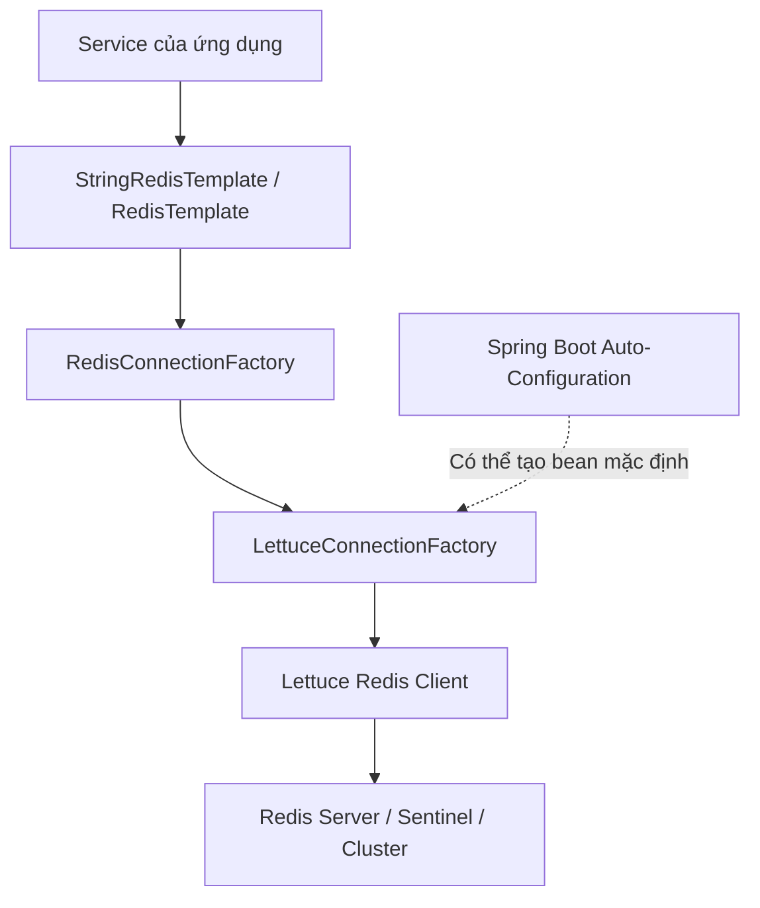

# Cấu hình `LettuceConnectionFactory` trong Spring Data Redis

`LettuceConnectionFactory` là thành phần tạo và quản lý kết nối Redis thông qua **Lettuce**, một Redis client cho Java. Trong ứng dụng Spring Data Redis, đây là điểm nối giữa cấu hình hạ tầng Redis và các API như `RedisTemplate`, `StringRedisTemplate` hoặc `ReactiveRedisTemplate`. Cấu hình đúng factory giúp ứng dụng chọn đúng máy chủ, cơ chế xác thực, thời gian chờ, TLS và chiến lược sử dụng kết nối.

Bài học phân biệt hai cách cấu hình: **để Spring Boot tự cấu hình factory** bằng các thuộc tính ứng dụng và **tự tạo bean `LettuceConnectionFactory`** khi cần kiểm soát chi tiết. Các ví dụ Java theo phong cách Spring Boot 3.x / Spring Data Redis 3.x; tên thuộc tính và một số API cần đối chiếu với phiên bản thực tế của dự án.

## 1. `LettuceConnectionFactory` nằm ở đâu?

Hãy hình dung đường đi của một thao tác đọc Redis:



Các thành phần có trách nhiệm khác nhau:

| Thành phần | Vai trò |
| --- | --- |
| `RedisConnectionFactory` | Interface của Spring Data Redis cung cấp kết nối cho API truy cập Redis. |
| `LettuceConnectionFactory` | Implementation sử dụng Lettuce, hỗ trợ nhiều dạng triển khai Redis. |
| `LettuceClientConfiguration` | Cấu hình phía client như command timeout, SSL/TLS, tùy chọn client và pooling khi chọn builder tương ứng. |
| `RedisStandaloneConfiguration` | Thông tin kết nối một Redis server: host, port, database và thông tin đăng nhập. |
| `RedisSentinelConfiguration` | Thông tin Redis Sentinel: tên master, danh sách Sentinel và thông tin xác thực. |
| `RedisClusterConfiguration` | Danh sách node khởi tạo kết nối Redis Cluster và một số thiết lập chuyển hướng. |
| `RedisTemplate` / `StringRedisTemplate` | API thực hiện lệnh Redis, sử dụng `RedisConnectionFactory` được cung cấp. |

`LettuceConnectionFactory` triển khai các hợp đồng kết nối Redis cần cho API đồng bộ và reactive của Spring Data Redis. Tuy nhiên, **factory chỉ mô tả và quản lý kết nối**; nó không tự chạy Redis server, không đảm bảo Redis đang sẵn sàng, cũng không tự quyết định định dạng serialization cho mọi loại dữ liệu.

## 2. Chuẩn bị dependency và Redis server

Với Spring Boot, dependency cơ bản ở Gradle Groovy DSL:

```groovy
dependencies {
    implementation 'org.springframework.boot:spring-boot-starter-data-redis'
}
```

Gradle Kotlin DSL:

```kotlin
dependencies {
    implementation("org.springframework.boot:spring-boot-starter-data-redis")
}
```

Maven:

```xml
<dependency>
    <groupId>org.springframework.boot</groupId>
    <artifactId>spring-boot-starter-data-redis</artifactId>
</dependency>
```

Starter này thường đưa `spring-data-redis` và `lettuce-core` vào classpath. Với ứng dụng Spring Boot, nên để Spring Boot BOM/parent quản lý các phiên bản phụ thuộc; không cần cố định riêng phiên bản Lettuce nếu không có lý do rõ ràng.

Để thực hành tại máy cá nhân, có thể chạy một Redis server thử nghiệm:

```bash
docker run --name redis-local -p 6379:6379 -d redis:7
docker exec redis-local redis-cli PING
```

Kết quả mong đợi từ lệnh thứ hai là `PONG` khi container đang chạy và Redis chấp nhận kết nối. Đây chỉ là ví dụ môi trường thực hành; việc mở cổng Redis ra mạng và cơ chế xác thực cần được cấu hình theo hạ tầng triển khai thực tế.

## 3. Cách ưu tiên trong Spring Boot: tự cấu hình bằng properties

Với đa số ứng dụng Spring Boot, **không cần tự khai báo `@Bean LettuceConnectionFactory`**. Khi có Redis starter, loại client phù hợp và không tồn tại bean `RedisConnectionFactory` tự định nghĩa, Spring Boot có thể tạo `LettuceConnectionFactory` dựa trên cấu hình.

Ví dụ `src/main/resources/application.yml`:

```yaml
spring:
  data:
    redis:
      client-type: lettuce
      host: localhost
      port: 6379
      database: 0
      connect-timeout: 2s
      timeout: 3s
```

Các thuộc tính:

- `client-type: lettuce` chọn Lettuce một cách tường minh; nếu client mặc định đã là Lettuce, thường không bắt buộc.
- `host` và `port` xác định máy chủ Redis đơn lẻ.
- `database` chọn database logic ở chế độ standalone, thường là `0`.
- `connect-timeout` giới hạn thời gian thiết lập kết nối mạng.
- `timeout` giới hạn thời gian chờ thực hiện thao tác theo cấu hình Spring Boot/Lettuce; đây không phải bảo đảm toàn bộ request HTTP sẽ hoàn tất trong thời gian đó.

Cấu hình tương đương trong `application.properties`:

```properties
spring.data.redis.client-type=lettuce
spring.data.redis.host=localhost
spring.data.redis.port=6379
spring.data.redis.database=0
spring.data.redis.connect-timeout=2s
spring.data.redis.timeout=3s
```

Với Spring Boot 3.x, prefix là `spring.data.redis`. Một số project Spring Boot 2.x sử dụng `spring.redis`; không áp dụng lẫn các tên thuộc tính mà chưa đối chiếu phiên bản.

### Cách sử dụng ngay sau khi cấu hình

Spring Boot thông thường đã có `StringRedisTemplate` nếu điều kiện tự cấu hình được đáp ứng:

```java
import java.time.Duration;
import org.springframework.data.redis.core.StringRedisTemplate;
import org.springframework.stereotype.Service;

@Service
public class VisitCounterService {
    private final StringRedisTemplate redis;

    public VisitCounterService(StringRedisTemplate redis) {
        this.redis = redis;
    }

    public Long increment(String pageId) {
        String key = "page:visits:" + pageId;
        Long count = redis.opsForValue().increment(key);
        redis.expire(key, Duration.ofDays(7));
        return count;
    }
}
```

Ví dụ cho thấy service chỉ cần quan tâm tới template; factory được Spring đưa vào template khi tạo bean. Việc tăng bộ đếm và đặt TTL bằng hai lệnh riêng không nguyên tử; nếu yêu cầu TTL chỉ đặt đúng một lần hoặc nhiều lệnh phải thực hiện cùng nhau, cần thiết kế thao tác Redis phù hợp thay vì giả định hai lời gọi Java là một transaction.

## 4. Khi nào cần tạo `LettuceConnectionFactory` thủ công?

Có thể tự tạo factory nếu ứng dụng cần:

1. Định nghĩa cấu hình Redis đặc biệt mà thuộc tính tự động chưa thể hiện đúng nhu cầu.
2. Tạo **nhiều kết nối Redis** cho nhiều mục đích khác nhau.
3. Điều chỉnh `LettuceClientConfiguration`, cách dùng kết nối hoặc chính sách hạ tầng theo yêu cầu.
4. Sử dụng Spring Framework thuần, không dùng cơ chế auto-configuration của Spring Boot.

Khi tự khai báo bean `RedisConnectionFactory`, Spring Boot thường không tạo factory mặc định nữa do cơ chế `@ConditionalOnMissingBean`. Vì vậy cần chủ động cấu hình host, port, timeout, TLS, authentication và các giá trị quan trọng khác; **không giả định mọi thuộc tính `spring.data.redis.*` sẽ tự động được áp dụng lên bean do chính mình tạo**.

### 4.1. Factory tối thiểu cho Redis standalone

```java
import org.springframework.context.annotation.Bean;
import org.springframework.context.annotation.Configuration;
import org.springframework.data.redis.connection.RedisStandaloneConfiguration;
import org.springframework.data.redis.connection.lettuce.LettuceConnectionFactory;

@Configuration
public class RedisConfiguration {
    @Bean
    public LettuceConnectionFactory redisConnectionFactory() {
        RedisStandaloneConfiguration server =
                new RedisStandaloneConfiguration("localhost", 6379);
        server.setDatabase(0);

        return new LettuceConnectionFactory(server);
    }
}
```

Các bước:

1. `RedisStandaloneConfiguration` mô tả **Redis server nào** cần kết nối.
2. `new LettuceConnectionFactory(server)` tạo factory sử dụng thông tin server với cấu hình Lettuce mặc định.
3. Spring quản lý vòng đời bean, bao gồm khởi tạo và đóng tài nguyên khi application context dừng.
4. Template sử dụng factory thông qua interface `RedisConnectionFactory`.

Trong ví dụ, host được viết trực tiếp chỉ để bài thực hành dễ đọc. Trong sản phẩm thực tế, host/port/password nên đến từ cấu hình theo môi trường.

### 4.2. Tạo `StringRedisTemplate` từ factory

```java
import org.springframework.context.annotation.Bean;
import org.springframework.context.annotation.Configuration;
import org.springframework.data.redis.connection.RedisConnectionFactory;
import org.springframework.data.redis.core.StringRedisTemplate;

@Configuration
public class RedisTemplateConfiguration {
    @Bean
    public StringRedisTemplate customStringRedisTemplate(
            RedisConnectionFactory connectionFactory) {
        return new StringRedisTemplate(connectionFactory);
    }
}
```

Trong ứng dụng Spring Boot thông thường, auto-configuration cũng có thể tạo `StringRedisTemplate` nên **không cần khai báo thêm nếu bean mặc định đã đáp ứng nhu cầu**. Nếu tạo template thứ hai, hãy dùng tên bean và `@Qualifier` rõ ràng khi có nhiều bean cùng kiểu.

## 5. Phân tách cấu hình server và cấu hình client

Một điểm quan trọng là **địa chỉ Redis** và **cách Lettuce vận hành** thuộc hai lớp cấu hình:

```text
RedisStandaloneConfiguration
  ├── host / port
  ├── database
  ├── username / password
  └── thông tin Redis server

LettuceClientConfiguration
  ├── commandTimeout
  ├── shutdownTimeout
  ├── useSsl
  ├── clientName / clientOptions
  └── lựa chọn pooling hoặc các tùy chọn client khác
```

Ví dụ một factory có cả hai:

```java
import java.time.Duration;
import org.springframework.context.annotation.Bean;
import org.springframework.context.annotation.Configuration;
import org.springframework.data.redis.connection.RedisStandaloneConfiguration;
import org.springframework.data.redis.connection.lettuce.LettuceClientConfiguration;
import org.springframework.data.redis.connection.lettuce.LettuceConnectionFactory;

@Configuration
public class TunedRedisConfiguration {
    @Bean
    public LettuceConnectionFactory redisConnectionFactory() {
        RedisStandaloneConfiguration server =
                new RedisStandaloneConfiguration("redis.internal", 6379);
        server.setDatabase(0);

        LettuceClientConfiguration client =
                LettuceClientConfiguration.builder()
                        .commandTimeout(Duration.ofSeconds(3))
                        .shutdownTimeout(Duration.ofMillis(200))
                        .clientName("catalog-service")
                        .build();

        return new LettuceConnectionFactory(server, client);
    }
}
```

Giải thích:

| Thiết lập | Ý nghĩa | Lưu ý |
| --- | --- | --- |
| `commandTimeout` | Ngưỡng chờ một thao tác Redis được thực hiện qua Lettuce | Timeout quá ngắn có thể gây lỗi giả khi hệ thống có biến động tải; quá dài có thể giữ request chờ lâu |
| `shutdownTimeout` | Thời gian chờ khi đóng tài nguyên client | Ảnh hưởng quá trình shutdown, không thay thế command timeout |
| `clientName` | Đặt tên kết nối phục vụ quan sát ở Redis | Giúp phân biệt nguồn kết nối, không phải danh tính xác thực |
| `database` | Chọn database logic trong standalone | Không áp dụng tùy ý với Redis Cluster |

Không nên sao chép nguyên các giá trị timeout cho mọi hệ thống. Cần phân biệt thời gian kết nối TCP, xác thực/SSL handshake, chờ kết quả lệnh và timeout ở tầng HTTP hoặc business.

### Cấu hình connect timeout chi tiết

Nếu cần kiểm soát connect timeout ngay ở Lettuce, có thể dùng `ClientOptions` và `SocketOptions`:

```java
import java.time.Duration;
import io.lettuce.core.ClientOptions;
import io.lettuce.core.SocketOptions;
import org.springframework.data.redis.connection.lettuce.LettuceClientConfiguration;

SocketOptions socketOptions = SocketOptions.builder()
        .connectTimeout(Duration.ofSeconds(2))
        .build();

ClientOptions clientOptions = ClientOptions.builder()
        .socketOptions(socketOptions)
        .autoReconnect(true)
        .build();

LettuceClientConfiguration client = LettuceClientConfiguration.builder()
        .clientOptions(clientOptions)
        .commandTimeout(Duration.ofSeconds(3))
        .build();
```

Đây là đoạn cấu hình client có thể dùng trong phương thức tạo factory; không phải một class Java đầy đủ. `autoReconnect` hỗ trợ kết nối lại sau sự cố nhưng **không biến mọi lệnh đang chờ thành giao dịch chính xác một lần**. Với lệnh ghi và timeout, ứng dụng cần hiểu khả năng lệnh đã được Redis xử lý dù client chưa nhận được kết quả.

## 6. Cấu hình xác thực và TLS

Một Redis server dùng trong môi trường triển khai có thể yêu cầu username/password và kết nối TLS. Trường hợp đơn giản, nên ưu tiên khai báo qua cấu hình Spring Boot:

```yaml
spring:
  data:
    redis:
      host: redis.example.internal
      port: 6380
      username: appuser
      password: ${REDIS_PASSWORD}
      ssl:
        enabled: true
      connect-timeout: 2s
      timeout: 3s
```

`REDIS_PASSWORD` đại diện cho biến môi trường hoặc nguồn cấu hình bí mật mà môi trường chạy cung cấp. Mặc định không nên commit mật khẩu thực vào repository.

Khi tạo factory thủ công, có thể truyền thông tin xác thực qua `RedisStandaloneConfiguration`:

```java
import org.springframework.beans.factory.annotation.Value;
import org.springframework.context.annotation.Bean;
import org.springframework.context.annotation.Configuration;
import org.springframework.data.redis.connection.RedisPassword;
import org.springframework.data.redis.connection.RedisStandaloneConfiguration;
import org.springframework.data.redis.connection.lettuce.LettuceClientConfiguration;
import org.springframework.data.redis.connection.lettuce.LettuceConnectionFactory;

@Configuration
public class SecureRedisConfiguration {
    @Bean
    public LettuceConnectionFactory redisConnectionFactory(
            @Value("${app.redis.host}") String host,
            @Value("${app.redis.port:6380}") int port,
            @Value("${app.redis.username}") String username,
            @Value("${app.redis.password}") String password) {

        RedisStandaloneConfiguration server =
                new RedisStandaloneConfiguration(host, port);
        server.setUsername(username);
        server.setPassword(RedisPassword.of(password));

        LettuceClientConfiguration client =
                LettuceClientConfiguration.builder()
                        .useSsl()
                        .build();

        return new LettuceConnectionFactory(server, client);
    }
}
```

Ở ví dụ này, `app.redis.*` là **nhóm property do ứng dụng tự định nghĩa**, không phải tên property Boot tự cấu hình Redis. Khi chạy, cần cung cấp đầy đủ các biến tương ứng.

Lưu ý bảo mật:

- SSL/TLS chỉ an toàn khi chứng chỉ máy chủ được kiểm tra và trust store/CA được cấu hình phù hợp với môi trường.
- Không dùng chế độ bỏ kiểm tra chứng chỉ để “sửa nhanh” lỗi TLS trong production.
- Không ghi log mật khẩu hoặc Redis URI chứa thông tin xác thực.
- Trong Redis Cluster/Sentinel, thông tin đăng nhập cho Redis data node và cho Sentinel có thể cần cấu hình riêng.
- Nếu secret xoay vòng, cần thiết kế thời điểm kết nối được tái tạo, không mặc định bean đã tạo sẽ tự đọc lại giá trị mới.

## 7. Cấu hình Redis Sentinel

Redis Sentinel giám sát master và hỗ trợ phát hiện/chuyển đổi master khi có failover. Ứng dụng kết nối tới các Sentinel để khám phá Redis master hiện tại, thay vì cố định duy nhất một địa chỉ master.

Ví dụ cấu hình thủ công:

```java
import org.springframework.context.annotation.Bean;
import org.springframework.context.annotation.Configuration;
import org.springframework.data.redis.connection.RedisSentinelConfiguration;
import org.springframework.data.redis.connection.lettuce.LettuceConnectionFactory;

@Configuration
public class SentinelRedisConfiguration {
    @Bean
    public LettuceConnectionFactory redisConnectionFactory() {
        RedisSentinelConfiguration sentinel =
                new RedisSentinelConfiguration()
                        .master("mymaster")
                        .sentinel("sentinel-1.internal", 26379)
                        .sentinel("sentinel-2.internal", 26379)
                        .sentinel("sentinel-3.internal", 26379);

        return new LettuceConnectionFactory(sentinel);
    }
}
```

Ở đây:

- `mymaster` là **tên master mà Sentinel theo dõi**, không phải hostname Redis.
- Các địa chỉ `sentinel-*.internal:26379` là endpoint Sentinel, không phải các node Redis data trong cấu hình standalone.
- Cơ chế Sentinel giúp client tìm master sau failover; ứng dụng vẫn phải tính đến lỗi hoặc gián đoạn ngắn trong quá trình chuyển đổi.
- Nếu Redis hoặc Sentinel có xác thực, bổ sung username/password tương ứng, không sao chép một mật khẩu cho cả hai khi hạ tầng không dùng chung danh tính.

Trong Spring Boot, có thể cấu hình Sentinel qua YAML nếu hệ thống chỉ cần các thiết lập mà Boot cung cấp:

```yaml
spring:
  data:
    redis:
      sentinel:
        master: mymaster
        nodes: sentinel-1.internal:26379,sentinel-2.internal:26379,sentinel-3.internal:26379
```

Chọn một hướng khai báo rõ ràng. Nếu đã tạo bean factory thủ công, các property Sentinel trong file YAML không mặc nhiên thay đổi bean đó.

## 8. Cấu hình Redis Cluster

Redis Cluster chia dữ liệu theo hash slot giữa nhiều master node; việc sử dụng connection factory cần tương thích topology của cluster.

Ví dụ cấu hình Java:

```java
import java.util.List;
import org.springframework.context.annotation.Bean;
import org.springframework.context.annotation.Configuration;
import org.springframework.data.redis.connection.RedisClusterConfiguration;
import org.springframework.data.redis.connection.lettuce.LettuceConnectionFactory;

@Configuration
public class ClusterRedisConfiguration {
    @Bean
    public LettuceConnectionFactory redisConnectionFactory() {
        RedisClusterConfiguration cluster =
                new RedisClusterConfiguration(List.of(
                        "redis-node-1.internal:6379",
                        "redis-node-2.internal:6379",
                        "redis-node-3.internal:6379"
                ));

        cluster.setMaxRedirects(3);
        return new LettuceConnectionFactory(cluster);
    }
}
```

Ví dụ Spring Boot YAML:

```yaml
spring:
  data:
    redis:
      cluster:
        nodes:
          - redis-node-1.internal:6379
          - redis-node-2.internal:6379
          - redis-node-3.internal:6379
        max-redirects: 3
```

Các lưu ý khi dùng Cluster:

1. Danh sách node là các **điểm khởi đầu để khám phá topology**. Không nhất thiết phải khai báo mọi node, nhưng các địa chỉ công bố từ cluster phải truy cập được từ môi trường ứng dụng.
2. Redis Cluster sử dụng database logic `0`; không chọn tùy ý database `1`, `2` như standalone.
3. Nhiều lệnh xử lý nhiều key đòi hỏi chúng ở cùng hash slot. Có thể dùng hash tag, ví dụ `cart:{user42}:items` và `cart:{user42}:total`, để đồng vị trí những key được thiết kế xử lý cùng nhau.
4. `maxRedirects` chỉ giới hạn việc xử lý chuyển hướng trong các trường hợp tương ứng, không thay thế cấu hình client topology refresh hay retry.
5. Redis Cluster không tự làm một operation có phạm vi toàn cluster trở thành atomic; phải xét hợp đồng của từng lệnh và cách Spring Data Redis chuyển tiếp chúng.

Khi ứng dụng cần topology refresh chủ động, reconnect hoặc read preference riêng, có thể cấu hình thêm `ClusterClientOptions` / các tùy chọn Lettuce liên quan qua `LettuceClientConfiguration`, sau đó cung cấp cho constructor nhận cả cluster configuration và client configuration. Chỉ bật các chiến lược này khi hiểu kiến trúc cluster và rủi ro đọc bản sao chưa cập nhật.

## 9. Kết nối chia sẻ của Lettuce và pooling

Đây là phần dễ hiểu sai nhất khi cấu hình factory. Với Lettuce, **nhiều thao tác Redis thông thường có thể dùng một kết nối native được chia sẻ**. `LettuceConnectionFactory` mặc định có thể quản lý kết nối dùng chung cho các thao tác không blocking/không transaction. Những thao tác đòi hỏi kết nối riêng được xử lý khác. Điều này không có nghĩa mọi thao tác Redis đều chỉ có một TCP connection trong mọi tình huống.

### 9.1. `shareNativeConnection`

```java
RedisStandaloneConfiguration server =
        new RedisStandaloneConfiguration("localhost", 6379);

LettuceConnectionFactory factory = new LettuceConnectionFactory(server);
factory.setShareNativeConnection(true);
```

Ví dụ trên mô tả thuộc tính; trong Spring container nên trả factory từ một `@Bean` để vòng đời được quản lý. `true` thường là lựa chọn mặc định. Khi đặt `false`, factory sẽ không sử dụng cách chia sẻ native connection như trên và các thao tác sẽ cần lấy kết nối theo chiến lược tương ứng; điều này có thể làm tăng chi phí tạo/lấy kết nối nếu không thiết kế tốt.

**Không mặc định tắt chia sẻ kết nối để giải quyết vấn đề throughput.** Lettuce có cơ chế kết nối và multiplexing hiệu quả; nguyên nhân chậm có thể là lệnh Redis, mạng, payload, khóa client, lệnh blocking hoặc pool thiếu tài nguyên.

### 9.2. Khi nào cần connection pool?

Pooling có thể hữu ích khi cần nhiều kết nối riêng, đặc biệt trong những luồng xử lý có đặc tính không chia sẻ được kết nối. Với Spring Boot sử dụng Lettuce, `commons-pool2` thường là dependency tùy chọn để bật cơ chế pool qua cấu hình:

```groovy
dependencies {
    implementation 'org.springframework.boot:spring-boot-starter-data-redis'
    implementation 'org.apache.commons:commons-pool2'
}
```

Spring Boot YAML:

```yaml
spring:
  data:
    redis:
      lettuce:
        pool:
          enabled: true
          max-active: 8
          max-idle: 8
          min-idle: 0
          max-wait: 2s
```

`max-active` giới hạn số kết nối đang được pool cho mượn; `max-wait` liên quan thời gian chờ để lấy connection khi pool hết tài nguyên. Cần phân biệt với Redis command timeout. Tăng pool quá lớn có thể làm tăng áp lực lên Redis server và hệ thống mạng thay vì giúp ứng dụng nhanh hơn.

### 9.3. Tự tạo factory với `LettucePoolingClientConfiguration`

Ví dụ khi cần cấu hình thủ công:

```java
import java.time.Duration;
import io.lettuce.core.api.StatefulConnection;
import org.apache.commons.pool2.impl.GenericObjectPoolConfig;
import org.springframework.context.annotation.Bean;
import org.springframework.context.annotation.Configuration;
import org.springframework.data.redis.connection.RedisStandaloneConfiguration;
import org.springframework.data.redis.connection.lettuce.LettuceClientConfiguration;
import org.springframework.data.redis.connection.lettuce.LettuceConnectionFactory;
import org.springframework.data.redis.connection.lettuce.LettucePoolingClientConfiguration;

@Configuration
public class PooledRedisConfiguration {
    @Bean
    public LettuceConnectionFactory redisConnectionFactory() {
        GenericObjectPoolConfig<StatefulConnection<?, ?>> pool =
                new GenericObjectPoolConfig<>();
        pool.setMaxTotal(8);
        pool.setMaxIdle(8);
        pool.setMinIdle(0);
        pool.setMaxWait(Duration.ofSeconds(2));

        LettuceClientConfiguration client =
                LettucePoolingClientConfiguration.builder()
                        .poolConfig(pool)
                        .commandTimeout(Duration.ofSeconds(3))
                        .build();

        RedisStandaloneConfiguration server =
                new RedisStandaloneConfiguration("localhost", 6379);

        return new LettuceConnectionFactory(server, client);
    }
}
```

Các kiểu Java trong ví dụ sử dụng Lettuce và Apache Commons Pool 2. Với project sử dụng nhiều cấu hình factory, không tự tạo nhiều factory chỉ để “tách pool” nếu không có nhu cầu rõ về Redis server, authentication hoặc isolation.

**Điều cần nhớ:** pool giúp quản lý việc lấy/trả kết nối, không rút ngắn độ phức tạp của lệnh Redis. Nếu lệnh như `HGETALL` trên hash khổng lồ giữ server bận, số connection lớn hơn thường không giải quyết được gốc vấn đề.

## 10. Vòng đời bean và tài nguyên

`LettuceConnectionFactory` là một bean có vòng đời. Khi Spring quản lý, quá trình khởi tạo, bắt đầu hoạt động và đóng các tài nguyên liên quan được tích hợp với application context. Khi tạo factory bằng `new` **bên ngoài** Spring context, lập trình viên phải tự đảm bảo các bước vòng đời thích hợp, nếu không có thể gặp trạng thái factory chưa sẵn sàng hoặc tài nguyên không được giải phóng.

Các hành vi nên hiểu:

| Hành vi | Ý nghĩa |
| --- | --- |
| Khởi tạo bean | Spring đưa dependency và cấu hình vào factory, thực hiện các callback vòng đời theo framework. |
| Lấy kết nối | `getConnection()` cung cấp đối tượng `RedisConnection` cho API đồng bộ. |
| Chia sẻ kết nối native | Factory có thể giữ một native connection dùng lại, theo cấu hình và loại thao tác. |
| Kết nối riêng | Những thao tác blocking/transaction hoặc cấu hình đặc biệt có thể cần kết nối chuyên biệt. |
| Dừng application context | Factory đóng tài nguyên và client theo vòng đời bean. |

Khi dùng template, ứng dụng thường **không cần gọi `getConnection()` trực tiếp**:

```java
String result = stringRedisTemplate.opsForValue().get("app:status");
```

Template quản lý các bước lấy và trả connection theo cơ chế Spring Data Redis. Nếu một API cần thao tác connection thô, hãy dùng cơ chế callback của template khi phù hợp để tránh giữ connection ngoài vòng đời mong đợi:

```java
String pong = stringRedisTemplate.execute(connection -> connection.ping());
```

Lời gọi `PING` có thể kiểm tra việc gửi lệnh qua connection tại thời điểm đó, nhưng chưa phản ánh đầy đủ khả năng chịu tải, replication health hay hành vi failover sau này.

### Tránh tạo factory cho mỗi request

Sai về mô hình sử dụng:

```java
// Không tạo factory mới trong từng request của Controller/Service.
LettuceConnectionFactory factory =
        new LettuceConnectionFactory("localhost", 6379);
```

Việc tạo lại factory trong request tạo tài nguyên client/kết nối không cần thiết và khó quản lý vòng đời. Thông thường, để Spring quản lý một factory phù hợp làm **singleton bean**, sau đó inject template vào service.

## 11. Nhiều Redis server hoặc nhiều kết nối trong cùng ứng dụng

Khi ứng dụng thật sự cần dùng hai Redis độc lập (chẳng hạn một Redis dành cho cache, một Redis dành cho token), cần tạo các bean có tên rõ ràng:

```java
import org.springframework.beans.factory.annotation.Qualifier;
import org.springframework.context.annotation.Bean;
import org.springframework.context.annotation.Configuration;
import org.springframework.data.redis.connection.RedisConnectionFactory;
import org.springframework.data.redis.connection.RedisStandaloneConfiguration;
import org.springframework.data.redis.connection.lettuce.LettuceConnectionFactory;
import org.springframework.data.redis.core.StringRedisTemplate;

@Configuration
public class MultiRedisConfiguration {
    @Bean("cacheConnectionFactory")
    public LettuceConnectionFactory cacheConnectionFactory() {
        return new LettuceConnectionFactory(
                new RedisStandaloneConfiguration("cache-redis.internal", 6379));
    }

    @Bean("tokenConnectionFactory")
    public LettuceConnectionFactory tokenConnectionFactory() {
        return new LettuceConnectionFactory(
                new RedisStandaloneConfiguration("token-redis.internal", 6379));
    }

    @Bean("cacheRedisTemplate")
    public StringRedisTemplate cacheRedisTemplate(
            @Qualifier("cacheConnectionFactory") RedisConnectionFactory factory) {
        return new StringRedisTemplate(factory);
    }

    @Bean("tokenRedisTemplate")
    public StringRedisTemplate tokenRedisTemplate(
            @Qualifier("tokenConnectionFactory") RedisConnectionFactory factory) {
        return new StringRedisTemplate(factory);
    }
}
```

Service chọn đúng template:

```java
import org.springframework.beans.factory.annotation.Qualifier;
import org.springframework.data.redis.core.StringRedisTemplate;
import org.springframework.stereotype.Service;

@Service
public class TokenStorage {
    private final StringRedisTemplate tokenRedis;

    public TokenStorage(
            @Qualifier("tokenRedisTemplate") StringRedisTemplate tokenRedis) {
        this.tokenRedis = tokenRedis;
    }

    public String getToken(String id) {
        return tokenRedis.opsForValue().get("token:" + id);
    }
}
```

Khi có nhiều factory cùng kiểu:

- `@Qualifier` chọn đúng bean đích, tránh inject nhầm Redis server.
- Nếu ứng dụng hoặc thư viện khác cần một connection factory mặc định, có thể cần `@Primary` hoặc thiết lập rõ bean được dùng.
- Các auto-configuration phụ thuộc `RedisConnectionFactory` và các template mặc định có thể back off hoặc gặp ambiguity tùy cấu hình; cần xác định bean nào phục vụ Spring Cache, repository và những nơi inject khác.
- Các ví dụ host cố định để minh họa quan hệ bean; khi triển khai thực tế nên lấy từ cấu hình môi trường, xác thực và TLS tương ứng.

## 12. Sử dụng factory cho Redis reactive

Lettuce cung cấp nền tảng cho API reactive của Spring Data Redis. Khi project dùng kiểu xử lý reactive, có thể sử dụng `ReactiveStringRedisTemplate` với một factory hỗ trợ `ReactiveRedisConnectionFactory`.

Ví dụ:

```java
import org.springframework.data.redis.connection.ReactiveRedisConnectionFactory;
import org.springframework.data.redis.core.ReactiveStringRedisTemplate;
import org.springframework.stereotype.Service;
import reactor.core.publisher.Mono;

@Service
public class ReactiveFlagService {
    private final ReactiveStringRedisTemplate redis;

    public ReactiveFlagService(ReactiveStringRedisTemplate redis) {
        this.redis = redis;
    }

    public Mono<Boolean> enable(String id) {
        return redis.opsForValue().set("feature:flag:" + id, "true");
    }

    public Mono<String> read(String id) {
        return redis.opsForValue().get("feature:flag:" + id);
    }
}
```

Với Spring Boot, chọn Redis reactive starter hoặc cấu hình dependency tương ứng rồi để Boot tự tạo reactive template nếu điều kiện phù hợp. Trong Spring Framework thuần, có thể tự tạo:

```java
@Bean
ReactiveStringRedisTemplate reactiveStringRedisTemplate(
        ReactiveRedisConnectionFactory factory) {
    return new ReactiveStringRedisTemplate(factory);
}
```

Đoạn cuối được đặt trong class `@Configuration` với import tương ứng. Không gọi `block()` trong reactive event-loop chỉ để ép lời gọi Redis thành đồng bộ. Cần phân biệt khả năng xử lý reactive của Lettuce với việc cả ứng dụng bắt buộc phải dùng WebFlux; hai quyết định này liên quan nhưng không đồng nhất.

## 13. Cách xác định thời gian chờ hợp lý

Ứng dụng truy cập Redis thường có nhiều lớp timeout:

```text
HTTP request timeout
    |
    +--> Chờ lấy connection (nếu có pool)
    |       -> pool max-wait
    |
    +--> Thiết lập kết nối TCP/TLS
    |       -> connect-timeout
    |
    +--> Gửi và chờ kết quả lệnh Redis
            -> command timeout
```

Ba thông số này có ý nghĩa khác nhau. Ví dụ đặt `commandTimeout=3s` không đảm bảo toàn bộ request chỉ mất tối đa 3 giây, vì request có thể chờ pool hoặc trải qua nhiều lệnh liên tiếp. Tương tự, đặt timeout cao không loại trừ lệnh blocking lâu hoặc lỗi do Redis server quá tải.

Một hướng thiết kế:

1. Xác định thời gian đáp ứng mục tiêu của service, đặc biệt p95/p99.
2. Phân biệt Redis dùng cho cache có thể bỏ qua khi lỗi hay Redis lưu dữ liệu nghiệp vụ bắt buộc.
3. Đặt connect timeout/command timeout phù hợp với deadline; tránh retry không giới hạn khi server chậm.
4. Theo dõi số connection, thời gian chờ pool, lệnh chậm, kích thước dữ liệu và tỷ lệ timeout.
5. Với lệnh ghi timeout, xem xét tính idempotent khi retry vì không phải lúc nào client cũng biết chắc Redis đã xử lý lệnh hay chưa.

## 14. Kiểm tra factory đã hoạt động đúng

Sau khi ứng dụng khởi động và Redis server sẵn sàng, có thể kiểm tra lệnh đơn giản qua template:

```java
import java.time.Duration;
import org.springframework.data.redis.core.StringRedisTemplate;
import org.springframework.stereotype.Component;

@Component
public class RedisSmokeCheck {
    private final StringRedisTemplate redis;

    public RedisSmokeCheck(StringRedisTemplate redis) {
        this.redis = redis;
    }

    public boolean canWriteAndRead() {
        String key = "demo:redis:smoke-check";
        redis.opsForValue().set(key, "ok", Duration.ofSeconds(30));
        return "ok".equals(redis.opsForValue().get(key));
    }
}
```

Trong môi trường nhiều ứng dụng cùng dùng Redis, nên đặt namespace và mã định danh riêng cho key kiểm tra để tránh va chạm. Không chạy thao tác ghi thử này vô hạn trong health-check gọi dày đặc; việc kiểm tra kết nối cần cân nhắc tải hạ tầng và cơ chế giám sát sẵn có.

Nếu có Spring Boot Actuator và health contributor phù hợp, ứng dụng có thể có thông tin Redis health; hãy quan sát trạng thái sẵn sàng theo yêu cầu vận hành, nhưng đừng coi một lần `PING` thành bằng chứng rằng toàn bộ cluster, failover hay mọi thao tác nghiệp vụ đều khỏe.

### Gặp lỗi thì khoanh vùng thế nào?

| Dấu hiệu | Khả năng cần điều tra | Hướng xử lý |
| --- | --- | --- |
| Không có bean `RedisConnectionFactory` | Thiếu starter/client, auto-configuration bị loại trừ hoặc context chưa nhận cấu hình | Xem classpath thực tế, điều kiện auto-configuration và bean đã khai báo |
| Có nhiều bean `RedisConnectionFactory`, không biết inject cái nào | Hai hoặc nhiều factory nhưng thiếu `@Qualifier` / `@Primary` | Đặt bean name và qualifier rõ ràng |
| `Connection refused` | Redis không nghe tại host/port mà ứng dụng truy cập | Kiểm tra Docker network, hostname, firewall, port và Redis server |
| `NOAUTH` hoặc `WRONGPASS` | Sai mật khẩu, username/ACL hoặc cấu hình xác thực | Kiểm tra secret, ACL user và cấu hình Redis |
| Lỗi SSL handshake | Không khớp TLS, CA, hostname, chứng chỉ hoặc cổng kết nối | Xác nhận server bật TLS, certificate chain và trust store |
| Redis command timeout | Mạng gián đoạn, lệnh chậm, Redis quá tải hoặc ngưỡng quá nhỏ | Đối chiếu metrics, slowlog, payload, deadline và tải |
| Hệ thống chậm khi bật pool | Pool giới hạn không phù hợp hoặc không cần pooling | Đo thời gian chờ pool, số connection và kiểu thao tác |
| Cluster trả `MOVED` / `ASK` bất thường kéo dài | Topology/endpoint Redis Cluster không đúng hoặc client chưa cập nhật | Kiểm tra seed node, địa chỉ quảng bá, NAT và cấu hình client cluster |
| Sentinel không tìm ra master | Sai tên master, sai cổng Sentinel, thiếu node có thể truy cập hoặc lỗi xác thực | Kiểm tra cấu hình Sentinel và trạng thái failover |

### Quan sát runtime

Đối với hệ thống thực:

- Theo dõi Redis latency, slowlog và các chỉ số client/server thay vì chỉ nhìn lỗi Java.
- Kiểm tra các thiết lập `commandTimeout`, pool, số lần retry và số lượng connection.
- Phân biệt lỗi ứng dụng tạo bean với lỗi kết nối xuất hiện lần đầu khi gửi command.
- Trong container/Kubernetes, xác nhận DNS và route nội bộ; `localhost` luôn là môi trường mạng của tiến trình ứng dụng, không phải một Redis container khác.
- Khi dùng tài khoản được phân quyền, xác nhận các lệnh business cần thiết được ACL cho phép; `PING` thành công chưa đồng nghĩa mọi lệnh đều hợp lệ.

## 15. Những lỗi thiết kế thường gặp

### Lỗi 1: vừa khai báo factory thủ công vừa trông chờ Boot áp dụng toàn bộ property

```java
@Bean
LettuceConnectionFactory redisConnectionFactory() {
    return new LettuceConnectionFactory("localhost", 6379);
}
```

Nếu YAML viết `spring.data.redis.host=redis-prod`, đoạn factory này vẫn chứa địa chỉ `localhost` do chính lập trình viên gán. Muốn Boot quản lý host thì bỏ bean thủ công và dùng auto-configuration; muốn tự tạo thì truyền cấu hình môi trường vào bean.

### Lỗi 2: dùng một kết nối Redis cho mọi môi trường mà không phân biệt thông tin xác thực

Việc hardcode host, port và mật khẩu phát triển vào một bean dùng chung có thể khiến môi trường staging/production kết nối sai Redis. Hãy phân tách theo profile hoặc biến môi trường và kiểm soát secret.

### Lỗi 3: xem số lượng connection là câu trả lời duy nhất cho hiệu năng

Nếu Redis chậm vì thao tác quét toàn bộ keyspace, script kéo dài hoặc payload quá lớn, điều chỉnh `LettuceConnectionFactory`/pool không xử lý nguyên nhân chính. Cần xét độ phức tạp lệnh, chiến lược dữ liệu và giới hạn công việc mỗi request.

### Lỗi 4: cấu hình Cluster như standalone

Cluster cần seed nodes/topology và có quy tắc hash slot. Chỉ thay `host` bằng tên một node trong cấu hình standalone sẽ không tạo đầy đủ hành vi Cluster mà ứng dụng mong đợi.

### Lỗi 5: trộn lẫn cấu hình kết nối và serialization

`LettuceConnectionFactory` quyết định **cách kết nối Redis**; `RedisTemplate` và serializers quyết định **key/value Java được chuyển thành bytes ra sao**. Đổi factory không tự khắc phục dữ liệu “không đọc được” do serializer không tương thích. Khi cần string key/string value, `StringRedisTemplate` là lựa chọn dễ hiểu.

## 16. Bài tập áp dụng

**Bài 1 — Auto-configuration:** tạo một ứng dụng Spring Boot có Redis starter, cấu hình host/port trong `application.yml`, inject `StringRedisTemplate` và ghi một key TTL 60 giây. Không tự tạo factory. Giải thích bean factory được tạo từ đâu.

**Bài 2 — Factory thủ công:** định nghĩa `RedisStandaloneConfiguration` cho máy Redis thử nghiệm và `LettuceClientConfiguration` với command timeout 2 giây. Tạo một bean `LettuceConnectionFactory` và một `StringRedisTemplate` sử dụng bean đó.

**Bài 3 — Giải thích timeout:** Redis phản hồi chậm, service có connect timeout 1 giây và command timeout 3 giây. Hãy giải thích tình huống nào áp dụng từng timeout và vì sao request HTTP có thể lâu hơn 3 giây.

**Bài 4 — Hai Redis:** thiết kế hai factory cho `cache` và `token`, đặt tên bean rõ ràng; inject hai template qua `@Qualifier`. Giải thích điều gì có thể xảy ra nếu không chỉ định bean mong muốn.

**Bài 5 — Sentinel/Cluster:** nêu sự khác nhau giữa `RedisSentinelConfiguration` và `RedisClusterConfiguration`. Trình bày một tình huống mà Sentinel hỗ trợ failover và một tình huống mà Redis Cluster yêu cầu các key cùng hash slot.

**Bài 6 — Pool và hiệu năng:** sau khi tăng pool từ 8 lên 64 connection, p99 vẫn cao. Hãy liệt kê các chỉ số và kiểu lệnh Redis cần quan sát trước khi tiếp tục thay đổi cấu hình client.

## Tổng kết

`LettuceConnectionFactory` kết nối Spring Data Redis với Lettuce và đóng vai trò trung tâm trong cấu hình truy cập Redis. Với Spring Boot, nên ưu tiên dùng **Redis starter + `spring.data.redis.*`** để framework tạo bean mặc định. Chỉ tạo factory thủ công khi có yêu cầu rõ về topology, timeout, client options, TLS, pool hoặc nhiều Redis. Khi thiết kế, luôn phân biệt cấu hình server, cấu hình Lettuce client, cách Spring quản lý bean và cách template chuyển đổi dữ liệu; sau đó kiểm tra bằng thao tác Redis thực tế và quan sát cả phía ứng dụng lẫn server.
