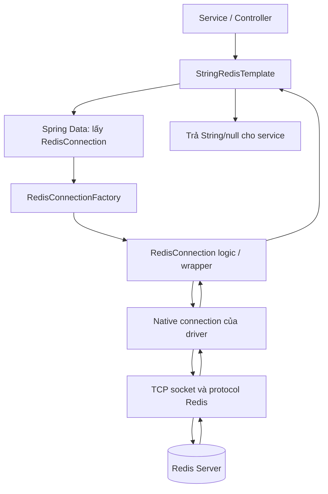

# Phân biệt kết nối logic của Spring với kết nối vật lý của trình điều khiển

Trong Spring Data Redis, câu “ứng dụng mở một kết nối Redis” có thể mang nhiều nghĩa. Một phương thức có thể mượn đối tượng `RedisConnection` để thực hiện một lệnh, nhưng **đối tượng đó không nhất thiết tương ứng với một TCP socket mới**. Ở tầng thấp hơn, driver Redis (thường là Lettuce hoặc Jedis) quản lý một hay nhiều kết nối mạng thật để giao tiếp với Redis Server.

Sự phân biệt này rất quan trọng khi phân tích hiệu năng, thiết lập connection pool, xử lý giao dịch, chạy lệnh blocking, điều tra số lượng client trên Redis Server và quyết định đối tượng nào được chia sẻ giữa các thread.

Bài học đặt trong ngữ cảnh Spring Data Redis, với trọng tâm là **cách Spring quản lý một kết nối ở tầng API** và **cách driver quản lý tài nguyên mạng ở tầng transport**.

## 1. Hai tầng “kết nối” khác nhau

### 1.1. Kết nối logic của Spring: `RedisConnection`

`RedisConnection` là một abstraction thuộc `org.springframework.data.redis.connection`. Nó cung cấp khả năng thực thi các lệnh Redis cho các thành phần của Spring Data, chẳng hạn `RedisTemplate`, repository và các callback.

Đặc điểm:

- Được lấy thông qua `RedisConnectionFactory`, ví dụ `connectionFactory.getConnection()`.
- Là một đối tượng ở phía ứng dụng Java, có vòng đời do Spring Data hoặc mã gọi quản lý.
- Có thể chỉ là **wrapper/adaptor** trỏ đến một kết nối do driver duy trì.
- Việc tạo một `RedisConnection` mới không đủ để khẳng định Redis Server nhìn thấy một client TCP mới.
- Không nên tự ý chia sẻ một instance `RedisConnection` giữa các thread; Spring Data Redis không bảo đảm đối tượng kết nối kiểu này thread-safe.

Khi dùng `RedisTemplate`, lập trình viên thường không trực tiếp giữ `RedisConnection`: template lấy kết nối, thực thi lệnh, rồi giải phóng tài nguyên theo cơ chế quản lý kết nối của Spring Data.

### 1.2. Kết nối vật lý của driver: native connection và socket

Driver như Lettuce hoặc Jedis cung cấp đối tượng client/kết nối của riêng mình. Đằng sau native connection là tài nguyên truyền thông với Redis Server, thường là một **TCP socket** (có thể được bọc TLS).

Đặc điểm:

- Do Redis driver tạo, dùng lại, kiểm tra trạng thái và đóng theo cấu hình.
- Có chi phí mở kết nối, handshake và xác thực; một số cấu hình có thể còn phải thương lượng TLS.
- Có thể được **chia sẻ**, **mượn từ pool** hoặc **tạo riêng** cho một loại thao tác.
- Trong Redis Cluster, một client logic có thể làm việc với nhiều node, nên không thể xem mỗi native connection như một socket duy nhất cho toàn bộ cụm trong mọi trường hợp.
- Redis Server đếm các kết nối mạng đang mở dưới dạng client connection; số này không đồng nhất với số đối tượng `RedisConnection` mà Spring đã tạo từ trước.

### 1.3. Ba thứ thường bị gọi chung là “một connection”

| Thuật ngữ | Tồn tại ở tầng nào? | Cần hiểu đúng |
|---|---|---|
| `RedisConnection` | Spring Data Redis | Hợp đồng API/wrapper để gọi lệnh Redis |
| Native connection, ví dụ `StatefulRedisConnection` của Lettuce hoặc kết nối Jedis | Driver | Đối tượng do driver dùng để quản lý phiên kết nối và thực thi lệnh |
| TCP socket / client trên Redis Server | Hệ điều hành và Redis Server | Kênh mạng thật, xuất hiện trong quan sát kết nối |

**Không có quy tắc 1:1 bắt buộc** giữa ba tầng này. Tỉ lệ giữa chúng phụ thuộc driver, cấu hình chia sẻ kết nối, connection pool, loại lệnh và mô hình triển khai Redis.

## 2. Đường đi của một lệnh `RedisTemplate`

Giả sử service gọi:

```java
String value = stringRedisTemplate.opsForValue().get("profile:42");
```

Ở mức khái niệm, luồng xử lý là:



Các bước quan trọng:

1. `StringRedisTemplate` chọn operation và serializer thích hợp, sau đó yêu cầu một kết nối từ `RedisConnectionFactory`.
2. Factory cung cấp đối tượng `RedisConnection` phù hợp với cách cấu hình client.
3. Lệnh `GET` được chuyển sang driver. Driver quyết định sử dụng native connection/socket nào.
4. Redis Server trả dữ liệu qua kết nối mạng đang sử dụng.
5. Spring Data giải mã kết quả và giải phóng **kết nối logic** theo cách quản lý của template.

Trong Spring Data, những utility như `RedisConnectionUtils` tham gia vào việc lấy và giải phóng kết nối; trong ngữ cảnh có transaction synchronization, chúng còn có thể gắn kết nối với luồng thực thi hiện tại.

**“Release connection” ở tầng Spring không mặc định có nghĩa là “đóng TCP socket”.** Một kết nối vật lý có thể tiếp tục sống để phục vụ các thao tác tiếp theo hoặc được trả về pool để tái sử dụng.

### Ví dụ theo dòng thời gian

Giả sử ứng dụng dùng Lettuce với chế độ chia sẻ native connection mặc định cho các lệnh thông thường:

```text
Thời gian      Tầng Spring                   Tầng Lettuce          Redis Server
──────────     ───────────────────────      ─────────────────     ────────────
t1             Tạo RedisConnection A ──────┐
t2             A thực hiện GET              ├──── Native N1 ─────── TCP socket S1
t3             Release A ───────────────────┘          │                  │
t4             Tạo RedisConnection B ──────┐          │                  │
t5             B thực hiện SET              ├──────────┘                  │
t6             Release B ───────────────────┘          │                  │
                                                     N1 vẫn có thể tiếp tục mở
```

Ở đây, A và B là **hai vòng đời sử dụng kết nối logic khác nhau** nhưng có thể dùng chung native connection N1 và socket S1. Đây là sơ đồ minh họa cho một cấu hình Lettuce phổ biến, không phải khẳng định tất cả driver và mọi thao tác luôn có đúng một socket.

## 3. `RedisConnectionFactory` có phải connection pool không?

Không. `RedisConnectionFactory` là **điểm truy cập trừu tượng** dùng để lấy kết nối cho Spring Data Redis. Nó không quy định bắt buộc rằng mỗi lời gọi `getConnection()` sẽ:

- Mở một socket mới.
- Mượn một socket từ pool.
- Trả về đúng cùng một native connection.

Các hành vi đó phụ thuộc implementation của factory và cấu hình driver.

Hai implementation thường gặp:

| Factory | Driver | Ý nghĩa thực tế |
|---|---|---|
| `LettuceConnectionFactory` | Lettuce | Có thể chia sẻ native connection cho các lệnh thông thường; có thể dùng kết nối riêng hoặc pool cho các trường hợp cần thiết |
| `JedisConnectionFactory` | Jedis | Thường quản lý các kết nối Jedis thông qua tài nguyên hoặc pool; không áp dụng giả định chia sẻ native connection giống Lettuce |

Spring Boot với starter Spring Data Redis thường dùng Lettuce khi Lettuce có mặt và không bị thay bằng cấu hình client khác. Tuy nhiên, code chỉ phụ thuộc `RedisConnectionFactory` nên ứng dụng có thể đổi driver mà không phải thay toàn bộ service/repository.

### Tính chất của factory và connection không giống nhau

Bean `LettuceConnectionFactory` có thể được chia sẻ an toàn trong ứng dụng theo thiết kế và là nơi cung cấp các đối tượng kết nối. Điều này **không làm cho từng `RedisConnection` do factory trả về trở thành thread-safe**. Tương tự, bản thân `RedisTemplate` có thể được chia sẻ giữa nhiều thread sau khi cấu hình xong, nhưng không nên lưu một `RedisConnection` vào field singleton rồi dùng từ nhiều request.

## 4. Lettuce: vì sao nhiều `RedisConnection` có thể dùng một socket?

### 4.1. Native connection của Lettuce có thể chia sẻ

Lettuce xây dựng trên mô hình I/O bất đồng bộ của Netty. Đối tượng native connection của Lettuce như `StatefulRedisConnection` được thiết kế cho việc gửi lệnh đồng thời từ nhiều thread trong các trường hợp được hỗ trợ.

Redis là giao thức request/response; Lettuce có thể gửi nhiều lệnh thông qua một kết nối đang mở và tương quan kết quả trả về. Vì thế, ứng dụng không cần tự mở một socket cho mỗi câu lệnh `GET` hoặc `SET`.

Tuy nhiên, “có thể dùng chung socket” **không có nghĩa mọi lệnh chạy song song thật sự trên cùng một Redis instance**. Redis vẫn nhận, xử lý lệnh và gửi phản hồi theo cơ chế của server; một kết nối dùng chung cũng chịu giới hạn về băng thông, độ trễ, timeout và hàng đợi lệnh.

### 4.2. `shareNativeConnection = true`

Với `LettuceConnectionFactory`, thuộc tính `shareNativeConnection` theo mặc định là `true`. Trong cấu hình cơ bản:

- Nhiều Spring `LettuceConnection` được tạo cho các lượt sử dụng khác nhau.
- Các thao tác thông thường, không blocking và không bị ràng buộc với Redis transaction có thể dùng **một native connection được chia sẻ**.
- Những thao tác cần kết nối riêng, như lệnh blocking hoặc thao tác transaction, sử dụng kết nối khác thông qua connection provider.

Đây là lý do khi ứng dụng gọi hàng nghìn thao tác Redis, lệnh `CLIENT LIST` trên Redis Server **không nhất thiết hiển thị hàng nghìn kết nối TCP**.

Sơ đồ:

```text
Request A ── RedisConnection A ──┐
                                 │
Request B ── RedisConnection B ──┼── Shared native Lettuce connection ── TCP S1
                                 │
Request C ── RedisConnection C ──┘

Blocking operation ── RedisConnection D ── Dedicated native connection ── TCP S2
Transaction        ── RedisConnection E ── Dedicated native connection ── TCP S3
```

Trong sơ đồ này, số socket chỉ để minh họa và còn tùy thời điểm, cấu hình, Redis topology và pool. Không nên lấy tổng số request làm phép tính trực tiếp cho số native connection.

### 4.3. `shareNativeConnection = false` có ý nghĩa gì?

Có thể yêu cầu factory không chia sẻ native connection:

```java
import org.springframework.context.annotation.Bean;
import org.springframework.context.annotation.Configuration;
import org.springframework.data.redis.connection.RedisStandaloneConfiguration;
import org.springframework.data.redis.connection.lettuce.LettuceConnectionFactory;

@Configuration
public class RedisConnectionConfig {

    @Bean
    public LettuceConnectionFactory redisConnectionFactory() {
        RedisStandaloneConfiguration server =
            new RedisStandaloneConfiguration("localhost", 6379);

        LettuceConnectionFactory factory = new LettuceConnectionFactory(server);
        factory.setShareNativeConnection(false);
        return factory;
    }
}
```

Với cấu hình này, các lời gọi Spring kết nối tới Redis thông qua những native connection riêng do provider cấp; nếu provider có pool, chúng có thể được **mượn và trả về pool** thay vì mở/đóng socket mỗi lần.

**Cảnh báo về suy luận:** Đặt `shareNativeConnection(false)` không tự động bảo đảm có pool. Nếu không cấu hình pool thích hợp, việc mở/đóng kết nối thường xuyên có thể làm tăng chi phí và số lần thiết lập TCP. Khi tự khai báo bean factory, cần tránh tạo chồng lấn với auto-configuration và phải cấu hình client phù hợp với môi trường.

## 5. Connection pooling là lớp quản lý khác với abstraction của Spring

Connection pool lưu giữ một số kết nối vật lý có thể tái sử dụng:

```text
Spring gọi mượn connection
          │
          ▼
┌───────────────────┐
│  Connection pool  │
│  native N1        │ ── TCP S1 ── Redis
│  native N2        │ ── TCP S2 ── Redis
│  native N3        │ ── TCP S3 ── Redis
└───────────────────┘
          ▲
          │
Spring release connection
→ native connection được trả về pool (nếu mượn từ pool và còn hợp lệ)
```

Cần tách bốn khái niệm:

| Khái niệm | Diễn giải |
|---|---|
| Acquire / borrow | Lấy một kết nối từ provider hoặc pool để sử dụng |
| Release / return | Trả lại quyền sử dụng, cho phép kết nối được tái sử dụng |
| Close native connection | Đóng tài nguyên driver, thường dẫn tới đóng socket liên quan |
| Close Spring `RedisConnection` | Hoàn tất vòng đời wrapper Spring; kết quả ở tầng native tùy factory và nguồn cấp kết nối |

**Pool không phải câu trả lời mặc định cho mọi ứng dụng Lettuce.** Với một native connection chia sẻ được, nhiều lệnh thông thường đã sử dụng hiệu quả một số lượng socket nhỏ. Pool có thể hữu ích cho các thao tác cần kết nối riêng hoặc khi thiết kế yêu cầu phân tách tài nguyên, nhưng việc tăng pool không mặc nhiên cải thiện throughput.

### Ví dụ cấu hình pool với Spring Boot

Khi ứng dụng sử dụng Lettuce và có dependency pool thích hợp (thường là `commons-pool2`), có thể cấu hình:

```groovy
dependencies {
    implementation 'org.springframework.boot:spring-boot-starter-data-redis'
    implementation 'org.apache.commons:commons-pool2'
}
```

```yaml
spring:
  data:
    redis:
      host: localhost
      port: 6379
      lettuce:
        pool:
          enabled: true
          max-active: 8
          max-idle: 8
          min-idle: 0
          max-wait: 2s
```

Trong đó:

- `max-active` là số kết nối được pool cho phép mượn đồng thời theo cấu hình pool.
- `max-idle` là số kết nối rảnh pool có thể giữ lại; `min-idle` là mục tiêu duy trì kết nối rảnh tùy implementation.
- `max-wait` liên quan thời gian chờ khi mượn kết nối từ pool đã hết tài nguyên, **khác với thời gian timeout một lệnh Redis**.

Việc bật pool không có nghĩa mọi `GET` qua `RedisTemplate` tự động lấy một socket riêng từ pool. **Khi Lettuce vẫn chia sẻ native connection, những thao tác thông thường có thể tiếp tục dùng kết nối chia sẻ**; pool chủ yếu phát huy vai trò ở các đường đi cần kết nối riêng. Tổng số socket Redis Server nhìn thấy có thể cao hơn giới hạn `max-active` của một pool vì còn kết nối chia sẻ, client khác, kết nối giám sát hoặc nhiều node.

Đừng cấu hình `max-active` bằng số request HTTP dự kiến. Hãy dựa vào loại lệnh Redis, số thao tác đồng thời thực sự cần kết nối riêng, độ trễ và giới hạn tài nguyên server để chọn mức phù hợp.

## 6. Vì sao lệnh blocking và transaction cần chú ý đặc biệt?

Không phải mọi lệnh Redis đều phù hợp với kết nối dùng chung cho các thao tác thông thường.

### 6.1. Lệnh blocking

Ví dụ Redis hỗ trợ `BLPOP` / `BRPOP` để chờ phần tử xuất hiện trong list. Nếu dùng socket chung đang phục vụ các lệnh khác, một lệnh blocking có thể giữ luồng xử lý trên kết nối lâu hơn dự kiến.

Vì vậy, với LettuceConnectionFactory ở chế độ chia sẻ native connection, các thao tác blocking thường được thực hiện trên **kết nối dành riêng**.

Một lời gọi Spring Data Redis minh họa:

```java
import java.time.Duration;
import org.springframework.data.redis.core.StringRedisTemplate;
import org.springframework.stereotype.Service;

@Service
public class QueueConsumer {
    private final StringRedisTemplate redis;

    public QueueConsumer(StringRedisTemplate redis) {
        this.redis = redis;
    }

    public String waitForJob() {
        return redis.opsForList()
            .leftPop("jobs:pending", Duration.ofSeconds(5));
    }
}
```

Nếu không có phần tử, thao tác có thể chờ đến timeout. Khi nhiều consumer cùng blocking, số kết nối native được dùng cho nhóm thao tác đó có thể tăng theo số lượt chờ đồng thời, ngay cả khi các lệnh `GET`/`SET` khác vẫn dùng chung một native connection.

### 6.2. Redis transaction

Các lệnh `MULTI`, `EXEC` và `DISCARD` tạo trạng thái transaction trên **một kết nối Redis cụ thể**. Nếu các lệnh của một transaction bị phân tán lên những socket không cùng phiên, ngữ nghĩa giao dịch sẽ bị phá vỡ.

Spring Data cung cấp cách giữ cùng ngữ cảnh kết nối trong một phiên làm việc, chẳng hạn thông qua `SessionCallback`:

```java
import java.util.List;
import org.springframework.data.redis.core.RedisOperations;
import org.springframework.data.redis.core.SessionCallback;
import org.springframework.data.redis.core.StringRedisTemplate;

public class CounterWriter {
    private final StringRedisTemplate redis;

    public CounterWriter(StringRedisTemplate redis) {
        this.redis = redis;
    }

    public List<Object> writeBatch() {
        return redis.execute(new SessionCallback<List<Object>>() {
            @Override
            @SuppressWarnings({"rawtypes", "unchecked"})
            public List<Object> execute(RedisOperations operations) {
                operations.multi();
                operations.opsForValue().set("metric:stage", "done");
                operations.opsForValue().increment("metric:count");
                return operations.exec();
            }
        });
    }
}
```

Trong ví dụ, `SessionCallback` là ranh giới cho một nhóm thao tác dùng ngữ cảnh kết nối thích hợp; Spring Data điều phối kết nối dành cho transaction. Bản thân transaction Redis chỉ bảo đảm hành vi theo ngữ nghĩa của `MULTI/EXEC`, **không có rollback tự động như cơ sở dữ liệu quan hệ** khi một lệnh đã chạy.

Cũng không nên suy ra rằng chỉ cần thêm `@Transactional` lên một service thì mọi lệnh Redis sẽ tự động thành một transaction Redis. Việc phối hợp Spring transaction synchronization với Redis cần cấu hình hỗ trợ tương ứng (ví dụ `RedisTemplate.setEnableTransactionSupport(true)` khi dùng kiểu tích hợp đó) và hiểu rõ ngữ nghĩa lệnh đọc/ghi.

### 6.3. Pipeline và Pub/Sub

- **Pipeline:** Nhiều lệnh được gửi để giảm chi phí chờ round trip; kết quả được thu thập sau. Nhóm lệnh cần có ngữ cảnh phiên/kết nối nhất quán trong quá trình pipeline. Cơ chế đó không làm mọi lệnh trở thành transaction.
- **Pub/Sub:** Một subscription tồn tại lâu hơn một lệnh `GET` thông thường. Driver có thể quản lý kết nối riêng hoặc tài nguyên chuyên dụng cho việc subscribe, tùy API và cấu hình.

Các ví dụ này cho thấy **loại thao tác** quyết định nhu cầu native connection, không chỉ số lượng lời gọi API.

## 7. Lettuce và Jedis: cùng API Spring, khác chiến lược kết nối

Spring Data Redis hỗ trợ nhiều driver, nhưng đặc điểm native connection không giống nhau.

| Khía cạnh | Lettuce | Jedis |
|---|---|---|
| Nền tảng I/O | Hỗ trợ I/O bất đồng bộ, xây dựng trên Netty | API truyền thống đồng bộ, các phiên bản mới có thêm khả năng riêng |
| Native connection dùng chung giữa thread | Có các connection API được thiết kế thread-safe cho gửi lệnh thông thường | Không được chia sẻ một instance Jedis thông thường giữa nhiều thread |
| Cách dùng trong Spring | `LettuceConnectionFactory` có thể chia sẻ native connection | `JedisConnectionFactory` quản lý tài nguyên connection theo mô hình Jedis, thường gắn với pool |
| Nhu cầu pool | Hữu ích tùy đường đi của lệnh và cấu hình, không mặc định cho mọi lệnh | Pool thường quan trọng để chia sẻ tài nguyên kết nối giữa các luồng công việc |
| Mã nghiệp vụ Spring Data | Vẫn gọi `RedisTemplate`, repository, `RedisConnectionFactory` | Cũng gọi các API Spring Data tương ứng |

**Quy tắc thực hành:** Khi xem log hay tài liệu nói “Spring mở connection mỗi lần gọi lệnh”, phải hỏi **đang nói về đối tượng Spring `RedisConnection` hay socket thật của driver nào?** Một mô tả có thể đúng ở tầng logic nhưng sai nếu hiểu thành một kết nối TCP mới cho từng lệnh.

## 8. Ví dụ Java: quản lý connection thủ công đúng vòng đời

`StringRedisTemplate` nên là lựa chọn thông dụng vì nó tự quản lý vòng đời kết nối Spring cho từng operation. Khi thật sự cần API cấp thấp, có thể lấy connection từ factory:

```java
import java.nio.charset.StandardCharsets;
import org.springframework.data.redis.connection.RedisConnection;
import org.springframework.data.redis.connection.RedisConnectionFactory;
import org.springframework.stereotype.Service;

@Service
public class RawRedisReader {
    private final RedisConnectionFactory connectionFactory;

    public RawRedisReader(RedisConnectionFactory connectionFactory) {
        this.connectionFactory = connectionFactory;
    }

    public String read(String key) {
        RedisConnection connection = connectionFactory.getConnection();
        try {
            byte[] rawKey = key.getBytes(StandardCharsets.UTF_8);
            byte[] rawValue = connection.stringCommands().get(rawKey);
            return rawValue == null
                ? null
                : new String(rawValue, StandardCharsets.UTF_8);
        } finally {
            connection.close();
        }
    }
}
```

Ở đây:

1. `getConnection()` lấy một đối tượng kết nối ở **tầng Spring Data**.
2. `stringCommands().get(...)` chuyển lệnh qua adapter và driver.
3. `close()` giải phóng vòng đời **đối tượng kết nối được mượn**. Với factory dùng native connection chia sẻ, thao tác này không nhất thiết đóng socket chia sẻ. Với pool, việc release có thể trả kết nối về pool.

Đoạn ví dụ này minh họa vòng đời cơ bản cho code tự quản lý connection; ứng dụng dùng Spring transaction synchronization, callback hoặc cơ chế connection binding nên ưu tiên những API template/callback tương ứng để tránh tự đóng sai kết nối đang được Spring quản lý.

Không nên giữ `connection` trên field của singleton:

```java
// Tránh thiết kế như sau:
// @Service
// class BadRedisService {
//     private final RedisConnection sharedConnection;
//     BadRedisService(RedisConnectionFactory factory) {
//         this.sharedConnection = factory.getConnection();
//     }
// }
```

Thiết kế này làm vòng đời kết nối khó kiểm soát, có thể gây lỗi khi nhiều request cùng dùng và làm tài nguyên không được release đúng lúc.

## 9. Quan sát thực tế: đếm socket chứ không đếm lời gọi Java

### 9.1. Kiểm tra từ Redis Server

Trong Redis CLI của môi trường thử nghiệm:

```redis
INFO clients
CLIENT LIST
```

`connected_clients` trong `INFO clients` là số kết nối client đang được Redis Server ghi nhận tại thời điểm quan sát. `CLIENT LIST` cho biết thông tin từng client, như địa chỉ mạng, tên client (nếu được đặt), trạng thái và một số đặc tính phiên.

Một ví dụ thực hành:

1. Khởi động ứng dụng Spring Boot dùng `StringRedisTemplate` và Lettuce theo cấu hình thông thường.
2. Gọi API dẫn đến 1, 10 rồi 1.000 thao tác `GET`/`SET` tuần tự.
3. Quan sát `INFO clients` / `CLIENT LIST` trước và sau từng nhóm lệnh.
4. Không kỳ vọng `connected_clients` tăng thêm đúng 1.000 chỉ vì ứng dụng đã thực hiện 1.000 lệnh.
5. Thử các consumer blocking đồng thời rồi quan sát kết nối bổ sung; kết quả phụ thuộc driver và pool hiện hành.

**Lưu ý khi đo:** Kết nối `redis-cli` cũng được tính là một client. Ứng dụng giám sát, health check, Pub/Sub, Redis Insight và các tiến trình khác đều có thể tạo client riêng; do đó số quan sát được không nhất thiết chỉ thuộc ứng dụng thử nghiệm. Kết nối có thể mở và đóng nhanh nên snapshot không phản ánh số lần tạo kết nối trong cả khoảng thời gian.

### 9.2. Đo từ phía ứng dụng

Một số hướng quan sát hữu ích:

- Theo dõi thời gian xử lý lệnh Redis và lỗi timeout; đừng quy chậm trễ chỉ cho số lượng connection.
- Khi dùng pool, theo dõi active, idle, pending/waiting và tình trạng borrow timeout, nếu implementation và hệ thống metrics của ứng dụng hỗ trợ.
- Xem metrics/log của driver (Lettuce hoặc Jedis) và kết hợp với số client phía Redis Server.
- Khi Redis chạy Cluster, phải xem node phù hợp vì một client ở tầng application có thể duy trì kết nối tới nhiều node.
- Nếu thường xuyên tạo `RedisConnectionFactory` mới hoặc khởi tạo client Redis thủ công ngoài Spring bean lifecycle, cần kiểm tra việc đóng factory/client và tránh làm phát sinh kết nối mạng không được quản lý.

**Không dùng** `System.identityHashCode(factory.getConnection())` làm thước đo số socket. Đó chỉ là danh tính của **đối tượng Java**, không phản ánh native connection hay TCP socket bên dưới.

## 10. Những hiểu nhầm gây ra cấu hình sai

### “Mỗi lần `RedisTemplate.opsForValue().get()` là một TCP connection mới”

Không nhất thiết. Lệnh gọi có thể sử dụng một `RedisConnection` logic mới hoặc được quản lý theo phiên, trong khi Lettuce tái sử dụng native connection chia sẻ. Chỉ có driver và cấu hình cụ thể mới quyết định số socket.

### “Dùng Lettuce thì không bao giờ cần pool”

Không đúng cho mọi trường hợp. Lệnh blocking, transaction và những đường đi cần kết nối riêng có thể hưởng lợi từ quản lý kết nối theo pool. Ngoài ra còn phụ thuộc yêu cầu cô lập, mức độ đồng thời và cấu hình client.

### “Đã bật pool thì tất cả lệnh Redis đều mượn socket từ pool”

Không nhất thiết với `LettuceConnectionFactory` khi `shareNativeConnection=true`. Các thao tác thông thường vẫn có thể đi qua native connection chia sẻ, trong khi pool cung cấp kết nối cho các hoạt động khác.

### “`RedisConnection` là thread-safe vì `RedisTemplate` thread-safe”

Đây là hai đối tượng có hợp đồng khác nhau. `RedisTemplate` có thể được sử dụng đồng thời sau khi cấu hình xong; từng `RedisConnection` của Spring Data không nên dùng chung giữa các thread. Mặt khác, Lettuce native connection có thể được thiết kế để dùng đồng thời, nên cũng không thể suy ngược thuộc tính thread-safe của driver sang mọi wrapper Spring.

### “Pool `max-active=8` nghĩa là Redis Server sẽ chỉ có 8 client”

Giới hạn pool không bao trùm toàn bộ các kết nối trong hệ thống. Có thể còn native connection chia sẻ, kết nối health check, subscriber, client ngoài ứng dụng, hoặc nhiều connection pool/node khác nhau.

### “Đóng `RedisConnection` sẽ đóng TCP socket”

`close()` hoàn tất vòng đời của đối tượng Spring. Tùy trường hợp, native connection có thể vẫn được chia sẻ, được trả về pool, hoặc thực sự bị đóng. Đừng xác định hành vi socket chỉ dựa trên tên phương thức `close()`.

### “Một HTTP request phải ứng với một Redis connection cố định”

Không có quy tắc đó. Một request có thể gọi Redis nhiều lần; template quản lý kết nối theo operation hoặc theo context phiên/transaction. Nhiều request có thể cùng đi qua một native connection an toàn của Lettuce.

### “Tăng pool thì Redis chắc chắn nhanh hơn”

Nếu nút thắt nằm ở Redis Server, mô hình dữ liệu, network latency, lệnh chậm hoặc số lượng thao tác, tăng pool có thể không cải thiện và thậm chí làm tăng tài nguyên sử dụng. Cần đo trước khi tăng.

## 11. Một số tình huống cần suy luận đúng tầng kết nối

| Hiện tượng | Góc nhìn cần kiểm tra |
|---|---|
| 500 request/s nhưng Redis Server chỉ thấy vài client TCP | Có thể đang tái sử dụng kết nối vật lý; đây không tự động là lỗi |
| Redis có nhiều client khi chạy `BLPOP` đồng thời | Lệnh blocking thường cần native connection riêng cho từng phiên chờ |
| Log báo “pool exhausted” | Pool không cấp đủ kết nối cho các tác vụ cần mượn; xem số borrower, thời gian giữ connection và cấu hình pool |
| `RedisTemplate` gọi được trong nhiều thread nhưng tự giữ `RedisConnection` lại lỗi | Khác biệt hợp đồng thread-safety giữa template và logical connection |
| `CLIENT LIST` có nhiều socket hơn `max-active` | Có kết nối không thuộc pool đó, nhiều node hoặc nhiều nguồn tạo kết nối |
| Đổi từ Lettuce sang Jedis làm số TCP client thay đổi | Hai driver có cơ chế native connection và pooling khác nhau |
| Một transaction xử lý không đúng như kỳ vọng | Kiểm tra cấu hình transaction support và cách giữ cùng context kết nối, không chỉ đếm socket |
| Redis timeout dù connection pool vẫn còn chỗ | Có thể là server/network/command latency, không nhất thiết thiếu connection |

## 12. Chọn cấu hình theo nhu cầu ứng dụng

**Trường hợp A — Cache và thao tác CRUD thông thường:** Dùng bean `StringRedisTemplate` / `RedisTemplate` hoặc Redis Repository do Spring quản lý, để `LettuceConnectionFactory` hoạt động với cách chia sẻ native connection thông thường nếu không có yêu cầu đặc biệt. Theo dõi độ trễ và số connection thực tế.

**Trường hợp B — Nhiều consumer thực hiện lệnh blocking:** Tính số tác vụ chờ đồng thời, sử dụng cơ chế cấp connection riêng/pool phù hợp và kiểm tra giới hạn client của Redis. Không thiết kế chỉ dựa trên số lệnh `GET`.

**Trường hợp C — Nhiều Redis transaction:** Sử dụng session/cơ chế transaction support của Spring Data, thiết kế rõ vòng đời kết nối và theo dõi số lượng native connection dành riêng. Không trộn nhiều nhóm lệnh transaction độc lập lên cùng đối tượng connection mà không có cơ chế bảo vệ.

**Trường hợp D — Thời gian chờ pool tăng:** Phân biệt lỗi **chờ mượn connection** với **lệnh Redis xử lý chậm**. Chỉ tăng pool khi đã xác định thiếu connection là nút thắt; ngoài ra xem việc giữ kết nối quá lâu, lệnh blocking và tài nguyên Redis Server.

**Trường hợp E — Redis Cluster hoặc cấu hình nhiều endpoint:** Không giả định một factory tương ứng với một socket duy nhất. Driver có thể mở kết nối tới nhiều node, và Redis Server chỉ nhìn thấy các client ở phía node đang kiểm tra.

## 13. Câu hỏi tự kiểm tra

**Câu 1.** Một service gọi `redisTemplate.opsForValue().get()` 100 lần. Có thể khẳng định Redis Server đã nhận 100 kết nối TCP không?

**Trả lời:** Không. Spring Data có thể tạo hoặc lấy logical connection cho mỗi lần sử dụng, nhưng driver có thể tái sử dụng một hoặc một số native connection/socket.

**Câu 2.** `RedisConnectionFactory.getConnection()` trả một object mới. Điều này chứng minh gì?

**Trả lời:** Nó chỉ cho biết người gọi nhận một đối tượng `RedisConnection` ở tầng Spring. Không đủ để kết luận có một native connection mới hoặc TCP socket mới.

**Câu 3.** Với Lettuce `shareNativeConnection=true`, tại sao Redis vẫn có thể thấy thêm socket khi chạy lệnh blocking?

**Trả lời:** Những thao tác cần kết nối riêng như blocking hoặc Redis transaction có thể được cấp native connection khác, trong khi các lệnh thông thường vẫn dùng kết nối được chia sẻ.

**Câu 4.** Spring bean `RedisTemplate` có thể dùng từ nhiều thread. Có thể giữ một `RedisConnection` instance duy nhất trong service singleton và dùng giống như template không?

**Trả lời:** Không nên. `RedisConnection` là wrapper/abstraction có vòng đời và giới hạn thread-safety riêng. Hãy để template quản lý connection, hoặc lấy và release connection đúng phạm vi sử dụng.

**Câu 5.** Bật Lettuce pool với `max-active: 8` có phải giới hạn tổng mọi socket Redis ở mức 8?

**Trả lời:** Không. Con số đó áp dụng cho pool cụ thể, không bao gồm tất cả connection từ client khác, kết nối chia sẻ, subscription hay các node khác.

**Câu 6.** Tại sao `MULTI` và `EXEC` cần giữ cùng một connection?

**Trả lời:** Trạng thái transaction thuộc một phiên kết nối với Redis Server. Đổi ngữ cảnh native connection giữa các lệnh có thể phá vỡ việc thực thi transaction như mong muốn.

### Ghi nhớ

- **Spring `RedisConnection` là kết nối logic** phục vụ API và vòng đời thao tác của framework.
- **Driver native connection và TCP socket là tài nguyên kết nối vật lý** để giao tiếp với Redis Server.
- **Lettuce có thể chia sẻ native connection** cho những lệnh thông thường, nên số object Spring không bằng số socket.
- **Pooling, lệnh blocking, Redis transaction và Redis topology** có thể thay đổi số kết nối vật lý được sử dụng.
- Cần xác định tầng đang đo: **đối tượng Java, lượt mượn pool, native connection, hay client TCP** trước khi kết luận về hiệu năng hoặc rò rỉ kết nối.
