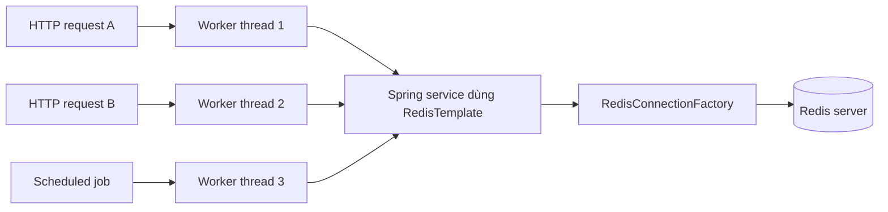
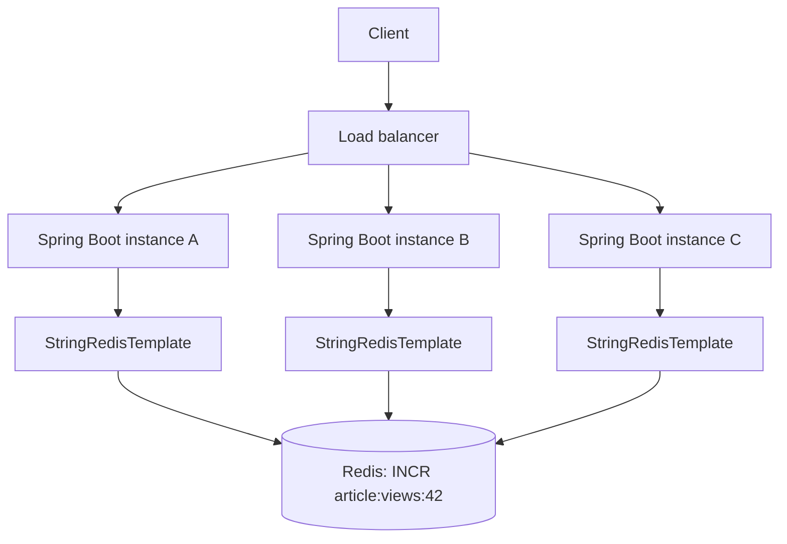

# Quy tắc dùng RedisConnection giữa nhiều luồng

Khi một ứng dụng Spring Boot xử lý nhiều HTTP request, chạy tác vụ `@Async`, dùng `ExecutorService` hoặc có nhiều consumer cùng truy cập Redis, câu hỏi thường gặp là: **có thể lấy một `RedisConnection` rồi chia sẻ cho tất cả các luồng để tiết kiệm kết nối không?**

**Quy tắc nền tảng: Không chia sẻ một đối tượng `RedisConnection` của Spring Data Redis giữa nhiều luồng.** Các đối tượng kết nối do `RedisConnectionFactory` cung cấp được dùng trong phạm vi một thao tác hoặc một phiên làm việc được quản lý thích hợp. Ở tầng ứng dụng, nên chia sẻ **`RedisConnectionFactory` và `RedisTemplate`/`StringRedisTemplate` đã cấu hình hoàn chỉnh**, để từng lời gọi nhận và giải phóng kết nối theo cơ chế Spring Data Redis.

Quy tắc trên vẫn đúng khi ứng dụng dùng **Lettuce**, dù native connection của chính Lettuce có hỗ trợ truy cập đồng thời. Native driver connection và abstraction `RedisConnection` của Spring là **hai đối tượng ở hai tầng khác nhau**, có hợp đồng sử dụng khác nhau.

Bài này giải thích các tầng kết nối, cách dùng an toàn trong môi trường đa luồng, ví dụ Java thực tế, các tình huống transaction/pipeline, và những lỗi dễ gây nhầm lẫn về tính nguyên tử.

## 1. Bối cảnh: Spring Boot có nhiều luồng cùng truy cập Redis

Trong một Spring MVC application, nhiều request có thể được xử lý song song trên các worker thread. Một ứng dụng còn có thể sử dụng scheduler, executor, listener và các tác vụ nền.



Ví dụ ba luồng cùng muốn tăng số lượt xem của sản phẩm `42`:

```text
Thread A → INCR views:product:42
Thread B → INCR views:product:42
Thread C → INCR views:product:42
```

Redis thực thi mỗi lệnh `INCR` như một thao tác nguyên tử đối với key đó. Tuy nhiên, điều này **không có nghĩa** mọi cách Java quản lý kết nối đều an toàn đa luồng. Cần tách riêng hai vấn đề:

1. **An toàn của đối tượng client/kết nối trên JVM:** có được dùng cùng instance từ nhiều luồng hay không?
2. **Tính đúng đắn của dữ liệu trên Redis:** lệnh hoặc chuỗi lệnh có tránh được lost update, race condition và xử lý trùng hay không?

Có thể sử dụng API truy cập Redis an toàn đa luồng nhưng vẫn tạo race condition nghiệp vụ do chọn chuỗi lệnh không nguyên tử.

## 2. Phân biệt bốn tầng thường bị gọi chung là “connection”

| Tầng | Ví dụ | Cách sử dụng trong Spring |
|---|---|---|
| **Factory** | `RedisConnectionFactory`, `LettuceConnectionFactory` | Bean cấu hình và cấp kết nối, thường chia sẻ trong toàn ứng dụng |
| **Template** | `RedisTemplate<K, V>`, `StringRedisTemplate` | API thao tác Redis, thường là singleton và dùng bởi nhiều luồng sau khi cấu hình xong |
| **Spring connection** | `RedisConnection` lấy từ factory/callback | Đối tượng làm việc có lifecycle; **không chuyển cho luồng khác hoặc lưu dùng chung** |
| **Native driver connection** | Lettuce `StatefulRedisConnection` hoặc kết nối Jedis | Theo hợp đồng riêng của driver; không đồng nhất với `RedisConnection` |

Hình dung đường gọi:

```text
Thread A ──┐
           ├─> singleton StringRedisTemplate ─> RedisConnectionFactory
Thread B ──┘                                    │
                                               ├─> RedisConnection cho thao tác A
                                               └─> RedisConnection cho thao tác B
                                                            │
                                             Native client / socket của driver
                                                            │
                                                        Redis server
```

Hai lời gọi có thể nhận **hai wrapper `RedisConnection` riêng** nhưng vẫn dùng chung một native network connection ở bên dưới, tùy driver và cấu hình factory. Vì vậy không nên suy luận “mỗi lần gọi `getConnection()` chắc chắn tạo một TCP socket mới”.

### 2.1. `RedisConnectionFactory`

Factory chịu trách nhiệm tạo/trao quyền truy cập các connection. Spring Boot thường tự cấu hình factory khi có starter Redis và cấu hình kết nối phù hợp. Với nhiều ứng dụng Spring Boot, **Lettuce** là driver mặc định.

Về thiết kế, factory thường là bean dùng chung:

```java
@Service
public class RedisBackedService {
    private final RedisConnectionFactory factory;

    public RedisBackedService(RedisConnectionFactory factory) {
        this.factory = factory;
    }
}
```

Giữ reference đến **factory** trong singleton service là bình thường. Factory giúp quản lý cấu hình và vòng đời kết nối; không nên tự tạo rồi đóng cả factory ở mỗi HTTP request.

### 2.2. `RedisTemplate` và `StringRedisTemplate`

`RedisTemplate` được thiết kế để dùng chung giữa các luồng **sau khi cấu hình xong**. Template lo phần kết nối/callback, serialization, exception translation và nhiều cơ chế tích hợp của Spring.

```java
@Service
public class CounterService {
    private final StringRedisTemplate redis;

    public CounterService(StringRedisTemplate redis) {
        this.redis = redis;
    }

    public Long increment(String name) {
        return redis.opsForValue().increment("counter:" + name);
    }
}
```

Nhiều request có thể gọi `increment()` trên cùng một singleton `CounterService` và cùng một `StringRedisTemplate`. Mỗi lời gọi thực hiện công việc theo cơ chế của Spring Data Redis; service **không giữ một `RedisConnection` trong field**.

Tính thread-safe của template áp dụng sau bước khởi tạo/cấu hình. Không đổi serializer, connection factory hoặc các thuộc tính cấu hình của cùng một template trong khi các luồng đang sử dụng nó.

### 2.3. `RedisConnection` của Spring Data Redis

`RedisConnection` là abstraction cho các lệnh Redis mức thấp. Một connection wrapper có thể mang trạng thái như:

- Transaction `MULTI`/`EXEC` hoặc các thao tác `WATCH`.
- Pipeline đang được mở.
- Trạng thái connection/session nội bộ và tài nguyên liên quan.
- Quy tắc đóng, giải phóng hoặc đồng bộ với thread hiện tại.

Vì các yếu tố này, **không truyền một `RedisConnection` tới nhiều worker thread**, ngay cả khi các lệnh đơn lẻ mà bạn gọi trông có vẻ độc lập. Cũng không giữ connection như field của bean singleton để tái sử dụng qua nhiều request.

### 2.4. Native connection của Lettuce không phải `RedisConnection`

Lettuce cung cấp native connection như `StatefulRedisConnection`, được thiết kế có thể dùng đồng thời giữa các luồng trong các trường hợp được driver hỗ trợ. `LettuceConnectionFactory` có thể mặc định chia sẻ một native connection cho các thao tác **không blocking và không transactional**, trong khi cung cấp đường kết nối phù hợp khác cho các thao tác cần tách biệt.

Điều đó **không chuyển tính thread-safe của native connection thành hợp đồng thread-safe cho wrapper `LettuceConnection`/`RedisConnection`**. Nếu lập trình qua Spring Data Redis, hãy tôn trọng abstraction Spring và để factory/template quản lý kết nối.

Với Jedis, object kết nối `Jedis` thông thường không được chia sẻ giữa các luồng. Khi cần nhiều client đồng thời, cơ chế pooling/factory phải cấp tài nguyên phù hợp cho từng thao tác. Không áp dụng máy móc giả định của Lettuce cho Jedis hoặc ngược lại.

## 3. Quy tắc sử dụng an toàn

| Thành phần / tình huống | Chia sẻ giữa các luồng? | Cách làm |
|---|---|---|
| `RedisConnectionFactory` bean | **Có**, theo lifecycle/configuration của Spring | Inject vào các service cần thiết |
| `RedisTemplate` đã cấu hình | **Có** | Inject singleton, gọi method ở từng luồng |
| `StringRedisTemplate` đã cấu hình | **Có** | Dùng cho dữ liệu chuỗi và counter |
| `RedisConnection` từ `getConnection()` | **Không** | Lấy, dùng, đóng trong cùng phạm vi công việc |
| `RedisConnection` nhận trong `RedisCallback` | **Không** | Chỉ dùng đồng bộ trong callback |
| `RedisConnection` dùng cho transaction/pipeline | **Không** | Giữ toàn bộ logic trong cùng session/callback |
| `StatefulRedisConnection` native của Lettuce | Theo hợp đồng Lettuce | Chỉ dùng trực tiếp khi thật sự cần native API và hiểu giới hạn |
| `Jedis` connection instance | **Không** | Dùng pool/factory theo thiết kế Jedis |

Một cách nhớ ngắn gọn:

```text
Chia sẻ bean quản lý Redis     → thường đúng
Chia sẻ RedisConnection       → sai phạm vi sử dụng
Chia sẻ cùng dữ liệu Redis     → bình thường, nhưng phải chọn lệnh/nghiệp vụ đúng
```

## 4. Ví dụ đúng: nhiều luồng cùng gọi một `StringRedisTemplate`

Giả sử ứng dụng có bean lưu số lượt xem bài viết.

```java
package example.redis;

import org.springframework.data.redis.core.StringRedisTemplate;
import org.springframework.stereotype.Service;

@Service
public class ArticleViewService {

    private final StringRedisTemplate redis;

    public ArticleViewService(StringRedisTemplate redis) {
        this.redis = redis;
    }

    public Long registerView(long articleId) {
        String key = "article:views:" + articleId;
        return redis.opsForValue().increment(key);
    }

    public String currentViews(long articleId) {
        return redis.opsForValue().get("article:views:" + articleId);
    }
}
```

Một controller, scheduled job hoặc service khác chỉ cần inject `ArticleViewService` rồi gọi:

```java
Long newCount = articleViewService.registerView(42L);
```

Khi nhiều luồng gọi đồng thời:

```text
Thread 1 ─┐
Thread 2 ─┤
Thread 3 ─┼─> ArticleViewService.registerView(42)
Thread 4 ─┘             │
                        └─> StringRedisTemplate.opsForValue().increment(...)
                                      │
                                Redis INCR
```

Trong trường hợp không có pipeline/transaction làm thay đổi cách trả kết quả, `INCR` trả giá trị mới của key. Redis xử lý tăng số nguyên trên server nên tránh được race của phương án Java tự đọc–cộng–ghi.

### 4.1. Mô phỏng lời gọi đồng thời

Đoạn mã sau thể hiện cách các task **chia sẻ service/template**, không chia sẻ `RedisConnection`:

```java
import java.util.ArrayList;
import java.util.List;
import java.util.concurrent.ExecutorService;
import java.util.concurrent.Executors;
import java.util.concurrent.Future;

public void simulateConcurrentViews(ArticleViewService service)
        throws Exception {

    ExecutorService executor = Executors.newFixedThreadPool(8);

    try {
        List<Future<Long>> futures = new ArrayList<>();

        for (int i = 0; i < 100; i++) {
            futures.add(executor.submit(() -> service.registerView(42L)));
        }

        for (Future<Long> future : futures) {
            future.get();
        }
    } finally {
        executor.shutdown();
    }
}
```

Các future giúp người gọi quan sát việc task thành công hay ném exception. Giá trị counter tăng thêm 100 **nếu cả 100 thao tác được thực thi thành công và không có tác nhân khác thay đổi hoặc xóa key**.

Trong ứng dụng thật, executor nên được quản lý theo lifecycle phù hợp, có giới hạn số task chờ và cơ chế shutdown; không tạo executor mới mỗi request.

Điểm chính là các luồng cùng sử dụng **bean an toàn để chia sẻ**, còn việc tạo/lấy/release kết nối được giấu phía trong Spring Data Redis.

## 5. Ví dụ sai: lưu `RedisConnection` ở field singleton

Mã sau là anti-pattern:

```java
// SAI: minh họa lỗi, không áp dụng.
@Service
public class UnsafeCounterService {

    private final RedisConnection connection;

    public UnsafeCounterService(RedisConnectionFactory factory) {
        this.connection = factory.getConnection();
    }

    public Long increment(byte[] key) {
        return connection.stringCommands().incr(key);
    }
}
```

Vì `UnsafeCounterService` là singleton, nhiều request cùng dùng `this.connection`:

```text
Thread A ─┐
Thread B ─┼──> cùng một RedisConnection instance
Thread C ─┘
```

Các rủi ro gồm:

- Trạng thái transaction hoặc pipeline của thao tác này ảnh hưởng thao tác khác.
- Một luồng đóng connection trong khi luồng khác còn sử dụng.
- Resource được giữ quá lâu, không tuân theo lifecycle được dự kiến.
- Những lỗi chỉ xuất hiện khi tải cao, khó tái hiện trong môi trường một luồng.

Không sửa bằng cách gắn `synchronized` lên mọi method rồi tiếp tục giữ connection lâu dài. Đồng bộ hóa của Java không giải quyết triệt để vấn đề lifecycle, timeout, thread-bound transaction hoặc yêu cầu cấp tài nguyên của driver.

Cách thay thế là inject `StringRedisTemplate` hoặc `RedisConnectionFactory`, rồi lấy connection theo đúng phạm vi mỗi tác vụ nếu cần API mức thấp.

## 6. Dùng `RedisConnection` trực tiếp khi thật sự cần

Template là lựa chọn mặc định cho hầu hết thao tác. Nếu cần gọi lệnh mức thấp, vẫn có thể lấy connection từ factory, sử dụng ngay rồi **giải phóng trong `finally`**.

```java
package example.redis;

import java.nio.charset.StandardCharsets;

import org.springframework.data.redis.connection.RedisConnection;
import org.springframework.data.redis.connection.RedisConnectionFactory;
import org.springframework.stereotype.Service;

@Service
public class LowLevelCounterService {

    private final RedisConnectionFactory connectionFactory;

    public LowLevelCounterService(RedisConnectionFactory connectionFactory) {
        this.connectionFactory = connectionFactory;
    }

    public Long increment(String key) {
        RedisConnection connection = connectionFactory.getConnection();

        try {
            byte[] rawKey = key.getBytes(StandardCharsets.UTF_8);
            return connection.stringCommands().incr(rawKey);
        } finally {
            connection.close();
        }
    }
}
```

Ở đây:

1. `connectionFactory` được inject và dùng chung.
2. Mỗi lời gọi `increment` nhận một `RedisConnection` wrapper cho riêng phạm vi thao tác.
3. Connection không được lưu vào field, cache, hàng đợi công việc hay truyền tới thread khác.
4. `finally` bảo đảm đóng/giải phóng connection ngay cả khi lệnh Redis thất bại.

**Chú ý về câu “đóng connection”:** đóng wrapper do factory cấp không nhất thiết đóng TCP socket vật lý. Với factory/client có cơ chế tái sử dụng native connection, việc giải phóng wrapper có thể chỉ trả quyền sử dụng tài nguyên cho cơ chế quản lý bên dưới.

Không gọi `connectionFactory.getConnection()` trong vòng lặp hàng nghìn lần nếu `RedisTemplate`/batch API có thể biểu đạt thao tác tốt hơn. Nhưng cũng không vì sợ chi phí lấy kết nối mà giữ một `RedisConnection` dùng chung bất chấp hợp đồng API.

### 6.1. Không dùng connection sau khi đã đóng

Mẫu sai:

```java
// SAI: dùng đối tượng khi phạm vi sống đã kết thúc.
RedisConnection connection = factory.getConnection();

try {
    connection.stringCommands().incr(key);
} finally {
    connection.close();
}

connection.stringCommands().incr(key); // Không hợp lệ.
```

Một connection đã đóng hoặc trả lại cho pool có thể bị tái sử dụng, từ chối lệnh hoặc mang trạng thái không còn thuộc lời gọi hiện tại. Không dựa vào hành vi tình cờ vẫn chạy ở một lần thử.

### 6.2. Không truyền connection sang `CompletableFuture`/executor

Mẫu sai:

```java
// SAI: connection được lấy ở luồng A nhưng chạy trên luồng B.
RedisConnection connection = factory.getConnection();

CompletableFuture.runAsync(() -> {
    connection.stringCommands().incr(key);
});

connection.close(); // Có thể xảy ra trước khi task ở luồng B chạy.
```

Đoạn mã vừa chia sẻ connection qua ranh giới luồng, vừa tạo race với `close()`. Kể cả khi chuyển `close()` vào callback tương lai, việc chuyển đối tượng Spring `RedisConnection` sang thread khác vẫn không phải hợp đồng sử dụng được khuyến nghị.

Mẫu đúng: chuyển **dữ liệu đầu vào**, cho task gọi template/service:

```java
CompletableFuture<Long> future = CompletableFuture.supplyAsync(
        () -> articleViewService.registerView(42L),
        executor
);
```

Mỗi task chỉ sử dụng service được inject; không giữ connection trong closure. `executor` là executor được ứng dụng quản lý và đã khởi tạo sẵn.

## 7. Cách dùng an toàn hơn: `RedisTemplate.execute(RedisCallback)`

Khi cần thao tác `RedisConnection` mức thấp, có thể để `RedisTemplate` quản lý vòng đời connection bằng callback:

```java
package example.redis;

import java.nio.charset.StandardCharsets;

import org.springframework.data.redis.core.RedisCallback;
import org.springframework.data.redis.core.StringRedisTemplate;
import org.springframework.stereotype.Service;

@Service
public class CallbackCounterService {

    private final StringRedisTemplate redis;

    public CallbackCounterService(StringRedisTemplate redis) {
        this.redis = redis;
    }

    public Long increment(String key) {
        byte[] rawKey = key.getBytes(StandardCharsets.UTF_8);

        return redis.execute(
                (RedisCallback<Long>) connection ->
                        connection.stringCommands().incr(rawKey)
        );
    }
}
```

Trong callback:

- `connection` chỉ được sử dụng **khi callback đang thực thi**.
- Không tự `close()` connection mà template đã cấp cho callback.
- Không lưu connection vào field hoặc biến static.
- Không trả connection từ callback để dùng về sau.
- Không tạo thread con để dùng connection khi callback chưa hoặc đã kết thúc.

Mẫu sai dù dùng `execute`:

```java
// SAI: giữ tham chiếu connection để dùng ngoài callback.
AtomicReference<RedisConnection> holder = new AtomicReference<>();

redis.execute((RedisCallback<Object>) connection -> {
    holder.set(connection);
    return null;
});

holder.get().stringCommands().incr(key); // Không dùng.
```

`RedisTemplate.execute(...)` giúp quản lý lifecycle, không có nghĩa connection callback được phép sống ngoài callback.

## 8. Tại sao Lettuce vừa “thread-safe” vừa không nên chia sẻ `RedisConnection`?

Đây là điểm dễ gây tranh luận khi đọc tài liệu của driver.

### 8.1. Khả năng của native Lettuce connection

Lettuce là Redis client bất đồng bộ dựa trên Netty. Native `StatefulRedisConnection` được thiết kế để nhiều luồng có thể gửi lệnh đồng thời trong những ngữ cảnh thích hợp. Các lệnh có thể được multiplex qua một TCP connection, nên không phải cứ có 100 request là cần 100 socket.

Nhưng những thao tác **mang trạng thái theo connection**, ví dụ transaction, blocking operation hoặc cơ chế subscription, cần được xem xét theo hợp đồng driver và abstraction đang sử dụng. Không lấy khẳng định chung “Lettuce thread-safe” làm lý do để cho nhiều luồng điều khiển chung một transaction.

### 8.2. Cách `LettuceConnectionFactory` có thể chia sẻ native connection

Với cấu hình thông dụng, `LettuceConnectionFactory` có thuộc tính `shareNativeConnection` (thường mặc định là `true`). Khi bật, các thao tác không blocking/không transactional có thể cùng sử dụng một native Lettuce connection bên dưới các Spring wrapper. Những trường hợp blocking/transaction thường cần cơ chế kết nối phù hợp khác theo factory.

```text
Thread A ─> RedisTemplate ─> RedisConnection wrapper A ─┐
                                                       ├─> native Lettuce connection
Thread B ─> RedisTemplate ─> RedisConnection wrapper B ─┘
```

Mục đích là **tái sử dụng kết nối mạng ở tầng driver** trong khi vẫn duy trì phạm vi sử dụng đúng cho Spring wrapper.

Nếu cần điều chỉnh chia sẻ native connection hoặc pooling, hãy dựa trên loại tác vụ, mô hình sử dụng, phiên bản Spring Data Redis và số liệu đo thực tế. Không tự bật nhiều pool hoặc tắt chia sẻ native connection chỉ vì có nhiều Java thread.

### 8.3. Với Jedis thì sao?

Jedis dùng mô hình kết nối và pooling khác Lettuce. Không giữ một Jedis connection và gọi nó từ nhiều luồng. Khi Jedis được cấu hình thông qua Spring Data Redis, để `JedisConnectionFactory` và cơ chế pooling cấp connection theo tác vụ.

**Quy tắc ổn định xuyên driver:** code service nên phụ thuộc vào `RedisTemplate` hoặc `RedisConnectionFactory`, tránh phụ thuộc vào việc driver bên dưới có đang dùng một socket, nhiều socket hoặc pool cụ thể.

## 9. Transaction, pipeline và `WATCH`: trạng thái gắn với cùng một session

Các thao tác Redis không phải lúc nào cũng độc lập. Có những chuỗi lệnh cần dùng **một cùng context/connection hợp lệ**.

### 9.1. Transaction `MULTI`/`EXEC`

Redis transaction gom lệnh sau `MULTI` rồi thực thi khi gặp `EXEC`. Phạm vi transaction gắn với trạng thái kết nối/session Redis.

Sơ đồ mong muốn:

```text
Cùng một session:
  MULTI
  SET order:42 "processing"
  INCR counter:orders
  EXEC
```

Nếu mỗi lệnh được gửi từ một `RedisConnection` không liên hệ với nhau, các lệnh có thể không nằm trong transaction như ý định. Ngược lại, nếu chia sẻ một connection giữa nhiều luồng, lệnh của thread khác có thể bị trộn vào trạng thái transaction.

Với Spring Data Redis, dùng API quản lý phiên phù hợp, chẳng hạn **`SessionCallback`** trên `RedisTemplate`, để nhóm các thao tác cần chung context:

```java
List<Object> result = redisTemplate.execute(
        new SessionCallback<List<Object>>() {
            @Override
            public <K, V> List<Object> execute(RedisOperations<K, V> operations) {
                operations.multi();

                // Các lệnh Redis dùng cùng SessionCallback.
                // Có thể thực hiện các thao tác opsForValue/opsForHash... ở đây.

                return operations.exec();
            }
        }
);
```

Ví dụ trên minh họa **phạm vi phiên**; thao tác nghiệp vụ cụ thể phải được bổ sung trong callback bằng kiểu dữ liệu tương ứng. Không tạo `CompletableFuture` bên trong callback để “phân tán” các lệnh transaction lên nhiều luồng.

Trong Redis, `MULTI`/`EXEC` bảo đảm các lệnh được xếp hàng và thực thi tuần tự theo transaction, nhưng **không cung cấp rollback kiểu quan hệ cho mọi lỗi lệnh hoặc lỗi nghiệp vụ**. Cần hiểu semantics Redis transaction trước khi dùng cho dữ liệu quan trọng.

### 9.2. `WATCH` và optimistic concurrency

`WATCH` theo dõi key để có thể hủy `EXEC` khi key bị thay đổi trước lúc transaction thực thi. Chuỗi thao tác `WATCH` → đọc/đánh giá → `MULTI` → ghi → `EXEC` cần quản lý cùng một session hợp lệ.

Không dùng một `RedisConnection` chung rồi để thread A `WATCH key:x`, thread B thực hiện thao tác khác trên cùng connection. Trạng thái theo connection có thể gây kết quả không như mong đợi. Nếu cần compare-and-set, cân nhắc script Lua hoặc API transaction được quản lý phù hợp theo yêu cầu nguyên tử.

### 9.3. Pipeline

Pipelining giúp gửi nhiều lệnh mà không cần chờ phản hồi từng lệnh theo kiểu thông thường, giảm round-trip trong một số workload. Pipeline **không tự biến cả nhóm lệnh thành một transaction nguyên tử**.

Ví dụ dùng Spring Data Redis:

```java
import java.nio.charset.StandardCharsets;
import java.util.List;

import org.springframework.data.redis.core.RedisCallback;
import org.springframework.data.redis.core.StringRedisTemplate;

public List<Object> incrementBatch(StringRedisTemplate redis) {
    byte[] keyA = "counter:a".getBytes(StandardCharsets.UTF_8);
    byte[] keyB = "counter:b".getBytes(StandardCharsets.UTF_8);

    return redis.executePipelined((RedisCallback<Object>) connection -> {
        connection.stringCommands().incr(keyA);
        connection.stringCommands().incr(keyB);
        return null;
    });
}
```

`executePipelined` quản lý scope pipeline/callback và trả kết quả của các lệnh sau khi xử lý. Callback của API này thông thường cần trả `null`; giá trị pipeline được trả bằng list bên ngoài.

Không chia sẻ `connection` trong callback cho nhiều thread để gọi lệnh đồng thời. Nếu bài toán yêu cầu nhiều đơn vị công việc chạy song song, tổ chức song song **ở cấp tác vụ gọi template**, không ở cấp chia sẻ cùng callback connection.

## 10. Thread-bound connection và ranh giới `@Async`

Một số cơ chế đồng bộ hóa/giao dịch của Spring sử dụng **thread-local context**. Ví dụ, khi bật transaction support của RedisTemplate và tích hợp với Spring transaction synchronization, connection có thể được gắn với thread thực hiện giao dịch.

Điều này dẫn tới quy tắc:

> Không giả định transaction hoặc connection context của thread hiện tại tự động đi theo task được gửi tới `@Async`, `CompletableFuture`, scheduler hay executor khác.

Ví dụ tình huống:

```text
Thread HTTP A:
  bắt đầu transaction / có context thread-local
  lưu dữ liệu
  gửi task @Async sang thread B
  commit/hoàn tất

Thread B:
  có ngữ cảnh luồng riêng
  gọi RedisTemplate
```

Thread B không tự nhiên trở thành một phần cùng Redis transaction của thread A. Nếu cần phối hợp giữa database commit và Redis update, phải xác định rõ trình tự, event sau commit, idempotency và xử lý retry. Đừng cố “mang” một `RedisConnection` từ A sang B để nối hai phạm vi.

Cũng cần phân biệt:

- `@Transactional` của Spring có thể điều khiển transaction cho tài nguyên do transaction manager tương ứng quản lý.
- Redis không tự trở thành một phần của database transaction chỉ vì cùng tồn tại trong một method `@Transactional`.
- Transaction Redis qua `MULTI`/`EXEC` không đồng nghĩa giao dịch ACID xuyên cả Redis và database.

Mô hình đúng là chọn một cơ chế nhất quán phù hợp với nghiệp vụ, thay vì giả định connection đa luồng giải quyết được giao dịch phân tán.

## 11. Thread-safe API không đồng nghĩa logic nghiệp vụ nguyên tử

Giả sử hai request cùng tăng số tồn kho mô phỏng trên một Redis key, nhưng code dùng chuỗi thao tác:

```java
// SAI nếu yêu cầu tăng đồng thời không bị mất cập nhật.
String value = redis.opsForValue().get("stock:42");
long updated = Long.parseLong(value == null ? "0" : value) + 1;
redis.opsForValue().set("stock:42", Long.toString(updated));
```

Kịch bản race:

```text
Thread A: GET stock:42 -> 10
Thread B: GET stock:42 -> 10
Thread A: SET stock:42 11
Thread B: SET stock:42 11
```

Kết quả là 11 thay vì 12, dù `StringRedisTemplate` được dùng đúng cách về mặt đa luồng.

Nếu mục tiêu chỉ là **tăng counter nguyên tử**:

```java
Long current = redis.opsForValue().increment("stock:42");
```

Redis `INCR` xử lý tăng số trong một lệnh. Đối với thao tác nhiều điều kiện như “chỉ trừ tồn kho khi đủ số lượng”, có thể cần script Lua, giao dịch phù hợp hoặc bảo đảm bất biến tại database nguồn sự thật.

### 11.1. `synchronized` không giải quyết được concurrency phân tán

` synchronized ` trong Java chỉ điều phối các thread đi qua cùng monitor **trong một JVM**. Một hệ thống có ba Spring Boot instance sau load balancer vẫn có thể đồng thời cập nhật cùng key trên Redis.

```text
Spring Boot A (JVM A) ─┐
Spring Boot B (JVM B) ─┼─> Redis
Spring Boot C (JVM C) ─┘
```

Vì vậy, với cập nhật cần nguyên tử xuyên nhiều instance, ưu tiên lệnh nguyên tử của Redis hoặc giao thức cập nhật được thiết kế đúng. Không dùng lock cục bộ để thay thế điều kiện nhất quán phân tán.

### 11.2. Timeout và retry có thể làm lệnh chạy hai lần

Một ví dụ nguy hiểm:

1. Client gửi `INCR counter:orders`.
2. Redis thực thi lệnh thành công.
3. Mạng lỗi trước khi client nhận được kết quả.
4. Client nhận timeout, gửi lại `INCR`.
5. Counter tăng **hai lần** cho cùng một yêu cầu nghiệp vụ.

`INCR` là atomic cho **mỗi lệnh**, nhưng không idempotent khi retry. Khi timeout, client không luôn biết chắc server đã xử lý hay chưa.

Với nghiệp vụ cần “mỗi yêu cầu chỉ ghi nhận một lần”, thiết kế idempotency key, kiểm tra duy nhất, transaction/script hoặc cơ chế ghi nhận bền vững tùy yêu cầu. Đừng tự động retry vô điều kiện mọi lệnh thay đổi dữ liệu.

## 12. Các thao tác blocking và kết nối dài hạn

Không phải tất cả lệnh Redis đều có cùng hành vi. Ví dụ một số lệnh đợi dữ liệu (blocking list/stream operations), transaction hoặc subscription có thể giữ connection/context trong thời gian dài.

Đối với các tình huống này:

- Không cho nhiều luồng cùng dùng một `RedisConnection` wrapper.
- Không chiếm giữ connection có trạng thái blocking rồi gửi các lệnh khác vào cùng scope không được thiết kế cho việc đó.
- Dùng công cụ/framework phù hợp để quản lý consumer và lifecycle.
- Quan sát số connection, timeout, số task đang chờ và mức tiêu thụ tài nguyên.

Với Pub/Sub trong Spring, `RedisMessageListenerContainer` là một abstraction thường dùng để quản lý subscription/listener và tài nguyên liên quan. Nó thích hợp hơn việc tự giữ một low-level connection trong singleton rồi điều khiển từ nhiều worker thread.

Với Redis Streams, chọn API container/consumer phù hợp, chính sách ack/retry và xử lý dữ liệu trùng. Thread safety của connection không quyết định được semantics giao hàng thông điệp.

## 13. Reactive Redis và quy tắc đa luồng

Trong Spring WebFlux hoặc pipeline Reactor, tác vụ có thể chuyển scheduler và chạy trên nhiều luồng khác nhau. Không dùng cách tiếp cận “giữ `RedisConnection` blocking trong thread-local” làm nền tảng cho toàn bộ reactive pipeline.

Spring Data Redis cung cấp API reactive như `ReactiveRedisTemplate` và `ReactiveStringRedisTemplate` để làm việc với Redis qua reactive stream.

Ví dụ:

```java
package example.redis;

import org.springframework.data.redis.core.ReactiveStringRedisTemplate;
import org.springframework.stereotype.Service;
import reactor.core.publisher.Mono;

@Service
public class ReactiveViewService {

    private final ReactiveStringRedisTemplate redis;

    public ReactiveViewService(ReactiveStringRedisTemplate redis) {
        this.redis = redis;
    }

    public Mono<Long> registerView(long articleId) {
        return redis.opsForValue()
                .increment("article:views:" + articleId);
    }
}
```

Mỗi subscription sẽ kích hoạt công việc theo semantics reactive; không cần chuyển một `RedisConnection` thông thường qua các stage trong pipeline.

Lưu ý:

- Không gọi trực tiếp API blocking của `RedisTemplate` trên event-loop thread nếu thao tác có thể làm chặn luồng.
- Dùng `ReactiveRedisTemplate` khi muốn duy trì luồng bất đồng bộ/reactive.
- Transaction context, số lần subscribe, retry và cancellation trong reactive flow cần được thiết kế theo semantics Reactor; **không tự suy ra** chỉ từ việc native Lettuce connection hỗ trợ đa luồng.
- Tránh giữ tài nguyên kết nối mức thấp qua một `Flux`/`Mono` tùy tiện nếu framework đã cung cấp callback/session lifecycle thích hợp.

## 14. Cấu hình Spring Boot để thực hành

Một project Spring Boot thông thường có dependency:

```groovy
dependencies {
    implementation 'org.springframework.boot:spring-boot-starter-data-redis'
}
```

Nếu muốn thử `ReactiveStringRedisTemplate`, cần dùng các thành phần reactive phù hợp của Spring Data Redis và runtime ứng dụng; không nhất thiết thêm WebFlux chỉ để sử dụng Redis thông thường.

Ví dụ Redis chạy local trên port mặc định, `application.yml`:

```yaml
spring:
  data:
    redis:
      host: ${REDIS_HOST:127.0.0.1}
      port: ${REDIS_PORT:6379}
      timeout: 2s
```

Với cấu hình Spring Boot 3.x thông dụng, starter Redis sử dụng Lettuce theo mặc định nếu không chọn driver khác. Lớp service chỉ cần inject template:

```java
@Service
public class RedisBusinessService {
    private final StringRedisTemplate redis;

    public RedisBusinessService(StringRedisTemplate redis) {
        this.redis = redis;
    }

    public boolean markSeen(String eventId) {
        Boolean wasNew = redis.opsForValue()
                .setIfAbsent("seen:" + eventId, "1");
        return Boolean.TRUE.equals(wasNew);
    }
}
```

Đoạn này chỉ minh họa dùng một lệnh `SET ... NX` qua API template. Vì key chưa có TTL, nó sẽ tồn tại cho đến khi được xóa/evict; ứng dụng thực phải quyết định retention. Ngoài ra, cơ chế “đã thấy” này **chưa đủ** để bảo đảm xử lý nghiệp vụ exactly-once qua các sự cố mạng và giao dịch hệ thống khác. Nếu cần TTL cùng thao tác tạo, dùng overload có `Duration` theo phiên bản API thích hợp.

### 14.1. Không cấu hình lại template trong lúc đang dùng

Mẫu cấu hình thích hợp ở khởi tạo:

```java
@Configuration
public class RedisConfig {

    @Bean
    RedisTemplate<String, String> textRedisTemplate(
            RedisConnectionFactory factory) {

        RedisTemplate<String, String> template = new RedisTemplate<>();
        template.setConnectionFactory(factory);
        template.setKeySerializer(new StringRedisSerializer());
        template.setValueSerializer(new StringRedisSerializer());
        template.afterPropertiesSet();
        return template;
    }
}
```

Các import cần có: `org.springframework.context.annotation.Bean`, `Configuration`, `org.springframework.data.redis.connection.RedisConnectionFactory`, `org.springframework.data.redis.core.RedisTemplate`, và `org.springframework.data.redis.serializer.StringRedisSerializer`.

Template được tạo/cấu hình một lần trước khi được chia sẻ. Không đổi serializer theo từng request; hai thread nhìn nhận dữ liệu dưới hai serialization khác nhau có thể gây đọc sai key/value hoặc hỏng dữ liệu logic.

Trong trường hợp key/value đều là String, có sẵn `StringRedisTemplate`, nên thường không cần tự tạo bean ở trên. Ví dụ chỉ cho thấy ranh giới **cấu hình trước, dùng chung sau**.

## 15. Kết nối, pooling và hiệu năng khi tải lớn

Không nên hiểu “đừng chia sẻ `RedisConnection`” thành “mở kết nối TCP mới cho mỗi lệnh”. Factory và driver xử lý chuyện tái sử dụng tài nguyên.

Khi ứng dụng có nhiều luồng:

- Với Lettuce, native connection có thể xử lý đồng thời nhiều lệnh; một socket chia sẻ chưa chắc là nghẽn, và quá nhiều socket cũng không đảm bảo nhanh hơn.
- Với Jedis/pool, kích thước pool và số request đồng thời ảnh hưởng thời gian chờ connection.
- Với lệnh blocking, transaction, Pub/Sub hoặc Streams, cách dùng connection và yêu cầu concurrency có thể khác lệnh `GET`/`SET` bình thường.
- Với tải cao, nghẽn có thể đến từ mạng, payload lớn, lệnh Redis nặng, server CPU, serialization hoặc retry; không nên kết luận nguyên nhân chỉ bằng số Java thread.

Một trình tự chẩn đoán hợp lý:

1. Xác định thao tác Redis nào chậm hoặc lỗi: command, key pattern và tần suất.
2. Quan sát timeout, số connection, queue chờ, memory và latency phía Redis.
3. Xác định việc đang sử dụng Spring template hay giữ connection thủ công.
4. Nếu có pool, kiểm tra thông số pool và số connection thực tế; nếu dùng Lettuce, phân biệt native connection sharing với wrapper lifecycle.
5. Chỉ tối ưu cấu hình connection sau khi có bằng chứng nghẽn và thử lại trên workload đại diện.

### 15.1. Những dấu hiệu thường gợi ý dùng sai connection

| Triệu chứng | Khả năng cần điều tra |
|---|---|
| Lỗi “connection closed” ngẫu nhiên | Connection được đóng trong khi luồng khác vẫn dùng, hoặc dùng sau callback |
| Lệnh bị trả về `null` bất ngờ | Lệnh chạy trong pipeline/transaction, kết quả phải lấy theo API tương ứng |
| Transaction chứa lệnh ngoài dự kiến | Nhiều luồng dùng chung session/connection có state |
| Ứng dụng hết connection hoặc task bị chờ lâu | Connection không được release, pool cấu hình không phù hợp hoặc workload blocking |
| Timeout tăng khi nhiều request cùng đến | Server/network quá tải, lệnh chậm, queue/pool, serialization |
| Counter có kết quả thấp hơn kỳ vọng | Java dùng chuỗi `GET` → tính → `SET` thay vì lệnh nguyên tử |
| Counter cao hơn kỳ vọng sau lỗi mạng | Retry thao tác không idempotent như `INCR` |
| `@Async` không thấy transaction context | Transaction/thread-bound context không tự chuyển sang luồng khác |

Bảng này là gợi ý đặt câu hỏi, **không phải chẩn đoán chắc chắn**. Cần dựa trên log, stack trace, cấu hình và đo đạc để kết luận.

## 16. Các quy tắc thực hành khi thiết kế code đa luồng

### Quy tắc 1: Inject template/factory thay vì giữ connection

Ưu tiên:

```java
private final StringRedisTemplate redis;
```

hoặc khi cần low-level API:

```java
private final RedisConnectionFactory factory;
```

Tránh:

```java
private final RedisConnection connection; // Sai nếu bean được dùng chung.
```

### Quy tắc 2: Phạm vi connection phải có điểm kết thúc rõ ràng

Nếu lấy trực tiếp bằng `factory.getConnection()`, dùng trong method và `close()` bằng `finally`. Nếu dùng callback của template, để template quản lý; không đóng connection callback hoặc đưa reference ra ngoài.

### Quy tắc 3: Không vượt ranh giới luồng bằng đối tượng connection

Chuyển **tham số nghiệp vụ** vào task, ví dụ `articleId`, `eventId`, DTO bất biến. Cho task gọi một Spring service có template. Không truyền connection qua executor, `@Async`, CompletableFuture hoặc callback reactive.

### Quy tắc 4: Transaction và pipeline đi cùng session phù hợp

Sử dụng `SessionCallback`, `executePipelined` hoặc API transaction được Spring Data Redis cung cấp. Không giả định mỗi lời gọi `opsForValue()` là cùng transaction nếu chưa kiểm soát phạm vi giao dịch.

### Quy tắc 5: Phân biệt thread safety với atomicity và idempotency

- **Thread safety:** đối tượng Java có hợp đồng sử dụng đồng thời thích hợp.
- **Atomicity:** thao tác cập nhật dữ liệu không bị chen ngang theo semantics Redis.
- **Idempotency:** cùng một yêu cầu được thực hiện lại không tạo thêm tác động nghiệp vụ ngoài mong muốn.

Đây là ba thuộc tính khác nhau. Một ứng dụng cần cả ba tùy nghiệp vụ.

### Quy tắc 6: Thiết kế đường lỗi trước khi bật retry

Timeout không chứng minh lệnh chưa được Redis thực thi. Lệnh chỉ đọc, lệnh có thể retry an toàn và lệnh tăng/ghi phát sinh side effect phải có chiến lược xử lý khác nhau.

### Quy tắc 7: Để Spring quản lý lifecycle bean

Không đóng singleton `RedisConnectionFactory` hoặc native client dùng chung sau mỗi request. Khi ứng dụng dừng, Spring thực hiện lifecycle cleanup của các bean được quản lý phù hợp với cấu hình.

## 17. Tình huống tổng hợp: bộ đếm truy cập trong nhiều instance

Giả sử ba Spring Boot instance cùng phục vụ `POST /articles/42/view`:



Thiết kế:

1. Mỗi instance tạo factory/template theo Spring container của chính nó.
2. Mỗi request gọi `ArticleViewService.registerView(42)`.
3. Redis nhận các lệnh `INCR` đối với cùng key và cập nhật nguyên tử từng lệnh.
4. Không có RedisConnection nào được chia sẻ theo kiểu chuyển object Java giữa các luồng hoặc các instance.
5. Nếu HTTP client gửi lại request sau timeout, API vẫn cần quy tắc nghiệp vụ về đếm lặp; riêng `INCR` không phân biệt request mới với request retry.

Như vậy, **một `StringRedisTemplate` dùng chung trong mỗi ứng dụng là bình thường**, còn chia sẻ `RedisConnection` giữa thread là sai; và **Redis `INCR` giải quyết race tăng số**, nhưng không giải quyết idempotency end-to-end.

## 18. Câu hỏi thường gặp

**Có phải mỗi thread cần một `RedisConnection` cố định suốt vòng đời thread?**

Không. Phạm vi cần là **mỗi thao tác hoặc session công việc hợp lệ**, không phải tạo “connection thường trú” cho từng thread của pool. Thread có thể được tái sử dụng cho nhiều request với transaction/context khác nhau. Dùng template giúp tránh việc tự quản lý mối quan hệ thread–connection.

**`RedisTemplate` singleton có an toàn khi hàng trăm request cùng gọi không?**

Có, theo hợp đồng của template **sau khi cấu hình xong**, nhưng số request có thể vượt khả năng của Redis server, pool hoặc network. Thread-safe không đồng nghĩa không có giới hạn throughput/latency.

**Lettuce thread-safe thì tại sao Spring `LettuceConnection` lại không thread-safe?**

Vì native connection của Lettuce và wrapper `RedisConnection` của Spring có lifecycle, state và hợp đồng sử dụng khác nhau. Factory có thể chia sẻ native connection phía dưới mà không cho phép nhiều thread cùng sử dụng một wrapper ở phía trên.

**Dùng `synchronized` trong service có thể thay Redis transaction không?**

Không đối với hệ thống nhiều instance; `synchronized` chỉ điều phối cùng JVM/monitor. Nó cũng không tự cung cấp atomicity cho nhiều lệnh Redis hoặc transaction xuyên Redis và database.

**Có nên bật connection pool chỉ vì ứng dụng đa luồng?**

Không có quy tắc chung. Cần căn cứ driver, blocking/transaction workload, concurrent demand và kết quả đo. Pool có thể hữu ích trong một số cấu hình, nhưng cũng thêm giới hạn chờ và chi phí vận hành.

**Có thể lấy connection trong `RedisCallback` rồi dùng sau callback không?**

Không. Connection thuộc phạm vi callback; template quản lý release. Muốn chạy việc ở thời điểm khác, truyền dữ liệu đầu vào và gọi template từ tác vụ đó.

**Spring `@Async` có tự mang theo Redis transaction của method gọi không?**

Không nên giả định. Transaction synchronization theo thread không tự truyền qua executor; phải thiết kế ranh giới giao dịch và xử lý lỗi rõ ràng.

## Kết luận

Trong **Spring Data Redis**, những đối tượng phù hợp để chia sẻ giữa nhiều luồng là **`RedisConnectionFactory` và `RedisTemplate`/`StringRedisTemplate` đã cấu hình**, còn **`RedisConnection` phải được dùng trong phạm vi thao tác/phiên được quản lý và không chuyển giữa các luồng**. Khả năng native connection của Lettuce hỗ trợ concurrent access không thay đổi quy tắc đó ở tầng Spring.

Khi triển khai code đồng thời, hãy kiểm tra ba lớp độc lập: **lifecycle kết nối đúng**, **lệnh hoặc giao dịch cập nhật dữ liệu đúng**, và **retry/idempotency phù hợp với nghiệp vụ**. Làm đúng cả ba mới giúp ứng dụng Spring Boot truy cập Redis ổn định dưới tải nhiều request và nhiều instance.

