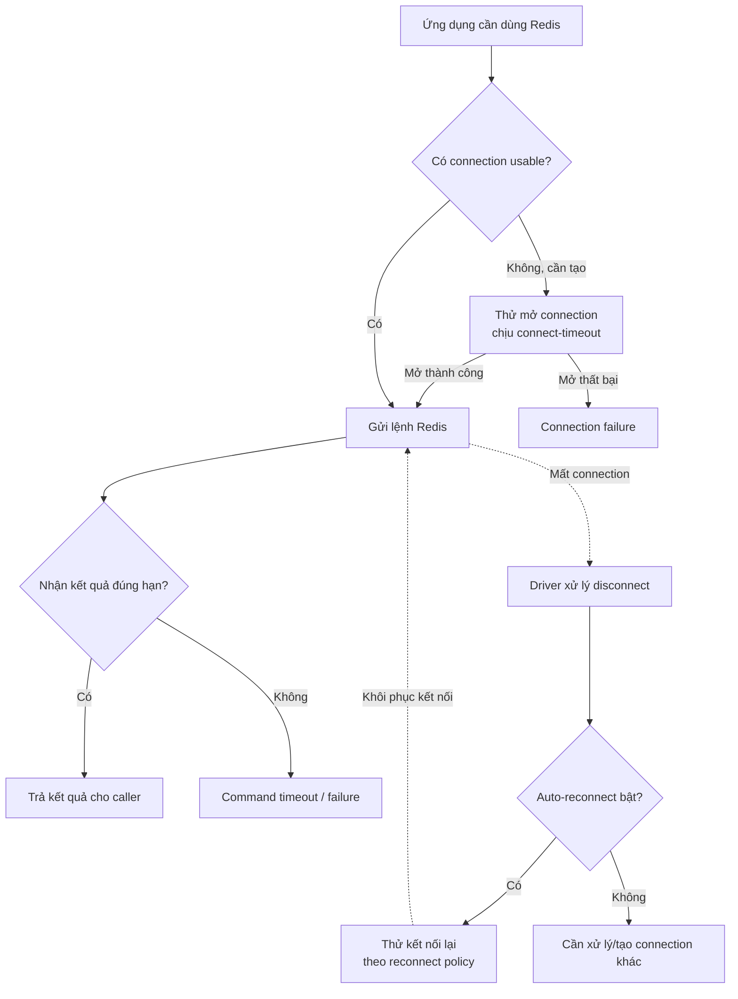
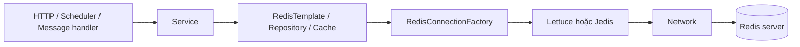
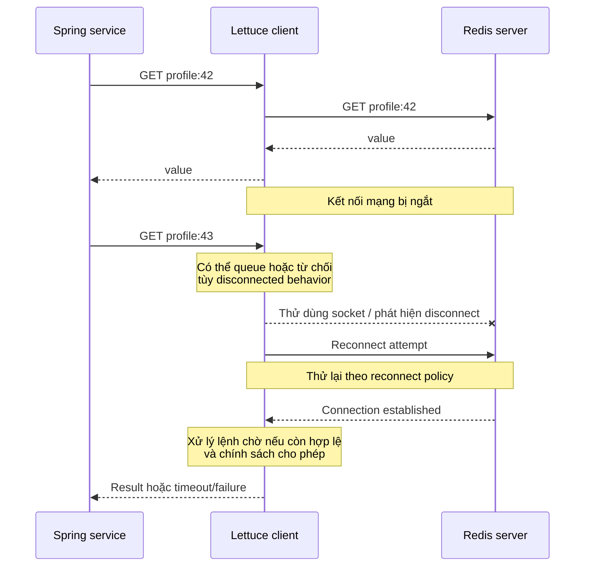
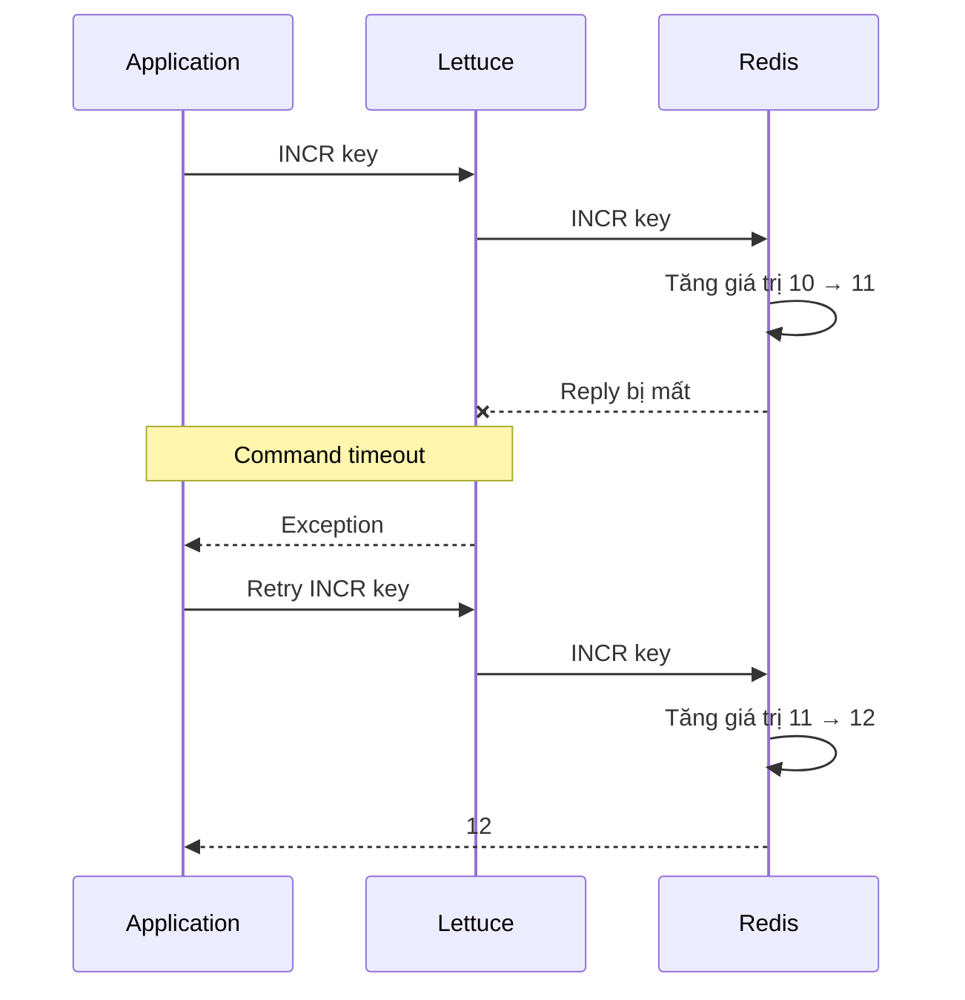

# Quan hệ giữa thời gian chờ kết nối, thời gian chờ lệnh và reconnect trong Spring Data Redis

Trong ứng dụng Spring Data Redis, một lỗi kết nối Redis có thể tạo ra ba câu hỏi khác nhau: **chờ bao lâu để mở kết nối?**, **chờ bao lâu để một lệnh Redis trả kết quả?**, và **khi kết nối đã bị mất, driver sẽ thử kết nối lại như thế nào?** Ba cơ chế này liên quan chặt chẽ nhưng có **phạm vi và đồng hồ đo thời gian riêng**. Nếu gộp chúng thành một khái niệm “Redis timeout”, ta rất dễ cấu hình sai và suy luận sai về độ trễ, retry hoặc tính đúng đắn của dữ liệu.

Bài học tập trung vào Spring Data Redis với driver **Lettuce**, thường được Spring Boot 3.x chọn khi sử dụng `spring-boot-starter-data-redis`. Những phần liên quan đến Jedis sẽ được phân biệt rõ vì hai driver không có hành vi quản lý connection hoàn toàn giống nhau. Ví dụ thời gian dưới đây dùng để giải thích luồng; kết quả chính xác phụ thuộc phiên bản driver, trạng thái network, loại lệnh và cấu hình ứng dụng.

## 1. Ba cơ chế, ba câu hỏi khác nhau

| Cơ chế | Câu hỏi mà nó trả lời | Thời điểm liên quan | Cấu hình thường gặp |
|---|---|---|---|
| **Connection timeout** | Một lần thiết lập kết nối tới Redis được phép chờ bao lâu? | Khi cần mở socket/kết nối mới | `spring.data.redis.connect-timeout` |
| **Command timeout** | Một thao tác Redis được phép chờ kết quả bao lâu? | Khi ứng dụng gửi/thực hiện `GET`, `SET`, `INCR`… | `spring.data.redis.timeout` |
| **Reconnect** | Sau khi connection đang dùng bị ngắt, driver có thử nối lại không, khi nào, và xử lý lệnh chờ ra sao? | Sau khi mất connection đã có hoặc khi driver quản lý một kết nối cần khôi phục | Driver options, reconnect delay/backoff và chính sách queue |

Một cách hình dung:



**Connection timeout không thay thế command timeout.** Kết nối có thể được thiết lập nhanh nhưng lệnh Redis vẫn chờ lâu vì server bận, network chậm hoặc reply thất lạc.

**Command timeout không quyết định driver ngừng reconnect.** Một lời gọi nghiệp vụ có thể hết thời gian chờ trong khi driver vẫn tiếp tục cố gắng khôi phục kết nối để phục vụ các yêu cầu sau.

**Reconnect không phải là lời hứa sẽ tự chạy lại nghiệp vụ đúng một lần.** Driver có thể khôi phục network connection, nhưng một thao tác đã timeout có thể đã được Redis xử lý mà ứng dụng chưa nhận được kết quả.

## 2. Vị trí các đồng hồ trong đường đi của một request



Một request thực tế có thể chịu **nhiều giới hạn thời gian**:

1. **Deadline của request ngoài**: ví dụ HTTP gateway, client hoặc message consumer chờ tối đa 800 ms.
2. **Thời gian chờ mượn connection từ pool**, nếu đường truy cập có sử dụng pool.
3. **Connection timeout** khi driver phải thiết lập một kết nối mới.
4. **Command timeout** cho lệnh Redis đang được thực thi hoặc chờ phản hồi.
5. **Lịch reconnect/backoff** sau khi connection bị ngắt, có thể tiếp tục qua nhiều lần thử.
6. **Timeout/retry ở tầng nghiệp vụ**, ví dụ circuit breaker, resilience library hoặc một client HTTP gọi service.

Không nên cộng cơ học các con số này rồi kết luận đó là giới hạn toàn bộ request. Các đồng hồ có thể **chạy chồng lên nhau**, bắt đầu tại những thời điểm khác nhau hoặc thuộc các operation khác nhau. Đặc biệt khi connection được dùng lại, một lời gọi Redis thông thường hoàn toàn không trải qua bước mở socket mới.

Ví dụ: HTTP request có deadline 800 ms, Redis command timeout 3 giây. HTTP có thể đã hết hạn trước khi lệnh Redis timeout. Nếu xử lý phía server vẫn tiếp tục, thao tác Redis có thể hoàn tất muộn hơn thời điểm người dùng đã rời request. Thiết kế timeout cần căn cứ vào **deadline của cả luồng nghiệp vụ**, không chỉ Redis.

## 3. Connection timeout: giới hạn cho việc mở kết nối

`spring.data.redis.connect-timeout` mô tả thời gian kết nối ở tầng Redis client khi mở connection. Trong cấu hình Spring Boot 3.x phổ biến:

```yaml
spring:
  data:
    redis:
      host: redis.internal
      port: 6379
      connect-timeout: 2s
```

Giá trị `2s` là duration. Nó giúp hạn chế thời gian thử mở kết nối khi Redis không thể tiếp nhận kết nối, ví dụ đích không phản hồi ở tầng TCP. Tuy nhiên **không có nghĩa mọi lỗi kết nối đều mất chính xác 2 giây**:

- Nếu host/port từ chối kết nối ngay, driver có thể báo `Connection refused` nhanh hơn.
- Nếu đường mạng làm mất gói tin, bước mở kết nối có thể chờ gần ngưỡng timeout.
- DNS lookup, TLS handshake, Sentinel/Cluster topology discovery, mượn connection từ pool, retry của tầng trên và việc khởi tạo tài nguyên khác có thể góp phần vào tổng thời gian quan sát; mức độ bị giới hạn bởi connect timeout phụ thuộc driver và phiên bản.
- Nếu driver đang sử dụng connection đã tồn tại, operation có thể không cần đụng đến connect timeout.

### 3.1. Kết nối ban đầu và kết nối lại

Hai sự kiện có thể đều cần tạo transport connection:

**Kết nối ban đầu:** ứng dụng vừa khởi động hoặc lần đầu gọi Redis, client chưa có kết nối đang hoạt động.

**Reconnect:** ứng dụng từng có kết nối, sau đó Redis restart, network đứt hoặc socket bị đóng; driver tìm cách tạo transport connection mới.

Connect timeout có thể áp dụng cho **từng lần thử kết nối** trong cả hai tình huống. Nhưng nó **không quyết định số lần thử reconnect hoặc khoảng cách giữa các lần thử**. Những điều đó thuộc reconnect policy.

### 3.2. Connection timeout không phải startup timeout tổng thể

Spring Boot có thể tạo `RedisConnectionFactory` thành công mà chưa thực hiện một round trip Redis thật. Lỗi kết nối đôi khi chỉ xuất hiện ở lệnh đầu tiên hoặc health check đầu tiên. Vì vậy “application started” không đồng nghĩa “Redis server reachable”.

Nếu ứng dụng bắt buộc Redis sẵn sàng trước khi nhận traffic, hãy dùng readiness/health mechanism phù hợp và xác định rõ hành vi khi Redis chưa sẵn sàng, thay vì chỉ tin vào việc bean được khởi tạo.

## 4. Command timeout: giới hạn chờ kết quả Redis

`spring.data.redis.timeout` là property thường dùng để định nghĩa thời gian chờ một lệnh Redis trong cấu hình Spring Boot/Lettuce.

```yaml
spring:
  data:
    redis:
      host: redis.internal
      port: 6379
      connect-timeout: 2s
      timeout: 3s
```

Khi code gọi:

```java
String value = stringRedisTemplate.opsForValue().get("profile:42");
```

ứng dụng cần nhận kết quả `GET` hoặc nhận lỗi. Nếu lệnh không hoàn tất trong phạm vi timeout tương ứng của driver/API, ứng dụng có thể nhận exception về command timeout.

Nguyên nhân timeout không nhất thiết là server “chưa chạy lệnh”. Có thể là:

- Gói lệnh chưa đến được Redis vì mạng đang gián đoạn.
- Lệnh đang nằm trong hàng đợi của client do connection tạm thời disconnected.
- Lệnh đã tới Redis nhưng server bận, event loop bị chậm hoặc lệnh tốn thời gian.
- Redis đã thực hiện lệnh, nhưng reply bị mất hoặc về quá muộn.
- Connection bị ngắt trong lúc lệnh đang chờ kết quả.

**Một command timeout là kết luận về khả năng quan sát kết quả trong thời hạn của client; nó không luôn là bằng chứng server chưa thực hiện lệnh.** Đây là điểm đặc biệt quan trọng đối với các lệnh ghi.

### 4.1. Ví dụ với lệnh đọc

```java
import org.springframework.data.redis.core.StringRedisTemplate;
import org.springframework.stereotype.Service;

@Service
public class ProfileNameReader {
    private final StringRedisTemplate redis;

    public ProfileNameReader(StringRedisTemplate redis) {
        this.redis = redis;
    }

    public String getCachedName(String profileId) {
        return redis.opsForValue().get("profile:" + profileId + ":name");
    }
}
```

Nếu `GET` timeout, service không thể kết luận key không tồn tại. “Không tồn tại” được thể hiện bằng kết quả `null` khi lệnh `GET` **thành công** và Redis trả nil; timeout là một trạng thái lỗi kết nối/thực thi khác.

Ứng dụng có thể quyết định đọc từ nguồn chính khi cache lỗi, nhưng việc fallback là **chính sách nghiệp vụ**, không tự sinh ra chỉ vì đã cấu hình command timeout.

### 4.2. Ví dụ với lệnh ghi

```java
Long result = stringRedisTemplate.opsForValue()
    .increment("metrics:article:42:views");
```

Giả sử Redis thực hiện `INCR` thành công nhưng phản hồi không về client trước timeout. Caller nhận lỗi, dù giá trị counter **đã tăng một lần**. Nếu tầng service retry cùng `INCR`, counter có thể tăng lần thứ hai.

Vì vậy, **không retry mù mọi lệnh ghi khi thấy timeout**. Cần phân tích operation có idempotent không, có operation ID để chống trùng hay có cơ chế kiểm tra kết quả hay không.

## 5. Reconnect: khôi phục kênh kết nối sau sự cố

Với Lettuce, `autoReconnect` được bật mặc định trong cấu hình client thông thường. Khi connection đã được thiết lập rồi bị mất, Lettuce có thể tự thử kết nối lại. Những lần thử thường được lên lịch theo reconnect delay/backoff của client resources.

Reconnect giải quyết câu hỏi: **làm thế nào có một connection usable mới sau khi connection cũ không còn hoạt động?** Nó không đồng nhất với:

- Retry một lời gọi service.
- Retry một thao tác Redis đã báo timeout.
- Đảm bảo mọi command đang chờ sẽ hoàn tất đúng hạn.
- Rollback một lệnh Redis đã xử lý.
- Đảm bảo đúng một lần thực thi khi kết nối chập chờn.

### 5.1. Các giai đoạn mất kết nối



Một số lệnh có thể được xếp hàng khi Lettuce đang disconnected, tùy `ClientOptions.DisconnectedBehavior` và cấu hình/request state. Một số lệnh khác có thể bị từ chối ngay. Việc caller đã hết command timeout có đồng nghĩa một lệnh queued sẽ bị loại khỏi mọi hàng đợi hay không cũng chịu ảnh hưởng của hành vi hủy lệnh và phiên bản client. **Không thiết kế nghiệp vụ dựa trên giả định mọi lệnh sẽ tự chạy lại đúng một lần sau reconnect.**

### 5.2. Reconnect delay khác connect timeout

Giả sử driver dùng reconnect delay tăng dần giữa các lần thử. Khi Redis chưa sẵn sàng:

```text
Trước đó: connection hoạt động
    |
    v
Kết nối bị ngắt
    |
    +-- chờ khoảng delay A --> connect attempt #1
    |                          |
    |                          +-- có thể thất bại trong connect-timeout
    |
    +-- chờ khoảng delay B --> connect attempt #2
    |                          |
    |                          +-- có thể thất bại
    |
    +-- chờ khoảng delay C --> connect attempt #3 --> thành công
                                                |
                                                v
                                         connection restored
```

**Reconnect delay** là khoảng chờ giữa những lần thử mở lại kết nối. **Connect timeout** giới hạn một lần thử mở kết nối theo semantics của driver. **Command timeout** lại gắn với các lệnh do application phát ra.

Nếu reconnect mất 10 giây trong khi command timeout chỉ 2 giây, request hiện tại có thể thất bại sau khoảng thời gian timeout của lệnh, nhưng driver vẫn tiếp tục reconnect để các request sau có cơ hội thành công.

## 6. Timeline: tại sao timeout vẫn xảy ra dù reconnect cuối cùng thành công?

Giả sử cấu hình:

```yaml
spring:
  data:
    redis:
      connect-timeout: 1s
      timeout: 2s
```

Kịch bản giả định: connection bị mất ở thời điểm `t = 0`, request gửi một lệnh ở `t = 0,1s`, còn Redis chỉ phục hồi ở `t = 4s`.

```text
Thời gian (giây)       0        1        2        3        4        5
                       |--------|--------|--------|--------|--------|
Connection             X mất mạng           reconnect attempts   ✓ có lại
GET ở t=0,1              |--------------------|
                         request chờ       command timeout
Redis phục hồi                                                 ^
                                                             t≈4s
```

Kết quả có thể là:

- Driver tiếp tục thực hiện các lần reconnect trong khoảng mất mạng.
- Caller của `GET` nhận lỗi/timeout **trước** khi Redis phục hồi.
- Khi kết nối trở lại ở `t≈4s`, các request **mới** có thể thực hiện thành công.
- Lệnh cũ đã timeout có được thực thi muộn, bị hủy hay thất bại trước đó cần xem cấu hình queue/cancellation cụ thể; không thể suy ra chỉ từ hai property timeout.

Đây là lý do “bật reconnect” không đảm bảo request sẽ chờ đến lúc Redis hồi phục. Mục tiêu của reconnect là **khôi phục khả năng sử dụng connection**, còn deadline của caller vẫn phải được tôn trọng theo thiết kế.

### Trường hợp ngược lại: command timeout rất dài

Nếu `timeout: 30s` và Redis phục hồi sau 4 giây, một số lệnh queued có thể được xử lý sau reconnect và caller nhận kết quả. Nhưng đổi lại:

- Thread/coroutine/request có thể chờ lâu nếu sử dụng API đồng bộ.
- Nhiều lệnh queued đồng thời có thể tạo backlog và áp lực bộ nhớ.
- Độ trễ HTTP có thể vượt yêu cầu trải nghiệm người dùng.
- Các lệnh ghi muộn có thể xung đột với quyết định nghiệp vụ đã chuyển sang nhánh xử lý khác.

Vì thế **tăng command timeout không tự động là cách sửa tốt** cho tình trạng mất Redis; phải xem mục tiêu độ trễ, chính sách queue và ngữ nghĩa của lệnh.

## 7. Cấu hình nền tảng với `application.yml`

Một ví dụ Spring Boot 3.x dùng Lettuce với Redis standalone:

```groovy
dependencies {
    implementation 'org.springframework.boot:spring-boot-starter-data-redis'
}
```

```yaml
spring:
  data:
    redis:
      host: ${REDIS_HOST:localhost}
      port: ${REDIS_PORT:6379}
      client-type: lettuce
      connect-timeout: 2s
      timeout: 3s
```

Giải thích:

- `host` và `port` trỏ tới endpoint Redis nhìn từ **môi trường của ứng dụng**.
- `client-type: lettuce` chọn Lettuce khi dependency phù hợp có sẵn.
- `connect-timeout: 2s` áp dụng cho bước thiết lập connection theo hành vi driver.
- `timeout: 3s` đặt thời gian chờ thao tác Redis theo mô hình client.

**Không có property Spring Boot phổ thông tên `spring.data.redis.reconnect-timeout` quyết định tổng thời gian reconnect.** Tần suất thử reconnect, auto-reconnect và chính sách lệnh đang chờ thuộc các tùy chọn của Lettuce. Nếu dự án cần thay đổi chúng, phải tùy chỉnh driver qua đúng hook cấu hình hoặc `ClientResources` của phiên bản sử dụng.

Để tránh hiểu nhầm tên: `spring.data.redis.timeout` là cấu hình **thao tác Redis**, không phải “tuổi thọ key”. TTL của key được khai báo ở lệnh `SET ... EX`, API `expire`, `@RedisHash(timeToLive=...)` hoặc `spring.cache.redis.time-to-live` tùy tầng sử dụng.

## 8. Tùy chỉnh disconnected behavior của Lettuce

Lettuce có `ClientOptions` điều khiển một phần hành vi khi mất kết nối. Một quyết định quan trọng là **có chấp nhận đưa lệnh vào hàng đợi khi connection đang disconnected hay từ chối ngay**.

Ví dụ Spring Boot 3.x dùng customizer để minh họa phương án *fail fast* cho lệnh gửi lúc connection đã disconnected:

```java
import io.lettuce.core.ClientOptions;
import org.springframework.boot.autoconfigure.data.redis
    .LettuceClientConfigurationBuilderCustomizer;
import org.springframework.context.annotation.Bean;
import org.springframework.context.annotation.Configuration;

@Configuration
class RedisLettucePolicyConfig {

    @Bean
    LettuceClientConfigurationBuilderCustomizer failFastWhileDisconnected() {
        return builder -> builder.clientOptions(
            ClientOptions.builder()
                .autoReconnect(true)
                .disconnectedBehavior(
                    ClientOptions.DisconnectedBehavior.REJECT_COMMANDS
                )
                .build()
        );
    }
}
```

Ở đây:

1. `autoReconnect(true)` cho phép driver tìm cách khôi phục kết nối sau khi bị mất.
2. `REJECT_COMMANDS` chọn từ chối các lệnh mới khi connection đang ở trạng thái disconnected, thay vì chấp nhận queue chúng theo cách cấu hình khác.
3. Application nhận lỗi sớm hơn ở tình huống driver **đã xác định** connection bị ngắt. Khi network lỗi nhưng chưa bị phát hiện, một lệnh vẫn có thể chờ đến command timeout.
4. Cấu hình `ClientOptions.builder().build()` thay thế bộ client options đang gắn vào builder; nếu ứng dụng đã tùy chỉnh thêm các option khác, cần hợp nhất chúng có chủ đích.

Ví dụ này trình bày **một lựa chọn chính sách**, không phải cấu hình mặc định bắt buộc cho mọi ứng dụng. Với workload cần chấp nhận lệnh queued trong một đợt reconnect ngắn, việc từ chối ngay có thể không phù hợp. Ngược lại, với API cần độ trễ thấp và có cơ chế fallback rõ ràng, fail fast có thể dễ dự đoán hơn.

### 8.1. Có thể điều chỉnh reconnect delay hay không?

Có. Lettuce quản lý lịch reconnect thông qua client resources, trong đó có chiến lược `Delay` / backoff theo phiên bản Lettuce. Ví dụ yêu cầu vận hành có thể đặt khoảng trì hoãn ban đầu, khoảng tối đa và jitter để tránh nhiều instance ứng dụng reconnect đồng loạt sau một Redis failover.

Nhưng đây là tùy chỉnh **driver-level**, không phải một giá trị “reconnect timeout” chung cho mọi Spring Data Redis client. Khi thực hiện:

- Xác định Lettuce version thực tế của Spring Boot BOM.
- Sử dụng đúng Spring Boot customization hook hoặc cấu hình `LettuceConnectionFactory` đã được ứng dụng sở hữu.
- Quản lý vòng đời `ClientResources` nếu tự tạo resource thay thế để tránh rò rỉ thread và tài nguyên.
- Kiểm tra tương tác với Sentinel/Cluster topology refresh và tình huống server mất kết nối dài.

Không nên copy một đoạn tùy chỉnh thấp tầng chỉ để “bật reconnect” khi Lettuce đã tự reconnect theo mặc định.

## 9. Connection pool tạo thêm một loại thời gian chờ

Ngoài connect timeout, ứng dụng có thể bị chặn ở bước **mượn connection từ pool**. Đây là đồng hồ riêng: *pool max-wait*.

Nếu dùng Apache Commons Pool 2 và bật Lettuce pool:

```groovy
dependencies {
    implementation 'org.springframework.boot:spring-boot-starter-data-redis'
    implementation 'org.apache.commons:commons-pool2'
}
```

```yaml
spring:
  data:
    redis:
      host: redis.internal
      port: 6379
      connect-timeout: 2s
      timeout: 3s
      lettuce:
        pool:
          enabled: true
          max-active: 8
          max-idle: 8
          min-idle: 0
          max-wait: 500ms
```

Hãy phân biệt:

| Tình huống | Đồng hồ chính liên quan |
|---|---|
| Pool đủ connection có thể mượn | Có thể không phải chờ pool |
| Pool đã hết connection khả dụng, caller đợi một connection trả về | `lettuce.pool.max-wait` |
| Pool cần tạo connection mới tới Redis | `connect-timeout` cho bước thiết lập |
| Caller gửi lệnh qua connection đã mượn | `timeout` / command timeout |
| Connection bị ngắt rồi driver cố gắng tái lập | Reconnect policy của Lettuce |

Pool không phải lúc nào cũng cần. Lettuce có khả năng dùng chung native connection cho nhiều lệnh thông thường; thêm pool khi chưa hiểu yêu cầu có thể làm số lượng connection và độ phức tạp xử lý sự cố tăng lên.

**Ví dụ:** pool max-wait là `500ms`, connect timeout `2s`, command timeout `3s`. Một request có thể thất bại ngay ở bước mượn connection sau khoảng 500 ms dù Redis hoàn toàn khỏe, chỉ vì pool đang cạn. Tăng command timeout sẽ không trực tiếp giải quyết tình huống đó.

## 10. Command timeout, reconnect và các lệnh không idempotent

Vấn đề lớn nhất không nằm ở con số timeout mà ở **sự mơ hồ về kết quả của lệnh** khi network lỗi.

Giả sử ứng dụng gửi:

```redis
INCR metrics:article:42
```

và gặp sự cố:



Trong ví dụ này, thao tác của người dùng đáng lẽ được ghi nhận một lần nhưng counter tăng hai lần. Redis không tự biết hai lệnh `INCR` thuộc cùng một request nghiệp vụ.

### 10.1. Phân loại retry theo ngữ nghĩa

| Thao tác | Nếu kết quả bị mất và retry | Nhận xét |
|---|---|---|
| `GET key` | Đọc lại dữ liệu | Thường an toàn khi chấp nhận dữ liệu có thể thay đổi giữa hai lần đọc |
| `SET key value` | Ghi lại cùng value | Có thể idempotent về giá trị cuối; nếu đặt TTL mới, thời điểm hết hạn có thể bị kéo dài |
| `DEL key` | Xóa lần nữa | Thường idempotent về trạng thái key cuối, nhưng số key bị xóa trả về có thể khác |
| `INCR key` | Tăng thêm một lần | **Không idempotent**; dễ tăng trùng |
| `LPUSH queue value` | Thêm cùng phần tử lần nữa | **Không idempotent**; có thể tạo phần tử trùng |
| `SADD set member` | Thêm cùng member | Idempotent về membership; reply có thể khác |
| Script nhiều lệnh | Tùy logic script | Phải phân tích có marker/chống trùng hay không |

Một chiến lược an toàn hơn cho thao tác có hiệu ứng nghiệp vụ là đưa vào **operation ID** và kiểm soát trùng lặp bằng Redis Lua/script, transaction hoặc thiết kế lưu trạng thái theo operation ID phù hợp. Ví dụ với thanh toán, trừ kho hoặc tính phí, không bao giờ giả định command timeout đồng nghĩa chắc chắn chưa cập nhật.

### 10.2. Ba tầng “retry” có thể cùng xuất hiện

1. **TCP/driver reconnect**: dựng lại đường truyền.
2. **Lettuce command queue/reissue behavior**: tùy cấu hình và trạng thái lệnh, có thể xử lý các lệnh chưa hoàn tất trong liên kết với reconnect.
3. **Application retry**: code hoặc framework như Spring Retry/Resilience4j gọi lại phương thức nghiệp vụ.

Ba cơ chế cần được thiết kế phối hợp. Nếu ứng dụng thêm retry mà không xem driver đã làm gì, một lỗi mạng nhỏ có thể dẫn đến duplicate side effects, queue tăng đột biến hoặc timeout dây chuyền.

## 11. So sánh Lettuce và Jedis trong xử lý connection

Spring Data Redis hỗ trợ nhiều client implementation. Đừng chuyển nguyên nhận định về reconnect của Lettuce sang Jedis.

| Khía cạnh | Lettuce | Jedis |
|---|---|---|
| Mô hình thông thường | Driver dựa trên Netty, hỗ trợ connection sharing và async/reactive | Client đồng bộ theo mô hình socket/connection truyền thống, thường dùng pool |
| Kết nối bị mất | Có cơ chế auto reconnect trên connection của driver (thông thường mặc định bật) | Thường xử lý bằng phát hiện connection lỗi, loại/đóng socket và tạo hoặc mượn connection hợp lệ cho lần tiếp theo |
| Lệnh lúc disconnected | Có lựa chọn queue hoặc reject thông qua client options | Không nên giả định có cùng cơ chế queue/replay với Lettuce |
| Tham số thời gian | Spring Boot properties cùng nhu cầu nhưng mapping và exception phụ thuộc client | Timeout socket/đọc và thời gian kết nối thể hiện theo Jedis |
| Reactive Redis API | Lettuce phù hợp với reactive connection support | Không thay thế trực tiếp Lettuce reactive API |

Chẳng hạn cấu hình:

```yaml
spring:
  data:
    redis:
      client-type: jedis
      host: localhost
      port: 6379
      connect-timeout: 2s
      timeout: 3s
```

chỉ khả thi khi **Jedis dependency** phù hợp có mặt và ứng dụng được cấu hình cho client đó. Không nên viết `client-type: jedis` rồi mong starter Lettuce mặc định tự bổ sung thư viện Jedis. Với Jedis, ứng dụng thường quan tâm đến việc pool xác thực/loại connection hỏng, thời gian socket đọc và retry ở tầng service.

Điểm bất biến giữa các driver là: **lỗi trong lúc gửi/nhận reply có thể để lại kết quả lệnh không xác định**, nên việc đảm bảo idempotency vẫn cần thiết.

## 12. Spring Cache và Redis Repository bị ảnh hưởng như thế nào?

`spring.data.redis.connect-timeout` và `spring.data.redis.timeout` cấu hình đường kết nối Redis dùng chung cho các thành phần dựa vào `RedisConnectionFactory`. Do đó lỗi connection/command timeout có thể xuất hiện khi sử dụng:

- `StringRedisTemplate` và `RedisTemplate`.
- Redis Repository thực hiện `save()`, `findById()` hoặc cập nhật index.
- Spring Cache với `RedisCacheManager`, chẳng hạn `@Cacheable` và `@CacheEvict`.

Nhưng **cách các thành phần xử lý lỗi khác nhau theo API và chính sách ứng dụng**.

### 12.1. Cache có tự bỏ qua lỗi Redis để gọi database không?

Không nên mặc định như vậy. Khi Redis cache backend lỗi, Spring Cache có thể propagate exception theo `CacheErrorHandler` đang sử dụng. Nếu ứng dụng muốn cache failure chỉ làm giảm hiệu năng thay vì khiến request thất bại, cần thiết kế chiến lược xử lý lỗi cache phù hợp và cân nhắc giới hạn tải về database nguồn.

Ví dụ:

```java
@Cacheable(cacheNames = "product-detail", key = "#id")
public ProductDetail findProduct(String id) {
    return database.loadProduct(id);
}
```

Nếu cache lookup Redis timeout trước khi method thực thi, **không được kết luận method sẽ luôn tự chạy để fallback**. Cần xem cache manager, error handler và proxy thực tế.

### 12.2. Repository có thể cần nhiều thao tác Redis

Một lần gọi `repository.save(entity)` có thể tương ứng với nhiều Redis commands để cập nhật hash, index hoặc TTL. Nếu gặp timeout ở giữa, việc gọi lại `save` có thể có hệ quả khác với một lệnh `SET` đơn. Không suy ra transaction toàn bộ từ tên method CRUD.

## 13. Quan sát lỗi thực tế và đọc đúng tín hiệu

Có nhiều dấu hiệu tương tự nhau ở tầng HTTP, nhưng hướng điều tra khác nhau:

| Tín hiệu | Có thể xảy ra điều gì? | Cần kiểm tra |
|---|---|---|
| `Connection refused` nhanh | Redis không lắng nghe, port sai hoặc server từ chối | DNS/host/port, trạng thái Redis, firewall |
| Timeout khi mở connection | Endpoint không phản hồi hoặc đường mạng mất gói | `connect-timeout`, route, security group, NAT |
| Lệnh timeout khi connection vẫn mở | Redis bận, network chậm, command chờ quá lâu | `timeout`, slowlog, latency, CPU/event loop |
| Timeout tăng mạnh sau disconnect | Lệnh xếp hàng đợi trong lúc reconnect hoặc nhiều request cùng chờ | Reconnect logs, pending commands, queue policy |
| Lỗi chờ pool connection | Pool cạn, connection giữ quá lâu | `pool.max-wait`, `max-active`, concurrency |
| Reconnect lặp đi lặp lại | Redis restart/failover, unstable network, auth/TLS không hợp lệ | Client logs, failover events, endpoint/TLS |
| Ứng dụng trả timeout nhưng Redis vẫn có giá trị mới | Reply có thể thất lạc sau khi Redis đã xử lý | Đối chiếu operation ID, key, trace và semantics lệnh |

Các exception quan sát được phụ thuộc nơi lỗi phát sinh. Driver Lettuce có thể tạo `RedisCommandTimeoutException` hoặc exception kết nối; Spring Data Redis có thể chuyển chúng thành các `DataAccessException` như `QueryTimeoutException` hoặc `RedisConnectionFailureException` tùy trường hợp. Vì thế, khi tìm nguyên nhân gốc hãy xem **cause chain**, không chỉ dòng exception ngoài cùng.

### 13.1. Mã xử lý lỗi phải tách dữ liệu vắng mặt và lỗi truy cập

```java
import org.springframework.dao.DataAccessException;
import org.springframework.data.redis.core.StringRedisTemplate;
import org.springframework.stereotype.Service;

@Service
public class FeatureFlagReader {
    private final StringRedisTemplate redis;

    public FeatureFlagReader(StringRedisTemplate redis) {
        this.redis = redis;
    }

    public boolean isEnabled(String feature) {
        try {
            String value = redis.opsForValue()
                .get("feature:" + feature);

            // null là Redis GET thành công nhưng key không tồn tại.
            return "enabled".equals(value);
        } catch (DataAccessException ex) {
            // Redis lỗi: không tự động coi như key không tồn tại.
            // Quyết định fail-closed/fallback tùy yêu cầu nghiệp vụ.
            throw new IllegalStateException(
                "Cannot verify feature flag from Redis", ex
            );
        }
    }
}
```

Ví dụ trên cố ý propagate lỗi để không âm thầm bật/tắt một tính năng khi mất nguồn xác thực trạng thái. Với dữ liệu cache không quan trọng, một ứng dụng khác có thể fallback; với khóa bảo mật hoặc kiểm soát quyền, fallback sai có thể gây vấn đề nghiêm trọng.

### 13.2. Các nguồn quan sát nên ghép lại

Để phân biệt lỗi:

- **Application metrics:** latency cho Redis operations, tỷ lệ timeout, số request lỗi, độ dài/độ sâu concurrency nếu có.
- **Driver logs:** reconnect attempts, trạng thái connection, exception về command.
- **Redis metrics:** CPU, connected clients, rejected connections, memory pressure, slowlog, network I/O, failover/restart events.
- **Infrastructure:** DNS resolution, TLS certificate, mạng giữa app instance và Redis, độ trễ theo availability zone.
- **Application trace:** request ID hoặc operation ID, khoảng thời gian method bắt đầu/kết thúc, loại lệnh và kết quả observable.

Hạn chế log raw key, value, password hoặc connection URL có credential; nhiều key chứa định danh nhạy cảm. Dùng log có cấu trúc và dữ liệu đã được giảm thiểu nếu cần điều tra.

## 14. Thiết kế time budget cho ba tình huống

Không có bộ timeout đúng cho mọi workload. Hãy bắt đầu từ **nghiệp vụ** và độ trễ được phép.

### Tình huống A — Redis chỉ làm cache tra cứu sản phẩm

Request HTTP cần phản hồi nhanh, dữ liệu gốc có trong database. Một hướng thiết kế:

- Command timeout đủ ngắn để phát hiện cache không phản hồi sớm.
- Cache lỗi có thể được xử lý theo chính sách fallback nếu database đủ sức chịu tải.
- Có giới hạn tải/circuit breaker để tránh mọi request cùng đổ về database khi Redis gặp sự cố.
- Reconnect vẫn giúp khôi phục cache cho request sau.

Ví dụ tham khảo theo yêu cầu nghiệp vụ giả định:

```yaml
spring:
  data:
    redis:
      connect-timeout: 500ms
      timeout: 800ms
```

Các giá trị chỉ là ví dụ về time budget thấp; phải đo network latency, Redis saturation và deadline thực tế trước khi áp dụng.

### Tình huống B — Redis giữ session tạm thời

Session có thể là thành phần bắt buộc đối với xác thực hoặc xử lý trạng thái. Redis lỗi thì **không thể tùy tiện coi session tồn tại hoặc tự cấp quyền**. Thiết kế cần quyết định rõ:

- Có từ chối request hoặc hiển thị lỗi tạm thời không?
- Có đa vùng/HA và failover được kiểm soát không?
- TTL của session có bị ảnh hưởng bởi retry/cập nhật muộn không?
- Session write có bị lặp hoặc mất thứ tự sau reconnect không?

Reconnect giúp connection phục hồi nhưng không bảo đảm hành vi session trong giai đoạn gián đoạn.

### Tình huống C — Redis thực hiện cập nhật bộ đếm

Đối với `INCR` hoặc các mutation không idempotent:

- Không coi timeout là chứng minh mutation chưa diễn ra.
- Nếu bắt buộc chính xác, dùng operation ID và chống trùng hoặc chuyển cập nhật qua cơ chế lưu sự kiện có khả năng deduplicate.
- Không cấu hình retries vô hạn quanh method mà không có kiểm soát.
- Quan sát tỷ lệ lệnh timeout và lệnh bị phát lại để phát hiện double count.

Ở tình huống này, **đúng số liệu** có thể quan trọng hơn việc che giấu một lỗi Redis bằng retry tự động.

## 15. Thực hành suy luận theo chuỗi sự kiện

Thay vì chỉ điều chỉnh YAML, hãy giải một loạt tình huống cụ thể.

### Bài tập 1: Redis tắt trước khi ứng dụng khởi động

Cấu hình:

```yaml
spring:
  data:
    redis:
      connect-timeout: 1s
      timeout: 2s
```

Ứng dụng tạo bean connection factory thành công nhưng lệnh `GET` đầu tiên lỗi. Điều gì xảy ra? **Bean được tạo không bắt buộc đã mở kết nối tới Redis**. Khi lệnh cần network, driver thử kết nối và gặp lỗi. Nếu Redis khởi động lại, một lần gọi sau có thể thành công; cần phân biệt kết nối ban đầu, connection mới và auto-reconnect của connection đã từng được thiết lập.

### Bài tập 2: Redis mất kết nối sau khi đã phục vụ request

Lettuce có auto reconnect. Trong lúc Redis mất, API gọi `GET` có thể timeout. Ba giây sau Redis hồi phục và API gọi lại thành công. Kết luận nào đúng? **Auto-reconnect có thể khôi phục connection sau sự cố nhưng không kéo dài deadline của lời gọi đã timeout.**

### Bài tập 3: Pool cạn nhưng Redis vẫn phản hồi nhanh

Pool `max-active: 4`, `max-wait: 200ms`; có tám request giữ connection lâu hơn 200 ms. Bốn request có thể không mượn được connection kịp thời ngay cả khi Redis server không chậm. Tăng `spring.data.redis.timeout` từ 2 lên 10 giây **không trực tiếp sửa giới hạn chờ pool**.

### Bài tập 4: `INCR` báo timeout nhưng giá trị vẫn tăng

Đây là tình huống reply mất sau khi Redis đã thực thi. Nếu retry ngay cùng `INCR`, giá trị có thể tăng gấp đôi. Hành động phù hợp là **xác định mô hình at-least-once/at-most-once mong muốn và cơ chế idempotency**, không suy luận từ mỗi exception.

### Bài tập 5: Command timeout 2 giây, reconnect thành công ở giây thứ 5

API request đã hết thời hạn; những request sau có thể được phục vụ từ kết nối mới. Không có cơ sở để khẳng định lệnh của request cũ chắc chắn không từng được Redis xử lý. Phải quan sát/thiết kế theo trạng thái lệnh thực tế.

## 16. Những nguyên tắc dùng để đọc bất kỳ cấu hình Redis nào

| Câu hỏi cần đặt ra | Nếu trả lời sai dễ dẫn đến |
|---|---|
| Connection được mở mới hay dùng lại? | Cho rằng mọi request đều chịu connect timeout |
| Timeout hiện tại là connect, command, pool hay HTTP deadline? | Tăng sai property và không cải thiện độ trễ |
| Driver là Lettuce hay Jedis? | Áp dụng sai nhận định về auto-reconnect và command queue |
| Khi disconnected, lệnh bị reject hay xếp hàng? | Backlog lớn, xử lý muộn, hoặc lỗi bất ngờ |
| Có application retry bên ngoài driver không? | Lặp mutation và khuếch đại lưu lượng |
| Lệnh có idempotent không? | Sai số counter, trùng ghi, trạng thái không nhất quán |
| Redis đã xử lý lệnh nhưng mất reply thì sao? | Xem timeout như chắc chắn rollback |
| Deadline của luồng nghiệp vụ dài bao nhiêu? | Request đã hủy nhưng thao tác backend còn chạy |

Điểm cốt lõi của bài: **connect timeout giới hạn lần thử thiết lập kết nối; command timeout giới hạn việc chờ kết quả thao tác; reconnect là cơ chế khôi phục đường truyền sau mất kết nối.** Ba thứ có thể xảy ra đồng thời nhưng không thay thế nhau. Muốn hệ thống Spring Data Redis ổn định, cần thiết kế các mốc thời gian này cùng với queue policy, retry policy, deadline của caller và tính idempotent của từng lệnh.
