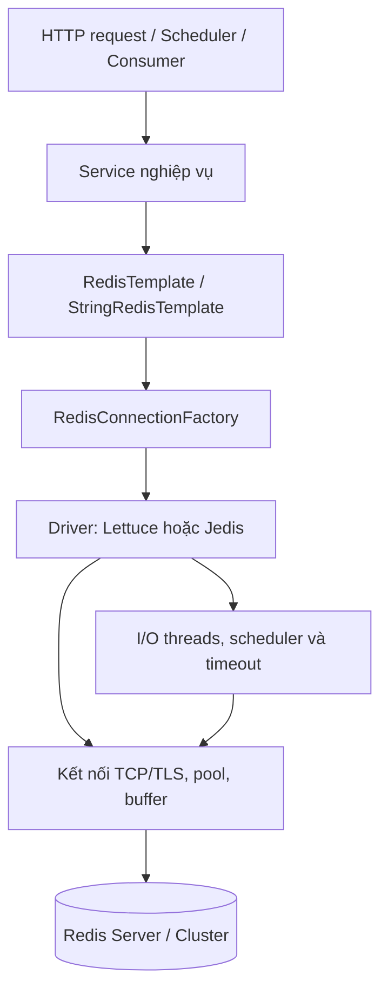
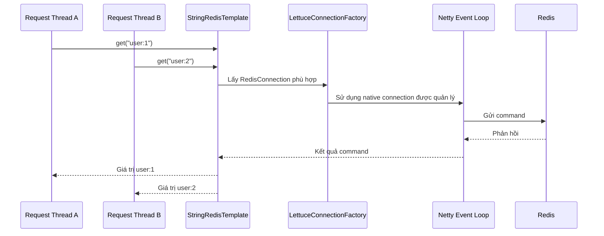
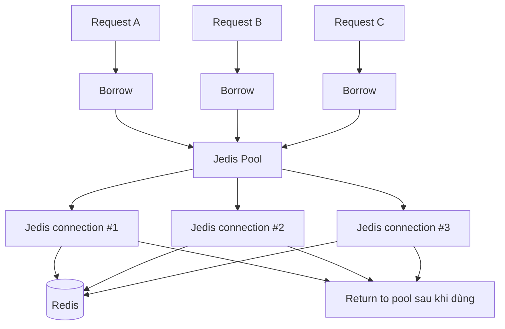
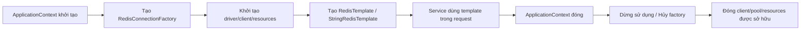
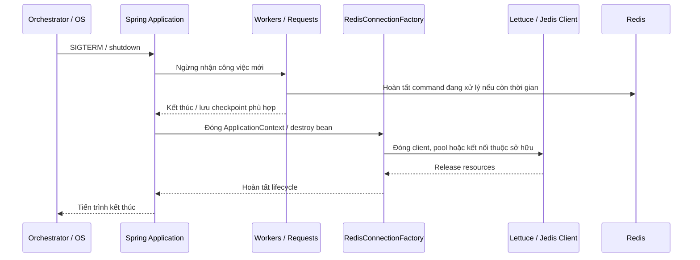

# Quản lý tài nguyên mạng, luồng xử lý và đóng trình điều khiển

Trong Spring Data Redis, **trình điều khiển (Redis driver/client)** là thành phần thực hiện giao tiếp mạng giữa ứng dụng Java và Redis Server. Việc gọi một lệnh Redis có vẻ đơn giản:

```java
String value = stringRedisTemplate.opsForValue().get("profile:42");
```

Nhưng phía sau lời gọi là kết nối TCP hoặc TLS, socket, bộ đệm, thread xử lý I/O, chính sách timeout, và đôi khi là connection pool. Nếu ứng dụng tạo quá nhiều client, giữ kết nối mà không trả về pool, chặn event loop, hoặc tắt driver khi request khác còn đang sử dụng, hậu quả có thể là tăng độ trễ, cạn file descriptor, hết connection pool, mất khả năng phục vụ hoặc kết thúc request không xác định.

Trong hệ sinh thái Spring Data Redis, hai driver thường gặp là **Lettuce** và **Jedis**. Cách quản lý tài nguyên của chúng khác nhau, nhưng nguyên tắc chung là: **xác định rõ ai tạo tài nguyên, ai sử dụng nó, và ai chịu trách nhiệm đóng nó**.

Bài học này tập trung vào vòng đời hạ tầng kết nối Redis trong ứng dụng Spring: tài nguyên mạng, cách tổ chức luồng xử lý, chia sẻ hoặc mượn kết nối, xử lý lỗi và đóng driver an toàn.

## 1. Nhận diện các tầng tài nguyên

Một lời gọi `RedisTemplate` không tương ứng với việc tự động tạo một Redis client mới và mở một socket mới. Spring Data Redis phân tách các trách nhiệm:



| Thành phần | Trách nhiệm chính | Quy tắc vòng đời |
|---|---|---|
| `RedisTemplate` / `StringRedisTemplate` | Cung cấp API đọc/ghi và tuần tự hóa dữ liệu | Thường là Spring singleton; inject và tái sử dụng |
| `RedisConnectionFactory` | Cung cấp kết nối theo loại driver và cấu hình | Spring quản lý bean, khởi tạo và hủy khi đóng context |
| Driver client | Quản lý giao thức, socket, reconnect, I/O | Được sở hữu bởi connection factory hoặc bean chủ sở hữu rõ ràng |
| Native connection | Đường giao tiếp cụ thể tới Redis, có thể dùng lại hoặc thuộc pool | Trả về/đóng theo hợp đồng chủ sở hữu; không chia sẻ bừa bãi |
| Connection pool | Giới hạn, cấp phát và thu hồi các kết nối có thể mượn | Pool sống cùng ứng dụng; từng lượt mượn phải trả |
| Executor / event loop | Chạy thao tác xử lý I/O, callback hoặc công việc do ứng dụng lên lịch | Có chủ sở hữu quản lý lúc shutdown |
| Redis Server | Xử lý các command nhận qua mạng | Vòng đời độc lập với ứng dụng |

### “Đóng một kết nối” có thể mang nhiều ý nghĩa

Cần phân biệt bốn việc dễ bị gọi chung là “đóng Redis”:

1. **Kết thúc một thao tác template:** lời gọi `get`/`set` hoàn tất; Spring trả tài nguyên cho cơ chế quản lý bên dưới. Ứng dụng không phải tự đóng template.
2. **Đóng connection wrapper:** khi tự xin `RedisConnection` từ factory, đóng wrapper theo hợp đồng; thao tác này có thể trả kết nối về pool thay vì đóng socket vật lý.
3. **Đóng native client hoặc pool:** giải phóng những kết nối, buffer và thread mà client/pool sở hữu; chỉ chủ sở hữu thực hiện khi ngừng sử dụng.
4. **Dừng Redis Server:** tác động đến hạ tầng dùng chung, không phải bước cleanup của một service.

Các thao tác trên khác phạm vi. Một service bị xóa khỏi Spring context không nên tự ra lệnh tắt Redis Server, và một request kết thúc không được gọi `shutdown()` trên client dùng chung.

## 2. Tài nguyên mạng nào được driver quản lý?

Mỗi kết nối Redis có thể chiếm socket và file descriptor của hệ điều hành, buffer gửi/nhận, tài nguyên TLS, trạng thái authentication, và trạng thái giao thức liên quan đến command đang chờ phản hồi. Redis Server cũng phải dành bộ nhớ và cấu trúc quản lý cho những client đang kết nối.

### 2.1. TCP, TLS và connection handshake

Một kết nối Redis mới thường trải qua các bước logic:

```text
Ứng dụng cần kết nối
    |
    +--> Phân giải tên host / chọn endpoint
    |
    +--> TCP connect
    |
    +--> TLS handshake (nếu cấu hình TLS)
    |
    +--> AUTH / HELLO / SELECT hoặc thiết lập giao thức khi cần
    |
    +--> Sẵn sàng gửi lệnh Redis
    |
    +--> Đọc phản hồi / theo dõi tình trạng kết nối
```

Tạo kết nối mới cho từng request gây thêm round trip, CPU, TLS handshake và áp lực lên Redis Server. Trong hệ thống có nhiều instance, tổng kết nối là tổng tài nguyên của **tất cả** instance và các loại client, chứ không chỉ con số pool trên một máy.

Ví dụ: một service có 12 instance, mỗi instance có pool tối đa 30 kết nối thì riêng service đó đã **có thể** tạo tới 360 kết nối trong pool; còn có kết nối pub/sub, health checks, admin tools, các service khác và kết nối phục vụ những mục đích riêng. Đây là một bài toán quản trị tài nguyên, không phải lúc nào max pool lớn cũng giúp nhanh hơn.

### 2.2. Tài nguyên mạng thay đổi theo topology

- **Standalone Redis:** một endpoint Redis chính, có thể đi qua DNS, proxy hoặc load balancer.
- **Redis Sentinel:** driver cần kết nối/tra cứu Sentinel để biết master hiện tại và xử lý chuyển đổi khi master thay đổi.
- **Redis Cluster:** driver cần nắm topology các node, slot mapping và xử lý chuyển hướng như `MOVED`/`ASK`; số kết nối thực tế có thể lớn hơn mô hình “một client, một socket”.
- **TLS:** thêm chi phí handshake, mã hóa và quản lý certificate; phải đóng kết nối và xử lý certificate rotation theo chiến lược triển khai.

Không nên lấy số socket trong standalone làm giả định cứng cho cluster. Khi chuyển topology, cần đánh giá lại timeout, reconnect, pooling, metrics và giới hạn kết nối Redis.

### 2.3. Mất kết nối không có nghĩa lệnh chưa chạy

Một request có thể xảy ra theo trình tự:

```text
Java -> gửi INCR -> Redis thực thi INCR -> mạng đứt
                                        |
                                 phản hồi thất lạc
```

Driver báo timeout hoặc lỗi I/O, nhưng Redis **có thể đã thực thi** lệnh. Nếu ứng dụng retry ngay lệnh `INCR`, bộ đếm có thể tăng hai lần. Với lệnh ghi nghiệp vụ, cần thiết kế idempotency hoặc khả năng xác nhận trạng thái ở tầng phù hợp; reconnect của driver tự nó không bảo đảm exactly-once.

## 3. Lettuce: kết nối chia sẻ và mô hình I/O bất đồng bộ bên trong

**Lettuce** là Redis client dựa trên Netty, hỗ trợ API đồng bộ, bất đồng bộ và reactive ở phía client. Spring Boot với `spring-boot-starter-data-redis` thường sử dụng Lettuce mặc định khi cấu hình phù hợp.

Lettuce dùng các **event loop thread** để xử lý network I/O. Nhiều command có thể đi qua một kết nối mà không cần mỗi caller giữ riêng một thread đọc socket. Một đối tượng native `StatefulRedisConnection` thông thường được thiết kế để dùng đồng thời từ nhiều thread đối với các thao tác phù hợp.

Điều này **không** có nghĩa mọi thao tác chia sẻ một connection đều an toàn cho các trạng thái tương tác nhiều bước, chẳng hạn transaction hay blocking command. Cũng cần phân biệt native connection của Lettuce với wrapper `RedisConnection` mà Spring Data Redis cung cấp.

### 3.1. Tại sao Lettuce thường không cần một kết nối cho mỗi request?



Sơ đồ là luồng khái niệm: lịch thực thi có thể đan xen và mỗi request có lệnh riêng. Với cấu hình mặc định phổ biến, `LettuceConnectionFactory` có thể dùng chung native connection cho các thao tác thông thường. Một `RedisConnection` wrapper lấy từ factory **không được mặc định coi là thread-safe**, dù native connection được chia sẻ có các bảo đảm đồng thời riêng.

Một số loại thao tác không phù hợp với cùng kết nối chia sẻ:

- **Blocking commands:** `BLPOP`, `BRPOP`, một số hoạt động stream blocking chờ dữ liệu; kết nối có thể bị giữ trong lúc chờ.
- **Redis transactions:** `MULTI`/`EXEC` có trạng thái gắn với connection; các command của một transaction phải đi đúng connection và thứ tự.
- **Pub/Sub:** kết nối subscription có mô hình sử dụng lâu dài riêng; không phải loại kết nối request-response thông thường.
- **Pipeline đặc thù:** cần giữ trình tự và ranh giới gửi/nhận kết quả theo contract của API.

Spring Data Redis và Lettuce sử dụng những cơ chế kết nối chuyên biệt cho các nhu cầu đó. Vì vậy, không nên rút ra quy tắc “chỉ một native connection cho toàn bộ ứng dụng trong mọi tình huống”.

### 3.2. Netty event loop không phải worker pool xử lý nghiệp vụ

Có hai loại luồng cần phân biệt:

| Loại thread | Công việc chính | Có nên làm gì trên đó? |
|---|---|---|
| Thread gọi `RedisTemplate` đồng bộ | Chạy service/controller, chờ kết quả Redis | Có thể block nếu kiến trúc imperative và số thread được quản lý |
| Netty event loop của Lettuce | Đọc/ghi socket, xử lý I/O và các công việc nội bộ của client | Tránh tác vụ lâu, I/O blocking hoặc xử lý CPU nặng |
| Thread của scheduler hoặc listener ứng dụng | Chạy công việc nghiệp vụ theo cấu hình service | Có chiến lược giới hạn concurrency và shutdown riêng |

Khi viết callback hoặc listener nằm trên đường xử lý I/O, không nên đưa việc gọi HTTP đồng bộ, tính toán nặng hay `Thread.sleep` trực tiếp vào luồng I/O. Một callback nặng có thể kéo dài thời gian xử lý phản hồi của những command khác. Phần việc nghiệp vụ nên được chuyển sang executor phù hợp nếu API và kiến trúc yêu cầu.

Không đặt tùy ý số event loop thread bằng số HTTP request hoặc số Redis connection. Event loop phục vụ I/O của nhiều kết nối; việc tăng thread quá mức gây context switching và không làm Redis Server tự xử lý lệnh nhanh hơn.

### 3.3. Tài nguyên ClientResources

Khi dùng Lettuce trực tiếp, `ClientResources` có thể sở hữu hoặc tham chiếu đến các tài nguyên chia sẻ như event loop group, timer, resolver và thành phần đo latency. Driver có thể sử dụng tài nguyên mặc định hoặc một `ClientResources` do ứng dụng cung cấp.

**Quy tắc ownership:** nếu ứng dụng tự tạo `ClientResources` dùng chung, ứng dụng phải quản lý vòng đời của nó sau khi mọi Redis client/factory đang dùng đã dừng. Nếu để framework tạo, hãy để framework chịu trách nhiệm theo hợp đồng của nó. Không tắt resources khi request đơn lẻ hoàn tất và không chia sẻ resources đã shutdown với factory khác.

Dùng chung `ClientResources` giữa nhiều Lettuce client có thể tiết kiệm thread/tài nguyên, nhưng làm tăng yêu cầu quản lý ownership: chỉ một thành phần đóng nó sau khi các client phụ thuộc được đóng hết.

## 4. Jedis: kết nối mượn từ pool và phạm vi sử dụng theo thread

**Jedis** có lịch sử API đồng bộ đơn giản dựa trên kết nối socket. Một instance `Jedis` truyền thống gắn với kết nối và **không nên được sử dụng đồng thời bởi nhiều thread**. Khi ứng dụng có nhiều request cùng lúc, mô hình thông thường là dùng connection pool hoặc abstraction có quản lý pool, mỗi luồng mượn một kết nối trong khoảng cần thiết rồi trả lại.



### 4.1. Phân biệt đóng Jedis connection và đóng JedisPool

Khi một connection được mượn từ `JedisPool`, gọi `jedis.close()` đúng cách sẽ **trả tài nguyên về pool** theo cơ chế của pool. Nó không nhất thiết đồng nghĩa với đóng socket vật lý trong mọi trường hợp. Ngược lại, `pool.close()` nhằm ngừng pool và giải phóng tài nguyên của toàn pool; không được gọi sau mỗi command.

Ví dụ Jedis thuần để minh họa ownership (không phải cách dùng song song với `StringRedisTemplate` trong một service Spring đã có auto-configuration):

```java
import redis.clients.jedis.Jedis;
import redis.clients.jedis.JedisPool;
import redis.clients.jedis.JedisPoolConfig;

public final class JedisPoolExample {
    public static void main(String[] args) {
        JedisPoolConfig poolConfig = new JedisPoolConfig();
        poolConfig.setMaxTotal(16);
        poolConfig.setMaxIdle(8);
        poolConfig.setMinIdle(0);

        // Pool thuộc vòng đời của ứng dụng.
        try (JedisPool pool =
                new JedisPool(poolConfig, "localhost", 6379)) {

            // Jedis chỉ thuộc một lượt mượn.
            try (Jedis jedis = pool.getResource()) {
                jedis.set("demo:greeting", "hello");
                String value = jedis.get("demo:greeting");
                System.out.println(value);
            } // close() trả kết nối về pool.
        } // close() đóng pool khi ứng dụng kết thúc ví dụ.
    }
}
```

Các giới hạn cần nhớ:

- Không chia sẻ một `Jedis` đang mượn cho nhiều request/threads để chạy command đồng thời.
- Không giữ `Jedis` được mượn trong field singleton của Spring bean rồi dùng mãi.
- Trả kết nối trong `finally` hoặc `try-with-resources` kể cả khi command ném exception.
- Không giữ kết nối trong thời gian xử lý nghiệp vụ kéo dài mà không có Redis command.
- Pool phải có giới hạn số connection, timeout chờ mượn và telemetry; pool vô hạn sẽ chỉ chuyển lỗi từ “chờ pool” sang “quá tải Redis hoặc OS”.

Các thế hệ Jedis mới có thêm API như `JedisPooled`, nhưng quy tắc sở hữu connection và chia sẻ thread vẫn cần dựa trên **đúng loại client được sử dụng**, không mặc định mọi object có tên Jedis đều chia sẻ an toàn.

### 4.2. Khi Jedis được Spring Data Redis quản lý

Trong Spring Data Redis, service thường inject `StringRedisTemplate` và dùng `JedisConnectionFactory` ở phía sau. Khi đó **framework chịu trách nhiệm lấy và giải phóng kết nối theo từng lời gọi**; service không tự gọi `pool.getResource()`, không tự `close()` kết nối do template đang dùng và không tự shutdown factory trong một request.

Nếu cần truy cập trực tiếp `RedisConnection` từ factory:

```java
import org.springframework.data.redis.connection.RedisConnection;
import org.springframework.data.redis.connection.RedisConnectionFactory;

public class DirectRedisConnectionExample {
    private final RedisConnectionFactory factory;

    public DirectRedisConnectionExample(RedisConnectionFactory factory) {
        this.factory = factory;
    }

    public void runWithRawConnection() {
        try (RedisConnection connection = factory.getConnection()) {
            // Thao tác raw RedisConnection nếu thực sự cần.
            // Khi rời block, connection được giải phóng theo factory.
        }
    }
}
```

Mẫu này minh họa quy tắc cleanup ở tầng thấp; không khuyến khích bỏ qua template nếu template đã cung cấp đủ API. Đừng dùng `RedisConnection` lấy ra để giữ trong singleton hay dùng đồng thời qua nhiều thread. Khi hoạt động trong callback template/transaction, nên theo abstraction do Spring cung cấp để giữ đúng ranh giới kết nối.

## 5. So sánh Lettuce và Jedis về tài nguyên, luồng, shutdown

| Khía cạnh | Lettuce | Jedis |
|---|---|---|
| Mô hình nổi bật | Netty I/O, hỗ trợ sync/async/reactive; native connection thông thường có thể dùng đồng thời | API đồng bộ truyền thống; mỗi `Jedis` trực tiếp gắn với kết nối, thường mượn theo lượt từ pool |
| Thread I/O | Event loop và resources của Netty | Khi gọi API đồng bộ, caller chờ I/O trên kết nối được mượn |
| Chia sẻ object | Native `StatefulRedisConnection` có các đảm bảo thread-safety; wrapper Spring vẫn phải theo contract | Không chia sẻ một instance `Jedis` thường cho nhiều thread đồng thời |
| Pool | Tùy use case; không bắt buộc chỉ vì request đồng thời | Thường quan trọng với ứng dụng nhiều thread gọi đồng bộ |
| Blocking command / transaction | Thường cần kết nối phù hợp tách khỏi kết nối chia sẻ thường lệ | Chiếm connection mượn suốt khoảng chờ/transaction |
| Tài nguyên phải thu hồi | Native client, kết nối, Netty event loop, `ClientResources` do ứng dụng sở hữu | Connection đã mượn, pool và client liên quan |
| Cách tích hợp Spring | `LettuceConnectionFactory` | `JedisConnectionFactory` |
| Cách đóng trong Spring Boot | Để ApplicationContext hủy factory/resources do Spring quản lý | Để ApplicationContext hủy factory/pool do Spring quản lý |

**Không chọn driver chỉ bằng số thread hoặc benchmark “một lệnh GET nhanh hơn”.** Cần cân nhắc loại workload (blocking hay không), topology, TLS, số lượng kết nối, khả năng reactive, timeout và nhu cầu vận hành.

## 6. Spring Boot quản lý driver theo vòng đời bean

Khi dùng Spring Boot auto-configuration, một sơ đồ vòng đời thông thường là:



Spring Boot cho phép cấu hình kết nối qua property; trong cấu hình thông thường không cần viết `new RedisClient()` hoặc `new JedisPool()` trong mỗi service.

Ví dụ dependency cho Lettuce:

```groovy
dependencies {
    implementation 'org.springframework.boot:spring-boot-starter-data-redis'
}
```

Cấu hình local theo namespace của Spring Boot 3.x:

```yaml
spring:
  data:
    redis:
      client-type: lettuce
      host: localhost
      port: 6379
      connect-timeout: 2s
      timeout: 2s
      lettuce:
        shutdown-timeout: 200ms
```

Ở đây:

- `client-type` chọn loại Redis client nếu classpath hỗ trợ.
- `connect-timeout` áp dụng cho quá trình thiết lập kết nối.
- `timeout` điều chỉnh thời gian chờ thao tác theo cấu hình driver của Boot.
- `shutdown-timeout` liên quan tới quá trình đóng Lettuce; đây **không** phải timeout cho một HTTP request.

Property chính xác có thể khác theo phiên bản Spring Boot. Cần tham chiếu configuration metadata của phiên bản dự án khi chuyển ví dụ sang phiên bản khác.

### 6.1. Khi nào cần pool cho Lettuce?

Một ứng dụng chủ yếu dùng command thông thường với Lettuce có thể hoạt động tốt bằng native connection chia sẻ và không cần pool lớn. Pool có ý nghĩa khi workload cần kết nối độc lập, có blocking/transaction, hoặc khi số command và đặc tính sử dụng cho thấy chia sẻ kết nối là điểm nghẽn. Đừng thêm pool chỉ vì ứng dụng có hàng trăm request đồng thời.

Ví dụ bật pool có giới hạn trong Spring Boot khi dependency pool đã có:

```groovy
dependencies {
    implementation 'org.springframework.boot:spring-boot-starter-data-redis'
    implementation 'org.apache.commons:commons-pool2'
}
```

```yaml
spring:
  data:
    redis:
      client-type: lettuce
      host: localhost
      port: 6379
      lettuce:
        pool:
          enabled: true
          max-active: 16
          max-idle: 8
          min-idle: 0
          max-wait: 1s
```

Đây là **số liệu minh họa**, không phải cấu hình tối ưu phổ quát. Pool quá nhỏ khiến luồng chờ mượn; pool quá lớn gây tăng socket, memory, context switching và có thể làm Redis quá tải. Đo độ trễ, số request đồng thời, thời gian giữ connection và connection count trên Redis trước khi điều chỉnh.

Cấu hình pool không biến lời gọi `RedisTemplate` đồng bộ thành lời gọi non-blocking. Client code vẫn chờ kết quả hoặc chờ lấy connection.

### 6.2. Chọn Jedis trong Spring Boot

Jedis cần có trên classpath, và phải chọn client type phù hợp. Một ví dụ với dependency đã được quản lý phiên bản qua Spring Boot:

```groovy
dependencies {
    implementation 'org.springframework.boot:spring-boot-starter-data-redis'
    implementation 'redis.clients:jedis'
    implementation 'org.apache.commons:commons-pool2'
}
```

```yaml
spring:
  data:
    redis:
      client-type: jedis
      host: localhost
      port: 6379
      connect-timeout: 2s
      timeout: 2s
      jedis:
        pool:
          enabled: true
          max-active: 24
          max-idle: 12
          min-idle: 0
          max-wait: 1s
```

Khi Boot quản lý Jedis, service vẫn có thể dùng chung `StringRedisTemplate` như với Lettuce:

```java
import org.springframework.data.redis.core.StringRedisTemplate;
import org.springframework.stereotype.Service;

@Service
public class VisitCounter {
    private final StringRedisTemplate redis;

    public VisitCounter(StringRedisTemplate redis) {
        this.redis = redis;
    }

    public long recordVisit(String pageId) {
        Long count = redis.opsForValue()
                .increment("counter:visits:" + pageId);
        if (count == null) {
            throw new IllegalStateException("Không nhận được kết quả Redis");
        }
        return count;
    }
}
```

Service này không biết driver phía dưới là Lettuce hay Jedis: đó là lợi ích của `RedisConnectionFactory` và template. Tuy nhiên **đặc tính thực thi, cấu hình pool, xử lý timeout và thread** vẫn phụ thuộc driver. Không nên đổi driver trong production mà không đánh giá tải và khả năng tương thích của những tính năng đang dùng.

## 7. Tùy biến Lettuce ClientResources khi thật sự cần

Auto-configuration thường đã đủ cho ứng dụng thông dụng. Nếu cần quản lý `ClientResources` chung hoặc tùy chỉnh driver ở tầng thấp, hãy quy định quyền sở hữu rõ ràng bằng các Spring bean.

Ví dụ cấu hình độc lập cho môi trường phát triển, thay thế việc Boot tự tạo connection factory:

```java
import java.time.Duration;
import io.lettuce.core.resource.ClientResources;
import io.lettuce.core.resource.DefaultClientResources;
import org.springframework.context.annotation.Bean;
import org.springframework.context.annotation.Configuration;
import org.springframework.data.redis.connection.RedisStandaloneConfiguration;
import org.springframework.data.redis.connection.lettuce.LettuceClientConfiguration;
import org.springframework.data.redis.connection.lettuce.LettuceConnectionFactory;

@Configuration(proxyBeanMethods = false)
public class RedisDriverConfiguration {

    @Bean(destroyMethod = "shutdown")
    ClientResources redisClientResources() {
        // Spring sở hữu resource bean này và gọi shutdown khi context đóng.
        return DefaultClientResources.create();
    }

    @Bean
    LettuceConnectionFactory redisConnectionFactory(
            ClientResources redisClientResources) {

        RedisStandaloneConfiguration server =
                new RedisStandaloneConfiguration("localhost", 6379);

        LettuceClientConfiguration clientConfig =
                LettuceClientConfiguration.builder()
                        .clientResources(redisClientResources)
                        .commandTimeout(Duration.ofSeconds(2))
                        .shutdownTimeout(Duration.ofMillis(200))
                        .build();

        return new LettuceConnectionFactory(server, clientConfig);
    }
}
```

Điểm quan trọng của ví dụ:

1. `ClientResources` là một bean có **chủ sở hữu** là Spring context.
2. Factory nhận tài nguyên đó qua dependency injection; Spring có thông tin về thứ tự hủy bean phụ thuộc.
3. Factory do Spring quản lý có lifecycle khởi tạo/đóng phù hợp, không cần `afterPropertiesSet()` hoặc `destroy()` từ service.
4. `shutdown()` của tài nguyên Lettuce có thể là API bất đồng bộ; phương án chờ hoàn tất shutdown và deadline phải phù hợp phiên bản driver/kiến trúc. Việc Spring gọi destroy method không nên bị diễn giải thành mọi tác vụ và phản hồi đã hoàn tất tuyệt đối.
5. Đoạn mã cố định `localhost` nhằm minh họa ownership; nếu dùng trong ứng dụng thật, cần chuyển cấu hình host, TLS, authentication, Sentinel/Cluster và timeout ra nguồn cấu hình triển khai.

Khi bạn tự định nghĩa `RedisConnectionFactory`, auto-configuration mặc định có thể không còn chịu trách nhiệm tạo factory đó. **Không để hai factory cạnh tranh không rõ chủ sở hữu**, hoặc vô tình có hai `ClientResources` độc lập khi mong muốn dùng chung. Cũng không đóng `ClientResources` thủ công trong một `@PreDestroy` của service nếu bean resources đang được nhiều factory khác sử dụng.

## 8. Thread gọi Redis: đồng bộ, bất đồng bộ và reactive

Một điểm dễ nhầm: Lettuce dùng Netty event loop **không làm cho mọi cách sử dụng Lettuce trở thành non-blocking ở tầng ứng dụng**.

| API ứng dụng | Cách caller nhận kết quả | Loại thread cần lưu ý |
|---|---|---|
| `StringRedisTemplate.opsForValue().get(...)` | Trả giá trị hoặc exception khi hoàn thành | Thread gọi thường chờ Redis |
| Lettuce async API | Trả future; caller có thể tiếp tục việc khác | Callback/executor và I/O event loop |
| `ReactiveStringRedisTemplate` | Trả `Mono`/`Flux`; xử lý khi subscribe | Event loop/scheduler của reactive pipeline |
| Jedis sync API | Lệnh đồng bộ, thường mượn kết nối | Thread gọi chờ kết quả hoặc chờ pool |

### 8.1. Trong Spring MVC

Trong mô hình request thread truyền thống:

```java
@GetMapping("/visits/{pageId}")
public Map<String, Long> count(@PathVariable String pageId) {
    return Map.of("count", visitCounter.recordVisit(pageId));
}
```

Nếu `recordVisit` gọi `StringRedisTemplate` đồng bộ, request thread chờ Redis phản hồi. Cách này có thể phù hợp khi latency được kiểm soát và giới hạn số request đồng thời được tính vào sizing. Nếu Redis chậm, nhiều request thread có thể cùng chờ và gây **thread starvation** ở tầng HTTP. Khi đó cần kiểm soát timeout, áp dụng backpressure/rate-limit, giảm command trên đường request nóng và theo dõi thread pool.

### 8.2. Trong Spring WebFlux

Nếu chạy trên event loop của Reactor Netty, gọi trực tiếp API blocking từ `RedisTemplate` có thể chặn event loop đang phục vụ nhiều connection.

Thay vào đó, trong stack reactive có thể sử dụng `ReactiveStringRedisTemplate` với driver hỗ trợ:

```java
import org.springframework.data.redis.core.ReactiveStringRedisTemplate;
import org.springframework.stereotype.Service;
import reactor.core.publisher.Mono;

@Service
public class ReactiveVisitStore {
    private final ReactiveStringRedisTemplate redis;

    public ReactiveVisitStore(ReactiveStringRedisTemplate redis) {
        this.redis = redis;
    }

    public Mono<Long> recordVisit(String pageId) {
        return redis.opsForValue()
                .increment("counter:visits:" + pageId);
    }
}
```

Không gọi `block()` trên event loop để “lấy giá trị ngay”; điều này triệt tiêu lợi ích non-blocking. Cũng không gọi `subscribe()` tự phát trong service để tạo công việc không còn gắn với vòng đời request, xử lý lỗi và khả năng hủy. Nên **trả `Mono` hoặc `Flux` về cho lớp điều phối** và để framework quản lý subscription.

Một số tác vụ blocking không tránh được có thể được chuyển sang executor/scheduler phù hợp, nhưng đây là lựa chọn có giới hạn concurrency và chi phí chuyển thread. Đừng coi `boundedElastic` là cách sửa mọi vấn đề thiếu năng lực Redis hoặc connection pool.

### 8.3. Blocking Redis command còn tiêu tốn kết nối

Lệnh như `BLPOP` hoặc `XREAD ... BLOCK` có thể giữ connection đang chờ dữ liệu. Nếu chạy nhiều consumer blocking, cần hiểu mỗi consumer giữ những tài nguyên gì và có cơ chế dừng an toàn. Dùng chung pool nhỏ cho cả blocking consumer và request thường có thể khiến request không mượn được connection.

Mô hình phù hợp thường phân tách đường xử lý blocking/long-lived khỏi đường request-response ngắn, hoặc dùng listener container/chính sách client có quản lý resource riêng. Chọn số consumer theo throughput và đặc tính Redis thực tế, không chỉ theo số CPU của máy ứng dụng.

## 9. Connection pool: giới hạn, chờ mượn, trả kết nối

Pool là cơ chế giới hạn và tái sử dụng connection. Nó không thay thế server capacity và không bảo đảm mọi request có kết nối ngay lập tức.

Các tham số cần phân biệt:

| Tham số | Ý nghĩa | Nếu chọn không phù hợp |
|---|---|---|
| `max-active` | Số connection tối đa có thể hoạt động trong pool | Quá nhỏ → chờ lâu; quá lớn → tốn socket/server |
| `max-idle` | Số connection rảnh tối đa được giữ lại | Quá cao → giữ tài nguyên không cần thiết |
| `min-idle` | Số connection rảnh tối thiểu theo cơ chế pool | Quá lớn → chiếm tài nguyên khi ít tải |
| `max-wait` | Thời gian tối đa chờ mượn connection | Quá dài → request thread bị giữ; quá ngắn → lỗi sớm dưới spike |
| Validation/eviction policy | Kiểm tra và loại connection không còn dùng được | Không hợp lý → dùng connection chết hoặc tăng overhead |

Để ước lượng nhu cầu kết nối, cần biết **số tác vụ đồng thời đang giữ connection**, chứ không chỉ thông lượng HTTP. Ví dụ, một ứng dụng 500 request/s nhưng mỗi command mất trung bình 2 ms có nhu cầu concurrency khác với hệ thống 100 request/s mà mỗi connection bị giữ 200 ms vì blocking. Thời gian chờ trong pool, thời gian thao tác Redis và thời gian xử lý nghiệp vụ cần đo riêng.

Một cách nhìn bằng định luật Little:

```text
Concurrency xấp xỉ Throughput x Thời gian giữ tài nguyên

Ví dụ:
200 thao tác/giây x 0,010 giây giữ connection
≈ 2 connection đang bận trung bình
```

Đây chỉ là ước tính trung bình, không tính burst, retry, long-tail latency, blocking command, nhiều command/transaction, cluster topology hoặc số instance cùng hoạt động. Để sizing thực tế, cần thêm headroom có kiểm soát và tải thử theo mẫu traffic của hệ thống.

### 9.1. Tại sao tăng max pool có thể làm hệ thống tệ hơn?

Khi Redis đã bão hòa CPU hoặc network, tăng số connection không tự tăng năng lực xử lý command. Nó có thể khiến:

- Redis nhận nhiều command đồng thời hơn và tăng queueing.
- Ứng dụng dùng nhiều file descriptor, buffer và memory.
- Nhiều request giữ tài nguyên và tăng tail latency.
- Lỗi Redis xảy ra cùng lúc, dẫn tới retry storm.

Thực hiện điều chỉnh theo dữ liệu metrics thay vì dùng số “càng lớn càng tốt”. Pool là giới hạn bảo vệ tài nguyên, không phải công cụ “bật chế độ parallel” cho Redis.

## 10. Timeout, reconnect, retry và hủy thao tác

Các thời hạn cần có ý nghĩa khác nhau:

| Thời hạn | Đang chờ điều gì? | Hướng xử lý |
|---|---|---|
| Connect timeout | TCP/TLS connection được thiết lập | Kiểm tra endpoint, network, DNS, TLS và tài nguyên |
| Command timeout | Command trả kết quả | Xác định đặc tính lệnh, tải Redis và khả năng đã thực thi |
| Pool borrow timeout | Có connection trống để mượn | Điều chỉnh concurrency, thời gian giữ connection, giới hạn pool |
| Application request deadline | Toàn bộ HTTP/job phải hoàn tất | Phân bổ timeout theo các bước, tránh chờ vượt ngân sách |
| Shutdown timeout | Đợi tài nguyên/công việc đóng | Chọn thứ tự đóng và grace period phù hợp |

**Timeout không có nghĩa Redis đã rollback lệnh.** Với dữ liệu quan trọng, sau timeout cần lựa chọn kiểm tra trạng thái, idempotency hoặc cơ chế xử lý lại an toàn. Retry có thể hợp lý với một `GET` idempotent nhưng nguy hiểm với `INCR`, `LPUSH`, `XADD` hoặc thao tác nghiệp vụ không có idempotency key.

### 10.1. Reconnect giúp phục hồi kết nối, không thay thế xử lý lỗi

Lettuce hỗ trợ reconnect trong nhiều trường hợp; điều kiện áp dụng phụ thuộc cấu hình, topology và loại lỗi. Khi kết nối rớt:

1. Command đang chờ có thể hoàn thành, thất bại hoặc không xác định kết quả.
2. Driver có thể cố thiết lập connection mới.
3. Ứng dụng vẫn phải quyết định xử lý exception và command timeout.
4. Server mới được chọn sau failover có thể chưa có toàn bộ dữ liệu từ node cũ nếu replication bất đồng bộ.

Không nên kết luận một cách máy móc rằng “driver tự reconnect nên request trước đó sẽ thành công” hoặc “có retry nên mỗi sự kiện chỉ được ghi một lần”.

### 10.2. Cancellation cũng không có nghĩa undo

Trong reactive pipeline hoặc task có khả năng hủy, việc caller ngừng chờ không bảo đảm Redis Server chưa nhận command. Một future hoặc subscription bị cancel có thể làm ứng dụng bỏ kết quả, nhưng side effect ở Redis vẫn có thể xảy ra. Hãy giữ idempotency tại ranh giới nghiệp vụ khi kết quả tác vụ phải có nghĩa chính xác.

## 11. Đóng driver an toàn khi ứng dụng dừng

Khi Spring Boot nhận tín hiệu shutdown, ứng dụng cần ngừng nhận công việc mới, cho các công việc đang xử lý hoàn tất trong giới hạn thời gian, đóng tài nguyên cấp ứng dụng, rồi giải phóng các driver/pool. Các lifecycle phase cụ thể do Spring context và bean lifecycle điều phối.



### 11.1. Tài nguyên của ai thì người đó đóng

| Tài nguyên | Ai tạo? | Ai đóng? | Khi nào? |
|---|---|---|---|
| `StringRedisTemplate` inject vào service | Spring | Spring quản lý bean; service không tự close | Theo ApplicationContext |
| `RedisConnectionFactory` auto-configured | Spring Boot | Spring container gọi lifecycle cleanup | Khi context đóng |
| Lettuce client do factory sở hữu | Factory | Factory/owner theo hợp đồng | Sau khi không còn thao tác cần dùng |
| `ClientResources` do ứng dụng tự tạo | Bean hoặc mã ứng dụng | Chính bean/chủ sở hữu | Sau khi các client phụ thuộc đã dừng |
| `Jedis` mượn từ `JedisPool` thủ công | Pool | Caller gọi `jedis.close()` trả lại pool | Mỗi lượt mượn |
| `JedisPool` tạo thủ công | Một bean hoặc ứng dụng | Bean/chủ sở hữu | Khi ngừng toàn bộ tác vụ dùng pool |
| `RedisConnection` lấy trực tiếp | Factory cấp | Caller trả/đóng wrapper theo hợp đồng | Cuối phạm vi dùng |
| Redis Server | Hệ thống hạ tầng | Hệ thống vận hành Redis | Theo vòng đời hạ tầng, độc lập service |

Nếu một bean sử dụng tài nguyên của bean khác, Spring biết dependency và có thể áp dụng thứ tự destroy phù hợp. Nếu tự quản lý bằng static singleton, thread tự tạo hoặc nhiều client ngoài Spring, ứng dụng phải tự xác định thứ tự shutdown và chờ hoàn tất.

### 11.2. Không đóng tài nguyên chia sẻ trong mỗi request

**Sai về ownership:**

```java
@Service
class WrongLifecycleService {
    private final LettuceConnectionFactory factory;

    WrongLifecycleService(LettuceConnectionFactory factory) {
        this.factory = factory;
    }

    void handleRequest() {
        // Xử lý một request...
        factory.destroy(); // Sai: factory dùng chung toàn ứng dụng.
    }
}
```

Một request gọi `factory.destroy()` có thể phá kết nối của các request khác. Điều tương tự áp dụng cho `RedisClient.shutdown()`, `ClientResources.shutdown()`, `JedisPool.close()` nếu các tài nguyên đó còn được nhiều service dùng.

**Đúng về ownership trong Spring:** inject `StringRedisTemplate`, gọi thao tác Redis, để Spring hủy factory khi đóng context. Nếu tạo pool hoặc executor riêng, khai báo bean có destroy method phù hợp hoặc logic lifecycle rõ ràng.

### 11.3. Graceful shutdown trong môi trường container

Khi triển khai trên Kubernetes, Docker hoặc hệ thống orchestrator, ứng dụng thường nhận `SIGTERM` và có khoảng thời gian hữu hạn trước khi bị buộc dừng. Thiết kế phù hợp gồm:

1. Đưa instance khỏi tuyến nhận request mới theo cơ chế vận hành.
2. Dừng scheduler/consumer bắt đầu công việc mới.
3. Cho các request hoặc message đang chạy hoàn tất trong thời hạn cho phép.
4. Với consumer, chỉ xác nhận xử lý sau khi side effect nghiệp vụ hoàn tất; nếu bị dừng giữa chừng, cơ chế replay/idempotency xử lý phần còn lại.
5. Để Spring đóng connection factory, client, pool và executor đúng ownership.
6. Cho một deadline hữu hạn để không treo shutdown mãi.

Spring Boot có hỗ trợ cấu hình graceful shutdown cho web server, nhưng chỉ riêng cấu hình đó **không tự xử lý vòng đời của mọi consumer và thread tùy biến**. Mỗi worker do ứng dụng sở hữu cần có cách ngừng nhận việc và dừng an toàn. Đừng kéo dài shutdown vô hạn vì một lệnh Redis blocking hoặc network outage.

### 11.4. Tránh giữ tài nguyên ngoài vòng đời context

Đây là các mẫu dễ gây leak:

- Tạo `new RedisClient(...)` trong mỗi phương thức.
- Tạo `new JedisPool(...)` ở mỗi lần gọi API.
- Tạo thread riêng chạy vòng lặp sử dụng client nhưng không dừng khi ứng dụng shutdown.
- Mượn Jedis rồi không đóng khi exception xuất hiện.
- Tạo `ClientResources` mới cho mỗi factory mà không đóng tài nguyên này.
- Giữ một native connection ngoài Spring trong static field và không quản lý vòng đời.
- Đóng pool trước khi các consumer đã dừng, khiến chúng đang chạy bị lỗi hàng loạt.
- Tạo nhiều `ApplicationContext` trong cùng JVM mà quên đóng các context phụ.

Một leak có thể không biểu hiện ngay: ứng dụng chạy ổn khi traffic thấp, nhưng sau vài giờ/ngày dần cạn socket hoặc pool và chỉ hồi phục khi restart.

## 12. Quan sát tài nguyên mạng và luồng

Khi ứng dụng tăng độ trễ hoặc bị lỗi kết nối, cần quan sát **cả phía ứng dụng và Redis**.

### 12.1. Các tín hiệu phía ứng dụng

| Tín hiệu | Có thể chỉ ra |
|---|---|
| Redis command latency, percentile p95/p99 | Redis/network chậm, command nặng hoặc chờ tài nguyên |
| Connection creation/reconnect/error count | Endpoint không ổn định, DNS/TLS hoặc failover |
| Pool active/idle/waiters và thời gian mượn | Cạn pool, leak hoặc workload giữ kết nối quá lâu |
| HTTP worker threads đang chờ Redis | Redis latency lan thành thread starvation |
| Netty event loop thread bận kéo dài | Callback hoặc I/O bị chặn, tài nguyên quá tải |
| OS open file descriptors và sockets | Quá nhiều connection/client hoặc leak |
| Timeout và số lần retry | Deadline không hợp lý, network/Redis quá tải |
| Pending tasks/consumer backlog | Tốc độ xử lý không theo kịp đầu vào |

Có thể dùng metrics từ Spring Boot Actuator/Micrometer, driver, pool và hệ thống giám sát, tùy component nào cung cấp. **Không mặc định mọi metric tự xuất hiện** chỉ vì đã thêm dependency Redis starter; cần kiểm tra instrumentation và tên metric của phiên bản đang dùng.

### 12.2. Quan sát Redis Server

Các lệnh vận hành thường dùng:

```redis
INFO clients
INFO stats
INFO memory
INFO commandstats
CLIENT LIST
SLOWLOG GET 20
LATENCY LATEST
```

Ý nghĩa:

- `INFO clients` cung cấp tổng quan client hiện tại, có thể giúp phát hiện số connection bất thường.
- `CLIENT LIST` hiển thị các client connection; cần phân quyền vận hành phù hợp vì kết quả có thể chứa thông tin nhạy cảm về địa chỉ/trạng thái.
- `INFO stats` hỗ trợ quan sát hoạt động và lỗi chung.
- `INFO memory` giúp phân biệt áp lực bộ nhớ với áp lực connection.
- `INFO commandstats` và `SLOWLOG` hỗ trợ điều tra command tốn thời gian xử lý ở Redis.
- `LATENCY` giúp xem các sự kiện latency nếu tính năng và ngưỡng theo dõi được cấu hình.

Các lệnh này là công cụ chẩn đoán; không nên gọi chúng trên mỗi request. Khi dùng Redis Cluster cần chú ý metrics và connection count của **từng node**.

### 12.3. Phân biệt bốn loại chậm

Khi một lời gọi `redis.opsForValue().get(...)` mất 900 ms, cần phân rã nguyên nhân:

1. **Chờ lấy connection từ pool:** Redis có thể vẫn nhanh, nhưng ứng dụng không có connection sẵn.
2. **Thiết lập/reconnect:** tốn DNS, TCP, TLS, AUTH, chuyển topology.
3. **Command/network latency:** đã gửi lệnh nhưng chờ xử lý/phản hồi.
4. **Chậm ở ứng dụng:** thread bị nghẽn, serializer nặng, GC hoặc callback xử lý nhiều việc.

Tăng pool chỉ có thể giải quyết một số trường hợp của bước 1, đôi khi còn làm bước 3 tệ hơn. Muốn xử lý đúng cần có tracing/metrics tách các giai đoạn và kiểm tra áp lực từ client tới server.

## 13. Các tình huống lỗi và cách xử lý

### Tình huống A: Pool Jedis cạn dù Redis vẫn hoạt động

**Biểu hiện:** request bắt đầu báo timeout khi mượn connection. Redis command latency thấp và CPU server chưa bão hòa, nhưng chỉ số pool active luôn đạt max.

**Nguyên nhân điển hình:** có đường code mượn `JedisPool.getResource()` mà không gọi `close()` khi exception, hoặc một consumer blocking giữ connection quá lâu.

**Cách xử lý:** tìm nơi mượn connection; đưa vào `try-with-resources`; tách workload dài khỏi request thông thường nếu cần; giám sát thời gian giữ connection. Không chỉ tăng `max-active` để che leak.

### Tình huống B: Mỗi request khởi tạo một Lettuce RedisClient

**Biểu hiện:** số socket/Netty threads tăng bất thường, TLS handshake nhiều, CPU và memory ứng dụng tăng, connection count phía Redis nhảy theo traffic.

**Nguyên nhân:** mã nghiệp vụ gọi `RedisClient.create()`/`connect()` ở mỗi request rồi không quản lý cleanup; dù có gọi shutdown, chi phí tạo client vẫn lớn.

**Cách xử lý:** dùng `RedisConnectionFactory` và template do Spring quản lý, hoặc một client/connection có ownership rõ ràng ở phạm vi application; tránh khởi tạo client trong controller.

### Tình huống C: WebFlux bị chậm khi Redis có độ trễ 50–100 ms

**Biểu hiện:** một số request gọi Redis chậm kéo theo request khác trên cùng event loop cũng chậm.

**Nguyên nhân:** service gọi `StringRedisTemplate` đồng bộ trực tiếp trên event loop.

**Cách xử lý:** dùng `ReactiveStringRedisTemplate` trong pipeline reactive, hoặc cách ly blocking call vào scheduler phù hợp với giới hạn concurrency và deadline. Tránh gọi `block()` trên event loop.

### Tình huống D: Pool lớn nhưng Redis latency tăng

**Biểu hiện:** tăng `max-active` làm throughput ít cải thiện, p99 lại tăng, Redis CPU/network cao và error/retry tăng.

**Nguyên nhân:** capacity thực sự nằm ở Redis Server/command/giới hạn network; thêm connection làm tăng mức tranh chấp.

**Cách xử lý:** đo command latency, giảm command nặng, tối ưu key/data shape, kiểm tra pipeline theo use case, shard/scale khi phù hợp và giới hạn concurrency đầu vào.

### Tình huống E: Dừng ứng dụng tạo nhiều lỗi Redis giữa chừng

**Biểu hiện:** khi nhận SIGTERM, scheduler còn chạy nhưng Redis client đã shutdown; một số job thất bại hoặc bị xử lý lại.

**Nguyên nhân:** shutdown order không đúng, background worker chưa dừng nhận việc hoặc timeout grace quá ngắn.

**Cách xử lý:** điều phối dừng công việc trước khi đóng client, ghi nhận trạng thái công việc, giữ retry/idempotency và bảo đảm bean lifecycle có dependency rõ ràng.

### Tình huống F: Failover gây trùng side effect

**Biểu hiện:** sau Redis reconnect, một sự kiện hoặc counter ghi hai lần dù caller “chỉ gửi một request”.

**Nguyên nhân:** timeout xảy ra sau khi server đã thực thi; application/driver retry một lệnh không idempotent.

**Cách xử lý:** thiết kế idempotency key, trạng thái xử lý ở nơi dữ liệu gốc và quy trình xác minh trước khi retry. Driver không thể tự cấp bảo đảm exactly-once cho toàn bộ nghiệp vụ.

## 14. Mẫu kiến trúc Spring nên áp dụng

Trong ứng dụng dùng Redis như một hạ tầng dùng chung, tổ chức trách nhiệm như sau:

```text
ApplicationContext
    |
    +-- RedisConnectionFactory (Spring-managed singleton)
    |       |
    |       +-- LettuceClient / Jedis resources (factory-managed)
    |       +-- Connection sharing / Pool / Network lifecycle
    |
    +-- StringRedisTemplate (Spring-managed singleton)
    |
    +-- RedisTemplate<K,V> cho serializer cụ thể nếu cần
    |
    +-- Service nghiệp vụ (inject template)
    |       |
    |       +-- Mỗi request gọi opsForValue/Hash/Set/...
    |       +-- Không tạo client/pool mỗi request
    |       +-- Không tự close factory đang chia sẻ
    |
    +-- Scheduler / Consumer (lifecycle riêng nếu tạo worker)
            |
            +-- Dừng nhận việc trước khi context giải phóng Redis resources
```

Cấu trúc trên giúp application code chỉ lo thao tác dữ liệu, trong khi container sở hữu tài nguyên kết nối. Khi có nhu cầu đặc biệt như Redis Cluster, Netty resource chia sẻ, Jedis pool hoặc consumer blocking, hãy cấu hình ở **tầng hạ tầng** và theo dõi tác động của nó thay vì mỗi service tự tạo cơ chế riêng.

### Quy tắc chọn cách quản lý

| Bạn đang làm gì? | Cách tiếp cận |
|---|---|
| Service Spring Boot gọi GET/SET/INCR thông thường | Inject `StringRedisTemplate` hoặc `RedisTemplate`; để Boot quản lý factory |
| Cần custom serializer | Cấu hình template bean riêng nhưng tái sử dụng connection factory |
| Cần timeout/pool | Cấu hình properties hoặc customizer ở tầng hạ tầng; đo trước và sau |
| Cần kết nối native cho API đặc biệt | Xác định owner; tuân thủ contract và cleanup của connection/client |
| Dùng Jedis thuần ngoài Spring | Mượn connection bằng `try-with-resources`, đóng pool một lần khi owner kết thúc |
| Tạo Lettuce `ClientResources` dùng chung | Có bean/chủ sở hữu và thứ tự shutdown rõ ràng |
| Chạy WebFlux/Reactor | Ưu tiên API Redis reactive, tránh gọi template blocking trên event loop |
| Chạy consumer chờ lệnh blocking | Giới hạn số consumer, tách connection phù hợp, có cách dừng |
| Scale nhiều instance hoặc chuyển Redis Cluster | Tính tổng socket, latency, topology, timeout và concurrency theo toàn cụm |

## 15. Những nguyên tắc cần ghi nhớ

**Thứ nhất, quản lý vòng đời theo phạm vi.** Một Redis client, connection factory hoặc pool thuộc phạm vi ứng dụng phải sống lâu hơn một request. Connection được mượn có phạm vi ngắn hơn và phải được trả đúng cách. Một `ClientResources` do ứng dụng tạo phải được đóng đúng lúc, sau khi những client phụ thuộc đã dừng.

**Thứ hai, hiểu rõ driver dùng thread như thế nào.** Lettuce dùng Netty event loops cho network I/O; API đồng bộ vẫn giữ thread gọi chờ kết quả. Jedis đồng bộ truyền thống thường gắn mỗi connection với một lượt mượn ở một thread. Không dùng các đặc điểm này để suy luận mọi object connection đều thread-safe.

**Thứ ba, giới hạn tài nguyên có cơ sở.** Số connection, pool, I/O threads và timeout phải được chọn từ workload, topology và quan sát thực tế. Pool lớn không đồng nghĩa server nhanh; nhiều client độc lập không đồng nghĩa khả năng xử lý cao.

**Thứ tư, shutdown phải có thứ tự.** Dừng tạo công việc mới, xử lý công việc đang chạy trong deadline, giải phóng connection đã mượn rồi để Spring container đóng factory/client/resources thuộc sở hữu. Không shutdown driver dùng chung từ một service/request đơn lẻ.

**Thứ năm, lỗi kết nối không nói đầy đủ kết quả nghiệp vụ.** Timeout, cancel hoặc reconnect không bảo đảm lệnh chưa thực thi và không bảo đảm rollback. Với thao tác có side effect, cần idempotency, xử lý retry và kiểm tra trạng thái tương xứng mức độ quan trọng của dữ liệu.

Khi ứng dụng Spring Data Redis có ownership rõ ràng cho mạng, luồng xử lý và tài nguyên driver, khả năng tăng tải, triển khai nhiều instance và dừng ứng dụng sẽ dễ kiểm soát hơn. Đây là nền tảng để sử dụng Redis ổn định trước khi tối ưu từng command hoặc tính năng nghiệp vụ.

