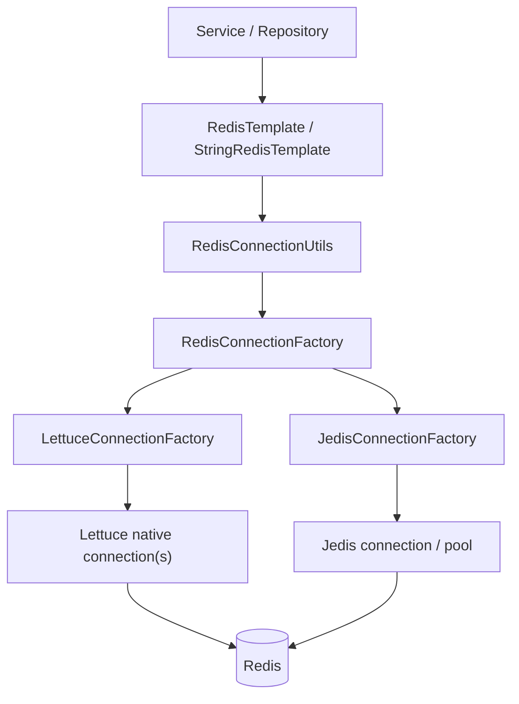
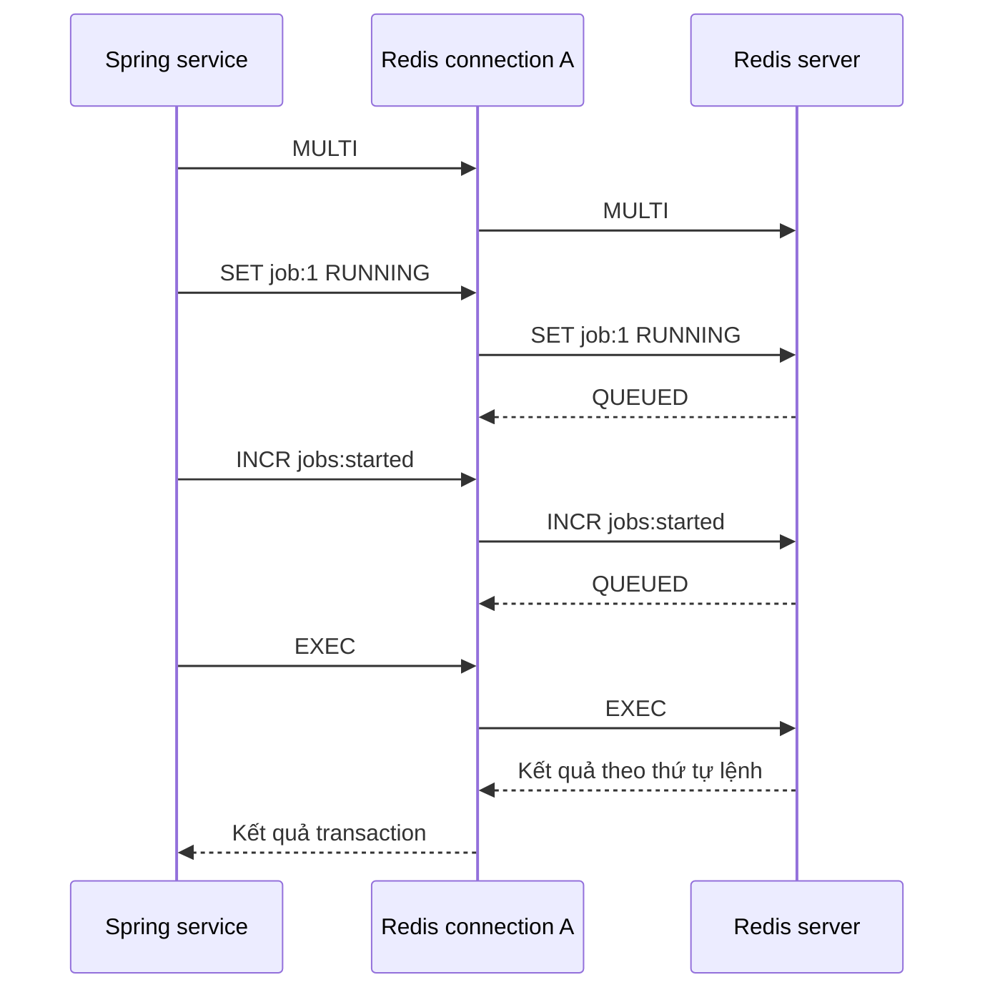
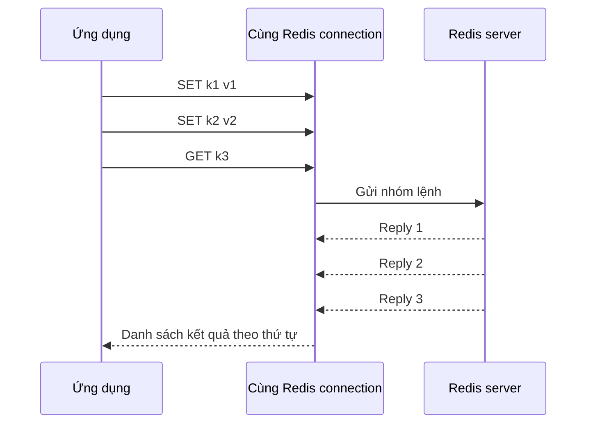

# Kiểm soát vòng đời kết nối trong giao dịch và pipeline

## 1. Vì sao vòng đời kết nối quan trọng?

Một lệnh Redis đơn lẻ như `GET` hoặc `INCR` thường rất ngắn: ứng dụng mượn hoặc sử dụng một kết nối, gửi lệnh, nhận kết quả rồi có thể dùng kết nối đó cho công việc tiếp theo. Nhưng **giao dịch Redis** và **pipeline** có trạng thái trải qua **nhiều lệnh**. Nếu ứng dụng tùy tiện đổi kết nối giữa chừng, đóng kết nối quá sớm hoặc giữ kết nối sau khi công việc đã kết thúc, kết quả có thể sai, tài nguyên bị chiếm hoặc request khác bị ảnh hưởng.

Trong Spring Data Redis, việc kiểm soát vòng đời kết nối nghĩa là xác định:

1. **Ai lấy kết nối?** `RedisTemplate`, `RedisConnectionFactory` hay mã ứng dụng gọi trực tiếp.
2. **Các lệnh nào phải dùng cùng kết nối?** Nhất là `MULTI`/`EXEC`, `WATCH` và một đợt pipeline.
3. **Ai chịu trách nhiệm trả/đóng kết nối?** Template hay chính đoạn mã lấy kết nối thủ công.
4. **Khi lỗi, trạng thái còn lại là gì?** Lệnh còn trong hàng đợi, kết nối mất, phản hồi không rõ, transaction chưa kết thúc.
5. **Khi nào giữ kết nối quá lâu?** Chờ thao tác ứng dụng, I/O bên ngoài, lệnh blocking hoặc batch quá lớn.

Một Redis connection không chỉ là địa chỉ host và port. Đó là một phiên giao tiếp có trạng thái ở client và server, bao gồm thứ tự lệnh, hàng đợi transaction, chế độ pipeline, kết quả đang chờ và đôi khi ngữ cảnh theo dõi `WATCH`. Các trạng thái này gắn với **kết nối**, không tự gắn với tên Redis key hay đối tượng service.

## 2. Các tầng quản lý kết nối của Spring Data Redis

Ứng dụng Spring Boot thường làm việc qua `StringRedisTemplate` hoặc `RedisTemplate<K,V>`. Các template dựa vào `RedisConnectionFactory` để lấy kết nối thông qua driver như Lettuce hoặc Jedis.



Các khái niệm cần phân biệt:

| Thành phần | Vai trò | Phạm vi sử dụng thường gặp |
|---|---|---|
| `RedisTemplate`, `StringRedisTemplate` | Cung cấp thao tác Redis, serializer, callback và quản lý kết nối | Bean dùng chung trong ứng dụng sau khi cấu hình hoàn chỉnh |
| `RedisConnectionFactory` | Cấp đối tượng `RedisConnection` của Spring Data Redis | Bean Spring dùng chung |
| `RedisConnection` | Giao diện kết nối ở tầng Spring, có trạng thái thao tác cụ thể | Sử dụng trong phạm vi callback hoặc đoạn mã đã lấy kết nối |
| Native Lettuce connection | Kết nối do Lettuce quản lý; một số loại hỗ trợ đa luồng | Có thể được factory chia sẻ cho lệnh thông thường |
| Jedis connection | Kết nối do Jedis quản lý, thông thường sử dụng độc quyền ở một thời điểm | Thường mượn/trả qua pool |
| Connection pool | Giới hạn và tái sử dụng số kết nối | Phục vụ các lần mượn kết nối, có giới hạn đợi |

**Lưu ý:** `LettuceConnectionFactory` có thể chia sẻ native connection cho các lệnh thông thường. Tuy nhiên **`LettuceConnection` (wrapper `RedisConnection` của Spring Data Redis) không được xem là thread-safe**. Spring Data Redis còn cần kết nối phù hợp cho transaction hoặc lệnh blocking. Jedis thường dựa vào pool hoặc cơ chế quản lý kết nối để phục vụ nhiều thread đồng thời. Vì vậy không được kết luận số lượng lời gọi `getConnection()` luôn bằng số socket vật lý.

### 2.1. Vòng đời của một lệnh qua RedisTemplate

```text
Service gọi redisTemplate.opsForValue().get(key)
        |
        v
Template lấy một RedisConnection phù hợp
        |
        v
Serialize key -> gửi GET -> nhận kết quả -> deserialize
        |
        v
Template giải phóng resource theo ngữ cảnh hiện hành
        |
        v
Connection có thể được tái sử dụng / trả pool
```

Ở mức ứng dụng, **không gọi `close()` trên kết nối mà template đã cấp cho callback**. Template chịu trách nhiệm quản lý resource và trả kết nối sau khi callback kết thúc. Ngược lại, nếu chính mã ứng dụng gọi `connectionFactory.getConnection()`, mã đó phải bảo đảm giải phóng kết nối đúng cách, thường bằng `try-with-resources`.

### 2.2. “Đóng connection” không đồng nghĩa đóng socket TCP

Khi đóng một `RedisConnection` wrapper, hành vi thực tế tùy factory:

- Có thể **trả connection về pool** để request khác mượn.
- Có thể **giải phóng wrapper** nhưng native Lettuce connection vẫn được factory giữ để dùng lại.
- Có thể thực sự đóng native socket nếu đó là connection chuyên biệt hoặc factory đang hủy.

Do đó, việc thấy `close()` ở đúng điểm kết thúc có nghĩa là hoàn tất **quyền sở hữu tài nguyên**, không nhất thiết mở/đóng một kết nối TCP cho mỗi lệnh. Tự đóng nhầm một native connection đang được factory chia sẻ có thể làm ảnh hưởng đến các lệnh khác.

## 3. Giao dịch Redis: trạng thái sống trên cùng kết nối

Redis hỗ trợ transaction bằng `MULTI` và `EXEC`. Sau khi gọi `MULTI`, các lệnh phù hợp được **xếp hàng đợi trên chính connection đó**. `EXEC` yêu cầu Redis thực thi nhóm lệnh theo thứ tự. `DISCARD` hủy các lệnh đã xếp hàng mà chưa thực thi.



**Không thể gửi `MULTI` bằng connection A, các lệnh bằng connection B, rồi `EXEC` bằng connection C** và mong Redis hiểu đó là một giao dịch. Mỗi connection có trạng thái transaction riêng.

### 3.1. Transaction Redis không giống transaction quan hệ

Redis bảo đảm các lệnh trong `EXEC` được xử lý theo thứ tự mà không bị lệnh của client khác chen vào giữa ở mức thực thi transaction. Nhưng Redis **không có rollback dữ liệu theo mô hình ACID của RDBMS**: lỗi thực thi của một lệnh trong transaction không mặc nhiên hoàn tác các lệnh khác đã thực thi. Nếu server hoặc đường mạng lỗi, kết quả thực tế còn phụ thuộc vào thời điểm mất kết nối và cơ chế persistence/replication.

Mặt khác, giá trị trả về của thao tác đặt bên trong `MULTI` **chưa phải kết quả lệnh được thực thi ngay**. Trong Spring Data Redis, các lời gọi được queue thường trả `null`; kết quả thực tế nằm trong danh sách do `exec()` trả về. Không viết logic dựa trên giá trị `get()`, `increment()` hoặc `setIfAbsent()` ngay sau khi đã bật transaction mà chưa `EXEC`.

## 4. Dùng SessionCallback để giữ cùng RedisConnection

Khi thao tác qua `RedisTemplate`, mỗi phương thức riêng lẻ có thể tự mượn/giải phóng connection. Với một chuỗi lệnh cần chung connection, API phù hợp là **`SessionCallback<T>`**. Nó yêu cầu các lệnh thông qua đối tượng `RedisOperations` trong callback sử dụng cùng ngữ cảnh kết nối của session.

Ví dụ Spring Boot dùng `StringRedisTemplate`:

```java
import java.util.List;
import org.springframework.dao.DataAccessException;
import org.springframework.data.redis.core.RedisOperations;
import org.springframework.data.redis.core.SessionCallback;
import org.springframework.data.redis.core.StringRedisTemplate;
import org.springframework.stereotype.Service;

@Service
public class JobStateStore {
    private final StringRedisTemplate redis;

    public JobStateStore(StringRedisTemplate redis) {
        this.redis = redis;
    }

    public List<Object> startJob(String jobId) {
        String stateKey = "jobs:state:v1:" + jobId;
        String countKey = "jobs:started:count:v1";

        return redis.execute(new SessionCallback<List<Object>>() {
            @Override
            @SuppressWarnings({"rawtypes", "unchecked"})
            public List<Object> execute(RedisOperations operations)
                    throws DataAccessException {
                operations.multi();
                try {
                    operations.opsForValue().set(stateKey, "RUNNING");
                    operations.opsForValue().increment(countKey);

                    // Kết quả thực tế chỉ nhận sau EXEC.
                    return operations.exec();
                } catch (RuntimeException failure) {
                    // Cố gắng rời chế độ MULTI nếu chưa EXEC thành công.
                    try {
                        operations.discard();
                    } catch (RuntimeException cleanupFailure) {
                        failure.addSuppressed(cleanupFailure);
                    }
                    throw failure;
                }
            }
        });
    }
}
```

Trong ví dụ này:

1. `StringRedisTemplate` nhận trách nhiệm lấy kết nối, cấu hình serialization và giải phóng sau callback.
2. `SessionCallback` bao trùm `multi()`, các lệnh được queue và `exec()`; không tạo thêm một connection khác tùy ý giữa chừng.
3. `exec()` trả kết quả thao tác theo thứ tự. Khi transaction bị hủy hoặc Redis trả lỗi, mã ứng dụng phải xử lý trạng thái và tránh giả định việc ghi đã thành công.
4. `discard()` trong nhánh lỗi là nỗ lực dọn trạng thái transaction. Nếu kết nối đã đứt, việc dọn có thể thất bại; không được coi nó là cách hoàn tác lệnh đã chạy.

**Không gọi `redis.opsForValue()...` trên biến template bên ngoài thay cho `operations.opsForValue()...` ở giữa callback**. Mục đích của `SessionCallback` là gom các thao tác qua đối tượng `operations` của cùng session; sử dụng API khác hoặc tự sinh thread có thể làm vỡ giả định cùng kết nối.

### 4.1. Vì sao một loạt lời gọi template độc lập không đủ?

Ví dụ sau thiếu cơ chế bảo đảm toàn bộ lệnh sử dụng cùng connection:

```java
redis.multi(); // Không phải API chuẩn trên RedisTemplate.
redis.opsForValue().set("jobs:1", "RUNNING");
redis.opsForValue().increment("jobs:counter");
redis.exec();  // RedisTemplate cũng không có API gọi trực tiếp như trên.
```

Trong Spring Data Redis, `multi()` và `exec()` được định nghĩa trên `RedisOperations`. Cách gọi nhiều lệnh qua session hoặc quản lý connection thích hợp là điều quan trọng. Việc tạo method trong một service có đánh dấu `@Transactional` cũng **không tự khiến các lời gọi Redis dùng một transaction Redis**, nếu không bật cơ chế hỗ trợ transaction của template.

### 4.2. Không giữ session trong lúc chờ công việc bên ngoài

Một session/transaction Redis nên **ngắn**. Tránh:

- Mở `MULTI`, sau đó gọi HTTP API hoặc truy vấn dài ở một dịch vụ khác rồi mới `EXEC`.
- Dừng chờ người dùng, retry vô hạn hoặc sleep trong callback.
- Chạy xử lý CPU nặng trong callback dù không cần connection.
- Chuyển các lệnh sang `CompletableFuture`/`@Async` rồi kết thúc callback ngay, vì ngữ cảnh kết nối/thread có thể không theo sang thread khác.

Thay vào đó, thực hiện tính toán/kiểm tra có thể làm trước, sau đó chỉ mở session khi đã sẵn sàng gửi lệnh Redis, và kết thúc bằng `EXEC`/`DISCARD` trong cùng phạm vi.

## 5. WATCH và giao dịch lạc quan

`WATCH` cho phép giám sát các khóa trước khi `MULTI`. Nếu một khóa bị thay đổi trong khoảng thời gian từ `WATCH` đến `EXEC`, transaction có thể bị hủy theo cơ chế optimistic locking của Redis.

```text
Connection A                        Connection B
  WATCH stock:sku-1
  GET stock:sku-1 -> "5"
                                     DECR stock:sku-1
  MULTI
  SET stock:sku-1 "4"
  EXEC -> transaction bị hủy do khóa đã thay đổi
```

Một luồng dùng WATCH thường theo trình tự:

1. **Cùng connection:** `WATCH key`.
2. Đọc giá trị hiện tại và xác định điều kiện cập nhật.
3. Nếu điều kiện không thỏa, `UNWATCH` và kết thúc.
4. Nếu điều kiện thỏa, gọi `MULTI`, queue các lệnh cập nhật, rồi `EXEC`.
5. Nếu `EXEC` bị hủy do xung đột, quyết định retry có giới hạn, backoff hoặc trả lỗi xung đột.

**WATCH cũng gắn với connection**, nên toàn bộ chuỗi phải nằm trong cùng session. Không dùng kết quả đọc ở connection khác rồi giả định WATCH bảo vệ nó. Retry cần có giới hạn và phải đọc lại dữ liệu; tránh lặp lại quyết định dựa trên một giá trị cũ.

Đối với bài toán còn tồn kho, đây chỉ là ví dụ cơ chế concurrency. Khi lượng tồn kho là dữ liệu nghiệp vụ chính thức, cần chọn nguồn dữ liệu và ràng buộc giao dịch phù hợp thay vì mặc định Redis là nguồn sự thật.

## 6. Pipeline: tái sử dụng một kết nối cho nhiều lệnh, giảm vòng đi mạng

**Pipelining** gửi nhiều lệnh Redis trong một phiên giao tiếp mà không phải chờ từng phản hồi trước khi gửi lệnh tiếp theo. Nó đặc biệt có ích khi thực hiện một batch gồm nhiều lệnh độc lập và network round-trip có chi phí đáng kể.



Pipeline **không phải transaction**. Các lệnh có thể được Redis thực thi theo thứ tự nhưng lệnh của client khác có thể xen vào; một lỗi cũng không tự rollback các lệnh trước đó. Pipeline tối ưu cách **truyền lệnh và thu phản hồi**, còn transaction `MULTI/EXEC` kiểm soát một nhóm thực thi có ngữ nghĩa khác.

### 6.1. RedisTemplate.executePipelined()

Spring Data Redis hỗ trợ `executePipelined`. Ví dụ gửi nhiều lệnh ghi bằng API cao hơn của template:

```java
import java.util.List;
import org.springframework.data.redis.core.RedisOperations;
import org.springframework.data.redis.core.SessionCallback;

public List<Object> markJobsQueued(
        StringRedisTemplate redis, List<String> jobIds) {

    return redis.executePipelined(new SessionCallback<Object>() {
        @Override
        @SuppressWarnings({"rawtypes", "unchecked"})
        public Object execute(RedisOperations operations) {
            for (String id : jobIds) {
                operations.opsForValue()
                        .set("jobs:state:v1:" + id, "QUEUED");
            }

            // Callback pipeline bắt buộc trả null.
            // Kết quả của các lệnh nằm trong danh sách bên ngoài.
            return null;
        }
    });
}
```

Trong callback:

- Các lệnh được gửi theo chế độ pipeline trên một ngữ cảnh kết nối do template quản lý.
- Giá trị trả về tức thời của từng thao tác thường là `null` thay vì kết quả thực tế.
- **Callback phải trả `null`**; `executePipelined(...)` trả danh sách kết quả sau khi pipeline được xử lý và phản hồi đã được đọc.
- Không gọi `closePipeline()` hoặc `close()` thủ công trên connection do template sở hữu.
- Kích thước batch cần giới hạn. Tạo pipeline chứa hàng triệu lệnh trong một callback có thể làm tăng bộ nhớ phía client và server, gây timeout và đẩy hệ thống vào tình trạng khó phục hồi.

Nếu cần đọc kết quả để quyết định lệnh tiếp theo, pipeline không phù hợp cho sự phụ thuộc *lệnh 2 chỉ chạy khi biết kết quả lệnh 1*, bởi các lời gọi trong callback không trả giá trị thực ngay. Tách thành nhiều đợt có điểm đồng bộ hoặc dùng lệnh Redis/script phù hợp nếu cần tính nguyên tử.

### 6.2. Pipeline bằng RedisCallback ở tầng thấp

Đôi khi cần gọi lệnh mà template chưa có một API thuận tiện. Có thể dùng `RedisCallback`, nơi Spring cấp `RedisConnection` trong phạm vi callback:

```java
import java.nio.charset.StandardCharsets;
import java.util.List;
import org.springframework.data.redis.core.RedisCallback;

List<Object> replies = redisTemplate.executePipelined(
        (RedisCallback<Object>) connection -> {
            byte[] key = "batch:last-id:v1"
                    .getBytes(StandardCharsets.UTF_8);
            byte[] value = "42".getBytes(StandardCharsets.UTF_8);

            connection.stringCommands().set(key, value);
            return null;
        });
```

Ở API low-level, mã gọi phải tự xử lý byte array/serializer. `getBytes(UTF_8)` chỉ phù hợp khi key/value thực sự dùng cùng quy ước encoding với phần còn lại của ứng dụng; nếu template đang dùng serializer khác, viết byte trực tiếp có thể tạo dữ liệu không đọc được từ `opsForValue()`. Khi có thể, ưu tiên dùng nhóm Operations chuẩn để tránh sai lệch serialization.

## 7. Kiểm soát resource trong pipeline và transaction

### 7.1. Quy tắc ownership

| Nơi lấy kết nối | Ai giải phóng? | Tránh việc gì? |
|---|---|---|
| `RedisTemplate.opsFor...` | Template/Spring Data Redis | Tự lấy/đóng native connection cho từng lệnh |
| `RedisTemplate.execute(RedisCallback)` | Template | `connection.close()` bên trong callback |
| `RedisTemplate.execute(SessionCallback)` | Template, sau khi session kết thúc | Đưa công việc sang thread khác rồi dùng connection cũ |
| `RedisTemplate.executePipelined(...)` | Template, sau pipeline | Tự đóng pipeline/kết nối trước khi template thu kết quả |
| `RedisConnectionFactory.getConnection()` do mã ứng dụng tự gọi | Mã ứng dụng | Quên `close()` hoặc trả connection còn trạng thái chưa dọn |
| Native connection mượn từ Jedis/Lettuce API trực tiếp | Theo contract của client/pool cụ thể | Chia sẻ connection không an toàn, quên trả pool hoặc đóng tài nguyên chia sẻ |

**Nguyên tắc:** ai thực sự sở hữu bước mượn kết nối thì chịu trách nhiệm giải phóng theo API tương ứng. Trộn việc giải phóng do template quản lý với việc gọi `close()` thủ công rất dễ tạo lỗi khó tái hiện.

### 7.2. Khi thực sự cần lấy RedisConnection thủ công

Ví dụ sau minh họa tầng low-level đồng bộ. Các byte key/value được tạo rõ ràng và có `try-with-resources` để bảo đảm kết thúc phạm vi sử dụng:

```java
import java.nio.charset.StandardCharsets;
import java.util.List;
import org.springframework.data.redis.connection.RedisConnection;
import org.springframework.data.redis.connection.RedisConnectionFactory;

public List<Object> writeAtomically(
        RedisConnectionFactory factory, String key, String value) {

    byte[] k = key.getBytes(StandardCharsets.UTF_8);
    byte[] v = value.getBytes(StandardCharsets.UTF_8);

    try (RedisConnection connection = factory.getConnection()) {
        connection.multi();
        try {
            connection.stringCommands().set(k, v);
            return connection.exec();
        } catch (RuntimeException ex) {
            try {
                connection.discard();
            } catch (RuntimeException cleanupEx) {
                ex.addSuppressed(cleanupEx);
            }
            throw ex;
        }
    }
}
```

Trong trường hợp này, **mã ứng dụng đã trực tiếp mượn connection**, nên `try-with-resources` là phần quan trọng của ví dụ. Nhưng đừng áp dụng nguyên mẫu này vào một `RedisConnection` nhận được *bên trong* `RedisTemplate.execute(callback)`; ở đó template là chủ sở hữu.

`getConnection()`/`close()` ở ví dụ thủ công có thể tương ứng với mượn/trả pool hoặc wrapper tùy driver. Nên ưu tiên `RedisTemplate` hoặc `SessionCallback` khi không có lý do cần thao tác low-level.

### 7.3. Dọn trạng thái khi lỗi

Nếu transaction đã mở `MULTI` nhưng chưa `EXEC`, cần cố gắng `DISCARD` hoặc để lớp quản lý connection xử lý hủy connection bị lỗi. Nếu pipeline đang mở ở tầng thấp, cần tuân theo API dọn/đóng pipeline của driver và không trả một connection có trạng thái nửa chừng về pool. Đừng cố tái sử dụng một connection nghi ngờ bị hỏng chỉ để giảm chi phí tạo connection mới.

Một kết nối đứt sau khi gửi `EXEC` hoặc gửi các lệnh pipeline có thể để lại **kết quả không xác định** ở phía ứng dụng: lệnh có thể đã thực thi nhưng phản hồi bị mất. Retry mù quáng những lệnh như `INCR` hoặc ghi thêm vào List có thể tạo tác dụng kép. Để giải quyết, sử dụng idempotency key, operation ID, điều kiện ghi hoặc lưu kết quả đã xử lý theo yêu cầu nghiệp vụ.

## 8. So sánh giao dịch và pipeline dưới góc nhìn vòng đời

| Tiêu chí | Redis transaction (`MULTI/EXEC`) | Redis pipeline |
|---|---|---|
| Mục tiêu chính | Nhóm thực thi các lệnh theo thứ tự, không bị client khác chen lệnh trong `EXEC` | Giảm thời gian chờ nhiều lượt gửi/nhận lệnh |
| Yêu cầu connection | `MULTI`, lệnh được queue và `EXEC` trên cùng connection | Gửi nhiều command và thu reply trong cùng ngữ cảnh pipeline |
| Kết quả của lệnh trước bước kết thúc | Lệnh trong `MULTI` trả `QUEUED`/giá trị API chờ `EXEC` | Lệnh trong callback pipeline thường chưa trả kết quả thực |
| Bước kết thúc | `EXEC` hoặc `DISCARD` | Đóng/flush pipeline, nhận danh sách reply |
| Tính nguyên tử | Nhóm thực thi không bị xen lệnh, nhưng không có rollback kiểu DB | Không bảo đảm atomic |
| Xung đột cạnh tranh | Có thể kết hợp `WATCH` cho optimistic locking | Không tự giải quyết race condition |
| Khôi phục sau lỗi mạng | Có thể không biết `EXEC` đã thực thi hay chưa | Có thể không biết những lệnh nào đã chạy |
| Mối nguy khi giữ kết nối | Transaction state kéo dài, thiếu `EXEC`/`DISCARD` | Reply backlog/buffer lớn, giữ kết nối lâu, batch quá lớn |
| API Spring phổ biến | `execute(SessionCallback)` với `multi/exec` | `executePipelined(SessionCallback/RedisCallback)` |

Pipeline và transaction có thể được kết hợp ở mức giao thức Redis hoặc client trong một số trường hợp, nhưng **kết quả trả về và cấu trúc phản hồi lúc đó phức tạp hơn**. Hãy hiểu rõ contract của Spring Data Redis/driver trước khi trộn hai cơ chế, và chỉ chọn cách kết hợp khi nó thật sự giải quyết một yêu cầu cụ thể.

## 9. Spring @Transactional có tự tạo Redis transaction không?

**Không mặc định.** `@Transactional` trong Spring chỉ tạo ngữ cảnh giao dịch thông qua transaction manager được cấu hình. `RedisTemplate` mặc định không tham gia vào transaction Spring như một Redis `MULTI/EXEC` nếu chưa bật transaction support phù hợp.

Để template tích hợp với transaction hiện hành của Spring, Spring Data Redis có tùy chọn:

```java
@Configuration
class RedisTransactionConfig {
    @Bean
    StringRedisTemplate transactionAwareRedisTemplate(
            RedisConnectionFactory connectionFactory) {
        StringRedisTemplate template =
                new StringRedisTemplate(connectionFactory);
        template.setEnableTransactionSupport(true);
        return template;
    }
}
```

Khi có Spring-managed transaction đang hoạt động, template được bật transaction support có thể **gắn một Redis connection vào thread hiện tại** và queue lệnh ghi Redis đến thời điểm transaction kết thúc. Các lệnh đọc trong ngữ cảnh này có đặc điểm riêng: một số read-only command có thể được định tuyến qua connection khác để đọc dữ liệu đã tồn tại thay vì đọc các write đang queue. Do đó, **không giả định một `get()` sau `set()` bên trong transaction sẽ thấy giá trị vừa queue**.

### 9.1. Giao dịch Redis và giao dịch database không trở thành một

Xét một service:

```java
@Transactional
public void completeOrder(String orderId) {
    orderRepository.markCompleted(orderId);   // SQL database
    redisTemplate.opsForValue().set(
            "orders:state:v1:" + orderId, "COMPLETED");
}
```

Nếu `redisTemplate` đã bật transaction support, Spring có thể đồng bộ hóa việc gửi/commit các lệnh Redis với vòng đời transaction hiện hành. Nhưng **điều này không mang lại một transaction phân tán ACID giữa SQL database và Redis**. Database có thể commit thành công trong khi Redis bị timeout, mất connection hoặc failover ở một thời điểm khác. Redis cũng không cung cấp rollback hai pha như cơ sở dữ liệu quan hệ ở ví dụ này.

Với đơn hàng, thanh toán và sự kiện quan trọng, thường nên:

- Ghi dữ liệu nghiệp vụ vào database chính với transaction và ràng buộc thích hợp.
- Xem Redis là cache/trạng thái dẫn xuất có thể phục hồi, hoặc chọn cơ chế đồng bộ như outbox/event đáng tin cậy.
- Thực hiện cache invalidation hoặc cập nhật projection sau commit, có retry/idempotency phù hợp.
- Quy định hành vi fallback khi Redis tạm thời không sẵn sàng.

### 9.2. Thread-bound resource và ranh giới bất đồng bộ

Phương thức đồng bộ trong Spring thường sử dụng transaction synchronization gắn với thread. Khi di chuyển công việc qua `@Async`, `CompletableFuture` hoặc một thread pool khác, **không được tự giả định transaction/connection đã bind được truyền sang thread mới**.

Với ứng dụng reactive, transaction context và resource management sử dụng mô hình khác (gắn với Reactor context trong các integration phù hợp). Không áp dụng trực tiếp lời giải đồng bộ dùng `ThreadLocal`, `SessionCallback` và `@Transactional` imperative cho `ReactiveRedisTemplate`. Cần sử dụng API reactive, publisher composition và các contract về connection/session/transaction của phiên bản Spring Data Redis đang chạy.

## 10. Lựa chọn connection pool cho giao dịch và pipeline

### 10.1. Vì sao pool bị cạn?

Giả sử Jedis pool có tối đa 12 kết nối, nhưng 12 request cùng mở transaction rồi thực hiện một HTTP call chậm trước khi `EXEC`. Cả 12 connection có thể bị giữ, các request còn lại phải chờ borrow connection. Tăng pool tạm thời có thể che triệu chứng nhưng không giải quyết nguyên nhân: **giữ connection trong thời gian không cần Redis**.

Với Lettuce, các lệnh thông thường có thể tái sử dụng native connection, nhưng transaction/blocking hoặc cấu hình dedicated connection vẫn có thể làm tăng nhu cầu kết nối. Một pipeline quá lớn cũng có thể giữ kết nối trong thời gian dài và tích tụ reply, tạo áp lực tài nguyên.

### 10.2. Nguyên tắc thực tế

1. **Giữ transaction/session ngắn**: chuẩn bị dữ liệu trước khi mở session, không đợi I/O ngoài Redis ở giữa.
2. **Chọn cỡ batch pipeline hữu hạn**: xử lý từng đợt, thu kết quả và nhường tài nguyên thay vì một batch khổng lồ.
3. **Giới hạn số tác vụ đồng thời**: thread/request concurrency và Redis pool size phải tương thích với khả năng server.
4. **Đặt timeout có chủ đích**: connect timeout, command timeout, pool borrow timeout và request timeout không nên mâu thuẫn.
5. **Không mở connection cho mỗi lần gọi một cách thủ công** nếu template/factory đã hỗ trợ tái sử dụng.
6. **Phân biệt pool wait với Redis latency**: chậm do chờ mượn connection cần giải pháp khác chậm do command hoặc network.
7. **Không để lỗi sau `MULTI` nuốt mất bước cleanup**; tránh ném mất exception gốc khi cleanup cũng thất bại.

Trong Spring Boot, các thuộc tính cấu hình pool có thể xuất hiện ở `spring.data.redis.lettuce.pool.*` hoặc `spring.data.redis.jedis.pool.*`, tùy client và dependency có mặt. Chỉ cấu hình khi đã xác nhận đúng phiên bản, cơ chế pooling và nhu cầu sử dụng. Đối với Lettuce, chia sẻ native connection cho lệnh thường không đồng nghĩa mọi transaction được chia sẻ connection đó.

## 11. Theo dõi vòng đời kết nối trong production

Để biết transaction/pipeline có làm cạn tài nguyên hay không, nên có số liệu từ **ứng dụng**, **pool/driver** và **Redis server**:

| Quan sát | Câu hỏi cần trả lời |
|---|---|
| Số kết nối active/idle, max pool, borrow wait | Có request nào phải chờ kết nối? Có connection giữ lâu bất thường? |
| Số connection đến Redis, rejected connections | Server có đạt giới hạn connection hay bị churn mở/đóng socket? |
| Thời gian Redis command p50/p95/p99 | Chậm do Redis thực thi lệnh hay do chờ resource ở ứng dụng? |
| Thời lượng SessionCallback/transaction | Có giữ connection lâu vì thao tác không liên quan tới Redis? |
| Số lệnh và kích thước mỗi pipeline | Có batch lớn gây buffer hoặc memory spike? |
| Timeout, reconnect, lỗi socket, failover | Kết quả lệnh có thể không xác định trong sự cố nào? |
| Redis CPU, memory, network I/O, slow log | Có lệnh tốn kém, value lớn hoặc băng thông bão hòa? |
| Thất bại `EXEC` do `WATCH`, retry rate | Có tranh chấp cao hoặc vòng retry quá mức? |

Khi xử lý một sự cố “mọi API Redis đều chậm”, cần tách **đợi pool** khỏi **thực thi lệnh Redis**. Nếu pool wait cao nhưng Redis CPU thấp, tăng số worker HTTP chưa chắc giúp. Nếu Redis CPU cao do `KEYS` hoặc thao tác trên collection lớn, đổi từ Jedis sang Lettuce cũng khó giải quyết gốc rễ.

Không ghi nguyên giá trị key chứa thông tin nhạy cảm, token hay nội dung value lên log. Log thông tin như loại lệnh, namespace/operation name đã chuẩn hóa, độ trễ, mã lỗi và kích thước batch là đủ hữu ích cho quan sát.

## 12. Xử lý các tình huống lỗi thường gặp

### 12.1. Bỏ quên EXEC hoặc DISCARD

**Triệu chứng:** callback mở `MULTI` rồi ném exception; một connection giao dịch có thể mang trạng thái chưa kết thúc, các thao tác về sau trả về kết quả bất ngờ hoặc connection bị loại bỏ.

**Cách xử lý:** đặt `MULTI`, các lệnh và `EXEC` trong cùng scope; dùng `DISCARD` khi có thể nếu lỗi xảy ra trước khi commit, kết thúc callback để framework giải phóng resource. Nếu connection đã hỏng, không cố tái sử dụng.

### 12.2. Đóng connection trong RedisCallback

**Triệu chứng:** `executePipelined` thất bại khi cần đọc reply; thao tác sau callback báo connection đã đóng; lỗi xuất hiện thất thường khi pool tái sử dụng.

**Cách xử lý:** để template quản lý kết nối mà nó cấp vào callback. Chỉ tự close connection khi chính mã gọi `RedisConnectionFactory.getConnection()` hoặc mượn native connection trực tiếp theo hợp đồng client.

### 12.3. Lấy giá trị trả về bên trong pipeline rồi dùng để điều kiện hóa lệnh khác

**Triệu chứng:** giá trị đọc được là `null` hoặc không có sẵn trong callback nên nhánh quyết định bị sai.

**Cách xử lý:** kết thúc pipeline rồi đọc `List<Object>` kết quả, hoặc chia thành các giai đoạn. Với quyết định bắt buộc nguyên tử, chọn lệnh Redis chuyên dụng/script/transaction phù hợp thay vì ép pipeline thực hiện vòng read–modify–write.

### 12.4. Timeout sau khi gửi lệnh, sau đó retry vô điều kiện

**Triệu chứng:** bộ đếm tăng hai lần hoặc job bị enqueue hai lần trong khi caller nhận timeout.

**Cách xử lý:** ghi nhận operation ID và thiết kế idempotency. Không dùng “không nhận reply” như bằng chứng rằng Redis chắc chắn chưa làm gì; cần phân biệt lỗi trước khi gửi lệnh với lỗi sau khi đã gửi nhưng mất phản hồi.

### 12.5. Dùng transaction rồi đọc ngay kết quả được queue

**Triệu chứng:** code kiểm tra giá trị ngay sau `increment()` trong `MULTI` nhưng thấy `null`; một số điều kiện có hành vi sai.

**Cách xử lý:** tính sẵn điều kiện trước `MULTI` hoặc dùng `WATCH` và `EXEC`, xử lý kết quả từ `exec()` sau khi transaction kết thúc.

### 12.6. Gắn connection/thread vào tác vụ bất đồng bộ

**Triệu chứng:** lệnh chạy ở thread khác không còn dùng session mong muốn, transaction state bị sai hoặc connection bị trả về pool trước khi tác vụ hoàn tất.

**Cách xử lý:** thực hiện lệnh trong scope callback đồng bộ hoặc dùng mô hình reactive/async chính thức với ranh giới resource rõ ràng. Không truyền RedisConnection qua thread rồi giả định an toàn.

## 13. Ba tình huống thiết kế

### Tình huống A: cập nhật trạng thái và bộ đếm

Một thao tác cần đặt `job:state:42 = RUNNING` và tăng `jobs:started` cùng một lượt thực thi. Nếu cả hai key nằm ở điều kiện triển khai cho phép (ví dụ cùng slot khi dùng Redis Cluster), có thể dùng `SessionCallback` với `MULTI/EXEC`. Service không nên thực hiện gọi HTTP khác giữa hai lệnh. Nếu muốn vừa đảm bảo điều kiện kiểm tra vừa cập nhật, cân nhắc `WATCH` hoặc Lua script với ngữ nghĩa phù hợp.

### Tình huống B: nhập 5.000 bản ghi cache

Cần ghi cache cho 5.000 mã sản phẩm, các bản ghi độc lập và có thể ghi lại khi một batch lỗi. Pipeline theo các đợt nhỏ (ví dụ vài trăm lệnh, sau khi đo và điều chỉnh) có thể giảm nhiều network round-trip. Không cần transaction chỉ để gửi nhanh; cần gắn TTL cho từng khóa bằng lệnh phù hợp và kiểm soát bộ nhớ khi giữ danh sách kết quả.

### Tình huống C: cập nhật PostgreSQL và xóa cache Redis

Ứng dụng cập nhật giá sản phẩm trong PostgreSQL, sau đó cần làm mới cache. Không nên dựa vào `@Transactional` với Redis transaction support để tuyên bố hai hệ thống commit nguyên tử. Ưu tiên database làm nguồn sự thật; sau commit thực hiện invalidation, có TTL hữu hạn và retry/event outbox nếu cần đảm bảo cuối cùng. Connection Redis chỉ được giữ trong thời gian thao tác cache thực tế.

## 14. Quy tắc áp dụng khi viết code

| Yêu cầu | Chọn API/cách quản lý | Trách nhiệm chính |
|---|---|---|
| Một lệnh GET/SET/INCR | `RedisTemplate.opsFor...` | Để template mượn và giải phóng connection |
| Nhiều lệnh cần chung một transaction Redis | `RedisTemplate.execute(SessionCallback)` + `multi/exec` | Cùng session; kết thúc bằng `EXEC` hoặc dọn bằng `DISCARD` |
| Read–modify–write có cạnh tranh | `WATCH` trong cùng session, hoặc script/lệnh nguyên tử | Phát hiện xung đột, retry có giới hạn |
| Gửi nhiều lệnh độc lập để giảm round-trip | `executePipelined(...)` | Callback trả `null`; giới hạn batch; đọc kết quả sau pipeline |
| Cần thao tác byte/command low-level | `RedisCallback` | Để template quản lý connection; xử lý serializer |
| Tự mượn `RedisConnection` | `RedisConnectionFactory.getConnection()` | `try-with-resources` và cleanup đầy đủ |
| Redis tham gia Spring transaction hiện hành | Bật transaction support đúng ngữ cảnh | Hiểu thread binding, commit synchronization và giới hạn consistency |
| Reactive Redis | `ReactiveRedisTemplate`/reactive connection | Quản lý resource theo reactive contract; tránh block event loop |

Điểm cốt lõi là **một connection chỉ nên được giữ trong phạm vi công việc cần trạng thái của connection đó**. Với transaction, phạm vi trải từ `MULTI` hoặc `WATCH` đến `EXEC`/`DISCARD`. Với pipeline, phạm vi trải từ mở pipeline đến lúc lấy toàn bộ kết quả và kết thúc batch. Trong Spring Data Redis, `SessionCallback` và `executePipelined` là những cơ chế giúp đặt ranh giới này rõ ràng. Cách thiết kế tốt vừa giữ đúng ngữ nghĩa Redis, vừa tránh connection leak, pool exhaustion và những kết quả không chắc chắn khi xảy ra lỗi.
