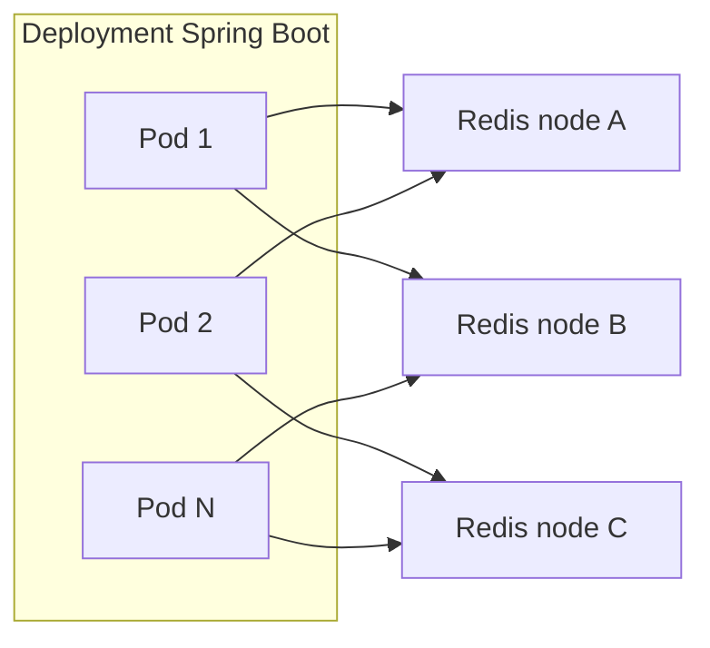
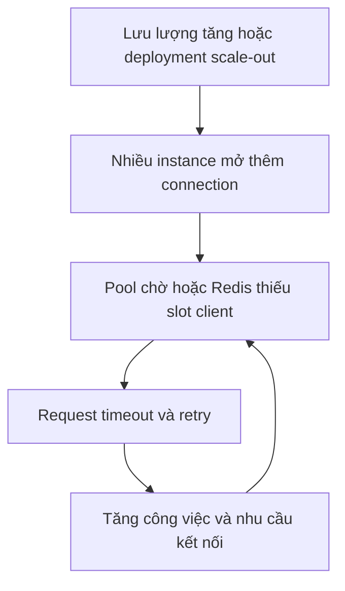

# Tính ngân sách kết nối Redis theo số bản sao ứng dụng

Một ứng dụng Spring Boot kết nối Redis có thể chạy ổn với một instance trên máy phát triển, nhưng khi triển khai nhiều bản sao (replica) sau load balancer hoặc trong Kubernetes, **mọi bản sao đều có khả năng tạo kết nối Redis riêng**. Nếu đồng thời tăng số replica, bật connection pool, có worker nền và triển khai rolling update, tổng số kết nối có thể cao hơn nhiều so với hình dung ban đầu. Kết quả thường thấy là Redis chạm giới hạn client, ứng dụng chờ lấy kết nối từ pool, timeout tăng hoặc deployment mới không kết nối được.

Bài học này trình bày cách lập **ngân sách kết nối (connection budget)** cho Spring Data Redis: xác định mỗi instance thực sự có thể mở bao nhiêu kết nối, tính số bản sao trong thời điểm tải và triển khai cao nhất, cộng các thành phần cùng sử dụng Redis, chừa dung lượng vận hành, rồi đối chiếu với giới hạn của từng Redis server.

## 1. Ngân sách kết nối là gì và vì sao cần tính?

**Một Redis connection** trong phạm vi bài này là một kết nối TCP đang được client thiết lập đến một Redis server/node. Một kết nối có thể được tái sử dụng cho nhiều lệnh; một request HTTP có thể gửi nhiều lệnh Redis; và nhiều request có thể dùng cùng một kết nối tùy Redis client và cách cấu hình. Vì vậy:

> **Số request ≠ số kết nối Redis. Số thread ≠ số kết nối Redis. Số bean RedisTemplate ≠ số kết nối Redis.**

Điều phải tính là **số kết nối vật lý có thể đồng thời tồn tại trên từng Redis node** khi toàn bộ ứng dụng, job, dịch vụ khác và thành phần hạ tầng hoạt động.

Một ví dụ đơn giản:

- Dịch vụ `order-service` chạy 1 replica và quan sát thấy khoảng 12 kết nối Redis.
- Kubernetes mở rộng dịch vụ lên 10 replica. Nếu mỗi replica tạo 12 kết nối tại thời điểm cao điểm, riêng dịch vụ này có thể dùng khoảng **120 kết nối**.
- Khi rolling update cho phép thêm 2 pod mới trước khi thu hồi pod cũ, một thời điểm có thể có 12 pod, tương ứng **144 kết nối** nếu mỗi pod duy trì mức đó.
- Một Redis server còn phục vụ các dịch vụ khác, health check, hệ thống quản trị và các thành phần hạ tầng; tất cả cùng đóng góp vào giới hạn kết nối.

Các con số 12, 120 và 144 ở đây là giả định để minh họa phép nhân. Trong hệ thống thật, phải xác định số kết nối **trên từng replica** từ cấu hình client và số liệu quan sát, thay vì coi bất kỳ giá trị pool nào cũng tự động bằng số kết nối đang mở.

### Giới hạn kết nối Redis không phải giới hạn duy nhất

Redis có giới hạn số client kết nối đồng thời, thường được điều khiển bởi cấu hình `maxclients`. Trong thực tế, giới hạn hữu hiệu còn phụ thuộc vào **file descriptor** mà hệ điều hành cho tiến trình Redis sử dụng. Redis cần các descriptor cho hoạt động nội bộ ngoài socket client, nên giá trị có thể thấp hơn cấu hình mong muốn nếu giới hạn hệ điều hành không đủ.

Ngay cả khi chưa chạm `maxclients`, một lượng lớn connection cũng tiêu thụ bộ nhớ (cấu trúc client, input/output buffer), descriptor, chi phí theo dõi và tài nguyên mạng. Ngược lại, còn nhiều slot client cũng không bảo đảm Redis đủ CPU, bộ nhớ hoặc throughput để phục vụ tải. Connection budget chỉ là **một trong các điều kiện năng lực** của hệ thống.

## 2. Một ứng dụng Spring Data Redis thực sự mở bao nhiêu kết nối?

Đây là bước quyết định độ chính xác của toàn bộ phép tính.

### 2.1. Lettuce thường tái sử dụng kết nối

Trong Spring Boot dùng `spring-boot-starter-data-redis`, Lettuce là client mặc định phổ biến. Với cấu hình `LettuceConnectionFactory` thông thường, Spring Data Redis có thể dùng **một native connection được chia sẻ** cho nhiều thao tác Redis thông thường. Điều này có nghĩa là:

- 100 request đồng thời **không nhất thiết** sinh 100 kết nối TCP.
- 10 bean `StringRedisTemplate` dùng chung một `RedisConnectionFactory` **không nhất thiết** tạo 10 pool riêng.
- Nếu không sử dụng pool cho đường thực thi thông thường, đặt `max-active: 20` cũng **không có nghĩa** ứng dụng luôn giữ 20 kết nối.

Một số thao tác cần kết nối chuyên biệt, chẳng hạn hoạt động blocking, transaction hoặc cơ chế đăng ký nhận thông điệp; chúng có thể sử dụng connection khác với native connection chia sẻ. Tùy cấu hình client/factory, các connection chuyên biệt này có thể được lấy từ pool. Với Pub/Sub, listener và các hoạt động giữ kết nối lâu, phải kiểm tra riêng cách client quản lý kết nối.

### 2.2. Pool là giới hạn mượn kết nối của từng pool

Khi dùng Lettuce connection pooling với Apache Commons Pool 2, `max-active` thường giới hạn số connection **đang được mượn đồng thời từ một pool**, không phải tổng số kết nối Redis tối đa của toàn bộ ứng dụng hay toàn bộ cluster. Một ứng dụng có thể có:

- Một pool cho kết nối thông thường hoặc cho thao tác yêu cầu kết nối chuyên biệt.
- Một native connection chia sẻ **nằm ngoài** số connection đang mượn từ pool, tùy cấu hình.
- Pool bổ sung được tạo bởi `RedisConnectionFactory` khác.
- Kết nối riêng cho Pub/Sub, blocking command, giao thức quản lý topology hoặc hoạt động nội bộ khác.
- Kết nối đến nhiều node nếu dùng Redis Cluster, Sentinel hoặc tách đọc/ghi.

Với Jedis, cơ chế chia sẻ và pooling khác Lettuce. Vì vậy không thể sao chép nguyên công thức “một kết nối mặc định + pool” của Lettuce sang mọi Redis client.

**Quy tắc:** phân biệt số **connection được cấu hình có thể mở**, số **connection đang mở** và số **connection đang bận**. Dùng giới hạn cấu hình để dựng kịch bản trần, dùng quan sát để hiệu chỉnh; không đánh đồng ba đại lượng.

### 2.3. Xác định số kết nối theo từng đường sử dụng

Một bảng kiểm kê cho *mỗi instance ứng dụng* có thể bắt đầu như sau:

| Thành phần trên một instance | Cần xác định | Ví dụ giá trị dự trù |
| --- | --- | ---: |
| Native connection chia sẻ của Lettuce | Có bật chia sẻ không, có kết nối tới node đang xét không? | 1 |
| Pool thứ nhất | `max-active`, số connection có thể đồng thời được mượn | 12 |
| Pool/connection factory thứ hai | Có thực sự tạo một pool độc lập không? | 0 nếu không có |
| Redis Pub/Sub listener | Có connection giữ lâu không? Đến node nào? | 0 nếu không dùng |
| Redis Streams/blocking consumer | Số consumer chạy song song, connection giữ cho mỗi consumer | 0 nếu không dùng |
| Connection quản lý/topology | Client và topology có mở thêm kết nối khác không? | Đo hoặc dự trù |

Nếu ứng dụng chỉ có một factory Lettuce, một native connection chia sẻ và **tối đa 12 kết nối pool đến cùng một node**, có thể dự trù **13 kết nối trên instance** cho ví dụ tính công suất. Đây là **giả định cụ thể của ví dụ**, không phải khẳng định rằng mọi ứng dụng đặt `max-active=12` sẽ có đúng 13 kết nối.

Ở cấu hình khác, pool có thể không được dùng đến; kết nối có thể phân bố qua nhiều node; hoặc có thêm nhiều connection chuyên biệt. Khi đó phải sửa số liệu đầu vào tương ứng.

## 3. Công thức tính ngân sách theo số replica

Để tính cho một Redis server/node `j`, đặt:

- `C_j`: giới hạn số client kết nối đồng thời **hữu hiệu** của Redis node `j`.
- `R_i`: số replica tối đa của ứng dụng `i` có thể đồng thời hoạt động tại thời điểm đang xét.
- `c_(i,j)`: số connection tối đa **một replica ứng dụng `i`** có thể mở đến Redis node `j`.
- `O_j`: số connection của **các ứng dụng khác** cùng truy cập node `j` và chưa được tính trong tổng.
- `I_j`: connection của công cụ vận hành/giám sát và các client hạ tầng khác.
- `H_j`: khoảng dự phòng cho biến động, thay đổi cấu hình, sự cố và thao tác khẩn cấp.

Ngân sách cần thỏa:

\[
\boxed{\sum_i (R_i \times c_{i,j}) + O_j + I_j + H_j \leq C_j}
\]

Phần kết nối còn có thể cấp phát sau khi giữ dự phòng:

\[
\text{FreeBudget}_j = C_j - \left[\sum_i(R_i\times c_{i,j}) + O_j + I_j + H_j\right]
\]

Nếu `FreeBudget_j < 0`, kế hoạch kết nối **vượt giới hạn** của node. Nếu còn dương nhưng rất ít, hệ thống dễ gặp rủi ro khi retry, failover, mở rộng tạm thời hoặc deploy dịch vụ mới.

Đối với một ứng dụng:

\[
R_{\mathrm{peak}} = R_{\mathrm{autoscale\ max}} + R_{\mathrm{deploy\ extra}}
\]

Đây là **ước lượng biên trên** khi cấu hình deployment cho phép pod mới tồn tại đồng thời với pod cũ. Cách tính phải phù hợp chiến lược triển khai thực tế: Kubernetes RollingUpdate có `maxSurge`; blue/green có thể giữ cả hai phiên bản; canary có replica riêng; chạy background worker và scheduled job ở deployment khác phải tính như workload khác.

Ví dụ cách cộng theo một instance trong mô hình giả định:

\[
c_{i,j} = P_{i,j} + S_{i,j} + D_{i,j}
\]

Trong đó `P` là tổng hạn mức các pool độc lập có thể kết nối đến node `j`, `S` là shared connection ngoài pool, và `D` là những kết nối riêng (Pub/Sub, blocking, quản lý...). Không cộng trùng cùng một connection nếu pool/client đã quản lý nó. Với Redis Cluster, tất cả biến mang chỉ số `j` vì client có thể kết nối tới từng node khác nhau.

## 4. Ví dụ tính đầy đủ: Spring Boot + Kubernetes + một Redis instance

Giả sử hệ thống dùng **một Redis server** và các điều kiện sau:

| Thành phần | Giá trị giả định |
| --- | ---: |
| Giới hạn kết nối hữu hiệu Redis `C` | 500 |
| `order-service` đang chạy | 8 replica |
| Giới hạn autoscaling của `order-service` | 14 replica |
| Rolling update `maxSurge` | 2 pod |
| Pool của mỗi replica: `max-active` | 12 connection |
| Shared connection dự trù ngoài pool cho mỗi replica | 1 connection |
| Kết nối các ứng dụng khác `O` | 90 |
| Kết nối giám sát/vận hành `I` | 10 |
| Dự phòng vận hành `H` | 100 |

**Bước 1: tính mỗi replica.**

Giả định connection riêng không có và một replica có thể mở toàn bộ 12 kết nối pool cộng 1 shared connection:

\[
c = 12+1=13
\]

**Bước 2: tính replica lúc cao điểm triển khai.**

\[
R_{\mathrm{peak}}=14+2=16
\]

**Bước 3: tính kết nối do ứng dụng tạo.**

\[
N_{\mathrm{order,peak}}=16\times13=208
\]

**Bước 4: cộng các thành phần và phần dự phòng.**

\[
N_{\mathrm{budget}}=208+90+10+100=408
\]

**Bước 5: đối chiếu giới hạn.**

\[
\text{FreeBudget}=500-408=92
\]

Kế hoạch ví dụ này còn **92 slot** sau khi dành riêng 100 slot dự phòng vận hành. Nếu mọi ứng dụng đều sử dụng đúng mức dự trù thì lượng kết nối vật lý trước phần dự phòng là `208 + 90 + 10 = 308`; không được hiểu `408` là số client thực tế Redis đã mở.

### Tác động khi tăng replica hoặc pool

| Kịch bản | Replica đồng thời | Dự trù kết nối mỗi replica | Kết nối riêng `order-service` | Tổng gồm 90 + 10 + dự phòng 100 | Còn lại dưới giới hạn 500 |
| --- | ---: | ---: | ---: | ---: | ---: |
| Tải hiện tại | 8 | 13 | 104 | 304 | 196 |
| Autoscale tối đa + rolling surge | 16 | 13 | 208 | 408 | 92 |
| Vẫn 16 pod, tăng pool lên 20 và thêm 1 shared | 16 | 21 | 336 | 536 | **−36** |
| Autoscale đến 20 + surge 2, giữ pool 12 + shared 1 | 22 | 13 | 286 | 486 | 14 |

Điều dễ bỏ qua: **thay một con số `max-active` trên mỗi pod có thể làm tăng tổng ngân sách mạnh hơn nhiều lần**, bởi thay đổi đó được nhân với mọi replica đồng thời. Ví dụ tăng pool từ 12 lên 20 làm trần của 16 replica tăng thêm `16 × 8 = 128` connection; kế hoạch đang còn 92 slot sẽ vượt mức dự trù 36 slot.

### Trường hợp một dịch vụ mới cùng dùng Redis

Nếu sau đó thêm `invoice-service` có tối đa 6 replica và dự trù 8 kết nối mỗi replica, dịch vụ mới cần:

\[
6\times8=48\text{ connections}
\]

Trong kịch bản `order-service` ở 16 pod, dư ngân sách giảm từ 92 xuống `92-48=44`. Nếu còn thêm job nền, công cụ migration hoặc một bản triển khai blue/green, phần dự trù này có thể bị tiêu hết. Vì vậy Redis được chia sẻ giữa nhiều team nên có **sổ ngân sách theo từng workload** và một mức dự phòng thống nhất.

## 5. Tìm số replica cao nhất thực tế

Chỉ nhìn số `replicas` đang chạy là chưa đủ. Khi lập ngân sách, cần xem:

1. **Autoscaling:** HPA có `maxReplicas` bao nhiêu? Autoscale theo CPU, memory hay metric khác vẫn có thể đạt mức tối đa trong sự cố hoặc tải tăng mạnh.
2. **RollingUpdate:** `maxSurge` cho phép tăng thêm bao nhiêu pod tạm thời? Nếu khai báo theo phần trăm, tính số lượng theo quy tắc làm tròn của Kubernetes và cấu hình deployment thực tế.
3. **Blue/green và canary:** liệu hai phiên bản ứng dụng có cùng chạy với số replica đầy đủ trong lúc chuyển traffic?
4. **Background workers và scheduler:** những deployment, cron job hoặc job thủ công có dùng Redis không? Chúng có thể chạy đồng thời với service chính.
5. **Nhiều môi trường chia sẻ Redis:** staging, test, preview hoặc các namespace khác có thực sự kết nối cùng một Redis server không? Namespace riêng không tự tạo ngân sách client riêng.
6. **Khởi động và failover:** các kết nối cũ có thể chưa được dọn ngay khi client mới kết nối; quá trình reconnect cũng có thể tạo đỉnh tạm thời.

Ví dụ mảnh cấu hình Kubernetes:

```yaml
# Deployment (trích những trường liên quan)
spec:
  replicas: 8
  strategy:
    type: RollingUpdate
    rollingUpdate:
      maxSurge: 2
      maxUnavailable: 1
```

```yaml
# HorizontalPodAutoscaler (trích những trường liên quan)
spec:
  minReplicas: 3
  maxReplicas: 14
```

Với giả định deployment tối đa 14 pod theo HPA và rollout cho phép tối đa 2 pod tăng thêm, dùng **16 pod** làm đầu vào tính ngân sách. Đây là cách dự trù tình huống đồng thời có thể xảy ra; số pod đang ở trạng thái `Ready` tại một thời điểm chỉ là số liệu quan sát, không thay thế biên trên cấu hình.

Nếu sử dụng VM/container không có Kubernetes, công thức vẫn giống nhau: số bản sao ở trạng thái cao nhất + instance tạm thời trong deployment + worker cùng kết nối Redis.

## 6. Dự trù từ cấu hình Spring Data Redis

Với Spring Boot 3.x sử dụng Lettuce và pool khi cần, có thể cấu hình ví dụ:

```yaml
spring:
  data:
    redis:
      host: redis.internal
      port: 6379
      connect-timeout: 2s
      timeout: 2s
      lettuce:
        pool:
          enabled: true
          max-active: 12
          max-idle: 8
          min-idle: 1
          max-wait: 300ms
```

Dependency tương ứng khi cần Lettuce pool:

```groovy
dependencies {
    implementation 'org.springframework.boot:spring-boot-starter-data-redis'
    implementation 'org.apache.commons:commons-pool2'
}
```

Các con số trong cấu hình trên **chỉ là ví dụ**, không phải mức tối ưu cho mọi ứng dụng. Trong Spring Boot, tên property và giá trị mặc định cần đối chiếu với dòng phiên bản đang dùng; đoạn này minh họa cấu hình Spring Boot 3.x.

| Thuộc tính | Tác dụng | Liên hệ với ngân sách |
| --- | --- | --- |
| `lettuce.pool.max-active` | Số connection được phép mượn đồng thời từ pool tương ứng | Là một thành phần trong trần mỗi instance, khi pool thực sự được dùng |
| `lettuce.pool.max-idle` | Số connection nhàn rỗi tối đa được giữ trong pool | Ảnh hưởng lượng kết nối duy trì khi giảm tải |
| `lettuce.pool.min-idle` | Mức nhàn rỗi mục tiêu được duy trì khi cơ chế pool hoạt động | Có thể khiến nhiều replica giữ kết nối dù không có nhiều request |
| `lettuce.pool.max-wait` | Thời gian tối đa chờ mượn connection khi pool bận | Giúp fail nhanh thay vì chờ vô hạn; không tạo thêm slot Redis |
| `connect-timeout` | Giới hạn thời gian thiết lập kết nối | Hữu ích để phát hiện lỗi kết nối; không tăng `maxclients` |
| `timeout` | Giới hạn thời gian thao tác Redis theo cấu hình client | Cần tách với thời gian chờ mượn connection |

**Lưu ý:** Pool được giới hạn *theo pool của mỗi instance*, không phải theo toàn bộ deployment. Nếu có ba `LettuceConnectionFactory` độc lập, mỗi factory tạo pool riêng, không thể lấy `max-active` của một pool rồi coi đó là giới hạn tổng cho cả process.

Nếu ứng dụng chỉ dùng Lettuce shared native connection cho phần lớn command, tăng `max-active` có thể ít ảnh hưởng đến số connection quan sát được trên đường thực thi chính. Phải nhìn đường đi của command thực tế, thao tác blocking/transaction và số pool đang tồn tại để tính ngân sách có ý nghĩa.

### Quan hệ giữa min-idle, max-idle và max-active

Một pool có thể có ít kết nối đang mở ở thời điểm khởi chạy và dần tăng khi lưu lượng cao. `max-active` biểu diễn **giới hạn đồng thời cho pool**, còn `min-idle`/`max-idle` liên quan đến kết nối rảnh được duy trì. Không lấy `min-idle` làm công suất tối đa; cũng không coi `max-active` là số connection luôn tồn tại ở mọi thời điểm.

Khi nhân nhiều replica, số kết nối nhàn rỗi tích lũy vẫn có thể đáng kể. Ví dụ 50 pod đều cố giữ ít nhất 2 connection nhàn rỗi trong pool sẽ có khoảng 100 connection chỉ phục vụ duy trì trạng thái, nếu pool đã khởi tạo và cơ chế duy trì idle thỏa điều kiện tương ứng. Ngoài những kết nối này còn có shared connection hoặc connection chuyên biệt nếu ứng dụng dùng.

## 7. Redis standalone, Sentinel và Cluster: tính ở đâu?

### 7.1. Redis standalone

Khi mọi instance cùng trỏ tới một Redis server, cộng toàn bộ connection được thiết lập tới server đó và so với giới hạn client **của chính server**. Đây là kịch bản của ví dụ 500 kết nối.

### 7.2. Redis có primary và replica

Nếu ứng dụng chỉ kết nối primary để đọc/ghi, phần lớn kết nối client tập trung tại primary. Khi cấu hình đọc từ replica hoặc chia tải đọc, có thể phát sinh connection tới nhiều node. Kết nối giữa Redis primary và replica cũng thuộc chi phí/hạ tầng mà phải hiểu khi thiết lập tổng giới hạn, dù không phải connection của các request Spring Boot thông thường.

Đừng tính `500 maxclients × 2 nodes = 1.000` rồi cho rằng một primary chịu được 1.000 connection. Mỗi node có giới hạn và tải riêng.

### 7.3. Redis Sentinel

Sentinel phục vụ khám phá và giám sát trạng thái primary/replica. Client có thể cần kết nối để làm việc với Sentinel **và** kết nối dữ liệu tới Redis node hiện được chọn. Ngân sách tới Redis data node và tới Sentinel endpoint là các phần khác nhau. Khi failover, Redis client có thể tái thiết lập kết nối tới primary mới; phải dự trù đỉnh reconnect và định tuyến lại, không chỉ nhìn lưu lượng trung bình trước failover.

### 7.4. Redis Cluster

Trong Redis Cluster, mỗi node giữ phần keyspace tương ứng với hash slots. Redis client có thể có connection tới nhiều node để gửi lệnh đúng nơi, theo dõi topology hoặc đọc từ replica khi đã cấu hình. Độ phân bố phụ thuộc key truy cập, client và lựa chọn read routing.



Phải tính **ngân sách trên từng node**, không nhân số connection tới một server với tổng số node như thể chúng là một giới hạn kết nối chung. Không giả định một pool duy nhất bao trùm toàn cluster nếu chưa quan sát được topology và cách client phân bổ pool/connection. Một key nóng có thể khiến một node đầy kết nối hoặc quá tải trong khi node khác còn nhiều dư địa.

Với cluster, dùng lại công thức:

\[
N^{\mathrm{peak}}_j = \sum_i (R_i \times c_{i,j}) + O_j + I_j
\]

và kiểm tra cho **từng node `j`**:

\[
N^{\mathrm{peak}}_j + H_j \leq C_j
\]

Nếu chưa đo được phân bổ, có thể lập biên trên thận trọng cho các node có khả năng nhận toàn bộ kết nối từ một workload, rồi hiệu chỉnh bằng connection thực tế, cấu hình cluster client và kịch bản failover.

## 8. Quan sát kết nối đang mở và mức trần

Ngân sách cần cả **dữ liệu cấu hình** lẫn **dữ liệu vận hành**. Một phép tính trên giấy chỉ đáng tin khi biết các instance thật mở bao nhiêu connection và giới hạn hiệu dụng của Redis đang chạy.

### 8.1. Phía Redis

Một số lệnh Redis CLI thông dụng:

```redis
CONFIG GET maxclients
INFO clients
CLIENT LIST
```

- `CONFIG GET maxclients`: xem mức cấu hình client đang có hiệu lực mà server trả về. Trong môi trường managed Redis, quyền đọc hoặc thay đổi cấu hình có thể bị hạn chế; dùng dashboard nhà cung cấp nếu cần.
- `INFO clients`: xem các thống kê như `connected_clients`, `blocked_clients`, cùng những chỉ số liên quan tùy phiên bản Redis. `connected_clients` giúp quan sát số client kết nối tại thời điểm lấy mẫu.
- `CLIENT LIST`: danh sách các connection client đang tồn tại và các thuộc tính, có thể hỗ trợ xác định địa chỉ nguồn, trạng thái, thời gian idle và client name. Đầu ra có thể chứa metadata nhạy cảm; sử dụng trong môi trường được phép và tránh sao chép nguyên văn ra log công khai.

Ví dụ dùng CLI từ máy có quyền truy cập Redis:

```bash
redis-cli -h redis.internal -p 6379 INFO clients
redis-cli -h redis.internal -p 6379 CONFIG GET maxclients
```

Không nhúng password của môi trường thật trực tiếp vào câu lệnh chia sẻ hoặc tài liệu. Với Redis managed/Cluster, thực hiện truy vấn trên từng node liên quan hoặc sử dụng metric của nền tảng để xem toàn topology.

### 8.2. Phía ứng dụng

Ở mỗi replica, cần quan sát các đại lượng **cùng một mốc thời gian**:

- Số connection thực tế tới Redis node theo pod/process, đặc biệt ở tải cao và khi rollout.
- Kích thước pool hiện hữu, số connection đang mượn/nhàn rỗi, thời gian chờ mượn, lỗi chờ pool nếu pool được dùng.
- Số tác vụ blocking hoặc Pub/Sub đang giữ connection; số consumer hoạt động.
- Throughput command, p50/p95/p99 latency, timeout và tỷ lệ retry.
- Số pod đang chạy, số pod trong rollout, HPA desired/current replicas.
- `connected_clients` và giới hạn client trên từng Redis node; sự kiện kết nối bị từ chối hoặc đóng kết nối.

Có thể dùng Micrometer/Actuator, Redis client metrics, Prometheus/Grafana hoặc telemetry hiện có. Tuy nhiên **không phải mọi thông số pool của Lettuce đều tự xuất hiện chỉ vì thêm starter**: khả năng quan sát phụ thuộc phiên bản, registry và cấu hình instrumentation của ứng dụng. Nếu thiếu, đo ở client và đối chiếu `CLIENT LIST` theo địa chỉ nguồn/tên client trong giới hạn hạ tầng cho phép.

### 8.3. Đo ở các thời điểm quan trọng

Không chỉ đo khi ứng dụng vừa khởi chạy và ít tải. Ít nhất cần có các bối cảnh:

1. Tải bình thường, đủ thời gian để pool khởi tạo.
2. Tải cao và hoạt động nền đồng thời.
3. Autoscaling gần hoặc chạm `maxReplicas`.
4. Rolling deployment/blue-green/canary làm tăng số bản sao.
5. Redis reconnect hoặc failover nếu môi trường có hỗ trợ.

So sánh chênh lệch số `connected_clients` trước/sau thay đổi số pod giúp ước lượng kết nối mỗi instance, nhưng phải loại trừ biến động đồng thời từ các workload khác và connection bị đóng trễ. Ước lượng như vậy là chỉ dấu, không phải bằng chứng tuyệt đối về trần kết nối.

## 9. Chọn pool size: cân bằng ngân sách server và concurrency ứng dụng

Không có công thức “mỗi pod cần 20 connection” đúng cho mọi hệ thống. Pool cần đáp ứng **concurrency của các thao tác thực sự phải mượn connection**, đồng thời tổng pool từ tất cả replica vẫn nằm trong ngân sách Redis.

Với những thao tác mỗi request cần giữ riêng một connection trong khoảng thời gian `W`, có thể ước tính số thao tác **đồng thời trung bình** theo Little's Law:

\[
L \approx \lambda \times W
\]

Trong đó:

- `\lambda`: số lượt thao tác sử dụng connection trên giây, tính cho **một instance**.
- `W`: thời gian trung bình mỗi lượt giữ connection, tính bằng giây.
- `L`: số lượt đang diễn ra đồng thời trung bình.

Ví dụ với 200 lượt/giây trên một pod và mỗi lượt **mượn riêng connection trong 0,02 giây**, số lượt đang giữ connection trung bình khoảng:

\[
L=200\times0.02=4
\]

Đây chỉ là điểm khởi đầu: tải thường có burst, phân bố thời gian giữ connection không đồng đều, một request có thể giữ connection lâu hoặc retry. Cần đo p95/p99 thời gian chờ pool và concurrency thực trước khi chọn `max-active`.

**Giới hạn áp dụng:** phép tính trên không có nghĩa 200 lệnh Redis/giây cần 4 socket nếu Lettuce dùng shared native connection có multiplexing/pipelining. Nó chỉ phản ánh số hoạt động đồng thời trong **mô hình phải mượn một connection riêng cho mỗi hoạt động**. Đặc tính client và đường thực thi quyết định cách chuyển workload concurrency thành connection count.

Một quy trình chọn pool size hữu ích:

1. Xác định đường thực thi nào thực sự mượn connection từ pool và thời gian giữ connection.
2. Đo concurrency và thời gian chờ ở mức tải mục tiêu, gồm các đỉnh.
3. Chọn mức trần pool ban đầu, kiểm tra tổng ngân sách qua tất cả replica.
4. Chạy load test có scale-out/rollout để quan sát pool wait, Redis `connected_clients`, timeout và throughput.
5. Điều chỉnh nếu có bằng chứng cạn pool hoặc kết nối dư thừa; không tự tăng pool chỉ vì p99 chậm, vì nguyên nhân có thể là lệnh Redis nặng, network hoặc CPU.

## 10. Điều gì xảy ra khi vượt ngân sách?

### 10.1. Redis từ chối connection mới

Khi server đạt giới hạn client hữu hiệu, kết nối mới có thể bị từ chối với thông báo tương ứng (ví dụ thông báo `max number of clients reached` tùy client/server). Kết quả phía Java có thể được bọc thành exception truy cập Redis hoặc lỗi lấy connection. Một số request vẫn hoạt động do đang dùng connection có sẵn, khiến hiện tượng khó nhận diện nếu chỉ nhìn health check.

### 10.2. Pool cạn trước khi Redis chạm maxclients

Nếu `max-active` nhỏ hơn nhu cầu borrow đồng thời, các thao tác có thể chờ connection rồi hết `max-wait`. Khi đó Redis có thể còn rất nhiều slot client rảnh. Tăng `maxclients` không giúp một pool tự cho mượn nhiều hơn giới hạn của nó; ngược lại, tăng `max-active` chỉ hợp lý nếu ngân sách Redis còn đủ và việc mượn thêm connection cải thiện throughput thực.

### 10.3. Retry và autoscaling tạo vòng khuếch đại



Khi kết nối bị từ chối, retry không có backoff hoặc retry quá nhiều có thể làm vấn đề kéo dài. Autoscaling ứng dụng từ 10 lên 20 pod vừa tăng năng lực HTTP vừa có thể làm **nhu cầu connection Redis tăng gần gấp đôi**. Cần thống nhất giữa giới hạn autoscaling và khả năng tiếp nhận của Redis.

## 11. Chiến lược giảm áp lực kết nối

### Giảm connection dư thừa trước

- Tái sử dụng `RedisConnectionFactory` theo kiến trúc Spring, tránh tạo factory/pool mới cho mỗi request hoặc mỗi service object.
- Đừng tạo `RedisClient`/connection trực tiếp trong phương thức xử lý request rồi bỏ quên việc đóng.
- Xem lại `min-idle` nếu nhiều replica giữ quá nhiều connection nhàn rỗi mà không phục vụ tải.
- Giới hạn số consumer/worker blocking và Pub/Sub connection độc lập; đặt mức concurrency theo ngân sách.
- Dùng connection sharing của Lettuce khi phù hợp với loại thao tác, thay vì buộc mọi lệnh thông thường cần một connection chuyên biệt.

### Điều phối ở cấp deployment

- Tính `maxSurge` hoặc thời gian hai phiên bản blue/green cùng hoạt động ngay trong phép toán ngân sách.
- Giữ ngân sách cho các job migration, backfill và cron chạy đồng thời với lưu lượng người dùng.
- Không nâng `maxReplicas` của nhiều dịch vụ cùng lúc nếu Redis chưa có năng lực tương ứng.
- Giới hạn tốc độ reconnect và dùng backoff có jitter để tránh mọi pod kết nối lại cùng một thời điểm sau failover.

### Mở rộng Redis khi nhu cầu thực sự đòi hỏi

Nếu đã giảm connection dư thừa mà vẫn thiếu dung lượng, có thể xem xét tăng giới hạn client (nếu môi trường, tài nguyên và nhà cung cấp cho phép), thay đổi quy mô Redis hoặc thiết kế phân bố workload. Tăng `maxclients` phải đi kèm kiểm tra file descriptor, bộ nhớ, network, CPU và chất lượng dịch vụ. Với Cluster, mở rộng không tự động giải quyết hot key hoặc phân bố kết nối lệch trên một node.

Việc tăng giới hạn server nên được triển khai có kiểm soát và đo lại; tránh xem đây là cách thay thế việc quản lý pool của các ứng dụng.

## 12. Mẫu bảng ngân sách dùng khi triển khai

Có thể duy trì một bảng dự trù cho mỗi Redis endpoint/node. Ví dụ mẫu điền số:

| Trường | Ý nghĩa | Giá trị ví dụ |
| --- | --- | ---: |
| Redis endpoint/node | Nơi nhận connection | `redis-primary-A` |
| `maxclients` hữu hiệu | Mức giới hạn đã xác nhận | 500 |
| Workload | Tên deployment sử dụng Redis | `order-service` |
| Replicas hiện tại | Số instance lúc đo | 8 |
| Replicas tối đa khi autoscale | HPA max hoặc số instance cao nhất | 14 |
| Replicas bổ sung khi deploy | Rolling surge/canary/blue-green | 2 |
| Replicas cần tính | Autoscale max + bổ sung hợp lệ | 16 |
| Kết nối dự trù trên mỗi replica tới node | Pool + shared + dedicated, không đếm trùng | 13 |
| Connection workload tại đỉnh | `16 × 13` | 208 |
| Các workload khác | Kết nối chưa có trong dòng trên | 90 |
| Giám sát/vận hành | Công cụ và client hạ tầng | 10 |
| Khoảng dự phòng | Dự trù sự cố/mở rộng/biến động | 100 |
| Tổng ngân sách | `208 + 90 + 10 + 100` | 408 |
| Dư ngân sách | `500 − 408` | 92 |

Một tổ chức có nhiều dịch vụ nên bổ sung cột người sở hữu workload, môi trường, client (Lettuce/Jedis), số factory/pool, kết quả đo tối đa gần đây, ngày cập nhật và liên kết metric. Khi nhiều node Redis cùng phục vụ, nhân bảng theo node và điều chỉnh kết nối đến từng node, thay vì chỉ có một hàng tổng cho toàn cluster.

### Mẫu kiểm tra thay đổi trước deployment

Giả sử một pull request tăng `max-active` từ 12 lên 20. Đánh giá cần tính:

```text
Giới hạn node                    = 500
Số pod đồng thời cao nhất         = 14 HPA max + 2 surge = 16
Connection/pod cũ                 = 12 pool + 1 shared = 13
Connection/pod mới                = 20 pool + 1 shared = 21
Kết nối ứng dụng tăng thêm        = 16 × (21 - 13) = 128
Ngân sách còn lại trước thay đổi  = 92
Ngân sách còn lại sau thay đổi    = 92 - 128 = -36
```

Trong giả định của bài, không nên áp dụng thay đổi đó nguyên trạng vì vượt trần dự trù 36 connection, dù lúc quan sát tải bình thường Redis vẫn chưa đầy. Có thể giảm pool, giảm replica đỉnh, phân bố workload khác hoặc nâng công suất Redis sau khi xác minh năng lực tài nguyên. Nếu số đo chứng minh pool không được sử dụng theo cách giả định, cần cập nhật mô hình connection thực tế rồi tính lại thay vì tiếp tục dùng con số dự trù cũ.

## 13. Những sai lầm thường gặp

| Nhận định sai | Vì sao sai | Cách hiểu phù hợp |
| --- | --- | --- |
| “Mỗi pod đặt `max-active=20`, nên Redis chỉ cần 20 slot.” | Mỗi pod có pool riêng; nhiều pod cộng dồn. | Nhân mức dự trù mỗi pod với replica đồng thời, rồi cộng workload khác. |
| “Có 5 `RedisTemplate` nên chắc có 5 connection pool.” | Nhiều template có thể dùng chung `RedisConnectionFactory`. | Kiểm tra cấu hình factory/pool thực tế. |
| “Lettuce mặc định có pool 20 connection đang mở.” | Lettuce thường có shared native connection; pool là cơ chế tùy cấu hình/đường thực thi. | Phân biệt sharing, dedicated connection và pooling. |
| “HPA tối đa 10 pod thì chỉ có đúng 10 pod.” | Rolling surge, blue/green, canary và worker có thể chạy thêm. | Dự trù mức đồng thời cao nhất theo chiến lược triển khai. |
| “Redis Cluster có 3 node, vậy mọi pod có gấp 3 lần ngân sách.” | Connection phân bố theo node và topology; giới hạn riêng từng node. | Tính `c_(i,j)` và ngân sách riêng cho node `j`. |
| “Redis chưa chạm `maxclients` thì mọi timeout đều do mạng.” | Pool có thể cạn trước, lệnh có thể chậm và client có thể retry. | Đo pool wait, latency server/client, số connection và lỗi. |
| “Thêm replica luôn giảm latency.” | Tăng replica cũng tăng kết nối và có thể tạo thêm tải Redis. | Kiểm tra năng lực Redis cùng lúc với autoscaling ứng dụng. |
| “Tăng `maxclients` là đủ.” | File descriptor, memory, CPU, network và giới hạn dịch vụ vẫn tồn tại. | Kiểm chứng toàn bộ tài nguyên và quan sát sau thay đổi. |

## 14. Bài tập áp dụng

**Bài 1 — Tính mức đỉnh của một deployment**

Một ứng dụng có HPA tối đa 18 replica, rolling update `maxSurge: 3`. Mỗi replica được dự trù tối đa 9 kết nối Redis đến cùng node. Hỏi riêng ứng dụng đó cần tối đa bao nhiêu kết nối?

<details>
<summary>Đáp án tham khảo</summary>

`(18 + 3) × 9 = 189` connection, trong giả định tất cả pod đồng thời giữ tối đa 9 kết nối.

</details>

**Bài 2 — Xác định ngân sách còn lại**

Redis có giới hạn hữu hiệu 600 client. Dịch vụ A cần tối đa 189 kết nối; B cần 170; công cụ giám sát và job khác cần 36; dự phòng giữ lại 120. Còn bao nhiêu connection chưa phân bổ?

<details>
<summary>Đáp án tham khảo</summary>

`600 − (189 + 170 + 36 + 120) = 85` connection.

</details>

**Bài 3 — Điều chỉnh pool**

Tiếp theo bài 2, dịch vụ B chạy 10 replica đồng thời và muốn tăng connection dự trù mỗi replica từ 17 lên 27. Thay đổi này làm tăng bao nhiêu kết nối? Có còn phù hợp ngân sách đang tính không?

<details>
<summary>Đáp án tham khảo</summary>

Số kết nối tăng `10 × (27 − 17) = 100`. Ban đầu còn 85, sau thay đổi còn `85 − 100 = −15` connection. Theo mô hình dự trù, kế hoạch vượt ngân sách 15 connection.

</details>

**Bài 4 — Phân biệt pool và client limit**

Redis đang dùng 250/1.000 kết nối nhưng Java báo hết thời gian chờ mượn connection từ pool. Thông số nào cần xem trước: Redis `maxclients` hay số connection đang mượn, `max-active` và `max-wait` của pool?

<details>
<summary>Đáp án tham khảo</summary>

Xem pool của ứng dụng trước vì có khả năng pool cạn trong khi Redis còn nhiều slot. Vẫn cần quan sát latency và tải Redis để tìm nguyên nhân connection bị giữ lâu.

</details>

**Bài 5 — Redis Cluster**

Một dịch vụ mở kết nối đến ba Redis node. Vì sao không thể lấy tổng `maxclients` của cả ba node làm trần kết nối chung rồi chỉ kiểm tra một phép cộng?

<details>
<summary>Đáp án tham khảo</summary>

Vì mỗi node có giới hạn riêng; client và workload phân bố không đều, có thể thay đổi khi failover hoặc chuyển hướng truy vấn. Phải kiểm tra số connection và phần dự phòng theo từng node.

</details>

## Ghi nhớ

Ngân sách kết nối Redis cần bắt đầu từ **đặc tính kết nối thật của Spring Data Redis client**, sau đó nhân với **số replica đồng thời cao nhất** trong cả hoạt động bình thường, autoscaling và deployment. Tiếp tục cộng kết nối của các dịch vụ khác, công cụ vận hành và khoảng dự phòng; cuối cùng đối chiếu với giới hạn hữu hiệu **trên từng Redis node**.

`max-active` là một giới hạn của pool, không mặc nhiên bằng số kết nối vật lý của toàn ứng dụng. Lettuce có thể dùng shared native connection, còn blocking operation, transaction, Pub/Sub hoặc nhiều connection factory có thể tạo những connection bổ sung. Vì thế, kết hợp **mô hình dự trù + quan sát `INFO clients`/`CLIENT LIST` + metrics phía Spring Boot + kiểm thử lúc scale-out và rollout** sẽ cho ngân sách đáng tin cậy hơn việc chọn một pool size theo cảm tính.
