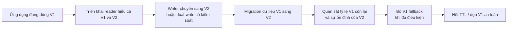
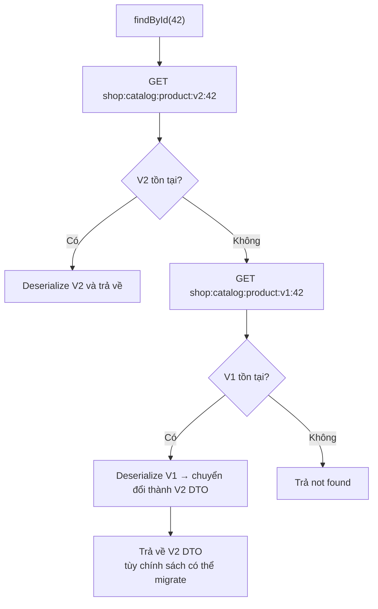
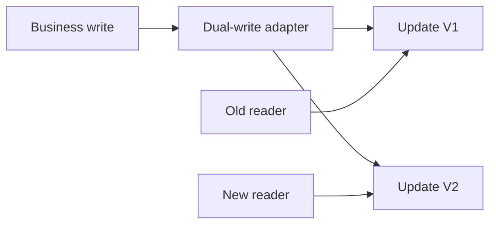
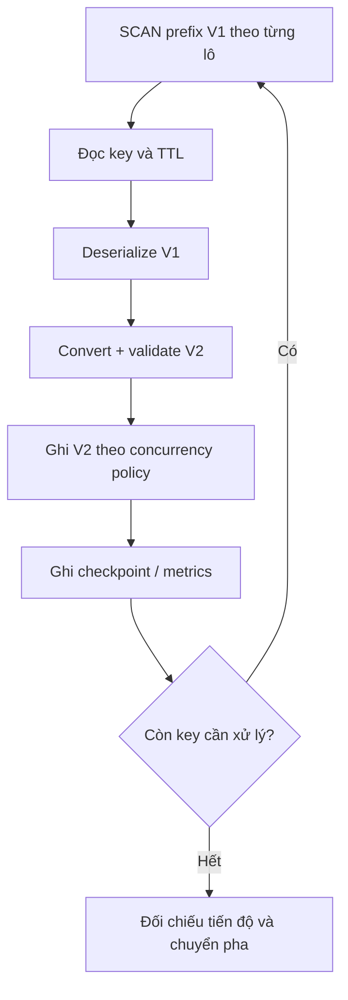

# Thiết kế khóa có phiên bản để hỗ trợ thay đổi cấu trúc dữ liệu trong Spring Data Redis

Redis lưu dữ liệu bằng key và value, nhưng **không tự quản lý schema của đối tượng Java** như hệ quản trị cơ sở dữ liệu quan hệ. Khi ứng dụng Spring Data Redis thay đổi cấu trúc entity, tên thuộc tính, kiểu dữ liệu, cách serialize hoặc cách tổ chức key, các bản ghi cũ có thể vẫn tồn tại trong Redis. Phiên bản ứng dụng mới có thể đọc sai chúng, còn ứng dụng cũ có thể không hiểu dữ liệu mà phiên bản mới ghi.

Một giải pháp thiết kế quan trọng là **gắn phiên bản schema vào tên key**. Ví dụ thay vì ghi đè dữ liệu mới lên `product:42`, ta chuyển từ `catalog:product:v1:42` sang `catalog:product:v2:42`. Hai thế hệ dữ liệu cùng tồn tại trong một khoảng thời gian để ứng dụng có thể triển khai theo từng bước, kiểm tra kết quả chuyển đổi và loại bỏ định dạng cũ có kiểm soát.

Bài học tập trung vào thiết kế key versioning trong **Spring Data Redis**, gồm `StringRedisTemplate`, `RedisTemplate`, Redis Repository và Redis Cache. Các ví dụ dùng Java 21 và API phổ biến của Spring Boot 3.x/Spring Data Redis 3.x; người triển khai cần đối chiếu hành vi thực tế với phiên bản dependency và topology Redis của dự án.

## 1. Vì sao cấu trúc dữ liệu Redis cần phiên bản?

Giả sử một ứng dụng quản lý danh mục sản phẩm lưu JSON như sau:

**Dữ liệu V1:**

```text
Key: catalog:product:v1:42
Type: Redis String
Value: {"id":"42","name":"Keyboard","priceCents":1599}
```

Phiên bản mới muốn đổi cấu trúc:

**Dữ liệu V2:**

```text
Key: catalog:product:v2:42
Type: Redis String
Value: {
  "schemaVersion": 2,
  "id": "42",
  "displayName": "Keyboard",
  "priceMinor": 1599,
  "currency": "USD"
}
```

Các thay đổi gồm:

- `name` được đổi thành `displayName`.
- `priceCents` được đổi thành `priceMinor` để có định nghĩa đơn vị rõ hơn.
- Thêm `currency`.
- Thêm `schemaVersion` bên trong payload để phục vụ kiểm tra và quan sát định dạng.

Nếu thay JSON V2 vào key V1 mà các instance ứng dụng cũ vẫn hoạt động, ứng dụng cũ có thể không đọc được trường `name` hoặc diễn giải sai giá. Ngược lại, nếu ứng dụng mới mong đợi `currency` mà gặp V1, có thể thiếu dữ liệu cần thiết.

Thiết kế có phiên bản giúp:

1. Phân biệt dữ liệu theo **hợp đồng schema**.
2. Cho phép V1 và V2 tồn tại đồng thời trong thời gian rollout.
3. Hỗ trợ chuyển đổi dữ liệu có chọn lọc hoặc chạy nền.
4. Giảm nguy cơ đọc sai dữ liệu nhị phân/JSON/Hash sau khi đổi serializer.
5. Dễ quan sát quy mô migration, đặt TTL và dọn thế hệ key cũ.

**Giới hạn:** gắn `v2` vào key chỉ tạo ra một ranh giới lưu trữ; nó không tự chuyển đổi dữ liệu, chống ghi đè đồng thời, đảm bảo rollback hay xóa các key cũ. Những phần này cần một migration protocol riêng.

## 2. “Phiên bản key” nghĩa là phiên bản gì?

Trong Redis có nhiều khái niệm “version”:

| Loại version | Ví dụ | Mục đích |
|---|---|---|
| **Schema/key format version** | `catalog:product:v2:42` | Phân biệt cách tổ chức, serialize hoặc diễn giải dữ liệu |
| **Application release version** | `app-2.7.1` | Theo dõi bản phát hành phần mềm, không nhất thiết làm đổi schema |
| **Business revision / optimistic version** | `revision: 18` trong value | Phát hiện cập nhật cũ hoặc xung đột ghi |
| **Cache generation/version** | `cache:catalog:g5:...` | Làm mất hiệu lực một thế hệ cache bằng đổi namespace |
| **API version** | `/api/v2/products` | Hợp đồng HTTP, không nhất thiết tương đương storage schema |

Trong bài này, `v1` và `v2` trên key chủ yếu là **phiên bản định dạng lưu trữ**. Không cần tăng schema version mỗi khi build/redeploy. Chỉ tạo thế hệ mới khi thay đổi có thể làm code cũ đọc sai, thay đổi kiểu Redis, serializer, quy tắc key, hoặc yêu cầu migration có chủ đích.

Ví dụ: thêm log trong service hoặc đổi TTL của cache từ 10 phút sang 5 phút **không nhất thiết cần đổi key version**. Ngược lại, chuyển từ Redis String chứa JSON sang Redis Hash với cấu trúc field mới là thay đổi đáng cân nhắc tách namespace.

**Version của tên key không thay thế optimistic locking.** Nếu hai request cùng ghi `catalog:product:v2:42`, hậu tố `v2` không giúp phát hiện request nào ghi sau hoặc dữ liệu nào mới hơn. Cần revision, transaction, Lua script hoặc cơ chế bảo vệ tương ứng khi có xung đột cập nhật.

## 3. Xây dựng quy ước tên key

Một quy ước dễ đọc:

```text
<application>:<domain>:<entity>:v<schemaVersion>:<businessId>
```

Ví dụ:

```text
shop:catalog:product:v1:42
shop:catalog:product:v2:42
shop:identity:session:v3:s-203
shop:inventory:stock:v2:sku-88
shop:search:result:v4:query-hash-7f1
```

Các trường nên có ý nghĩa ổn định:

| Phần | Ví dụ | Ý nghĩa |
|---|---|---|
| Application/namespace | `shop` | Tránh va chạm với ứng dụng khác dùng chung Redis |
| Bounded context/domain | `catalog` | Phân biệt hệ thống nghiệp vụ |
| Kiểu dữ liệu | `product` | Xác định object hoặc nhóm key |
| Schema version | `v2` | Chọn hợp đồng đọc/ghi |
| Business ID | `42` | Xác định bản ghi cụ thể |

Những nguyên tắc nên áp dụng:

- **Cố định quy ước phân tách và thứ tự** để có thể tạo prefix và scan có kiểm soát.
- Dùng tên rõ nghĩa như `v2`, tránh chỉ dùng `2` khiến khó phân biệt version với ID.
- Chuẩn hóa ID, encoding và ký tự đặc biệt. Nếu ID có thể chứa `:`, khoảng trắng hoặc ký tự bất kỳ, cần một quy tắc escape/encode ổn định.
- Giữ key đủ ngắn, không nhồi toàn bộ JSON vào tên key. Key dài làm tăng sử dụng bộ nhớ và chi phí truyền tải.
- Không đưa password, token, email hoặc PII trực tiếp vào key nếu không có yêu cầu và biện pháp bảo vệ. Redis key thường xuất hiện trong monitoring, logs hoặc các công cụ quản trị.
- Khi nhiều dịch vụ chia sẻ Redis, thêm prefix đủ để tránh xung đột và ghi rõ **dịch vụ nào sở hữu key**.

### 3.1. Đặt version ở đầu hay cuối?

Cả hai quy ước sau đều khả thi:

```text
shop:catalog:product:v2:42
shop:catalog:v2:product:42
```

Chọn theo kiểu truy vấn và thao tác vận hành thường dùng. Nếu hay scan mọi product V2, prefix `shop:catalog:product:v2:*` rất thuận tiện. Điều quan trọng là **nhất quán** trong hệ thống và có khả năng xây dựng key chính xác từ business ID.

Nếu migration bao gồm nhiều loại dữ liệu có phiên bản khác nhau, nên để từng kiểu có version riêng; không ép toàn bộ Redis vào cùng một “global version” trừ khi thật sự cần đổi toàn bộ namespace.

### 3.2. Redis Cluster và hash tags

Redis Cluster chia key theo hash slot. Khi cần thao tác **nhiều key liên quan đến cùng một entity** trong một transaction hoặc Lua script, có thể thiết kế hash tag:

```text
shop:catalog:product:{42}:v1
shop:catalog:product:{42}:v2
shop:catalog:product:{42}:migration-lock
```

Redis Cluster tính slot từ chuỗi trong ngoặc nhọn `{42}`; các key trên cùng slot vì có cùng hash tag. Điều này hữu ích cho các thao tác nhiều key bắt buộc chạy trên một node.

Tuy nhiên, đặt **cùng một hash tag cố định cho toàn bộ sản phẩm**, ví dụ `{products}`, sẽ ép nhiều key vào một slot và làm mất khả năng phân tán. Nên dùng identity đủ phân tán (ví dụ ID thực của từng entity). Không phải mọi migration cần transaction nhiều key; nếu không cần, không phải tự thêm hash tag.

## 4. Bản đồ vòng đời từ V1 sang V2



Trục chính của thiết kế là **tách khả năng đọc, quyền ghi, chuyển đổi dữ liệu và thời điểm xóa dữ liệu cũ**. Một release có thể chứa nhiều trong số các bước này, nhưng đối với migration lớn thì triển khai theo pha giúp giảm rủi ro.

### Pha 1 — Reader tương thích hai schema

Ứng dụng mới biết đọc V2; khi V2 chưa có, có thể đọc V1 và chuyển sang model V2 trong bộ nhớ. Đây là **read fallback**.

### Pha 2 — Bắt đầu ghi V2

Ứng dụng mới ghi vào namespace V2. Nếu vẫn còn instance V1 cần đọc dữ liệu mới, phải thiết kế một khoảng **dual-write** hoặc đảm bảo tất cả consumer đã được nâng cấp trước khi chỉ ghi V2.

### Pha 3 — Chuyển đổi các bản ghi còn lại

Có thể chuyển khi đọc (lazy migration), chạy job nền (batch migration) hoặc kết hợp cả hai.

### Pha 4 — Theo dõi và kết thúc tương thích

Khi không còn consumer V1, dữ liệu V2 đã sẵn sàng, và không còn phụ thuộc vào V1 cho rollback, mới bỏ fallback V1 và dọn key cũ theo kế hoạch.

**Không sử dụng “đã deploy version mới” làm bằng chứng duy nhất để xóa V1.** Những worker cũ, consumer chạy lâu, batch job, service phụ hoặc ứng dụng ngoại vi có thể vẫn cần namespace trước đó.

## 5. Lựa chọn chiến lược migration

| Chiến lược | Cách hoạt động | Phù hợp khi | Điểm cần kiểm soát |
|---|---|---|---|
| **Cold cutover** | Dừng writer, chuyển toàn bộ V1 sang V2, đổi reader/writer, mở traffic | Tập dữ liệu nhỏ hoặc có cửa sổ bảo trì | Downtime, rollback, thời gian migration |
| **Read fallback** | Đọc V2 trước; thiếu thì đọc và chuyển V1 trong bộ nhớ | Cần giữ ứng dụng hoạt động trong lúc nâng cấp | V1 có thể cũ; xóa và miss dễ nhập nhằng |
| **Lazy migration** | Khi đọc V1 thì ghi bản V2 tương ứng | Dữ liệu truy cập thường xuyên, khối lượng lớn | Concurrency, TTL, số key ít được đọc sẽ tồn tại lâu |
| **Batch/background migration** | Quét theo prefix, đọc V1, chuyển đổi, ghi V2 | Cần chuyển toàn bộ dữ liệu, không phụ thuộc lượt truy cập | SCAN, rate limit, idempotency, tiến độ và lỗi |
| **Dual-write** | Một thay đổi ghi cả V1 và V2 trong giai đoạn chuyển tiếp | Instance cũ và mới cần cùng tồn tại | Partial failure, consistency, tăng chi phí ghi |
| **Cache generation switch** | Reader chuyển sang prefix mới, cache mới tự nóng dần | Dữ liệu có thể tái tạo từ source of truth | Cache miss tăng mạnh, database overload |

Không có một lựa chọn thắng mọi trường hợp. Với **cache có thể tạo lại**, tăng generation và đợi key cũ hết TTL thường đơn giản. Với **Redis là nguồn dữ liệu chính**, phải coi migration như thay đổi dữ liệu có yêu cầu độ bền, nhất quán và rollback rõ ràng.

## 6. Read fallback: ưu tiên V2, rồi mới V1

Một quy tắc đọc hay dùng trong giai đoạn chuyển tiếp:



**Không đảo thứ tự đọc tùy tiện.** Nếu cả V1 và V2 tồn tại, V2 thường là nguồn ưu tiên của reader mới, nếu rollout quy định V2 là authoritative. Đọc V1 trước sẽ có nguy cơ trả dữ liệu cũ.

Tuy nhiên, chỉ dùng thuật toán “V2 không có thì đọc V1” **chưa đủ an toàn cho dữ liệu có thể bị xóa**:

1. V1 của sản phẩm `42` vẫn còn.
2. Ứng dụng mới xóa V2 của sản phẩm `42`.
3. Lần đọc sau không tìm thấy V2.
4. Reader fallback sang V1 và “hồi sinh” sản phẩm đã xóa.

Đây là lỗi **stale resurrection**. Nếu miền dữ liệu có update/delete trong thời kỳ migration, phải có quy tắc riêng: tombstone có phiên bản, record trạng thái deleted, quyền sở hữu dữ liệu, hoặc hoàn tất chuyển đổi/cắt V1 trước khi cho phép delete kiểu mới.

Một tombstone có thể có key như:

```text
shop:catalog:product:v2:42:deleted
```

Nếu thấy tombstone hợp lệ, reader trả “đã xóa” thay vì fallback. Nhưng tombstone cũng có TTL, điều kiện tạo/xóa và concurrency; **không thể chọn TTL tombstone ngắn hơn thời gian V1 còn có khả năng được fallback** mà không có biện pháp bổ sung.

## 7. Ví dụ Spring Data Redis: đọc hai schema, ghi V2

Đoạn mã dưới minh họa cách đóng gói versioning trong một adapter Spring Data Redis. Đối với ví dụ, V1 chứa giá tính bằng cent và **toàn bộ V1 được bảo đảm thuộc USD theo hợp đồng dữ liệu cũ**. Vì vậy, migration có thể điền `currency = "USD"`; nếu dữ liệu thực tế có nhiều loại tiền mà V1 không lưu currency thì không được tự đoán.

### 7.1. Model lưu trữ

```java
// ProductSnapshotV1.java
public record ProductSnapshotV1(
    String id,
    String name,
    long priceCents
) {}

// ProductSnapshotV2.java
public record ProductSnapshotV2(
    int schemaVersion,
    String id,
    String displayName,
    long priceMinor,
    String currency
) {}
```

### 7.2. Adapter với `StringRedisTemplate`

```java
import com.fasterxml.jackson.core.JsonProcessingException;
import com.fasterxml.jackson.databind.ObjectMapper;
import java.time.Duration;
import java.util.Optional;
import org.springframework.data.redis.core.StringRedisTemplate;
import org.springframework.stereotype.Repository;

@Repository
public class VersionedProductStore {
    private static final String V1_PREFIX = "shop:catalog:product:v1:";
    private static final String V2_PREFIX = "shop:catalog:product:v2:";
    private static final Duration V2_TTL = Duration.ofHours(6);

    private final StringRedisTemplate redis;
    private final ObjectMapper json;

    public VersionedProductStore(
            StringRedisTemplate redis,
            ObjectMapper json) {
        this.redis = redis;
        this.json = json;
    }

    public Optional<ProductSnapshotV2> find(String id) {
        validateId(id);

        String current = redis.opsForValue().get(V2_PREFIX + id);
        if (current != null) {
            ProductSnapshotV2 v2 = fromJson(
                current, ProductSnapshotV2.class
            );
            if (v2.schemaVersion() != 2) {
                throw new IllegalStateException("Unexpected V2 schema");
            }
            return Optional.of(v2);
        }

        // Transitional fallback; xem điều kiện xóa/tombstone bên dưới.
        String legacy = redis.opsForValue().get(V1_PREFIX + id);
        if (legacy == null) {
            return Optional.empty();
        }

        ProductSnapshotV1 v1 = fromJson(
            legacy, ProductSnapshotV1.class
        );
        return Optional.of(convert(v1));
    }

    public void save(ProductSnapshotV2 product) {
        if (product.schemaVersion() != 2) {
            throw new IllegalArgumentException("V2 schema required");
        }
        validateId(product.id());
        redis.opsForValue().set(
            V2_PREFIX + product.id(),
            toJson(product),
            V2_TTL
        );
    }

    private ProductSnapshotV2 convert(ProductSnapshotV1 v1) {
        return new ProductSnapshotV2(
            2,
            v1.id(),
            v1.name(),
            v1.priceCents(),
            "USD"
        );
    }

    private <T> T fromJson(String value, Class<T> type) {
        try {
            return json.readValue(value, type);
        } catch (JsonProcessingException e) {
            throw new IllegalStateException(
                "Invalid Redis JSON for " + type.getSimpleName(), e
            );
        }
    }

    private String toJson(Object value) {
        try {
            return json.writeValueAsString(value);
        } catch (JsonProcessingException e) {
            throw new IllegalStateException(
                "Cannot serialize Redis value", e
            );
        }
    }

    private void validateId(String id) {
        if (id == null || !id.matches("[A-Za-z0-9_-]{1,80}")) {
            throw new IllegalArgumentException("Invalid product ID");
        }
    }
}
```

Điều kiện để ví dụ vận hành:

- Ứng dụng có `spring-boot-starter-data-redis` và Jackson JSON được khai báo/cấu hình để cung cấp `ObjectMapper`.
- Redis V1 lưu JSON đúng schema `ProductSnapshotV1`; ví dụ không áp dụng trực tiếp cho Redis Hash hoặc JDK serialization.
- V1 thực sự là USD theo hợp đồng dữ liệu đã biết.
- Trong thời gian bật fallback, hệ thống phải có **chính sách xóa/cập nhật tránh đọc nhầm V1 stale**. Ví dụ trên là luồng đọc dành cho dữ liệu chưa xóa hoặc migration có quản lý; không tự triển khai tombstone.
- Việc deserialize lỗi là **data-format error**, không được diễn giải thành “key không tồn tại” rồi âm thầm fallback.

Ví dụ sử dụng:

```java
ProductSnapshotV2 product = store.find("42")
    .orElseThrow();

store.save(new ProductSnapshotV2(
    2, "42", "Mechanical Keyboard", 1599, "USD"
));
```

Ưu điểm của adapter là service nghiệp vụ chỉ làm việc với `ProductSnapshotV2`. Các quy tắc xây dựng key, đọc fallback và chuyển đổi model được tập trung tại một nơi, không bị sao chép vào nhiều controller hoặc service.

Lưu ý: `@Repository` trên `VersionedProductStore` là stereotype Spring để tạo bean/inject adapter. Nó **không đồng nghĩa** với Redis Repository interface kiểu `CrudRepository`; ví dụ này chủ động dùng `StringRedisTemplate`.

## 8. Lazy migration: chuyển đổi khi người dùng đọc V1

Sau khi đọc và chuyển V1 thành V2, ứng dụng có thể ghi V2 để những lần đọc sau không cần fallback:

```text
read V2
  ├─ có  → return V2
  └─ thiếu → read V1
              ├─ thiếu → not found
              └─ có    → convert to V2
                          → write V2 if safe
                          → return V2
```

Đây là **read repair/lazy migration**. Tuy nhiên, việc ghi V2 trong nhánh fallback có thể gây race condition:

```text
T1: Migration reader đọc V1 = giá 100
T2: Writer mới cập nhật V2 = giá 120
T1: Migration reader ghi V2 = giá 100
Kết quả: cập nhật mới bị ghi đè
```

Một biện pháp ban đầu là dùng **SET NX** để chỉ ghi khi key V2 chưa tồn tại:

```java
Boolean created = redis.opsForValue().setIfAbsent(
    "shop:catalog:product:v2:42",
    v2Json,
    Duration.ofHours(6)
);
```

`setIfAbsent(key, value, duration)` có ý nghĩa tương ứng với thiết lập key nếu chưa tồn tại kèm TTL ở Redis. Điều này tránh ghi đè V2 **đã tồn tại** nhưng **không tự giải quyết mọi cuộc đua**:

- Nếu writer V2 đang cập nhật cùng thời điểm, thứ tự write quyết định ai tạo key trước.
- Nếu entity mới bị xóa trước khi lazy migration chạy, fallback V1 vẫn có thể tái tạo dữ liệu cũ.
- Nếu logic update chỉ chạy khi key tồn tại, một key do lazy migration vừa tạo có thể ảnh hưởng tính đúng đắn của write mới.
- Nếu cần so sánh revision, cần dữ liệu revision thực và thao tác kiểm tra-ghi có tính nguyên tử.

Vì vậy, lazy migration phù hợp nhất khi nguồn V1 tương đối ổn định hoặc đã có protocol **chặn stale write và xóa sai**. `SET NX` hữu ích nhưng không thay thế thiết kế nhất quán.

## 9. TTL: phiên bản mới không được vô tình thay đổi vòng đời dữ liệu

TTL là thời gian sống của **một Redis key**, không phải của một entity trừu tượng. V1 và V2 là hai key khác nhau nên có TTL riêng.

Giả sử:

```text
Key V1: login:session:v1:s-101
TTL: 120 giây còn lại

Migration viết:
Key V2: login:session:v2:s-101
TTL: 30 phút
```

Khi đó, session đã gần hết hạn ở V1 nhưng được kéo dài thành 30 phút tại V2. Đây có thể là lỗi an ninh hoặc sai nghiệp vụ.

### 9.1. Chuyển TTL còn lại

Khi migration yêu cầu **giữ nguyên thời điểm hết hạn**, phải đọc TTL còn lại của V1 và dùng TTL tương ứng cho V2. Spring Data Redis hỗ trợ `getExpire`:

```java
import java.time.Duration;

Duration remaining = redis.getExpire("login:session:v1:s-101");
```

Các trường hợp cần phân biệt theo API/version:

- TTL dương: key tồn tại và đang có thời hạn. Có thể ghi V2 với TTL còn lại, nếu policy cho phép.
- Không có TTL: Redis trả sentinel `-1` ở lệnh `TTL` hoặc `PTTL`.
- Key không tồn tại: Redis trả `-2` ở lệnh `TTL` hoặc `PTTL`.
- Redis key có thể **hết hạn ngay giữa bước đọc value và đọc TTL**.

Vì `GET` và `TTL` riêng lẻ không tạo snapshot nguyên tử, migration đòi hỏi consistency chặt nên dùng script/transaction phù hợp hoặc phiên bản có revision, thay vì chỉ “đọc TTL rồi set” một cách vô điều kiện.

Nếu yêu cầu expiry chính xác hơn giây, xem `PTTL` / `PEXPIRE` hoặc API Duration với độ chính xác phù hợp. TTL âm không được chuyển thành Duration dương bằng cách lấy trị tuyệt đối; cần xử lý theo chính sách cụ thể.

### 9.2. Trường hợp nên đặt TTL mới

Với **cache chỉ là bản sao từ database**, key V2 có thể được tạo mới với TTL mặc định của cache V2. Điều này thường chấp nhận được vì cache không phải nguồn sự thật; khi hết TTL sẽ tải lại dữ liệu nguồn.

Với **OTP, session, lease, rate limit, lock hoặc entitlement tạm thời**, kéo dài TTL ngoài ý muốn có thể thay đổi semantics nghiệp vụ. Trong các trường hợp đó, thời điểm hết hạn là một phần của contract cần được giữ nguyên hoặc quy định thay đổi minh bạch.

## 10. Dual-write trong giai đoạn ứng dụng cũ và mới cùng chạy

Ở hệ thống có rolling deployment, một phần instance có thể vẫn đọc V1 trong khi instance khác đã đọc V2.



Dual-write có thể giúp instance cũ thấy cập nhật trong thời gian chuyển tiếp. Nhưng nó mang thêm rủi ro:

- Ghi V1 thành công, ghi V2 thất bại → dữ liệu lệch.
- Ghi V2 thành công, ghi V1 thất bại → reader cũ thấy dữ liệu cũ.
- Retry sau timeout có thể ghi lại giá trị sai thứ tự.
- Nếu V2 chứa thông tin V1 không biểu diễn được, phép chuyển ngược V2 → V1 có thể **mất thông tin**.
- Sự kiện update và delete đến không cùng thứ tự tại hai phiên bản key có thể tạo trạng thái bất nhất.

Do đó cần chọn một **nguồn sự thật** và nguyên tắc giải quyết xung đột. Chẳng hạn với PostgreSQL là nguồn chính:

1. Transaction cập nhật database.
2. Phát sự kiện có ID/revision hoặc sử dụng outbox bảo đảm không mất sự kiện.
3. Consumer tạo/invalidates V1 và V2 một cách idempotent.
4. Quan sát lag, lỗi và tiến độ đồng bộ.

Trong giai đoạn chuyển tiếp, có thể ưu tiên **invalidate cache ở cả hai namespace** sau khi dữ liệu gốc thay đổi, thay vì cố cập nhật đồng thời hai bản cache với cùng giá trị. Cách nào phù hợp tùy yêu cầu latency và chi phí cache miss.

**Không coi hai lệnh `SET` liên tiếp là một transaction phân tán.** Với standalone Redis, có thể dùng `MULTI/EXEC` hoặc Lua cho các thao tác hợp lệ trên một Redis instance; với Redis Cluster, nhiều-key operation bị ràng buộc cùng hash slot. Ngay cả khi Redis viết hai key nguyên tử, nó cũng không tự atomic với database hoặc hệ thống bên ngoài.

## 11. Batch migration với SCAN: xử lý nhiều key

Khi dữ liệu V1 không tự hết hạn hoặc có nhiều bản ghi ít được truy cập, lazy migration không thể bảo đảm chuyển hết. Có thể dùng background job:



Ví dụ kiểm tra key theo prefix trên môi trường cho phép:

```bash
redis-cli --scan --pattern 'shop:catalog:product:v1:*'
```

Từ CLI, `SCAN` phù hợp hơn `KEYS shop:catalog:product:v1:*` khi keyspace lớn vì `KEYS` có thể chặn server trong một khoảng thời gian đáng kể. Nhưng **SCAN không cung cấp snapshot bất biến**:

- Trong lúc quét, key có thể bị thêm, xóa, đổi TTL hoặc cập nhật.
- Một key có thể xuất hiện hơn một lần giữa các lượt quét.
- Cần thiết kế migration **idempotent** để chạy lại không gây hại.
- Ở Redis Cluster, việc quét trên một endpoint không mặc nhiên là quét mọi primary node; cần chiến lược duyệt tất cả shard/primary phù hợp.

Job migration nên có giới hạn throughput, batch size, retry có kiểm soát, checkpoint và khả năng tạm dừng. Nếu V1 vẫn có writer, **một lần SCAN đi hết không chứng minh tất cả dữ liệu đã được chuyển chính xác**; phải phối hợp cắt writer V1, revision hoặc reconciliation.

### 11.1. Đếm tiến độ không chỉ bằng số key V2

Ví dụ chỉ số:

| Chỉ số | Ý nghĩa |
|---|---|
| `migration.v1_scanned` | Tổng key được quét; có thể gồm lần quét trùng |
| `migration.v2_created` | Số bản ghi V2 mới thực sự được tạo |
| `migration.v2_already_exists` | Bản ghi V2 có sẵn hoặc tạo bởi luồng khác |
| `migration.transform_failed` | V1 không chuyển đổi được |
| `migration.ttl_skipped` | Bản ghi đã hết hạn/không phù hợp chính sách TTL |
| `reads.v1_fallback` | Tần suất reader còn phải quay về V1 |
| `writes.v1` / `writes.v2` | Xác định writer cũ đã ngừng chưa |

Không ghi raw payload hoặc ID nhạy cảm vào metric labels vì dễ tạo high cardinality và lộ dữ liệu. Có thể lưu các lỗi cần điều tra vào khu vực xử lý riêng, giới hạn quyền truy cập, và ghi ID đã được giảm thiểu.

## 12. Versioned keys khi sử dụng Redis Repository

Redis Repository trong Spring Data Redis không hoạt động giống một `StringRedisTemplate` ghi JSON. Với entity có `@RedisHash`, framework ánh xạ dữ liệu sang Redis Hash và có thể quản lý thêm secondary index, tập ID, TTL metadata hoặc phantom copy tùy tính năng/cấu hình.

Ví dụ phân biệt keyspace theo phiên bản:

```java
import org.springframework.data.annotation.Id;
import org.springframework.data.redis.core.RedisHash;

@RedisHash("product-v1")
public class ProductV1Entity {
    @Id
    private String id;
    private String name;
    // Constructors/getters/setters cần thiết được lược bỏ.
}

@RedisHash("product-v2")
public class ProductV2Entity {
    @Id
    private String id;
    private String displayName;
    private String currency;
    // Constructors/getters/setters cần thiết được lược bỏ.
}
```

Thông qua `@RedisHash("product-v1")` và `@RedisHash("product-v2")`, hai aggregate có keyspace tách biệt. Tuy nhiên đây chỉ là minh họa entity mapping; để dùng cùng lúc cần cấu hình repository interface và quét entity phù hợp. Khác với JSON ở ví dụ `StringRedisTemplate`, các key chính và **key metadata/index** do Spring Data Redis quản lý có quy tắc riêng.

Khi migration Repository:

- Không tự giả định chỉ cần `RENAME product-v1:42 product-v2:42`. Entity structure và secondary index có thể đã đổi; rename raw Redis key không tạo lại index/schema mapping đúng.
- Với thuộc tính dùng `@Indexed`, migration cần xem việc tạo và dọn index của cả hai keyspace.
- Việc đổi `@RedisHash` không làm dữ liệu cũ tự chuyển sang keyspace mới.
- Nếu có TTL qua `@RedisHash(timeToLive=...)` hoặc `@TimeToLive`, phải định nghĩa chính sách giữ lại thời điểm hết hạn.
- Nếu index/phantom copy/keyspace events được dùng, cần xem cơ chế lưu trữ metadata và cleanup của phiên bản Spring Data Redis tương ứng trước khi xóa key bằng lệnh thô.

Một đường an toàn thường là **đọc V1 bằng mapping V1, chuyển đổi DTO, lưu V2 qua repository V2** để framework tạo dữ liệu và index phù hợp. Nếu cần tối ưu tốc độ bằng lệnh thấp tầng, phải chủ động duy trì tất cả invariant mà repository thường quản lý.

## 13. Versioned keys khi dùng Spring Cache

Với cache, phiên bản namespace có thể đặt ở **cache name**:

```java
import org.springframework.cache.annotation.Cacheable;

@Cacheable(cacheNames = "catalog-product-v2", key = "#productId")
public ProductView findProduct(String productId) {
    return productGateway.load(productId);
}
```

Nếu Spring Cache dùng `RedisCacheManager` với prefix mặc định phổ biến, key có dạng logic:

```text
catalog-product-v2::42
```

Format key thật có thể thay đổi bởi `RedisCacheConfiguration` và key serializer. Việc đổi cache name từ `catalog-product-v1` sang `catalog-product-v2` làm reader mới bỏ qua giá trị cũ và xây cache mới khi miss.

Đây là một cách đơn giản để triển khai **cache generation**:

1. Đổi cache name khi serializer hoặc output shape thay đổi.
2. Reader mới chỉ đọc cache V2.
3. Lần miss sẽ gọi nguồn dữ liệu và ghi kết quả V2.
4. Cache V1 tự hết hạn theo TTL hoặc được dọn khi không còn consumer cũ.

Không cần đọc fallback từ cache V1 nếu nguồn dữ liệu chính sẵn sàng và chi phí tải lại chấp nhận được. Nhưng nếu rollout làm đồng thời tất cả cache key miss, có thể gây **cache stampede**: nhiều request cùng đánh database/API. Cần cân nhắc warm-up, rollout từng đợt, TTL có jitter, cache synchronization hoặc giới hạn tải.

Ví dụ TTL cache riêng với connection configuration:

```yaml
spring:
  data:
    redis:
      host: localhost
      port: 6379
  cache:
    type: redis
    redis:
      time-to-live: 15m
```

`spring.cache.redis.time-to-live` áp dụng cho cache entries theo cấu hình; `spring.data.redis.timeout` nếu có là command timeout, không phải TTL. Đổi tên cache không làm serializer tự đổi; nếu JSON/cache value type thay đổi phải cấu hình serializer phù hợp cho Redis Cache.

## 14. Serializer versioning và schema versioning

Đổi key version có thể cần ngay cả khi business fields không thay đổi, ví dụ chuyển:

```text
V1: Redis String + JDK serialization
V2: Redis String + JSON UTF-8
V3: Redis Hash + field-based mapping
```

Nếu cùng key được lưu bằng nhiều serializer, code mới có thể gặp deserialize error, hoặc Redis trả `WRONGTYPE` nếu key từ String chuyển thành Hash.

Tách namespace theo version giúp xác định **phải dùng decoder nào**:

| Key prefix | Redis type | Decoder/mapping |
|---|---|---|
| `shop:profile:v1:*` | String | JDK serializer cũ (nếu tồn tại dữ liệu legacy) |
| `shop:profile:v2:*` | String | JSON và DTO V2 |
| `shop:profile:v3:*` | Hash | Hash mapping/fields V3 |

Không nên sử dụng thử lần lượt nhiều decoder trên một key mà không có metadata/version rõ ràng: xử lý lỗi phức tạp, dễ đọc nhầm bytes hợp lệ nhưng không đúng schema. Với dữ liệu có yêu cầu audit hoặc phát triển lâu dài, có thể bổ sung `schemaVersion` trong payload như một **lớp kiểm tra phụ**.

Khi dùng polymorphic JSON/Jackson default typing, phải cân nhắc rủi ro bảo mật và compatibility; tránh tin tưởng payload không được kiểm soát và tránh serialize Java class name làm hợp đồng dữ liệu lâu dài nếu không có lý do cụ thể.

## 15. Concurrency, revision và dữ liệu mới ghi đè dữ liệu cũ

Versioned keys phân tách thế hệ schema, **không tự giải quyết thứ tự update**.

### 15.1. Vấn đề trong background migration

```text
t0: Job đọc product V1: price = 100, revision = 7
t1: Service cập nhật product V2: price = 120, revision = 8
t2: Job ghi product V2: price = 100, revision = 7
```

V2 đã bị regression về dữ liệu cũ. Một quy trình an toàn có thể cần:

- Không cho legacy writer thay đổi dữ liệu trong cửa sổ cutover, hoặc
- Cả hai schema chia sẻ revision có thể so sánh, hoặc
- Dùng lock/version check và ghi nguyên tử phù hợp với topology, hoặc
- Lấy dữ liệu từ một nguồn sự thật khác (database/event log) thay vì tin snapshot V1 có thể cũ.

Nếu dùng Redis làm nơi authoritative, phép kiểm tra revision và ghi phải có tính nguyên tử. Với Redis String JSON, một thiết kế là script kiểm tra revision hiện tại rồi ghi nếu revision mới lớn hơn; với Redis Hash cũng có thể lưu `revision` riêng và cập nhật bằng Lua. Mọi key mà script truy cập trong Redis Cluster phải cùng slot.

### 15.2. Tombstone và update/delete

Một mô hình thường dùng là mỗi entity có trạng thái:

```json
{
  "schemaVersion": 2,
  "id": "42",
  "revision": 19,
  "deleted": true
}
```

Khi reader thấy tombstone V2, nó **không fallback** vào V1. Nhưng cũng phải:

- Gắn revision/timestamp theo nguồn đáng tin cậy.
- Xử lý event update đến muộn sau delete.
- Quy định retention của tombstone so với vòng đời V1.
- Bảo đảm job migration không ghi đè tombstone bằng bản V1 cũ.

Đừng xóa tombstone ngay khi ứng dụng mới ngừng đọc V1 nếu còn writer hoặc migration job cũ có khả năng tạo lại dữ liệu.

## 16. Quy trình triển khai theo pha và rollback

Một kế hoạch có kiểm soát cho hệ thống đang hoạt động:

| Pha | Đường đọc | Đường ghi | Mục tiêu |
|---|---|---|---|
| 0 — Chuẩn bị | V1 | V1 | Chốt contract V1/V2, conversion và chỉ số quan sát |
| 1 — Reader tương thích | V2 rồi fallback V1 | V1 hoặc theo protocol quá độ | Đảm bảo reader mới không vấp dữ liệu cũ |
| 2 — Chuyển quyền ghi | V2 rồi fallback V1 | V2, hoặc dual-write trong thời gian có reader cũ | Cho dữ liệu mới vào namespace V2 |
| 3 — Migrate/reconcile | V2 ưu tiên | V2 authoritative | Chuyển dữ liệu còn lại, bảo đảm update/delete đúng |
| 4 — Ngừng phụ thuộc V1 | Chỉ V2 | Chỉ V2 | Không còn consumer V1 và fallback không cần nữa |
| 5 — Cleanup | Chỉ V2 | Chỉ V2 | Hết TTL/xóa V1 theo kế hoạch đã xác nhận |

Thứ tự cụ thể phụ thuộc loại dữ liệu. Với cache có thể tái tạo, có thể bỏ qua fallback, dual-write và batch migration. Với authoritative Redis, cần chú trọng dữ liệu thay đổi liên tục và khả năng phục hồi.

### 16.1. Rollback có thực sự an toàn?

Nếu ứng dụng mới đã chỉ ghi V2, rollback code về bản chỉ đọc V1 **không tự thấy được những cập nhật V2**. Do đó:

1. Xác định giai đoạn nào còn được rollback về reader cũ.
2. Trong khoảng đó, bảo đảm dữ liệu V1 được duy trì theo contract hoặc có cơ chế chuyển ngược đáng tin cậy.
3. Nếu V2 chứa trường không tồn tại trong V1 hoặc thay đổi không đảo ngược được, có thể phải chọn roll-forward thay vì rollback dữ liệu.
4. Không dọn V1 trước khi kết thúc cửa sổ rollback và mọi consumer cũ đã tắt.

**Giữ key V1 không có nghĩa rollback tự an toàn**: key có thể đã stale. Chỉ xem rollback an toàn khi dữ liệu cần thiết cho phiên bản cũ được cập nhật đúng hoặc có kế hoạch khôi phục từ nguồn sự thật.

### 16.2. Feature flag/cấu hình thế hệ key

Một service có thể quản lý lựa chọn reader/writer bằng cấu hình:

```yaml
app:
  redis:
    product:
      read-version: v2
      allow-v1-fallback: true
      write-version: v2
```

`app.redis.product.*` ở đây là **thuộc tính ứng dụng tự định nghĩa**, không phải property mặc định của Spring Boot hay Spring Data Redis. Cần tạo configuration properties và logic sử dụng tương ứng.

Feature flag giúp đổi pha nhanh, nhưng bản thân flag không bảo đảm chuyển đổi chính xác. Những cơ chế như revision, tombstone, dual-write hoặc migration job vẫn phải làm việc đúng.

## 17. Dọn key cũ an toàn

Việc dọn V1 chỉ nên thực hiện khi:

- Không còn reader/writer V1 và các job cũ thực sự đã dừng.
- V2 có đủ dữ liệu cần giữ và các bản ghi lỗi chuyển đổi đã được xử lý.
- Cửa sổ rollback đã hết hoặc có phương án khôi phục độc lập.
- TTL/tombstone/index đã được đối chiếu với yêu cầu dữ liệu.
- Có cách dừng cleanup khi phát hiện bất thường.

Ví dụ chỉ **liệt kê** các key V1:

```bash
redis-cli --scan --pattern 'shop:catalog:product:v1:*'
```

Trên Redis lớn, không dùng `KEYS *` để quét tất cả key trong production; cũng không dùng `FLUSHDB` hoặc `FLUSHALL` chỉ để xóa một schema version. Dùng `SCAN` theo lô và thao tác xóa có giới hạn tốc độ, có thể dùng `UNLINK` khi phù hợp để giảm thời gian giải phóng bộ nhớ trên main thread. Lệnh `UNLINK` chỉ chọn cách reclaim memory; nó không thay thế xác minh quyền sở hữu key hay quyết định cleanup.

Với Redis Repository, phải tính cả các key index/metadata mà framework duy trì. Xóa thô entity hash nhưng giữ index có thể để lại dữ liệu tham chiếu không còn hợp lệ; xóa thô index lại có thể làm hỏng khả năng query của entity còn tồn tại.

## 18. Sai lầm thường gặp

| Sai lầm | Hệ quả | Cách thiết kế tốt hơn |
|---|---|---|
| Đổi schema nhưng giữ cùng key và serializer cũ | Deserialization lỗi hoặc hiểu sai field | Tách version khi định dạng không tương thích |
| Lấy application release làm schema version | Tạo quá nhiều key namespace không cần thiết | Chỉ tăng version khi contract lưu trữ đổi |
| Reader V2 luôn fallback V1, kể cả sau delete | Hồi sinh dữ liệu đã xóa | Tombstone/revision/cutover protocol |
| Job migration dùng `SET` ghi đè V2 mới hơn | Mất update gần đây | Version-aware write, conditional write |
| Thay TTL còn lại bằng TTL đầy đủ | Kéo dài session, OTP hoặc lease | Giữ expiry theo policy của domain |
| Dual-write nhưng không xử lý partial failure | V1 và V2 lệch nhau | Có nguồn sự thật, retry idempotent, reconciliation |
| Chỉ scan một Redis Cluster node | Bỏ sót key trên shard khác | Duyệt các primary phù hợp |
| Cho rằng V2 prefix tự cập nhật Repository index | Query theo index không đúng | Migrate qua repository mapping hoặc xử lý metadata |
| Xóa V1 ngay sau deploy | Instance cũ, rollback hoặc batch job bị lỗi | Chỉ cleanup sau khi hết dependency |
| Scan/xóa hàng triệu key không rate limit | Gây áp lực CPU/network, độ trễ Redis tăng | Batch, checkpoint và giới hạn tải |

## 19. Ba bài tập thiết kế

### Tình huống A — Cache JSON đổi schema

Một endpoint đọc sản phẩm từ PostgreSQL, cache JSON V1 có `name`, phiên bản mới trả DTO V2 với `displayName`. Redis chỉ là cache.

**Giải pháp:** đổi cache name/key namespace từ V1 sang V2, reader mới chỉ ghi/đọc cache V2 và để V1 hết TTL. Giám sát cache miss để tránh dồn tải đột ngột vào PostgreSQL. Không cần dual-write nếu ứng dụng cũ có thể tiếp tục sử dụng V1 cache của chính nó trong cửa sổ triển khai.

### Tình huống B — Session đang còn TTL

Session V1 có TTL 5 phút và chỉ còn 45 giây. V2 bổ sung field `lastSeenIp`; migration muốn copy sang key V2.

**Giải pháp:** giữ chính sách hết hạn gốc; nếu nghiệp vụ muốn sliding expiration phải xác định rõ sự kiện nào được phép refresh TTL. Không đặt TTL V2 là 5 phút vô điều kiện vì sẽ kéo dài session. Thiết kế migration chống race với hết hạn key và cập nhật session đồng thời.

### Tình huống C — Redis là dữ liệu chính, update liên tục

Giá sản phẩm V1 bị thay đổi trong lúc job đang migrate. Job đọc giá 100, service V2 vừa ghi giá 120.

**Giải pháp:** không ghi đè V2 bằng snapshot V1 cũ. Có thể chốt quyền ghi, dùng revision có so sánh nguyên tử, hoặc lấy dữ liệu chuẩn từ event log/database authoritative. Chỉ coi migration hoàn tất khi writer cũ dừng và reconciliation bảo đảm không bỏ sót cập nhật.

## 20. Cách tư duy khi thiết kế key versioning

Mỗi lần muốn thêm `v2` vào một Redis key, hãy trả lời được các câu hỏi:

1. **Thứ gì thay đổi?** Schema JSON, Redis data type, key layout, serializer, TTL semantics hay business meaning?
2. **Ai sở hữu dữ liệu?** Redis là nguồn sự thật hay cache có thể tái tạo?
3. **Ai đang đọc và ghi V1?** Có rollout nhiều instance, worker chạy lâu hoặc consumer ngoại vi không?
4. **V1 → V2 có chuyển đổi được không?** Có dữ liệu thiếu, default không an toàn hoặc conversion không đảo ngược không?
5. **Khi cả hai key tồn tại, bản nào authoritative?** Có revision hoặc xung đột cập nhật không?
6. **Delete và TTL xử lý thế nào?** Có nguy cơ hồi sinh record hoặc kéo dài thời hạn không?
7. **Khi nào được bỏ V1?** Bằng chứng về tiến độ, hết cửa sổ rollback và tất cả reader/writer cũ?

Thiết kế key có phiên bản là một **hợp đồng thay đổi dữ liệu qua thời gian**. Một namespace rõ ràng như `shop:catalog:product:v2:42` giúp ứng dụng phân biệt schema, nhưng hệ thống chỉ chuyển đổi an toàn khi kết hợp được quy tắc đọc/ghi, migration, TTL, concurrency, rollback và cleanup. Với Spring Data Redis, hãy luôn đặt các quy tắc này ở đúng lớp sở hữu dữ liệu: Template cho các key tự quản lý, Repository cho entity/index và Redis Cache cho những giá trị có thể tái tạo từ nguồn dữ liệu chính.
