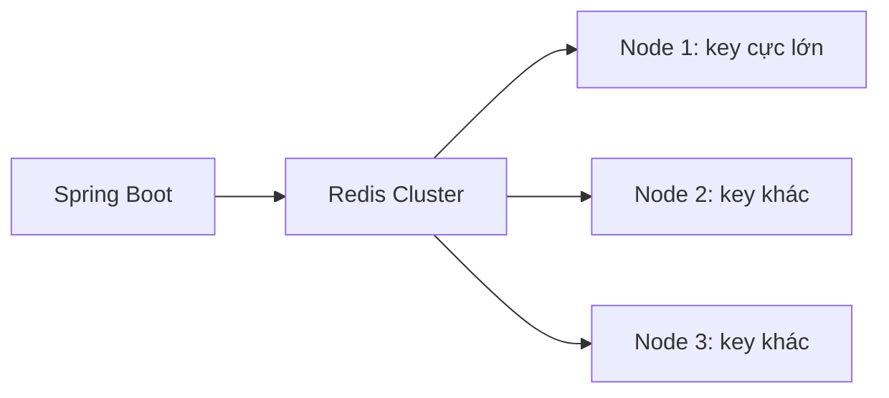
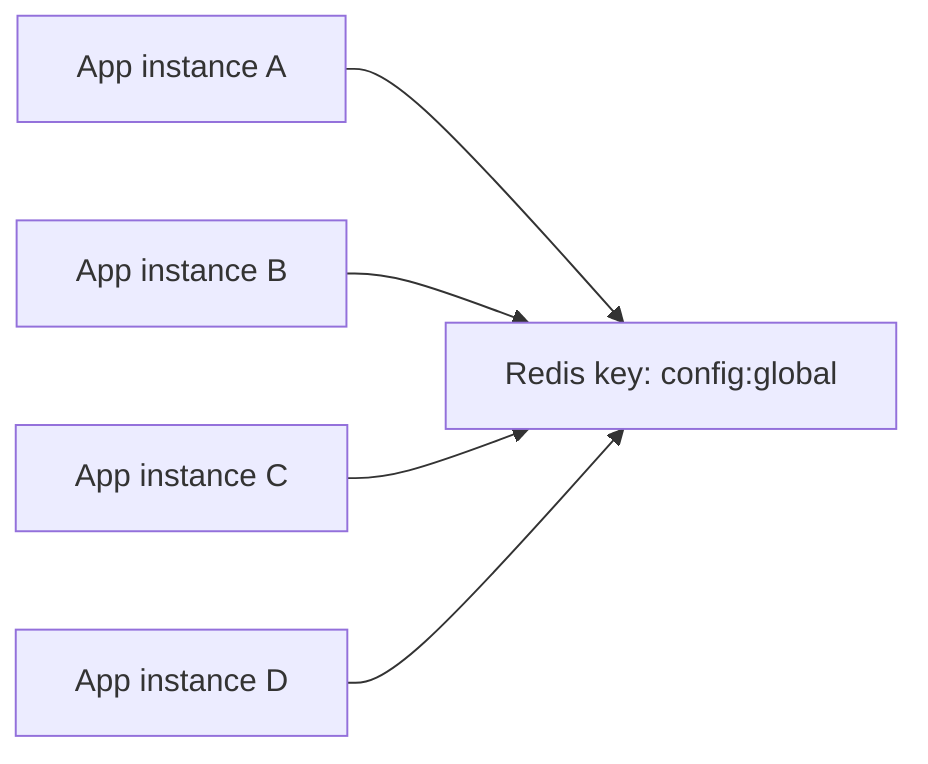
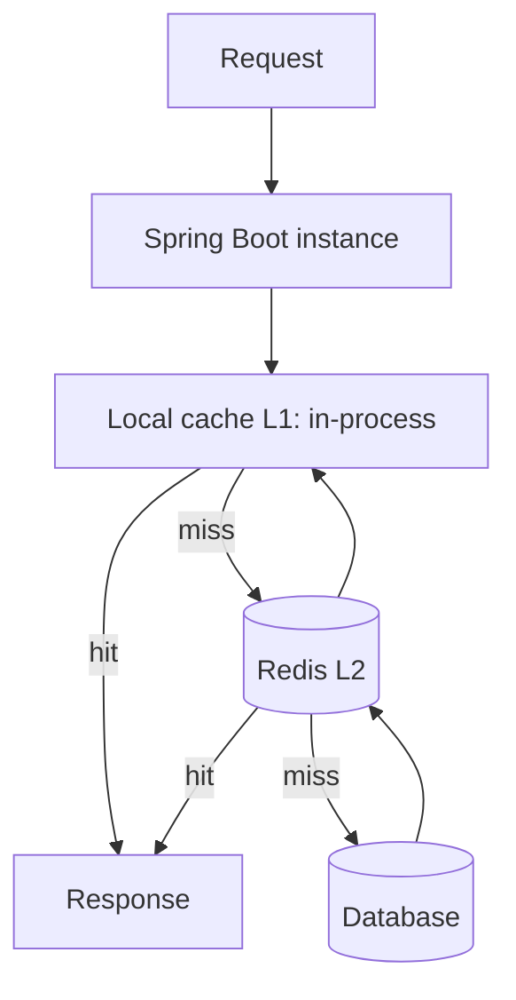

# Tránh khóa quá lớn và khóa có lưu lượng truy cập tập trung

Trong Redis, thiết kế key ảnh hưởng trực tiếp đến tốc độ truy cập, mức dùng RAM, độ trễ mạng và khả năng mở rộng của ứng dụng. Một hệ thống có thể chạy tốt khi thử với vài nghìn bản ghi nhưng chậm dần khi một key chứa hàng triệu phần tử, hoặc khi phần lớn request dồn vào một key duy nhất.

Hai hiện tượng cần phân biệt là:

- **Big Key (khóa quá lớn):** một key chiếm nhiều bộ nhớ, chứa giá trị lớn hoặc tập hợp có quá nhiều phần tử. Vấn đề chính là **kích thước dữ liệu và chi phí thao tác**.
- **Hot Key (khóa nóng):** một key nhận lưu lượng đọc/ghi cao bất thường so với những key còn lại. Vấn đề chính là **mức tập trung truy cập**, bất kể key lớn hay nhỏ.

Trong Spring Data Redis, việc chọn `StringRedisTemplate`, `RedisTemplate` hay `@Cacheable` không tự động giải quyết hai hiện tượng này. Cần tổ chức key, value, cách đọc/ghi, TTL, thống kê truy cập và khả năng xử lý đồng thời ngay từ thiết kế ứng dụng.

## 1. Mục tiêu của bài học

Sau bài học, bạn có thể:

1. Phân biệt Big Key, Hot Key và key vừa lớn vừa nóng.
2. Giải thích vì sao những key đó gây nghẽn Redis, tăng p99 latency hoặc khiến Redis Cluster mở rộng không hiệu quả.
3. Nhận biết kiểu lệnh nguy hiểm trên cấu trúc lớn như `HGETALL`, `SMEMBERS`, `LRANGE 0 -1`, hoặc đọc một String quá lớn.
4. Dùng các công cụ Redis để quan sát keyspace, kích thước key, tần suất truy cập và độ trễ mà vẫn kiểm soát tác động lên server.
5. Chọn phương án giới hạn kích thước, phân mảnh theo nghiệp vụ, đọc theo trang, dùng cache nhiều tầng, hoặc chia tải ghi cho Hot Key khi có thể.
6. Áp dụng mẫu code Spring Data Redis và hiểu các đánh đổi về nguyên tử, nhất quán, TTL và vận hành.

## 2. Big Key và Hot Key khác nhau ra sao?

### 2.1. Big Key: một key có giá trị hoặc tập phần tử quá lớn

Ví dụ:

```text
product:42:description      → String JSON dài vài MB
user:123:notifications     → List có hàng trăm nghìn phần tử
tenant:88:members          → Set chứa hàng triệu user ID
leaderboard:global         → Sorted Set chứa toàn bộ tài khoản
analytics:all-events       → Stream chứa sự kiện không giới hạn
```

Redis không có một ngưỡng "big" chung đúng cho mọi ứng dụng. Một String vài trăm KB có thể là quá lớn trên API rất nhạy với độ trễ; một cấu trúc nhiều phần tử vẫn chấp nhận được khi chỉ thao tác trên tập nhỏ, có kiểm soát. Cần xét **byte thực tế, số phần tử, cách truy cập, kích thước phản hồi và mục tiêu latency của hệ thống**.

Big Key không nhất thiết có tên key dài. Ví dụ `x` có thể là Big Key nếu value chiếm hàng trăm MB, trong khi `shop:prod:product:detail:42` chỉ có payload vài KB.

### 2.2. Hot Key: nhiều truy cập dồn vào cùng một key

Ví dụ:

```text
cache:homepage:featured        → bị đọc ở hầu hết request mở trang chủ
counter:video:trending:42      → được tăng ở mọi lượt xem video đang nổi
inventory:flashsale:sku:9     → bị kiểm tra/cập nhật liên tục khi mở bán
rate:global                   → mọi request đều tăng cùng một bộ đếm
```

Key `cache:homepage:featured` có thể chỉ vài trăm byte nhưng vẫn là Hot Key nếu nhận lượng request cực lớn.

Một Hot Key còn được phân theo loại tải:

| Loại | Tín hiệu | Hướng xử lý ưu tiên |
|---|---|---|
| **Read-hot** | Rất nhiều `GET`, `HGET`, `ZRANGE` vào cùng key | Giảm request đến Redis bằng cache cục bộ có kiểm soát, gộp yêu cầu hoặc phân phối dữ liệu đọc |
| **Write-hot** | Rất nhiều `INCR`, `HINCRBY`, `ZINCRBY`, `SET` vào cùng key | Giảm số lần ghi, chia tải khi nghiệp vụ cho phép, batch/aggregation |
| **Mixed-hot** | Cùng key vừa bị đọc vừa bị ghi liên tục | Tách read model/write model hoặc điều chỉnh thiết kế, chấp nhận độ trễ đồng bộ có giới hạn |

### 2.3. Bốn trường hợp thường gặp

| Trường hợp | Ví dụ | Nút thắt nổi bật |
|---|---|---|
| Nhỏ và ít truy cập | `feature:user:123` | Ít rủi ro |
| Lớn nhưng ít truy cập | `tenant:archive:2025` | Bộ nhớ, serialization, lệnh quét/xóa, snapshot |
| Nhỏ nhưng rất nóng | `views:viral:42` | Throughput, CPU/network, tập trung tải vào một node |
| Vừa lớn vừa nóng | `homepage:all-products` | Cả kích thước payload và lượng truy cập; rủi ro cao |

**Một key lớn không mặc nhiên là hot, và một key hot không mặc nhiên lớn.** Công cụ tìm key lớn không thể thay thế quan sát lưu lượng trên từng key.

## 3. Vì sao Big Key có thể làm Redis chậm?

Redis xử lý nhiều lệnh dữ liệu rất nhanh, nhưng tốc độ thực tế của mỗi yêu cầu còn phụ thuộc lượng công việc cần làm.

### 3.1. Lệnh có độ phức tạp phụ thuộc kích thước dữ liệu

Một số lệnh chỉ thao tác một phần nhỏ của cấu trúc, trong khi lệnh khác phải xử lý nhiều phần tử:

| Cấu trúc | Thao tác nên cân nhắc | Thao tác dễ tốn kém khi key lớn |
|---|---|---|
| String | `GET` khi value nhỏ và có giới hạn | `GET` value rất lớn; ghi lại value khổng lồ |
| Hash | `HGET key field`, `HMGET` số field có giới hạn | `HGETALL` trên hash có quá nhiều field |
| List | `LRANGE key 0 49` | `LRANGE key 0 -1` trên list rất dài |
| Set | `SISMEMBER key member` | `SMEMBERS` trên set lớn |
| Sorted Set | Lấy khoảng/top N nhỏ có giới hạn | Trả về toàn bộ hàng triệu member |
| Stream | `XREAD`/`XRANGE` có phạm vi và `COUNT` hợp lý | Trả về lượng entry lớn; không trim retention |

Độ phức tạp thuật toán là một phần câu chuyện. Ngay cả khi lệnh được tối ưu, việc gửi một phản hồi rất lớn qua mạng, giải mã toàn bộ trong Java hoặc tạo nhiều object JVM vẫn làm tăng **memory pressure, GC và latency**.

Ví dụ:

```redis
HGETALL tenant:88:users
```

Nếu hash có 500.000 field, ứng dụng có thể nhận về toàn bộ field và value dù màn hình chỉ cần hiển thị 20 người. Thay bằng `HGET` hoặc một truy vấn phân trang đã thiết kế từ trước thường hợp lý hơn.

### 3.2. Xóa hoặc hết hạn Big Key có thể phát sinh chi phí

Lệnh `DEL` xóa dữ liệu và có thể tạo thời gian xử lý lớn khi đối tượng chứa nhiều phần tử cần được giải phóng. Redis có lệnh `UNLINK` để gỡ key ra khỏi keyspace và **giải phóng phần bộ nhớ ở background** khi phù hợp.

```redis
UNLINK tenant:88:large-temp-set
```

`UNLINK` có thể giảm độ trễ trên luồng xử lý chính so với giải phóng đồng bộ một đối tượng lớn, nhưng không khiến công việc giải phóng bộ nhớ trở thành miễn phí. Bộ nhớ thực tế được thu hồi sau đó và vẫn tiêu thụ tài nguyên hệ thống. Không nên dùng lệnh xóa như cách thay thế cho việc ngăn key phình to ngay từ đầu.

Key hết TTL cũng cần được xử lý giải phóng. Với bộ dữ liệu lớn, cách Redis xử lý expiration, eviction và các cấu hình lazy freeing có thể ảnh hưởng latency; phải đo theo phiên bản/cấu hình cụ thể.

### 3.3. Bộ nhớ, persistence và replication

Một Big Key làm tăng tổng lượng RAM dùng. Khi dữ liệu đang được snapshot hoặc AOF rewrite, thao tác ghi lên những đối tượng lớn có thể làm tăng áp lực bộ nhớ và I/O; cơ chế fork/copy-on-write của hệ điều hành trong một số trường hợp cũng làm chi phí tăng.

Nếu Redis dùng replication, thay đổi dữ liệu còn cần được truyền và áp dụng ở replica. Độ trễ, backlog và khả năng phục hồi phải được quan sát; không thể kết luận rằng replication sẽ “cân” được một key lớn.

### 3.4. Redis Cluster không tự chia một key thành nhiều node

Redis Cluster phân phối **key** qua hash slot. Một key chứa hàng triệu phần tử vẫn nằm trên một slot, do đó thuộc về **một shard chủ quản**.



Thêm node giúp phân phối **nhiều key khác nhau**, nhưng không tự cắt nội dung một Hash/List/Set duy nhất ra nhiều node. Khi một cấu trúc có quy mô quá lớn, cần nghĩ tới **phân vùng ở mô hình dữ liệu**.

## 4. Vì sao Hot Key gây nghẽn ngay cả khi dữ liệu nhỏ?

Giả sử tất cả request đến API đều đọc `config:global`:



Mỗi `GET` có thể nhanh, nhưng tổng số lệnh, số byte đọc/ghi, scheduling và băng thông mạng phải được phục vụ bởi tài nguyên đang chứa key. Trong Redis Cluster, một Hot Key còn làm một shard bận hơn những shard khác.

Với write-hot key như bộ đếm chung:

```redis
INCR views:video:42
```

`INCR` là lệnh tăng nguyên tử cho mỗi thao tác, nhưng tất cả các yêu cầu vẫn cùng nhắm vào một key. Nếu lượng tăng quá lớn, tải có thể tập trung vào một node. Việc tách lệnh ra nhiều thread Java không phân phối tải lên nhiều Redis shard khi vẫn là **cùng một key**.

Hot Key có thể xuất hiện theo thời điểm: flash sale, livestream, bài viết lan truyền hoặc batch job. Vì vậy, thống kê trung bình cả ngày có thể che khuất các đợt nghẽn kéo dài vài phút.

## 5. Nguyên tắc đầu tiên: đo trước khi thay đổi key schema

Hãy xác định:

- Nhóm API nào bị tăng p95/p99 latency?
- Redis chậm vì một lệnh xử lý quá nhiều dữ liệu hay do số lệnh quá nhiều?
- Key nào chiếm RAM nhiều nhất? Key nào được đọc/ghi nhiều nhất?
- Có shard nào nóng rõ rệt hơn các shard khác?
- Thời điểm tải tăng có trùng cache miss, TTL đồng loạt, batch job hoặc sự kiện marketing?
- Payload được trả về từ Redis có thực sự cần toàn bộ trong một request không?

Không suy từ một chỉ số duy nhất. Ví dụ `used_memory` cao có thể do nhiều key nhỏ, còn độ trễ cao có thể do network/client serialization dù không có Big Key.

### 5.1. Các số liệu quan sát

| Số liệu | Gợi ý điều tra | Điều không thể kết luận chỉ từ số liệu đó |
|---|---|---|
| `used_memory`, `used_memory_dataset` | Dung lượng bộ dữ liệu | Key nào đang lớn |
| `evicted_keys`, `expired_keys` | Eviction hoặc TTL đang có tác động | Chính xác key nào gây chậm |
| `keyspace_hits`, `keyspace_misses` | Xu hướng hit/miss của Redis | Hot Key cụ thể nằm ở đâu |
| `instantaneous_ops_per_sec` | Lưu lượng lệnh tại thời điểm quan sát | Có một hay nhiều Hot Key |
| `SLOWLOG` | Lệnh chạy tốn thời gian xử lý trên Redis | Toàn bộ thời gian round-trip, network và deserialize |
| `MEMORY USAGE key` | Ước lượng bộ nhớ của một key | Số request/giây vào key |
| `HLEN`, `LLEN`, `SCARD`, `ZCARD`, `XLEN` | Số phần tử của cấu trúc tương ứng | Mỗi phần tử chiếm bao nhiêu byte |
| APM, metrics ứng dụng | Key pattern nào gắn với request chậm | Kích thước chính xác của key nếu không đo thêm |

Mục tiêu là liên hệ **kích thước, tần suất, loại lệnh và độ trễ** trên cùng khoảng thời gian.

## 6. Phát hiện Big Key bằng công cụ Redis

Ví dụ dưới đây dùng `redis-cli`. Trên máy development có Redis chạy bằng Docker Compose, có thể thêm `docker compose exec redis` ở đầu lệnh:

```bash
docker compose exec redis redis-cli INFO memory
docker compose exec redis redis-cli INFO stats
docker compose exec redis redis-cli INFO commandstats
```

Các lệnh này cung cấp số liệu toàn instance. Khi dùng production/cluster, cần chạy với quyền phù hợp và xác định đang kiểm tra node nào; `INFO` của một node không tự mô tả toàn bộ cluster.

### 6.1. Quan sát kích thước một key đã biết

```redis
TYPE tenant:88:members
MEMORY USAGE tenant:88:members
SCARD tenant:88:members
TTL tenant:88:members
```

Giải thích:

- `TYPE` cho biết kiểu dữ liệu của key.
- `MEMORY USAGE` trả mức bộ nhớ được Redis ước lượng cho key, tính cả chi phí lưu trữ nội bộ liên quan theo cấu trúc.
- `SCARD` cho số phần tử nếu đó là Set.
- `TTL` cho biết key còn hạn hay không.

Với các kiểu khác, sử dụng lệnh cardinality tương ứng:

```redis
STRLEN cache:homepage:featured
HLEN profile:fields:123
LLEN notifications:user:123
ZCARD leaderboard:monthly
XLEN stream:orders
```

`STRLEN` trả độ dài byte của Redis String. Đây không phải số ký tự Unicode mà người dùng nhìn thấy trong một đoạn UTF-8.

Với cấu trúc lồng nhiều phần tử, `MEMORY USAGE` có tham số `SAMPLES` để kiểm soát lượng lấy mẫu khi ước lượng:

```redis
MEMORY USAGE tenant:88:members SAMPLES 10
```

Giá trị `SAMPLES 0` yêu cầu tính toán bằng cách duyệt tất cả phần tử theo khả năng của Redis và có thể rất tốn kém trên đối tượng lớn. Không mặc định dùng phép đo đắt đỏ nhất trong production.

### 6.2. Tìm key lớn bằng `redis-cli --bigkeys`

Trong môi trường có quyền truy cập Redis và đã hiểu phạm vi keyspace:

```bash
redis-cli -h 127.0.0.1 -p 6379 --bigkeys
```

Công cụ quét keyspace và báo các key lớn đáng chú ý theo loại dữ liệu. Kết quả thường hữu ích để phát hiện String có nhiều byte hoặc cấu trúc có cardinality lớn.

Cần hiểu giới hạn:

- Việc quét toàn bộ keyspace vẫn tạo tải lên Redis.
- Kết quả không thay thế phân tích RAM thực tế bằng `MEMORY USAGE` cho key mục tiêu.
- Đây không phải snapshot tuyệt đối khi key liên tục được thêm/xóa.
- Với Cluster cần hiểu công cụ đang truy cập node nào và cách quét các node/shard; không giả định một endpoint sẽ đo toàn cluster đầy đủ.
- Không chạy trên production quá tải một cách tùy tiện; chọn thời điểm, tốc độ và phạm vi quan sát thích hợp.

Một số phiên bản `redis-cli` có tùy chọn điều chỉnh nhịp quét; hãy xem `redis-cli --help` trên môi trường đang dùng. Công cụ có thể thay đổi chi tiết giữa các phiên bản.

### 6.3. Duyệt tên key bằng `SCAN`, tránh `KEYS *`

Ví dụ:

```redis
SCAN 0 MATCH shop:prod:product:* COUNT 100
```

Redis trả về **cursor tiếp theo** và một nhóm key. Ứng dụng tiếp tục gọi `SCAN <cursor>` cho đến khi cursor trả về `0`.

`COUNT 100` là **gợi ý lượng công việc**, không phải lời hứa luôn trả đúng hoặc tối đa 100 key. Trong lúc keyspace thay đổi, có thể nhận trùng key hoặc kết quả khác giữa các vòng; nếu dùng để xử lý nghiệp vụ, cần thiết kế idempotency.

So với:

```redis
KEYS *
```

`SCAN` phù hợp hơn cho việc duyệt dần keyspace lớn, vì `KEYS *` có thể chặn xử lý của Redis trong lúc liệt kê rất nhiều key. Dù vậy, **SCAN vẫn tiêu thụ CPU/network** nếu quét liên tục không giới hạn.

Không nên biến một request HTTP thường xuyên thành quy trình `SCAN` toàn Redis để tìm key. Key cần truy cập trong nghiệp vụ nên được tính trực tiếp từ định danh hoặc duy trì một index được thiết kế rõ ràng.

### 6.4. Quan sát lệnh chậm

```redis
SLOWLOG GET 10
```

Slow log đo thời gian xử lý lệnh phía Redis, **không bao gồm toàn bộ thời gian mạng và đọc phản hồi ở client**. Một `GET` trả hàng MB có thể khiến Java chậm do network/deserialize dù slow log không nổi bật tương ứng.

Có thể dùng:

```redis
LATENCY LATEST
```

Và, khi tính năng latency monitoring được bật/cấu hình phù hợp:

```redis
LATENCY DOCTOR
```

Các chỉ số nên được đọc cùng p95/p99 latency tại ứng dụng Spring Boot và metrics của client/connection pool.

## 7. Phát hiện Hot Key

Hot Key đòi hỏi biết **mức tập trung yêu cầu theo key**, không chỉ bộ nhớ.

### 7.1. Ưu tiên số liệu tại ứng dụng

Nếu một endpoint thực hiện:

```java
redis.opsForValue().get("cache:homepage:featured");
```

cho mỗi request, có thể đặt metrics theo **nhóm key và tên thao tác**:

```text
redis_access_total{
  operation="GET",
  key_group="homepage-featured"
}
```

Không đưa mọi ID người dùng hoặc tên key động vào **label** metrics, vì sẽ tạo cardinality rất lớn trên hệ thống monitoring. Chỉ dùng nhóm hữu hạn như `product-detail`, `session`, `homepage`, `rate-limit`, và điều tra chi tiết khi có tín hiệu bất thường.

Cũng cần xem trace của endpoint, tỷ lệ cache hit/miss, số request/giây và lượng byte trả về. Khi có nhiều key, sampling hoặc tổng hợp theo prefix thường khả thi hơn ghi log tất cả key.

### 7.2. `redis-cli --hotkeys` phụ thuộc LFU

Redis CLI có khả năng tìm các key có tần suất truy cập nổi bật thông qua cơ chế LFU:

```bash
redis-cli -h 127.0.0.1 -p 6379 --hotkeys
```

Khả năng này **đòi hỏi Redis dùng chính sách maxmemory thuộc nhóm LFU phù hợp**, ví dụ `allkeys-lfu` hoặc `volatile-lfu`, vì Redis phải có thông tin tần suất truy cập của key. Nó không phải công cụ phổ quát dùng được với mọi cấu hình.

Kiểm tra trước:

```redis
CONFIG GET maxmemory-policy
```

**Không đổi eviction policy của production chỉ để chạy một câu lệnh chẩn đoán.** Policy ảnh hưởng trực tiếp cách Redis chọn key để loại bỏ khi thiếu bộ nhớ. Có thể dùng môi trường mô phỏng hoặc cơ chế metrics khác nếu hệ thống đang dùng policy không phải LFU.

### 7.3. Vì sao `MONITOR` không phải công cụ mặc định?

`MONITOR` có thể cho thấy các lệnh mà Redis nhận, nhưng nó cũng tạo thêm tải và có thể làm lộ nội dung lệnh/dữ liệu nhạy cảm. Với traffic lớn, bật `MONITOR` lâu dài là rủi ro đáng kể về hiệu năng và bảo mật.

Ưu tiên APM, metrics ở tầng ứng dụng, sampling có kiểm soát hoặc công cụ quan sát đã được hệ thống chấp thuận. Chỉ dùng `MONITOR` trong môi trường phù hợp, thời gian ngắn và có mục tiêu điều tra cụ thể.

### 7.4. Phân biệt Hot Key và hot shard

Một shard bận không nhất thiết do **một** key. Có thể có hàng nghìn key cùng nằm trên shard đó và nhận tải cao. Khi đánh giá Redis Cluster, cần so sánh:

- Số lệnh, CPU, network và latency **theo từng node**.
- Phân phối key và slot.
- Key pattern đang được truy cập nhiều.
- Số byte của các payload phổ biến.
- Sự kiện resharding/failover/replication.

Khi xác định đúng nguyên nhân mới chọn giải pháp tách Hot Key, cân bằng key distribution hay nâng công suất node.

## 8. Tránh Big Key bằng cách giới hạn dữ liệu từ lúc ghi

Nguyên tắc trực tiếp nhất là **không để một key tăng mãi mà không có giới hạn**.

### 8.1. Thiết kế theo đơn vị truy cập thực tế

Giả sử UI chỉ hiển thị 20 bình luận một trang. Không cần cache toàn bộ 300.000 bình luận vào một String JSON:

```text
Sai hướng:
product:42:all-reviews
→ một JSON chứa tất cả bình luận
```

Có thể cache từng trang:

```text
shop:prod:product:42:reviews:page:0
shop:prod:product:42:reviews:page:1
shop:prod:product:42:reviews:page:2
```

Mỗi page giới hạn số bình luận và kích thước payload. Truy cập trang nào thì đọc key trang đó, thay vì tải cả tập lớn rồi phân trang trong Java.

Một cách khác là giữ index các ID và lưu chi tiết riêng:

```text
shop:prod:product:42:review-ids:2026-11  → Sorted Set ID
shop:prod:review:991                     → dữ liệu bình luận 991
shop:prod:review:992                     → dữ liệu bình luận 992
```

Cách này tạo thêm request để lấy chi tiết và đòi hỏi kiểm soát nhất quán giữa index và các key chi tiết. Không có phương án nào miễn phí hoàn toàn; mục tiêu là giảm kích thước dữ liệu của mỗi thao tác và giới hạn tăng trưởng.

### 8.2. Tách theo thời gian

Dữ liệu log, notification hoặc leaderboard thường có trục thời gian:

```text
events:tenant:88:2026-11-10
events:tenant:88:2026-11-11
events:tenant:88:2026-11-12
```

Thay vì:

```text
events:tenant:88:all-time
```

Lợi ích là giới hạn số phần tử theo khoảng thời gian, cho phép expiration/retention theo từng phân vùng và chỉ đọc khoảng cần thiết.

Đánh đổi: query nhiều tháng phải kết hợp nhiều key và tính đến ranh giới thời gian/múi giờ. Nên dùng ngày UTC hoặc một quy ước múi giờ được xác định rõ, nhất quán giữa cách tạo key và cách query.

### 8.3. Tách theo tenant, entity hoặc bucket

Một key chứa toàn bộ dữ liệu của mọi tenant dễ biến thành Big Key và Hot Key:

```text
global:member-ids
```

Thay bằng:

```text
tenant:88:members
tenant:89:members
tenant:90:members
```

Nếu `tenant:88:members` tiếp tục quá lớn, cần chia nhỏ theo bucket hoặc cấu trúc nghiệp vụ:

```text
tenant:88:members:bucket:00
tenant:88:members:bucket:01
...
tenant:88:members:bucket:15
```

Một cách phân bucket ổn định là `bucket = hash(memberId) mod 16`. Cần dùng **hàm hash ổn định và số bucket đã định nghĩa rõ**; thay số bucket về sau sẽ cần migration/rebalancing. Không dùng hash không ổn định giữa các runtime/version nếu nó làm thay đổi vị trí dữ liệu.

Nếu ứng dụng thường cần đọc thành viên theo phòng ban, có thể chia theo phòng ban thay vì hash vì phù hợp truy vấn hơn. Thiết kế key nên xuất phát từ **access pattern**, không chỉ từ số byte.

### 8.4. Giới hạn chiều dài List/Stream từ lúc ghi

Với List chỉ cần N sự kiện mới nhất, có thể chèn rồi trim:

```redis
LPUSH user:123:recent-actions "open:42"
LTRIM user:123:recent-actions 0 99
```

Như vậy List chỉ giữ tối đa khoảng 100 phần tử nếu mọi đường ghi đều tuân thủ quy tắc. Khi có nhiều writer, nếu cần tính nguyên tử của **cả thao tác chèn và trim** với nghiệp vụ, hãy dùng Lua script hoặc cơ chế transaction phù hợp.

Với Stream, xác định retention và cơ chế trimming rõ ràng. Ví dụ:

```redis
XADD stream:activity MAXLEN ~ 10000 * type view productId 42
```

Từ `~` thể hiện giới hạn **xấp xỉ**: Redis có thể giữ nhiều hơn số mục tiêu để tối ưu thao tác. Nếu nghiệp vụ yêu cầu giới hạn chính xác hoặc giữ dữ liệu theo thời gian dài, cần chọn chính sách tương ứng và hiểu chi phí.

Không để Stream hoặc List tăng vô hạn trong một hệ thống có retention hữu hạn.

### 8.5. Không lấy toàn bộ cấu trúc khi chỉ cần một phần

So sánh:

```redis
HGETALL user:123:profile
SMEMBERS group:88:members
LRANGE user:123:messages 0 -1
ZRANGE leaderboard:all 0 -1
```

với các lệnh có phạm vi nhỏ:

```redis
HMGET user:123:profile name avatar
SISMEMBER group:88:members user:123
LRANGE user:123:messages 0 49
ZRANGE leaderboard:all 0 19 REV WITHSCORES
```

Các lệnh tập trung theo phạm vi cần thiết giảm dữ liệu truyền về client và giảm nguy cơ cấp phát bộ nhớ lớn trong JVM. Tuy nhiên, nếu bản thân key đã có hàng triệu phần tử, chỉ thay cách đọc là **biện pháp giảm triệu chứng**; cần đánh giá cả retention và phân vùng ở mô hình lưu trữ.

## 9. Duyệt dữ liệu lớn từng phần với HSCAN, SSCAN, ZSCAN

Khi cần xử lý dần các phần tử của một cấu trúc, Redis cung cấp các lệnh dạng scan:

```redis
HSCAN user:123:large-profile 0 COUNT 100
SSCAN tenant:88:members 0 COUNT 100
ZSCAN leaderboard:global 0 COUNT 100
```

Đây là **quy trình dựa trên cursor**. Phải tiếp tục dùng cursor nhận về cho đến khi kết thúc; không thể mặc định một lần gọi là đủ.

Các lưu ý:

- `COUNT` chỉ là hint lượng công việc; số phần tử trả về thay đổi.
- Trong khi tập dữ liệu bị ghi/xóa, kết quả có thể có phần tử lặp hoặc hành vi duyệt khác snapshot cố định.
- Một số cấu trúc dùng encoding nhỏ gọn có thể trả nhiều phần tử trong một lần scan; không coi `COUNT` là giới hạn tuyệt đối cho bộ nhớ client.
- Cần xử lý từng batch, có giới hạn concurrency và cơ chế checkpoint/idempotency nếu job dài.
- Scan toàn bộ một cấu trúc cực lớn vẫn tiêu tốn tài nguyên; nếu nhu cầu nghiệp vụ thường xuyên cần scan tất cả, nên xem lại cách thiết kế dữ liệu.

`HSCAN` hữu ích cho tác vụ quản trị/di trú, nhưng không nên dùng nó để thay cho phân trang ổn định theo thứ tự nghiệp vụ. Cursor scan không tự bảo đảm thứ tự các phần tử.

## 10. Tránh Hot Key với truy cập đọc

Read-hot key thường dễ giảm tải hơn write-hot key, vì dữ liệu đọc có thể được sao chép tới các lớp cache khác **khi chấp nhận được độ cũ**.

### 10.1. Cache hai tầng L1 + L2

Một kiến trúc phổ biến:



- **L1** có thể là một bộ nhớ đệm cục bộ, ví dụ Caffeine, trong mỗi instance.
- **L2** là Redis dùng chung giữa các instance.
- **Database** hoặc service nguồn tiếp tục là nguồn dữ liệu chính khi cache miss.

Nếu 10.000 request/giây trên nhiều instance cùng đọc một cấu hình ít đổi, L1 có thể tránh nhiều lần round-trip tới Redis. Nhưng mỗi JVM có bản sao riêng nên dữ liệu giữa các instance có thể tạm thời khác nhau.

Cần xác định:

- TTL và giới hạn bộ nhớ L1.
- Cách invalidate khi dữ liệu thay đổi.
- Mức stale data được chấp nhận.
- Cách xử lý khi một instance mới khởi động và L1 còn trống.

Có thể dùng Redis Pub/Sub để **thông báo** invalidation trong một số thiết kế, nhưng Pub/Sub thông thường không bảo đảm replay cho consumer offline; TTL hoặc cơ chế versioning vẫn cần thiết cho dữ liệu quan trọng.

### 10.2. Request coalescing / single-flight

Khi cache miss, một nghìn request đồng thời có thể cùng truy vấn database rồi cùng ghi Redis. Có thể dùng cơ chế **single-flight theo key** để chỉ một tác vụ nạp dữ liệu, các yêu cầu khác chờ cùng kết quả trong một phạm vi kiểm soát.

```text
100 request đồng thời
         │
         ▼
  Cache miss cùng key
         │
         ▼
  1 tác vụ fetch nguồn dữ liệu
         │
         ▼
  Trả cùng kết quả cho các request chờ
```

Trong một JVM, cơ chế này có thể dùng future/in-flight map hoặc khả năng loading cache phù hợp. Với nhiều instance, gộp yêu cầu cấp local không loại bỏ được mọi duplicate load xuyên các instance; cần đo mức hiệu quả trước khi thêm distributed lock.

Phải có timeout, giới hạn số request chờ và đường xử lý khi fetch thất bại. Nếu single-flight không được giới hạn, một key nóng có thể biến thành hàng nghìn task treo.

### 10.3. Tránh TTL hết hạn đồng loạt

Nếu một triệu key cùng được tạo với TTL đúng 300 giây trong một batch, sau 5 phút có thể có nhiều miss đồng thời. Giải pháp phổ biến là thêm **TTL jitter** trong phạm vi phù hợp:

```text
TTL mục tiêu: khoảng 4–5 phút
Mỗi key: 240–300 giây
```

Jitter giúp phân tán thời điểm hết hạn giữa nhiều key. Với **một key duy nhất** đang rất nóng, jitter không xóa được vấn đề stampede; vẫn có thể cần prewarming hoặc single-flight.

Đối với dữ liệu phải hết hạn vào thời điểm nghiệp vụ chính xác, không tự thêm jitter làm sai quy tắc. Khi cần expiry chính xác, phải thiết kế phù hợp.

### 10.4. Replication cho truy cập đọc

Redis replica có thể phục vụ một số read workload tùy client, cấu hình routing và yêu cầu nhất quán. Tuy nhiên:

- Replication thường bất đồng bộ nên replica có thể trả dữ liệu cũ.
- Không phải mọi Redis client tự phân phối read tới replica.
- Truy cập qua Spring Data Redis cần được cấu hình theo loại driver và topology thực tế.
- Việc thêm replica không giải quyết write-hot key trên primary.

Read replica là một phương án kiến trúc cần đo thực tế, không phải thay thế tự động cho key design tốt.

## 11. Tránh Hot Key với truy cập ghi

Write-hot key phức tạp hơn vì mọi thay đổi thường phải có thứ tự hoặc tính nguyên tử.

### 11.1. Sharded counter: chia một bộ đếm thành N key

Thay vì mọi request dùng:

```redis
INCR views:video:42
```

có thể chia thành:

```text
views:video:42:shard:0
views:video:42:shard:1
views:video:42:shard:2
...
views:video:42:shard:15
```

Mỗi lượt xem chọn một shard để tăng:

```text
shard = random(0..15)
INCR views:video:42:shard:<shard>
```

Tổng lượt xem được tính bằng tổng các shard:

\[
\text{totalViews} = \sum_{i=0}^{N-1}\text{counter}_i
\]

Ưu điểm: các lệnh ghi không còn nhắm vào một Redis key duy nhất. Trong Cluster, nếu key được phân phối vào các slot khác nhau, tải có khả năng trải trên nhiều node.

Đánh đổi quan trọng:

- Đọc tổng phải lấy nhiều key rồi cộng.
- Việc cộng nhiều key không mặc nhiên là **snapshot nguyên tử** khi có ghi đồng thời.
- Nếu request cần giá trị tổng chính xác ngay sau mỗi lượt tăng, phân mảnh có thể không phù hợp.
- Việc quản lý TTL, reset theo ngày, xử lý duplicate/retry và thay đổi số shard cần kế hoạch riêng.
- `INCR` ở mỗi shard vẫn không idempotent khi một request bị retry sau timeout.

Sharded counter phù hợp với thống kê chấp nhận độ trễ hoặc độ lệch quan sát ngắn; không dùng máy móc cho số dư, tồn kho cần ràng buộc chặt hoặc giới hạn giao dịch toàn cục.

### 11.2. Batch / aggregate trước khi ghi

Nếu nghiệp vụ cho phép, mỗi instance có thể gom sự kiện trong khoảng thời gian nhỏ rồi ghi một lần:

```text
1000 sự kiện trong 1 giây
    ↓ aggregate cục bộ
INCRBY views:video:42 1000
```

Cách này làm giảm số lệnh. Tuy nhiên, sự kiện chưa flush có thể mất khi ứng dụng dừng đột ngột. Nếu cần bền vững, phải có hàng đợi/log nguồn bền vững, flush có kiểm soát và khả năng replay/idempotency.

Nên đánh giá luồng dữ liệu trước khi chọn batching; “ít lệnh Redis hơn” không tự đồng nghĩa dữ liệu vẫn chính xác trong mọi lỗi.

### 11.3. Không chia nhỏ một bất biến cần nguyên tử toàn cục

Ví dụ `inventory:sku:9` giữ số hàng còn lại để quyết định có bán hay không. Chia thành 16 counter rồi để các instance tự đọc tổng có thể gây oversell nếu không có cơ chế đồng bộ khác.

Các bất biến như:

- Không bán vượt tồn kho.
- Không trừ số dư âm.
- Không cấp quá N vé toàn hệ thống.
- Một idempotency key chỉ được xử lý một lần.

cần được kiểm soát bởi giao thức dữ liệu có semantics phù hợp (lệnh nguyên tử, script, transaction/constraint tại database nguồn sự thật, cơ chế đặt chỗ, v.v.). Không đổi lấy throughput bằng cách bỏ qua ràng buộc nghiệp vụ.

## 12. Thiết kế key cho Redis Cluster

### 12.1. Các key khác nhau có thể đi đến shard khác nhau

Redis Cluster tính hash slot từ tên key. Mỗi key thuộc một slot, slot được gán cho một master node.

```text
views:video:42:shard:0
views:video:42:shard:1
views:video:42:shard:2
```

Khi đặt tên không dùng hash tag ép slot, những key này có cơ hội phân bố qua nhiều slot. Nhưng phân bố thực tế phụ thuộc hàm hash, số slot và cách cluster gán slot cho node; cần quan sát để biết tải có được trải đều không.

### 12.2. Hash tag có thể vô tình tạo Hot Slot

Trong Redis Cluster, phần nằm giữa cặp `{...}` hợp lệ có thể được dùng làm **hash tag** để ép các key có cùng tag nằm trên cùng một slot.

Ví dụ:

```text
order:{tenant88}:1
order:{tenant88}:2
order:{tenant88}:3
```

Các key trên được đặt cùng slot, hữu ích khi cần một số thao tác nhiều key phải đồng slot. Nhưng nếu mọi key của tenant lớn đều dùng `{tenant88}`, một shard có thể phải gánh hầu hết tải của tenant.

Nếu muốn phân phối sharded counter, tránh đặt cùng hash tag cho tất cả shard:

```text
Không phân tán theo slot:
views:{video42}:shard:0
views:{video42}:shard:1

Có thể phân bố:
views:video42:shard:0
views:video42:shard:1
```

Đừng tự thêm hoặc bỏ hash tag mà không xem xét các lệnh nhiều key, transaction, Lua script và semantics Redis Cluster. Một số thao tác đa key cần key cùng slot; chia key sang slot khác có thể gây lỗi `CROSSSLOT` hoặc buộc ứng dụng xử lý nhiều lượt riêng.

### 12.3. Một key vẫn là một đơn vị không thể cắt tiếp bằng Cluster

Hash tag chỉ điều khiển **slot**, không chia nội dung một key. Muốn phân nhỏ một Hash có hàng triệu field, phải thay đổi mô hình dữ liệu thành nhiều key, ví dụ theo bucket hoặc entity. Resharding cũng chỉ di chuyển key/slot sang node khác; nó không cắt một Hash lớn thành nhiều phần.

## 13. Spring Data Redis: cache từng trang với TTL có jitter

Giả sử service đang tạo JSON danh sách sản phẩm phân trang. Thay vì cache một giá trị chứa mọi sản phẩm, ta dùng key theo page và giới hạn payload ngay ở service.

```java
package example.redis;

import java.time.Duration;
import java.util.concurrent.ThreadLocalRandom;

import org.springframework.data.redis.core.StringRedisTemplate;
import org.springframework.stereotype.Service;

@Service
public class ProductPageCache {

    private final StringRedisTemplate redis;

    public ProductPageCache(StringRedisTemplate redis) {
        this.redis = redis;
    }

    public void put(long categoryId, int page, String jsonPage) {
        if (page < 0) {
            throw new IllegalArgumentException("page must be >= 0");
        }

        // Mỗi page chứa tối đa một lượng dữ liệu được giới hạn ở tầng truy vấn.
        String key = key(categoryId, page);

        long ttlSeconds = ThreadLocalRandom.current().nextLong(240, 301);
        redis.opsForValue().set(
                key,
                jsonPage,
                Duration.ofSeconds(ttlSeconds)
        );
    }

    public String get(long categoryId, int page) {
        if (page < 0) {
            throw new IllegalArgumentException("page must be >= 0");
        }

        return redis.opsForValue().get(key(categoryId, page));
    }

    public void invalidate(long categoryId, int page) {
        redis.delete(key(categoryId, page));
    }

    private String key(long categoryId, int page) {
        return "shop:product-page:category:" + categoryId + ":page:" + page;
    }
}
```

Mẫu này thể hiện ba nguyên tắc:

1. **Key theo đơn vị truy cập**: page riêng, không gộp cả danh mục vào một String.
2. **TTL có giới hạn**: cache không tồn tại mãi, và các key được tạo cùng lúc không nhất thiết hết hạn cùng giây.
3. **Định danh có thể tính trực tiếp**: service biết key từ `categoryId` và `page`, không cần `SCAN` để tìm cache.

**Giới hạn của ví dụ:** phương thức `put` nhận `jsonPage` đã được tạo sẵn, nên **không tự kiểm soát kích thước thực tế của JSON**. Tầng truy vấn phải giới hạn page size, số field và kích thước nội dung; trong hệ thống thực nên cân nhắc thêm giới hạn byte trước khi ghi, ví dụ tránh cache payload vượt một ngưỡng được xác định từ đo đạc.

Ngoài ra, khi sản phẩm đổi giá hoặc bị xóa, nhiều trang có thể bị ảnh hưởng. Cần thiết kế invalidation theo version dữ liệu, theo nhóm page hoặc quy tắc refresh hợp lý; không suy rằng TTL có jitter sẽ đảm bảo dữ liệu luôn mới.

### 13.1. Vì sao không dùng `@Cacheable` cho mọi trường hợp?

`@Cacheable` rất hữu ích khi ranh giới cache trùng với lời gọi method:

```java
@Cacheable(cacheNames = "productPage", key = "#categoryId + ':' + #page")
public PageDto getPage(long categoryId, int page) {
    return repository.getPage(categoryId, page);
}
```

Nhưng annotation không tự giới hạn độ lớn của `PageDto`, không tự tạo quy tắc chia trang an toàn và không tự thêm TTL ngẫu nhiên theo từng entry nếu cache manager chưa được tùy chỉnh tương ứng.

Khi cần kiểm soát byte size, phân mảnh, expiry khác nhau theo entry hoặc thao tác Redis đặc thù, truy cập qua `StringRedisTemplate`/`RedisTemplate` có thể minh bạch hơn.

Nếu cache object, cần cấu hình serializer phù hợp và hiểu tương thích dữ liệu khi nâng cấp class hoặc định dạng JSON. Serialization/deserialization của payload lớn có thể là nút thắt ở JVM ngay cả khi Redis server nhanh.

## 14. Spring Data Redis: lấy dữ liệu có giới hạn thay vì toàn bộ Hash

Giả sử thông tin người dùng nằm trong một Redis Hash:

```redis
HSET user:123:profile name "An" city "Da Nang" tier "silver"
```

Tránh đọc mọi field khi màn hình chỉ cần một vài giá trị:

```java
package example.redis;

import java.util.List;

import org.springframework.data.redis.core.StringRedisTemplate;
import org.springframework.stereotype.Service;

@Service
public class UserProfileReader {

    private final StringRedisTemplate redis;

    public UserProfileReader(StringRedisTemplate redis) {
        this.redis = redis;
    }

    public String getName(long userId) {
        String key = "user:" + userId + ":profile";
        Object value = redis.opsForHash().get(key, "name");
        return value == null ? null : value.toString();
    }

    public List<Object> getDisplayFields(long userId) {
        String key = "user:" + userId + ":profile";
        return redis.opsForHash()
                .multiGet(key, List.of("name", "city", "tier"));
    }
}
```

`HGET`/`HMGET` chỉ yêu cầu những field cần dùng. Nếu Hash rất lớn, vẫn cần chính sách quản lý tổng số field và dữ liệu, nhưng cách đọc có giới hạn giúp giảm response size.

Với yêu cầu phân trang hoặc tìm kiếm trên tập profile lớn, Hash không cung cấp một query engine dạng SQL. Nên thiết kế index/collection phù hợp với truy vấn hoặc lưu dữ liệu nguồn trong database/search engine, Redis chỉ giữ phần cache cần thiết.

## 15. Spring Data Redis: sharded counter cho key ghi nóng

Mã sau minh họa counter gồm 16 shard. Mỗi request ghi vào một shard được chọn ngẫu nhiên:

```java
package example.redis;

import java.util.concurrent.ThreadLocalRandom;

import org.springframework.data.redis.core.StringRedisTemplate;
import org.springframework.stereotype.Service;

@Service
public class ShardedViewCounter {

    private static final int SHARD_COUNT = 16;

    private final StringRedisTemplate redis;

    public ShardedViewCounter(StringRedisTemplate redis) {
        this.redis = redis;
    }

    public void recordView(long videoId) {
        int shard = ThreadLocalRandom.current().nextInt(SHARD_COUNT);
        redis.opsForValue().increment(key(videoId, shard));
    }

    public long readApproximateTotal(long videoId) {
        long sum = 0L;

        for (int shard = 0; shard < SHARD_COUNT; shard++) {
            String value = redis.opsForValue().get(key(videoId, shard));
            if (value != null) {
                sum += Long.parseLong(value);
            }
        }

        return sum;
    }

    private String key(long videoId, int shard) {
        return "views:video:" + videoId + ":shard:" + shard;
    }
}
```

Các điểm cần hiểu:

- `increment` gửi lệnh tăng nguyên tử **trên từng shard**.
- `recordView()` không trả về tổng toàn cục, vì một shard chỉ biết phần số đếm của nó.
- `readApproximateTotal()` đọc lần lượt 16 key; ghi có thể xảy ra trong lúc vòng đọc chạy, do đó kết quả **không phải ảnh chụp nguyên tử**. 16 lần đọc còn có chi phí network; có thể tối ưu bằng batch/pipeline hoặc vật hóa tổng định kỳ khi cần.
- Nếu có Redis Cluster, các key shard có thể rơi vào các slot khác nhau; khi đó các thao tác đa key phải tuân theo giới hạn của Cluster.
- Ví dụ chưa gắn TTL, chưa xử lý reset counter theo ngày, chưa đảm bảo idempotency và chưa xử lý overflow; đó là các quy tắc phải xác định theo nghiệp vụ.
- Nếu đòi hỏi con số chính xác tức thời, cách đọc tổng cần được thiết kế khác hoặc duy trì một nguồn đếm đáng tin cậy riêng.

Cách chia shard không nhất thiết là `random`: có thể dùng định danh producer ổn định để chọn shard, nhưng nếu một producer tạo phần lớn traffic, mapping cố định lại làm một shard nóng. Chọn chiến lược theo phân phối tải thực tế.

### 15.1. Kết hợp batch ghi và số liệu thống kê

Khi cần thống kê lượt xem, một hướng mở rộng là gửi sự kiện vào luồng xử lý bền vững, gộp theo cửa sổ thời gian, cập nhật các counter shard và định kỳ vật hóa tổng vào database/analytics store.

Ưu điểm là Redis không cần phục vụ toàn bộ chi phí tổng hợp trên mọi request đọc. Đổi lại, hệ thống phải công khai **độ trễ cập nhật**, xử lý duplicate và cơ chế phục hồi khi consumer gặp lỗi.

## 16. TTL, eviction và Big Key/Hot Key

TTL và eviction thường liên quan nhưng không tương đương:

- **TTL** quy định key hết hạn sau một khoảng thời gian hoặc tại mốc thời gian cụ thể.
- **Eviction** xảy ra khi Redis cần giải phóng bộ nhớ theo `maxmemory` và `maxmemory-policy` được cấu hình.
- **Big Key** có thể chiếm nhiều RAM ngay cả khi TTL rất ngắn.
- **Hot Key** có thể được truy cập liên tục dù kích thước chỉ vài byte; TTL không tự giảm số request.

Ví dụ:

```redis
SET cache:product:42 "..." EX 300
TTL cache:product:42
```

Key sẽ hết hạn theo TTL nếu chưa bị xóa/thay đổi; nếu Redis có chính sách eviction thích hợp và thiếu bộ nhớ, key còn có thể bị loại bỏ trước khi hết hạn.

### 16.1. Nguy cơ của key không có TTL

Nếu một API liên tục tạo key:

```text
cache:search:q:term1
cache:search:q:term2
cache:search:q:term3
...
```

mà không đặt TTL hay giới hạn số lượng key, tổng bộ nhớ có thể tăng ngay cả khi mỗi key rất nhỏ. Đây là **vấn đề số lượng key**, khác với một Big Key duy nhất nhưng có thể gây cùng hậu quả hết RAM.

Cần xem cả **size per key** lẫn **key cardinality** theo namespace. Đặt TTL chỉ là một phần; cache có input cardinality không giới hạn còn cần chính sách admission, chuẩn hóa input và giới hạn dung lượng.

### 16.2. TTL không khắc phục được cache stampede

Nhiều request cùng đến ngay khi một Hot Key hết hạn có thể cùng truy vấn nguồn dữ liệu.

```text
Hot Key hết hạn
     │
     ├─ Request A: cache miss → DB
     ├─ Request B: cache miss → DB
     └─ Request C: cache miss → DB
```

Giải pháp có thể là single-flight, refresh trước thời điểm hết hạn, serving stale data trong khoảng giới hạn hoặc chủ động prewarm. Chọn theo tính nhất quán và trải nghiệm sản phẩm.

Không giữ giá trị stale vô thời hạn cho dữ liệu thay đổi nhạy cảm chỉ để làm hệ thống nhanh.

## 17. Quy ước đặt tên key giúp chủ động kiểm soát kích thước

Một mẫu tên dễ quản lý:

```text
<application>:<environment>:<domain>:<entity>:<id>:<segment>
```

Ví dụ:

```text
shop:prod:product:42:detail:v2
shop:prod:product:42:reviews:page:0
shop:prod:tenant:88:members:bucket:03
shop:prod:metrics:2026-11-12:views:video:42:shard:07
```

Lợi ích:

- Dễ tìm namespace có xu hướng tăng bất thường.
- Dễ định nghĩa TTL/retention theo loại dữ liệu.
- Dễ theo dõi metric theo prefix thay vì label chứa từng ID.
- Dễ di trú sang key schema mới bằng version.
- Dễ phân biệt data cache với session, rate limiting và các dữ liệu khác.

Tuy nhiên, tiền tố không tạo isolation bảo mật. ACL, network restriction và secret management vẫn cần được cấu hình riêng.

### 17.1. Đừng biến tên key thành một payload khổng lồ

Key cũng chiếm bộ nhớ và được gửi trong các lệnh. Không nhét một đoạn JSON, câu truy vấn quá dài hay toàn bộ danh sách ID vào tên key.

Nếu key dựa trên input dài, có thể chuẩn hóa và hash input thành định danh cố định:

```text
cache:search:<hash-of-normalized-query>
```

Cần chọn hash có độ dài/xác suất va chạm phù hợp và thiết kế cách xử lý collision/phiên bản chuẩn hóa nếu hậu quả sai key nghiêm trọng. Không lấy `hashCode()` Java 32-bit làm định danh duy nhất cho mọi dữ liệu có rủi ro collision.

### 17.2. Tránh nhân bản dữ liệu lớn ở nhiều key một cách vô ý

Nếu cùng một JSON vài MB được cache ở hàng trăm key để "chia tải", tổng RAM có thể tăng mạnh. Khi cân nhắc nhân bản đọc, cần xem tỷ lệ truy cập và số bản sao.

Sao chép ở lớp cache cục bộ có TTL ngắn đôi khi phù hợp; nhân nhiều bản cùng nội dung trong Redis có thể không đạt mục tiêu vì vẫn dùng chung node/shard hoặc gây chi phí invalidation lớn.

## 18. Hướng xử lý khi đã có Big Key trong production

Giả sử phát hiện:

```text
tenant:88:members
```

là một Set rất lớn và một số endpoint dùng `SMEMBERS` để lấy toàn bộ.

Thay đổi dữ liệu có thể đi theo các bước:

1. **Xác định chủ sở hữu và mục đích key**: Set này là cache có thể tái tạo hay dữ liệu nguồn?
2. **Ngăn tăng trưởng mới**: dừng các đường ghi không giới hạn hoặc đặt retention thích hợp.
3. **Đổi cách đọc**: tránh trả toàn bộ Set trên API; chuyển sang query theo trang/index có định nghĩa rõ ràng.
4. **Chọn key schema mới**: theo tenant/bucket hoặc loại dữ liệu, phù hợp access pattern.
5. **Chuẩn bị migration**: dùng dữ liệu nguồn hoặc job chuyển đổi theo batch có giới hạn; quản lý ghi đồng thời trong lúc chuyển.
6. **Đổi luồng ứng dụng**: dual-read/dual-write hay cutover theo phiên bản phải có quy tắc rõ, tránh đọc mất dữ liệu.
7. **Giải phóng key cũ**: chỉ sau khi xác nhận không còn consumer phụ thuộc; cân nhắc `UNLINK` để tránh việc giải phóng object lớn trong một lần.
8. **Theo dõi sau chuyển đổi**: bộ nhớ, độ trễ, số lượng key, độ lệch giữa dữ liệu mới/cũ trong phạm vi dự kiến.

Với dữ liệu có thể tái tạo hoàn toàn, có thể đơn giản hơn bằng cách đổi key prefix và để cache cũ hết TTL. Với dữ liệu quan trọng, không được xóa/migrate dựa trên giả định nó chỉ là cache.

### 18.1. Không xóa Big Key chỉ vì nó lớn

Nếu Big Key chứa trạng thái duy nhất của nghiệp vụ (ví dụ dữ liệu job đang xử lý), việc `DEL`/`UNLINK` có thể làm mất dữ liệu. Trước khi xóa cần xác định quyền sở hữu, khả năng dựng lại và tác động đến các consumer.

Ngược lại, nếu đây là cache tạm không còn dùng, `UNLINK` có thể là một phần của kế hoạch dọn dẹp có kiểm soát.

## 19. Hướng xử lý khi đã có Hot Key trong production

Ví dụ `cache:homepage:featured` nhận nhiều GET từ nhiều Spring Boot instance.

Có thể hành động theo thứ tự:

1. Xác nhận read-hot hay write-hot bằng số liệu ứng dụng/Redis.
2. Đo payload size và latency, xác định có đồng thời là Big Key không.
3. Với read-hot và dữ liệu ít đổi, thêm L1 cache có bounded size/TTL tại mỗi instance.
4. Đảm bảo khi dữ liệu thay đổi có invalidation hoặc refresh/version phù hợp.
5. Nếu cache miss tạo tải lên database, bổ sung single-flight hoặc prewarming có kiểm soát.
6. Nếu có Cluster, kiểm tra shard thực tế và khả năng cân bằng tải; không giả định thêm node sẽ tự chia một key.
7. Theo dõi p95/p99 latency, tỷ lệ lỗi, ops/sec, network và dữ liệu stale trước/sau thay đổi.

Với `counter:video:viral`, hướng xử lý khác: đánh giá sharded counter, batch `INCRBY` hoặc vật hóa thống kê; xác định mức chính xác và độ trễ mà sản phẩm chấp nhận.

## 20. Các sai lầm thường gặp

### “Big Key chỉ là key có tên quá dài”

Sai. Big Key thường nói đến memory footprint, kích thước value hoặc số phần tử của cấu trúc. Tên key dài cũng tốn byte nhưng là một khía cạnh khác.

### “Chỉ cần đổi `HGETALL` thành `HSCAN` là hết Big Key”

`HSCAN` giảm nhu cầu tải toàn bộ một lần trong nhiều trường hợp, nhưng object vẫn lớn trong RAM. Cần giới hạn dữ liệu, retention hoặc chia key nếu cấu trúc lớn vượt yêu cầu vận hành.

### “Redis Cluster sẽ tự phân phối một Hash rất lớn”

Không. Một Redis key nằm trong một hash slot. Cluster chỉ chuyển slot/key giữa node; không tự phân một key thành nhiều shard.

### “Hot Key phải là Big Key”

Không. Counter chứa một số nguyên nhỏ vẫn có thể rất nóng nếu một lượng request lớn liên tục `INCR` vào nó.

### “Dùng `@Cacheable` là tự hết Hot Key”

`@Cacheable` thường chỉ làm giảm đọc từ database bằng cách dùng Redis. Nếu mọi application instance đều truy cập **cùng một Redis cache entry** với tần suất rất lớn, entry đó vẫn là Hot Key của Redis.

### “Tăng số kết nối luôn tăng throughput”

Không chắc. Nhiều client/connection vẫn có thể gửi lệnh tới cùng một key trên một shard và tăng contention/network overhead. Phải đo workload trước khi thay đổi pool hoặc connection sharing.

### “Chia counter thành 16 key thì tổng luôn chính xác tại mọi thời điểm”

Mỗi shard có thể tăng nguyên tử, nhưng việc đọc cộng nhiều shard không mặc nhiên là một snapshot nguyên tử. Retry có thể tạo đếm trùng. Nghiệp vụ cần exact total phải có phương án phù hợp.

### “`SCAN COUNT 100` luôn trả tối đa 100 key”

Không. `COUNT` là hint; số phần tử có thể khác. Phải tiếp tục theo cursor và kiểm soát kích thước batch xử lý ở client.

### “`UNLINK` làm thao tác xóa trở nên không tốn tài nguyên”

Không. Lệnh giúp chuyển phần giải phóng bộ nhớ ra background khi thích hợp, nhưng vẫn cần CPU và quản lý RAM, và dữ liệu bị loại khỏi keyspace ngay khi lệnh có hiệu lực.

## 21. Bài thực hành minh họa

Thử trong **Redis dành riêng cho development**, tránh dùng key production.

### 21.1. Tạo Set có nhiều phần tử và đo cardinality

Có thể lặp trong script hoặc CLI để tạo một tập nhỏ đủ quan sát:

```redis
SADD demo:members user:1 user:2 user:3 user:4 user:5
SCARD demo:members
MEMORY USAGE demo:members
SSCAN demo:members 0 COUNT 2
```

Quan sát rằng cardinality (`SCARD`) và memory usage phản ánh hai đại lượng khác nhau. `SSCAN` trả cursor để tiếp tục duyệt; kết quả một lần gọi không bị ràng buộc chính xác bởi số `2`.

### 21.2. So sánh đọc toàn bộ và đọc một phần

```redis
HSET demo:profile name "An" city "HCM" plan "basic" status "active"
HGETALL demo:profile
HMGET demo:profile name plan
```

Với vài field, cả hai đều dễ dàng. Khi hash có rất nhiều field, phần trả về của `HGETALL` tăng theo toàn bộ cấu trúc, còn `HMGET` chỉ yêu cầu những field cụ thể. Đây là lý do chọn access pattern từ đầu.

### 21.3. Tạo counter có TTL

```redis
INCR demo:views:42
INCR demo:views:42
EXPIRE demo:views:42 120
GET demo:views:42
TTL demo:views:42
```

`INCR` tăng nguyên tử cho từng lệnh, nhưng `INCR` rồi `EXPIRE` như hai lệnh độc lập **không phải một transaction**. Nếu TTL là bất biến bắt buộc của logic rate limit, cần cơ chế đặt TTL nguyên tử với thao tác tương ứng, ví dụ script Lua.

### 21.4. Quan sát key và dọn dữ liệu thực hành

```redis
TYPE demo:members
SCARD demo:members
MEMORY USAGE demo:members
UNLINK demo:members demo:profile demo:views:42
```

`UNLINK` xóa các key demo khỏi keyspace và xử lý phần giải phóng bộ nhớ theo cơ chế của Redis. Chỉ dùng đúng tiền tố `demo:` đã tạo; không quét hoặc xóa các namespace khác.

## 22. Gợi ý lựa chọn kỹ thuật theo tình huống

| Tình huống | Hướng xử lý | Điều cần đánh đổi |
|---|---|---|
| Cache một JSON quá lớn | Chia theo trang/entity, giới hạn payload | Nhiều key, invalidation phức tạp hơn |
| Hash chứa rất nhiều field | Chia theo bucket/nhóm dữ liệu, chỉ đọc field cần | Truy vấn qua nhiều bucket |
| List hoặc Stream tăng mãi | Giới hạn chiều dài/retention, partition theo thời gian | Không còn toàn bộ lịch sử trong Redis |
| Key bị đọc cực nhiều | L1 cache + TTL/invalidation, coalescing | Nguy cơ stale giữa instance |
| Counter bị ghi cực nhiều | Sharded counter, batch/aggregation | Tổng có thể không atomic tức thời |
| Một slot Redis Cluster quá nóng | Điều chỉnh key distribution/hash tag và workload | Multi-key operations và migration |
| Cache miss đồng loạt | TTL jitter, prewarm, single-flight | Chi phí refresh và khả năng chờ |
| Big Key cần xóa | Migration/cutover rồi `UNLINK` khi phù hợp | Thu hồi bộ nhớ ở background, cần theo dõi |
| Dữ liệu bắt buộc nhất quán và chính xác | Giao dịch/constraint nguồn dữ liệu, thuật toán phù hợp | Throughput có thể thấp hơn phương án approximate |

## Kết luận

Thiết kế key Redis tốt không chỉ là đặt tên dễ đọc, mà còn là kiểm soát **kích thước mỗi key, số phần tử, lưu lượng theo key, kiểu lệnh và vòng đời dữ liệu**. Big Key làm tăng chi phí bộ nhớ và thao tác trên đối tượng lớn; Hot Key tập trung read/write traffic và có thể khiến một shard nghẽn ngay cả khi giá trị rất nhỏ.

Trong **Spring Data Redis**, hãy thiết kế cache theo đúng phạm vi cần truy cập, tránh thao tác trả về toàn bộ cấu trúc, đặt giới hạn kích thước và retention, đo tải trước khi tối ưu, rồi chọn chiến lược riêng cho read-hot hoặc write-hot. Khi phân vùng dữ liệu hoặc counter, luôn đánh giá tác động lên consistency, atomicity, TTL, Redis Cluster và khả năng migration. Một mô hình key có giới hạn rõ ràng sẽ dễ vận hành, giám sát và mở rộng hơn khi dữ liệu và traffic tăng.

