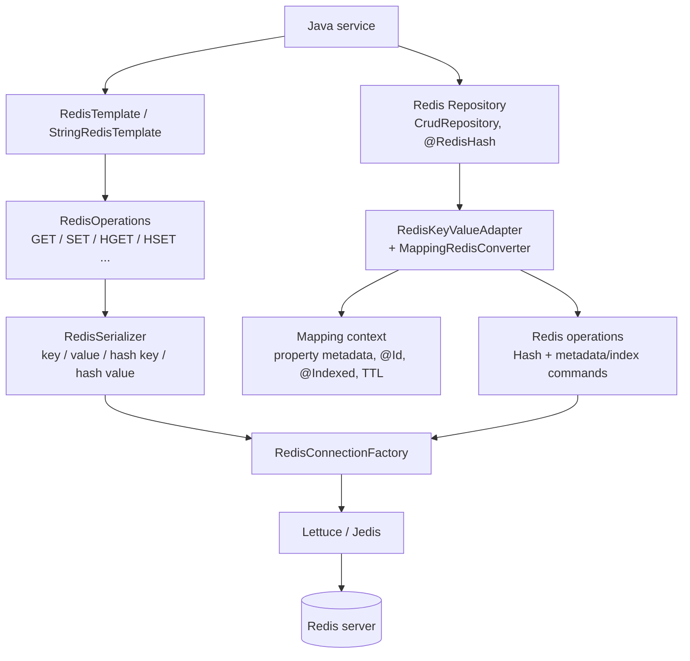
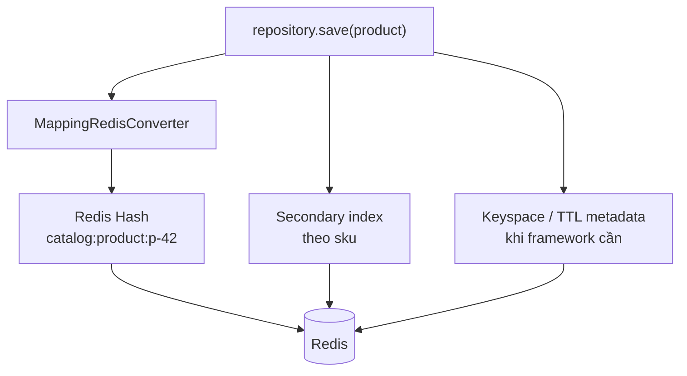
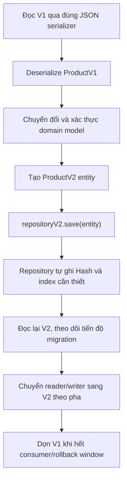

# Phân biệt RedisSerializer với ánh xạ thực thể sang Hash trong Spring Data Redis

Khi một ứng dụng Java ghi đối tượng vào Redis, có hai câu hỏi rất dễ bị nhầm lẫn:

1. **Giá trị Java được chuyển thành byte như thế nào?** Đây là vấn đề **serialization**, thường được xử lý qua `RedisSerializer`.
2. **Đối tượng được tổ chức thành những key và field nào trong Redis?** Đây là vấn đề **object mapping**, chẳng hạn ánh xạ entity sang Redis **Hash** bằng `MappingRedisConverter` và Redis Repository.

Hai cơ chế có thể cùng liên quan đến quá trình ghi dữ liệu, nhưng chúng giải quyết hai cấp độ khác nhau. Một `RedisSerializer` có thể biến **toàn bộ một đối tượng** thành JSON rồi lưu trong Redis String; Redis Repository có thể biến **từng thuộc tính của entity** thành những field trong Redis Hash. Trong cả hai trường hợp, Redis cuối cùng vẫn nhận các key, field và value ở dạng byte.

Bài học sử dụng Spring Data Redis trong hệ sinh thái Spring Boot 3.x; các ví dụ Java minh họa API đồng bộ của `StringRedisTemplate`, `RedisTemplate` và Redis Repository. Cách lưu chính xác của các metadata và nested fields có thể phụ thuộc phiên bản Spring Data Redis cùng cấu hình converter.

## 1. Nhìn từ Redis: kiểu dữ liệu và byte là hai khái niệm khác nhau

Redis là cơ sở dữ liệu key-value có nhiều cấu trúc dữ liệu: String, Hash, List, Set, Sorted Set, Stream... Một **Redis String** là kiểu dữ liệu Redis cho một key, nhưng nội dung của String vẫn là một chuỗi byte. Tương tự, một **Redis Hash** chứa nhiều cặp field/value; tên field và nội dung value cũng được lưu dưới dạng byte.

Giả sử có một sản phẩm:

```json
{
  "id": "p-42",
  "name": "Mechanical Keyboard",
  "priceMinor": 159900,
  "currency": "VND"
}
```

Ta có thể lưu ít nhất hai cách.

**Cách A — Serialize toàn bộ object thành JSON trong một Redis String:**

```text
Redis key (String): product:json:p-42
Redis type:         string
Redis value:        {"id":"p-42","name":"Mechanical Keyboard",
                     "priceMinor":159900,"currency":"VND"}
```

**Cách B — Ánh xạ từng thuộc tính vào một Redis Hash:**

```text
Redis key (String): product:hash:p-42
Redis type:         hash
Redis fields:
    id          -> "p-42"           (field ID có thể do mapping suy ra từ key)
    name        -> "Mechanical Keyboard"
    priceMinor  -> "159900"
    currency    -> "VND"
    _class      -> "..."            (metadata kiểu khi converter cần)
```

Các field hiển thị ở trên mô tả **ý tưởng**; cách Spring Data Redis lưu field `id`, marker `_class` và kiểu dữ liệu thực tế còn tùy metadata/mapping. Không nên coi sơ đồ minh họa là hợp đồng byte-level của mọi phiên bản thư viện.

Ở cách A, Redis không tự hiểu `priceMinor` là một thuộc tính; nó chỉ thấy byte của JSON. Ở cách B, Redis hiểu được các **field của Hash** để áp dụng lệnh như `HGET`, `HSET`, `HDEL` hoặc `HGETALL`, dù không hiểu toàn bộ domain semantics của một `Product` Java.

Điểm mấu chốt: **Hash là kiểu dữ liệu của Redis; serializer là công cụ chuyển đổi representation; mapper là công cụ tổ chức object thành representation.**

## 2. Bản đồ các lớp trong Spring Data Redis



Đường đi trong sơ đồ được giản lược cho mục đích giảng giải; Redis Repository dùng hạ tầng Redis operations và các cơ chế chuyển đổi byte nội bộ, không có nghĩa mỗi repository call đều đi qua serializer đã cấu hình trên một `RedisTemplate` bất kỳ.

| Thành phần | Vai trò chính | Đối tượng nó biết |
|---|---|---|
| `RedisSerializer<T>` | Chuyển `T` thành byte và đọc byte về `T` | Một value, key, hash field hoặc hash value |
| `RedisTemplate<K,V>` | Cung cấp API thực thi lệnh Redis và sử dụng serializer tương ứng | Redis key, value và các cấu trúc dữ liệu |
| `RedisHash` | Đánh dấu entity được quản lý như Redis aggregate, xác định keyspace/TTL mặc định | Entity type |
| `MappingRedisConverter` | Ánh xạ property/entity sang dữ liệu Redis Hash và đọc ngược | Object graph, mapping metadata, type conversions |
| `RedisKeyValueAdapter` | Liên kết Spring Data repository/key-value operations với Redis | Entity, ID, keyspace, index, TTL |
| `CrudRepository<T, ID>` | API CRUD cho aggregate | Entity và định danh, không trực tiếp thao tác command Redis |
| `RedisConnectionFactory` | Cung cấp kết nối tới Redis driver | Kết nối, không quyết định schema của value |

Bạn có thể dùng `RedisTemplate.opsForHash()` mà không dùng Redis Repository; cũng có thể dùng Redis Repository mà không tự tạo một bean `RedisTemplate<String, Product>` cho entity ấy.

## 3. RedisSerializer thực sự làm gì?

`RedisSerializer<T>` là contract chuyển đổi dữ liệu:

```java
// Minh họa khái niệm, không phải định nghĩa đầy đủ của interface.
byte[] serialize(T value);
T deserialize(byte[] bytes);
```

Trong API thực tế, xử lý `null`, những phương thức bổ trợ và exception tuân theo hợp đồng của từng serializer. Redis gửi và nhận byte; Java cần biết byte đó đại diện cho String, số, JSON object, giá trị JDK serialization hay định dạng do ứng dụng tự định nghĩa.

Ví dụ:

```text
Java "hello"
    |
    | StringRedisSerializer (UTF-8)
    v
byte[] = 68 65 6c 6c 6f (hex)
    |
    v
Redis String value
```

Với serializer JSON:

```text
Java ProductSnapshot("p-42", "Keyboard")
    |
    | Jackson2JsonRedisSerializer<ProductSnapshot>
    v
byte[] của {"id":"p-42","name":"Keyboard"}
    |
    v
Redis String value
```

Serializer là một **chiến lược encoding/decoding**. Nó không tự định nghĩa key namespace, quan hệ entity, secondary index, TTL, truy vấn theo property hay vòng đời aggregate.

### 3.1. Các serializer thường gặp

| Serializer | Representation | Khi nên cân nhắc | Giới hạn cần hiểu |
|---|---|---|---|
| `StringRedisSerializer` | Chuỗi UTF-8 | Key dễ đọc, text và giá trị dạng chuỗi | Không tự hiểu object phức tạp |
| `JdkSerializationRedisSerializer` | Dạng Java native serialization | Tương thích dữ liệu Java serialization đã tồn tại | Byte khó đọc, phụ thuộc class/version; deserialization dữ liệu không tin cậy có rủi ro bảo mật |
| `Jackson2JsonRedisSerializer<T>` | JSON cho một kiểu Java cụ thể | Value là DTO/record xác định rõ type | Cần quản lý đổi schema và cấu hình Jackson |
| `GenericJackson2JsonRedisSerializer` | JSON có xử lý thông tin kiểu đa hình | Khi cần đọc/ghi nhiều kiểu object qua cùng một serializer | Cần đánh giá cấu hình type metadata và bảo mật polymorphic deserialization |
| `GenericToStringSerializer<T>` | Chuyển giá trị qua `ConversionService` / String | Các kiểu đơn giản có conversion rõ ràng | Không phù hợp mọi object graph |
| `ByteArrayRedisSerializer` | Byte nguyên trạng | Dữ liệu đã tự encode, binary protocol | Caller phải sở hữu logic encode/decode |

Tên class và constructor có thể khác theo thế hệ Spring Data Redis; khi cấu hình thực tế, đối chiếu API của version mà ứng dụng đang dùng. Với hệ thống mới, một định dạng dữ liệu rõ ràng, được version hóa và không yêu cầu tin tưởng class name bên ngoài thường dễ vận hành hơn Java native serialization.

### 3.2. Bốn vị trí serializer của RedisTemplate

`RedisTemplate` có các vị trí cấu hình độc lập:

```text
RedisTemplate<K, V>
├── keySerializer          # Redis key
├── valueSerializer        # Redis String value / value của một số operations
├── hashKeySerializer      # tên field trong Redis Hash
└── hashValueSerializer    # nội dung mỗi field trong Redis Hash
```

Ví dụ:

```java
import org.springframework.context.annotation.Bean;
import org.springframework.context.annotation.Configuration;
import org.springframework.data.redis.connection.RedisConnectionFactory;
import org.springframework.data.redis.core.RedisTemplate;
import org.springframework.data.redis.serializer.StringRedisSerializer;

@Configuration
class ManualRedisConfig {

    @Bean
    RedisTemplate<String, String> textRedisTemplate(
            RedisConnectionFactory connectionFactory) {

        RedisTemplate<String, String> template = new RedisTemplate<>();
        template.setConnectionFactory(connectionFactory);
        template.setKeySerializer(new StringRedisSerializer());
        template.setValueSerializer(new StringRedisSerializer());
        template.setHashKeySerializer(new StringRedisSerializer());
        template.setHashValueSerializer(new StringRedisSerializer());
        template.afterPropertiesSet();
        return template;
    }
}
```

Trong `RedisTemplate`, key serializer và hash key serializer không phải một: key serializer chuyển **tên key Redis**; hash key serializer chuyển **tên field bên trong Hash**. Nếu quên cấu hình hash key serializer, hash field có thể không xuất hiện ở dạng chuỗi như mong đợi trong Redis CLI, tùy default của template.

`StringRedisTemplate` đã được thiết kế chuyên cho string và sử dụng serializer chuỗi cho key/value/hash key/hash value. Khi mọi dữ liệu đều là text, nó giúp giảm cấu hình so với tự tạo template.

## 4. Ví dụ 1: RedisTemplate ghi một object thành Redis String

Xét model dữ liệu:

```java
public record ProductSnapshot(
    String id,
    String name,
    long priceMinor,
    String currency
) {}
```

Tạo template riêng để ghi/đọc JSON:

```java
import org.springframework.context.annotation.Bean;
import org.springframework.context.annotation.Configuration;
import org.springframework.data.redis.connection.RedisConnectionFactory;
import org.springframework.data.redis.core.RedisTemplate;
import org.springframework.data.redis.serializer.Jackson2JsonRedisSerializer;
import org.springframework.data.redis.serializer.StringRedisSerializer;

@Configuration
class ProductJsonConfig {
    @Bean
    RedisTemplate<String, ProductSnapshot> productJsonTemplate(
            RedisConnectionFactory connectionFactory) {

        RedisTemplate<String, ProductSnapshot> template =
            new RedisTemplate<>();
        template.setConnectionFactory(connectionFactory);
        template.setKeySerializer(new StringRedisSerializer());
        template.setValueSerializer(
            new Jackson2JsonRedisSerializer<>(ProductSnapshot.class)
        );
        template.afterPropertiesSet();
        return template;
    }
}
```

Ghi và đọc:

```java
import java.time.Duration;
import org.springframework.data.redis.core.RedisTemplate;
import org.springframework.stereotype.Service;

@Service
public class ProductJsonStore {
    private final RedisTemplate<String, ProductSnapshot> redis;

    public ProductJsonStore(
            RedisTemplate<String, ProductSnapshot> productJsonTemplate) {
        this.redis = productJsonTemplate;
    }

    public void save(ProductSnapshot product) {
        redis.opsForValue().set(
            "product:json:" + product.id(),
            product,
            Duration.ofMinutes(20)
        );
    }

    public ProductSnapshot find(String id) {
        return redis.opsForValue().get("product:json:" + id);
    }
}
```

Luồng ghi:

```text
ProductSnapshot
      |
      v
Jackson2JsonRedisSerializer
      |
      v
byte[] JSON
      |
      v
Redis SET product:json:p-42 <JSON> EX ...
      |
      v
Redis lưu một key có TYPE = string
```

Điểm cần nhớ:

- Redis lưu **một giá trị JSON hoàn chỉnh** cho mỗi key.
- `RedisTemplate.opsForValue()` thao tác với Redis String; không tự tạo Redis Hash vì class Java có nhiều field.
- Redis không thể dùng `HGET product:json:p-42 name` để đọc thuộc tính `name` từ JSON String. Lệnh `HGET` với key này có thể trả `WRONGTYPE`.
- Đổi `ProductSnapshot` hoặc cấu hình Jackson có thể khiến dữ liệu cũ không đọc được; cần kế hoạch migration, version hoặc TTL.
- TTL 20 phút là do code truyền vào `set`, không phải do serializer.

Trong hệ thống thực, nếu có nhiều bean cùng kiểu generics hoặc nhiều template, đặt qualifier rõ ràng để service inject đúng serializer và key convention. Những ví dụ này chỉ minh họa việc lựa chọn representation, không phải gợi ý dùng một serializer JSON cho tất cả dữ liệu.

## 5. Ví dụ 2: RedisTemplate tự ghi từng field vào Redis Hash

Không cần Repository vẫn có thể dùng Redis Hash. API `opsForHash()` cung cấp thao tác như `put`, `get`, `entries`, `delete`:

```java
import java.util.Map;
import org.springframework.data.redis.core.StringRedisTemplate;
import org.springframework.stereotype.Service;

@Service
public class ManualProductHashStore {
    private final StringRedisTemplate redis;

    public ManualProductHashStore(StringRedisTemplate redis) {
        this.redis = redis;
    }

    public void save(ProductSnapshot product) {
        String key = "product:manual-hash:" + product.id();
        redis.opsForHash().put(key, "name", product.name());
        redis.opsForHash().put(
            key, "priceMinor", Long.toString(product.priceMinor())
        );
        redis.opsForHash().put(key, "currency", product.currency());
    }

    public String findName(String productId) {
        Object value = redis.opsForHash().get(
            "product:manual-hash:" + productId,
            "name"
        );
        return value == null ? null : value.toString();
    }

    public Map<Object, Object> fields(String productId) {
        return redis.opsForHash().entries(
            "product:manual-hash:" + productId
        );
    }
}
```

Trong ví dụ này, `StringRedisTemplate` serialize **từng tên field** và **từng giá trị** dưới dạng chuỗi UTF-8. Mã Java **tự quyết định** field nào được ghi, kiểu String nào biểu diễn số, cách ghép key và thời điểm gắn TTL.

Đối chiếu Redis CLI:

```bash
redis-cli TYPE product:manual-hash:p-42
# hash

redis-cli HGET product:manual-hash:p-42 name
# "Mechanical Keyboard"

redis-cli HGETALL product:manual-hash:p-42
# name, priceMinor, currency cùng các giá trị đã ghi
```

**Đây vẫn là serialization**: `"priceMinor"` và `"159900"` được chuyển thành byte. Tuy nhiên chưa có **entity mapping tự động**: không có `@Id`, `@RedisHash`, `MappingRedisConverter`, secondary index hoặc cơ chế Repository nào được gọi. Một Redis Hash không tự trở thành Redis Repository entity chỉ vì được tạo bằng `opsForHash()`.

## 6. Redis Repository ánh xạ entity sang Hash như thế nào?

Spring Data Redis hỗ trợ một lớp mapping dành cho entity. Khi dùng Redis Repository, thường khai báo `@RedisHash` trên entity và `@Id` trên thuộc tính định danh. Infrastructure Spring Data KeyValue/Redis có thể dùng `MappingRedisConverter` để chuyển entity thành các hash field, và dùng `RedisKeyValueAdapter` để lưu/đọc chúng qua Redis.

Ví dụ entity:

```java
import org.springframework.data.annotation.Id;
import org.springframework.data.redis.core.RedisHash;
import org.springframework.data.redis.core.index.Indexed;

@RedisHash(value = "catalog:product", timeToLive = 1800)
public class ProductEntity {
    @Id
    private String id;

    @Indexed
    private String sku;

    private String name;
    private Long priceMinor;
    private String currency;

    public ProductEntity() {}

    public ProductEntity(
            String id, String sku, String name,
            Long priceMinor, String currency) {
        this.id = id;
        this.sku = sku;
        this.name = name;
        this.priceMinor = priceMinor;
        this.currency = currency;
    }

    public String getId() { return id; }
    public void setId(String id) { this.id = id; }
    public String getSku() { return sku; }
    public void setSku(String sku) { this.sku = sku; }
    public String getName() { return name; }
    public void setName(String name) { this.name = name; }
    public Long getPriceMinor() { return priceMinor; }
    public void setPriceMinor(Long priceMinor) { this.priceMinor = priceMinor; }
    public String getCurrency() { return currency; }
    public void setCurrency(String currency) { this.currency = currency; }
}
```

Khai báo repository:

```java
import java.util.List;
import org.springframework.data.repository.CrudRepository;

public interface ProductRepository
        extends CrudRepository<ProductEntity, String> {

    List<ProductEntity> findBySku(String sku);
}
```

Khi Redis repositories được bật và quét đúng package (qua auto-configuration phù hợp của Spring Boot hoặc `@EnableRedisRepositories`), service có thể làm việc với entity:

```java
ProductEntity entity = new ProductEntity(
    "p-42", "KEYBOARD-42", "Mechanical Keyboard",
    159900L, "VND"
);

productRepository.save(entity);
ProductEntity loaded =
    productRepository.findById("p-42").orElseThrow();
List<ProductEntity> bySku =
    productRepository.findBySku("KEYBOARD-42");
```

### 6.1. Ý nghĩa từng annotation

| Annotation | Tác dụng |
|---|---|
| `@RedisHash("catalog:product")` | Chỉ định keyspace của Redis entity, ví dụ key chính thường có dạng `catalog:product:p-42` |
| `@Id` | Định danh dùng để xây dựng key và tìm entity theo ID |
| `@Indexed` | Đề nghị Spring Data Redis quản lý secondary index để hỗ trợ truy vấn theo thuộc tính, ví dụ `findBySku` |
| `timeToLive = 1800` | Đặt TTL mặc định 1.800 giây cho dữ liệu entity khi lưu theo cơ chế Repository |

`@RedisHash` **không phải serializer JSON**. Nó nói với framework rằng đây là một entity được tổ chức trong keyspace của Redis, thường lưu ở Redis Hash. `@Indexed` cũng không làm Redis có SQL index; Spring Data Redis duy trì những cấu trúc key bổ trợ để tìm các entity theo giá trị index.

### 6.2. Một lần save có thể tạo nhiều Redis key

Sơ đồ khái niệm:



Một entity đơn giản có thể trở thành hash gồm các property và metadata kiểu. Khi thêm `@Indexed`, repository có thể tạo thêm key phục vụ truy vấn theo SKU. Với TTL/expiration events, framework có thể duy trì metadata hoặc bản sao phục vụ xử lý hết hạn tùy cấu hình và phiên bản.

Do đó **`repository.save(entity)` không thể được hiểu đơn giản là một lệnh `SET` với value đã qua RedisSerializer**. Nó có thể tương ứng với nhiều Redis commands và nhiều key. Cũng không nên mặc định toàn bộ các thao tác đó là một transaction nguyên tử.

## 7. Redis Hash của Repository chứa gì?

Một representation mang tính minh họa:

```text
Key: catalog:product:p-42
TYPE: hash
Fields thường tương ứng với:
    _class       = tên kiểu Java hoặc type alias khi cần
    sku          = KEYBOARD-42
    name         = Mechanical Keyboard
    priceMinor   = 159900
    currency     = VND
```

Tùy cách mapping và model:

- Thuộc tính đơn giản có thể được đưa vào field tương ứng.
- Object lồng nhau có thể được ánh xạ qua tên path/field, chẳng hạn `address.city`.
- Collection/map có thể được biểu diễn qua những field có convention riêng.
- Type metadata như `_class` có thể được lưu để hỗ trợ dựng lại kiểu object.
- Một số property có thể không được lưu theo tên field “nhìn giống Java” nếu có custom converter hoặc mapping metadata.
- ID thường được sử dụng để xây key; không nên cho rằng lúc nào cũng có một hash field `id` giống hệt key.

Với dữ liệu đơn giản và serializer dễ đọc, bạn có thể quan sát bằng Redis CLI:

```bash
redis-cli TYPE catalog:product:p-42
# hash

redis-cli HGETALL catalog:product:p-42
# Một danh sách field/value; nội dung thực tế phụ thuộc mapping
```

Giá trị trả về có thể không phải JSON, và có thể chứa byte không hiển thị tốt trong terminal. `HGETALL` cho thấy field ở tầng Redis, **không đảm bảo hiển thị nguyên vẹn Java object khi có nesting, metadata hoặc converter đặc biệt**.

## 8. MappingRedisConverter khác RedisSerializer ở đâu?

Sự khác biệt cốt lõi:

```text
Đường A: RedisTemplate + JSON serializer

Java object
   |
   v
serialize object -> byte[] JSON
   |
   v
SET key <byte[]>
   |
   v
Redis String

Đường B: Redis Repository + object mapping

Java entity
   |
   v
inspect metadata: @RedisHash, @Id, @Indexed, properties
   |
   v
MappingRedisConverter -> RedisData / hash field representation
   |
   v
HSET / HMSET và commands quản lý keyspace, index, TTL
   |
   v
Redis Hash + metadata/index keys khi cần
```

| Tiêu chí | `RedisSerializer` | `MappingRedisConverter` / Redis Repository |
|---|---|---|
| Đầu vào | Một giá trị Java thuộc kiểu cần serialize | Một entity cùng thông tin property và mapping metadata |
| Đầu ra ý niệm | Byte representation | Redis Hash fields và metadata để lưu/đọc aggregate |
| Tổ chức field | Không tự tổ chức entity thành nhiều hash fields | Ánh xạ property/object graph thành các field tương ứng |
| Redis data type | Phụ thuộc operation của template: String, Hash, List... | Entity chủ yếu được lưu thành Redis Hash |
| ID và keyspace | Caller tự chọn key | `@Id`, `@RedisHash` và adapter hỗ trợ quản lý |
| Secondary index | Không được tạo tự động | Có thể được quản lý qua `@Indexed` |
| TTL | Caller cấu hình thao tác/`expire` | Có thể khai báo `@RedisHash(timeToLive=...)`, `@TimeToLive` |
| Thay đổi schema | Thay serializer/DTO/key version hoặc migrate dữ liệu | Thay mapping converter/entity/keyspace và migrate dữ liệu/index |
| Truy vấn | Chủ động dùng Redis commands | Repository API với những khả năng truy vấn được hỗ trợ |

**Đừng xem `MappingRedisConverter` là một `Jackson2JsonRedisSerializer` khác tên.** Serializer JSON biến object thành một JSON payload; mapping converter biết về các property và representation của Redis Hash để khôi phục aggregate.

Mặt khác, object mapping vẫn cần chuyển từng dữ liệu sang representation lưu trữ. Vì vậy nói “Repository không hề serialize dữ liệu” cũng không đúng: framework vẫn chuyển property và metadata thành byte, chỉ là **ranh giới chuyển đổi và cơ chế quản lý khác với serializer của application template**.

## 9. Một Redis Hash không đồng nghĩa với Redis Repository

Có ba cách lưu dữ liệu dễ bị gọi chung là “lưu Hash”:

| Cách | Redis TYPE | Ai tạo và quản lý field? |
|---|---|---|
| `RedisTemplate.opsForValue().set(key, jsonObject)` với JSON serializer | `string` | Object được serialize thành JSON; Redis không biết property |
| `StringRedisTemplate.opsForHash().put(key, field, value)` | `hash` | Chính code ứng dụng tự quản lý field |
| `productRepository.save(entity)` với `@RedisHash` | `hash` | Spring Data Redis mapping và repository infrastructure |

Cách thứ hai và thứ ba cùng dùng Redis Hash, nhưng không thay thế nhau được một cách tùy tiện.

Ví dụ ứng dụng đã dùng Repository để lưu entity với `@Indexed private String sku`. Sau đó có đoạn code:

```java
stringRedisTemplate.opsForHash().put(
    "catalog:product:p-42",
    "sku",
    "NEW-SKU"
);
```

Lệnh `HSET` có thể đổi field `sku` trên hash, nhưng **không tự cập nhật những secondary index mà Repository quản lý**. Kết quả là `findById("p-42")` có thể thấy SKU mới trong khi `findBySku("NEW-SKU")` không tìm ra entity, hoặc index cho SKU cũ chưa được dọn.

Tương tự, nếu code tự tạo cùng key bằng `opsForValue().set(...)`, Redis key có thể chuyển thành kiểu String. Repository kỳ vọng Redis Hash sẽ gặp lỗi kiểu dữ liệu hoặc không đọc được aggregate.

Quy tắc thiết kế: **mỗi keyspace cần một owner rõ ràng**. Nếu Repository sở hữu key và index, cập nhật qua Repository hoặc một adapter chuyên biệt hiểu đầy đủ mapping/index/TTL của nó. Nếu Template sở hữu key, đừng để Repository tự nhận keyspace đó mà không có kế hoạch migration.

## 10. Thực tế của bốn serializer khi thao tác Hash thủ công

Giả sử một template được cấu hình:

```java
RedisTemplate<String, Object> template = new RedisTemplate<>();
template.setConnectionFactory(connectionFactory);
template.setKeySerializer(new StringRedisSerializer());
template.setHashKeySerializer(new StringRedisSerializer());
template.setHashValueSerializer(new GenericJackson2JsonRedisSerializer());
template.afterPropertiesSet();
```

Khi gọi:

```java
template.opsForHash().put(
    "profile:manual:42",
    "settings",
    new ProfileSettings("vi", true)
);
```

Redis nhận:

```text
Key:       profile:manual:42                 (UTF-8 String)
Type:      hash
Hash field: settings                        (UTF-8 String)
Hash value: JSON bytes của ProfileSettings
```

Ở đây **mỗi hash value** dùng JSON serializer, nhưng framework không tự flatten thành các field như `settings.language` hay `settings.notificationsEnabled`. Value của field `settings` đơn giản là một payload JSON được đặt trong Hash.

Một record minh họa:

```java
public record ProfileSettings(
    String language,
    boolean notificationsEnabled
) {}
```

Điều này cho thấy hai tầng có thể phối hợp:

- **Redis Hash** quyết định cấu trúc collection các field.
- **Hash value serializer** quyết định representation của từng field value.

Nếu bạn đổi `hashValueSerializer` từ JSON sang JDK serialization, Redis vẫn có thể là Hash nhưng dữ liệu byte của từng field khác đi. Những field cũ không tự chuyển định dạng.

## 11. Kiểu lồng nhau và custom conversion trong Redis Repository

Khi entity có object lồng nhau:

```java
public class ShippingAddress {
    private String city;
    private String postalCode;

    public ShippingAddress() {}
    public String getCity() { return city; }
    public void setCity(String city) { this.city = city; }
    public String getPostalCode() { return postalCode; }
    public void setPostalCode(String postalCode) {
        this.postalCode = postalCode;
    }
}

@RedisHash("orders")
public class OrderEntity {
    @Id
    private String id;
    private ShippingAddress address;
    // Constructors/getters/setters tương ứng cần được khai báo.
}
```

Mapping converter có thể xử lý object graph thông qua metadata để ánh xạ nested properties, ví dụ các field mang nghĩa `address.city` hoặc `address.postalCode`. Với collection hoặc các kiểu Java đặc biệt, hình thức ánh xạ và type metadata có thêm quy tắc riêng.

Nếu muốn điều chỉnh cách một kiểu được lưu trong Redis Hash, Spring Data Redis hỗ trợ **custom conversions** thông qua cơ chế converter và `RedisCustomConversions` ở những đường mapping được hỗ trợ. Một custom writing conversion có thể biểu diễn một kiểu domain thành một dạng lưu trữ đơn giản hoặc bytes; reading conversion dựng lại kiểu domain.

Sự khác nhau về trách nhiệm:

```text
RedisSerializer
    "Hãy encode/decode byte của một value."

Property/custom conversion của entity
    "Hãy biểu diễn thuộc tính này thành những dữ liệu lưu trữ
     mà MappingRedisConverter có thể ghi vào Hash."
```

Custom conversion hữu ích khi object cần representation rõ ràng như `Money`, `GeoPoint`, identifier đặc thù hoặc kiểu không thể được mapper xử lý theo mặc định. Cần định nghĩa **hai chiều** đọc và ghi, quản lý backwards compatibility và tránh làm converter lưu ra bytes mà các phiên bản trước không hiểu.

Thay đổi custom converter có thể làm bản ghi cũ không đọc được dù tên key và entity class vẫn giữ nguyên. Đây cũng là thay đổi schema và cần được version hóa hoặc migrate nếu không tương thích.

## 12. RedisSerializer không quyết định lệnh Redis

Một nhầm lẫn thường gặp là “đặt JSON serializer thì Redis sẽ dùng JSON data type”. Thực tế:

```java
// Với RedisTemplate có JSON value serializer:
template.opsForValue().set("x", someObject);
// Lệnh mang ý nghĩa SET; key x là Redis String.

// Với hash value JSON serializer:
template.opsForHash().put("y", "field1", someObject);
// Lệnh mang ý nghĩa HSET; key y là Redis Hash.
```

Loại operation quyết định Redis type; serializer quyết định cách biểu diễn key/field/value dưới dạng bytes. Một JSON payload có thể nằm trong Redis String hoặc **trong một field value của Redis Hash**. Redis không tự diễn giải JSON thành các field chỉ vì bytes bắt đầu bằng dấu `{`.

Redis cũng có những module/extension hỗ trợ biểu diễn JSON với API riêng (ví dụ các hệ thống triển khai RedisJSON), nhưng đó là capability khác. `RedisTemplate` với JSON serializer mặc định không tự chuyển sang lệnh của RedisJSON.

## 13. TTL và index thuộc lớp nào?

Serializer không mang ngữ nghĩa vòng đời key. Giả sử cùng một sản phẩm được lưu ba cách:

### Template String có JSON

```java
redisTemplate.opsForValue().set(
    "product:json:p-42", product,
    Duration.ofMinutes(10)
);
```

TTL được đặt trực tiếp bởi thao tác `set`.

### Template Hash thủ công

```java
String key = "product:manual-hash:p-42";
stringRedisTemplate.opsForHash().put(key, "name", "Keyboard");
stringRedisTemplate.expire(key, Duration.ofMinutes(10));
```

Ở đây `expire` gắn TTL cho **toàn bộ Redis key Hash**. Redis không có TTL field-level chuẩn trong mọi cấu hình/version, nên đừng mặc định mỗi field sẽ hết hạn độc lập với key. Khả năng field expiration nếu hệ Redis có hỗ trợ là câu chuyện khác và cần xác nhận API/phiên bản.

### Entity Repository

```java
@RedisHash(value = "catalog:product", timeToLive = 600)
public class ProductEntity {
    @Id
    private String id;
    // ...
}
```

TTL là một phần cấu hình mapping/entity mà Repository áp dụng khi lưu. Với `@TimeToLive`, có thể diễn đạt TTL theo từng instance nếu bài toán yêu cầu. Khi key hết hạn, việc dọn index và thông báo expiration có điều kiện theo hạ tầng Redis keyspace events và cấu hình repository; không nên mặc định chúng luôn được xử lý ngay, tuyệt đối chính xác.

**Serialization không tự cấp TTL, không tạo index và không làm cho nhiều lệnh của Repository trở thành một transaction nguyên tử.** Đó là các quyết định quản lý dữ liệu khác.

## 14. Trường hợp Spring Cache: thêm một nguồn serializer khác

Ứng dụng có thể cấu hình Redis làm backend của Spring Cache:

```java
@Cacheable(cacheNames = "product-details", key = "#productId")
public ProductView findProduct(String productId) {
    return productGateway.load(productId);
}
```

Spring Cache với `RedisCacheManager` thường ghi **cache entry** vào Redis bằng serializer từ `RedisCacheConfiguration`, chứ không dùng tự động bean `RedisTemplate<String, ProductSnapshot>` mà bạn đã tạo. Cache key thường được prefix theo cache name; cache value có serializer và TTL riêng.

Ví dụ:

```text
product-details::p-42   -> serialized ProductView cache value
catalog:product:p-42    -> Redis Repository Hash
product:json:p-42       -> ProductSnapshot JSON trong Redis String
```

Ba key trên có thể cùng tồn tại trong một Redis server nhưng mỗi key được quản lý bởi một abstraction khác nhau. Thay `RedisCacheConfiguration` không đồng nghĩa Repository sẽ đổi Hash mapping. Thay `RedisTemplate.setValueSerializer` cũng không đồng nghĩa dữ liệu cache và entity được migrate.

Nhận biết owner của key là bước đầu tiên khi debug: cache value, raw template value hay repository aggregate?

## 15. Điều gì xảy ra khi thay serializer hoặc thay entity schema?

### 15.1. Đổi serializer nhưng giữ key cũ

Trước khi nâng cấp:

```text
product:json:p-42 -> Java JDK serialization bytes
```

Sau khi nâng cấp:

```text
ProductJsonStore muốn đọc product:json:p-42 bằng JSON serializer
```

JSON decoder có thể thất bại vì bytes cũ không phải JSON. **Chỉ đổi serializer trong configuration không tự chuyển đổi dữ liệu trên Redis**.

Phương án:

- Chọn namespace mới, ví dụ `product:json:v2:p-42`, và chuyển đổi có kiểm soát.
- Nếu chỉ là cache tái tạo được, xóa/để hết hạn cache cũ và ghi cache mới.
- Nếu dữ liệu authoritative, phải đọc bằng codec cũ, biến đổi thành model mới rồi ghi qua codec mới; tính đến update đồng thời và rollback.

### 15.2. Đổi mapping entity nhưng giữ keyspace

Trước:

```java
@RedisHash("customers")
class CustomerV1 {
    @Id String id;
    String fullName;
}
```

Sau:

```java
@RedisHash("customers")
class CustomerV2 {
    @Id String id;
    String givenName;
    String familyName;
}
```

Hash cũ có thể chứa `fullName`; code V2 mong đợi `givenName` và `familyName`. Mapper không thể tự suy ra cách tách tên chính xác trong mọi trường hợp. Chỉ đổi tên field Java không có nghĩa dữ liệu Redis được đổi cấu trúc.

Có thể:

1. Dùng converter đọc V1 rồi chuyển sang model V2 nếu thuật toán có nghĩa rõ ràng.
2. Đổi keyspace thành `customers-v2` để tránh decoder mới đọc nhầm dữ liệu cũ.
3. Thực hiện migration với kiểm soát concurrency, TTL, index và quan sát lỗi.

Việc chuyển từ JSON String sang Repository Hash càng cần kế hoạch cụ thể vì **Redis type của key thay đổi từ `string` sang `hash`**. Không thể dùng `HGETALL` để đọc một key String; cũng không thể dùng `GET` trực tiếp để đọc Hash.

## 16. Khi migrate từ JSON String sang Repository Hash

Giả sử ứng dụng trước đây sử dụng:

```text
product:json:v1:p-42
    TYPE = string
    value = {"id":"p-42","name":"Keyboard"}
```

Phiên bản mới chuyển sang Redis Repository với:

```text
catalog:product:v2:p-42
    TYPE = hash
    fields theo MappingRedisConverter
```

Một luồng migrate có kiểm soát:



Không nên chọn lối tắt `RENAME product:json:v1:p-42 catalog:product:v2:p-42`, vì sau `RENAME`, key vẫn là **Redis String** chứ không tự thành Redis Hash. Cũng không nên chỉ ghi vài field bằng `HSET` mà bỏ qua secondary index do repository cần duy trì.

Với dữ liệu đang thay đổi, conversion phải xử lý **stale write** (migration không được ghi đè cập nhật mới), **delete/tombstone** (tránh hồi sinh dữ liệu bị xóa) và **TTL** (tránh kéo dài phiên/OTP không mong muốn). Đối với Redis Cluster, các thao tác nhiều key trong Lua/transaction cần tuân theo giới hạn cùng hash slot.

## 17. Debug: xác định ngay kiểu Redis và cách giải mã

Khi thấy lỗi deserialize hoặc `WRONGTYPE`, hãy truy nguyên theo thứ tự:

**Bước 1 — Xem Redis type của key**

```bash
redis-cli TYPE product:json:p-42
redis-cli TYPE product:manual-hash:p-42
redis-cli TYPE catalog:product:p-42
```

**Bước 2 — Đọc bằng lệnh phù hợp với type**

```bash
# Chỉ dùng GET cho Redis String
redis-cli GET product:json:p-42

# Chỉ dùng HGETALL cho Redis Hash
redis-cli HGETALL product:manual-hash:p-42
redis-cli HGETALL catalog:product:p-42
```

**Bước 3 — Xác định serializer hoặc mapping**

- Redis String value từ `RedisTemplate.opsForValue()`: xem `valueSerializer`.
- Redis Hash tạo bằng `opsForHash()`: xem `hashKeySerializer` và `hashValueSerializer`.
- Redis Hash do Repository tạo: xem `@RedisHash`, `@Id`, `@Indexed`, entity field mapping và `MappingRedisConverter`/custom conversions.
- Redis Cache: xem `RedisCacheConfiguration`, cache name, key prefix và serializer.

**Bước 4 — Kiểm tra TTL và source of truth**

```bash
redis-cli TTL product:json:p-42
redis-cli TTL catalog:product:p-42
```

`TTL` trả số giây còn lại khi key có expiry, `-1` khi key tồn tại mà không có expiry, và `-2` khi key không tồn tại. Khi key đã hết hạn, deserialize error sẽ không xảy ra cho key đó; nếu object không tìm được, hãy phân biệt với lỗi connection hoặc lỗi serializer.

Redis CLI in giá trị theo dạng text, nhưng byte của JDK serialization hay serializer nhị phân có thể không hiển thị có nghĩa. Đừng đổi serializer chỉ để CLI “đẹp” nếu hệ thống có dữ liệu cũ phải tương thích.

Trên môi trường có nhiều key, dùng `SCAN` theo prefix để quan sát:

```bash
redis-cli --scan --pattern 'catalog:product:*'
```

Tránh `KEYS *` trên Redis production lớn vì có thể chặn server; khi xóa key, cần biết cả metadata/index key thuộc hạ tầng Repository.

## 18. Performance: không có representation tốt nhất cho mọi bài toán

| Nhu cầu | JSON String với Serializer | Hash thủ công với Template | Repository Hash mapping |
|---|---|---|---|
| Ghi/đọc toàn object theo một key | Đơn giản, mỗi giá trị là một payload | Phải chia/ghép fields thủ công | Có API `save/findById` |
| Chỉ đọc một field | Thường phải đọc/parse toàn payload, trừ khi có cơ chế riêng | `HGET` rất phù hợp | Repository thường thiên về khôi phục aggregate; không mặc định tối ưu field-only |
| Thay đổi một field | Thường ghi lại object/payload | `HSET` trực tiếp | Có thể cần save aggregate và cập nhật index |
| Derived query theo thuộc tính | Không có tự động | Tự quản lý index | Có hỗ trợ theo giới hạn của Redis Repository và `@Indexed` |
| Nested object | JSON thường tự nhiên | Phải định nghĩa representation từng field | Mapper có quy tắc flatten/nested metadata |
| Đọc bằng công cụ Redis CLI | Dễ nếu JSON UTF-8 | Dễ nếu hash field/value là String | Có thể có metadata và bytes khó đọc |
| Chi phí cập nhật metadata | Tự quản lý tối thiểu | Tự quản lý | Có thể phát sinh thêm key/index/TTL metadata |
| Compatibility khi schema đổi | Quản lý JSON DTO và serializer | Quản lý field names và converter tự viết | Quản lý entity mapping, keyspace, index, converters |

Không nên khẳng định “Hash luôn dùng ít bộ nhớ hơn JSON” hoặc “Repository luôn chậm hơn Template”. Chi phí thực tế phụ thuộc độ lớn payload, số field, encoding Redis, network round trips, số index, dạng query, tần suất update và driver settings.

Benchmark nên sử dụng workload thật: số lượng field, phân bố kích thước object, tỷ lệ read/write, số key, TTL, concurrent requests và Redis topology. Khi cần một lệnh atomic như `INCR` hoặc `HINCRBY`, API Template thường rõ ràng và phù hợp hơn việc đọc/sửa/ghi cả entity.

## 19. Những nhầm lẫn cần tránh

| Nhầm lẫn | Điều đúng hơn |
|---|---|
| “Object Java có nhiều thuộc tính thì RedisTemplate sẽ lưu thành Hash.” | `opsForValue()` vẫn ghi Redis String; serializer không tự đổi lệnh Redis. |
| “Dùng Jackson2JsonRedisSerializer là dùng RedisJSON.” | JSON serializer chỉ tạo byte JSON; Redis data type phụ thuộc operation. |
| “`@RedisHash` là một cách viết tắt của JSON serializer.” | `@RedisHash` tham gia mapping entity/keyspace, không định nghĩa JSON codec cho toàn object. |
| “Redis Hash được tạo bằng `opsForHash()` có thể dùng luôn với Repository.” | Repository còn cần mapping metadata/index/ID và contract riêng. |
| “Đổi serializer của bean RedisTemplate sẽ đổi cách Repository lưu entity.” | Cấu hình serializer của template ứng dụng không tự thay thế toàn bộ entity mapper của Repository. |
| “`HSET` sửa field trên entity Repository sẽ cập nhật `@Indexed`.” | Low-level write không tự duy trì secondary index do Repository quản lý. |
| “`@Indexed` là SQL index được Redis tạo tự động.” | Spring Data Redis duy trì cấu trúc secondary index bằng các key Redis theo cơ chế của nó. |
| “Đổi class Java là dữ liệu Redis tự migrate.” | Data migration, keyspace hoặc backward-compatible converter phải được thiết kế. |
| “Serializer quyết định TTL.” | TTL thuộc lệnh/Repository/Cache configuration, độc lập với codec. |
| “Mọi lỗi đọc null đều do key không tồn tại.” | Deserialization/type/connection errors có semantics khác Redis nil. |

## 20. Bài tập nhận diện representation

### Tình huống A — Cache hồ sơ dưới dạng JSON

Yêu cầu: lưu snapshot profile có vài chục thuộc tính, đọc toàn bộ trong một lần và có thể tái tạo từ database.

Một `RedisTemplate<String, ProfileSnapshot>` với JSON value serializer hoặc Redis Cache có serializer cấu hình rõ ràng là lựa chọn hợp lý. Key thuộc Redis String; TTL quản lý theo cache/use case. Không cần Repository chỉ vì profile là Java object.

### Tình huống B — Session entity theo ID, tìm theo user ID

Yêu cầu: lưu session có ID, TTL 20 phút, có truy vấn theo `userId`. Redis Repository với `@RedisHash`, `@Id` và `@Indexed` có thể phù hợp nếu nhu cầu truy vấn nằm trong khả năng của Repository. Cần theo dõi index và TTL; việc lưu thông qua Repo khác với đặt một JSON string bằng Template.

### Tình huống C — Cập nhật counters nằm trong một Redis Hash

Yêu cầu: mỗi bài viết có `views` và `likes`, mỗi request chỉ tăng một field.

`StringRedisTemplate.opsForHash().increment(...)` phù hợp với Redis `HINCRBY`; bạn chủ động dùng lệnh atomic của Redis cho một field. Không cần mapping toàn bộ Java aggregate cho mỗi lần tăng counter.

### Tình huống D — Đã có JSON String, muốn chuyển sang Repository

Yêu cầu: schema của sản phẩm đổi, cần query theo `sku` và sử dụng `@Indexed`.

Phải đọc bản JSON bằng serializer cũ, chuyển thành entity mới, lưu qua repository để xây Hash/index tương ứng và chuyển reader/writer theo pha. Không chỉ `RENAME` key hoặc thay `setValueSerializer`.

### Tình huống E — Một Redis key trả `WRONGTYPE`

Yêu cầu: service gọi `opsForHash().get("product:42", "name")` nhưng key `product:42` trước đó được ghi bằng `opsForValue().set(...)`.

Redis key có kiểu **String** nên không thể `HGET`. Hướng sửa là thống nhất owner/key namespace, chọn Redis type đúng và migrate dữ liệu nếu cần. Đổi hash value serializer không biến key String thành Hash.

## 21. Cách chọn đúng abstraction

Sử dụng những câu hỏi sau khi thiết kế:

1. **Bạn muốn điều khiển Redis commands và byte format của một giá trị?** Bắt đầu với `RedisTemplate` và `RedisSerializer`.
2. **Bạn muốn lưu entity theo ID, có mapping property và index theo thuộc tính được hỗ trợ?** Cân nhắc Redis Repository với `@RedisHash` và `MappingRedisConverter`.
3. **Bạn muốn thao tác trực tiếp từng field trên Redis Hash?** `opsForHash()` phù hợp; tự quản lý schema, index và TTL.
4. **Bạn muốn cache kết quả phương thức?** Dùng Spring Cache với `RedisCacheManager` và serializer/cache TTL của riêng nó.
5. **Bạn muốn đổi định dạng lưu trữ hiện tại?** Xác định key owner, Redis TYPE, serializer/mapping cũ, định dạng mới, TTL, index và chiến lược migration trước khi triển khai.

**RedisSerializer trả lời cách biểu diễn một giá trị bằng byte; ánh xạ thực thể sang Hash trả lời cách tổ chức một object thành các field và key Redis.** Spring Data Redis cung cấp cả hai vì chúng phục vụ những tình huống khác nhau. Khi đọc lỗi hoặc sửa schema, đừng chỉ hỏi “đang dùng serializer nào”; hãy hỏi thêm “key này là Redis String hay Hash, ai sở hữu nó, và representation được quản lý ở tầng nào?”.
