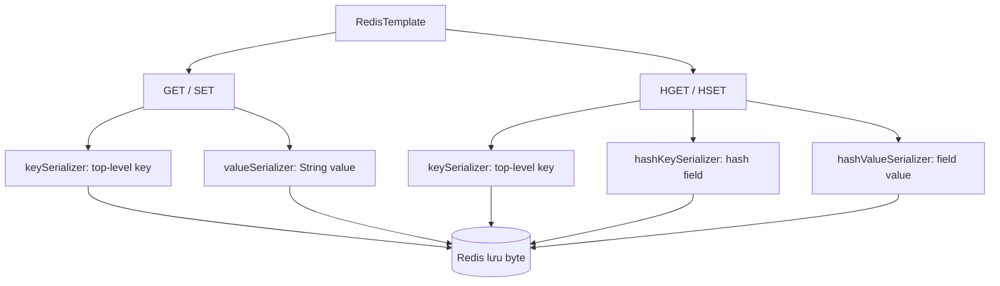

# Serializer riêng cho key, value, hash key và hash value

## 1. Vì sao RedisTemplate cần bốn serializer?

Redis không lưu trực tiếp đối tượng Java, `String` hay kiểu dữ liệu generic. Ở tầng giao thức, tên key và nội dung của các giá trị được truyền dưới dạng **byte**. Spring Data Redis phải chuyển dữ liệu Java sang byte trước khi gửi lệnh, sau đó chuyển byte trả về thành giá trị Java. Thành phần thực hiện hai chiều chuyển đổi này là **`RedisSerializer<T>`**.

Một `RedisTemplate<K, V>` có bốn vị trí cấu hình serializer độc lập:

- **Key serializer:** mã hóa tên key cấp cao nhất của Redis.
- **Value serializer:** mã hóa value cho thao tác trên Redis String, chẳng hạn `GET`/`SET`.
- **Hash key serializer:** mã hóa tên field bên trong một Redis Hash.
- **Hash value serializer:** mã hóa dữ liệu value của từng field trong Redis Hash.

Phân biệt bốn vị trí rất quan trọng vì một ứng dụng có thể muốn tên key và tên field là chuỗi UTF-8 dễ đọc, nhưng value là JSON có cấu trúc. Nếu đặt serializer sai, Redis vẫn lưu được byte nhưng ứng dụng khác hoặc phiên bản mới có thể không tìm được key, không giải mã được value hoặc đọc sai cấu trúc.

Ví dụ một ứng dụng quản lý cửa hàng cần lưu:

```text
Key Redis String: product:42
Value JSON:       {"id":"42","name":"Bàn phím","priceCents":890000}

Key Redis Hash:   cart:user-7
Field:            sku-123
Field value JSON: {"sku":"sku-123","quantity":2}
```

Trong ví dụ đó, có thể chọn `StringRedisSerializer` cho **key** và **hash key**, `Jackson2JsonRedisSerializer<ProductSnapshot>` cho **value**, và `Jackson2JsonRedisSerializer<CartLine>` cho **hash value**.

Điểm cốt lõi: **Redis chỉ nhìn thấy byte; ý nghĩa, kiểu và khả năng đọc lại các byte là hợp đồng của những ứng dụng chia sẻ keyspace.**

## 2. Bốn serializer tương ứng với phần nào của lệnh Redis?

Xem hai thao tác:

```redis
SET product:42 "{\"id\":\"42\",\"name\":\"Bàn phím\",\"priceCents\":890000}"
HSET cart:user-7 sku-123 "{\"sku\":\"sku-123\",\"quantity\":2}"
```

Lệnh `SET` chỉ có top-level key và một String value. Lệnh `HSET` có top-level key, hash field và hash field value. Bởi vậy, RedisTemplate chọn serializer theo vị trí tham số, không dựa vào việc tên biến Java có chứa chữ “key” hay “value”.

| Thuộc tính cấu hình | Dữ liệu Java đầu vào | Nơi được dùng | Ví dụ byte đầu ra |
|---|---|---|---|
| `keySerializer` | `String` như `"product:42"` | Top-level key của `GET`, `SET`, `HSET`, `SADD`, `DEL`, v.v. | Byte UTF-8 của `product:42` |
| `valueSerializer` | `ProductSnapshot` | Value của Redis String, ví dụ `SET`/`GET`; một số API khác dùng value serializer theo hợp đồng | Byte JSON của đối tượng sản phẩm |
| `hashKeySerializer` | `String` như `"sku-123"` | Field name trong `HSET`, `HGET`, `HDEL` | Byte UTF-8 của `sku-123` |
| `hashValueSerializer` | `CartLine` | Value của field trong `HSET`/`HGET`/`HGETALL` | Byte JSON của một dòng giỏ hàng |

Sơ đồ dữ liệu:



### 2.1. “Key” và “hash key” là hai khái niệm khác nhau

Giả sử lệnh:

```redis
HSET cart:user-7 sku-123 2
```

- `cart:user-7` là **Redis key**, chịu tác động của `keySerializer`.
- `sku-123` là **hash key**, còn gọi là **field**, chịu tác động của `hashKeySerializer`.
- `2` là **hash value**, chịu tác động của `hashValueSerializer`.

Một Hash có thể chứa hàng nghìn field và vẫn chỉ chiếm **một top-level key** trong keyspace. TTL thông dụng gắn với top-level key của Hash, nên việc cấu hình hash key serializer không thay đổi cách Redis xác định thời gian sống của key.

### 2.2. Không phải mọi cấu trúc Redis đều có “hash key”

`SetOperations`, `ListOperations` và `ZSetOperations` vẫn thao tác qua RedisTemplate, nhưng tên “hash key” chỉ áp dụng cho field của Redis Hash. Với list/set/zset, thành phần value/member và score có hợp đồng tuần tự hóa của API tương ứng; đừng suy luận hash serializer sẽ điều khiển toàn bộ phần tử của mọi cấu trúc Redis.

Ví dụ:

```java
template.opsForValue().set("product:42", product);
template.opsForHash().put("cart:user-7", "sku-123", cartLine);
```

Ở dòng đầu, template dùng key serializer và value serializer. Ở dòng thứ hai, template dùng key serializer, hash key serializer và hash value serializer.

## 3. Mặc định của RedisTemplate và StringRedisTemplate

Hai lớp có thể cùng truy cập Redis nhưng không nhất thiết ghi ra byte giống nhau.

### 3.1. StringRedisTemplate

`StringRedisTemplate` là biến thể chuyên dụng của `RedisTemplate<String, String>`. Nó được cấu hình sẵn `StringRedisSerializer` cho các vị trí key, value, hash key và hash value.

```java
import org.springframework.data.redis.core.StringRedisTemplate;
import org.springframework.stereotype.Service;

@Service
public class SimpleFlagStore {
    private final StringRedisTemplate redis;

    public SimpleFlagStore(StringRedisTemplate redis) {
        this.redis = redis;
    }

    public void saveFlag(String id, boolean enabled) {
        redis.opsForValue().set("feature:" + id, Boolean.toString(enabled));
    }

    public boolean loadFlag(String id) {
        return Boolean.parseBoolean(
                redis.opsForValue().get("feature:" + id));
    }
}
```

Dữ liệu trong Redis thường dễ quan sát bằng `redis-cli`:

```redis
GET feature:checkout
```

Nếu ứng dụng viết `"true"`, CLI có thể trả chuỗi `true`. Đây là lựa chọn thích hợp khi dữ liệu bản chất là text, số nguyên được biểu diễn dưới dạng text, hoặc muốn tương thích với các hệ thống ngoài Java.

**Lưu ý:** `StringRedisSerializer` chỉ mã hóa và giải mã chuỗi. Nó không tự chuyển một object Java thành JSON và không tự bảo đảm tương thích schema JSON.

### 3.2. RedisTemplate tổng quát

`RedisTemplate<K, V>` cho phép cấu hình từng serializer. Template tổng quát được tạo với cấu hình mặc định có thể sử dụng **Java native serialization** (`JdkSerializationRedisSerializer`) nếu người dùng không chỉ định serializer khác và default serializer còn được bật.

Điều này khiến key trong Redis có thể là bytes nhị phân, không phải chuỗi trực quan `product:42` mà bạn gõ trong CLI.

Ví dụ cấu hình chưa làm rõ định dạng:

```java
RedisTemplate<String, ProductSnapshot> template = new RedisTemplate<>();
template.setConnectionFactory(connectionFactory);
// Chưa khai báo serializers riêng.
```

Generic `<String, ProductSnapshot>` chỉ giúp Java kiểm tra kiểu tại thời điểm biên dịch. Nó **không buộc Redis ghi key UTF-8** và **không tự chọn serializer JSON**. Không nên dựa vào serializer mặc định của template cho hợp đồng dữ liệu chia sẻ giữa nhiều service.

### 3.3. Mọi serializer phải đồng ý về định dạng

Hai template sau tuy cùng gửi key Java `"product:42"` nhưng có thể truy cập **hai key byte khác nhau** nếu key serializer khác nhau:

```text
Template A:
  key Java: "product:42"
  key serializer: StringRedisSerializer
  key bytes: UTF-8("product:42")

Template B:
  key Java: "product:42"
  key serializer: JdkSerializationRedisSerializer
  key bytes: Java serialized String
```

Redis so sánh key theo byte, nên key trong hai trường hợp không nhất thiết trùng nhau. Đây là nguyên nhân phổ biến khi ứng dụng ghi thành công nhưng `redis-cli GET product:42` hoặc service khác lại không tìm thấy.

## 4. Các RedisSerializer thường gặp

| Serializer | Định dạng | Ưu điểm | Điều cần cân nhắc |
|---|---|---|---|
| `StringRedisSerializer` | Chuỗi UTF-8 | Đơn giản, dễ debug, tương thích ngôn ngữ khác | Phải tự quy ước việc parse kiểu và schema |
| `Jackson2JsonRedisSerializer<T>` | JSON gắn kiểu đích cụ thể | Thân thiện với DTO có schema rõ, quan sát được bằng CLI | Thay đổi field/class cần chiến lược tương thích |
| `GenericJackson2JsonRedisSerializer` | JSON theo cơ chế kiểu động | Hữu ích khi value có nhiều kiểu | Type metadata, versioning, giới hạn kiểu tin cậy và bảo mật |
| `JdkSerializationRedisSerializer` | Dữ liệu Java native serialization | Dùng được cho một số hệ thống Java cũ | Phụ thuộc Java class, khó quan sát, rủi ro giải tuần tự hóa |
| `ByteArrayRedisSerializer` | Byte array dạng trực tiếp | Dữ liệu nhị phân giữ nguyên | Ứng dụng phải tự đảm bảo hợp đồng byte và kiểm tra dữ liệu |
| Custom `RedisSerializer<T>` | Do ứng dụng định nghĩa | Kiểm soát hoàn toàn định dạng, phiên bản và kích thước | Phải tự xử lý null, lỗi, migration, tương thích |

Không có serializer tối ưu cho mọi mục đích. Key và hash field thường nên dùng dạng chuỗi ổn định, vì chúng cần dễ đặt tên, dễ khám phá và dễ bảo trì. Value có thể dùng JSON, text hay binary tùy loại dữ liệu, throughput và mức độ tương thích giữa các ứng dụng.

### 4.1. Vì sao JSON thường phù hợp cho value?

JSON mang tính liên ngôn ngữ. Một Java service ghi JSON có thể được đọc bởi Go, Node.js hoặc Python nếu tất cả thống nhất schema. JSON cũng dễ xem trong CLI và log có kiểm soát.

Nhược điểm là chi phí serialize/deserialize, kích thước dữ liệu và những thay đổi schema như thêm/xóa field hoặc đổi kiểu. Một object chứa `LocalDateTime` hay kiểu thời gian khác có thể cần mapper/module thích hợp. Không giả định mọi Jackson configuration của ứng dụng tự động được áp dụng cho serializer mà bạn khởi tạo trực tiếp.

### 4.2. Vì sao JDK serialization khó dùng làm chuẩn chia sẻ?

Java native serialization phụ thuộc cấu trúc Java class, cách quản lý phiên bản và chính sách deserialization. Các value khó đọc bằng công cụ vận hành và khó dùng từ service khác ngôn ngữ. Việc deserialize dữ liệu từ nguồn không đáng tin cậy còn có rủi ro bảo mật.

Nếu đang duy trì dữ liệu cũ dùng JDK serialization, cần có kế hoạch chuyển đổi dữ liệu và điều phối các phiên bản ứng dụng. Chỉ đổi bean cấu hình sang JSON khi Redis vẫn chứa bytes JDK cũ có thể làm các lệnh đọc mới thất bại.

## 5. Cấu hình đủ bốn serializer trong RedisTemplate

Giả sử ta có hai kiểu dữ liệu nghiệp vụ:

```java
// ProductSnapshot.java
public record ProductSnapshot(
        String id,
        String name,
        long priceCents
) {}

// CartLine.java
public record CartLine(
        String sku,
        int quantity
) {}
```

Hệ thống muốn:

- `GET product:snapshot:42` trả value JSON dạng `ProductSnapshot`.
- `HGET cart:user-7 sku-123` trả hash value JSON dạng `CartLine`.
- Mọi top-level key và field name đều là chuỗi UTF-8 dễ đọc.

Có thể tạo **một template có serializer khác nhau cho vị trí value và hash value**. Ví dụ dành cho Spring Data Redis 3.x:

```java
import org.springframework.context.annotation.Bean;
import org.springframework.context.annotation.Configuration;
import org.springframework.data.redis.connection.RedisConnectionFactory;
import org.springframework.data.redis.core.RedisTemplate;
import org.springframework.data.redis.serializer.Jackson2JsonRedisSerializer;
import org.springframework.data.redis.serializer.StringRedisSerializer;

@Configuration
public class BusinessRedisSerializationConfiguration {

    @Bean("businessRedisTemplate")
    public RedisTemplate<String, ProductSnapshot> businessRedisTemplate(
            RedisConnectionFactory connectionFactory) {

        RedisTemplate<String, ProductSnapshot> template =
                new RedisTemplate<>();

        template.setConnectionFactory(connectionFactory);

        // Redis top-level key: "product:snapshot:42", "cart:user-7".
        template.setKeySerializer(new StringRedisSerializer());

        // Redis String value: JSON của ProductSnapshot.
        template.setValueSerializer(
                new Jackson2JsonRedisSerializer<>(ProductSnapshot.class));

        // Redis Hash field name: "sku-123".
        template.setHashKeySerializer(new StringRedisSerializer());

        // Redis Hash field value: JSON của CartLine.
        template.setHashValueSerializer(
                new Jackson2JsonRedisSerializer<>(CartLine.class));

        return template;
    }
}
```

### 5.1. Ý nghĩa từng dòng cấu hình

`template.setConnectionFactory(connectionFactory)` xác định thành phần chịu trách nhiệm kết nối Redis. Template do Spring quản lý thường là singleton được inject vào nhiều service.

`template.setKeySerializer(...)` quyết định cách tất cả **top-level keys** được mã hóa, kể cả key của String, Hash, Set hay List. Nếu đã dùng key text trong production, thay đổi thuộc tính này mà không migration sẽ khiến ứng dụng không tìm được các key cũ.

`template.setValueSerializer(...)` quyết định cách object được biểu diễn ở những API dùng value serializer, điển hình là `opsForValue()` trên Redis String. Ví dụ một `ProductSnapshot` được chuyển thành JSON.

`template.setHashKeySerializer(...)` quyết định cách field name của Redis Hash được mã hóa. Dùng `StringRedisSerializer` giúp `HGET cart:user-7 sku-123` từ CLI truy vấn đúng field.

`template.setHashValueSerializer(...)` quyết định cách field value trong Hash được mã hóa. Ở đây JSON được deserialize thành `CartLine`. Các field trong những hash do template này quản lý phải tuân cùng định dạng.

**Lưu ý về type:** `RedisTemplate<String, ProductSnapshot>` khai báo kiểu top-level value `ProductSnapshot`. Riêng `HashOperations` có generic cho hash key và hash value, vì vậy vẫn có thể sử dụng `CartLine` cho nội dung hash với serializer đã chọn. Không vì generic trên template mà tự động kết luận cả bốn serializer dùng chung `ProductSnapshot`.

### 5.2. Service đọc/ghi cả Redis String và Redis Hash

```java
import java.time.Duration;
import java.util.Optional;
import org.springframework.beans.factory.annotation.Qualifier;
import org.springframework.data.redis.core.HashOperations;
import org.springframework.data.redis.core.RedisTemplate;
import org.springframework.stereotype.Service;

@Service
public class BusinessRedisStore {

    private final RedisTemplate<String, ProductSnapshot> redis;

    public BusinessRedisStore(
            @Qualifier("businessRedisTemplate")
            RedisTemplate<String, ProductSnapshot> redis) {
        this.redis = redis;
    }

    public void saveProduct(ProductSnapshot product) {
        redis.opsForValue().set(
                "product:snapshot:" + product.id(),
                product,
                Duration.ofMinutes(15));
    }

    public Optional<ProductSnapshot> getProduct(String id) {
        return Optional.ofNullable(
                redis.opsForValue().get("product:snapshot:" + id));
    }

    public void saveCartLine(String userId, CartLine line) {
        String key = "cart:" + userId;

        HashOperations<String, String, CartLine> hash =
                redis.opsForHash();
        hash.put(key, line.sku(), line);

        redis.expire(key, Duration.ofDays(7));
    }

    public Optional<CartLine> getCartLine(
            String userId, String sku) {
        HashOperations<String, String, CartLine> hash =
                redis.opsForHash();

        return Optional.ofNullable(
                hash.get("cart:" + userId, sku));
    }
}
```

Dữ liệu minh họa mà các lệnh này tạo ra:

```text
String key
    product:snapshot:42
String value
    {"id":"42","name":"Bàn phím","priceCents":890000}

Hash key
    cart:user-7
Hash field
    sku-123
Hash field value
    {"sku":"sku-123","quantity":2}
```

Các byte JSON thực tế do Jackson tạo có thể khác về thứ tự field hoặc cấu hình format, nhưng contract vẫn là JSON của đúng kiểu đích. Với cấu hình ở ví dụ, `CartLine` chỉ được dùng qua hash; không ghi `CartLine` bằng `opsForValue()` của template này vì serializer top-level value mong `ProductSnapshot`.

### 5.3. Hai lệnh liên tiếp không tự động nguyên tử

Trong `saveCartLine`, `hash.put(...)` và `redis.expire(...)` là **hai lệnh**. Nếu ứng dụng gặp lỗi giữa các lệnh thì hash có thể đã được ghi mà TTL chưa được gia hạn. Đây là vấn đề atomicity, không phải serialization.

Nếu một bất biến yêu cầu “mọi lần ghi field đều phải gắn TTL trong cùng thao tác”, cần dùng script Redis hoặc cơ chế thao tác nguyên tử phù hợp. Serializer chỉ xác định bytes; nó không quyết định transaction hoặc consistency giữa các lệnh.

### 5.4. Vì sao đôi khi nên tách thành hai template?

Ví dụ trên giúp thấy rõ khả năng cấu hình **độc lập bốn serializer**. Trong hệ thống thực tế, việc tách template theo schema có thể dễ bảo trì hơn:

```text
productSnapshotRedisTemplate
  keySerializer:       String
  valueSerializer:     ProductSnapshot JSON

cartLineRedisTemplate
  keySerializer:       String
  hashKeySerializer:   String
  hashValueSerializer: CartLine JSON
```

Khi mỗi template quản lý một loại dữ liệu xác định, người đọc dễ biết những operation được phép sử dụng và tránh vô tình ghi sai kiểu value vào namespace khác. Các template có thể chia sẻ `RedisConnectionFactory`; không cần tạo client Redis độc lập chỉ vì muốn có hai chính sách serializer.

## 6. Quan sát dữ liệu thực bằng redis-cli

Với `keySerializer` là `StringRedisSerializer`, tên key được gửi dưới dạng UTF-8. Tương tự, hash field dùng `StringRedisSerializer` cũng dễ truy cập.

Sau khi gọi `saveProduct(new ProductSnapshot("42", "Bàn phím", 890000))` và `saveCartLine("user-7", new CartLine("sku-123", 2))`:

```redis
TYPE product:snapshot:42
GET product:snapshot:42
TTL product:snapshot:42

TYPE cart:user-7
HGET cart:user-7 sku-123
HGETALL cart:user-7
TTL cart:user-7
```

Kết quả ý tưởng:

```text
TYPE product:snapshot:42 -> string
GET  product:snapshot:42 -> {"id":"42","name":"Bàn phím","priceCents":890000}
TTL  product:snapshot:42 -> số giây còn lại

TYPE cart:user-7     -> hash
HGET cart:user-7 sku-123 -> {"sku":"sku-123","quantity":2}
HGETALL cart:user-7      -> field/value JSON theo từng field
```

Không dùng `GET cart:user-7`, vì Redis key đó có kiểu Hash và có thể trả lỗi `WRONGTYPE`. Tương tự, `HGET product:snapshot:42 sku-123` sai kiểu Redis. **Lỗi WRONGTYPE liên quan đến kiểu cấu trúc dữ liệu Redis; lỗi deserialize liên quan đến định dạng byte.** Hai loại lỗi này cần được chẩn đoán riêng.

Nếu ứng dụng dùng serializer nhị phân cho hash field, `HGET cart:user-7 sku-123` trong CLI có thể không tìm thấy vì field bytes không đúng. Khi ấy, không nên vội kết luận hash rỗng; hãy xác nhận serializer và thử quan sát các field thực bằng công cụ có khả năng hiển thị byte.

## 7. Cấu hình serializer riêng không đồng nghĩa mọi operation dùng đúng cùng một loại

Một template có thể thao tác Redis String, Hash, List, Set, Sorted Set, Stream và các primitive khác. Bốn serializer thường được quan tâm nhiều nhất là key, value, hash key, hash value, nhưng từng nhóm API có quy tắc riêng cho dữ liệu được gửi.

| Operation | Dữ liệu thường cần serialize | Điểm lưu ý |
|---|---|---|
| `opsForValue().set(key, value)` | Key + value | Value serializer |
| `opsForValue().get(key)` | Key; phản hồi được deserialize bằng value serializer | Kiểu Java nhận về phải phù hợp |
| `opsForHash().put(key, field, value)` | Key + hash key + hash value | Ba serializer tương ứng |
| `opsForHash().get(key, field)` | Key + hash key; phản hồi dùng hash value serializer | Đọc field phải dùng cùng hash key serializer |
| `opsForHash().entries(key)` | Key; toàn bộ field và value | Giải mã mỗi field bằng hash key serializer và mỗi value bằng hash value serializer |
| `opsForList().rightPush(key, value)` | Key + list element | Element thường theo value serializer |
| `opsForSet().add(key, member)` | Key + member | Member thường theo value serializer |
| `opsForZSet().add(key, member, score)` | Key + member; score là tham số số của lệnh | Member thường theo value serializer |
| `expire(key, ttl)` / `delete(key)` | Key | Key serializer vẫn có hiệu lực |

**Ví dụ:** một value được ghi qua `opsForList()` bằng JSON serializer sẽ không tự nhiên tương thích với một `StringRedisTemplate` cùng key, vì template chuỗi sẽ diễn giải các member thành `String`, không thành DTO. Cần thống nhất wire format và kiểu Redis giữa các caller.

Những API nâng cao như script execution, pipelining, message listener, Redis Streams hoặc raw `RedisConnection` có thể sử dụng serializer hay codec theo hợp đồng riêng của API. Không nên suy luận chỉ dựa vào bốn setter mà mọi byte trong tất cả lệnh đều do cùng một serializer xử lý. Khi tích hợp loại operation mới, cần xem cách Spring Data Redis serialize key, argument, result và entry cụ thể.

## 8. Tự viết RedisSerializer cho định dạng đặc biệt

Dùng serializer có sẵn thường đủ. Nếu hệ thống có wire format riêng, muốn cố định một kiểu dữ liệu ở dạng text tối giản hoặc cần tương thích với hệ thống cũ, có thể cài đặt `RedisSerializer<T>`.

Ví dụ value `Long` dưới dạng số thập phân UTF-8:

```java
import java.nio.charset.StandardCharsets;
import org.springframework.data.redis.serializer.RedisSerializer;
import org.springframework.data.redis.serializer.SerializationException;

public final class DecimalLongSerializer
        implements RedisSerializer<Long> {

    @Override
    public byte[] serialize(Long value)
            throws SerializationException {
        if (value == null) {
            return null;
        }

        return Long.toString(value)
                .getBytes(StandardCharsets.UTF_8);
    }

    @Override
    public Long deserialize(byte[] bytes)
            throws SerializationException {
        if (bytes == null) {
            return null;
        }

        try {
            String text = new String(
                    bytes, StandardCharsets.UTF_8);
            return Long.parseLong(text);
        } catch (NumberFormatException ex) {
            throw new SerializationException(
                    "Invalid decimal long in Redis", ex);
        }
    }
}
```

Khi giá trị được mã hóa đúng dạng chuỗi số, nó có thể tương thích với `INCR`/`INCRBY` trên Redis (miễn là giá trị nằm trong miền số nguyên Redis hỗ trợ). Nếu thay bằng binary định dạng riêng, không thể giả định Redis còn hiểu byte đó là số để tăng trực tiếp.

### 8.1. Các quyết định cần có khi tự tạo serializer

- **Null:** trả `null` hay một biểu diễn đặc biệt? API Redis có thể không chấp nhận null tại một vị trí nhất định; đừng nhầm “không có key” với “giá trị null”.
- **Encoding:** dùng UTF-8, ASCII, binary endian nào? Quy ước phải cố định.
- **Version:** khi đổi định dạng, phiên bản cũ sẽ đọc lại dữ liệu thế nào?
- **Validation:** dữ liệu thiếu field, sai kích thước, chứa byte lạ hoặc sai checksum phải có hành vi rõ ràng.
- **Error semantics:** ném `SerializationException` với nguyên nhân hữu ích; không âm thầm trả giá trị mặc định khi dữ liệu bị hỏng.
- **Compatibility:** các service khác viết cùng key có tuân đúng schema không?
- **Performance:** tránh serialize cồng kềnh trên đường request nóng; đo cả kích thước bytes và CPU.
- **Security:** không deserialize kiểu tùy ý từ dữ liệu không tin cậy.

Đừng viết custom serializer chỉ để đổi một chuỗi thành UTF-8 khi `StringRedisSerializer` đã đáp ứng. Custom serializer làm tăng trách nhiệm bảo trì hợp đồng dữ liệu.

## 9. Phân biệt serializer với converter, codec và mapping

Trong Spring Data Redis có nhiều tầng chuyển đổi dữ liệu:

```text
Java service
   |
   +-- RedisTemplate
   |     |
   |     +-- RedisSerializer: Java value <-> byte[]
   |     +-- RedisConnectionFactory -> driver -> Redis
   |
   +-- Redis repository / mapping abstraction
         |
         +-- Redis mapping/conversion cho entity và Hash
         +-- Tương tác Redis theo cơ chế repository
```

**Serializer** chuyển object sang byte và ngược lại theo contract của RedisTemplate. **Redis driver codec** (ví dụ API trực tiếp của Lettuce) cũng quyết định cách biểu diễn key/value khi làm việc ngoài abstraction Spring Data Redis. **Redis repository mapping** có thể dùng hệ thống converter và cách tổ chức Hash khác với việc `RedisTemplate.opsForValue()` tự ghi JSON.

Vì thế:

- Cấu hình `setHashValueSerializer(...)` trên một RedisTemplate không đồng nghĩa mọi `@RedisHash` repository đều tự dùng serializer đó.
- Một entity được lưu qua Spring Data Redis repository có thể biểu diễn thành nhiều field của Hash theo mapping, không giống một field chứa toàn bộ JSON blob do template ghi.
- Một Lettuce client dùng trực tiếp với codec riêng có thể ghi bytes không tương thích với template Spring, dù cùng tên key Java.
- Spring Cache với `RedisCacheManager` có cấu hình serialization riêng cho cache key và value; không mặc định lấy serializer từ `RedisTemplate` bạn tự định nghĩa.

Cần coi mỗi abstraction là một writer/reader có hợp đồng format riêng. Khi nhiều abstraction truy cập cùng key, hãy chủ động thống nhất hoặc tách namespace.

## 10. Serializer trong Spring Cache khác gì serializer của RedisTemplate?

Nếu dùng Spring Cache:

```java
@Cacheable(cacheNames = "products", key = "#id")
public ProductSnapshot findProduct(String id) {
    return repository.findById(id)
            .orElseThrow();
}
```

`RedisCacheManager` quyết định prefix, cache key format, value format và TTL dựa trên `RedisCacheConfiguration`. Một ví dụ cấu hình value JSON cho cache:

```java
import java.time.Duration;
import org.springframework.context.annotation.Bean;
import org.springframework.context.annotation.Configuration;
import org.springframework.data.redis.cache.RedisCacheConfiguration;
import org.springframework.data.redis.serializer.Jackson2JsonRedisSerializer;
import org.springframework.data.redis.serializer.RedisSerializationContext;
import org.springframework.data.redis.serializer.StringRedisSerializer;

@Configuration
class ProductCacheSerializationConfiguration {

    @Bean
    RedisCacheConfiguration redisCacheConfiguration() {
        Jackson2JsonRedisSerializer<ProductSnapshot> json =
                new Jackson2JsonRedisSerializer<>(ProductSnapshot.class);

        return RedisCacheConfiguration.defaultCacheConfig()
                .serializeKeysWith(
                        RedisSerializationContext.SerializationPair
                                .fromSerializer(new StringRedisSerializer()))
                .serializeValuesWith(
                        RedisSerializationContext.SerializationPair
                                .fromSerializer(json))
                .entryTtl(Duration.ofMinutes(10));
    }
}
```

Đoạn mã trên minh họa nguyên tắc; ứng dụng có nhiều cache với nhiều kiểu value sẽ cần cấu hình theo từng cache name hoặc định dạng chung phù hợp. **Cache key** thường chứa prefix do Spring Cache tạo ra, ví dụ `products::42`, khác với key `product:snapshot:42` tự dùng trong template.

Không tạo giả định rằng `StringRedisTemplate.opsForValue().get("products::42")` trả được object cache trực tiếp. Nó chỉ trả text theo String serializer; nếu cache value là JSON, người gọi phải hiểu chính xác format, prefix và policy. Đường truy cập đúng khi đã dùng Spring Cache thường là qua `CacheManager`/annotation, không phải thao tác tùy ý vào key nội bộ của cache.

## 11. Serializer trong ReactiveRedisTemplate

`ReactiveRedisTemplate<K, V>` có cùng nhu cầu định dạng byte nhưng sử dụng cách cấu hình `RedisSerializationContext<K, V>` thay vì chỉ dựa vào các setter của template đồng bộ.

Ví dụ ý tưởng với reactive Redis trong Spring Data Redis 3.x:

```java
import org.springframework.context.annotation.Bean;
import org.springframework.context.annotation.Configuration;
import org.springframework.data.redis.connection.ReactiveRedisConnectionFactory;
import org.springframework.data.redis.core.ReactiveRedisTemplate;
import org.springframework.data.redis.serializer.Jackson2JsonRedisSerializer;
import org.springframework.data.redis.serializer.RedisSerializationContext;
import org.springframework.data.redis.serializer.StringRedisSerializer;

@Configuration
public class ReactiveProductRedisConfiguration {

    @Bean
    ReactiveRedisTemplate<String, ProductSnapshot> reactiveProductRedisTemplate(
            ReactiveRedisConnectionFactory factory) {

        var keySerializer = new StringRedisSerializer();
        var valueSerializer =
                new Jackson2JsonRedisSerializer<>(ProductSnapshot.class);

        RedisSerializationContext<String, ProductSnapshot> context =
                RedisSerializationContext
                        .<String, ProductSnapshot>newSerializationContext(
                                keySerializer)
                        .value(valueSerializer)
                        .hashKey(keySerializer)
                        .hashValue(valueSerializer)
                        .build();

        return new ReactiveRedisTemplate<>(factory, context);
    }
}
```

Ở ví dụ này, hash value cũng dùng `ProductSnapshot` vì context được khai báo với cùng kiểu cho value và hash value. Nếu cần `CartLine` cho Hash, nên tạo context/template khác với kiểu phù hợp hoặc dùng API/serializer có hợp đồng riêng. Đừng hiểu generic trên template reactive là cơ chế tự chuyển kiểu cho mọi field.

**Quan trọng:** Reactive template giải quyết cách tương tác không chặn caller theo kiểu reactive, trong khi serialization vẫn cần hợp đồng byte tương thích với service đồng bộ. Nếu một service dùng `RedisTemplate` và service khác dùng `ReactiveRedisTemplate` cùng đọc key, chúng có thể tương thích **khi** cùng key/value serializer và schema; không phải vì cùng Spring Data Redis mà tự tương thích.

## 12. Các lỗi thường gặp khi cấu hình bốn serializer

### 12.1. Đổi value serializer nhưng quên hash value serializer

Cấu hình:

```java
template.setKeySerializer(new StringRedisSerializer());
template.setValueSerializer(
        new Jackson2JsonRedisSerializer<>(ProductSnapshot.class));

// Không cấu hình hashKeySerializer, hashValueSerializer.
```

Hậu quả có thể là `opsForValue()` ghi JSON như mong muốn nhưng `opsForHash()` vẫn dùng serializer mặc định khác cho field và value. Lúc đó, các hash field có thể trở thành bytes nhị phân và khó tương tác bằng CLI hay service khác. Cần cấu hình **đủ bốn vị trí** khi template sẽ sử dụng cả String và Hash.

### 12.2. Cùng tên Java key nhưng khác key serializer

Service A ghi:

```java
stringRedisTemplate.opsForValue()
        .set("product:42", "ready");
```

Service B dùng template có key serializer là JDK serialization rồi cố đọc `"product:42"`. Redis không tìm được vì serialized key bytes khác nhau. Không thể khắc phục bằng cách chỉ thay value serializer: **đầu tiên phải đọc đúng byte key**.

### 12.3. Đọc value JSON bằng serializer String

Nếu writer dùng `Jackson2JsonRedisSerializer<ProductSnapshot>` thì reader dùng `StringRedisTemplate` với cùng key UTF-8 có thể nhận chuỗi JSON. Điều này có thể hữu ích để debug, nhưng reader không nhận được `ProductSnapshot` tự động. Nếu writer dùng JDK binary, String serializer có thể tạo chuỗi vô nghĩa hoặc lỗi tùy decoder.

Hãy tách rõ “đọc được bytes”, “đọc được chuỗi”, và “deserialize thành DTO đúng schema”.

### 12.4. Đọc cùng Hash field với hash key serializer khác

Writer dùng `hashKeySerializer` là String để ghi field `"sku-123"`. Reader dùng JDK serialization cho hash key. Dù top-level key giống nhau, `HGET` sẽ tra field bytes khác nên có thể trả `null`. Đây là lỗi ở **hash key serializer**, không phải hash value serializer.

### 12.5. Giải mã JSON bằng sai kiểu Java

Một value JSON `CartLine` có thể chứa field `sku` và `quantity`. Nếu code cố deserialize bằng `Jackson2JsonRedisSerializer<ProductSnapshot>`, tùy cấu hình Jackson, dữ liệu có thể ném lỗi hoặc tạo object thiếu dữ liệu. Không nên xử lý bằng cách catch mọi exception rồi giả định key “không tồn tại”.

Dùng đúng kiểu/value schema hoặc đưa vào metadata định danh loại dữ liệu với migration có kiểm soát. Một Redis Hash nên có quy ước thống nhất cho từng field value hoặc tách các field có kiểu khác nhau thành namespace/bản ghi khác.

### 12.6. Đổi serializer khi production vẫn còn dữ liệu cũ

Trước đây value được ghi bằng JDK serializer, nay application chuyển sang JSON. Sau deploy, các key cũ vẫn chứa bytes JDK; JSON deserializer không tự hiểu định dạng cũ. Nếu dữ liệu có TTL ngắn và có nguồn dựng lại, có thể chấp nhận bỏ cache cũ sau khi tính tác động tải. Nếu dữ liệu quan trọng, cần dual-reader, migration, versioned namespace hoặc một phương án chuyển đổi có xác nhận.

### 12.7. Gặp WRONGTYPE rồi nghĩ do serializer JSON

`WRONGTYPE` báo Redis key đang có kiểu dữ liệu khác với kiểu mà lệnh yêu cầu: ví dụ `GET` trên Hash. Nó không đồng nghĩa JSON value không giải mã được. Trước tiên chạy `TYPE key` hoặc kiểm tra ownership key; sau đó mới điều tra serializer/schema.

### 12.8. Tưởng setDefaultSerializer(null) là tự động dùng String

Việc để serializer mặc định bằng `null` hoặc tắt default serializer có thể khiến một số thao tác truyền đối tượng theo dạng byte hoặc không có serializer áp dụng, tùy API. Đây không phải lối tắt để có key UTF-8. Hãy **khai báo rõ serializer mong muốn** tại từng vị trí thay vì trông vào hành vi fallback.

## 13. Thiết kế tương thích schema cho nhiều phiên bản dịch vụ

Trong hệ thống thực, serializer là một phần của giao thức lưu trữ. Hai instance chạy phiên bản khác nhau có thể cùng đọc/ghi Redis trong thời gian rolling deployment.

Ví dụ ban đầu có:

```json
{"id":"42","name":"Bàn phím","priceCents":890000}
```

Sau này bổ sung currency:

```json
{"id":"42","name":"Bàn phím","priceCents":890000,"currency":"VND"}
```

Thay đổi schema có thể gây lỗi nếu reader cũ không chấp nhận field mới, hoặc reader mới đòi field bắt buộc mà dữ liệu cũ chưa có. Một số chiến lược:

1. **Thay đổi có tính tương thích:** bổ sung field có default hợp lý, giữ ý nghĩa và kiểu của field cũ; quy định cách đọc field không biết.
2. **Version payload:** thêm field `schemaVersion`, dùng decoder phù hợp cho từng phiên bản nếu dữ liệu phải tồn tại lâu.
3. **Version namespace:** ghi `product:v2:42` thay cho `product:v1:42`, đồng thời chuẩn bị quá trình chuyển đọc/ghi.
4. **Dual-read / single-write có kiểm soát:** ưu tiên format mới, fallback format cũ để chuyển dần dữ liệu; phải bảo đảm không ghi đè mất dữ liệu.
5. **TTL như một công cụ migration:** với dữ liệu có thể dựng lại, TTL ngắn hỗ trợ chuyển sang format mới nhưng có thể làm tăng tải nguồn gốc khi hàng loạt cache miss.
6. **Đo tồn dư:** theo dõi key và tỷ lệ decode cũ trước khi xóa nhánh tương thích.

Đừng viết code thử deserialize một giá trị qua quá nhiều định dạng mà không biết key thuộc namespace nào: lỗi dữ liệu hỏng có thể bị che và trở thành chi phí CPU lớn. Cần một cơ chế phân biệt format rõ ràng và giới hạn thời gian migration.

### Key format cũng cần versioning khi thay đổi

Đổi hash field name từ `"sku-123"` thành một kiểu binary hoặc đổi Unicode normalization làm field bytes khác nhau. Đổi key serializer từ String sang một serializer mới làm key bytes khác nhau, khiến key cũ “biến mất” dưới góc nhìn reader mới dù vẫn tồn tại trong Redis.

Nếu muốn thay đổi key format, hãy thiết kế bước chuyển đổi và đo cả key count/bộ nhớ trong giai đoạn cùng tồn tại. Không thể chỉ đọc value cũ bằng serializer mới nếu ứng dụng đã không thể truy cập đúng key bytes.

## 14. Hiệu năng, kích thước và bảo mật

### 14.1. Chi phí lưu trữ

Mỗi object JSON có thể lặp lại tên field, dấu ngoặc và string, khiến tổng dữ liệu lớn hơn encoding nhị phân. Đổi lại, JSON giảm khó khăn khi debug và phối hợp đa ngôn ngữ. Với key số lượng rất lớn, độ dài prefix cũng góp phần vào kích thước bộ nhớ và chi phí truyền tải.

Trước khi tối ưu serializer bằng binary, hãy đo:

- Số byte trước và sau serialize của mẫu dữ liệu thật.
- Thời gian serialize/deserialize ở p95/p99 khi request có nhiều object.
- Tỷ lệ cache hit/miss, throughput và latency Redis.
- Chi phí mạng, bộ nhớ, eviction và sức ép lên GC của JVM.

Một format nhị phân nhỏ hơn nhưng tốn CPU decode hoặc làm migration khó khăn chưa chắc cải thiện toàn hệ thống.

### 14.2. Serializer không phải lớp bảo vệ dữ liệu

JSON, JDK serialization hay byte array chỉ là cách mã hóa dữ liệu vào byte. Chúng **không tự mã hóa bảo mật**. Nếu dữ liệu nhạy cảm, cần xác định quyền truy cập, TLS, ACL, secret management, policy retention và giới hạn nội dung được đưa vào Redis. Không ghi thẳng mật khẩu hoặc token nhạy cảm vào log chỉ để debug serializer.

Khi deserialize kiểu động hoặc Java native serialized data, hạn chế dữ liệu có thể được gửi vào Redis từ tác nhân không tin cậy. Một JSON format có type metadata có thể tạo nguy cơ nếu cho phép dựng bất kỳ class nào trong classpath. Nên dùng DTO có kiểu đích cố định hoặc giới hạn chặt những kiểu được phép.

### 14.3. Tránh thay serializer tại runtime

`RedisTemplate` thường được quản lý thành singleton. Cấu hình serializer được thực hiện khi bean khởi tạo, trước lúc các thread bắt đầu sử dụng. Không gọi `setValueSerializer(...)` hay `setHashValueSerializer(...)` trong service để đổi format theo từng request: các request đồng thời có thể dùng cấu hình khác nhau và tạo dữ liệu không đồng nhất.

Khi có nhiều schema hoặc format, tạo template khác nhau hoặc tạo logic serialization rõ ràng ở tầng repository/adapter; mỗi key namespace cần một contract ổn định.

## 15. Hướng dẫn chọn serializer cho từng nhóm dữ liệu

| Nhu cầu | Key serializer | Value serializer | Hash key serializer | Hash value serializer |
|---|---|---|---|---|
| Flags, counter, token dạng text | String | String | Không dùng nếu không thao tác Hash | Không dùng nếu không thao tác Hash |
| Snapshot DTO lưu dưới Redis String | String | Typed JSON của DTO | Tùy nhu cầu | Tùy nhu cầu |
| Giỏ hàng là Hash, field là SKU, value là số lượng dạng text | String | Tùy nhu cầu | String | String |
| Giỏ hàng là Hash, field là SKU, value là DTO dòng hàng | String | Tùy nhu cầu | String | Typed JSON của `CartLine` |
| Các value có nhiều kiểu khác nhau | String | Schema định danh kiểu rõ ràng hoặc serializer động giới hạn | String | Tương ứng schema từng Hash |
| Định dạng nhị phân đã thống nhất liên dịch vụ | String hoặc binary có hợp đồng | Serializer binary phù hợp | String hoặc binary có hợp đồng | Serializer binary phù hợp |

Với phần lớn ứng dụng Spring Boot, một điểm khởi đầu tốt là **String serializer cho tên key/field** và **JSON có kiểu rõ ràng cho giá trị có cấu trúc**. Điều này giúp vừa dễ vận hành vừa giảm ràng buộc với Java native serialization. Tuy nhiên, với bộ đếm cần `INCR`, value phải là dữ liệu mà Redis hiểu là số nguyên; JSON object không phù hợp để tăng trực tiếp bằng lệnh số học.

## 16. Tình huống thực hành: hai writer cùng truy cập một Hash

Giả sử service A dùng Spring Data Redis ghi:

```java
HashOperations<String, String, CartLine> hash =
        businessRedisTemplate.opsForHash();

hash.put(
        "cart:user-7",
        "sku-123",
        new CartLine("sku-123", 2));
```

Service B dùng `StringRedisTemplate`:

```java
Object rawValue = stringRedisTemplate.opsForHash()
        .get("cart:user-7", "sku-123");
```

Nếu cả hai thống nhất String serializer cho top-level key và hash field, service B **đọc đúng field** và nhận một chuỗi JSON (do value bytes là JSON text). Nhưng service B không tự nhận `CartLine`; muốn sử dụng nghiệp vụ, B phải parse JSON theo schema hoặc dùng template có hash value serializer tương ứng.

Ngược lại, nếu B dùng hash key serializer khác thì nó có thể không tìm được field. Nếu B ghi ngược một string thuần `"2"` vào cùng field trong khi A mong JSON `CartLine`, lần đọc sau của A có thể lỗi deserialize.

Vì thế, **đồng ý về tên key chưa đủ**. Phải đồng ý cả:

- Kiểu dữ liệu Redis (`String` hay `Hash`).
- Byte format của top-level key.
- Byte format của hash field.
- Byte format và schema của hash field value.
- Quy tắc TTL, update, delete và tương thích phiên bản.

Khi các team hoặc service không thể giữ cùng hợp đồng, hãy chia namespace hoặc chọn một adapter chính làm owner của định dạng dữ liệu.

## 17. Mẫu câu hỏi để tự kiểm tra khi thiết kế

**Câu 1: Có thể dùng `StringRedisTemplate` để đọc key do `RedisTemplate` ghi không?**

Có thể khi key bytes giống nhau; value String template nhận là text theo String serializer. Nếu value là JSON text, có thể đọc như chuỗi JSON, nhưng không tự thành DTO. Nếu key được ghi bằng serializer khác, String template có thể không tìm thấy key.

**Câu 2: Hash key serializer có tác động tới `HGETALL` không?**

Có. `HGETALL` trả về các field và value; template cần giải mã field bằng hash key serializer và value bằng hash value serializer. Serializer sai có thể làm field không biểu diễn đúng như mong đợi.

**Câu 3: Vì sao `setValueSerializer(json)` rồi `opsForHash().put(...)` vẫn ghi ra định dạng khác?**

Vì Hash field value dùng **hash value serializer**. `valueSerializer` và `hashValueSerializer` là hai cấu hình riêng, dù cùng template.

**Câu 4: Có cần serializer cho top-level key của Redis Hash không?**

Có. Khi gọi `HSET cart:user-7 sku-123 ...`, chuỗi `cart:user-7` vẫn là top-level key và đi qua key serializer. Hash key serializer chỉ áp dụng cho `sku-123`.

**Câu 5: Generic của RedisTemplate có đảm bảo định dạng trên Redis không?**

Không. `RedisTemplate<String, ProductSnapshot>` là khai báo kiểu Java; wire format vẫn do serializer. Những service khác hoặc thay đổi cấu hình có thể ghi bytes khác cùng một key.

**Câu 6: Đổi từ JSON sang JDK serialization có xóa dữ liệu cũ không?**

Redis không tự xóa dữ liệu khi application đổi bean, nhưng reader mới có thể không giải mã được dữ liệu cũ hoặc thậm chí không tìm đúng key nếu key serializer cũng đổi. Cần migration hoặc phân tách namespace rõ ràng.

**Câu 7: Dùng serializer khác nhau có làm Redis chạy các lệnh một cách nguyên tử hơn không?**

Không. Serializer chỉ biến object thành bytes. Atomicity phụ thuộc lệnh Redis, script, transaction và thiết kế đồng thời của ứng dụng.

## 18. Tổng kết

`RedisTemplate` cung cấp **bốn điểm cấu hình serializer độc lập** vì Redis có nhiều vị trí dữ liệu khác nhau:

1. `keySerializer` dành cho tên key cấp cao nhất.
2. `valueSerializer` dành cho value theo các operation như `GET`/`SET`.
3. `hashKeySerializer` dành cho field name bên trong Hash.
4. `hashValueSerializer` dành cho dữ liệu của từng field trong Hash.

Trong thiết kế mới, thường nên để key và hash field ở dạng chuỗi UTF-8, value có cấu trúc ở dạng JSON với schema/kiểu rõ ràng, và chỉ dùng binary khi có lý do đo đạc hoặc hợp đồng tích hợp cụ thể. Hãy cấu hình đủ những vị trí mà application thực sự sử dụng, giữ định dạng ổn định theo namespace và có chiến lược migration khi thay đổi phiên bản.

Spring Data Redis xử lý quá trình chuyển đổi object ↔ byte, còn khả năng hai ứng dụng hiểu cùng dữ liệu phụ thuộc vào **hợp đồng serializer, kiểu Redis, schema và vòng đời key**. Hiểu đúng bốn serializer giúp tránh những lỗi “đã ghi nhưng không tìm thấy”, “cùng Hash nhưng không đọc được field”, và “đọc thấy byte nhưng deserialize thất bại” trong hệ thống nhiều service.

