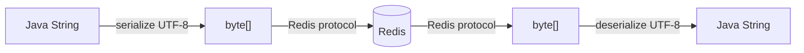

# Dùng StringRedisSerializer cho chuỗi và khóa có thể đọc được

## 1. Vì sao cần quan tâm đến cách Redis lưu chuỗi?

Giả sử một ứng dụng Spring Boot cần lưu trạng thái đơn hàng tạm thời theo khóa:

```text
orders:status:v1:1042 → PROCESSING
```

Khi mở Redis CLI để điều tra sự cố, lập trình viên muốn đọc được khóa `orders:status:v1:1042` và giá trị `PROCESSING`. Tuy nhiên Redis lưu **chuỗi byte**: Redis không tự biết đối tượng `String`, `Long` hay `ProductDto` của Java là gì. Trước khi dữ liệu được gửi qua mạng, Spring Data Redis cần chuyển đối tượng Java sang chuỗi byte; sau khi nhận dữ liệu, ứng dụng cần chuyển ngược lại.

**`StringRedisSerializer`** là serializer chuyên dùng cho Java `String`. Nó biểu diễn chuỗi dưới dạng byte theo một bảng mã ký tự (mặc định là **UTF-8**) và chuyển các byte đó về chuỗi khi đọc.

Ví dụ:

```text
Java String: "shop:product:v1:42"
         |
         | StringRedisSerializer (UTF-8)
         v
Redis key bytes: 73 68 6F 70 3A 70 72 6F 64 75 63 74 3A 76 31 3A 34 32 (hex)
         |
         | Redis CLI giải mã/hiển thị được phần text
         v
Redis CLI: shop:product:v1:42
```

Với giá trị tiếng Việt như `"Đang xử lý"`, UTF-8 vẫn lưu được đầy đủ ký tự Unicode. Khả năng *nhìn thấy đúng chữ* còn phụ thuộc vào terminal và cách công cụ hiển thị byte, nhưng dữ liệu đã được mã hóa theo quy tắc rõ ràng, không bị biến thành dạng nhị phân của Java serialization.

Trong Redis, **cả key lẫn value đều là binary-safe**. “Khóa có thể đọc được” là một **quy ước giữa ứng dụng, serializer và công cụ quan sát**, không phải một kiểu khóa Redis khác.

## 2. StringRedisSerializer hoạt động như thế nào?

`StringRedisSerializer` triển khai `RedisSerializer<String>` của Spring Data Redis. Hai hướng chính là:

- **Serialize:** nhận `String` của Java, mã hóa thành `byte[]` (mặc định UTF-8).
- **Deserialize:** nhận `byte[]`, giải mã theo cùng charset và trả lại `String`.



Ví dụ sử dụng trực tiếp serializer để hiểu ý nghĩa:

```java
import java.nio.charset.StandardCharsets;
import org.springframework.data.redis.serializer.StringRedisSerializer;

StringRedisSerializer serializer =
        new StringRedisSerializer(StandardCharsets.UTF_8);

byte[] encoded = serializer.serialize("Chào Redis");
String decoded = serializer.deserialize(encoded);

System.out.println(decoded); // Chào Redis
```

Ví dụ đó chỉ minh họa quá trình biến đổi dữ liệu; trong ứng dụng thực, `RedisTemplate` thường gọi serializer tự động.

### Đặc tính cần nhớ

| Đặc tính | Ý nghĩa thực tế |
|---|---|
| Charset mặc định | UTF-8, hỗ trợ chữ tiếng Việt và Unicode |
| Dữ liệu nguồn | `String`, không tự serialize mọi Java object |
| Kết quả lưu | Byte của văn bản, không thêm header Java object serialization |
| Cần cùng quy ước khi đọc | Reader phải dùng encoding tương thích, nếu không có thể thấy ký tự lỗi |
| Có thể dùng cho khóa | Dễ quan sát key bằng Redis CLI và công cụ vận hành |
| Có thể dùng cho giá trị | Phù hợp với string, số đã biểu diễn dưới dạng string, mã trạng thái, JSON text |
| Không tự tạo schema | Không validate nội dung JSON, không quản lý phiên bản DTO hay ép kiểu giá trị |

Lưu ý rằng chuỗi được mã hóa có thể chiếm **nhiều byte hơn số ký tự**. Ký tự ASCII thông thường dùng một byte trong UTF-8, nhiều ký tự tiếng Việt dùng nhiều byte. Khi ước lượng bộ nhớ, băng thông hoặc giới hạn kích thước key/value, phải xét dung lượng byte và overhead của Redis, không chỉ `String.length()` trong Java.

## 3. Phân biệt key serializer và value serializer

Một `RedisTemplate<K,V>` có nhiều điểm áp dụng serializer, không chỉ một chỗ:

```text
RedisTemplate<K, V>
  |
  +-- keySerializer       -> Redis key
  +-- valueSerializer     -> Redis String value / phần tử collection tương ứng
  +-- hashKeySerializer   -> field name trong Redis Hash
  +-- hashValueSerializer -> field value trong Redis Hash
```

Ví dụ Redis lưu:

```text
Key: user:settings:v1:42
Type: hash
  language    -> vi
  theme       -> dark
  timezone    -> Asia/Ho_Chi_Minh
```

Ở đây:

- `user:settings:v1:42` chịu tác động của **key serializer**.
- `language`, `theme` và `timezone` chịu tác động của **hash key serializer**.
- `vi`, `dark` và `Asia/Ho_Chi_Minh` chịu tác động của **hash value serializer**.

Nếu chỉ cấu hình `keySerializer` mà bỏ quên `hashKeySerializer`, các field bên trong Hash có thể được serialize bằng một cơ chế khác và không còn dễ đọc trong Redis CLI. Muốn toàn bộ Hash ở dạng văn bản, cần cấu hình rõ cả ba thành phần liên quan: key, hash key và hash value.

### Cấu trúc Redis String và Java String là hai khái niệm khác nhau

Redis có một **kiểu dữ liệu String**, nhưng một value thuộc kiểu String vẫn có thể chứa **JSON, byte nén hoặc Java serialization**. Ví dụ cùng lệnh Redis `GET`:

| Java cần lưu | Cách serialize | Dữ liệu ở Redis có thể nhìn thấy |
|---|---|---|
 `"ACTIVE"` | `StringRedisSerializer` | `ACTIVE` |
 `"42"` | `StringRedisSerializer` | `42` |
 `new ProductDto(42, "Sách")` | JSON serializer | `{"id":42,"name":"Sách"}` (tùy định dạng) |
 `ProductDto` | JDK serialization | Byte nhị phân có header, khó đọc |
 Dữ liệu ảnh nén | Byte array trực tiếp | Byte nhị phân, không phải text |

Mục tiêu “khóa dễ đọc” thường chỉ yêu cầu **key serializer là String**, còn **value serializer** được chọn theo loại dữ liệu và yêu cầu tương thích. Không nên ép DTO thành Java `String` chỉ để dùng cùng một serializer cho mọi thứ.

## 4. Cách đơn giản nhất: dùng StringRedisTemplate

**`StringRedisTemplate`** là một biến thể của `RedisTemplate<String,String>` được cấu hình để sử dụng `StringRedisSerializer` cho key, value, hash key và hash value. Nó rất phù hợp với trường hợp cả tên khóa lẫn nội dung cần biểu diễn bằng văn bản.

Trong ứng dụng Spring Boot có `spring-boot-starter-data-redis` và `RedisConnectionFactory` phù hợp, Boot thông thường tự cấu hình `StringRedisTemplate` để inject vào service:

```groovy
dependencies {
    implementation 'org.springframework.boot:spring-boot-starter-data-redis'
}
```

```yaml
# application.yml: ví dụ kết nối Redis cục bộ
spring:
  data:
    redis:
      host: localhost
      port: 6379
      connect-timeout: 2s
      timeout: 2s
```

Ví dụ service:

```java
import java.time.Duration;
import org.springframework.data.redis.core.StringRedisTemplate;
import org.springframework.stereotype.Service;

@Service
public class OrderStatusStore {
    private final StringRedisTemplate redis;

    public OrderStatusStore(StringRedisTemplate redis) {
        this.redis = redis;
    }

    public void markProcessing(long orderId) {
        String key = "orders:status:v1:" + orderId;
        redis.opsForValue().set(
                key, "PROCESSING", Duration.ofMinutes(15));
    }

    public String readStatus(long orderId) {
        return redis.opsForValue()
                .get("orders:status:v1:" + orderId);
    }

    public void remove(long orderId) {
        redis.delete("orders:status:v1:" + orderId);
    }
}
```

Lệnh `set(key, value, Duration)` tạo/cập nhật giá trị và chỉ định TTL trong thao tác ghi. Sau khi TTL hết hạn, `get` thường trả `null` vì khóa không còn tồn tại. Trong tầng nghiệp vụ, cần phân biệt “chưa có trạng thái”, “đã hết hạn” và “lỗi Redis” nếu chúng mang ý nghĩa khác nhau.

`StringRedisTemplate` không yêu cầu lập trình viên gọi `serializer.serialize(...)` thủ công mỗi lần. Template xử lý phần chuyển đổi dữ liệu, kết nối và lời gọi Redis thông qua driver.

### Trông như thế nào trong Redis CLI?

Sau khi service chạy `markProcessing(1042)`, có thể quan sát (giả sử Redis CLI kết nối cùng instance/database và khóa chưa hết TTL):

```bash
redis-cli TYPE orders:status:v1:1042
redis-cli --raw GET orders:status:v1:1042
redis-cli TTL orders:status:v1:1042
```

Kết quả tiêu biểu:

```text
string
PROCESSING
894
```

Con số TTL chỉ là ví dụ tại một thời điểm; nó giảm dần theo thời gian. Redis quy ước `TTL = -1` khi khóa tồn tại nhưng không có hạn hết hạn, `TTL = -2` khi không tồn tại. Tùy terminal, `redis-cli` mặc định có thể thêm dấu nháy hoặc escape ký tự; tùy chọn `--raw` thuận tiện để đọc nội dung dạng text.

## 5. Cấu hình RedisTemplate với StringRedisSerializer

Khi ứng dụng đã có một `RedisTemplate` tự định nghĩa hoặc cần một template riêng, có thể cấu hình explicit serializer thay vì dựa vào mặc định:

```java
import java.nio.charset.StandardCharsets;
import org.springframework.context.annotation.Bean;
import org.springframework.context.annotation.Configuration;
import org.springframework.data.redis.connection.RedisConnectionFactory;
import org.springframework.data.redis.core.RedisTemplate;
import org.springframework.data.redis.serializer.StringRedisSerializer;

@Configuration
public class TextRedisConfiguration {

    @Bean("readableRedisTemplate")
    public RedisTemplate<String, String> readableRedisTemplate(
            RedisConnectionFactory connectionFactory) {
        RedisTemplate<String, String> template = new RedisTemplate<>();
        template.setConnectionFactory(connectionFactory);

        StringRedisSerializer utf8 =
                new StringRedisSerializer(StandardCharsets.UTF_8);

        template.setKeySerializer(utf8);
        template.setValueSerializer(utf8);
        template.setHashKeySerializer(utf8);
        template.setHashValueSerializer(utf8);
        return template;
    }
}
```

Khi bean được Spring khởi tạo, vòng đời bean của `RedisTemplate` xử lý bước khởi tạo cần thiết. Việc khai báo bean tên riêng `readableRedisTemplate` hữu ích nếu ứng dụng có nhiều template với serializer khác nhau.

Service sử dụng bằng tên bean:

```java
import org.springframework.beans.factory.annotation.Qualifier;
import org.springframework.data.redis.core.RedisTemplate;
import org.springframework.stereotype.Service;

@Service
public class SystemFlagStore {
    private final RedisTemplate<String, String> redis;

    public SystemFlagStore(
            @Qualifier("readableRedisTemplate")
            RedisTemplate<String, String> redis) {
        this.redis = redis;
    }

    public void setMaintenanceMode(boolean enabled) {
        redis.opsForValue().set(
                "system:maintenance:v1",
                Boolean.toString(enabled));
    }
}
```

Với tình huống thuần chuỗi, `StringRedisTemplate` thường gọn hơn cấu hình lại template từ đầu. Cấu hình tường minh đặc biệt có ích khi muốn kiểm soát rõ serializer hoặc cần nhiều template phục vụ các nhóm dữ liệu khác nhau.

### Không nhầm generic Java với cấu hình runtime

Khai báo `RedisTemplate<String, String>` **không tự bảo đảm** các key/value sẽ lưu dưới dạng UTF-8 nếu template chưa cấu hình serializer tương ứng. Generic Java giúp kiểm soát kiểu khi biên dịch; **serializer mới quyết định byte thực tế trong Redis**. Một template với kiểu generic phù hợp nhưng còn dùng JDK serializer có thể vẫn tạo key/value nhị phân.

Ngược lại, `StringRedisSerializer` chỉ dành cho dữ liệu kiểu `String`. Đừng cố truyền thẳng `ProductDto` hoặc `Long` vào một template đã định kiểu `RedisTemplate<String,String>`. Hãy chuyển thành string có chủ đích hoặc sử dụng serializer phù hợp với kiểu giá trị.

## 6. Đọc và ghi Redis Hash có thể quan sát được

Khi các thuộc tính đều là chuỗi, `StringRedisTemplate` cho phép lưu Hash với field và value dễ hiểu:

```java
import java.time.Duration;
import java.util.Map;
import org.springframework.data.redis.core.HashOperations;

String key = "profile:prefs:v1:42";
HashOperations<String, String, String> hash = redis.opsForHash();

hash.put(key, "language", "vi");
hash.put(key, "theme", "dark");
hash.put(key, "timezone", "Asia/Ho_Chi_Minh");
redis.expire(key, Duration.ofHours(12));

String theme = hash.get(key, "theme");        // "dark"
Map<String, String> all = hash.entries(key); // ba thuộc tính
```

Quan sát bằng Redis CLI:

```bash
redis-cli TYPE profile:prefs:v1:42
redis-cli HGET profile:prefs:v1:42 theme
redis-cli HGETALL profile:prefs:v1:42
```

Hash có **một key Redis** và nhiều field. Lệnh `EXPIRE` trong ví dụ áp dụng cho **toàn key Hash**, không riêng field `theme`. Hai lời gọi `put` và `expire` là các lệnh khác nhau; với yêu cầu TTL nghiêm ngặt tại thời điểm tạo key, cần cơ chế cập nhật nguyên tử hoặc chính sách dọn dẹp phù hợp.

Với các Hash rất lớn, `HGETALL` hoặc `hash.entries(key)` có thể tốn nhiều bộ nhớ và băng thông; chỉ dùng khi kích thước đã được giới hạn. Phục vụ mục đích đọc một field nên sử dụng `HGET`/`hash.get`.

## 7. StringRedisSerializer và bộ đếm số

Một tình huống hay gặp là lưu bộ đếm bằng `StringRedisTemplate`:

```java
String key = "article:views:today:v1:42";

Long count = redis.opsForValue().increment(key);
String stored = redis.opsForValue().get(key);
```

Redis lưu bộ đếm dưới dạng chuỗi byte biểu diễn một số nguyên thập phân, chẳng hạn `"27"`. Lệnh `INCR` hiểu chuỗi số theo quy tắc của Redis và thực hiện tăng nguyên tử. Vì thế **giá trị Java khi đọc bằng `StringRedisTemplate` vẫn là `String`**, trong khi giá trị trả về của `increment` là `Long` theo API.

Đây là một lợi ích thực tế: dùng String serializer cho value của bộ đếm cho phép lệnh số học của Redis hoạt động trực tiếp, miễn nội dung string đúng định dạng số mà lệnh hỗ trợ.

Những lưu ý:

- Nếu khóa chứa `"ACTIVE"` hoặc `"{\"count\":27}"`, `INCR` sẽ báo lỗi vì giá trị không phải số nguyên hợp lệ.
- `INCR` của Redis tăng nguyên tử, còn chuỗi Java `GET -> parse -> +1 -> SET` không nguyên tử khi có nhiều request đồng thời.
- `INCR` **không tự đặt TTL**. Nếu cần bộ đếm theo cửa sổ thời gian, việc tăng và đặt TTL có thể đòi hỏi một thao tác nguyên tử bằng script hoặc cơ chế được thiết kế rõ.
- Giá trị đọc từ Redis không nên được ép sang `Integer` chỉ vì hiện tại còn nhỏ; cân nhắc giới hạn số và kiểu của API Java.

Ví dụ lưu số nguyên dưới dạng chuỗi:

```java
redis.opsForValue().set("users:online:estimated:v1", Long.toString(120L));
String text = redis.opsForValue().get("users:online:estimated:v1");
long parsed = Long.parseLong(text);
```

Việc parse cần xử lý `null`, nội dung không hợp lệ và giá trị ngoài phạm vi cho phép nếu dữ liệu có thể bị thay đổi từ nhiều tác nhân.

## 8. Giá trị JSON: dùng StringRedisSerializer khi nào?

**JSON là văn bản**, nên có thể serialize một DTO bằng Jackson thành chuỗi JSON, sau đó gửi chuỗi đó qua `StringRedisTemplate`:

```java
import com.fasterxml.jackson.core.JsonProcessingException;
import com.fasterxml.jackson.databind.ObjectMapper;
import java.io.IOException;
import java.time.Duration;
import org.springframework.data.redis.core.StringRedisTemplate;

public record ProductSummary(long id, String name, long price) {}

public class ProductJsonStore {
    private final StringRedisTemplate redis;
    private final ObjectMapper mapper;

    public ProductJsonStore(StringRedisTemplate redis, ObjectMapper mapper) {
        this.redis = redis;
        this.mapper = mapper;
    }

    public void save(ProductSummary product)
            throws JsonProcessingException {
        String key = "product:summary:v1:" + product.id();
        String json = mapper.writeValueAsString(product);
        redis.opsForValue().set(key, json, Duration.ofMinutes(10));
    }

    public ProductSummary find(long id) throws IOException {
        String json = redis.opsForValue()
                .get("product:summary:v1:" + id);
        return json == null ? null
                : mapper.readValue(json, ProductSummary.class);
    }
}
```

Đường đi dữ liệu có hai giai đoạn:

```text
ProductSummary
  -> ObjectMapper: JSON String
  -> StringRedisSerializer: UTF-8 byte[]
  -> Redis
  -> StringRedisSerializer: JSON String
  -> ObjectMapper: ProductSummary
```

Điều quan trọng là **`StringRedisSerializer` không tự biến DTO thành JSON**. Mã ví dụ chủ động gọi Jackson trước và sau.

Với các hệ thống lớn, có thể chọn serializer JSON chuyên dụng cho value, ví dụ serializer của Spring Data Redis dựa trên Jackson (tùy phiên bản và cấu hình an toàn). Khi đó vẫn nên **giữ key serializer là `StringRedisSerializer`** để khóa Redis dễ đọc:

```java
RedisTemplate<String, ProductSummary> template = new RedisTemplate<>();
template.setConnectionFactory(connectionFactory);
template.setKeySerializer(new StringRedisSerializer());

// Chọn một RedisSerializer<ProductSummary> tương thích
// với định dạng JSON và chính sách schema của ứng dụng:
template.setValueSerializer(productSummaryJsonSerializer);
```

`productSummaryJsonSerializer` ở trên là **phụ thuộc do ứng dụng cung cấp**, minh họa cách phối hợp serializer; không phải một bean mặc định có sẵn. Cần quyết định phiên bản JSON/schema, tương thích khi deploy nhiều phiên bản, bảo vệ deserialization trước dữ liệu không tin cậy và cách xử lý dữ liệu cũ.

### So sánh cách lưu value

| Nhu cầu value | Serializer hoặc cách tiếp cận | Lưu ý |
|---|---|---|
| Mã trạng thái, chuỗi tự do | `StringRedisSerializer` | Dễ quan sát, đơn giản |
| Bộ đếm dùng `INCR` | Chuỗi số với `StringRedisSerializer` | Phải là định dạng số mà Redis hiểu |
| JSON text đã tạo sẵn | `StringRedisSerializer` | DTO ↔ JSON do ứng dụng tự xử lý |
| DTO Java có schema riêng | JSON serializer được cấu hình đúng kiểu | Cần quy ước schema/version, không nhất thiết đọc lại bằng StringRedisTemplate |
| Dữ liệu nhị phân/nén | Byte array serializer thích hợp | Không cố ép byte không phải text thành UTF-8 |
| Dữ liệu legacy dùng Java object serialization | Cơ chế legacy khi đọc/migration | Tránh xem raw binary là text; chuyển đổi có kế hoạch |

## 9. So sánh với JdkSerializationRedisSerializer

Một lỗi thường gặp khi dùng `RedisTemplate` mà không cấu hình đầy đủ là key được serialize theo dạng Java serialization truyền thống, khiến Redis CLI hiển thị chuỗi byte khó đọc.

Ví dụ tên key `"customer:42"` được JDK serialize có thể bắt đầu bằng byte nhị phân biểu thị Java serialization stream. Redis không hiểu đó là chuỗi tên khách hàng; Redis chỉ so sánh các byte.

| Tiêu chí | `StringRedisSerializer` | `JdkSerializationRedisSerializer` |
|---|---|---|
| Kiểu nguồn | Java `String` | Các đối tượng Java có thể serialize theo cơ chế JDK |
| Định dạng | Văn bản theo charset, thường UTF-8 | Dạng binary Java serialization |
| Khóa dễ đọc trong CLI | Có, nếu key được xây dựng từ text | Thường không |
| Dùng qua ứng dụng ngôn ngữ khác | Dễ vì dựa trên UTF-8 | Khó vì gắn với định dạng Java |
| Thay đổi class Java | Không liên quan nếu dữ liệu là chuỗi | Có thể gặp lỗi tương thích class/version |
| Rủi ro deserialization | Cần kiểm soát dữ liệu như văn bản | Java deserialization dữ liệu không tin cậy có rủi ro bảo mật đáng kể |
| Dùng cho `INCR` | Có với chuỗi số hợp lệ | Không phù hợp với giá trị được mã hóa dưới dạng Java binary |

Một số cấu hình `RedisTemplate` sử dụng serializer JDK làm mặc định nếu người phát triển không tùy chỉnh, nhưng cần **xem chính bean và phiên bản Spring Boot/Spring Data Redis đang chạy**; không suy rằng mọi template đều có cùng default. `StringRedisTemplate` được thiết kế riêng cho các thao tác chuỗi nên tránh được sự mơ hồ này.

**Không thể chỉ đổi key serializer rồi kỳ vọng đọc được ngay key cũ**: byte key cũ và byte key mới là hai khóa Redis khác nhau. Vấn đề migration cần được xử lý riêng.

## 10. Đặt tên khóa để thực sự có thể đọc và vận hành

Serializer chỉ làm nhiệm vụ mã hóa văn bản. **Thiết kế tên key** mới quyết định người vận hành có hiểu nội dung hay không.

Một quy ước phổ biến:

```text
<application>:<domain>:<purpose>:v<schema-version>:<opaque-id>
```

Ví dụ:

```text
shop:product:summary:v1:42
shop:cart:items:v2:cart-0f8a
shop:rate:login:v1:subject-a7d2
shop:job:status:v1:job-1042
shop:leaderboard:weekly:v1:2026-W46
```

Các thành phần có tác dụng:

- **Namespace ứng dụng** tránh va chạm khi nhiều service dùng chung một Redis instance.
- **Domain và purpose** giúp biết key phục vụ nghiệp vụ nào.
- **Phiên bản schema** hỗ trợ thay đổi cấu trúc value/serializer có kiểm soát.
- **ID ổn định và an toàn** giúp truy cập theo khóa trực tiếp thay vì quét keyspace.
- **Quy tắc phân cách nhất quán**, thường dùng dấu hai chấm, giúp đọc bằng CLI và nhóm metric.

Ví dụ key tốt:

```text
inventory:reservation:v1:res-4a7c
```

Ví dụ key có thể gây vấn đề:

```text
token:eyJhbGciOi...          # Đưa token nhạy cảm vào key
customer:alice@example.com  # Lộ email trong key
search:<entire-user-query>   # Key không giới hạn, dễ tạo quá nhiều giá trị khác nhau
```

**Key dễ đọc không có nghĩa được phép chứa dữ liệu riêng tư.** Key có thể xuất hiện trong log, APM, công cụ vận hành hoặc khi quản trị viên duyệt Redis. Ưu tiên ID nội bộ, định danh ngẫu nhiên/opaque; khi cần tạo key từ thông tin đầu vào, chuẩn hóa và hạn chế độ dài, cân nhắc hash/HMAC với khóa bí mật theo mục đích sử dụng.

Ngoài ra, một key quá dài có overhead, làm tăng bộ nhớ/băng thông và khó chẩn đoán. Một key quá ngắn như `k42` lại khó hiểu. Chọn tên đủ mô tả nhưng có kích thước được giới hạn.

### Unicode trong key: hợp lệ nhưng cần quy ước

`StringRedisSerializer` với UTF-8 có thể encode key tiếng Việt:

```text
đơn-hàng:trạng-thái:42
```

Redis hỗ trợ byte tương ứng, nhưng vận hành qua nhiều shell, công cụ, hệ điều hành và chương trình khác ngôn ngữ sẽ thuận tiện hơn nếu **key schema dùng ASCII nhất quán**:

```text
orders:status:v1:42
```

Giá trị hiển thị cho người dùng vẫn có thể là Unicode. Nếu key được xây dựng từ text tự do, hai chuỗi nhìn giống nhau có thể có các cách chuẩn hóa Unicode khác nhau và vì thế tạo ra byte key khác nhau. Nên chuẩn hóa/ánh xạ thành định danh ổn định trước khi đặt key.

### Redis Cluster và hash tag

Nếu dùng Redis Cluster, Redis xác định hash slot dựa trên byte key. Cặp ngoặc nhọn có ý nghĩa đặc biệt khi dùng hash tag, ví dụ:

```text
orders:{1042}:status:v1
orders:{1042}:items:v1
```

Hai key cùng phần `{1042}` được định tuyến vào cùng slot, hữu ích cho một số lệnh đa-key yêu cầu cùng slot. Tuy nhiên, không nên gom mọi dữ liệu vào một hash tag chung vì có thể gây lệch tải. `StringRedisSerializer` chỉ encode ký tự `{` và `}` như text; quy tắc hash slot được Redis Cluster áp dụng lên byte key.

## 11. Kiểm tra key bằng Redis CLI và các công cụ vận hành

Một trong những lợi ích thực tế của `StringRedisSerializer` là việc chẩn đoán dữ liệu thường không cần viết riêng một chương trình Java để deserialize key.

Các lệnh minh họa:

```bash
# Đọc một key đã biết
redis-cli TYPE shop:job:status:v1:job-1042
redis-cli --raw GET shop:job:status:v1:job-1042
redis-cli TTL shop:job:status:v1:job-1042

# Xem field trong Hash
redis-cli HGETALL shop:cart:items:v2:cart-0f8a

# Duyệt theo namespace một cách tăng dần
redis-cli --scan --pattern 'shop:product:summary:v1:*'
```

`--scan` sử dụng cơ chế duyệt theo cursor, phù hợp hơn việc gọi `KEYS *` trên không gian khóa lớn trong production. Tuy vậy, `SCAN` vẫn tiêu thụ tài nguyên, không phải snapshot nhất quán; khi key đang thay đổi, việc duyệt có thể gặp phần tử trùng và không bảo đảm bắt được mọi thay đổi vừa xảy ra. Cần giới hạn phạm vi và tần suất.

**Không được suy ra kiểu value từ việc key đọc được.** Luôn kiểm tra `TYPE` trước khi dùng `GET` hoặc `HGETALL`. Một key Redis kiểu Hash không thể đọc bằng `GET` dù tên key được serialize bằng `StringRedisSerializer`.

Đối với Redis có ACL/TLS/authentication, dùng cách kết nối được tổ chức cho phép. Tránh để password trực tiếp trong shell history hoặc log. Redis CLI giúp quan sát nhưng không thay thế chính sách quyền truy cập và bảo vệ dữ liệu.

## 12. Hai ứng dụng cùng đọc một khóa: phải thống nhất byte

Giả sử Service A dùng:

```java
StringRedisSerializer serializer = new StringRedisSerializer();
redis.opsForValue().set("app:feature:v1", "enabled");
```

Service B cũng phải sử dụng quy ước byte tương thích nếu muốn đọc cùng key. Ví dụ một ứng dụng Python gửi key UTF-8 với tên `app:feature:v1` có thể truy cập cùng Redis key; một chương trình Java dùng JDK serializer cho key có thể **không** truy cập được, dù tên key Java trước khi serialize giống hệt.

Cũng phải thống nhất định dạng value. Nếu A ghi string `"enabled"`, B dùng JSON serializer và kỳ vọng một object có trường `enabled` sẽ không tự nhận được dữ liệu đúng kiểu.

### Hợp đồng chia sẻ dữ liệu nên ghi rõ

| Thành phần | Ví dụ hợp đồng |
|---|---|
| Key pattern | `app:feature:v1:<feature-id>` |
| Encoding key | UTF-8 text |
| Redis type | String |
| Encoding value | UTF-8 text |
| Value hợp lệ | `enabled` hoặc `disabled` |
| TTL | Không TTL, hoặc TTL đã được định nghĩa |
| Chủ sở hữu ghi | Một service cụ thể |
| Quy tắc đổi schema | Tăng phiên bản key, hỗ trợ giai đoạn chuyển tiếp |

Một hợp đồng rõ ràng giúp đổi driver Lettuce/Jedis, thay client hoặc triển khai ứng dụng ngôn ngữ khác mà vẫn giữ được dữ liệu. **Driver lựa chọn cách gửi lệnh; serializer và key schema quyết định byte được lưu.**

## 13. Đổi serializer trên hệ thống đang chạy: có cần migration?

**Có thể có.** Đây là tình huống cần chú ý nhất khi chuyển từ `RedisTemplate` dùng serializer nhị phân sang `StringRedisTemplate`.

Giả sử phiên bản cũ tạo khóa `product:42` dưới dạng byte JDK serialization. Phiên bản mới tạo key UTF-8 từ chuỗi `product:42`. Redis xem đây là **hai key khác nhau**. Phiên bản mới đọc bằng `StringRedisTemplate` sẽ thấy cache miss, dù dữ liệu cũ vẫn còn trong Redis.

### Trường hợp 1: chỉ là cache có thể tái tạo

Nếu dữ liệu ở Redis là bản sao từ database:

1. Dùng namespace/version mới, chẳng hạn `product:summary:v2:42`.
2. Đọc cache miss thì tải từ database nguồn và ghi lại bằng định dạng mới.
3. Để key cũ hết hạn theo TTL hoặc dọn theo kế hoạch có giới hạn.
4. Theo dõi memory tăng tạm thời, hit rate và tải của database trong quá trình chuyển đổi.

Đây thường là cách an toàn và ít phức tạp cho cache. Không nên quét và xóa toàn Redis chỉ vì muốn đổi serializer.

### Trường hợp 2: dữ liệu cần giữ, không thể tái tạo

Nếu dữ liệu cũ là trạng thái có ý nghĩa nghiệp vụ:

1. Xác định nguồn sự thật và khả năng đọc dữ liệu theo serializer cũ.
2. Xây dựng công cụ migration đọc byte key/value cũ bằng đúng serializer, kiểm tra và ghi ra namespace mới bằng UTF-8/text hoặc định dạng phù hợp.
3. Thiết kế chuyển tiếp khi cả phiên bản cũ và mới đang chạy: dual-write, đọc định dạng cũ khi miss, hoặc khóa luồng cập nhật tùy yêu cầu.
4. Xác minh số lượng/key mapping, TTL còn lại, trường hợp trùng key và hành vi rollback deployment.
5. Chỉ xóa dữ liệu cũ sau khi đã có bằng chứng chuyển đổi thành công và thời gian tương thích kết thúc.

Không dùng “thử deserialize theo mọi serializer cho đến khi không lỗi” làm chiến lược lâu dài. Với dữ liệu quan trọng, định dạng cần được nhận diện và quản lý phiên bản rõ ràng.

### Lưu ý khi thay đổi value nhưng giữ key

Nếu vẫn dùng key UTF-8 cũ nhưng chuyển value từ chuỗi thuần sang JSON, ứng dụng phiên bản cũ và mới có thể đọc **cùng key với định dạng value khác nhau**. Đây có thể là lỗi nguy hiểm hơn cache miss vì dữ liệu được tìm thấy nhưng không hiểu đúng. Giải pháp đơn giản là đổi version namespace hoặc có hợp đồng backward-compatible rõ ràng.

## 14. Spring Cache có serializer riêng

Việc ứng dụng có `StringRedisTemplate` **không tự động quyết định cách `@Cacheable` serialize key và value**. Spring Cache tích hợp Redis thông qua `RedisCacheManager` và `RedisCacheConfiguration`, có bộ cấu hình serializer/TTL riêng.

Ví dụ dành riêng cho những cache method trả về `String`:

```java
import java.time.Duration;
import org.springframework.context.annotation.Bean;
import org.springframework.context.annotation.Configuration;
import org.springframework.data.redis.cache.RedisCacheConfiguration;
import org.springframework.data.redis.cache.RedisCacheManager;
import org.springframework.data.redis.connection.RedisConnectionFactory;
import org.springframework.data.redis.serializer.RedisSerializationContext;
import org.springframework.data.redis.serializer.StringRedisSerializer;

@Configuration
public class TextOnlyCacheConfiguration {
    @Bean
    public RedisCacheManager cacheManager(
            RedisConnectionFactory connectionFactory) {

        StringRedisSerializer strings = new StringRedisSerializer();

        RedisCacheConfiguration config =
                RedisCacheConfiguration.defaultCacheConfig()
                        .entryTtl(Duration.ofMinutes(10))
                        .serializeKeysWith(
                                RedisSerializationContext.SerializationPair
                                        .fromSerializer(strings))
                        .serializeValuesWith(
                                RedisSerializationContext.SerializationPair
                                        .fromSerializer(strings));

        return RedisCacheManager.builder(connectionFactory)
                .cacheDefaults(config)
                .build();
    }
}
```

Mẫu này giúp cache key và value dùng text, nhưng **chỉ phù hợp nếu cache chứa `String`**. Khi method `@Cacheable` trả về DTO, List hoặc giá trị kiểu khác, phải thiết kế serializer value phù hợp, không áp `StringRedisSerializer` một cách máy móc.

Ngoài ra, Spring Cache thường tạo key theo cache name, tiền tố và key generator, ví dụ dạng `productTitles::42`, thay vì dùng đúng chuỗi key do service tự tạo. Key có đọc được không phụ thuộc cả **key generation** lẫn **key serialization**. Khi thay đổi cấu hình cache toàn cục, phải xét mọi cache dùng chung manager.

## 15. Reactive và serializer chuỗi

Trong ứng dụng Spring WebFlux, `ReactiveStringRedisTemplate` cung cấp API reactive cho dữ liệu chuỗi và sử dụng quy ước serialization phù hợp với chuỗi.

```java
import java.time.Duration;
import org.springframework.data.redis.core.ReactiveStringRedisTemplate;
import reactor.core.publisher.Mono;

public class ReactiveFlagStore {
    private final ReactiveStringRedisTemplate redis;

    public ReactiveFlagStore(ReactiveStringRedisTemplate redis) {
        this.redis = redis;
    }

    public Mono<Boolean> write(String flag) {
        return redis.opsForValue()
                .set("app:flag:v1", flag, Duration.ofMinutes(5));
    }

    public Mono<String> read() {
        return redis.opsForValue().get("app:flag:v1");
    }
}
```

Nguyên tắc byte vẫn giống bản synchronous: lựa chọn serializer phải tương thích với những service khác dùng chung key. Reactive chỉ thay đổi **mô hình xử lý kết quả và I/O**, không tạo ra kiểu dữ liệu Redis mới.

## 16. Những lỗi thường gặp và cách nhận diện

| Triệu chứng | Khả năng nguyên nhân | Hướng xử lý |
|---|---|---|
| Redis CLI hiển thị key dạng ký tự lạ | Key được serialize dưới dạng binary/JDK | Kiểm tra `keySerializer` của template đã ghi; không giả định tên key Java là byte UTF-8 |
| `StringRedisTemplate.get()` trả `null` dù ứng dụng khác nói có dữ liệu | Khác byte key, khác database, namespace hoặc TTL đã hết | Kiểm tra Redis endpoint/DB, key schema, serializer và `TTL` |
| `HGET` không thấy field dù Hash tồn tại | Hash key serializer khác nhau hoặc field bị đặt sai tên | Xác nhận `hashKeySerializer` và byte field thực tế |
| `INCR` trả lỗi | Value không phải chuỗi số nguyên hợp lệ | Tách cache JSON khỏi counter; dùng key/value dạng số thích hợp |
| Đọc tiếng Việt bị lỗi ký tự | Writer và reader khác charset hoặc terminal không hiển thị UTF-8 | Đồng nhất encoding và kiểm tra raw byte, không sửa dữ liệu bằng cách đoán |
| Sau đổi serializer cache miss hàng loạt | Dữ liệu cũ được ghi theo định dạng key khác | Version key và migration theo loại dữ liệu; dự trù tải lên DB |
| `ClassCastException` khi lưu DTO | Dùng `StringRedisSerializer`/`StringRedisTemplate` cho object không phải `String` | Chuyển DTO thành JSON text rõ ràng hoặc dùng serializer DTO |
| `@Cacheable` vẫn ghi value nhị phân | Redis Cache Manager có cấu hình serialization riêng | Kiểm tra `RedisCacheConfiguration`, tách cấu hình theo cache |
| Trùng key giữa service A và B | Không có namespace/ownership/version rõ ràng | Chuẩn hóa key naming convention và hợp đồng đọc/ghi |
| Key quá dài hoặc lộ dữ liệu cá nhân | Ghép nguyên đầu vào, email/token vào key | Dùng opaque ID, giới hạn kích thước và tránh thông tin nhạy cảm |

### Một lỗi cấu hình dễ mắc

```java
RedisTemplate<String, String> template = new RedisTemplate<>();
template.setConnectionFactory(connectionFactory);
template.setKeySerializer(new StringRedisSerializer());
// Không thiết lập valueSerializer/hashKeySerializer/hashValueSerializer
```

Đoạn này **chỉ bảo đảm serialization cho key của template đã được chỉ định**. Các thành phần còn lại sẽ phụ thuộc cấu hình mặc định và vòng đời khởi tạo; không nên kết luận toàn bộ dữ liệu đều là text. Nếu mục đích là key và value đều có thể đọc, hãy cấu hình cả các serializer liên quan hoặc dùng `StringRedisTemplate`.

## 17. Thiết kế theo ba tình huống thực tế

### Tình huống A — Trạng thái ngắn hạn cho một job

Yêu cầu: một chuỗi trạng thái `QUEUED`, `RUNNING`, `DONE`, tự hết hạn sau 30 phút và cần nhìn trực tiếp trong Redis CLI.

Giải pháp: `StringRedisTemplate`, key như `jobs:status:v1:<job-id>`, value dạng chuỗi và `set(key, value, Duration)`. Dữ liệu job chính thức nếu cần lịch sử phải được lưu ở hệ bền vững khác.

### Tình huống B — Cache DTO sản phẩm từ database

Yêu cầu: key theo product ID phải đọc được; value là DTO có nhiều trường; muốn serialize JSON và có thể thay đổi schema về sau.

Giải pháp: dùng `StringRedisSerializer` **cho key**, serializer JSON có hợp đồng schema **cho value**, hoặc dùng `StringRedisTemplate` với JSON text được chuyển đổi thủ công. Đặt key version và TTL; database tiếp tục là nguồn sự thật. Không dùng JDK serialization một cách vô tình chỉ vì dễ tạo template mặc định.

### Tình huống C — Thống kê lượt xem bằng bộ đếm

Yêu cầu: mỗi lần xem tăng 1, Redis CLI có thể đọc số đếm, lưu theo ngày.

Giải pháp: `StringRedisTemplate.opsForValue().increment(key)` với key `article:views:daily:v1:<date>:<id>`. Giá trị được lưu dạng số nguyên dạng text; xác định chiến lược TTL và đồng bộ sang kho bền vững nếu cần báo cáo chính thức. Tăng bằng `INCR` tránh mất cập nhật do race của `GET` rồi `SET`.

## 18. Quy trình lựa chọn serializer cho một chức năng mới

1. **Xác định dạng dữ liệu:** Redis String, Hash, Set, List hay cấu trúc khác; key biểu diễn điều gì, value là String hay DTO?
2. **Chọn quy ước key:** namespace, version, ID và delimiter ổn định; hạn chế dữ liệu bí mật và chiều dài key.
3. **Chọn encoding:** UTF-8 cho key/text, đảm bảo writer và reader nhất quán; không pha binary và text trên cùng key schema.
4. **Chọn API Spring:** `StringRedisTemplate` khi mọi thứ là chuỗi; `RedisTemplate<String,V>` với key serializer chuỗi và value serializer được thiết kế riêng cho `V` khi cần.
5. **Xem Hash riêng:** nếu sử dụng Hash, cấu hình cả `hashKeySerializer` và `hashValueSerializer` phù hợp.
6. **Quy định TTL và nguồn sự thật:** cache có thể tái tạo hay trạng thái phải bảo tồn; các service chia sẻ dữ liệu cần hợp đồng rõ.
7. **Chuẩn bị version/migration:** khi đổi serializer hoặc schema, cần biết dữ liệu cũ sẽ được đọc, tái tạo hay dọn thế nào.
8. **Quan sát bằng Redis CLI:** kiểm tra `TYPE`, `GET`/`HGET`, `TTL` và tên key theo namespace; dùng `SCAN` có kiểm soát thay vì `KEYS *` cho keyspace lớn.

**Điểm mấu chốt:** `StringRedisSerializer` giải quyết bài toán biểu diễn **Java String dưới dạng byte text nhất quán**, thường là UTF-8. Nó giúp khóa Redis và các giá trị chuỗi trở nên dễ quan sát và dễ tích hợp giữa các hệ thống. Trong Spring Data Redis, `StringRedisTemplate` là lựa chọn tự nhiên cho dữ liệu thuần chuỗi; với DTO hoặc cấu trúc phức tạp, vẫn dùng key serializer chuỗi nhưng chọn value serializer theo hợp đồng dữ liệu. Tên key có cấu trúc, TTL và chiến lược migration rõ ràng mới biến lợi ích “dễ đọc” thành khả năng vận hành đáng tin cậy.
