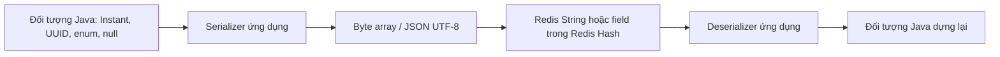

# Xử lý ngày giờ, enum, UUID và giá trị null trong dữ liệu tuần tự hóa

Khi lưu một đối tượng Java vào Redis bằng Spring Data Redis, Redis không tự biết trường nào là `Instant`, `LocalDate`, `enum` hay `UUID`. Ứng dụng cần chuyển đối tượng thành byte trước khi ghi và dựng lại đối tượng từ byte khi đọc. Nếu quy ước chuyển đổi thiếu rõ ràng, hai lần đọc ghi cùng một khóa có thể trả về thời gian sai múi giờ, trạng thái enum không tồn tại, UUID sai định dạng hoặc `null` không phân biệt được với khóa chưa từng được lưu.

Bài học trình bày cách xác định **hợp đồng tuần tự hóa** cho bốn nhóm dữ liệu thường gặp trong ứng dụng Spring Data Redis: ngày giờ, enum, UUID và giá trị null. Ví dụ sử dụng JSON vì dễ quan sát và liên thông giữa các service; các nguyên tắc về dữ liệu còn áp dụng với Redis Hash, serializer nhị phân và cơ chế cache.

## 1. Redis thực sự lưu gì?

Redis có các cấu trúc dữ liệu như String, Hash, List, Set và Sorted Set. Tuy nhiên, ở giao diện giao thức, khóa và nội dung dữ liệu phần lớn được biểu diễn bằng **chuỗi byte**. Redis không tự hiểu kiểu đối tượng Java mà ứng dụng đang dùng.



Trong Spring Data Redis, cần tách hai tầng:

| Tầng | Ví dụ | Ai chịu trách nhiệm? |
|---|---|---|
| **Mô hình dữ liệu Java** | `Instant`, `BookingStatus`, `UUID`, `String` có thể null | Ứng dụng quyết định ý nghĩa nghiệp vụ. |
| **Serialization của giá trị** | JSON, UTF-8 string, binary, Java serialization | `RedisSerializer`, Jackson hoặc converter được chọn. |
| **Giao thức Redis** | RESP gửi lệnh `SET`, `GET`, `HSET`, `HGET` | Driver Lettuce/Jedis và Redis Server. |
| **Lưu trữ Redis** | Key và value dưới dạng byte | Redis lưu nội dung do client cung cấp, không biết kiểu Java gốc. |

Ví dụ đối tượng:

```java
public record BookingSnapshot(
        int schemaVersion,
        UUID bookingId,
        Instant createdAt,
        LocalDate serviceDate,
        BookingStatus status,
        String note
) {}

public enum BookingStatus {
    CREATED, CONFIRMED, CANCELLED
}
```

Một biểu diễn JSON có thể là:

```json
{
  "schemaVersion": 1,
  "bookingId": "f81d4fae-7dec-11d0-a765-00a0c91e6bf6",
  "createdAt": "2026-11-12T08:15:30Z",
  "serviceDate": "2026-11-20",
  "status": "CONFIRMED",
  "note": null
}
```

Các chuỗi trong JSON ở trên không tự trở thành `UUID`, `Instant` hoặc enum nếu phía đọc không biết kiểu đích và quy tắc parse. **Hợp đồng dữ liệu** phải xác định cả cách ghi lẫn cách đọc.

### 1.1. Serializer của key khác serializer của value

Một `RedisTemplate<K, V>` có thể cấu hình riêng:

- `keySerializer`: chuyển key chính của Redis thành byte.
- `valueSerializer`: chuyển value của Redis String/List/Set sang byte.
- `hashKeySerializer`: chuyển tên field trong Redis Hash thành byte.
- `hashValueSerializer`: chuyển giá trị field trong Redis Hash thành byte.

Ví dụ cùng một đối tượng nhưng key `booking:v1:<uuid>` là UTF-8 string, còn value là JSON. Nếu một service dùng `StringRedisSerializer` cho key trong khi service khác dùng mặc định `JdkSerializationRedisSerializer`, chúng có thể đang truy cập **hai khóa byte khác nhau** dù phần tên Java nhìn có vẻ giống nhau.

`StringRedisTemplate` được thiết kế để thao tác key/value dạng chuỗi. `RedisTemplate` thông thường cần được cấu hình serializer theo hợp đồng của ứng dụng. Không nên cho rằng khai báo kiểu generic `RedisTemplate<String, BookingSnapshot>` tự biến mọi value thành JSON.

## 2. Xác định quy ước dữ liệu trước khi viết serializer

Có nhiều biểu diễn hợp lệ cho cùng một giá trị. Điều quan trọng là cả hai phía phải dùng nhất quán một cách.

| Kiểu Java | Biểu diễn khuyến nghị trong JSON | Điều dễ bị nhầm |
|---|---|---|
| `Instant` | ISO-8601 UTC, ví dụ `"2026-11-12T08:15:30Z"` | Epoch giây và mili giây, độ chính xác phần lẻ. |
| `OffsetDateTime` | ISO-8601 có offset, ví dụ `"2026-11-12T15:15:30+07:00"` | Offset có thể bị đổi khi deserializer điều chỉnh về timezone ngữ cảnh. |
| `ZonedDateTime` | Có cả thời điểm và zone ID khi nghiệp vụ cần | Offset `+07:00` không mô tả đầy đủ quy tắc múi giờ. |
| `LocalDateTime` | `"2026-11-12T15:15:30"` | Không có timezone; không thể tự suy ra thời điểm tuyệt đối. |
| `LocalDate` | `"2026-11-20"` | Là ngày theo lịch, không phải timestamp. |
| `Duration` | ISO-8601 duration như `"PT15M"`, hoặc số có đơn vị rõ ràng | 900 là giây hay mili giây? |
| `enum` | Mã ổn định dạng string | Đổi tên hằng hoặc dùng `ordinal()` gây sai ý nghĩa. |
| `UUID` | Chuỗi canonical 36 ký tự có dấu gạch nối | Dạng nhị phân 16 byte cần cùng quy tắc byte order. |
| `null` | Quy ước: vắng key, vắng field, JSON `null` hoặc sentinel | Redis không có native “null value” tương đương Java null. |

Không nhất thiết mọi hệ thống phải chọn JSON. Một hệ thống hiệu năng cao có thể dùng Protocol Buffers, CBOR hoặc binary schema khác. Khi ấy cần bổ sung version schema, mapping và chiến lược thay đổi định dạng tương tự.

## 3. Xử lý ngày giờ: chọn đúng kiểu Java trước

### 3.1. `Instant` cho một thời điểm tuyệt đối

`Instant` biểu diễn một vị trí trên dòng thời gian. Nó phù hợp với `createdAt`, `updatedAt`, `processedAt`, thời điểm nhận sự kiện hoặc mốc bắt đầu một tác vụ.

```java
Instant createdAt = Instant.parse("2026-11-12T08:15:30Z");
String text = createdAt.toString();
// "2026-11-12T08:15:30Z"
```

Chữ `Z` là UTC. Nếu một service ở Việt Nam và một service ở châu Âu đọc cùng chuỗi này, cả hai có thể dựng lại **cùng một thời điểm**, mặc dù giờ địa phương hiển thị khác nhau.

Trong JSON có thể lưu:

```json
{
  "createdAt": "2026-11-12T08:15:30Z"
}
```

Không tự ý loại bỏ `Z` rồi diễn giải chuỗi còn lại bằng default timezone của server. Cách đó có thể làm lệch thời gian khi service được triển khai ở vùng khác.

### 3.2. `LocalDate` cho ngày theo lịch

Một ngày nghỉ, ngày dự kiến giao hàng hoặc ngày đặt lịch nhiều khi chỉ mang ý nghĩa **ngày theo lịch**, không cần giờ.

```java
LocalDate serviceDate = LocalDate.parse("2026-11-20");
```

Lưu dạng:

```json
{
  "serviceDate": "2026-11-20"
}
```

Đừng biến `LocalDate` thành `Instant` tại 00:00 UTC một cách tự động. Khi hiển thị ở múi giờ khác, timestamp nửa đêm UTC có thể rơi vào ngày trước/sau ở địa phương; đó không phải semantics của một ngày lịch độc lập.

### 3.3. `LocalDateTime` không mang timezone

`LocalDateTime` chứa ngày và giờ “trên mặt đồng hồ” nhưng **không biết đó là ở đâu**.

```java
LocalDateTime opening = LocalDateTime.parse("2026-11-12T09:00:00");
```

JSON:

```json
{
  "opensAtLocal": "2026-11-12T09:00:00"
}
```

Đây có thể là 9:00 ở Hà Nội, Tokyo hoặc Berlin. Không chuyển trực tiếp sang epoch timestamp khi chưa xác định múi giờ và quy tắc xử lý khoảng thời gian chuyển giờ mùa hè (DST).

Khi nghiệp vụ yêu cầu “9:00 theo giờ của chi nhánh”, lưu cả:

```json
{
  "localTime": "2026-11-12T09:00:00",
  "zoneId": "Asia/Ho_Chi_Minh"
}
```

Rồi chuyển khi cần:

```java
LocalDateTime local = LocalDateTime.parse("2026-11-12T09:00:00");
ZoneId zone = ZoneId.of("Asia/Ho_Chi_Minh");
Instant absoluteTime = local.atZone(zone).toInstant();
```

Với vùng có DST, một `LocalDateTime` có thể **không tồn tại** hoặc **xảy ra hai lần** tại thời điểm chuyển đồng hồ. Ứng dụng lên lịch nghiêm ngặt cần quyết định rõ cách xử lý `gap` và `overlap`, không mặc định việc gọi `atZone` luôn cho ra cách hiểu đúng nghiệp vụ.

### 3.4. `OffsetDateTime` và `ZonedDateTime` khác nhau

`OffsetDateTime` biết offset so với UTC, chẳng hạn `+07:00`. Nó đủ để xác định một thời điểm tại thời điểm được ghi.

`ZonedDateTime` còn biết vùng theo quy tắc thời gian như `Europe/Berlin`, có thể bao gồm quy tắc đổi DST và lịch sử timezone. Khi nghiệp vụ cần tái dựng **lịch hẹn theo giờ địa phương trong tương lai**, nên lưu **zone ID** rõ ràng bên cạnh local time hoặc instant phù hợp.

| Cần biểu diễn | Kiểu phù hợp | Ví dụ |
|---|---|---|
| Một sự kiện đã xảy ra | `Instant` | Thời điểm API xử lý xong đơn hàng. |
| Giờ địa phương kèm offset cụ thể | `OffsetDateTime` | Thời điểm nhận từ một API quốc tế. |
| Lịch theo một vùng có DST | `LocalDateTime` + `ZoneId`, hoặc `ZonedDateTime` theo hợp đồng | 09:00 mỗi ngày tại Europe/Berlin. |
| Ngày sinh/ngày đặt lịch | `LocalDate` | 2026-11-20. |
| Khoảng thời gian | `Duration` | 15 phút. |

Cấu hình Jackson có thể điều chỉnh `OffsetDateTime` về timezone của ngữ cảnh khi đọc. Nếu yêu cầu giữ offset ban đầu, cần kiểm tra/tắt hành vi điều chỉnh đó ở serializer và chọn test round-trip thích hợp.

## 4. Độ chính xác thời gian, epoch và timezone

### 4.1. Giây hay mili giây?

Đối với timestamp số:

```text
Unix epoch seconds:      1_700_000_000
Unix epoch milliseconds: 1_700_000_000_000
```

Khác biệt ba chữ số là khác biệt hệ số **1.000**. Redis không có siêu dữ liệu để biết số được lưu là giây hay mili giây.

Ví dụ Java:

```java
Instant time = Instant.parse("2023-11-14T22:13:20Z");

long epochSeconds = time.getEpochSecond();   // 1700000000
long epochMillis = time.toEpochMilli();       // 1700000000000

Instant fromSeconds = Instant.ofEpochSecond(epochSeconds);
Instant fromMillis = Instant.ofEpochMilli(epochMillis);
```

Nếu hệ thống chọn lưu timestamp số, ghi tên field hoặc schema theo đơn vị:

```json
{
  "createdAtEpochMillis": 1700000000000
}
```

Tránh field tên chung chung `createdAt: 1700000000` nếu không có đặc tả đơn vị. Với dữ liệu bên ngoài, không đoán đơn vị chỉ bằng độ dài số mà bỏ qua hợp đồng API.

### 4.2. Nanoseconds và round-trip

`Instant` có thể biểu diễn độ chính xác đến nanosecond, nhưng format JSON, trình parse, cơ sở dữ liệu trước đó và cách chuyển thành milliseconds có thể làm mất phần lẻ.

Ví dụ:

```java
Instant precise = Instant.parse("2026-11-12T08:15:30.123456789Z");
long millis = precise.toEpochMilli();

Instant restored = Instant.ofEpochMilli(millis);
// Phần micro/nano vượt quá mili giây đã mất.
```

Không dùng `toEpochMilli()` nếu nghiệp vụ cần so sánh đầy đủ nanosecond. Nếu chỉ cần độ chính xác mili giây, **chuẩn hóa rõ ràng ở ranh giới ghi** để tránh sự khác biệt khi so sánh dữ liệu.

### 4.3. TTL không phải một field ngày giờ

Redis có cơ chế TTL riêng cho key. Ví dụ:

```redis
SET booking:v1:123 "{\"status\":\"CONFIRMED\"}" EX 300
TTL booking:v1:123
```

Ở đây `EX 300` là thời gian sống 300 giây của **key trên server**, không phải field `expiresAt` nằm trong JSON. Nếu ứng dụng chỉ cần cache hết hạn sau năm phút, dùng TTL:

```java
redisTemplate.opsForValue().set(
        key,
        snapshot,
        Duration.ofMinutes(5)
);
```

Nếu nghiệp vụ cũng cần biết chính xác mốc hết hạn để hiển thị, có thể lưu thêm một `expiresAt` có ý nghĩa kinh doanh. Cần quyết định mối quan hệ giữa nó và TTL: TTL là cơ chế dọn dữ liệu, còn field thời gian là dữ liệu ứng dụng. Chúng có thể khác nhau do độ trễ, refresh hoặc chính sách cache.

### 4.4. Không lấy timezone mặc định làm hợp đồng dữ liệu

`ZoneId.systemDefault()` phụ thuộc cấu hình máy chạy. Service trong container có thể dùng UTC; máy developer có thể dùng một timezone khác. Kết quả parse/format không nên phụ thuộc môi trường nếu dữ liệu được chia sẻ giữa service.

Ưu tiên:

- `Instant` UTC cho mốc thời gian tuyệt đối.
- `LocalDate` ISO cho ngày lịch.
- `OffsetDateTime`/`ZoneId` khi offset/vùng có ý nghĩa.
- ISO-8601 và charset UTF-8 được ghi rõ trong hợp đồng.
- `Clock` có thể được inject để tạo giá trị `now` có thể kiểm soát trong ứng dụng và bài kiểm tra.

## 5. Tuần tự hóa ngày giờ bằng Jackson trong Spring Data Redis

### 5.1. Vì sao có lỗi với `java.time`?

Jackson 2 cơ bản không tự bảo đảm xử lý đúng mọi kiểu `java.time` nếu thiếu module tương ứng. Khi dùng Jackson 2 với Spring Data Redis, cấu hình thường cần **`jackson-datatype-jsr310`** và `JavaTimeModule`.

Ví dụ lỗi phổ biến khi thiếu module:

```text
Java 8 date/time type java.time.Instant not supported by default
```

Thư viện Jackson và cách tạo mapper phải được chọn theo **dòng Spring Boot/Spring Data Redis đang dùng**. Ví dụ cụ thể dưới đây dùng **Spring Data Redis 3.x + Jackson 2.x**. Spring Data Redis **4.x chuyển sang Jackson 3 làm JSON library chính**, vì vậy API serializer và package có thay đổi, được giải thích ở mục 9.

### 5.2. Cấu hình Jackson 2 để lưu thời gian ISO

Đối với Spring Boot 3.x và Jackson 2:

```java
import com.fasterxml.jackson.databind.DeserializationFeature;
import com.fasterxml.jackson.databind.ObjectMapper;
import com.fasterxml.jackson.databind.SerializationFeature;
import com.fasterxml.jackson.datatype.jsr310.JavaTimeModule;

ObjectMapper mapper = new ObjectMapper()
        .registerModule(new JavaTimeModule())
        .disable(SerializationFeature.WRITE_DATES_AS_TIMESTAMPS)
        .disable(DeserializationFeature.ADJUST_DATES_TO_CONTEXT_TIME_ZONE);
```

Ý nghĩa:

- `JavaTimeModule` bổ sung cách đọc/ghi `Instant`, `LocalDate`, `LocalDateTime`, `OffsetDateTime` và các kiểu thời gian Java mới khác.
- Tắt `WRITE_DATES_AS_TIMESTAMPS` để ưu tiên chuỗi ISO-8601 thay vì các dạng timestamp số/array của Jackson.
- Tắt `ADJUST_DATES_TO_CONTEXT_TIME_ZONE` khi muốn bảo toàn offset/zone theo hợp đồng thay vì để Jackson tự điều chỉnh lúc đọc.

**Lưu ý:** đoạn này cấu hình một mapper *dành cho ví dụ serializer Redis*. Nếu ứng dụng đã có `ObjectMapper` do Spring Boot quản lý, đừng tạo nhiều mapper có cấu hình khác nhau mà không có lý do. Có thể cấu hình một serializer riêng hoặc dùng cơ chế customizer của Boot theo yêu cầu chung.

### 5.3. JSON trông như thế nào?

Với đối tượng:

```java
BookingSnapshot snapshot = new BookingSnapshot(
        1,
        UUID.fromString("f81d4fae-7dec-11d0-a765-00a0c91e6bf6"),
        Instant.parse("2026-11-12T08:15:30Z"),
        LocalDate.of(2026, 11, 20),
        BookingStatus.CONFIRMED,
        null
);
```

Jackson 2 sau khi cấu hình có thể tạo JSON cùng ý nghĩa:

```json
{
  "schemaVersion": 1,
  "bookingId": "f81d4fae-7dec-11d0-a765-00a0c91e6bf6",
  "createdAt": "2026-11-12T08:15:30Z",
  "serviceDate": "2026-11-20",
  "status": "CONFIRMED",
  "note": null
}
```

Dữ liệu này lưu được trong Redis String dưới dạng UTF-8 và đọc được bằng `redis-cli GET`. JSON không mang kiểu Java của từng field; deserializer dựa vào `BookingSnapshot.class` và module ngày giờ để dựng lại đối tượng.

### 5.4. Tạo `RedisTemplate` có serializer rõ ràng (Spring Data Redis 3.x)

Mã minh họa đầy đủ cho Spring Data Redis 3.x và Jackson 2:

```java
import com.fasterxml.jackson.databind.DeserializationFeature;
import com.fasterxml.jackson.databind.ObjectMapper;
import com.fasterxml.jackson.databind.SerializationFeature;
import com.fasterxml.jackson.datatype.jsr310.JavaTimeModule;

import org.springframework.context.annotation.Bean;
import org.springframework.context.annotation.Configuration;
import org.springframework.data.redis.connection.RedisConnectionFactory;
import org.springframework.data.redis.core.RedisTemplate;
import org.springframework.data.redis.serializer.Jackson2JsonRedisSerializer;
import org.springframework.data.redis.serializer.StringRedisSerializer;

@Configuration
public class BookingRedisSerializationConfig {

    @Bean("bookingRedisTemplate")
    RedisTemplate<String, BookingSnapshot> bookingRedisTemplate(
            RedisConnectionFactory connectionFactory) {

        ObjectMapper mapper = new ObjectMapper()
                .registerModule(new JavaTimeModule())
                .disable(SerializationFeature.WRITE_DATES_AS_TIMESTAMPS)
                .disable(DeserializationFeature.ADJUST_DATES_TO_CONTEXT_TIME_ZONE);

        Jackson2JsonRedisSerializer<BookingSnapshot> json =
                new Jackson2JsonRedisSerializer<>(mapper, BookingSnapshot.class);

        RedisTemplate<String, BookingSnapshot> template = new RedisTemplate<>();
        template.setConnectionFactory(connectionFactory);
        template.setKeySerializer(new StringRedisSerializer());
        template.setValueSerializer(json);
        template.setHashKeySerializer(new StringRedisSerializer());
        template.setHashValueSerializer(json);
        template.afterPropertiesSet();
        return template;
    }
}
```

`Jackson2JsonRedisSerializer<BookingSnapshot>` là **typed serializer**: khi đọc value, nó hướng Jackson dựng lại đối tượng `BookingSnapshot`. Nếu Redis cùng một namespace key chứa nhiều kiểu object không tương thích, typed serializer không tự suy ra đúng kiểu của mọi value.

Cách dùng service:

```java
import java.time.Duration;
import java.util.Optional;
import java.util.UUID;

import org.springframework.beans.factory.annotation.Qualifier;
import org.springframework.data.redis.core.RedisTemplate;
import org.springframework.stereotype.Service;

@Service
public class BookingCacheRepository {

    private final RedisTemplate<String, BookingSnapshot> redis;

    public BookingCacheRepository(
            @Qualifier("bookingRedisTemplate")
            RedisTemplate<String, BookingSnapshot> redis) {
        this.redis = redis;
    }

    public void save(BookingSnapshot booking) {
        String key = keyFor(booking.bookingId());
        redis.opsForValue().set(key, booking, Duration.ofMinutes(20));
    }

    public Optional<BookingSnapshot> find(UUID bookingId) {
        return Optional.ofNullable(
                redis.opsForValue().get(keyFor(bookingId))
        );
    }

    private String keyFor(UUID id) {
        return "booking:v1:" + id;
    }
}
```

`Optional.empty()` trong ví dụ mang nghĩa **không nhận được object từ Redis**. Nó phù hợp với chiến lược không lưu null object vào cache; phần sau giải thích tại sao không nên dùng nó như một chứng cứ tuyệt đối rằng key không tồn tại nếu dữ liệu lưu có thể là JSON `null` hoặc nếu đang dùng pipeline/transaction.

### 5.5. Nếu dùng `StringRedisTemplate`

`StringRedisTemplate` nhận/trả chuỗi. Nó không tự serialize toàn bộ record Java thành JSON. Có thể tự chuyển đổi ở ranh giới ứng dụng:

```java
String json = mapper.writeValueAsString(snapshot);
stringRedisTemplate.opsForValue()
        .set("booking:v1:" + snapshot.bookingId(), json, Duration.ofMinutes(20));

// Khi đọc:
String saved = stringRedisTemplate.opsForValue().get(key);
BookingSnapshot restored = saved == null
        ? null
        : mapper.readValue(saved, BookingSnapshot.class);
```

`writeValueAsString` và `readValue` ném lỗi Jackson tương ứng và phải được xử lý theo phương thức đang dùng. Cách làm thủ công hữu ích nếu có nhiều phiên bản schema hoặc muốn đọc JSON thô, nhưng phải tránh copy/paste logic chuyển đổi không đồng nhất giữa service.

## 6. Enum: lưu tên hay lưu mã ổn định?

### 6.1. Vì sao không nên dùng `ordinal()`?

Một enum Java:

```java
enum PaymentStatus {
    NEW, PAID, REFUNDED
}
```

Lệnh `PaymentStatus.PAID.ordinal()` trả `1` trong danh sách này. Nhưng sau khi thêm trạng thái ở đầu:

```java
enum PaymentStatus {
    CREATED, NEW, PAID, REFUNDED
}
```

Mã `1` không còn là `PAID`. Nếu Redis lưu ordinal dưới dạng số, dữ liệu cũ có thể bị hiểu thành trạng thái khác mà **không báo lỗi**. Đây là lỗi nguy hiểm vì thay đổi ý nghĩa nghiệp vụ.

Cách thông thường với Jackson là ghi enum dưới dạng tên:

```json
{
  "status": "PAID"
}
```

Dễ đọc và tránh lệ thuộc thứ tự enum. Tuy nhiên, **đổi tên hằng** từ `PAID` sang `SETTLED` vẫn có thể làm ứng dụng mới không đọc được dữ liệu cũ.

### 6.2. Dùng mã ổn định tách khỏi tên enum

Với dữ liệu cần sống qua nhiều lần phát hành, định nghĩa mã bên ngoài ổn định:

```java
import com.fasterxml.jackson.annotation.JsonCreator;
import com.fasterxml.jackson.annotation.JsonValue;

public enum PaymentStatus {
    NEW("new"),
    PAID("paid"),
    REFUNDED("refunded");

    private final String code;

    PaymentStatus(String code) {
        this.code = code;
    }

    @JsonValue
    public String code() {
        return code;
    }

    @JsonCreator
    public static PaymentStatus fromCode(String code) {
        for (PaymentStatus status : values()) {
            if (status.code.equals(code)) {
                return status;
            }
        }
        throw new IllegalArgumentException("Unknown payment status code: " + code);
    }
}
```

JSON tương ứng:

```json
{
  "status": "paid"
}
```

Khi code Java muốn đổi tên `PAID` thành `SETTLED`, vẫn có thể giữ wire code `"paid"` trong một giai đoạn chuyển đổi theo hợp đồng. Tên enum là chi tiết implementation; **wire code** là hợp đồng lưu trữ.

Đoạn annotation ở trên dùng package Jackson 2 `com.fasterxml.jackson.annotation`. Khi nâng Spring Data Redis và Jackson, kiểm tra đúng bản annotation và serializer đang dùng.

### 6.3. Xử lý giá trị enum không nhận biết được

Giả sử service mới đã ghi `"chargeback"` nhưng service cũ chỉ biết `"new"`, `"paid"` và `"refunded"`. Có ba chiến lược:

| Chiến lược | Hành vi | Phù hợp khi |
|---|---|---|
| **Fail fast** | Deserialization ném lỗi với mã lạ | Quyết định nghiệp vụ nhạy cảm; không được hiểu sai trạng thái. |
| **Unknown state** | Map mã lạ thành một trạng thái `UNKNOWN` | Consumer chỉ cần hiển thị/truyền tiếp, biết xử lý thiếu thông tin an toàn. |
| **Tương thích ngược có chủ đích** | Code reader hiểu thêm alias mã cũ/mã mới | Đang thực hiện migration có kiểm soát. |

Jackson 2 có cơ chế `@JsonEnumDefaultValue` kết hợp cấu hình `READ_UNKNOWN_ENUM_VALUES_USING_DEFAULT_VALUE`. Tuy nhiên, mặc định chuyển mọi giá trị lạ về `UNKNOWN` có thể che lỗi quan trọng. **Với thanh toán, phân quyền và workflow**, thường nên ném lỗi hoặc có xử lý trạng thái lạ riêng thay vì im lặng cho phép xử lý tiếp.

Một enum có `null` cũng không đồng nghĩa trạng thái chưa xác định. Nếu nghiệp vụ cần phân biệt “chưa có thông tin” với một trạng thái hợp lệ `UNKNOWN`, hãy biểu diễn hai trường hợp độc lập.

### 6.4. Enum dùng làm Redis key hoặc Hash field

Với `StringRedisTemplate`, thường dùng `status.code()` hoặc `status.name()` làm một phần key:

```java
String key = "orders:status:" + status.code();
```

Không phụ thuộc `Enum.toString()` nếu phương thức đó có thể bị override phục vụ UI. Nếu enum nằm trong Redis Hash, cấu hình `hashKeySerializer` và quy ước field name giống nhau trên tất cả service.

## 7. UUID: dạng chuỗi hay 16 byte?

### 7.1. Biểu diễn canonical dễ tương tác

`UUID` gồm 128 bit. Java cung cấp chuỗi canonical 36 ký tự có dấu gạch nối:

```java
UUID id = UUID.fromString("f81d4fae-7dec-11d0-a765-00a0c91e6bf6");

String text = id.toString();
// f81d4fae-7dec-11d0-a765-00a0c91e6bf6

UUID restored = UUID.fromString(text);
```

Dạng string phù hợp khi cần:

- Quan sát bằng `redis-cli`.
- Kết nối Redis từ Java, Node.js, Go hoặc các ngôn ngữ khác.
- Đặt tên key như `booking:v1:<uuid>`.
- JSON có field ID rõ ràng và ổn định.

Ví dụ:

```redis
SET booking-owner:f81d4fae-7dec-11d0-a765-00a0c91e6bf6 "user-19"
```

Khi lưu UUID trong JSON bằng Jackson, mặc định thường là chuỗi canonical. Khi đọc vào field khai báo kiểu `UUID`, Jackson có thể parse lại thành `UUID`.

### 7.2. Lưu UUID dưới dạng binary 16 byte

Nếu tối ưu kích thước byte của một lượng lớn UUID, có thể dùng 16 byte. Cần thống nhất thứ tự byte và cách chuyển đổi ở **mọi client**.

Ví dụ Java:

```java
import java.nio.ByteBuffer;
import java.util.UUID;

public final class UuidBinary {
    private UuidBinary() {}

    public static byte[] encode(UUID id) {
        ByteBuffer buffer = ByteBuffer.allocate(16);
        buffer.putLong(id.getMostSignificantBits());
        buffer.putLong(id.getLeastSignificantBits());
        return buffer.array();
    }

    public static UUID decode(byte[] raw) {
        if (raw == null || raw.length != 16) {
            throw new IllegalArgumentException("UUID binary must be exactly 16 bytes");
        }

        ByteBuffer buffer = ByteBuffer.wrap(raw);
        return new UUID(buffer.getLong(), buffer.getLong());
    }
}
```

`ByteBuffer` mặc định dùng byte order **big-endian**. Nếu một service dùng byte order khác, cùng một chuỗi 16 byte có thể được diễn giải thành UUID khác. Không được xem binary UUID như một chuẩn wire tự hiển nhiên khi nhiều ngôn ngữ/framework tham gia.

| Lựa chọn | Kích thước biểu diễn | Ưu điểm | Hạn chế |
|---|---|---|---|
| UUID string canonical | Thường 36 byte UTF-8 (chưa tính khung/metadata) | Dễ debug, liên ngôn ngữ, trong JSON tự nhiên | Tốn byte hơn 16-byte binary |
| UUID binary | 16 byte | Gọn | Cần codec và thỏa thuận byte order; CLI khó đọc |

### 7.3. UUID trong key và namespace

Một quy ước key dễ quản lý:

```text
booking:v1:<uuid>
payment:v2:<uuid>
customer:<tenant-id>:<uuid>
```

Các thành phần `booking`, `payment`, `v1` và tenant là hợp đồng key naming. Không nên dùng một UUID đơn lẻ rồi để nhiều loại object cùng tranh nhau namespace.

UUID ngẫu nhiên có thể khiến số lượng key tăng rất nhanh. Cần áp dụng TTL hoặc chiến lược xóa phù hợp với nghiệp vụ; UUID làm key “độc nhất” không tự động bảo đảm dữ liệu sẽ được thu gom.

Nếu UUID đến từ input không tin cậy, parse/validate trước khi tạo key. Không trộn định dạng có dấu gạch nối, không dấu gạch nối và chữ hoa/chữ thường giữa service nếu muốn truy cập cùng một key byte.

## 8. `null`: vấn đề khó nhất vì Redis không có native null value

### 8.1. Phân biệt null Java, null JSON và key không tồn tại

Một Java reference có thể bằng `null`. JSON có token `null`. Redis String có thể chứa **bốn byte UTF-8 `n`, `u`, `l`, `l`**, nhưng Redis **không có một giá trị String “null” bản địa**.

Hãy xét ba thao tác Redis:

```redis
DEL demo:null:missing
SET demo:null:empty ""
SET demo:null:literal "null"
```

Kết quả ở phía Redis:

| Khóa | `EXISTS` | `GET` ở mức Redis | Ý nghĩa |
|---|---|---|---|
| `demo:null:missing` | `0` | Nil/null reply | **Key không tồn tại**. |
| `demo:null:empty` | `1` | Bulk string dài 0 byte | **Chuỗi rỗng**, key có tồn tại. |
| `demo:null:literal` | `1` | Bulk string chứa `null` | **Chuỗi 4 ký tự**; nếu xem là JSON thì là JSON null. |

Spring Data Redis ở API cao có thể trả `null` khi `GET` không tìm được key. Nhưng hành vi của serializer khi nhận dữ liệu là JSON `null`, byte rỗng hoặc giá trị không hợp lệ còn phụ thuộc serializer.

Tài liệu `RedisSerializer` nêu Redis không chấp nhận null key/value nhưng có thể trả null reply cho key không tồn tại. Các serializer phải có hợp đồng riêng cho việc serializing `null`. Ví dụ `Jackson2JsonRedisSerializer` ở dòng 3.x biểu diễn null object thành **empty byte array** trong thao tác serialize/deserialize, chứ không đồng nghĩa tồn tại một native null value trong Redis.

**Không dùng `redisTemplate.opsForValue().set(key, null)` như một cách lưu “giá trị null” chung cho mọi serializer/driver.** Nó không cung cấp một trạng thái có thể hiểu giống nhau giữa các client; có thể gây exception hoặc mơ hồ tùy API.

### 8.2. Khi nào nên xóa key?

Nếu quy tắc nghiệp vụ là “không có dữ liệu thì không giữ bản ghi”, lựa chọn đơn giản là xóa key:

```java
public void saveOrDelete(String key, String value) {
    if (value == null) {
        stringRedisTemplate.delete(key);
    } else {
        stringRedisTemplate.opsForValue().set(key, value);
    }
}
```

Cách này coi **không có value** là **không có key**. Phù hợp với nhiều cache đọc dữ liệu dương tính, nhưng không phù hợp nếu phải phân biệt “chưa từng tra cứu” và “đã tra cứu, xác nhận không có”.

### 8.3. Negative caching: biểu diễn không tìm thấy bằng sentinel

Khi backend tốn kém để tìm một đối tượng có thể không tồn tại, ứng dụng đôi khi muốn cache kết quả âm trong thời gian ngắn:

```json
{
  "schemaVersion": 1,
  "state": "NOT_FOUND"
}
```

Ví dụ key `customer:lookup:v1:<id>` được ghi sentinel trong **30 giây**. Lần đọc kế tiếp thấy `NOT_FOUND` thì không gọi backend ngay.

Cần phân biệt ít nhất:

1. **Key vắng mặt:** chưa có cache hoặc cache đã hết TTL → truy vấn nguồn.
2. **Sentinel `NOT_FOUND`:** đã có kết quả âm trong TTL → trả không tìm thấy theo chính sách.
3. **Payload tồn tại:** cache hit với dữ liệu thật.

Negative caching giảm tải nhưng có nguy cơ giữ trạng thái “không tìm thấy” sau khi dữ liệu vừa được tạo. TTL âm nên được chọn theo mức độ cập nhật và yêu cầu nhất quán, thường ngắn hơn TTL cache dữ liệu dương.

### 8.4. Field JSON vắng mặt khác field có `null`

Hai payload này khác nhau:

```json
{
  "schemaVersion": 1,
  "note": null
}
```

```json
{
  "schemaVersion": 1
}
```

Trong một số cách deserialize vào Java object, cả hai có thể cho `note == null`. Nhưng đối với API patch, audit hoặc schema evolution:

- **Field vắng mặt** có thể mang nghĩa “chưa được cung cấp” hoặc “giữ nguyên”.
- **Field là JSON null** có thể mang nghĩa “xóa giá trị”.
- **Field là chuỗi rỗng** có thể mang nghĩa “người dùng đã nhập chuỗi rỗng”.

Jackson có `@JsonInclude(Include.NON_NULL)` để bỏ field null khi ghi, nhưng nếu tính phân biệt trên quan trọng, tự động bỏ field null có thể **làm mất thông tin nghiệp vụ**.

Với yêu cầu như PATCH hoặc form update, cân nhắc DTO có trạng thái ba mức (absent / explicit null / value) hoặc định dạng có quy ước rõ ràng, thay vì chỉ dùng nullable field.

### 8.5. Redis Hash và field không tồn tại

Hash có thể có field chứa chuỗi rỗng, nhưng field không có giá trị `null` nội tại giống reference Java.

```redis
HSET user:1 displayName ""
HEXISTS user:1 displayName
HGET user:1 displayName
HGET user:1 middleName
```

Trong ví dụ, `displayName` có tồn tại với giá trị rỗng, trong khi `middleName` không tồn tại. Nếu muốn xóa một field, dùng `HDEL` theo hợp đồng. Không giả định `hashOps.put(key, field, null)` sẽ tạo trạng thái null có thể đọc lại theo cùng cách ở mọi serializer.

Khi dùng hash serializer, phải quản lý **hash key serializer** và **hash value serializer** độc lập với key/value serializer của Redis String.

## 9. `Optional`, cache null và pipeline trong Spring Data Redis

### 9.1. `Optional` nên ở ranh giới API Java

`Optional<T>` hữu ích để diễn đạt “có hoặc không có kết quả” của một phương thức:

```java
public Optional<BookingSnapshot> find(UUID bookingId) {
    BookingSnapshot value = redis.opsForValue().get(keyFor(bookingId));
    return Optional.ofNullable(value);
}
```

Nhưng `Optional` không nhất thiết là cấu trúc tốt nhất để serialize trực tiếp vào Redis. Tốt hơn là chọn một trong hai:

- Lưu **đối tượng thật**, dùng key vắng mặt khi không có dữ liệu.
- Lưu **payload có trạng thái** như `FOUND`/`NOT_FOUND` khi cần negative caching.

Điều này giúp contract ổn định giữa Java và các client ngôn ngữ khác. Khi deserializing JSON null thành Java null, `Optional.ofNullable` không cho biết byte nào đã được lưu.

### 9.2. Spring Cache có thể cache null theo cách khác

Spring Cache abstraction (`@Cacheable`, `RedisCacheManager`) có logic riêng. Trong Spring Data Redis 3.x, `RedisCacheConfiguration.defaultCacheConfig()` mặc định **cho phép cache null values** và dùng một cách biểu diễn phù hợp của cache layer, thường qua sentinel như `org.springframework.cache.support.NullValue`, sau đó serializer chuyển thành byte.

Điều này khác với việc gọi trực tiếp `RedisTemplate.opsForValue().set(key, null)`.

Nếu ứng dụng không muốn lưu kết quả null từ `@Cacheable`, có thể dùng:

```java
@Cacheable(cacheNames = "bookings", key = "#bookingId",
           unless = "#result == null")
public BookingSnapshot loadBooking(UUID bookingId) {
    return repository.load(bookingId);
}
```

Hoặc cấu hình:

```java
RedisCacheConfiguration config =
        RedisCacheConfiguration.defaultCacheConfig()
                .disableCachingNullValues();
```

Đoạn code là biểu thức cấu hình, cần được gắn vào `RedisCacheManager` hoặc cấu hình Boot phù hợp. Khi thay serializer của `RedisCache`, phải tính cả cách biểu diễn **NullValue sentinel**, không chỉ JavaTime/UUID/enum. Đặc biệt chú ý khi nâng từ Jackson 2 sang Jackson 3 vì khả năng đọc payload cache cũ có thể khác nhau.

### 9.3. `null` khi đang pipeline hoặc transaction

Một giá trị trả về `null` từ Spring Data Redis **không luôn đồng nghĩa key vắng mặt**. Trong pipeline hoặc transaction, nhiều thao tác chưa có kết quả ngay tại thời điểm method được gọi:

```java
redisTemplate.executePipelined(connection -> {
    // Các command bên trong được đưa vào pipeline.
    // Không dùng return value tại đây để kết luận key có tồn tại.
    return null;
});
```

Tài liệu Spring Data Redis nêu các method gọi trong ngữ cảnh pipeline/transaction có thể trả `null` cho đến khi kết quả được thu thập qua pipeline hoặc transaction. Muốn biết “GET trả nil”, cần xem **kết quả sau khi kết thúc pipeline/EXEC**, cùng lệnh và serializer tương ứng.

## 10. Migration giữa Jackson 2 và Jackson 3

### 10.1. Vì sao version thư viện ảnh hưởng dữ liệu Redis?

Spring Data Redis 4.0 chuyển **Jackson 3** thành JSON library chính. Một số API Jackson 2 vẫn tồn tại nhưng bị đánh dấu deprecated cho việc loại bỏ trong tương lai.

| Mục đích | Spring Data Redis 3.x / Jackson 2 | Spring Data Redis 4.x / Jackson 3 |
|---|---|---|
| JSON serializer typed | `Jackson2JsonRedisSerializer` | `JacksonJsonRedisSerializer` |
| JSON serializer generic | `GenericJackson2JsonRedisSerializer` | `GenericJacksonJsonRedisSerializer` |
| Mapper Redis Hash | `Jackson2HashMapper` | `JacksonHashMapper` |
| Lời gọi `RedisSerializer.json()` | Dựa vào serializer Jackson 2 trước đây | Dùng Jackson 3 |

Jackson 3 dùng package gốc `tools.jackson` cho nhiều thành phần, khác Jackson 2 `com.fasterxml.jackson`. **Không copy nguyên phần import, cách tạo mapper hoặc API của ví dụ Spring Data Redis 3.x vào dự án 4.x rồi mặc định sẽ biên dịch.**

Quan trọng hơn, cùng một Java object có thể sinh JSON khác nhau khi thay serializer hoặc cách bật type metadata, date/time config và null handling.

### 10.2. Default typing và dữ liệu generic

`GenericJackson2JsonRedisSerializer` trong Spring Data Redis 3.x thường bật type metadata mặc định cho trường hợp generic. `GenericJacksonJsonRedisSerializer` thuộc dòng 4.x **không tự bật default typing theo cùng cách**; nếu cần, phải thiết lập theo builder và chính sách bảo mật thích hợp.

Ví dụ payload cũ có metadata:

```json
{
  "@class": "com.example.booking.BookingSnapshot",
  "schemaVersion": 1,
  "bookingId": "f81d4fae-7dec-11d0-a765-00a0c91e6bf6"
}
```

Nếu serializer mới không tạo/đọc metadata theo quy ước cũ, dữ liệu trong Redis có thể không đọc lại được trực tiếp. Dùng typed serializer và schema độc lập với class name thường giúp giảm phụ thuộc vào tên package Java.

**Không bật polymorphic default typing rộng rãi cho dữ liệu không đáng tin cậy** mà không cấu hình hạn chế loại được phép deserialize. Java native serialization cũng có rủi ro deserialization; tài liệu Spring Data Redis khuyến nghị thận trọng và ưu tiên format dữ liệu an toàn hơn như JSON có hợp đồng rõ ràng.

### 10.3. Chiến lược migration khi có dữ liệu cũ

Một cách triển khai có kiểm soát:

1. Xác định serializer cũ và lấy mẫu payload đang có trong Redis.
2. Xác định schema mới: kiểu ngày giờ, mã enum, định dạng UUID, null handling.
3. Thiết kế reader hỗ trợ **cả dữ liệu cũ và mới** trong thời gian chuyển tiếp nếu cần.
4. Ghi dữ liệu mới theo schema mới, gắn version ở key hoặc payload.
5. Chờ TTL của key cũ, migrate dữ liệu hoặc thực hiện invalidation có kiểm soát.
6. Sau khi hết dữ liệu cũ, loại bỏ reader/serializer tương thích ngược.

Ví dụ:

```text
booking:v1:<uuid>   → schema/serializer cũ
booking:v2:<uuid>   → schema/serializer mới
```

Không cần version key cho mọi thay đổi; có thể dùng `schemaVersion` trong value. Nhưng phải chọn một cách xử lý và biết khi nào reader cần giải mã theo version trước khi dựng Java object.

## 11. Hợp đồng dữ liệu đề xuất cho một cache đặt lịch

Giả sử ứng dụng cần cache bản chụp đơn đặt lịch và đọc từ nhiều service.

### 11.1. Schema payload

```json
{
  "schemaVersion": 2,
  "bookingId": "f81d4fae-7dec-11d0-a765-00a0c91e6bf6",
  "createdAt": "2026-11-12T08:15:30Z",
  "serviceDate": "2026-11-20",
  "serviceTime": "09:00:00",
  "serviceZoneId": "Asia/Ho_Chi_Minh",
  "status": "confirmed",
  "note": null
}
```

Định nghĩa:

| Trường | Kiểu JSON | Quy tắc |
|---|---|---|
| `schemaVersion` | number | Số nguyên xác định phiên bản payload. |
| `bookingId` | string | UUID canonical có dấu gạch nối. |
| `createdAt` | string | `Instant` ISO-8601 UTC. |
| `serviceDate` | string | `LocalDate` ISO-8601, ngày lịch. |
| `serviceTime` | string | `LocalTime` ISO-8601, giờ địa phương. |
| `serviceZoneId` | string | IANA time zone ID, ví dụ `Asia/Ho_Chi_Minh`. |
| `status` | string | Mã enum ổn định, không dùng ordinal. |
| `note` | string hoặc null | Quy ước rõ: null là không có ghi chú; không tự nhập thành chuỗi rỗng. |

Các trường ngày giờ tách theo ý nghĩa: `createdAt` là thời điểm tuyệt đối, còn `serviceDate`/`serviceTime`/`serviceZoneId` biểu diễn lịch hẹn theo giờ địa phương.

### 11.2. Quy ước Redis key và TTL

```text
Key:      booking:cache:v2:<uuid>
Value:    JSON UTF-8 theo schemaVersion 2
TTL:      20 phút
Missing:  Key không tồn tại = cache miss
Negative: Key riêng/sentinel có TTL ngắn nếu cần
```

Không serialize `Optional.empty()` hay object `null` để biểu diễn cache miss; trường hợp vắng dữ liệu có quy tắc riêng. Nếu cần phân biệt chưa tra cứu và đã tra cứu không thấy, thêm sentinel rõ trạng thái.

### 11.3. Khi nào nên tách Redis Hash?

Redis String chứa JSON thuận tiện cho một payload nhất quán. Redis Hash hữu ích khi muốn đọc/ghi từng field, nhưng mỗi field phải có serializer và quy ước riêng. Ví dụ:

```redis
HSET booking:hash:v2:123 \
     createdAt "2026-11-12T08:15:30Z" \
     serviceDate "2026-11-20" \
     status "confirmed"
```

Các giá trị ở đây là string. Khi đọc, cần parse `createdAt` thành `Instant`, `serviceDate` thành `LocalDate` và `status` thành enum. Nếu một field không có, `HGET` cho nil; nó khác field tồn tại với chuỗi rỗng.

Với Hash phải lưu ý tính nhất quán khi cập nhật nhiều field và cách xử lý phiên bản schema: chỉ thay vài field có thể tạo ra tổ hợp cũ/mới nếu không có cơ chế phối hợp phù hợp.

## 12. Thực hành bằng Redis CLI và Spring

### 12.1. Lưu JSON dễ kiểm tra

Có thể tự thử với một Redis local:

```bash
redis-cli SET booking:cache:v2:demo '{"schemaVersion":2,"bookingId":"f81d4fae-7dec-11d0-a765-00a0c91e6bf6","createdAt":"2026-11-12T08:15:30Z","serviceDate":"2026-11-20","status":"confirmed","note":null}' EX 300

redis-cli GET booking:cache:v2:demo
redis-cli TTL booking:cache:v2:demo
```

Quan sát:

- `GET` trả một JSON string, không phải Java record.
- `createdAt` và `bookingId` là JSON string có format đã thống nhất.
- `note: null` là token JSON trong payload.
- `TTL` do Redis quản lý riêng, không xuất hiện tự động trong JSON.

### 12.2. Thấy rõ sự khác nhau giữa vắng key và chuỗi rỗng

```bash
redis-cli DEL lab:missing
redis-cli SET lab:empty ""
redis-cli SET lab:literal-null "null"

redis-cli EXISTS lab:missing
redis-cli EXISTS lab:empty
redis-cli EXISTS lab:literal-null

redis-cli GET lab:missing
redis-cli GET lab:empty
redis-cli GET lab:literal-null
```

Ứng dụng có thể dùng `hasKey` để phân biệt “key tồn tại với dữ liệu có thể deserialize thành null” và “key không tồn tại”, nhưng cần cân nhắc **race condition**: nếu gọi `EXISTS` rồi `GET` ở hai lệnh tách nhau, key có thể hết TTL hoặc bị client khác xóa giữa hai thao tác. Khi tính nhất quán này quan trọng, thiết kế một giá trị có trạng thái hoặc dùng cơ chế thao tác nguyên tử phù hợp.

### 12.3. Bài tập lựa chọn biểu diễn

1. Hệ thống có hai service ở hai timezone; cần lưu thời điểm thanh toán thành công. Chọn `Instant` hay `LocalDateTime`?
2. Một lịch hẹn ghi “09:00 tại Berlin” sẽ diễn ra sau vài tháng. Chỉ lưu `OffsetDateTime` ở hôm nay có đủ không?
3. Redis đã lưu enum `"PAID"`; code đổi tên hằng Java thành `SETTLED`. Phải làm gì để reader cũ/mới tương thích?
4. Một key Redis có byte nội dung là `null`. Có đồng nghĩa key vắng mặt không?
5. Vì sao thêm một hằng enum trước `PAID` có thể làm dữ liệu ordinal cũ sai nghĩa?
6. Dự án nâng Spring Data Redis 3.x sang 4.x. Có nên tự đổi serializer JSON mà không xem payload đã lưu không?

**Hướng suy luận:** (1) `Instant`; (2) cần lưu zone ID và quy tắc lịch theo địa phương; (3) giữ mã wire hoặc migration có chủ đích; (4) không; (5) ordinal phụ thuộc thứ tự khai báo; (6) cần xét migration Jackson 2/3, type metadata và các giá trị cũ.

## 13. Các lỗi thường gặp và cách tìm nguyên nhân

| Biểu hiện | Nguyên nhân thường gặp | Hướng xử lý |
|---|---|---|
| Lỗi Jackson về `java.time.Instant` không được hỗ trợ | Thiếu module xử lý Java Time hoặc mapper sai | Cấu hình module đúng bản Jackson và serializer. |
| Thời gian lệch giờ khi đọc lại | Dùng `LocalDateTime` thiếu zone, hoặc mapper thay đổi offset | Chọn `Instant`/`ZoneId` phù hợp, giữ quy ước ISO và xem time zone adjustment. |
| Timestamp lệch hàng chục năm | Nhầm epoch seconds với milliseconds | Ghi rõ đơn vị và dùng `ofEpochSecond` / `ofEpochMilli` đúng cách. |
| Enum deserialize lỗi sau deploy | Đã đổi tên hằng hoặc thêm mã mới | Mã enum ổn định, alias/migration hoặc fail fast có kiểm soát. |
| Đổi thứ tự enum làm trạng thái sai | Đã lưu ordinal | Ngừng dùng ordinal làm wire format; migrate sang mã string. |
| UUID parse lỗi | Chuỗi sai định dạng hoặc binary byte order khác | Kiểm tra UUID canonical, byte length và chuẩn encode/decode. |
| `GET` trả Java null nhưng `EXISTS` là 1 | Value có thể là JSON null, empty bytes hoặc serializer trả null | Kiểm tra byte raw, serializer và hợp đồng null. |
| `@Cacheable` không giữ null như kỳ vọng | Có `unless` hoặc `disableCachingNullValues` hoặc serializer khác | Kiểm tra cấu hình Spring Cache, không suy từ `RedisTemplate`. |
| Redis CLI hiển thị byte không đọc được | Serializer dùng native JDK/binary | Xác nhận serializer đã cấu hình và công cụ decode tương ứng. |
| Sau nâng 3.x → 4.x không đọc JSON cache cũ | Thay Jackson 2 bằng Jackson 3, khác metadata/type mapping | Xem migration guide, đọc thử payload cũ và có chiến lược chuyển tiếp. |

### 13.1. Đọc dữ liệu cũ một cách có kiểm soát

Đừng chỉ nhìn Java exception rồi xóa toàn bộ Redis. Trước tiên xác định:

- Key nào bị lỗi và namespace đó phục vụ chức năng gì?
- Serializer cũ là `StringRedisSerializer`, Jackson JSON, Java serialization hay format khác?
- Dữ liệu có TTL không, còn được đọc bởi service phiên bản cũ không?
- Có PII hoặc thông tin nhạy cảm không? Không ghi raw payload vào log công khai.
- Nếu cần migrate, reader có thể nhận diện schema và giải mã chính xác không?

Với dữ liệu cache có TTL ngắn, có thể chọn chiến lược để key cũ hết hạn tự nhiên. Với dữ liệu Redis có vai trò lưu trữ bền vững hoặc queue/workflow, việc xóa hàng loạt có thể làm mất trạng thái nghiệp vụ và phải được thay bằng kế hoạch migration cụ thể.

### 13.2. Đừng phụ thuộc format của `toString()`

Các lớp Java có thể override `toString()` để hiển thị cho người dùng; enum có thể dùng tên dịch hoặc label; date/time có thể được format theo locale. Nếu dùng `toString()` làm định dạng lưu trữ mà không có hợp đồng, các thay đổi UI có thể khiến dữ liệu trong Redis đổi format.

Hãy dùng formatter/codec rõ ràng: `DateTimeFormatter.ISO_INSTANT`, `UUID.toString()` theo chuẩn canonical, mã enum ổn định, hoặc serializer JSON có cấu hình được kiểm soát.

## 14. Tóm tắt các lựa chọn thiết kế

| Vấn đề | Lựa chọn mặc định dễ bảo trì | Khi cần thiết kế khác |
|---|---|---|
| Timestamp sự kiện | `Instant` ISO-8601 UTC | Epoch có đơn vị rõ ràng hoặc binary contract đã thỏa thuận. |
| Ngày theo lịch | `LocalDate` ISO-8601 | Đặc tả lịch khác ISO hoặc định dạng nghiệp vụ bắt buộc. |
| Lịch theo địa phương | `LocalDate` + `LocalTime` + `ZoneId` | Domain có nhu cầu lưu offset/thời điểm bổ sung. |
| Enum trong dữ liệu lâu dài | Mã string ổn định | Format compact có schema và migration rõ ràng. |
| UUID | Chuỗi canonical | Binary 16 byte với byte order thống nhất. |
| Không có cache | Key vắng mặt | Sentinel `NOT_FOUND` khi cần negative caching. |
| Field nullable | JSON null hoặc field vắng mặt **theo hợp đồng** | Mô hình ba trạng thái cho PATCH/update. |
| JSON với Spring Data Redis | Typed serializer cho payload có schema rõ ràng | Generic serializer khi cần đa hình, với chính sách type metadata an toàn. |
| Đổi phiên bản serializer | Đọc được dữ liệu cũ trước khi triển khai | Đổi namespace/schema và để dữ liệu cũ hết TTL hoặc migrate. |

Nền tảng của một hệ thống Spring Data Redis ổn định là **viết rõ hợp đồng byte** giữa các service. Ngày giờ phải có semantics timezone, enum có mã ổn định, UUID có định dạng thống nhất, và `null` phải có nghĩa độc lập với key vắng mặt. Khi đổi Spring Boot, Jackson hoặc Spring Data Redis, cần coi cấu trúc dữ liệu đã lưu trong Redis là một giao diện có phiên bản, thay vì chi tiết triển khai có thể đổi tùy ý.

### Tài liệu chính thức để học thêm

- [Spring Data Redis — Working with Objects through RedisTemplate](https://docs.spring.io/spring-data/redis/reference/redis/template.html): key/value/hash serializers, `StringRedisTemplate` và lưu ý về native Java serialization.
- [Spring Data Redis — Migration Guides](https://docs.spring.io/spring-data/redis/reference/upgrading.html): thay đổi serializer Jackson 2/3, default typing và xử lý null trong Spring Data Redis 4.x.
- [Spring Data Redis — RedisSerializer API](https://docs.spring.io/spring-data/redis/reference/api/java/org/springframework/data/redis/serializer/RedisSerializer.html): hợp đồng serialize/deserialize byte và null.
- [Spring Data Redis — Redis Cache](https://docs.spring.io/spring-data/redis/reference/redis/redis-cache.html): cấu hình cache, TTL, value serialization và null caching.
- [Jackson — JavaTimeModule](https://fasterxml.github.io/jackson-datatype-jsr310/javadoc/2.18/com/fasterxml/jackson/datatype/jsr310/JavaTimeModule.html): hỗ trợ `java.time` và các tùy chọn timestamp.
- [Java SE — Date-Time API](https://docs.oracle.com/en/java/javase/21/docs/api/java.base/java/time/package-summary.html): semantics của `Instant`, `LocalDate`, `LocalDateTime` và `ZoneId`.
- [Redis — GET](https://redis.io/docs/latest/commands/get/), [HGET](https://redis.io/docs/latest/commands/hget/), [EXISTS](https://redis.io/docs/latest/commands/exists/) và [TTL](https://redis.io/docs/latest/commands/ttl/): phân biệt key/field không tồn tại với giá trị được lưu.
