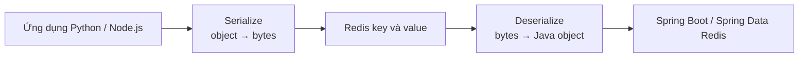
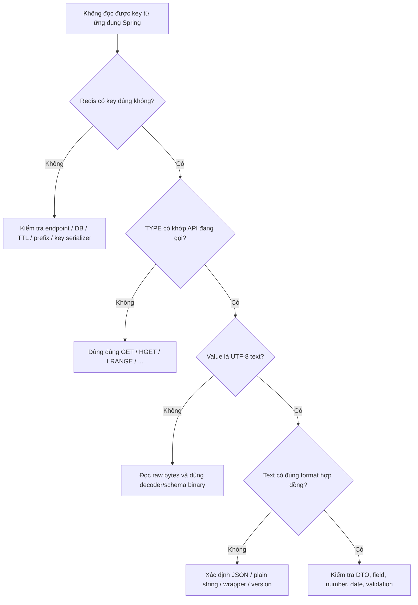

# Đọc dữ liệu Redis do ứng dụng hoặc ngôn ngữ khác ghi

Redis thường được chia sẻ giữa nhiều dịch vụ: một ứng dụng Python ghi dữ liệu phiên làm việc, một dịch vụ Node.js cập nhật thông tin người dùng, trong khi ứng dụng Java/Spring Boot cần đọc và xử lý dữ liệu đó. Dữ liệu nằm trong cùng Redis **không đồng nghĩa** các ứng dụng sẽ tự hiểu được nhau. Thách thức thường không nằm ở khả năng kết nối, mà ở **cách dữ liệu được tuần tự hóa (serialization)** trước khi ghi và cách ứng dụng đọc giải mã (deserialization).

Trong Spring Data Redis, hai chương trình có thể cùng dùng lệnh `GET` nhưng nhận kết quả hoàn toàn khác nhau: chương trình A ghi JSON UTF-8, chương trình B dùng serializer Java mặc định để giải mã, dẫn đến lỗi; hoặc chương trình A ghi một Redis Hash, còn B lại cố dùng `GET` và nhận `WRONGTYPE`. Muốn đọc dữ liệu do hệ thống khác tạo ra, cần biết rõ *key*, *kiểu dữ liệu Redis*, *định dạng byte*, *schema* và *quy tắc phiên bản* của dữ liệu.

Bài học hướng dẫn cách xác định định dạng đang lưu, chọn serializer tương thích trong Spring Data Redis, đọc JSON/Hash/bytes do Python hoặc Node.js ghi, xử lý dữ liệu cũ và thiết kế hợp đồng trao đổi dữ liệu ổn định giữa các ứng dụng.

## 1. Redis lưu dữ liệu theo byte, không lưu kiểu đối tượng Java

Khi Java ghi một đối tượng `Customer`, Redis không biết đó là class Java. Redis chỉ biết key, loại cấu trúc dữ liệu (string, hash, list, set, sorted set, stream...) và nội dung byte hoặc các phần tử của cấu trúc đó. **Ý nghĩa của byte là thỏa thuận giữa bên ghi và bên đọc.**



Ví dụ ba producer cùng muốn lưu tên người dùng dưới key `user:42`:

| Producer | Lệnh Redis về bản chất | Bytes/value lưu trong Redis | Spring phải đọc bằng |
| --- | --- | --- | --- |
| Python ghi chuỗi | `SET user:42 "Mai"` | UTF-8 của `Mai` | `StringRedisSerializer` |
| Node.js ghi JSON | `SET user:42 '{"id":42,"name":"Mai"}'` | UTF-8 của văn bản JSON | `StringRedisSerializer` rồi parse JSON, hoặc JSON serializer phù hợp |
| Java dùng JDK serializer | `SET user:42 <binary>` | Luồng dữ liệu nhị phân Java serialization | JDK serializer tương thích, trong môi trường tin cậy và có kiểm soát |

Ba trường hợp đều có thể là **Redis String**, nhưng cách giải mã khác hẳn. Tên kiểu `string` trong Redis không bảo đảm nội dung là chuỗi UTF-8. Nó là một giá trị byte có thể chứa văn bản, JSON, Protobuf, ảnh hoặc binary bất kỳ.

### Serializer được dùng ở đâu trong Spring Data Redis?

`RedisTemplate` quản lý serializer cho **bốn vị trí thường gặp**:

| Vị trí | Thuộc tính | Ví dụ |
| --- | --- | --- |
| Key Redis | `keySerializer` | `profile:v1:42` |
| Value của Redis String | `valueSerializer` | JSON object trong `GET profile:v1:42` |
| Field của Redis Hash | `hashKeySerializer` | `displayName` trong `HGET profile:42 displayName` |
| Value của field trong Hash | `hashValueSerializer` | `Mai` trong field `displayName` |

Một ứng dụng có thể cấu hình key bằng UTF-8 nhưng value bằng JSON; hoặc key và field bằng UTF-8 trong khi hash value được lưu bằng bytes nhị phân. Nếu chỉ sửa `valueSerializer` mà quên `hashValueSerializer`, thao tác `GET` có thể chạy đúng còn `HGET` vẫn giải mã sai.

`StringRedisTemplate` là một lựa chọn tốt cho dữ liệu văn bản trao đổi giữa nhiều ngôn ngữ: nó dùng `StringRedisSerializer` cho key, value, hash key và hash value. Trong Spring Boot có Spring Data Redis starter, `StringRedisTemplate` thường được auto-configure khi đáp ứng điều kiện cấu hình. Cần phân biệt nó với `RedisTemplate<Object, Object>` dùng serializer mặc định: cấu hình mặc định của `RedisTemplate` truyền thống thường dựa vào JDK serialization cho các vị trí không được cấu hình rõ ràng; điều này không phù hợp làm giao thức chia sẻ dữ liệu giữa ngôn ngữ khác nhau.

## 2. Kiểm tra dữ liệu đã có trước khi chọn cách đọc

Trước khi viết Java code, cần trao đổi với bên ghi hoặc kiểm tra một vài key mẫu trong môi trường được phép. Các câu hỏi đầu tiên là:

1. Key có đúng tên và đúng database/namespace không? Có tiền tố từ thư viện cache, môi trường hoặc tenant không?
2. Dữ liệu được tạo bằng loại Redis nào: String, Hash, List, Set, Sorted Set hay Stream?
3. Key/field/value được mã hóa UTF-8, JSON, Protobuf, MessagePack, JDK serialization hay định dạng khác?
4. Có dùng nén, mã hóa, version header hoặc envelope bao ngoài payload không?
5. Schema mong đợi là gì: tên field, kiểu dữ liệu, timezone, trường tùy chọn, đơn vị đo, quy tắc `null`?
6. Key có TTL không? Bên nào chịu trách nhiệm tạo, gia hạn và xóa key?

### Các lệnh Redis CLI hữu ích

```redis
TYPE profile:v1:u-42
TTL profile:v1:u-42
GET profile:v1:u-42

TYPE account:42
HGETALL account:42
HGET account:42 balance

TYPE recent:orders:42
LRANGE recent:orders:42 0 9
```

- `TYPE` cho biết kiểu cấu trúc Redis, giúp tránh dùng nhầm `GET` cho một Hash.
- `TTL` trả thời gian sống còn lại theo giây; `-1` là key có tồn tại nhưng không có hạn dùng, `-2` là key không tồn tại. `PTTL` tương tự nhưng đơn vị mili-giây.
- `GET` dùng cho Redis String; `HGET` / `HGETALL` cho Hash; `LRANGE` cho List. Với tập lớn, nên giới hạn lượng dữ liệu đọc.
- `redis-cli --raw` hữu ích khi xem chuỗi UTF-8 vì không thêm một số cách escape của giao diện mặc định. Tuy nhiên **không** dùng terminal như công cụ giải mã binary tùy ý: bytes không phải UTF-8 có thể hiển thị sai hoặc gây ký tự điều khiển.

```bash
redis-cli --raw GET profile:v1:u-42
redis-cli TYPE profile:v1:u-42
```

**Chú ý về `DUMP`:** lệnh này tạo ra dạng serialization nội bộ của Redis phục vụ `RESTORE`/di chuyển dữ liệu; đó **không** phải cách lấy JSON hay đối tượng logic do ứng dụng lưu. Cần đọc đúng value qua lệnh tương ứng rồi sử dụng decoder của giao thức ứng dụng.

Không dùng `KEYS *` trên production chỉ để dò dữ liệu; thao tác đó có thể quét toàn bộ keyspace và ảnh hưởng độ trễ Redis. Khi bắt buộc cần tìm key theo mẫu, dùng `SCAN` có giới hạn, kết hợp quan sát tải và quyền truy cập phù hợp.

## 3. Xây dựng hợp đồng serialization liên ngôn ngữ

Cách ổn định nhất để các ứng dụng khác ngôn ngữ cùng đọc/ghi Redis là mô tả rõ **wire format**: các byte thực sự có mặt trong Redis và ý nghĩa của chúng. Một hợp đồng tối thiểu có thể ghi:

| Thành phần hợp đồng | Ví dụ thống nhất | Nếu không thống nhất |
| --- | --- | --- |
| Key naming | `profile:v1:{userId}`, với `userId` được kiểm soát | Đọc nhầm key hoặc va chạm giữa phiên bản/tenant |
| Redis data type | `string` | `WRONGTYPE` khi một bên dùng Hash, bên kia dùng GET |
| Character encoding | UTF-8 | Lỗi decode, hỏng dấu tiếng Việt |
| Value format | JSON object | Một bên chờ JSON, bên kia ghi binary/Java object |
| Schema | `userId`, `displayName`, `balanceMinor`, `updatedAt` | Field thiếu, kiểu bất đồng, lỗi mapping |
| Date/time | ISO-8601 UTC, ví dụ `2026-11-12T08:30:00Z` | Sai múi giờ, không parse được |
| Số nguyên lớn | Chuỗi thập phân cho ID/số tiền cần chính xác | JavaScript có thể mất chính xác với integer vượt giới hạn Number |
| Số tiền | Integer đơn vị nhỏ nhất hoặc chuỗi decimal có quy ước | Sai đơn vị, mất phần thập phân |
| Optional/null | Field có thể vắng mặt hay luôn hiện với `null` | Deserialize khác hành vi nghiệp vụ |
| TTL | Ví dụ 900 giây kể từ lần ghi | Một ứng dụng đọc dữ liệu stale hoặc key biến mất sớm |
| Version | `v1` trong key hoặc field `schemaVersion` | Schema thay đổi làm consumer cũ ngừng đọc |
| Compression/encryption | Không dùng, hoặc mô tả thuật toán/header rõ ràng | Byte sau khi GET không parse được trực tiếp |

### Chọn JSON UTF-8 khi dữ liệu không quá lớn

Với dữ liệu nghiệp vụ nhỏ hoặc vừa, JSON UTF-8 thường là điểm bắt đầu dễ triển khai vì Python, JavaScript, Java, Go và nhiều ngôn ngữ khác đều có thư viện JSON. JSON thích hợp cho payload có schema rõ, nhưng cần cân nhắc:

- JSON number không bảo đảm mọi ngôn ngữ cùng biểu diễn số lớn chính xác. JavaScript `Number` giữ nguyên vẹn integer an toàn đến `2^53 - 1`; nếu cần lớn hơn nên chọn **chuỗi số** hoặc một giao thức số nguyên chính xác đã thỏa thuận.
- Số tiền không nên dựa vào floating-point thông thường nếu cần phép tính chính xác; nên dùng minor units dạng integer có quy ước hoặc decimal string.
- JSON không có kiểu ngày/giờ riêng. Chọn chuỗi có offset/UTC, hoặc epoch với đơn vị được ghi rõ.
- Object key ordering không nên mang ý nghĩa nghiệp vụ. JSON field có thể được ghi theo thứ tự khác nhau mà vẫn biểu thị cùng đối tượng.
- Unicode cần thống nhất cách mã hóa và nếu có xử lý so khớp tên/mã định danh, cần thống nhất cả Unicode normalization.
- Một API bên ghi có thể phát sinh field mới. Bên đọc cần chiến lược bỏ qua hoặc phản hồi với field lạ tùy mục tiêu tương thích và yêu cầu bảo mật.

Với payload lớn, nhị phân hoặc yêu cầu schema kiểm soát chặt, có thể dùng Protobuf/MessagePack/Avro; khi đó **phải chia sẻ schema và bộ giải mã**, không thể xem byte đó như JSON.

## 4. Ví dụ hoàn chỉnh: Python ghi JSON, Spring Boot đọc

Giả sử dịch vụ Python lưu một hồ sơ tạm trong Redis theo hợp đồng:

```text
Key:          profile:v1:u-42
Redis type:   string
Encoding:     UTF-8
Payload:      JSON object
TTL:          900 seconds
Schema v1:    userId, displayName, balanceMinor, updatedAt
```

Giá trị JSON mong đợi:

```json
{
  "userId": "u-42",
  "displayName": "Nguyễn Mai",
  "balanceMinor": "12345678901234567890",
  "updatedAt": "2026-11-12T08:30:00Z"
}
```

`balanceMinor` là chuỗi decimal vì cần giữ chính xác số nguyên lớn giữa các ngôn ngữ. Ví dụ mang tính mô phỏng; ứng dụng nghiệp vụ cần định nghĩa rõ đơn vị tiền và giới hạn hợp lệ của giá trị này.

### 4.1. Producer Python dùng `redis-py`

```python
import json
import redis

client = redis.Redis(
    host="localhost",
    port=6379,
    db=0,
    decode_responses=False,
)

profile = {
    "userId": "u-42",
    "displayName": "Nguyễn Mai",
    "balanceMinor": "12345678901234567890",
    "updatedAt": "2026-11-12T08:30:00Z",
}

payload = json.dumps(
    profile,
    ensure_ascii=False,
    separators=(",", ":"),
).encode("utf-8")

client.set("profile:v1:u-42", payload, ex=900)
client.close()
```

Điểm quan trọng:

- `json.dumps(...)` tạo **văn bản JSON**, không tạo đối tượng Python pickle.
- `encode("utf-8")` biến văn bản thành byte; Redis lưu đúng các byte này.
- `ensure_ascii=False` giữ ký tự Unicode ở dạng UTF-8 đọc được khi kiểm tra, nhưng `ensure_ascii=True` cũng tạo JSON hợp lệ nếu bên đọc giải mã JSON đúng.
- `ex=900` đặt TTL trong cùng thao tác `SET`, tránh trường hợp ghi xong nhưng chưa gắn hạn dùng.
- `decode_responses=False` phù hợp nếu muốn kiểm soát byte; với dữ liệu JSON text có thể dùng chế độ decode UTF-8, nhưng không dùng chế độ đó để đọc tùy tiện payload binary.

Trên Redis CLI, có thể quan sát:

```redis
TYPE profile:v1:u-42
# string

GET profile:v1:u-42
# {"userId":"u-42","displayName":"Nguyễn Mai",...}
```

### 4.2. Java đọc bằng `StringRedisTemplate` + Jackson

Trong ứng dụng Spring Boot có `spring-boot-starter-data-redis`, sử dụng `StringRedisTemplate` để lấy JSON text; sau đó dùng Jackson `ObjectMapper` để map vào DTO.

DTO cho schema v1:

```java
public record ProfileV1(
        String userId,
        String displayName,
        String balanceMinor,
        String updatedAt
) {}
```

Service đọc dữ liệu:

```java
import com.fasterxml.jackson.core.JsonProcessingException;
import com.fasterxml.jackson.databind.ObjectMapper;
import java.math.BigInteger;
import java.time.Instant;
import java.time.format.DateTimeParseException;
import java.util.Optional;
import org.springframework.data.redis.core.StringRedisTemplate;
import org.springframework.stereotype.Service;

@Service
public class ExternalProfileReader {

    private final StringRedisTemplate redis;
    private final ObjectMapper objectMapper;

    public ExternalProfileReader(
            StringRedisTemplate redis,
            ObjectMapper objectMapper
    ) {
        this.redis = redis;
        this.objectMapper = objectMapper;
    }

    public Optional<ProfileV1> find(String userId) {
        String json = redis.opsForValue().get("profile:v1:" + userId);
        if (json == null) {
            return Optional.empty();
        }

        try {
            ProfileV1 profile = objectMapper.readValue(json, ProfileV1.class);

            if (profile.userId() == null || !userId.equals(profile.userId())) {
                throw new IllegalArgumentException("Profile userId mismatch");
            }
            if (profile.balanceMinor() == null || profile.updatedAt() == null) {
                throw new IllegalArgumentException("Required fields missing");
            }

            // Kiểm tra định dạng trước khi đưa dữ liệu vào nghiệp vụ.
            new BigInteger(profile.balanceMinor());
            Instant.parse(profile.updatedAt());

            return Optional.of(profile);
        } catch (JsonProcessingException
                 | DateTimeParseException
                 | NumberFormatException e) {
            throw new IllegalStateException(
                    "Invalid external Redis profile for user " + userId, e
            );
        }
    }
}
```

Ứng dụng cần có Jackson Databind và một bean `ObjectMapper` tương ứng. Trong ứng dụng Spring Boot có starter Web hoặc JSON, Jackson thường đã có và được cấu hình; nếu project chỉ thêm Redis starter thì phải bảo đảm Jackson và `ObjectMapper` đã được khai báo/cấu hình. Ví dụ:

```groovy
dependencies {
    implementation 'org.springframework.boot:spring-boot-starter-data-redis'
    implementation 'org.springframework.boot:spring-boot-starter-json'
}
```

Nếu project dùng Spring Boot phiên bản có hệ JSON/mapper khác, kiểm tra dependency và auto-configuration tương ứng. Mục tiêu của ví dụ là **đọc JSON UTF-8 dưới dạng String rồi deserialize có chủ đích**, không phụ thuộc type metadata riêng của Java trong Redis.

### Vì sao không dùng `RedisTemplate<Object, Object>` mặc định?

Một template có serializer mặc định JDK có thể cố giải mã byte của JSON bằng `ObjectInputStream`; byte đầu tiên là dấu `{` thay vì header Java serialization hợp lệ nên có thể ném ngoại lệ. Ngay cả key cũng có thể bị serialize theo JDK, khiến `get("profile:v1:u-42")` thực tế gửi một key binary **khác** với key UTF-8 mà Python đã viết và trả về `null`.

`StringRedisTemplate` loại bỏ hai nguyên nhân thường gặp ấy trong ví dụ JSON text: key và value đều được xem là UTF-8 string; Jackson tự quản lý schema JSON.

### 4.3. Producer Node.js dùng cùng hợp đồng

Node.js cũng có thể ghi cùng cấu trúc Redis String:

```javascript
import { createClient } from "redis";

const client = createClient({ url: "redis://localhost:6379" });
await client.connect();

const profile = {
  userId: "u-43",
  displayName: "Lê An",
  balanceMinor: "9007199254740993",
  updatedAt: "2026-11-12T09:00:00Z",
};

await client.set(
  "profile:v1:u-43",
  JSON.stringify(profile),
  { EX: 900 }
);

await client.quit();
```

Service Java ở trên có thể đọc `profile:v1:u-43` mà không cần biết payload được tạo từ Node.js hay Python. Điều kiện là cả hai producer phát hành **cùng hợp đồng** tên key, kiểu Redis, JSON UTF-8, schema và quy tắc TTL.

Đừng biểu diễn `9007199254740993` bằng JavaScript `Number` rồi mới `JSON.stringify` nếu cần giữ chính xác; giá trị này vượt miền số nguyên an toàn của JavaScript. Dùng chuỗi decimal (như trong ví dụ) hoặc một thư viện/format có bảo đảm riêng.

## 5. Spring Boot ghi JSON để Python đọc lại

Tương tác hai chiều giúp xác định giao thức thực sự độc lập ngôn ngữ. Khi Java ghi qua `StringRedisTemplate`, Python có thể `GET` rồi `json.loads` như sau.

Java:

```java
import com.fasterxml.jackson.core.JsonProcessingException;
import com.fasterxml.jackson.databind.ObjectMapper;
import java.time.Duration;
import org.springframework.data.redis.core.StringRedisTemplate;
import org.springframework.stereotype.Service;

@Service
public class ExternalProfileWriter {

    private final StringRedisTemplate redis;
    private final ObjectMapper objectMapper;

    public ExternalProfileWriter(StringRedisTemplate redis, ObjectMapper objectMapper) {
        this.redis = redis;
        this.objectMapper = objectMapper;
    }

    public void save(ProfileV1 profile) throws JsonProcessingException {
        String json = objectMapper.writeValueAsString(profile);
        redis.opsForValue().set(
                "profile:v1:" + profile.userId(),
                json,
                Duration.ofMinutes(15)
        );
    }
}
```

Python:

```python
import json
import redis

client = redis.Redis(host="localhost", port=6379, db=0)
raw = client.get("profile:v1:u-42")

if raw is None:
    print("Profile not found or expired")
else:
    profile = json.loads(raw.decode("utf-8"))
    print(profile["displayName"])
    print(int(profile["balanceMinor"]))

client.close()
```

Ở đây `raw is None` có nghĩa key không tồn tại tại thời điểm đọc (chưa từng ghi, đã xóa hoặc đã hết TTL). `null` bên trong JSON lại là một giá trị schema; không nên nhầm hai tình huống. Nếu payload tồn tại nhưng không hợp lệ, bên đọc cần báo lỗi dữ liệu thay vì im lặng coi đó là key bị thiếu.

## 6. Đọc Redis Hash được ghi bởi ứng dụng khác

Không phải mọi ứng dụng đều lưu một JSON document dưới một Redis String. Một thiết kế khác là dùng **Redis Hash**, mỗi field có value riêng:

```redis
HSET account:42 displayName "Nguyễn Mai" enabled "true" loginCount "17"
EXPIRE account:42 900
HGET account:42 displayName
HGETALL account:42
```

Hợp đồng ở đây là:

- Redis key `account:42` thuộc kiểu `hash`.
- Hash field `displayName`, `enabled` và `loginCount` là UTF-8 string.
- `enabled` được biểu diễn bằng đúng `"true"` hoặc `"false"`.
- `loginCount` là chuỗi số nguyên thập phân, không phải JSON number hoặc byte Java.

### 6.1. Python ghi Hash

```python
import redis

client = redis.Redis(host="localhost", port=6379, db=0)

with client.pipeline(transaction=True) as pipe:
    pipe.hset(
        "account:42",
        mapping={
            "displayName": "Nguyễn Mai",
            "enabled": "true",
            "loginCount": "17",
        },
    )
    pipe.expire("account:42", 900)
    pipe.execute()

client.close()
```

`hset` và `expire` trong pipeline có `transaction=True` được nhóm qua `MULTI`/`EXEC`, giúp hai thay đổi thực thi như một nhóm Redis transaction. Không nhầm hình thức này với transaction của cơ sở dữ liệu quan hệ có rollback mọi logic ứng dụng khi lỗi.

### 6.2. Java đọc bằng HashOperations

```java
import java.util.Map;
import org.springframework.data.redis.core.StringRedisTemplate;
import org.springframework.stereotype.Service;

@Service
public class ExternalAccountReader {
    private final StringRedisTemplate redis;

    public ExternalAccountReader(StringRedisTemplate redis) {
        this.redis = redis;
    }

    public AccountSnapshot read(long accountId) {
        String key = "account:" + accountId;
        Map<Object, Object> fields = redis.opsForHash().entries(key);

        if (fields.isEmpty()) {
            throw new IllegalArgumentException("Account hash missing or empty");
        }

        String name = (String) fields.get("displayName");
        String enabledText = (String) fields.get("enabled");
        String loginCountText = (String) fields.get("loginCount");

        if (name == null
                || (!"true".equals(enabledText) && !"false".equals(enabledText))
                || loginCountText == null) {
            throw new IllegalStateException("Invalid account hash schema");
        }

        return new AccountSnapshot(
                accountId,
                name,
                Boolean.parseBoolean(enabledText),
                Long.parseLong(loginCountText)
        );
    }

    public record AccountSnapshot(
            long accountId,
            String displayName,
            boolean enabled,
            long loginCount
    ) {}
}
```

`StringRedisTemplate` giải mã field name và field value thành String. Tuy nhiên Redis Hash **không lưu thông tin kiểu dữ liệu của từng field**: ký tự `"17"` không tự trở thành Java `long`; cần parse và kiểm tra giới hạn. Đặc biệt, `Boolean.parseBoolean("1")` trả `false`, nên nếu producer ghi `1/0`, consumer phải có parser theo đúng hợp đồng thay vì dùng parser `true/false`.

Nếu chỉ cần một hoặc vài field của một Hash lớn, dùng:

```java
Object value = redis.opsForHash().get("account:42", "displayName");
```

thay vì `entries(...)` đọc toàn bộ Hash. `HGETALL` có chi phí theo số field và tạo response lớn nếu Hash tăng rất to.

### 6.3. Hash chứa JSON trong một field

Một hệ thống có thể ghi:

```redis
HSET document:42 metadata '{"version":1,"owner":"u-42"}'
```

Khi đó `HGET document:42 metadata` trả **một string chứa JSON**; cần parse JSON sau khi đọc field. Ngược lại, nếu producer ghi nguyên document dưới Redis String thì phải dùng `GET`. Cùng “dữ liệu JSON” nhưng kiểu Redis và thao tác đọc có thể khác nhau.

## 7. Đọc list, set, sorted set và stream từ hệ thống khác

Ngoài Redis String và Hash, nhiều hệ thống trao đổi dữ liệu qua collection. Mỗi cấu trúc có quy tắc đọc và thứ tự khác nhau:

| Kiểu Redis | Ví dụ bên ghi | Phương thức Spring Data Redis thường dùng | Vấn đề cần thống nhất |
| --- | --- | --- | --- |
| List | `LPUSH events "..."` | `opsForList().range(key, 0, 49)` | Mỗi phần tử là text/JSON/binary gì; thứ tự push/pop |
| Set | `SADD tags "java" "redis"` | `opsForSet().isMember(...)` hoặc `members(...)` | Không có thứ tự ổn định; định dạng của member |
| Sorted Set | `ZADD scores 98.5 "u-42"` | `opsForZSet().reverseRangeWithScores(...)` | Score là số thực, member encoding, thứ tự khi trùng điểm |
| Stream | `XADD audit * eventType login userId u-42` | `opsForStream()` | Field/value encoding, consumer group, ID và ack |

Ví dụ List gồm các JSON string do Node.js ghi:

```javascript
await client.rPush(
  "events:v1",
  JSON.stringify({ type: "LOGIN", userId: "u-42" }),
  JSON.stringify({ type: "LOGOUT", userId: "u-41" })
);
```

Spring Data Redis đọc:

```java
List<String> rawEvents =
        stringRedisTemplate.opsForList().range("events:v1", 0, 49);
// Mỗi phần tử là JSON text; parse từng phần tử theo schema được thống nhất.
```

Không dùng một lệnh trả toàn bộ collection nếu có thể lớn không giới hạn. `Set` không phải danh sách có thể phân trang ổn định theo thứ tự; `Sorted Set` sắp theo score với quy tắc xử lý điểm bằng nhau cần hiểu rõ; Stream cần hợp đồng consumer group, acknowledgment và xử lý trùng message chứ không chỉ hợp đồng serialization.

Nếu Stream field/value có serializer khác với Hash field/value, cần cấu hình `RedisTemplate` hoặc serializer riêng phù hợp; không giả định một cấu hình serializer phù hợp cho mọi loại dữ liệu trong Redis.

## 8. Khi payload là binary: Protobuf, MessagePack hoặc dữ liệu nén

Một số producer tối ưu kích thước, tốc độ parse hoặc schema bằng format binary như Protobuf hoặc MessagePack. Những payload này **không phải JSON text**, nên gọi `StringRedisTemplate.opsForValue().get(...)` có thể lỗi UTF-8 hoặc làm sai byte trước khi decode.

Với Spring Data Redis, có thể tạo một `RedisTemplate<String, byte[]>` chuyên đọc byte nguyên trạng:

```java
import org.springframework.context.annotation.Bean;
import org.springframework.context.annotation.Configuration;
import org.springframework.data.redis.connection.RedisConnectionFactory;
import org.springframework.data.redis.core.RedisTemplate;
import org.springframework.data.redis.serializer.RedisSerializer;
import org.springframework.data.redis.serializer.StringRedisSerializer;

@Configuration
public class BinaryRedisConfig {

    @Bean("binaryRedisTemplate")
    RedisTemplate<String, byte[]> binaryRedisTemplate(
            RedisConnectionFactory factory
    ) {
        RedisTemplate<String, byte[]> template = new RedisTemplate<>();
        template.setConnectionFactory(factory);

        template.setKeySerializer(new StringRedisSerializer());
        template.setHashKeySerializer(new StringRedisSerializer());
        template.setValueSerializer(RedisSerializer.byteArray());
        template.setHashValueSerializer(RedisSerializer.byteArray());

        template.afterPropertiesSet();
        return template;
    }
}
```

Đọc byte và bàn giao cho decoder tương ứng:

```java
import org.springframework.beans.factory.annotation.Qualifier;
import org.springframework.data.redis.core.RedisTemplate;
import org.springframework.stereotype.Service;

@Service
public class BinaryDocumentReader {
    private final RedisTemplate<String, byte[]> redis;

    public BinaryDocumentReader(
            @Qualifier("binaryRedisTemplate") RedisTemplate<String, byte[]> redis
    ) {
        this.redis = redis;
    }

    public byte[] readRaw(String id) {
        return redis.opsForValue().get("document:pb:v1:" + id);
    }
}
```

Tiếp theo, ứng dụng phải dùng đúng bộ thư viện và schema được công bố bởi producer, chẳng hạn lớp Protobuf sinh từ cùng file `.proto`:

```java
byte[] raw = binaryDocumentReader.readRaw("42");
if (raw != null) {
    // DocumentV1 là class do protoc sinh từ schema chung.
    DocumentV1 parsed = DocumentV1.parseFrom(raw);
}
```

`DocumentV1` trong ví dụ là tên giả định của class đã sinh; chỉ đoạn code này sẽ không biên dịch nếu project chưa thêm Protobuf dependency và chưa generate class. Với payload nén hoặc mã hóa, phải giải nén/giải mã theo **thuật toán và thứ tự thao tác đã thống nhất** trước khi parse Protobuf/MessagePack. Không tự đoán định dạng chỉ dựa trên vài byte đầu.

**Tại sao cấu hình key vẫn dùng String serializer?** Vì producer đã ghi key dạng UTF-8 (`document:pb:v1:42`). Nếu Java serialize key bằng Java native serialization trong khi value giữ nguyên bytes, lệnh `GET` sẽ tìm một key binary khác và trả `null`.

## 9. Dữ liệu JDK serialization hoặc serializer dành riêng cho Java

Một trường hợp phổ biến trong hệ thống cũ là Java ghi qua `RedisTemplate<Object, Object>` với `JdkSerializationRedisSerializer`. Payload có thể bắt đầu bằng byte header thường thấy của Java Object Serialization: `AC ED 00 05` (biểu diễn hexadecimal). Python, Node.js và các consumer khác **không thể tự chuyển payload này thành JSON** chỉ bằng việc đọc Redis String.

Khi gặp dữ liệu như vậy, các hướng xử lý là:

1. Xác định producer và serializer chính xác, kể cả serializer cho key/hash field.
2. Nếu vẫn phải đọc tạm từ Java, chỉ giải mã dữ liệu trong môi trường được tin cậy, với class phiên bản tương thích và chính sách deserialize an toàn.
3. Thiết kế một định dạng trao đổi trung lập (ví dụ JSON UTF-8, Protobuf schema chung) và chuyển dữ liệu dần sang các key/schema mới.

**Không deserialize Java object hoặc Python pickle từ dữ liệu không tin cậy.** Cả hai kiểu serialization gắn với cơ chế dựng đối tượng phức tạp, có rủi ro bảo mật nghiêm trọng nếu nhận payload do đối tượng không tin cậy kiểm soát. Tránh đưa cơ chế deserialize native vào một kênh trao đổi công khai giữa các ngôn ngữ.

### Jackson serializer có chắc tương thích giữa Java và Python?

Không phải cứ “Jackson” là mọi ngôn ngữ đều đọc được ở mức nghiệp vụ. Cần phân biệt:

- **JSON thông thường:** `{"userId":"u-42","displayName":"Mai"}`. Các ngôn ngữ khác có thể parse JSON rồi map theo schema.
- **JSON gắn thông tin kiểu Java:** một số serializer tổng quát (chẳng hạn cấu hình dạng Generic Jackson với type metadata) có thể ghi thêm field như `@class` hoặc cấu trúc type hint. Python/Node có thể parse JSON về mặt cú pháp nhưng không nhất thiết hiểu các class name hoặc yêu cầu polymorphic Java của consumer.
- **JDK binary serialization:** hoàn toàn không phải JSON.

Đối với Redis được nhiều ngôn ngữ cùng sử dụng, nên dành một serializer/schema rõ ràng cho key liên thông. Không đặt tên class Java vào wire contract trừ khi đó thật sự là yêu cầu được các consumer chấp nhận.

Nếu tự cấu hình Jackson polymorphic deserialization, không bật cơ chế nhận kiểu tùy ý từ payload ngoài phạm vi tin cậy. Ưu tiên DTO cụ thể và danh sách kiểu được cho phép.

## 10. Schema evolution: nhiều producer/consumer không nâng cấp cùng lúc

Vấn đề chỉ phát sinh sau một thời gian vận hành: Python bắt đầu ghi thêm field, Node.js đổi kiểu số, trong khi một số instance Spring Boot vẫn chạy phiên bản cũ. Redis không ép schema, vì vậy một bản ghi hợp lệ đối với producer mới có thể làm consumer cũ lỗi.

### 10.1. Version theo key và schema

Một cách đơn giản là đặt phiên bản vào tên key:

```text
profile:v1:u-42  -> JSON schema v1
profile:v2:u-42  -> JSON schema v2
```

Hoặc giữ định danh key và đặt `schemaVersion` bên trong payload, nếu mọi consumer đã được thiết kế để định tuyến theo version. Đối với dữ liệu có thay đổi không tương thích, **versioned key** thường giúp tránh một producer ghi đè định dạng mà consumer cũ vẫn kỳ vọng. Tuy nhiên cũng phải thiết kế quy tắc xóa key và đồng bộ dữ liệu giữa các phiên bản.

Ví dụ thay đổi tương thích:

```json
{
  "userId": "u-42",
  "displayName": "Mai",
  "balanceMinor": "1000",
  "updatedAt": "2026-11-12T08:30:00Z",
  "locale": "vi-VN"
}
```

Thêm field `locale` có thể tương thích nếu consumer cũ **bỏ qua field lạ**. Với Jackson, chính sách mặc định về unknown properties phụ thuộc cấu hình `ObjectMapper`: cần quyết định rõ có dùng `@JsonIgnoreProperties(ignoreUnknown = true)` trên DTO hoặc cấu hình tương đương hay không. Nếu muốn kiểm tra hợp đồng chặt, từ chối field lạ cũng có thể là lựa chọn hợp lý; không có một chính sách đúng cho mọi hệ thống.

Ví dụ thay đổi **không** tương thích là chuyển `balanceMinor` từ chuỗi decimal sang floating-point number, hoặc đổi `updatedAt` từ ISO-8601 thành epoch milliseconds mà không tăng version. Những thay đổi này có thể parse sai hoặc gây sai nghiệp vụ ngay cả khi JSON vẫn hợp lệ.

### 10.2. Lộ trình chuyển dữ liệu cũ

Giả sử hệ thống cũ có `profile:v1:{id}` ở dạng JDK serialization, cần chuyển sang JSON UTF-8:

1. **Khóa hợp đồng v2:** xác định key prefix mới, kiểu Redis, encoding, schema và TTL.
2. **Triển khai consumer hiểu v2:** ưu tiên đọc v2; nếu không có thì đọc v1 thông qua decoder cũ *chỉ trong vùng dữ liệu tin cậy*.
3. **Cập nhật producer:** ghi v2; nếu cần tương thích trong giai đoạn chuyển tiếp, có thể dual-write v1/v2 với kế hoạch xử lý lỗi từng bên.
4. **Backfill theo batch:** di chuyển những key v1 còn cần thiết; dùng SCAN có kiểm soát và tránh tải cả keyspace vào bộ nhớ.
5. **Giữ đúng vòng đời:** không vô tình biến key sắp hết hạn thành key sống vĩnh viễn. Khi copy, xem xét TTL còn lại và quy tắc thời hạn của hệ thống.
6. **Quan sát và gỡ đường cũ:** theo dõi tỷ lệ đọc v1/v2, lỗi decode và tiến độ các phiên bản app; chỉ bỏ decoder và key v1 sau khi không còn phụ thuộc.

Dual-write không mặc định bảo đảm atomicity giữa hai key nếu dùng nhiều lệnh riêng. Nếu dữ liệu cần nhất quán chặt, thiết kế commit/read policy hoặc cách ghi phù hợp và dự phòng cho thất bại giữa hai lần ghi.

## 11. Bảo mật và độ tin cậy khi đọc dữ liệu từ producer khác

Dữ liệu trong Redis cần được xem là **đầu vào của ứng dụng**, kể cả khi producer nằm trong mạng nội bộ. Một số giới hạn thiết thực:

- **Xác thực nguồn ghi:** Redis ACL, quyền truy cập network và prefix theo trách nhiệm giúp giảm nguy cơ một service ghi đè dữ liệu của service khác. Redis ACL có thể dùng pattern key; cần phù hợp cấu hình thực tế.
- **Giới hạn kích thước payload:** không deserialize không giới hạn những JSON/binary lớn không kiểm soát, đặc biệt trong request HTTP. Kiểm tra giới hạn byte trước khi parse nếu có khả năng dữ liệu bị lạm dụng.
- **Kiểm tra schema và giá trị:** xác thực required field, enum, khoảng số, identifier, timestamp, tenant/owner. JSON hợp lệ về cú pháp chưa chắc hợp lệ nghiệp vụ.
- **Không log bí mật:** tránh đưa toàn bộ payload có token/session/PII vào log hoặc exception. Log key đã chuẩn hóa, loại lỗi, version và correlation ID khi đủ.
- **Kiểm soát encoding và decoder:** không fallback ngẫu nhiên từ JSON sang Java native deserialize khi lỗi, vì có thể che giấu hỏng dữ liệu và tạo rủi ro bảo mật.
- **Định nghĩa idempotency:** nếu dữ liệu được đọc rồi xử lý bởi nhiều consumer, cần chiến lược chống xử lý trùng theo nghiệp vụ; Redis không đảm bảo điều đó chỉ nhờ serializer.
- **Phân biệt cache và nguồn sự thật:** TTL có thể làm key biến mất bất kỳ lúc nào. Nếu dữ liệu nghiệp vụ phải tồn tại vĩnh viễn, cần một nguồn lưu bền vững và quy tắc fallback thích hợp.

Khi cần kiểm tra một giá trị cụ thể bằng Redis CLI hoặc công cụ quản trị, dùng môi trường và quyền được cấp. Các lệnh như `MONITOR` có thể làm lộ command/payload và tạo tải lớn; không phải giải pháp mặc định để khám phá dữ liệu production.

## 12. Chẩn đoán lỗi liên thông thường gặp

| Triệu chứng khi Spring Data Redis đọc | Nguyên nhân có thể | Cách điều tra |
| --- | --- | --- |
| `GET` trả `null` nhưng producer khẳng định đã ghi | Sai key prefix, database, Redis endpoint, key serializer; hoặc key đã hết TTL | So tên key dưới dạng byte/UTF-8, database, endpoint và `TTL` |
| `WRONGTYPE Operation against a key holding the wrong kind of value` | Producer ghi Hash/List/Set nhưng consumer gọi GET hoặc ngược lại | `TYPE key` và đổi sang API phù hợp |
| Chuỗi ký tự bị lỗi dấu hoặc lỗi decode UTF-8 | Producer ghi encoding khác UTF-8 hoặc value là binary | Xác định format thực; đọc raw bytes thay vì ép string |
| `SerializationException` / lỗi stream header | Java cố giải mã JSON bằng JDK serializer, hoặc dữ liệu binary không đúng serializer | Kiểm tra `keySerializer` và `valueSerializer`, xem vài byte đầu của payload trong công cụ binary an toàn |
| JSON parse lỗi ký tự đầu tiên | Payload không phải JSON, có header nén, BOM, envelope hoặc bị encode hai lần | Xác nhận raw value và giao thức bên ghi |
| Java map được JSON nhưng field trở thành `null` | Sai tên field, viết hoa/viết thường, field bị thiếu hoặc DTO không phù hợp | So schema với payload và cấu hình Jackson |
| Parse số sai/làm tròn giá trị | Producer dùng floating-point hoặc JavaScript Number cho integer lớn | Dùng decimal string hoặc schema số nguyên chính xác |
| Ngày giờ lệch nhiều giờ | Bên ghi và đọc hiểu khác timezone hoặc epoch seconds/milliseconds | Chuẩn hóa ISO-8601 có offset hoặc epoch với đơn vị |
| Đọc Hash field nhưng được binary khó hiểu | `hashValueSerializer` khác với định dạng producer | Kiểm tra cả bốn serializer của RedisTemplate |
| Đọc được dữ liệu hôm qua, hôm nay lại lỗi | Schema đã đổi nhưng không version, hoặc nhiều producer ghi cùng key với format khác | Xác định ownership, version và thời điểm rollout |
| Lúc đọc được, lúc không | TTL, race condition xóa/ghi, kết nối nhầm node/DB hoặc producer chưa ghi xong nhiều bước | Đối chiếu TTL, log thời điểm ghi và tính atomicity của quy trình |

### Các bước chẩn đoán theo thứ tự



Các câu hỏi trên giúp tách **lỗi truy xuất Redis**, **lỗi chọn serializer** và **lỗi schema nghiệp vụ**. Chỉ tăng timeout hoặc retry không sửa được dữ liệu ghi theo định dạng không tương thích.

## 13. Lựa chọn mô hình đọc dữ liệu trong Spring Data Redis

| Định dạng producer ghi | Cách đọc đề xuất trong Spring | Điều kiện |
| --- | --- | --- |
| Redis String chứa UTF-8 text | `StringRedisTemplate.opsForValue().get(key)` | Tên key dùng UTF-8, value thật sự là text |
| Redis String chứa JSON UTF-8 | `StringRedisTemplate` + `ObjectMapper.readValue` vào DTO | Schema JSON được thống nhất |
| Redis Hash với field/value UTF-8 | `StringRedisTemplate.opsForHash()` | Mọi field/value đều biểu diễn bằng text |
| Redis List với các phần tử JSON | `StringRedisTemplate.opsForList().range` + parse từng phần tử | Có giới hạn số phần tử đọc; biết thứ tự |
| Redis String/Hash value dạng binary | `RedisTemplate<String, byte[]>` có key serializer UTF-8 và value serializer raw bytes | Có đúng decoder/schema binary |
| Redis String do Java JDK serialization ghi | Decoder Java được kiểm soát trong giai đoạn chuyển đổi | Chỉ dùng dữ liệu tin cậy, class/version phù hợp; ưu tiên chuyển sang format trung lập |
| JSON có type metadata riêng của Java | Đọc theo thỏa thuận rõ ràng về metadata hoặc chuyển về DTO JSON trung lập | Không nhận class tùy ý từ producer không tin cậy |

Đừng tạo một RedisTemplate “đa năng” tự thử nhiều decoder cho mọi key. Cách quản lý dễ hiểu hơn là **tách namespace theo hợp đồng** và đặt tên template/service theo định dạng: ví dụ `ProfileJsonRepository` chỉ phụ trách `profile:v1:*`, còn `BinaryDocumentRepository` phụ trách `document:pb:v1:*`.

## 14. Bài tập thực hành

### Bài 1 — Nhận diện nguyên nhân không đọc được key

Python ghi:

```python
client.set("product:7", '{"id":7,"name":"Sách"}')
```

Java dùng `RedisTemplate<Object, Object>` với serializer mặc định và gọi `opsForValue().get("product:7")`, kết quả không đọc đúng. Hãy nêu **hai vị trí serializer** cần kiểm tra trước khi thay đổi dữ liệu trong Redis.

*Gợi ý:* key serializer quyết định bytes của tên key, còn value serializer quyết định cách giải mã nội dung.

### Bài 2 — Hash và JSON

Node.js ghi:

```redis
HSET session:abc userId "u-42" expiresAt "2026-11-12T09:00:00Z"
```

Vì sao `StringRedisTemplate.opsForValue().get("session:abc")` không phải cách đọc đúng? Hãy chọn thao tác Hash để lấy riêng `userId`.

*Gợi ý:* `TYPE` là `hash`; có thể dùng `opsForHash().get("session:abc", "userId")`.

### Bài 3 — Số nguyên lớn

Producer Node.js ghi JSON:

```javascript
JSON.stringify({ invoiceId: 9007199254740993 })
```

Vì sao ID nhận được có thể không còn chính xác ngay trước khi tới Java? Hãy đề xuất một biểu diễn khác bảo toàn giá trị.

*Gợi ý:* JavaScript Number và ngưỡng số nguyên an toàn.

### Bài 4 — Thay đổi schema

Producer v2 đổi `updatedAt` từ `"2026-11-12T08:30:00Z"` sang `1762936200000` nhưng không tăng version key. Một phần Spring Boot consumer vẫn phân tích timestamp bằng `Instant.parse`. Dự đoán lỗi và đề xuất thứ tự triển khai để tránh consumer cũ đọc nhầm.

*Gợi ý:* versioned namespace, reader hỗ trợ v2, dual-read có thời hạn và chỉ đổi producer khi consumer sẵn sàng.

### Bài 5 — Payload binary

Redis `TYPE report:42` trả `string`, nhưng `GET` cho nhiều ký tự không đọc được. Tại sao không thể kết luận payload là văn bản “bị hỏng”? Làm sao giữ nguyên bytes từ Redis trước khi thử Protobuf parser?

*Gợi ý:* Redis String là byte sequence; dùng template value serializer raw bytes và đúng binary decoder.

## 15. Ghi nhớ

Muốn Spring Data Redis đọc dữ liệu do ứng dụng hoặc ngôn ngữ khác ghi, cần thống nhất **key encoding, Redis data type, value encoding, schema, version và TTL**. Cách đơn giản cho dữ liệu nghiệp vụ thông thường là **UTF-8 JSON**: ứng dụng bên ngoài ghi JSON vào Redis String, Spring đọc bằng `StringRedisTemplate` rồi chuyển vào DTO bằng Jackson. Với Redis Hash, các field/value có thể là string nhưng phải parse theo schema; với Protobuf/MessagePack hoặc payload nén, cần đọc **raw bytes** và dùng decoder tương ứng.

Tránh lấy JDK native serialization hoặc type metadata chỉ có ý nghĩa trong Java làm giao thức trao đổi mặc định giữa các dịch vụ. Khi gặp dữ liệu cũ, hãy xác định đúng serializer trước, đặt hợp đồng version rõ ràng rồi chuyển đổi có kiểm soát. Một key nhìn thấy bằng Redis CLI chưa đủ để chứng minh hai ứng dụng hiểu cùng một đối tượng: **tính tương thích nằm ở những byte mà producer ghi và cách consumer diễn giải chúng**.
