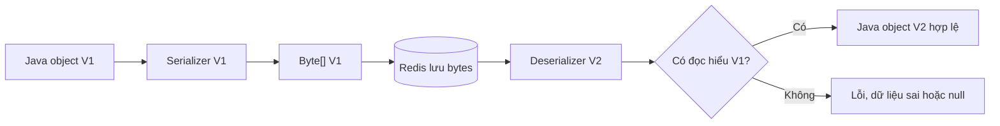

# Kiểm thử tương thích khi đổi serializer hoặc nâng cấp thư viện trong Spring Data Redis

Một hệ thống dùng Spring Data Redis có thể chạy ổn định trong nhiều tháng rồi bất ngờ xuất hiện lỗi đọc cache sau khi triển khai phiên bản ứng dụng mới. Ví dụ, phiên bản cũ ghi đối tượng Java bằng **JDK serialization**, nhưng phiên bản mới chuyển sang **JSON**; hoặc cả hai vẫn dùng Jackson nhưng tên class, cấu trúc field, thông tin kiểu hay cấu hình `ObjectMapper` đã thay đổi. Redis tiếp tục lưu những byte cũ, còn code mới lại cố đọc chúng theo cách mới.

Trục trặc này liên quan đến **tương thích dữ liệu đã được tuần tự hóa (serialization compatibility)**. Khi đổi serializer hoặc nâng cấp Spring Data Redis, Jackson, Lettuce/Jedis, JDK hay kiểu domain, cần xác định dữ liệu cũ có thể được phiên bản mới đọc đúng hay không; đồng thời cân nhắc chiều ngược lại khi hai phiên bản ứng dụng cùng chạy hoặc khi cần rollback.

Điểm xuất phát của bài học:

> **Đổi serializer trong Spring không tự chuyển đổi các byte đã tồn tại trong Redis.** Một key có thể vẫn tồn tại, còn TTL và kiểu Redis vẫn hợp lệ, nhưng ứng dụng mới không giải mã được nội dung.

Bài học này tập trung vào cách lập kế hoạch, tạo fixture, kiểm thử và triển khai an toàn khi thay đổi cơ chế tuần tự hóa trong Spring Data Redis.

## 1. Hiểu đúng điều gì cần tương thích

Khi gọi:

```java
redisTemplate.opsForValue().set("cart:42", cart);
CartCache cart = redisTemplate.opsForValue().get("cart:42");
```

`RedisTemplate` sử dụng serializer để chuyển đổi giữa **đối tượng Java** và **mảng byte**. Đối với key Redis kiểu string, sơ đồ khái niệm:



Redis Server không biết đó là JSON, Java object, Protobuf hay byte đã nén. Với nhiều cấu trúc dữ liệu, Redis chỉ lưu các byte key và value theo kiểu dữ liệu Redis. Serializer của ứng dụng quyết định cách hiểu những byte đó.

### 1.1. Tương thích có nhiều lớp

| Lớp | Ví dụ thay đổi | Hậu quả có thể xảy ra |
|---|---|---|
| **Key serializer** | Từ `StringRedisSerializer` sang serializer nhị phân | Key vật lý thay đổi; ứng dụng có thể không tìm thấy dữ liệu cũ |
| **Value serializer** | JDK serialization sang JSON | Key vẫn tồn tại nhưng dữ liệu cũ không giải mã được |
| **Hash key/value serializer** | Thay kiểu mã hóa field hoặc giá trị hash | `HGET` không tìm được field cũ hoặc giá trị đọc lỗi |
| **Domain schema** | Đổi tên field, kiểu số, enum, cấu trúc object | Giá trị giải mã khác kỳ vọng hoặc thất bại |
| **Type metadata** | JSON chứa tên class, chuyển package, đổi polymorphic typing | Không xác định được class hoặc không cho phép subtype |
| **Library/JDK version** | Nâng cấp Jackson, Spring Data Redis, Java hoặc driver | Thay đổi API/cấu hình/điều kiện diễn giải dữ liệu |
| **Cache/Repository mapping** | Đổi key prefix, tên cache hoặc `@RedisHash` | Key hoặc cấu trúc lưu trữ đổi dù serializer giữ nguyên |
| **Compression/envelope** | Thêm nén GZIP, đổi encoding, thêm byte header | Parser mới/cũ không nhận diện payload của bên kia |

**Không có lỗi không đồng nghĩa tương thích.** Chẳng hạn, dữ liệu cũ đọc được nhưng field tiền tệ rơi về `null`, enum về giá trị mặc định hoặc số bị làm tròn thì ứng dụng vẫn có thể trả kết quả nghiệp vụ sai.

### 1.2. Tương thích theo hai chiều

Gọi:

- **V1**: phiên bản ứng dụng và serializer đang chạy.
- **V2**: phiên bản dự kiến triển khai.

Cần phân biệt:

1. **Backward read compatibility:** V2 đọc được payload do V1 đã ghi (`V1 write → V2 read`).
2. **Forward read compatibility:** V1 đọc được payload V2 vừa ghi (`V2 write → V1 read`).
3. **Round-trip correctness:** Cùng một phiên bản ghi rồi đọc lại cho ra dữ liệu đúng.
4. **Mixed-version compatibility:** Trong thời gian rolling deployment, các instance V1 và V2 đọc/ghi cùng hệ thống Redis mà không gây lỗi hoặc làm sai dữ liệu.

Đọc được dữ liệu cũ là điều kiện cần khi giữ nguyên key chứa dữ liệu; nhưng nếu muốn **rollback** hoặc triển khai cuốn chiếu với các phiên bản cùng ghi, phải đánh giá cả chiều `V2 write → V1 read`.

## 2. Các serializer thường gặp trong Spring Data Redis

Spring Data Redis cung cấp cơ chế `RedisSerializer` để mã hóa và giải mã dữ liệu. Lựa chọn serializer ảnh hưởng trực tiếp đến định dạng byte trên Redis.

| Serializer / cách làm | Dữ liệu lưu | Lưu ý về tương thích |
|---|---|---|
| `StringRedisSerializer` | UTF-8 của chuỗi | Phù hợp cho tên key, ID và chuỗi rõ ràng; vẫn phải giữ encoding và cách chuẩn hóa |
| `JdkSerializationRedisSerializer` | Java Object Serialization nhị phân | Bị ràng buộc vào cấu trúc class, `serialVersionUID` và quy tắc Java serialization; cần đặc biệt chú ý bảo mật khi deserialize |
| `Jackson2JsonRedisSerializer<T>` | JSON cho kiểu Java được khai báo | Phụ thuộc schema JSON, cấu hình Jackson và kiểu đích; API cụ thể thay đổi giữa các phiên bản thư viện |
| `GenericJackson2JsonRedisSerializer` | JSON với khả năng lưu thông tin kiểu động | Cần quản lý metadata về class/type, cấu hình polymorphic typing và các thay đổi tên class |
| Serializer tự viết | JSON envelope, MessagePack, Protobuf, CBOR, byte nén... | Phải định nghĩa schema, version, codec và chính sách tương thích rõ ràng |

**Lưu ý về mặc định:** `RedisTemplate`, `StringRedisTemplate`, `RedisCacheManager` và các bean được tự cấu hình có thể có serializer khác nhau. `StringRedisTemplate` chủ yếu làm việc với chuỗi; một `RedisTemplate` thông thường có thể sử dụng JDK serialization nếu chưa được cấu hình lại. Không nên suy diễn chỉ từ tên bean rằng tất cả key/value đều là JSON.

Cần xác định serializer thực tế ở **đúng đường đi đang ghi và đọc**:

```java
RedisSerializer<?> keySerializer = redisTemplate.getKeySerializer();
RedisSerializer<?> valueSerializer = redisTemplate.getValueSerializer();
RedisSerializer<?> hashKeySerializer = redisTemplate.getHashKeySerializer();
RedisSerializer<?> hashValueSerializer = redisTemplate.getHashValueSerializer();
```

Đối với Spring Cache, phải kiểm tra `RedisCacheConfiguration` và cách `RedisCacheManager` cấu hình key prefix, cache name, key/value serializer. Serializer của một `RedisTemplate` tự tạo **không tự động quyết định** serializer cho toàn bộ các cache quản lý bởi `RedisCacheManager`.

## 3. Các kiểu thay đổi thường làm dữ liệu cũ bị lỗi

### 3.1. Đổi từ JDK serialization sang JSON

Giả sử V1 sử dụng `JdkSerializationRedisSerializer` và ghi object vào `cart:42`. Nội dung Redis là dữ liệu nhị phân Java serialization. V2 cấu hình JSON:

```java
RedisSerializer<CartCacheEntry> newSerializer =
    new Jackson2JsonRedisSerializer<>(CartCacheEntry.class);
```

Nếu V2 đọc thẳng key cũ bằng JSON deserializer, byte đầu vào có thể không phải JSON và phát sinh lỗi giải mã. **Việc đặt cùng tên key không làm hai serializer tương thích.**

Các lựa chọn xử lý có chủ đích:

- Nếu chỉ là cache có thể tái tạo: dùng namespace/version mới, cho cache cũ hết TTL hoặc xóa đúng phạm vi rồi làm ấm lại cache.
- Nếu dữ liệu cần giữ: đọc bằng serializer V1 trong một tiến trình migration được kiểm soát, chuyển đổi thành model/schema V2 rồi ghi bằng serializer V2.
- Nếu cần triển khai hai phiên bản đồng thời: thiết kế giai đoạn V2 hỗ trợ đọc cả định dạng cũ lẫn mới, hoặc dùng key namespace riêng cho hai version. Kiểm tra tương thích rollback trước khi đổi định dạng ghi.

### 3.2. Vẫn dùng JSON nhưng đổi field

Ví dụ V1 lưu:

```json
{
  "cartId": "c-42",
  "subtotalMinor": 125000,
  "currency": "VND"
}
```

V2 bổ sung `state`:

```json
{
  "cartId": "c-42",
  "subtotalMinor": 125000,
  "currency": "VND",
  "state": "OPEN"
}
```

Nếu V2 đọc dữ liệu V1, trường `state` có thể không tồn tại. Java record/class mới có thể nhận `null` hoặc default của kiểu nguyên thủy, tùy cấu hình Jackson và constructor. Nếu logic nghiệp vụ mặc định kỳ vọng `state == "OPEN"`, phải xử lý điều đó một cách tường minh và kiểm thử.

Chiều ngược lại cũng cần quan tâm: V1 đọc JSON V2 có field `state` mà V1 không biết, tùy cấu hình Jackson có thể bỏ qua hoặc báo lỗi unknown property. **Không giả định JSON luôn tự động backward/forward compatible.**

### 3.3. Đổi tên thuộc tính, kiểu số hoặc enum

| Thay đổi | Rủi ro | Hướng xử lý |
|---|---|---|
| `name` → `displayName` | Payload cũ không còn field mà V2 yêu cầu | Dùng alias/mapper tương thích trong giai đoạn chuyển đổi |
| `amount: 123.45` → `amountMinor: 12345` | Khác đơn vị, có thể đọc thành số sai | Chuyển đổi có kiểm tra đơn vị và dữ liệu mẫu |
| `int` → `long` | Có thể chấp nhận một chiều; cần kiểm tra giá trị vượt giới hạn | Bộ fixture có min/max/boundary |
| Thêm enum `SUSPENDED` | V1 có thể không nhận biết giá trị mới | Chặn ghi giá trị mới đến hết rolling deployment hoặc định nghĩa fallback rõ |
| `LocalDateTime` → `Instant` | Thay đổi ngữ nghĩa timezone, format hoặc module Jackson | Dùng format chuẩn và kiểm tra dữ liệu thời gian có timezone |
| `BigDecimal` → `double` | Có nguy cơ mất độ chính xác | Kiểm tra tiền tệ và tránh chuyển kiểu thiếu chính xác |
| `null` → field bắt buộc | Dữ liệu cũ có thể thiếu giá trị | Validation sau deserialize và kế hoạch bổ sung dữ liệu |

Một cách bảo vệ tính đọc tương thích cho JSON khi thêm field:

```java
import com.fasterxml.jackson.annotation.JsonIgnoreProperties;

@JsonIgnoreProperties(ignoreUnknown = true)
public record CartCacheEntry(
        String cartId,
        long subtotalMinor,
        String currency,
        String state
) {}
```

`@JsonIgnoreProperties(ignoreUnknown = true)` chỉ giúp bỏ qua các field dư mà model không biết. Nó **không** tự cấp giá trị đúng cho field bị thiếu, không kiểm soát đổi đơn vị tiền và không tự xử lý class polymorphic. Cần bổ sung validation hoặc mapping khi đọc.

### 3.4. JSON chứa thông tin tên class

Một số thiết lập serializer JSON động lưu metadata kiểu, có thể mang tên class hoặc package Java. Payload minh họa:

```json
{
  "@class": "com.example.shop.cache.CartCacheV1",
  "cartId": "c-42",
  "subtotalMinor": 125000
}
```

Nếu đổi package sang `com.example.store.cache.CartCacheEntry`, dữ liệu cũ có thể chỉ tới class không còn tồn tại. Ngay cả khi phần JSON nghiệp vụ giữ nguyên, deserializer vẫn có thể thất bại vì không giải quyết được metadata kiểu.

Tên trường type hint, cách mã hóa kiểu và việc chấp nhận subtype **phụ thuộc serializer cùng cấu hình ObjectMapper cụ thể**; ví dụ trên không phải định dạng bắt buộc của mọi bản Jackson/Spring Data Redis.

Không khắc phục bằng cách bật polymorphic typing không hạn chế hoặc bỏ qua kiểm tra subtype. Deserialization dữ liệu không đáng tin cậy có rủi ro bảo mật. Nếu cần type metadata, chỉ cho phép các kiểu thật sự cần thiết và sử dụng cấu hình type validation phù hợp.

### 3.5. Đổi key serializer và key prefix

Nếu V1 lưu string key bằng UTF-8:

```text
cart:c-42
```

còn V2 dùng serializer nhị phân cho key, thì dù đoạn code vẫn truyền `"cart:c-42"`, Redis có thể nhận **mảng byte key khác**. Kết quả là V2 đọc `null` như cache miss; thực tế key cũ vẫn tồn tại.

Tương tự khi thay `RedisCacheManager` prefix từ `shop:v1:cache::` sang `shop:v2:cache::`, key Redis thay đổi theo cấu hình. Trường hợp này thường là **đổi địa chỉ lưu**, không phải lỗi giải mã payload. Việc phân loại đúng giúp chọn giải pháp phù hợp.

### 3.6. Redis hash, repository và cấu trúc đặc biệt

Một Redis hash có các field và value được mã hóa riêng:

```text
HSET customer:c-42 name <bytes> status <bytes>
```

Khi dùng `RedisTemplate`, các serializer cho `hashKey` và `hashValue` có thể khác `key` và `value`. Nếu chỉ đổi `valueSerializer`, bạn chưa chắc đã đổi định dạng dùng cho `opsForHash()`.

Với **Spring Data Redis Repository**, mapper có thể quản lý hash và các key phụ như index/set/TTL. Các thay đổi về tên class, metadata mapping, keyspace, tên property hoặc cấu hình converter cần kiểm tra bằng **repository API thật**, không chỉ bằng test serializer trực tiếp. Ghi đè hash bằng một JSON string sẽ thay đổi kiểu dữ liệu Redis và có thể gây lỗi `WRONGTYPE`.

## 4. Thiết lập hợp đồng tương thích trước khi đổi phiên bản

Trước khi viết test, cần ghi rõ:

- **Đối tượng dữ liệu:** cache có thể tái tạo, session, rate limiter, event, dữ liệu nghiệp vụ hay dữ liệu trung gian.
- **Nơi ghi/đọc:** `RedisTemplate`, `StringRedisTemplate`, `RedisCacheManager`, Redis Repository, Redis Streams hoặc code trực tiếp bằng driver.
- **Key format:** prefix, serializer key, Redis data type, hash field names, TTL.
- **Wire format:** serializer, Jackson/ObjectMapper config, encoding, compression, metadata type, format/schema version.
- **Yêu cầu triển khai:** deploy đồng thời V1/V2 hay cắt chuyển toàn bộ; có cần rollback ứng dụng V2 về V1 không.
- **Chính sách lỗi:** bỏ cache lỗi rồi tái tạo, thử fallback serializer, đưa dữ liệu vào quarantine, dừng migration hay báo cảnh báo.

Ví dụ bản ghi hợp đồng:

```yaml
dataFamily: cart-cache
redisType: string
keyPattern: "shop:prod:v1:tenant:{tenant}:cart:{cartId}"
keyEncoding: UTF-8
v1ValueFormat: JDK-serialization
v2ValueFormat: JSON-typed-CartCacheEntry
ttlSeconds: 1800
sourceOfTruth: order-database
mustReadV1WithV2: true
mustReadV2WithV1: false
rollingDeployment: use-versioned-keyspace
rollback: revert-reader-and-writer-to-v1-namespace
```

Đây là bản hợp đồng minh họa cho dự án, không phải YAML cấu hình tích hợp sẵn của Spring. Các cờ thể hiện **quyết định triển khai**: nếu V2 ghi vào namespace khác, V1 không cần đọc JSON của V2 trong namespace V1; nhưng phải biết bản nào ghi và bản nào đọc ở mỗi giai đoạn.

## 5. Ma trận kiểm thử tương thích

Hãy lập ma trận theo **phiên bản thực tế** thay vì chỉ test `serialize()` rồi `deserialize()` trong cùng một build.

| Dữ liệu được ghi bởi | Được đọc bởi | Mục đích | Khi nào bắt buộc? |
|---|---|---|---|
| V1 | V1 | Xác nhận fixture cũ thực sự có thể đọc ở V1 | Khi lập baseline và xác minh fixture |
| **V1** | **V2** | Kiểm tra đọc dữ liệu cũ | Khi V2 đọc chung key/format cũ hoặc cần migration |
| V2 | V2 | Kiểm tra định dạng mới hoạt động | Mọi thay đổi |
| **V2** | **V1** | Kiểm tra rolling deployment/rollback | Khi V1 có thể gặp dữ liệu V2 ghi |
| V1/V2 cùng ghi | V1/V2 cùng đọc | Kiểm tra trộn phiên bản và hành vi concurrent | Khi có mixed-version deployment |
| Dữ liệu lỗi/cắt cụt | V2 | Kiểm tra fail-safe, metrics và xử lý lỗi | Với hệ thống có dữ liệu lâu dài hoặc nguồn không đáng tin |

Ví dụ kế hoạch:

```text
                         ĐỌC V1      ĐỌC V2
GHI V1 (legacy bytes)      PASS        PHẢI PASS nếu dùng key cũ
GHI V2 (new JSON)          PASS?       PASS
```

Ô `PASS?` không tự động phải đạt trong mọi kiến trúc: nếu V2 chỉ ghi vào `v2:*`, các instance V1 được ngăn đọc key `v2:*` thì không tồn tại yêu cầu V1 đọc JSON mới. Ngược lại, khi cùng dùng một key giữa rolling deployment, không đạt ô đó có thể gây lỗi cho các instance V1.

### 5.1. Dữ liệu mẫu phải bao phủ trường hợp biên

Không chỉ dùng một object đơn giản có vài chuỗi. Bộ fixture nên đại diện cho dữ liệu thực:

| Nhóm | Trường hợp nên có |
|---|---|
| Chuỗi | Unicode tiếng Việt, emoji, chuỗi rỗng, dấu xuống dòng, ký tự đặc biệt |
| Số | 0, số âm, max/min, số tiền lớn, decimal có phần lẻ |
| Thời gian | UTC, timezone, daylight saving khi liên quan, timestamp cũ |
| Null/thiếu field | `null`, field vắng mặt, collection rỗng, object rỗng |
| Enum | Giá trị hiện tại, giá trị legacy, giá trị mới chưa có ở V1 |
| Object phức tạp | Nested object, list, map, polymorphic subtype |
| Tên kiểu | Đổi package/class, đổi discriminator/type hint |
| Byte | Ký tự UTF-8, file binary, compressed payload, magic bytes |
| Dữ liệu lỗi | JSON thiếu byte, type sai, payload quá lớn, version không hỗ trợ |
| Redis behavior | Key không tồn tại, TTL còn ít, expiration, hash field, cache prefix |

Khi dùng dữ liệu sản xuất để xây fixture, **ẩn hoặc thay thế toàn bộ thông tin nhạy cảm** rồi mới đưa vào repository. Cần giữ nguyên những đặc tính byte làm lộ lỗi tương thích; không nên “làm sạch” fixture bằng serializer mới vì như vậy có thể vô tình chữa luôn lỗi cần kiểm tra.

## 6. Golden fixtures: bằng chứng mạnh hơn round-trip

Một bài test đơn giản:

```java
assertEquals(value, serializer.deserialize(serializer.serialize(value)));
```

chỉ chứng minh một serializer **đọc được chính định dạng do nó vừa ghi**. Nó không chứng minh serializer V2 đọc được dữ liệu do V1 đã ghi nhiều tháng trước.

**Golden fixture** là file byte được tạo bằng **bản ứng dụng/thư viện V1 thực tế** rồi lưu cố định trong bộ test. Khi nâng cấp sang V2, test dùng đúng file byte đó làm đầu vào và kiểm tra kết quả.

Ví dụ cấu trúc fixture:

```text
src/test/resources/redis-compat/
  README.md
  cart-v1-typical.bin
  cart-v1-null-state.bin
  cart-v1-unicode.bin
  cart-v1-legacy-enum.bin
  cart-v2-typical.bin
```

Trong `README.md` của bộ fixture nên ghi:

- Commit/tag phát hành tạo ra fixture.
- Phiên bản Spring Data Redis, Jackson, JDK, serializer và cấu hình liên quan.
- Đường ghi sử dụng `RedisTemplate`, CacheManager, Repository hay driver.
- Loại Redis value (string/hash), serializer của key/hash field và naming convention.
- Mong đợi về giá trị nghiệp vụ sau deserialize; nếu cần, hash SHA-256 của file fixture để phát hiện sửa đổi vô ý.

### 6.1. Cách tạo fixture đúng

Chạy một chương trình/test **trên dependency V1 thật**, dùng đường ghi thực tế của V1:

```java
CartCacheV1 oldValue = new CartCacheV1(
    "c-42",
    125_000L,
    "VND"
);

byte[] legacyBytes = legacySerializer.serialize(oldValue);
Files.write(
    Path.of("src/test/resources/redis-compat/cart-v1-typical.bin"),
    legacyBytes
);
```

Ví dụ giả định `CartCacheV1` và `legacySerializer` đã có trong code V1. Khi tạo fixture, phải sử dụng đúng serializer, ObjectMapper và kiểu dữ liệu của phiên bản cũ. Sau khi fixture được chốt, **không tạo lại fixture V1 bằng code V2** trong lúc chạy test CI.

Nếu dữ liệu thật được ghi qua `RedisCacheManager` hoặc Repository, fixture cần phản ánh đúng output của đường ghi đó. Có thể thu byte trực tiếp từ Redis của môi trường thử nghiệm chạy V1 để tránh sai khác giữa “serializer được cho là đang dùng” và “serializer thực tế”.

### 6.2. Test đọc byte V1 bằng serializer V2

Ví dụ dưới đây dùng JUnit 5 và serializer JSON typed của Spring Data Redis. Đây là mẫu code để kiểm tra một lần chuyển đổi **khi fixture V1 thực sự có định dạng JSON tương thích**. Nếu V1 dùng JDK binary, test này được kỳ vọng báo lỗi cho đến khi ta triển khai migration hoặc fallback phù hợp.

```java
package com.example.redis.compat;

import static org.junit.jupiter.api.Assertions.assertEquals;
import static org.junit.jupiter.api.Assertions.assertNotNull;

import java.io.IOException;
import java.nio.file.Files;
import java.nio.file.Path;

import com.fasterxml.jackson.annotation.JsonIgnoreProperties;
import org.junit.jupiter.api.Test;
import org.springframework.data.redis.serializer.Jackson2JsonRedisSerializer;

class CartSerializerCompatibilityTest {

    @JsonIgnoreProperties(ignoreUnknown = true)
    record CartCacheEntry(
        String cartId,
        long subtotalMinor,
        String currency,
        String state
    ) {}

    private final Jackson2JsonRedisSerializer<CartCacheEntry> newSerializer =
        new Jackson2JsonRedisSerializer<>(CartCacheEntry.class);

    @Test
    void v2ReadsGoldenPayloadWrittenByV1() throws IOException {
        byte[] legacyBytes = Files.readAllBytes(Path.of(
            "src/test/resources/redis-compat/cart-v1-typical.bin"
        ));

        CartCacheEntry result = newSerializer.deserialize(legacyBytes);

        assertNotNull(result);
        assertEquals("c-42", result.cartId());
        assertEquals(125_000L, result.subtotalMinor());
        assertEquals("VND", result.currency());

        // Nếu V1 chưa lưu field state, V2 phải chủ động xử lý giá trị thiếu.
        String effectiveState =
            result.state() == null ? "OPEN" : result.state();
        assertEquals("OPEN", effectiveState);
    }

    @Test
    void v2RoundTripRetainsDomainSemantics() {
        CartCacheEntry input =
            new CartCacheEntry("c-99", 999_000L, "VND", "OPEN");

        byte[] bytes = newSerializer.serialize(input);
        CartCacheEntry result = newSerializer.deserialize(bytes);

        assertEquals(input, result);
    }
}
```

Test đầu kiểm tra **tương thích byte cũ**; test thứ hai kiểm tra **round-trip bản mới**. Hai bài test đáp ứng hai câu hỏi khác nhau. Khi V1/V2 có serializer không tương thích, không chỉnh test để “PASS” bằng một fixture mới do V2 ghi; thay vào đó chọn chiến lược đọc/migrate phù hợp.

### 6.3. Test chiều ngược: V1 đọc dữ liệu do V2 ghi

Muốn kiểm tra rollback, tạo một fixture `cart-v2-typical.bin` bằng V2. Sau đó chạy một test **trên dependency/runtime V1 thật** để đọc file đó bằng deserializer V1.

Không đủ nếu chỉ tạo một class Java tên `OldCart` ở source V2: version Jackson/JDK và cấu hình runtime vẫn là V2. Kiểm thử đáng tin cậy nên chạy **hai build hoặc hai process/container độc lập** với dependency đã khóa version:

```text
Build V1                            Build V2
 ├── tạo fixture v1 ───────────────► đọc fixture v1
 ├── đọc fixture v2 ◄─────────────── tạo fixture v2
 └── kiểm tra schema/semantics       └── kiểm tra schema/semantics
```

Nếu V1 không được phép đọc V2 theo kiến trúc versioned key, ghi rõ điều kiện đó và kiểm tra các route không trộn namespace, thay vì mặc định tất cả tổ hợp đều phải đọc được.

## 7. Kiểm thử tích hợp với Redis thật

Test trực tiếp `serializer.deserialize(bytes)` chưa kiểm tra serializer nào đang được nối với `RedisTemplate`, quy tắc tạo key hay tình trạng Redis. Test tích hợp với một Redis riêng (ví dụ Redis Testcontainers) sẽ phát hiện lỗi cấu hình mà unit test bỏ sót.

### 7.1. Dùng Testcontainers để ghi legacy bytes và đọc qua template mới

Dependency mẫu với Gradle (version cụ thể nên được quản lý bởi BOM/dependency management của dự án):

```groovy
dependencies {
    implementation 'org.springframework.boot:spring-boot-starter-data-redis'

    testImplementation 'org.springframework.boot:spring-boot-starter-test'
    testImplementation 'org.testcontainers:junit-jupiter'
    testImplementation 'org.testcontainers:testcontainers'
}
```

Ví dụ integration test (JUnit 5, Spring Data Redis 3.x):

```java
package com.example.redis.compat;

import static org.junit.jupiter.api.Assertions.assertEquals;
import static org.junit.jupiter.api.Assertions.assertNotNull;

import java.nio.file.Files;
import java.nio.file.Path;

import com.fasterxml.jackson.annotation.JsonIgnoreProperties;
import org.junit.jupiter.api.Test;
import org.springframework.data.redis.connection.RedisConnection;
import org.springframework.data.redis.connection.lettuce.LettuceConnectionFactory;
import org.springframework.data.redis.core.RedisTemplate;
import org.springframework.data.redis.serializer.Jackson2JsonRedisSerializer;
import org.springframework.data.redis.serializer.StringRedisSerializer;
import org.testcontainers.containers.GenericContainer;
import org.testcontainers.junit.jupiter.Container;
import org.testcontainers.junit.jupiter.Testcontainers;
import org.testcontainers.utility.DockerImageName;

@Testcontainers
class RedisWireCompatibilityIT {

    @Container
    static GenericContainer<?> redis =
        new GenericContainer<>(DockerImageName.parse("redis:7.4-alpine"))
            .withExposedPorts(6379);

    @JsonIgnoreProperties(ignoreUnknown = true)
    record CartCacheEntry(
        String cartId,
        long subtotalMinor,
        String currency,
        String state
    ) {}

    @Test
    void templateV2ReadsRedisKeyContainingV1Bytes() throws Exception {
        LettuceConnectionFactory factory =
            new LettuceConnectionFactory(
                redis.getHost(),
                redis.getMappedPort(6379)
            );
        factory.afterPropertiesSet();

        try {
            RedisTemplate<String, CartCacheEntry> template =
                new RedisTemplate<>();
            template.setConnectionFactory(factory);
            template.setKeySerializer(new StringRedisSerializer());
            template.setValueSerializer(
                new Jackson2JsonRedisSerializer<>(CartCacheEntry.class)
            );
            template.afterPropertiesSet();

            String key = "compat:test:v1:cart:c-42";
            byte[] keyBytes = new StringRedisSerializer().serialize(key);
            byte[] oldBytes = Files.readAllBytes(Path.of(
                "src/test/resources/redis-compat/cart-v1-typical.bin"
            ));

            // Giữ nguyên bytes được tạo bởi V1, không serialize lại bằng V2.
            RedisConnection connection = factory.getConnection();
            try {
                connection.stringCommands().set(keyBytes, oldBytes);
            } finally {
                connection.close();
            }

            CartCacheEntry read = template.opsForValue().get(key);
            assertNotNull(read);
            assertEquals("c-42", read.cartId());
            assertEquals(125_000L, read.subtotalMinor());
        } finally {
            factory.destroy();
        }
    }
}
```

Test này sử dụng Redis thật nhưng không cần Redis production. Dữ liệu V1 được đưa vào Redis như **raw bytes**; đường đọc V2 đi qua `RedisTemplate` thật. Nhờ vậy có thể bắt lỗi ở cả serializer lẫn cấu hình template.

Hãy chạy test tương tự cho những loại dữ liệu khác mà ứng dụng đang quản lý:

- `opsForHash()` với key, hash-key và hash-value serializer đúng thực tế.
- `RedisCacheManager` với cache name, prefix và cache value serializer.
- Redis Repository nếu thay đổi mapping hoặc converter, kèm index/TTL liên quan.
- Key có TTL để quan sát việc đọc, migration hoặc rewrite có vô ý thay đổi thời hạn không.

Nếu ứng dụng dùng Redis Cluster, các kiểm thử đa key, hash slot hoặc prefix có hash tag cần chạy trên topology phù hợp. Test với một Redis standalone không chứng minh rằng một thao tác đa key sẽ hợp lệ trên cluster.

## 8. Kiểm thử qua Spring Cache và Repository

### 8.1. Spring Cache cần kiểm tra đường đi thực tế

Với Spring Cache:

```java
@Cacheable(cacheNames = "cartSummary", key = "#cartId")
public CartSummary getSummary(String cartId) {
    return loadFromDatabase(cartId);
}
```

Khi nâng cấp serializer cache, cần kiểm tra:

1. Redis key vật lý do cache manager tạo ra còn đúng prefix/cache name không.
2. Giá trị cũ lưu trong Redis được serializer cache mới đọc như thế nào.
3. Khi cache hit, giá trị trả về có đúng **kiểu và nội dung** mà service mong đợi không.
4. Khi cache miss do đổi prefix hoặc dữ liệu cũ đã hết hạn, ứng dụng có tải lại an toàn từ nguồn chính không.
5. Nếu decode thất bại, hệ thống ném exception hay đã có handler chủ động xử lý cache lỗi? Không đánh đồng lỗi deserialize với cache miss bình thường.
6. `@CachePut` và `@CacheEvict` có dùng cùng key convention với `@Cacheable` không.

Ví dụ cấu hình serializer cache tường minh:

```java
import java.time.Duration;
import org.springframework.context.annotation.Bean;
import org.springframework.context.annotation.Configuration;
import org.springframework.data.redis.cache.RedisCacheConfiguration;
import org.springframework.data.redis.cache.RedisCacheManager;
import org.springframework.data.redis.connection.RedisConnectionFactory;
import org.springframework.data.redis.serializer.GenericJackson2JsonRedisSerializer;
import org.springframework.data.redis.serializer.RedisSerializationContext;

@Configuration
public class CacheSerializationConfig {

    @Bean
    public RedisCacheManager cacheManager(RedisConnectionFactory factory) {
        RedisCacheConfiguration config =
            RedisCacheConfiguration.defaultCacheConfig()
                .serializeValuesWith(
                    RedisSerializationContext.SerializationPair.fromSerializer(
                        new GenericJackson2JsonRedisSerializer()
                    )
                )
                .computePrefixWith(name -> "shop:v2:cache:" + name + "::")
                .entryTtl(Duration.ofMinutes(15));

        return RedisCacheManager.builder(factory)
            .cacheDefaults(config)
            .build();
    }
}
```

Đoạn trên chỉ minh họa điểm gắn serializer và prefix trong API Spring Data Redis 3.x. Khi nâng cấp major version, cần kiểm tra API thực tế của version mới. **Cấu hình mới không tự chuyển byte trong các key cache V1**. Nếu đổi prefix `v1` → `v2`, cache V2 sẽ đọc key mới; đây có thể là cách tách an toàn khi dữ liệu cache tái tạo được.

Với serializer JSON động, cần kiểm thử metadata kiểu; không nên cho phép deserialize các type tùy ý không được kiểm soát. Trong bài toán cache, có thể chọn serializer typed khi cache chỉ chứa một kiểu giá trị, hoặc thiết kế schema ổn định phù hợp với nhiều kiểu thực tế.

### 8.2. Redis Repository không chỉ có một value serializer

`@RedisHash` và repository dùng cơ chế mapping dựa trên Redis hash. Ví dụ:

```java
@RedisHash("customers")
public class Customer {
    @Id
    private String id;
    private String displayName;
    // Constructor/getter/setter...
}
```

Nếu nâng cấp Spring Data Redis hoặc sửa cấu hình converter:

- Kiểm tra đọc aggregate cũ bằng `findById`, không chỉ deserialize một JSON string.
- Kiểm tra kiểu và tên field trong hash, field nested, thông tin kiểu khi có polymorphism.
- Kiểm tra thao tác `save`, `deleteById` và query theo `@Indexed` nếu entity có secondary index.
- Kiểm tra thời hạn TTL khi entity có `@RedisHash(timeToLive = ...)` hoặc `@TimeToLive`.
- Không dùng `SET key JSON` đè lên key Redis hash do repository quản lý; hành vi đó có thể tạo `WRONGTYPE` và làm sai index.

Thay đổi tên class/package còn có thể tác động tới metadata kiểu lưu bên trong hash. Đây là lý do cùng một “nâng cấp Jackson” phải được đánh giá theo **đường lưu cụ thể**, không chỉ theo tên thư viện.

## 9. Khi nào cần test ở hai runtime riêng?

Một số thay đổi chỉ thể hiện khi chạy đúng bộ dependency và JDK của từng phiên bản:

- Nâng cấp major Spring Data Redis hoặc Jackson.
- Đổi classpath/module Jackson; thiếu module hỗ trợ Java Time, Kotlin, parameter names hoặc kiểu dữ liệu đặc biệt.
- Đổi JDK trong khi dùng Java native serialization.
- Di chuyển package/class, thay đổi `serialVersionUID` hoặc serializable field.
- Đổi configuration mặc định được Spring Boot auto-configure.
- Nâng cấp driver và cách vận hành Redis connection khiến đường code thực tế thay đổi.

Lúc đó, không chỉ dựng hai biến `oldSerializer` và `newSerializer` trong cùng một test runtime. Nên chạy một pipeline có **hai build độc lập**:

```text
Repository tag V1                  Repository branch V2
Dependencies khóa ở V1             Dependencies khóa ở V2
JDK của V1                         JDK dự kiến của V2
       │                                  │
       ├── ghi golden payload ──────────►│ test V2 đọc
       │                                  ├── ghi V2 payload
       │◄─────────────────────────────────┘
       └── test V1 đọc V2 nếu cần rollback
```

Có thể dùng hai container ứng dụng nối cùng một Redis Testcontainers/service thử nghiệm để mô phỏng rolling deployment. Trước khi chạy, thống nhất tên key và cơ chế cleanup riêng cho test để các lần chạy không ảnh hưởng nhau.

Trong CI, cần **pin dependency version** và ghi version trong kết quả; kiểm tra “tương thích với V1” không còn giá trị nếu test lỡ kéo dependency “latest” rồi cả hai nhánh đều chạy thư viện V2.

## 10. Kiểm thử tương thích JDK serialization

Java native serialization phụ thuộc vào quy tắc `Serializable` và metadata của class.

Ví dụ:

```java
import java.io.Serializable;

public class CartV1 implements Serializable {
    private static final long serialVersionUID = 1L;

    private String id;
    private long subtotalMinor;

    // Constructor/getter/setter...
}
```

Nếu V2 đổi `serialVersionUID` không tương thích, Java deserializer có thể báo `InvalidClassException`. Ngay cả khi giữ UID, các thay đổi về cấu trúc kế thừa, loại field, tên package/class hoặc cách khôi phục object vẫn có thể làm dữ liệu không tương thích hoặc bị sai.

Các tình huống cần kiểm thử bằng fixture nhị phân V1:

1. V2 đọc một object V1 thông thường.
2. V2 đọc object V1 có nested object và collection.
3. V2 đọc sau khi đổi tên/move package class.
4. V2 đọc khi type/field thay đổi hoặc `serialVersionUID` thay đổi.
5. V2 xử lý bytes bị lỗi mà không tạo đối tượng không hợp lệ.
6. V1 đọc payload V2 nếu rollback hoặc chạy song song là yêu cầu.

**An toàn bảo mật:** Java native deserialization có thể nguy hiểm khi đầu vào bị tác động bởi nguồn không đáng tin cậy. Không nên coi việc giữ `JdkSerializationRedisSerializer` mãi mãi là giải pháp tương thích an toàn; khi di chuyển sang định dạng khác phải có kế hoạch migration hoặc invalidation phù hợp. Nếu buộc phải đọc legacy bytes, giới hạn class được deserialize, bảo vệ quyền ghi Redis và giới hạn thời gian tồn tại của đường đọc legacy.

## 11. Thử nghiệm thất bại cần dự đoán trước

Các kết quả sau có nguyên nhân khác nhau:

| Triệu chứng | Khả năng nguyên nhân | Cách điều tra |
|---|---|---|
| `GET` trả `null` dù nghĩ key tồn tại | Key serializer/prefix đổi, key đã hết hạn/bị eviction, sai DB/endpoint | Kiểm tra raw key, `EXISTS`, `TTL`, serializer key |
| Deserialize ném `SerializationException` | Byte không đúng format hoặc mapper không hiểu payload | Xác định V1 format, dùng golden bytes, kiểm tra stack trace |
| Lỗi Jackson unknown field | V1/V2 khác schema hoặc ObjectMapper strict | Test chiều V2→V1 và cấu hình bỏ qua field dư nếu phù hợp |
| Lỗi không tìm thấy class/type id | JSON có metadata tên class cũ hoặc validation subtype | Kiểm tra type hint/package và chính sách ánh xạ |
| `InvalidClassException` | JDK serialization không khớp class/UID | Kiểm tra phiên bản class và fixture nhị phân V1 |
| `ClassCastException` khi lấy cache | Serializer trả object sai kiểu kỳ vọng | Kiểm tra generic serializer/type metadata và cache mix-type |
| Đọc được nhưng giá trị tiền/thời gian sai | Đổi đơn vị, precision, timezone hoặc default | So sánh field nghiệp vụ, không chỉ `assertNotNull` |
| `WRONGTYPE` | Key Redis string/hash/list khác thao tác đang gọi | `TYPE key` và lịch sử thay đổi cấu trúc dữ liệu |
| Cache miss hàng loạt ngay sau deploy | Prefix/version thay đổi hoặc cố tình invalidation | Theo dõi nguồn chính và chiến lược warm-up |
| TTL bất ngờ tăng sau rewrite | Migration ghi key lại bằng `SET` không giữ TTL | Đo `PTTL` trước/sau và áp dụng chính sách TTL phù hợp |

**Không biến mọi lỗi deserialize thành `null` một cách âm thầm.** Với cache có thể tái tạo, có thể chọn xóa key lỗi và nạp lại, nhưng cần log/metric để biết dữ liệu đã từng không tương thích. Với session, idempotency key, state machine hoặc dữ liệu không thể tái tạo, tự bỏ qua lỗi có thể làm sai nghiệp vụ nghiêm trọng.

## 12. Những chiến lược triển khai thay đổi serializer

### 12.1. Phương án A — Versioned namespace và tái tạo cache

Phù hợp khi Redis chỉ chứa **cache có thể tái tạo từ nguồn chính**.

Ví dụ:

```text
V1 key: shop:prod:v1:cache:price:sku-42
V2 key: shop:prod:v2:cache:price:sku-42
```

Trình tự:

1. V2 dùng prefix `v2` và serializer/schema mới, không đụng vào byte V1.
2. Cache V2 ban đầu miss và tải dữ liệu từ nguồn chuẩn.
3. V1 vẫn dùng prefix `v1` nếu đang chạy song song hoặc phải rollback.
4. Dữ liệu `v1` cũ tự hết hạn theo TTL hoặc được dọn sau khi kết thúc giai đoạn chuyển đổi.

Ưu điểm: cách ly định dạng rõ, tránh cố deserialize sai payload; rollback dễ hơn khi namespace V1 còn nguyên. Nhược điểm: cache miss tăng, tải nguồn chính tăng, bộ nhớ có thể tăng vì dữ liệu hai phiên bản cùng tồn tại.

Khi áp dụng, cần xác nhận service có thể chịu **cold-cache load** trong rollout. Có thể dùng canary, warm-up và giới hạn tốc độ để tránh đồng thời nhiều request dồn về database.

### 12.2. Phương án B — Bộ đọc tương thích hai định dạng

Phù hợp khi cần đọc dữ liệu cũ đang tồn tại và không thể bỏ ngay:

```text
Đọc key
   │
   ├── Định dạng mới? ──► V2 deserializer ──► validation
   │
   └── Định dạng cũ? ──► V1 deserializer ──► map sang V2 ──► validation
```

Thiết kế nên có **cách nhận diện định dạng đáng tin**, chẳng hạn:

- Prefix/keyspace version khác nhau; hoặc
- Envelope có version rõ trong payload; hoặc
- Một magic header/metadata được định nghĩa trước khi ghi.

Nếu hệ thống legacy chưa có marker, có thể cần một decoder thử theo thứ tự và bắt **đúng nhóm lỗi định dạng đã biết**. Cách fallback “cứ thử JSON, lỗi gì cũng thử JDK rồi trả null” dễ che lỗi hạ tầng, dữ liệu hỏng, lỗi security hoặc bug nghiệp vụ. Đường fallback legacy cần được giới hạn, đo số lần sử dụng và có ngày kết thúc.

Ví dụ envelope có schema version cho **dữ liệu JSON mới**:

```json
{
  "schemaVersion": 2,
  "payload": {
    "cartId": "c-42",
    "subtotalMinor": 125000,
    "currency": "VND",
    "state": "OPEN"
  }
}
```

Một envelope tự mô tả giúp decoder chọn schema và hỗ trợ migration rõ ràng. Nhưng nếu payload V1 chưa có envelope, V2 vẫn cần xử lý legacy đúng đường.

### 12.3. Phương án C — Đọc cũ, ghi mới theo nhiều giai đoạn

Khi hai phiên bản cùng ghi chung keyspace, phải tránh tình huống V2 đột ngột ghi format mà V1 không đọc được. Một chiến lược **expand/contract** thường gồm:

1. Ra mắt phiên bản đọc mới có khả năng hiểu cả payload V1 và V2, nhưng vẫn **ghi V1**.
2. Đợi các instance cũ không còn hoạt động; xác nhận consumer quan trọng đã hỗ trợ V2.
3. Bật ghi V2 bằng cấu hình triển khai/feature flag.
4. Theo dõi lỗi decode, cache hit/miss, dữ liệu cũ còn lại.
5. Khi hết giai đoạn tương thích, gỡ đường đọc V1 theo kế hoạch.

Trình tự này cần thực thi đầy đủ, không chỉ đổi serializer trong một lần deploy. Nếu còn hệ thống bên ngoài hoặc job cũ đang đọc Redis, chúng cũng là consumer V1 phải tính đến.

### 12.4. Phương án D — Migration hàng loạt

Phù hợp khi dữ liệu phải được giữ và cần chuyển đổi định dạng trên quy mô lớn.

Quy trình tổng quát:

```text
SCAN / danh sách ID có kiểm soát
              │
              ▼
Đọc raw bytes và TTL hiện tại
              │
              ▼
Giải mã bằng V1 + validation
              │
              ▼
Map sang model/schema V2
              │
              ▼
Ghi vào namespace V2 bằng V2 serializer
              │
              ▼
Readback bằng V2 + so sánh nghiệp vụ
              │
              ▼
Đánh dấu checkpoint; dọn V1 theo chính sách
```

Các yêu cầu quan trọng:

- Có checkpoint để **chạy lại an toàn (idempotent)** sau khi job bị dừng.
- Không biến một lỗi decode thành dữ liệu mặc định rồi ghi đè.
- Bảo toàn hoặc chủ động quyết định lại TTL; việc ghi giá trị mới có thể làm thay đổi thời hạn.
- Xử lý cạnh tranh ghi: trong lúc migration đọc V1, ứng dụng cũ có thể cập nhật chính key đó. Cần cơ chế cutover, version check, compare-and-set/script hoặc khóa hợp lý tùy tính nhất quán yêu cầu.
- Kiểm soát tốc độ quét và ghi để không gây áp lực đột ngột lên Redis/database.
- Kiểm tra nguồn dữ liệu thật, số lượng bản ghi, bản ghi bị lỗi và số lượng chuyển đổi thành công.
- Với Redis Cluster, xử lý topology/shard phù hợp; một `SCAN` ở một node không bao trùm toàn bộ cụm.

`DUMP`/`RESTORE` giữ representation Redis ở mức cấu trúc dữ liệu, **không tự chuyển JDK bytes sang JSON**. `RENAME` chỉ đổi tên key, cũng không đổi format giá trị. Chúng không thay thế pipeline deserialize V1 → map → serialize V2.

### 12.5. Quyết định theo tính chất dữ liệu

| Loại dữ liệu | Phương án thường hợp lý |
|---|---|
| Cache đọc từ database | Versioned namespace và làm ấm lại cache |
| Session đang hoạt động | Test khả năng đọc session cũ hoặc kế hoạch hết hạn/đăng nhập lại có kiểm soát |
| Idempotency key | Không được xóa tùy tiện; cần bảo đảm cùng request không bị xử lý lại |
| Rate-limit counter | Cần xem thay đổi key format có reset quota ngoài ý muốn hay không |
| Queue/list/stream event | Chuyển đổi producer/consumer và schema message theo thứ tự triển khai tương thích |
| Dữ liệu nghiệp vụ không thể tái tạo | Migration có checkpoint, readback, bảo vệ concurrent writes và rollback rõ |
| Redis Repository có index | Migration qua cơ chế mapping tương thích, bảo vệ index và TTL |

## 13. TTL, eviction và thời hạn của dữ liệu được migrate

Redis không gắn “serializer version” vào TTL. Thời gian sống của key và cấu trúc bytes là hai thuộc tính khác nhau.

Ví dụ:

```redis
SET shop:v1:cache:cart:c-42 "legacy-bytes" EX 300
TTL shop:v1:cache:cart:c-42
```

Nếu migration đọc dữ liệu sau 200 giây, key còn khoảng 100 giây. Ghi dữ liệu V2 bằng `SET` không kèm TTL có thể vô tình tạo key **không còn thời hạn**, khiến cache tồn tại lâu hơn dự kiến.

Quy trình test liên quan:

1. Ghi key V1 kèm TTL ngắn.
2. Đợi một khoảng thời gian để TTL giảm.
3. Đọc `PTTL` trước khi migrate.
4. Chuyển đổi và ghi key mới theo chính sách TTL đã chọn.
5. Kiểm tra TTL sau migration vẫn đáp ứng mục tiêu nghiệp vụ.
6. Lặp lại với key sắp hết hạn, key không có TTL và key đã hết hạn.

Nếu migrate key sang namespace khác, có thể dùng phần TTL **còn lại** làm TTL của key mới để không gia hạn tuổi thọ; nhưng phải xử lý trường hợp TTL âm (không có TTL, key không tồn tại), TTL gần bằng 0 và concurrent expiration. Nếu yêu cầu TTL được tính lại từ thời điểm cập nhật nghiệp vụ, hãy ghi rõ đó là chủ ý.

Eviction do thiếu bộ nhớ cũng có thể xảy ra trong quá trình migration hoặc cache warm-up. Khi số key tăng gấp đôi trong thời gian chuyển đổi, cần tính đến giới hạn `maxmemory`, policy eviction và khả năng cache miss hàng loạt. Mất key vì expiration/eviction không đồng nghĩa lỗi serializer; nên quan sát riêng `expired_keys` và `evicted_keys`.

## 14. Kiểm thử thay đổi serialization trong nhiều môi trường

Một chiến lược test thực tế nên có các cấp:

| Cấp | Kiểm tra | Giá trị |
|---|---|---|
| Unit test serializer | Golden bytes V1 → object V2; V2 round-trip; invalid payload | Phát hiện vấn đề định dạng/scheme sớm |
| Integration test Redis | Đọc key/hash/cache thực tế qua template/manager/repository | Bắt lỗi key serializer, prefix và mapping |
| Cross-version test | Hai process/build V1-V2 đọc dữ liệu của nhau | Phát hiện vấn đề runtime/dependency và rollback |
| Migration rehearsal | Chạy tool chuyển đổi trên bản sao dữ liệu hoặc dataset mô phỏng | Đo thời gian, TTL, lỗi decode, checkpoint |
| Staging/canary | Triển khai cùng chiến lược như production | Quan sát hành vi thực tế dưới tải |
| Post-deploy validation | Error/miss rate, metrics, sample readback | Phát hiện regression sau rollout |

### 14.1. Môi trường test phải gần với production ở điểm quan trọng

Không cần sao chép mọi thứ, nhưng nên thống nhất các thuộc tính ảnh hưởng trực tiếp đến tương thích:

- Version Redis Server và những tính năng/lệnh đang dùng.
- Redis standalone, Sentinel hay Cluster (nhất là khi có thao tác đa key).
- Version JDK, Spring Boot, Spring Data Redis, Jackson, driver và module Jackson.
- Cấu hình serializer/ObjectMapper, prefix và TTL.
- Có hoặc không có nén, encryption, schema registry hoặc format envelope.
- Dataset đủ nhiều để bắt lỗi dữ liệu legacy hiếm gặp.

Nếu chạy test trên Redis mới hoàn toàn và chỉ ghi dữ liệu bằng app V2, ta chưa kiểm tra khả năng V2 đọc byte cũ từ production.

### 14.2. Chốt đầu ra bằng kiểm tra semantic, không chỉ so byte

Hai chuỗi JSON có thể khác thứ tự thuộc tính nhưng mang cùng dữ liệu. Với JSON, so sánh toàn bộ byte bằng `assertArrayEquals` có thể gây false negative nếu không có yêu cầu format canonical. Ngược lại, `assertNotNull` lại quá yếu.

Nên kiểm tra:

- ID và mối quan hệ với tenant.
- Giá trị tiền và đơn vị, timestamp và timezone.
- Trạng thái/enum, cấu trúc nested, collection.
- Field mặc định khi input cũ thiếu thuộc tính.
- Không bỏ mất dữ liệu bắt buộc.
- Các invariant nghiệp vụ sau mapping.

So sánh byte vẫn rất hữu ích cho **fixture cố định**, checksum của artifact hoặc giao thức yêu cầu wire format chính xác. Cần phân biệt mục đích kiểm tra byte và mục đích kiểm tra ngữ nghĩa.

## 15. Quan sát trong lúc triển khai và khả năng rollback

Trước khi phát hành V2, quyết định trước cách ứng dụng phản ứng khi gặp payload V1:

```text
V2 đọc cache/Redis data
          │
          ▼
Giải mã thành công? ── Có ──► Validate dữ liệu ──► Sử dụng
          │
          Không
          │
          ▼
Xác định loại dữ liệu
          │
          ├── Cache có thể tái tạo:
          │       Ghi nhận metric/lỗi → invalidation đúng key → tải lại
          │
          └── Dữ liệu cần bảo toàn:
                  Báo lỗi có kiểm soát → giữ bytes → migration/khôi phục
```

Nên theo dõi ít nhất:

- Số và tỷ lệ lỗi `SerializationException`, `ClassCastException`, `InvalidClassException` hoặc lỗi parser theo data family.
- Tỷ lệ cache hit/miss và tải lên database sau đổi namespace.
- TTL bất thường, eviction, Redis memory và tốc độ tăng số key trong giai đoạn song song V1/V2.
- Tỷ lệ bản ghi legacy còn phải đọc bằng fallback.
- Kết quả migration: số key đã thử, đã chuyển, bỏ qua do hết hạn, lỗi decode, lỗi validation, lỗi cạnh tranh ghi.
- P95/P99 latency của các đường đọc quan trọng và tác động đến request.

Không log raw byte chứa session token, dữ liệu người dùng hoặc thông tin nhạy cảm. Khi cần tái tạo lỗi, lưu fixture đã ẩn dữ liệu và kèm metadata không nhạy cảm: serializer version, schema version, key family và message lỗi.

### Kịch bản rollback

Rollback code V2 về V1 **không đồng nghĩa rollback dữ liệu Redis**. Nếu V2 đã ghi JSON vào chính key mà V1 chỉ đọc được JDK serialization, V1 có thể tiếp tục lỗi sau khi rollback.

Trước khi phát hành, phải trả lời:

1. Nếu rollback V1, V1 sẽ đọc key nào?
2. Key đó còn giữ byte V1 hay đã bị V2 ghi đè?
3. Có thể bật chế độ “V2 chỉ đọc mới, tiếp tục ghi cũ” trong rollout đầu không?
4. Namespace V1 còn TTL đủ để phục vụ rollback không?
5. Nếu đã migrate, có cách chuyển ngược an toàn hay chỉ có thể restore từ nguồn chính?
6. Khi rolling deploy, có consumer cũ nào tiếp tục đọc message/event do producer mới ghi không?

Với cache tái tạo được, versioned namespace thường tạo một lối rollback đơn giản. Với dữ liệu không thể mất, rollback cần đi kèm chiến lược dữ liệu (schema, migration, snapshot/backup và tính nhất quán), chứ không chỉ rollback container image.

## 16. Tình huống thực hành: nâng cấp serializer cho giỏ hàng

Giả sử service có lịch sử như sau:

```text
V1:
  key = shop:prod:v1:cart:c-42
  value = Java serialization của CartV1
  TTL = 30 phút

V2:
  key = shop:prod:v2:cart:c-42
  value = JSON của CartCacheEntry
  TTL = 30 phút
```

Giỏ hàng có thể tái dựng từ database hoặc nguồn chính khác. Ta chọn **versioned namespace** để V1 và V2 không ghi đè byte của nhau.

### Bước 1 — Thu baseline V1

Trên source/tag V1, ghi một số giỏ hàng đại diện; lưu raw value bytes vào fixture. Ghi serializer, JDK, dependency version, key serializer và TTL. Không lưu thông tin cá nhân thật.

### Bước 2 — Test decoder V2

Chạy test `v2ReadsGoldenPayloadWrittenByV1` để trả lời liệu có thể đọc/migrate V1 hay không. Nếu V1 là Java binary và V2 JSON typed không đọc được, đó là một kết quả kỹ thuật hợp lệ chỉ ra **cần tách namespace hoặc triển khai đường đọc legacy**, không phải lý do sửa fixture.

### Bước 3 — Đặt prefix V2

Ví dụ key V2:

```text
shop:prod:v2:cart:c-42
```

V2 chỉ đọc/ghi namespace này. Khi cache miss, service lấy giỏ hàng từ nguồn chính và ghi JSON V2 với TTL phù hợp. V1 vẫn đọc/ghi namespace V1 trong thời gian rolling deployment.

### Bước 4 — Integration test

Trên Redis Testcontainers:

1. Ghi raw fixture V1 vào key `v1`.
2. Gọi đường đọc V2 với key `v2` chưa tồn tại để xác nhận fallback tới nguồn chính.
3. Kiểm tra key `v2` có Redis type, serializer và TTL đúng.
4. Xác nhận V1 vẫn đọc được key `v1` nếu rollback được yêu cầu.
5. Chạy nhiều request song song để kiểm tra cache warm-up không gây tải ngoài khả năng hệ thống.

### Bước 5 — Canary và dọn dữ liệu cũ

Triển khai một phần lưu lượng vào V2, theo dõi cache miss, độ trễ và tải database. Khi ổn định, tăng phạm vi; chỉ dọn namespace V1 khi không còn instance/consumer V1 cần đọc và đã qua thời gian rollback dự kiến. Với key có TTL, có thể để chúng tự hết hạn; không dùng `FLUSHDB` trên Redis chung chỉ để dọn một phiên bản cache.

Nếu giỏ hàng **không thể** tái tạo từ nguồn chính, phương án này không đủ. Khi đó phải dùng migration V1→V2 có kiểm tra dữ liệu và xử lý các ghi đồng thời.

## 17. Các lỗi tư duy cần tránh

**“Thay serializer và deploy là dữ liệu tự đổi theo.”**  
Sai. Redis vẫn giữ các byte đã ghi, trừ khi có quá trình đọc-ghi lại, thay key hoặc dọn dữ liệu.

**“Test object V2 serialize rồi deserialize thành công nghĩa là đã tương thích V1.”**  
Sai. Test đó không dùng payload từ V1. Cần golden fixture do phiên bản cũ thực sự sinh ra.

**“Hai phiên bản cùng dùng JSON nên chắc chắn đọc được nhau.”**  
Sai. Field, enum, timestamp, kiểu số, metadata subtype và cấu hình ObjectMapper có thể thay đổi.

**“Không có exception thì dữ liệu đúng.”**  
Sai. Giá trị mặc định, field `null` và chuyển kiểu có thể dẫn đến sai nghiệp vụ mà không ném lỗi.

**“Nếu key không tồn tại khi đọc thì serializer đã hỏng.”**  
Chưa đủ căn cứ. Hãy kiểm tra key serializer, prefix, Redis database/endpoint, expiration và eviction trước.

**“Rollback ứng dụng sẽ tự rollback Redis.”**  
Sai. Redis có thể chứa bytes V2 mà code V1 không đọc được; cần xác định chiến lược dữ liệu cho rollback.

**“Có thể dùng `KEYS *` để lấy hết dữ liệu rồi migrate trên production.”**  
Không phù hợp với hệ thống lớn vì có thể gây nghẽn. Chọn cơ chế duyệt an toàn như `SCAN` có giới hạn, xử lý cursor và Redis Cluster, hoặc dùng danh sách ID từ nguồn chuẩn; migration phải bảo vệ write concurrency.

**“Đổi từ JDK serialization sang JSON bằng cách dùng `RENAME` hoặc `RESTORE`.”**  
Sai. Các thao tác đổi tên hoặc khôi phục representation Redis không dịch wire format Java sang JSON.

**“Bắt mọi lỗi decode rồi trả null giúp hệ thống chịu lỗi tốt hơn.”**  
Không có tính đúng đắn chung cho cách này. Với dữ liệu nghiệp vụ cần bảo toàn, làm vậy có thể mất state; ngay cả với cache tái tạo được cũng cần metric và invalidation đúng phạm vi.

## 18. Bảng quyết định cho người phát triển

| Câu hỏi | Nếu câu trả lời là “Có” | Hướng thiết kế |
|---|---|---|
| Dữ liệu chỉ là cache và có thể tái tạo? | Có | Ưu tiên key namespace/version mới, TTL và warm-up |
| Bản V2 phải đọc key cũ? | Có | Golden fixture V1→V2, fallback/migration khi cần |
| Còn instance V1 sau khi V2 bắt đầu ghi? | Có | Test V2→V1 hoặc tránh dùng chung keyspace |
| Cần rollback về V1 nhanh? | Có | Giữ đường đọc dữ liệu V1 và bảo vệ key/format cũ |
| Dữ liệu không thể tái tạo? | Có | Migration được kiểm tra bằng readback, checkpoint, concurrent write handling |
| Dùng Redis hash hoặc repository index? | Có | Test nguyên đường mapping/index, không chỉ serializer string |
| Có metadata type/class trong payload? | Có | Kiểm tra rename package, subtype validation và cấu hình typing |
| Nâng cấp thư viện/JDK major? | Có | Test với runtime V1/V2 độc lập và pin dependency |
| Có TTL hoặc eviction? | Có | Đo thời gian sống trước/sau migration và sức chứa Redis |

## 19. Câu hỏi tự kiểm tra

**1. Vì sao `deserialize(serialize(x))` chưa đủ để chứng minh tương thích sau nâng cấp?**  
Vì cả hai thao tác chạy bằng serializer mới. Nó không kiểm tra các byte từng được serializer V1 ghi trong Redis.

**2. Phân biệt backward read và forward read compatibility.**  
Backward read: V2 đọc payload V1. Forward read: V1 đọc payload V2. Chiều thứ hai đặc biệt quan trọng nếu có rolling deployment dùng chung key hoặc cần rollback.

**3. Khi đổi từ JDK serialization sang JSON, nên làm gì với cache có thể tái tạo?**  
Có thể dùng namespace phiên bản mới và cho cache miss tải lại từ nguồn chuẩn; cần tính trước tải warm-up, TTL, eviction và thời gian giữ namespace cũ.

**4. Một key vẫn có TTL và Redis type `string`, nhưng V2 đọc lỗi. Điều này có mâu thuẫn không?**  
Không. TTL và Redis type mô tả trạng thái của key ở Redis; chúng không bảo đảm byte của value hợp với serializer V2.

**5. V2 thêm trường `state` vào JSON; vì sao V1 có thể không đọc được JSON V2?**  
V1 có thể dùng cấu hình Jackson từ chối thuộc tính không biết hoặc không chấp nhận giá trị enum/type mới. Cần test chiều V2→V1 nếu hai phiên bản cùng dùng key.

**6. Tại sao các golden fixture cần được tạo bởi build V1 thực tế?**  
Vì serializer, ObjectMapper, JDK và metadata type của V1 mới là nguồn tạo wire format đang tồn tại. Tạo fixture bằng V2 có thể khiến test “PASS” dù dữ liệu cũ thật vẫn lỗi.

**7. Khi migrate một key còn TTL 120 giây, ghi lại bằng `SET` không kèm TTL có tác dụng gì?**  
Có thể xóa thời hạn của key mới/được ghi đè, khiến nó sống lâu ngoài dự kiến. Migration cần chính sách TTL rõ và test `PTTL` trước/sau.

**8. Spring Cache dùng một `RedisCacheManager` riêng. Chỉnh `valueSerializer` của `RedisTemplate` có chắc đổi cách đọc của cache không?**  
Không. Cần kiểm tra serializer và prefix của chính cache manager mà Spring Cache đang dùng.

**9. Vì sao rollback code chưa chắc khôi phục được ứng dụng?**  
Vì data đã được V2 ghi vào Redis có thể không tương thích với V1. Muốn rollback an toàn phải giữ được dữ liệu/namespace mà V1 hiểu hoặc có kế hoạch chuyển đổi ngược.

**10. Khi nào có thể xóa key lỗi và tái tạo, khi nào không nên?**  
Cache tái tạo từ nguồn chính có thể áp dụng chính sách invalidation có đo lường. Dữ liệu session, idempotency hoặc trạng thái nghiệp vụ cần phân tích chính sách mất dữ liệu và tính đúng đắn trước khi xóa.

**Điểm cần ghi nhớ:** Tương thích serialization là **hợp đồng giữa những phiên bản cùng đọc và ghi dữ liệu Redis**. Một lần nâng cấp an toàn phải kiểm chứng bằng byte V1 thật, test đúng API Spring đang dùng, hiểu nhu cầu rolling deployment/rollback, và có kế hoạch với dữ liệu cũ, TTL, lỗi decode và migration. Khi dữ liệu có thể tái tạo, tách namespace theo version thường giúp thay đổi dễ quản lý; khi dữ liệu cần bảo toàn, kiểm thử migration và bảo vệ tính nhất quán là bắt buộc.
