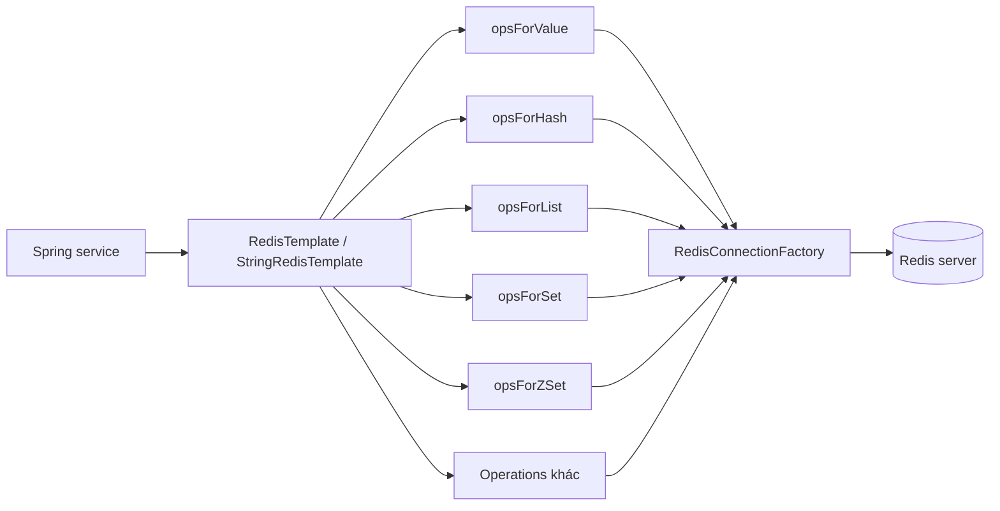

# Truy cập các nhóm opsForValue, opsForHash và các Operations khác

`RedisTemplate` là API trung tâm của **Spring Data Redis** dành cho thao tác Redis theo mô hình đồng bộ. Thay vì gửi câu lệnh dạng chuỗi qua socket, ứng dụng Java lấy một nhóm thao tác theo **kiểu dữ liệu Redis**: `opsForValue()` để làm việc với String, `opsForHash()` với Hash, `opsForList()` với List, `opsForSet()` với Set, `opsForZSet()` với Sorted Set và nhiều nhóm khác.

Điểm quan trọng là **tên nhóm Operations phản ánh cấu trúc dữ liệu đang lưu trong Redis**, không phản ánh kiểu biến Java. Chẳng hạn, một đối tượng Java `ProductDto` được tuần tự hóa thành JSON String có thể được lưu bằng `opsForValue()`; trong khi một `Map<String, String>` được lưu thành Redis Hash thì dùng `opsForHash()`.

Bài học thuộc chương **RedisTemplate** và tập trung vào cách chọn nhóm `opsFor...`, cách gọi API trong Spring Boot, dữ liệu được lưu thực tế, quy tắc TTL/serializer, cùng những giới hạn khi ứng dụng có nhiều luồng hoặc nhiều instance.

## 1. Bức tranh tổng thể về RedisTemplate

Sơ đồ luồng xử lý:



`RedisTemplate<K, V>` giữ các trách nhiệm chung như kết nối, serialization, dịch ngoại lệ, callback và hỗ trợ pipeline/transaction. Các đối tượng Operations được lấy từ template để cung cấp những method tương ứng với từng nhóm lệnh.

```java
ValueOperations<String, String> values = redis.opsForValue();
HashOperations<String, String, String> hashes = redis.opsForHash();
ListOperations<String, String> lists = redis.opsForList();
SetOperations<String, String> sets = redis.opsForSet();
ZSetOperations<String, String> sortedSets = redis.opsForZSet();
```

Đoạn trên giả định `redis` là một `StringRedisTemplate`. Trong thực tế, bạn thường gọi trực tiếp:

```java
redis.opsForValue().set("app:message", "Hello Redis");
String message = redis.opsForValue().get("app:message");
```

### 1.1. Bảng lựa chọn nhanh

| Nhóm API | Kiểu dữ liệu Redis | Lệnh Redis thường gặp | Ví dụ nghiệp vụ |
|---|---|---|---|
| `opsForValue()` | String | `SET`, `GET`, `INCR`, `MGET` | Cache JSON, token tạm, bộ đếm |
| `opsForHash()` | Hash | `HSET`, `HGET`, `HMGET`, `HINCRBY` | Profile gồm nhiều field, metadata |
| `opsForList()` | List | `LPUSH`, `RPUSH`, `LRANGE`, `LPOP` | Danh sách hoạt động gần đây, queue đơn giản |
| `opsForSet()` | Set | `SADD`, `SISMEMBER`, `SREM`, `SINTER` | Thành viên duy nhất, tag, quyền |
| `opsForZSet()` | Sorted Set | `ZADD`, `ZRANGE`, `ZREVRANK` | Leaderboard, sắp xếp theo điểm |
| `opsForGeo()` | Geospatial dựa trên Sorted Set | `GEOADD`, `GEODIST`, `GEOSEARCH` | Tìm điểm gần vị trí |
| `opsForHyperLogLog()` | HyperLogLog | `PFADD`, `PFCOUNT`, `PFMERGE` | Ước lượng số người dùng duy nhất |
| `opsForStream()` | Stream | `XADD`, `XREAD`, `XACK` | Nhật ký sự kiện và consumer group |

Ngoài các nhóm trên, `RedisTemplate` còn cung cấp thao tác cấp **toàn key** như `delete`, `unlink`, `expire`, `getExpire`, `hasKey`, `type`, `rename`, và các API callback, pipeline hoặc transaction.

## 2. Chuẩn bị Spring Boot và một Redis server

Ví dụ sử dụng **Spring Boot 3.x** và Spring Data Redis đồng bộ. Cần một Redis server đang chạy, có thể là container Docker hoặc instance dành riêng cho development.

Với Gradle Groovy DSL:

```groovy
dependencies {
    implementation 'org.springframework.boot:spring-boot-starter-data-redis'
}
```

`application.yml` dành cho môi trường local:

```yaml
spring:
  data:
    redis:
      host: ${REDIS_HOST:127.0.0.1}
      port: ${REDIS_PORT:6379}
      timeout: 2s
```

Thông thường Spring Boot tự cấu hình `RedisConnectionFactory` và `StringRedisTemplate` khi starter, driver và các điều kiện auto-configuration phù hợp. Lettuce thường là client mặc định của starter; ứng dụng không cần mở socket Redis thủ công.

Có thể kiểm tra kết nối từ terminal có `redis-cli`:

```redis
PING
```

Kết quả mong đợi:

```text
PONG
```

Hoặc thử bằng Java:

```java
@Service
public class RedisPingService {

    private final StringRedisTemplate redis;

    public RedisPingService(StringRedisTemplate redis) {
        this.redis = redis;
    }

    public void writeAndRead() {
        redis.opsForValue().set("demo:ping", "ok", Duration.ofSeconds(30));
        String result = redis.opsForValue().get("demo:ping");
        System.out.println(result); // ok nếu ghi/đọc thành công
    }
}
```

Các import trong ví dụ: `java.time.Duration`, `org.springframework.stereotype.Service` và `org.springframework.data.redis.core.StringRedisTemplate`. Khi thiếu Redis server hoặc đường mạng bị chặn, lời gọi thao tác có thể phát sinh ngoại lệ kết nối/timeout. Việc inject thành công template **không chứng minh** Redis đang sẵn sàng.

## 3. Hiểu serializer trước khi chọn nhóm Operations

Redis lưu key và value dưới dạng **chuỗi byte**. Kiểu Java `String`, `Long`, `Map` hay DTO chỉ tồn tại ở phía ứng dụng; template chuyển chúng thành byte thông qua serializer.

Có bốn vị trí cấu hình phổ biến:

| Thuộc tính template | Thành phần được mã hóa |
|---|---|
| `keySerializer` | Redis key chính, ví dụ `product:42` |
| `valueSerializer` | Redis String value hoặc phần tử collection |
| `hashKeySerializer` | Tên field bên trong Redis Hash |
| `hashValueSerializer` | Value của field bên trong Redis Hash |

`StringRedisTemplate` sử dụng cách biểu diễn chuỗi cho các vị trí thường gặp, nên rất tiện khi muốn kiểm tra Redis bằng CLI.

```java
@Service
public class RedisTextService {
    private final StringRedisTemplate redis;

    public RedisTextService(StringRedisTemplate redis) {
        this.redis = redis;
    }

    public void save(String key, String value) {
        redis.opsForValue().set(key, value);
    }
}
```

Với `RedisTemplate` tổng quát, cần biết serializer mặc định hoặc serializer mà dự án đã cấu hình. RedisTemplate không được tự suy luận rằng mọi object Java sẽ lưu thành JSON có thể đọc bằng `redis-cli`. Trong nhiều cấu hình mặc định, Java serialization có thể được sử dụng; nó tạo dữ liệu nhị phân và cần chú ý tương thích/bảo mật.

### 3.1. Tạo một RedisTemplate dùng chuỗi minh bạch

Dù thường chỉ cần `StringRedisTemplate`, ví dụ sau thể hiện cách cấu hình các serializer khi tự tạo template:

```java
import org.springframework.context.annotation.Bean;
import org.springframework.context.annotation.Configuration;
import org.springframework.data.redis.connection.RedisConnectionFactory;
import org.springframework.data.redis.core.RedisTemplate;
import org.springframework.data.redis.serializer.StringRedisSerializer;

@Configuration
public class RedisTextTemplateConfiguration {

    @Bean
    RedisTemplate<String, String> explicitTextRedisTemplate(
            RedisConnectionFactory factory) {

        StringRedisSerializer stringSerializer = new StringRedisSerializer();

        RedisTemplate<String, String> template = new RedisTemplate<>();
        template.setConnectionFactory(factory);
        template.setKeySerializer(stringSerializer);
        template.setValueSerializer(stringSerializer);
        template.setHashKeySerializer(stringSerializer);
        template.setHashValueSerializer(stringSerializer);
        template.afterPropertiesSet();

        return template;
    }
}
```

Bean được cấu hình **một lần khi khởi động**. Sau đó có thể chia sẻ template giữa các request/thread. Không thay serializer giữa chừng vì cùng một key sẽ bị đọc/ghi dưới các định dạng khác nhau.

Nếu dự án cần object JSON, nên xác định DTO, cấu trúc JSON, serializer và chiến lược phiên bản hóa. Một cách dễ quan sát là dùng `StringRedisTemplate` kèm `ObjectMapper` để tự chuyển DTO thành String JSON; tránh để serializer thay đổi ngầm theo cấu hình của từng module.

### 3.2. Ví dụ lưu DTO dưới dạng Redis String

```java
public record ProductView(long id, String name, long price) {
}
```

Service:

```java
import com.fasterxml.jackson.core.JsonProcessingException;
import com.fasterxml.jackson.databind.ObjectMapper;
import java.time.Duration;
import org.springframework.data.redis.core.StringRedisTemplate;
import org.springframework.stereotype.Service;

@Service
public class ProductJsonCache {

    private final StringRedisTemplate redis;
    private final ObjectMapper mapper;

    public ProductJsonCache(StringRedisTemplate redis, ObjectMapper mapper) {
        this.redis = redis;
        this.mapper = mapper;
    }

    public void put(ProductView product) throws JsonProcessingException {
        String json = mapper.writeValueAsString(product);
        redis.opsForValue().set(
                "product:view:" + product.id(),
                json,
                Duration.ofMinutes(5)
        );
    }

    public ProductView get(long productId) throws JsonProcessingException {
        String json = redis.opsForValue().get("product:view:" + productId);
        return json == null ? null : mapper.readValue(json, ProductView.class);
    }
}
```

`ObjectMapper` ở đây là bean Jackson đã được cấu hình trong ứng dụng Spring Boot có hỗ trợ Jackson. Lưu object ở dạng JSON thuận tiện để gỡ lỗi, nhưng chi phí serialization/deserialization và tương thích schema vẫn cần được quản lý.

## 4. `opsForValue()`: thao tác với Redis String

`ValueOperations<K, V>` là nhóm thao tác với một value của một Redis key. Redis String có thể chứa văn bản, byte, JSON hoặc số được mã hóa thành chuỗi.

### 4.1. `set` và `get`

```java
redis.opsForValue().set("shop:message", "Hello");
String value = redis.opsForValue().get("shop:message");
```

Lệnh Redis tương đương về ý nghĩa:

```redis
SET shop:message Hello
GET shop:message
```

Nếu key không tồn tại hoặc đã hết hạn, `get` thường trả `null`. Điều đó khác với chuỗi rỗng `""`, vốn là giá trị hợp lệ có thể được lưu trong Redis.

Có thể lưu với TTL ngay trong thao tác `set`:

```java
redis.opsForValue().set(
        "shop:otp:request:42",
        "pending",
        Duration.ofMinutes(2)
);
```

TTL của **key** bắt đầu khi lệnh ghi có hiệu lực. Sau khi hết hạn, Redis không tiếp tục coi key tồn tại.

### 4.2. `setIfAbsent`: chỉ tạo khi key chưa tồn tại

```java
Boolean created = redis.opsForValue().setIfAbsent(
        "job:42:claim",
        "worker-7",
        Duration.ofSeconds(30)
);
```

Ý nghĩa tương ứng với `SET ... NX` kèm expiry:

```redis
SET job:42:claim worker-7 NX EX 30
```

Nếu key chưa tồn tại, thao tác tạo key và đặt TTL có thể xảy ra trong **một lệnh Redis**. Nếu key đã tồn tại, kết quả thông thường là `false` và value cũ được giữ lại.

Mẫu này hữu ích cho cờ tạm/idempotency sơ bộ, nhưng **chưa phải giải pháp distributed lock hoàn chỉnh**. Nếu dùng làm lock, phải xem xét token chủ sở hữu, thời hạn lease, xóa khóa có kiểm tra chủ sở hữu, failover và tác vụ chạy quá TTL.

Giá trị trả về là `Boolean` dạng đối tượng; ở các ngữ cảnh pipeline/transaction có method trả `null` trước khi kết quả thật được thu thập. Vì vậy code nên so sánh:

```java
if (Boolean.TRUE.equals(created)) {
    // Đã tạo key trong lời gọi đồng bộ thông thường.
}
```

### 4.3. Bộ đếm `increment` và `decrement`

```java
Long newCount = redis.opsForValue().increment("views:article:42");

Long next = redis.opsForValue().increment("quota:used:42", 5L);

Long remaining = redis.opsForValue().decrement("quota:remaining:42");
```

Redis dùng các lệnh như `INCR`, `INCRBY`, `DECR`. Mỗi lệnh tăng/giảm số nguyên được Redis xử lý nguyên tử đối với key tương ứng.

Không nên viết quy trình:

```java
// RỦI RO LOST UPDATE KHI NHIỀU REQUEST:
String old = redis.opsForValue().get("views:article:42");
long next = Long.parseLong(old == null ? "0" : old) + 1;
redis.opsForValue().set("views:article:42", Long.toString(next));
```

Hai request có thể cùng đọc giá trị cũ rồi ghi đè lên nhau. `increment` tránh được race đó cho thao tác tăng một key.

Redis value cần chứa biểu diễn số phù hợp với lệnh tăng/giảm. Nếu key đã chứa `"hello"` hoặc JSON, Redis sẽ trả lỗi kiểu dữ liệu/giá trị không hợp lệ. `increment` cũng không tự đặt TTL khi tạo key mới; nếu cần expiry gắn nguyên tử vào logic nhiều bước, hãy thiết kế transaction/script phù hợp.

### 4.4. Đọc nhiều key trong một lần

```java
List<String> values = redis.opsForValue().multiGet(
        List.of("product:1:name", "product:2:name", "product:3:name")
);
```

Tương ứng về ý nghĩa với `MGET`, giúp giảm số round-trip so với ba lời gọi `get` tuần tự trong một số trường hợp.

Cần giữ thứ tự đầu vào khi ghép kết quả với key. Key không tồn tại có thể có vị trí `null` trong danh sách kết quả. Trong Redis Cluster, các thao tác nhiều key có thể chịu giới hạn hash slot hoặc cách driver phân tách lệnh; không mặc định mọi lệnh multi-key dùng được trên các slot khác nhau.

### 4.5. Khi nào nên dùng Value thay vì Hash?

Dùng `opsForValue()` khi ứng dụng:

- Đọc/ghi toàn bộ object được serialize thành JSON.
- Lưu token/cờ trạng thái ngắn hạn, hoặc một chuỗi đơn giản.
- Tăng bộ đếm.
- Cần một value đại diện cho một key với TTL rõ ràng.

Nếu cần cập nhật từng trường như `profile.name` mà không tải và ghi lại cả JSON, Hash có thể phù hợp hơn.

## 5. `opsForHash()`: thao tác với các field của một Redis Hash

Redis Hash chứa nhiều cặp **field → value** dưới một key:

```text
user:42:profile
    name   → An
    city   → Ha Noi
    level  → gold
```

Trong Spring Data Redis, nhóm `HashOperations<H, HK, HV>` trong thực tế có ba tham số kiểu: `H` là key Redis chính, `HK` là field, `HV` là value của field.

Với `StringRedisTemplate`:

```java
HashOperations<String, String, String> hashes = redis.opsForHash();
```

### 5.1. Ghi và đọc một field

```java
redis.opsForHash().put("user:42:profile", "name", "An");
redis.opsForHash().put("user:42:profile", "city", "Ha Noi");

Object name = redis.opsForHash().get("user:42:profile", "name");
```

Tương ứng:

```redis
HSET user:42:profile name An
HSET user:42:profile city "Ha Noi"
HGET user:42:profile name
```

Khi dùng `StringRedisTemplate`, giá trị được lưu dưới dạng chuỗi nhưng `opsForHash().get(...)` có kiểu trả về `Object` tùy phương thức và generic signature của template. Trong service, có thể kiểm tra `null` và chuyển về kiểu phù hợp.

Redis Hash **không phải Java `HashMap` chạy trong RAM JVM**. Nó là một giá trị tồn tại ở Redis server, được truy cập qua lệnh mạng.

### 5.2. Ghi nhiều field

```java
Map<String, String> fields = Map.of(
        "name", "An",
        "city", "Ha Noi",
        "tier", "silver"
);

redis.opsForHash().putAll("user:42:profile", fields);
```

Tương ứng với thao tác ghi nhiều field (`HSET` nhiều cặp field–value). Nếu một field đã tồn tại, nội dung của field đó có thể bị cập nhật; không cần xóa cả Hash trước khi thay đổi một field.

Đối với field phải bảo toàn nếu đã có, tham khảo `putIfAbsent`:

```java
Boolean inserted = redis.opsForHash()
        .putIfAbsent("user:42:profile", "createdBy", "registration");
```

### 5.3. Đọc những field cần thiết

```java
List<Object> summary = redis.opsForHash().multiGet(
        "user:42:profile",
        List.of("name", "tier")
);
```

Tương tự `HMGET`, thao tác này chỉ yêu cầu các field được chỉ định.

Các phương thức khác:

```java
Long count = redis.opsForHash().size("user:42:profile");
Boolean hasTier = redis.opsForHash().hasKey("user:42:profile", "tier");
Long removed = redis.opsForHash().delete("user:42:profile", "tier");
```

Với Hash nhỏ, có thể xem toàn bộ:

```java
Map<Object, Object> allFields =
        redis.opsForHash().entries("user:42:profile");
```

Nhưng **không mặc định dùng `entries()` cho Hash có hàng trăm nghìn field**. Redis tương ứng với `HGETALL` và có thể trả về payload rất lớn, gây độ trễ mạng và áp lực bộ nhớ JVM. Khi cần xử lý theo lô, xem xét `scan` hoặc thiết kế lại cách lưu/truy vấn.

### 5.4. Tăng số trong một field

```java
Long points = redis.opsForHash().increment(
        "user:42:stats",
        "points",
        10L
);
```

Phù hợp với lệnh `HINCRBY` cho field có value biểu diễn số nguyên. Tăng field không phải quy trình đọc–cộng–ghi ở Java, nên tránh lost update của cách thao tác nhiều lệnh.

### 5.5. Hash và TTL

TTL thông thường được quản lý ở cấp **Redis key**:

```java
redis.opsForHash().put("user:42:profile", "name", "An");
redis.expire("user:42:profile", Duration.ofMinutes(15));
```

Điều này đặt thời hạn cho **toàn bộ Hash** `user:42:profile`, không chỉ field `name`. Một số phiên bản Redis mới hỗ trợ khả năng expiration cấp hash field, nhưng API và điều kiện hỗ trợ phụ thuộc phiên bản server/driver/Spring Data Redis. Các ví dụ cơ bản ở đây sử dụng TTL cấp key.

Nếu ứng dụng muốn từng thuộc tính có TTL khác nhau và hoạt động độc lập, có thể thiết kế nhiều key thay vì ép tất cả vào cùng Hash.

### 5.6. Hash hay JSON String?

| Tiêu chí | Hash | JSON String |
|---|---|---|
| Cập nhật một field | `HSET` trực tiếp | Thường phải đọc/sửa/serialize lại toàn bộ JSON |
| Đọc toàn bộ object | `HGETALL` khi phù hợp | Một `GET` |
| Dữ liệu lồng nhau phức tạp | Cần quy ước flatten/serialization | JSON biểu diễn tự nhiên hơn |
| TTL cơ bản | Trên key Hash | Trên key String |
| Kiểu dữ liệu Java | Tùy hash serializer và mapper | Tùy serializer/JSON mapper |
| Khối lượng dữ liệu lớn | Tránh `entries()` không giới hạn | Tránh String JSON khổng lồ |

Chọn theo **kiểu thao tác**, kích thước dữ liệu và chiến lược cập nhật, không chỉ theo việc object Java có nhiều field.

## 6. `opsForList()`: danh sách có thứ tự

Redis List phù hợp với việc thêm/xóa ở hai đầu, giữ các phần tử theo một thứ tự tuyến tính.

Ví dụ lưu các hoạt động gần nhất của người dùng:

```java
ListOperations<String, String> list = redis.opsForList();

list.leftPush("user:42:recent", "view:product:100");
list.leftPush("user:42:recent", "view:product:101");

List<String> recent = list.range("user:42:recent", 0, 9);
```

Với `LPUSH`, phần tử mới ở đầu danh sách. `range(key, 0, 9)` lấy tối đa 10 phần tử đầu (nếu danh sách có đủ).

### 6.1. Các phương thức thường dùng

| API | Ý nghĩa | Lệnh Redis |
|---|---|---|
| `leftPush(key, value)` | Thêm đầu danh sách | `LPUSH` |
| `rightPush(key, value)` | Thêm cuối | `RPUSH` |
| `leftPop(key)` | Lấy và xóa phần tử đầu | `LPOP` |
| `rightPop(key)` | Lấy và xóa phần tử cuối | `RPOP` |
| `range(key, start, end)` | Đọc khoảng chỉ số | `LRANGE` |
| `trim(key, start, end)` | Giữ lại khoảng chỉ số | `LTRIM` |
| `size(key)` | Lấy số phần tử | `LLEN` |

Ví dụ giới hạn tối đa 100 hoạt động:

```java
redis.opsForList().leftPush("user:42:recent", "view:product:102");
redis.opsForList().trim("user:42:recent", 0, 99);
```

**Hai lời gọi trên là hai thao tác tách biệt.** Trong tình huống nhiều writer và yêu cầu bất biến chặt về giới hạn kích thước, cần gộp bằng cơ chế phù hợp (chẳng hạn Lua script) thay vì giả định `leftPush` cộng `trim` tự động nguyên tử.

Không nên dùng:

```java
redis.opsForList().range("user:42:recent", 0, -1);
```

trên List rất lớn khi UI chỉ cần vài chục phần tử. `-1` trong Redis mang ý nghĩa cuối danh sách, không phải một số lượng nhỏ.

### 6.2. Dùng List làm queue có giới hạn

Một mô hình FIFO đơn giản:

```java
redis.opsForList().leftPush("queue:demo", "task:1");
String task = redis.opsForList().rightPop("queue:demo");
```

Các thao tác này phù hợp với queue demo hoặc công việc nhẹ, nhưng **không tự cung cấp cơ chế ack/retry bền vững khi worker chết giữa lúc lấy và xử lý**. Đối với job quan trọng, cân nhắc Redis Streams có consumer group hoặc một message broker phù hợp.

Một số API List có biến thể blocking theo timeout, hữu ích cho consumer đợi công việc. Cần đặt timeout và quản lý số kết nối blocking thích hợp; không gọi blocking operation không kiểm soát trong thread xử lý HTTP.

## 7. `opsForSet()`: tập phần tử duy nhất

Redis Set không cho phép phần tử trùng nhau. Kiểu này phù hợp với câu hỏi “người dùng đã tham gia nhóm chưa?” hoặc “một sản phẩm có tag này không?”.

```java
SetOperations<String, String> set = redis.opsForSet();

set.add("course:redis:students", "user:1", "user:2");
set.add("course:redis:students", "user:2");

Boolean enrolled =
        set.isMember("course:redis:students", "user:2");

Long total = set.size("course:redis:students");
```

Dù `user:2` được thêm nhiều lần, tập chỉ chứa một member `user:2`.

### 7.1. Các thao tác quan trọng

| API | Ý nghĩa | Redis command |
|---|---|---|
| `add` | Thêm member | `SADD` |
| `isMember` | Kiểm tra tồn tại | `SISMEMBER` |
| `size` | Đếm member | `SCARD` |
| `remove` | Xóa member | `SREM` |
| `members` | Lấy mọi member | `SMEMBERS` |
| `intersect` | Giao hai hoặc nhiều tập | `SINTER` |
| `union` | Hợp các tập | `SUNION` |
| `randomMember` | Chọn member ngẫu nhiên không xóa | `SRANDMEMBER` |

Ví dụ xác định người cùng tham gia hai khóa học:

```java
Set<String> common = redis.opsForSet().intersect(
        "course:java:students",
        "course:redis:students"
);
```

Kết quả là giao các member giữa hai Set. Chú ý: lệnh tạo kết quả lớn vẫn có thể tiêu tốn nhiều CPU/RAM; cần đánh giá cardinality trước khi gọi trên tập có hàng triệu phần tử.

### 7.2. Set không bảo đảm thứ tự hiển thị

Không dùng `members()` rồi giả định danh sách trả về theo thời điểm tham gia. Redis Set **không có thứ tự có ý nghĩa nghiệp vụ**. Khi cần sắp xếp theo timestamp/score, hãy xem xét Sorted Set.

`members()` cũng không phù hợp để phân trang trên Set cực lớn. Redis hỗ trợ `SSCAN` theo cursor; Spring Data Redis có các API scan thích hợp để duyệt từng phần, nhưng cần lưu ý cursor scan không phải trang ổn định khi dữ liệu thay đổi.

## 8. `opsForZSet()`: Sorted Set có score

Sorted Set lưu các member duy nhất kèm **score** dạng số. Redis sắp xếp theo score, hỗ trợ lấy thứ hạng, top N và cập nhật điểm.

Ví dụ bảng xếp hạng:

```java
ZSetOperations<String, String> ranking = redis.opsForZSet();

ranking.add("leaderboard:weekly", "user:1", 120.0);
ranking.add("leaderboard:weekly", "user:2", 200.0);
ranking.add("leaderboard:weekly", "user:3", 150.0);
```

Lấy top 3 theo thứ tự điểm giảm dần:

```java
Set<ZSetOperations.TypedTuple<String>> top =
        ranking.reverseRangeWithScores("leaderboard:weekly", 0, 2);

if (top != null) {
    for (ZSetOperations.TypedTuple<String> entry : top) {
        System.out.println(entry.getValue() + ": " + entry.getScore());
    }
}
```

`reverseRangeWithScores` trả member và score; với trường hợp không có pipeline/transaction, các phần tử được sắp theo thứ tự Redis xác định. Tránh dùng bản chỉ lấy member nếu UI còn cần hiển thị điểm và việc truy vấn lại score riêng lẻ tạo nhiều round-trip.

### 8.1. Những thao tác thường dùng

```java
Double current = ranking.score("leaderboard:weekly", "user:2");

Double updated = ranking.incrementScore(
        "leaderboard:weekly", "user:1", 15.0
);

Long reverseRank =
        ranking.reverseRank("leaderboard:weekly", "user:1");

Long numberOfPlayers = ranking.zCard("leaderboard:weekly");
```

- `score` lấy điểm hiện tại.
- `incrementScore` tăng score của một member trên Redis.
- `reverseRank` lấy thứ hạng theo điểm giảm dần, **đánh số từ 0**.
- `zCard` lấy số member.

Nếu UI đánh số hạng từ 1, cần chuyển `reverseRank + 1` khi kết quả không null.

### 8.2. Sorted Set không phải List

| Redis List | Redis Sorted Set |
|---|---|
| Thứ tự dựa trên vị trí phần tử | Thứ tự dựa trên score (và quy tắc phụ khi bằng điểm) |
| Có thể chứa giá trị trùng nhau | Member duy nhất; thêm lại member cập nhật score |
| Phù hợp FIFO, recent events | Phù hợp leaderboard, ranking, lịch theo điểm/thời gian |
| Lấy bằng index | Lấy bằng rank/range theo score tùy API |

Không dùng Sorted Set chỉ vì “muốn có danh sách”. Nếu không có nhu cầu sắp thứ tự theo score, List hoặc Set có thể đơn giản hơn.

### 8.3. Lưu ý với độ chính xác điểm số

Score là số dấu phẩy động. Với bài toán tiền tệ hoặc số lượng cần độ chính xác tuyệt đối, không tự dùng score dạng `double` để đại diện cho số tiền. Cần kiểu lưu trữ và phép toán được thiết kế theo yêu cầu độ chính xác, ví dụ số nguyên đơn vị nhỏ nhất ở nơi phù hợp.

Sorted Set có thể là cấu trúc index/ranking, nhưng database nghiệp vụ vẫn có thể là nguồn sự thật của điểm, giải thưởng hoặc giao dịch.

## 9. `opsForGeo()`: dữ liệu vị trí

Redis hỗ trợ các thao tác địa lý, trong đó tọa độ được mã hóa trong một cấu trúc dựa trên Sorted Set. `GeoOperations` giúp thêm địa điểm, đo khoảng cách và tìm các điểm trong phạm vi.

Ví dụ:

```java
import org.springframework.data.geo.Distance;
import org.springframework.data.geo.Metrics;
import org.springframework.data.geo.Point;

redis.opsForGeo().add(
        "geo:pickup-points",
        new Point(106.70, 10.80),
        "pickup:1"
);

redis.opsForGeo().add(
        "geo:pickup-points",
        new Point(106.75, 10.82),
        "pickup:2"
);

Distance distance = redis.opsForGeo().distance(
        "geo:pickup-points",
        "pickup:1",
        "pickup:2",
        Metrics.KILOMETERS
);
```

`Point(x, y)` ở đây nhận **kinh độ (longitude), vĩ độ (latitude)**. Đảo nhầm thứ tự là lỗi phổ biến khiến kết quả khoảng cách hoặc tìm kiếm không đúng.

Các nhóm khả năng thường gặp:

- `add`: thêm hoặc cập nhật tọa độ của member.
- `distance`: tính khoảng cách giữa hai member đang lưu trong cùng key địa lý.
- `position`: lấy tọa độ của member.
- `search`: tìm member theo tham chiếu vị trí/khoảng cách và tùy chọn truy vấn được phiên bản API hỗ trợ.
- `remove`: xóa member.

Kết quả tìm kiếm vị trí phụ thuộc semantics Redis Geo và giới hạn khoảng cách; đây không phải hệ GIS đầy đủ với đường đi, vùng đa giác phức tạp hoặc bản đồ giao thông. Với những yêu cầu đó, cân nhắc hạ tầng địa lý chuyên dụng.

## 10. `opsForHyperLogLog()`: ước lượng số phần tử khác nhau

Một số sản phẩm muốn trả lời câu hỏi “hôm nay có khoảng bao nhiêu người dùng khác nhau?” mà không cần lưu hàng triệu ID trong một Set chính xác. Redis HyperLogLog giúp **ước lượng cardinality** với bộ nhớ nhỏ, đổi lại kết quả có sai số xác suất.

```java
HyperLogLogOperations<String, String> hll = redis.opsForHyperLogLog();

hll.add("uv:2026-11-12", "user:1", "user:2", "user:1");

Long uniqueEstimate = hll.size("uv:2026-11-12");
```

Giá trị trả về là **ước lượng**, không phải phép đếm chính xác tuyệt đối như `SCARD` trên Set.

Các lưu ý:

- HyperLogLog chủ yếu hỗ trợ thêm phần tử và ước lượng số phần tử khác nhau; không có thao tác “lấy toàn bộ user ID” như Set.
- Không dùng nó để làm membership test hoặc cơ sở xác định người dùng có quyền truy cập.
- Có thể hợp nhất nhiều HyperLogLog theo khả năng API và server, hữu ích cho báo cáo qua nhiều khoảng thời gian.
- Chọn key theo ngày/tuần/tháng và TTL/retention theo yêu cầu thống kê.

Nếu sản phẩm cần biết chính xác từng ID hoặc chỉ cần vài nghìn phần tử, Set có thể phù hợp hơn. HyperLogLog nên được sử dụng khi chấp nhận **approximate counting**.

## 11. `opsForStream()`: dữ liệu dạng luồng sự kiện

Redis Stream lưu các entry có ID tăng theo một thứ tự được Redis quản lý. Không giống List đơn giản, Stream hỗ trợ consumer group và trạng thái pending/ack cho luồng xử lý công việc.

Ví dụ thêm một entry:

```java
import java.util.Map;
import org.springframework.data.redis.connection.stream.MapRecord;
import org.springframework.data.redis.connection.stream.RecordId;
import org.springframework.data.redis.connection.stream.StreamRecords;

MapRecord<String, String, String> record =
        StreamRecords.mapBacked(
                Map.of("type", "order-created", "orderId", "42")
        ).withStreamKey("stream:orders");

RecordId id = redis.opsForStream().add(record);
```

Tương ứng về mặt chức năng với:

```redis
XADD stream:orders * type order-created orderId 42
```

ID giúp định danh entry trong Stream. Khi cần consumer group, ứng dụng còn phải quản lý:

1. Tạo consumer group và xác định điểm bắt đầu đọc.
2. Đọc entry bằng API stream tương ứng với `XREAD`/`XREADGROUP`.
3. Chỉ xác nhận (`ack`) sau khi xử lý thành công theo chính sách nghiệp vụ.
4. Theo dõi pending entry, retry/reclaim và idempotency.
5. Quy định retention/trim; Stream tăng mãi có thể trở thành Big Key.

Đừng suy rằng “đã đưa vào Stream” là xử lý exactly-once. Consumer có thể nhận lại entry sau timeout, crash hoặc retry. Khi side effect liên quan database hoặc service khác, phải có cơ chế chống xử lý trùng.

### 11.1. Phân biệt Stream với Pub/Sub

| Tiêu chí | Redis Stream | Redis Pub/Sub |
|---|---|---|
| Lưu entry để đọc sau | Có, theo retention | Không giữ lại message cho subscriber đã vắng mặt |
| Consumer group | Có | Không theo semantics Stream |
| Theo dõi ack/pending | Có | Không có trong Pub/Sub cơ bản |
| Tình huống | Event processing, work queue có quản lý | Thông báo thời gian thực đơn giản |

Pub/Sub thường được truy cập qua các API liên quan connection/listener container, không phải một trong các nhóm `opsForValue`/`opsForHash` thông thường. Trong Spring, `RedisMessageListenerContainer` là cách tích hợp phổ biến cho listener theo mô hình Pub/Sub.

## 12. Thao tác ở cấp key không thuộc riêng một nhóm `opsFor...`

Nhiều nhu cầu không phụ thuộc Redis key là String, Hash hay List. `RedisTemplate` cung cấp API trực tiếp:

```java
Boolean exists = redis.hasKey("product:view:42");

Boolean ttlSet = redis.expire(
        "product:view:42",
        Duration.ofMinutes(10)
);

Long secondsLeft =
        redis.getExpire("product:view:42", TimeUnit.SECONDS);

Boolean deleted = redis.delete("product:view:42");
```

Cần import `java.time.Duration` và `java.util.concurrent.TimeUnit` nếu dùng như trên.

### 12.1. TTL là thuộc tính của key

```redis
SET session:42 active EX 120
TTL session:42
```

Key có thể hết hạn; ứng dụng sau đó đọc được `null` hoặc phát hiện không tồn tại. TTL và eviction là hai cơ chế khác nhau:

- **TTL**: key tự hết hiệu lực theo thời gian đã đặt.
- **Eviction**: Redis có thể loại bỏ key theo chính sách bộ nhớ khi đạt giới hạn cấu hình.
- **Delete**: ứng dụng chủ động xóa key.

Một key có TTL vẫn có thể bị evict trước thời hạn; một key không có TTL vẫn có thể bị evict nếu policy cho phép. Đối với cache, luôn xác định fallback khi cache miss.

### 12.2. Cẩn thận với `delete` và `unlink`

`redis.delete(key)` ánh xạ đến thao tác xóa key. Với những giá trị rất lớn, giải phóng bộ nhớ đồng bộ có thể tạo độ trễ đáng kể.

Spring Data Redis còn hỗ trợ `unlink` ở các API tương ứng, ánh xạ đến lệnh Redis `UNLINK` trong những phiên bản phù hợp; lệnh gỡ key và cho phép giải phóng bộ nhớ bất đồng bộ khi khả dụng.

```java
Boolean unlinked = redis.unlink("cache:large:obsolete");
```

Sử dụng `UNLINK` không làm việc xóa “miễn phí”: bộ nhớ vẫn cần được thu hồi ở background. Chỉ xóa key sau khi biết rõ dữ liệu thuộc quyền quản lý của ứng dụng và có thể xóa.

### 12.3. `hasKey` rồi `set` không phải check-and-set nguyên tử

Đoạn mã:

```java
if (!Boolean.TRUE.equals(redis.hasKey("task:42"))) {
    redis.opsForValue().set("task:42", "processing");
}
```

có race condition khi hai instance cùng kiểm tra và cùng ghi. Nếu cần tạo key chỉ một lần, dùng `setIfAbsent` với timeout theo ngữ cảnh:

```java
Boolean acquired = redis.opsForValue().setIfAbsent(
        "task:42",
        "processing",
        Duration.ofSeconds(30)
);
```

Khi yêu cầu trải qua nhiều bước hơn một lệnh, phải thiết kế atomicity, idempotency và recovery tương ứng.

## 13. Bound Operations: gắn một key vào đối tượng thao tác

Bên cạnh `opsForValue()` hoặc `opsForHash()`, template còn có nhóm **bound operations**, ví dụ `boundValueOps(key)`, `boundHashOps(key)`, `boundListOps(key)`, `boundSetOps(key)`, `boundZSetOps(key)`.

Bound Operations giữ sẵn **key được thao tác** để tránh lặp lại ở mọi method call:

```java
import org.springframework.data.redis.core.BoundValueOperations;

BoundValueOperations<String, String> counter =
        redis.boundValueOps("counter:article:42");

counter.increment();
counter.increment();
String current = counter.get();
```

So sánh với API không bound:

```java
redis.opsForValue().increment("counter:article:42");
redis.opsForValue().increment("counter:article:42");
String current = redis.opsForValue().get("counter:article:42");
```

Hai cách thực hiện các nhóm thao tác tương ứng; bound operations không tự tạo transaction hoặc cache cục bộ cho value.

Với Hash:

```java
BoundHashOperations<String, String, String> profile =
        redis.boundHashOps("user:42:profile");

profile.put("name", "An");
profile.put("tier", "gold");
Object tier = profile.get("tier");
```

Đừng hiểu bound operations là lý do giữ `RedisConnection` thủ công. Bound Operations vẫn dùng cơ chế thực thi của template. Nếu cần bảo đảm một chuỗi lệnh nguyên tử, phải dùng đúng transaction/script chứ không chỉ gom lệnh quanh một đối tượng bound.

## 14. Truy cập nhiều nhóm Operations trong cùng một service

Một nghiệp vụ có thể dùng nhiều kiểu dữ liệu Redis, chẳng hạn lưu thông tin khóa học, danh sách học viên và bảng xếp hạng điểm.

```text
course:42:title             -> String
course:42:metadata          -> Hash
course:42:members           -> Set
course:42:recent-activity   -> List
course:42:leaderboard       -> Sorted Set
```

Service minh họa:

```java
import java.time.Duration;
import java.util.List;
import java.util.Set;

import org.springframework.data.redis.core.StringRedisTemplate;
import org.springframework.stereotype.Service;

@Service
public class CourseRedisService {

    private final StringRedisTemplate redis;

    public CourseRedisService(StringRedisTemplate redis) {
        this.redis = redis;
    }

    public void registerCourse(long courseId, String title) {
        String prefix = "course:" + courseId;

        redis.opsForValue()
                .set(prefix + ":title", title, Duration.ofDays(1));

        redis.opsForHash()
                .put(prefix + ":metadata", "status", "open");
    }

    public void enroll(long courseId, String userId) {
        String prefix = "course:" + courseId;

        redis.opsForSet()
                .add(prefix + ":members", userId);

        redis.opsForList()
                .leftPush(prefix + ":recent-activity", "enroll:" + userId);

        // Bảng xếp hạng bắt đầu từ 0 điểm.
        redis.opsForZSet()
                .addIfAbsent(prefix + ":leaderboard", userId, 0.0);
    }

    public Long rewardPoints(long courseId, String userId, long points) {
        String key = "course:" + courseId + ":points:" + userId;
        return redis.opsForValue().increment(key, points);
    }

    public Set<String> members(long courseId) {
        return redis.opsForSet().members("course:" + courseId + ":members");
    }

    public List<String> recentActivity(long courseId) {
        return redis.opsForList().range(
                "course:" + courseId + ":recent-activity", 0, 19
        );
    }
}
```

Ví dụ minh họa cách **mỗi nhóm Operations được chọn theo kiểu dữ liệu Redis**. Các key có hậu tố khác nhau giữ các vai trò riêng, tránh ghi String vào một key rồi đột ngột dùng Hash/List với cùng key gây `WRONGTYPE`.

Đây là ví dụ chức năng truy cập, chưa phải một quy trình đăng ký khóa học đầy đủ về nghiệp vụ. Các lời gọi `SADD`, `LPUSH` và `ZADD` tách nhau; nếu một lệnh lỗi hoặc tiến trình bị dừng giữa chừng, trạng thái của các key có thể không đồng bộ. Với dữ liệu cần bất biến chặt, phải định nghĩa transaction/script hoặc lưu nguồn sự thật trong database phù hợp.

### 14.1. Có thể gán TTL khác nhau cho từng key

Trong ví dụ trên, `course:42:title` có TTL 1 ngày nhưng metadata/member/list/leaderboard chưa được đặt TTL. Redis không tự suy ra rằng các key cùng tiền tố thuộc cùng một “object” và có cùng thời gian sống.

Nếu tất cả các key thuộc một phiên học tạm, ứng dụng phải chủ động áp dụng expiry phù hợp cho từng key hoặc tổ chức lại mô hình dữ liệu để nhất quán vòng đời.

## 15. Chọn cấu trúc dữ liệu theo thao tác, không theo tên biến Java

Ví dụ có một Java `List<String>`:

```java
List<String> tags = List.of("java", "spring", "redis");
```

Có ít nhất ba cách lưu có ý nghĩa khác nhau:

1. **String JSON**: lưu một String chứa `["java","spring","redis"]`, lấy bằng `GET`; thích hợp khi luôn đọc/ghi toàn bộ.
2. **Redis List**: lưu từng phần tử, giữ thứ tự và cho phép trùng lặp; thích hợp khi cần thao tác ở hai đầu.
3. **Redis Set**: lưu member duy nhất, kiểm tra membership nhanh; không bảo đảm thứ tự hiển thị.

Một Java `Map<String, String>` cũng có thể:

- Serialize thành JSON String và dùng `opsForValue()`.
- Lưu từng entry trong Redis Hash và dùng `opsForHash()`.

Chọn đúng dựa vào câu hỏi nghiệp vụ:

| Cần làm gì? | Nên cân nhắc |
|---|---|
| Đọc toàn bộ JSON được cache | Value |
| Cập nhật riêng trường `name` | Hash |
| Thêm hoạt động mới lên đầu | List |
| Kiểm tra user thuộc nhóm | Set |
| Lấy top 10 theo điểm | Sorted Set |
| Đo khoảng cách giữa điểm | Geo |
| Ước lượng unique visitors | HyperLogLog |
| Consumer đọc sự kiện và ack | Stream |

Không lưu một key duy nhất bằng nhiều kiểu khác nhau. Chẳng hạn:

```redis
SET demo:thing "hello"
HSET demo:thing name An
```

Lệnh `HSET` trên key đang là String sẽ gặp lỗi **`WRONGTYPE`**. Giải pháp là thiết kế key schema rõ ràng hoặc xóa/migrate key cũ có kiểm soát, không chỉ đổi API Java.

## 16. Quản lý kết quả `null`, `Boolean` và lỗi kết nối

Spring Data Redis có các kiểu trả về cần hiểu theo ngữ cảnh.

### 16.1. Key không tồn tại

```java
String missing = redis.opsForValue().get("key:does-not-exist");
```

`missing` thường là `null`. Với `HashOperations.get`, field không tồn tại cũng có thể trả `null`. Không nên dùng `null` để đại diện cho một bản ghi nghiệp vụ phức tạp mà không xác định rõ sự khác nhau giữa “không có key”, “đã hết TTL”, “đã bị evict” và “lỗi truy cập”.

Lỗi network/Redis server thường được biểu diễn bằng exception, không mặc định chỉ trả `null`.

### 16.2. `Boolean` dạng object

Nhiều method trả `Boolean` thay vì `boolean`:

```java
Boolean exists = redis.hasKey("user:42:profile");
Boolean removed = redis.delete("old:cache:key");

if (Boolean.TRUE.equals(exists)) {
    // Key hiện tồn tại trong lời gọi thông thường.
}
```

Cách so sánh trên an toàn về mặt null. Trong pipeline/transaction, một số method có thể trả `null` ngay lúc xếp lệnh; kết quả thực nằm trong tập phản hồi sau khi `exec`/pipeline hoàn tất.

### 16.3. TTL đặc biệt

Dùng:

```java
Long ttl = redis.getExpire("cache:product:42", TimeUnit.SECONDS);
```

Trong một lời gọi thông thường, Redis có thể biểu diễn các tình trạng đặc biệt như:

- Giá trị không âm: số giây còn lại.
- `-1`: key tồn tại nhưng không có TTL.
- `-2`: key không tồn tại.

Giá trị trả về ở Spring Data Redis có thể là `null` khi đang pipeline/transaction theo API tương ứng. Không viết logic chỉ dựa vào `ttl > 0` nếu còn các trường hợp vừa nêu.

### 16.4. Phân biệt dữ liệu không có với truy cập thất bại

Một ứng dụng cache cần xác định rõ:

- Cache miss: đọc database và có thể ghi cache.
- Redis timeout: fallback có giới hạn hoặc báo lỗi theo SLA.
- Dữ liệu deserialize thất bại: điều tra key schema/serializer/version.
- `WRONGTYPE`: có xung đột kiểu dữ liệu tại key.
- Redis hết bộ nhớ với chính sách không eviction phù hợp: lệnh ghi có thể thất bại.

Không nên bắt mọi exception rồi coi là cache miss; cách đó dễ che khuất sự cố hạ tầng và làm cơ sở dữ liệu bị dồn tải.

## 17. Concurrency: Operations không tự gộp nhiều lệnh thành nguyên tử

`RedisTemplate` đã cấu hình thường có thể được nhiều thread cùng sử dụng. Spring Data Redis quản lý việc thực thi lời gọi thông qua factory/connection. Tuy nhiên, **nhiều method liên tiếp không mặc nhiên là một transaction**.

Ví dụ:

```java
redis.opsForValue().increment("rate:user:42");
redis.expire("rate:user:42", Duration.ofMinutes(1));
```

Nếu tiến trình chết hoặc mạng lỗi sau `increment` nhưng trước `expire`, key có thể không có TTL. Đối với rate limiter, đây có thể là bug vì key không được dọn đúng.

Nếu cần một bất biến nhiều bước, có thể dùng Lua script hoặc transaction được quản lý thích hợp, tùy semantics:

```text
Một lệnh nguyên tử: INCR
Hai lệnh độc lập: INCR; EXPIRE
Một script Redis: kiểm tra, tăng, đặt TTL theo quy tắc trong cùng lượt thực thi
```

Ngoài ra, retry lệnh không idempotent như `INCR` có thể tăng hai lần nếu Redis đã thực thi nhưng client bị timeout trước khi nhận phản hồi. Bất biến nghiệp vụ cần idempotency riêng khi có retry.

## 18. `execute`, callback và các thao tác mức thấp

`RedisTemplate.execute(RedisCallback<T>)` cho phép truy cập `RedisConnection` trong phạm vi callback. Điều này hữu ích khi API Operations chưa thể hiện trực tiếp lệnh hoặc cần tinh chỉnh một thao tác cụ thể.

```java
import java.nio.charset.StandardCharsets;
import org.springframework.data.redis.core.RedisCallback;

Long result = redis.execute((RedisCallback<Long>) connection -> {
    byte[] key = "counter:example".getBytes(StandardCharsets.UTF_8);
    return connection.stringCommands().incr(key);
});
```

Trong callback:

- Không lưu `RedisConnection` vào biến static hoặc field để dùng sau.
- Không đưa connection sang thread khác.
- Không tự đóng connection được template cung cấp cho callback.
- Không chuyển giao connection ra ngoài phạm vi callback.

Callback là cách truy cập thấp hơn, không bắt buộc cho lệnh thông thường đã có trong `opsForValue()` hay `opsForHash()`. Khi có API Operations tương ứng, nên dùng API đó để code dễ hiểu hơn.

### 18.1. Pipeline cho nhiều thao tác độc lập

Pipelining có thể giảm round-trip khi gửi nhiều lệnh đến Redis:

```java
import java.nio.charset.StandardCharsets;
import java.util.List;
import org.springframework.data.redis.core.RedisCallback;

List<Object> results = redis.executePipelined(
        (RedisCallback<Object>) connection -> {
            connection.stringCommands().incr(
                    "metrics:read".getBytes(StandardCharsets.UTF_8)
            );
            connection.stringCommands().incr(
                    "metrics:write".getBytes(StandardCharsets.UTF_8)
            );
            return null;
        }
);
```

Callback trong ví dụ trả `null` vì kết quả pipeline được thu thập bởi `executePipelined` và trả ở danh sách bên ngoài. Định dạng kết quả còn liên quan serializer của template.

**Pipeline không phải transaction nguyên tử.** Redis có thể thực thi nhiều lệnh nối tiếp nhưng các thao tác vẫn có semantics riêng; không dựa vào pipeline để bảo đảm “tất cả cùng thành công hoặc tất cả cùng thất bại”.

### 18.2. Transaction Redis

Redis hỗ trợ `MULTI`/`EXEC`, và Spring Data Redis có các API như `SessionCallback` giúp nhóm lệnh trong một ngữ cảnh session phù hợp. Nếu cần `WATCH` để optimistic locking, phải quản lý cùng session và kiểm tra kết quả `EXEC` có bị hủy hay không.

Các ranh giới quan trọng:

- Transaction Redis không tự tạo transaction chung với database SQL.
- `MULTI`/`EXEC` không có rollback kiểu database quan hệ cho mọi loại lỗi.
- Không chia sẻ cùng `RedisConnection` giữa nhiều thread để “giữ chung transaction”.
- Không dùng transaction để che giấu việc đã chọn cấu trúc dữ liệu không phù hợp; đôi khi một lệnh nguyên tử hoặc Lua script sẽ đơn giản hơn.

## 19. RedisTemplate, Spring Cache và Repository khác nhau gì?

`RedisTemplate` cho phép chỉ rõ **key, thao tác và cấu trúc dữ liệu**:

```java
redis.opsForValue().set("cache:product:42", json, Duration.ofMinutes(5));
```

Spring Cache trừu tượng hóa cache ở mức method:

```java
@Cacheable(cacheNames = "productById", key = "#id")
public ProductDto getProduct(long id) {
    return repository.findById(id)
            .map(ProductDto::from)
            .orElseThrow();
}
```

Nếu cấu hình `RedisCacheManager`, Spring Cache có thể dùng Redis làm backend. `@Cacheable` thích hợp khi logic cache khớp với ranh giới method. Nó không cung cấp sẵn giao diện để thêm một member vào Sorted Set hay tăng một field của Hash.

Spring Data Redis Repository lại phục vụ mô hình ánh xạ entity/repository theo khả năng của module Redis; không phải mọi truy vấn Java kiểu JPA đều hoạt động giống nhau trên Redis.

| Tình huống | Thường chọn |
|---|---|
| Cache kết quả một method | Spring Cache + RedisCacheManager |
| Thao tác Redis Hash/String/List/Set/ZSet trực tiếp | RedisTemplate / StringRedisTemplate |
| Object mapping theo kiểu repository được hỗ trợ | Spring Data Redis Repository |
| Reactive pipeline | ReactiveRedisTemplate / ReactiveStringRedisTemplate |

Lựa chọn có thể kết hợp trong một ứng dụng, nhưng cần thống nhất **serializer, key namespace, TTL và ownership** để không có hai lớp cùng viết một key dưới định dạng khác nhau.

## 20. Những lỗi thường gặp khi làm việc với Operations

### 20.1. `opsForHash()` đọc key được ghi bằng `opsForValue()`

```java
redis.opsForValue().set("user:42", "{\"name\":\"An\"}");
redis.opsForHash().get("user:42", "name"); // Sai kiểu dữ liệu.
```

Key `user:42` đang là Redis String, không phải Hash. Dù nội dung chuỗi nhìn giống JSON có field `name`, Redis không tự hiểu nó là Hash.

Giải pháp: đọc toàn bộ JSON bằng `opsForValue()`, hoặc thay đổi mô hình ghi sang Hash và migrate key có chủ đích.

### 20.2. Hai template dùng serializer khác nhau

Một template ghi Redis key bằng Java serialization, template khác đọc bằng String serializer. Trong CLI, key có thể hiện ký tự nhị phân và ứng dụng đọc `null` vì đang tìm **byte key khác nhau**.

Cần xem `keySerializer`, `hashKeySerializer`, `valueSerializer` và `hashValueSerializer` của template. Không tự thay serializer của dữ liệu đã tồn tại mà thiếu kế hoạch tương thích/migration.

### 20.3. Lấy toàn bộ collection khi chỉ cần trang nhỏ

Các API như `opsForHash().entries()`, `opsForSet().members()`, `opsForList().range(key, 0, -1)` hoặc `opsForZSet().range(key, 0, -1)` có thể tạo phản hồi cực lớn.

Khi dữ liệu phát triển, ưu tiên:

- Chỉ đọc field thực sự cần.
- Lấy phần đầu hoặc phạm vi giới hạn.
- Phân vùng theo tenant/thời gian/page.
- Duyệt cursor theo batch khi cần quét dữ liệu quản trị.
- Áp dụng retention và giới hạn số phần tử.

Không coi “Redis ở RAM” là lý do lấy dữ liệu không giới hạn.

### 20.4. Nhầm thứ tự phần tử

`Set` không có thứ tự hiển thị có ý nghĩa; `List` dựa vào vị trí; `ZSet` dựa trên score. Nếu danh sách vừa cần member duy nhất vừa cần xếp hạng, Sorted Set thường phù hợp hơn Set.

### 20.5. Quên TTL hoặc xóa TTL ngoài ý muốn

Một `SET` thông thường có thể thay thế value và ảnh hưởng TTL trước đó theo semantics lệnh. Nếu cần giữ TTL khi cập nhật, phải chọn API/lệnh hỗ trợ giữ TTL theo phiên bản phù hợp hoặc đặt lại expiry chủ động.

Không nên giả định mọi thao tác ghi Hash/List/Set đều tự gia hạn TTL. TTL là thuộc tính key; cần đo và kiểm tra `getExpire` trong những luồng có yêu cầu thời hạn cụ thể.

### 20.6. Truy cập Redis trong vòng lặp tạo N round-trip

Ví dụ truy vấn 1.000 key:

```java
for (String key : keys) {
    redis.opsForValue().get(key);
}
```

Có thể tạo nhiều round-trip, gây chậm dù từng lệnh nhanh. Với workload phù hợp, cân nhắc `multiGet`, pipeline hoặc thay đổi key schema. Trên Redis Cluster, cần tính đến hash slot và khả năng driver xử lý lệnh nhiều key.

### 20.7. `@Transactional` làm mọi lệnh Redis và SQL thành một transaction

Không. Database transaction manager và Redis transaction không tự hợp nhất. Cần xác định rõ dữ liệu nguồn, thứ tự commit, invalidation sau commit, retry và idempotency.

### 20.8. Đặt quá nhiều dữ liệu vào một key

Một JSON String nhiều MB, Hash hàng triệu field hay Stream không trim có thể tạo Big Key. Một key nhỏ được nhiều request truy cập cũng có thể tạo Hot Key. Chọn Operations phù hợp **không đủ**; cần thiết kế kích thước key, TTL và access pattern.

## 21. Bài thực hành ngắn với các nhóm Operations

Các lệnh sau có thể chạy trong một Redis dành riêng cho development. Sử dụng prefix `demo:ops:` để tránh va chạm với key nghiệp vụ.

### 21.1. Value

Java:

```java
redis.opsForValue().set("demo:ops:greeting", "xin chao", Duration.ofSeconds(60));
System.out.println(redis.opsForValue().get("demo:ops:greeting"));
```

Redis CLI:

```redis
GET demo:ops:greeting
TTL demo:ops:greeting
```

Kỳ vọng: value trả `"xin chao"` nếu còn TTL; TTL giảm theo thời gian.

### 21.2. Hash

Java:

```java
redis.opsForHash().putAll(
        "demo:ops:profile",
        Map.of("name", "Lan", "level", "beginner")
);
Object level = redis.opsForHash().get("demo:ops:profile", "level");
```

Redis CLI:

```redis
HGETALL demo:ops:profile
HGET demo:ops:profile level
TYPE demo:ops:profile
```

Kỳ vọng: `TYPE` là `hash`, đọc `level` nhận `beginner`.

### 21.3. List, Set và Sorted Set

Java:

```java
redis.opsForList().rightPush("demo:ops:list", "A");
redis.opsForList().rightPush("demo:ops:list", "B");

redis.opsForSet().add("demo:ops:set", "A", "B", "A");

redis.opsForZSet().add("demo:ops:zset", "A", 10.0);
redis.opsForZSet().add("demo:ops:zset", "B", 20.0);
```

Redis CLI:

```redis
LRANGE demo:ops:list 0 -1
SCARD demo:ops:set
ZRANGE demo:ops:zset 0 -1 WITHSCORES
```

Kỳ vọng: List có hai phần tử theo thứ tự thêm; Set có hai phần tử duy nhất; Sorted Set được sắp theo score.

### 21.4. Dọn key demo

Sau khi thử:

```redis
DEL demo:ops:greeting
DEL demo:ops:profile
DEL demo:ops:list
DEL demo:ops:set
DEL demo:ops:zset
```

Không dùng `FLUSHALL` hoặc xóa toàn bộ keyspace chỉ để dọn một bài học khi Redis instance có thể đang chứa dữ liệu của ứng dụng khác.

## 22. Tóm lược cách lựa chọn API trong dự án thực

Quy trình thiết kế một Redis-backed feature có thể bắt đầu từ:

1. **Xác định dữ liệu nguồn:** Redis là cache có thể tái tạo hay là nơi lưu trạng thái quan trọng?
2. **Xác định thao tác chính:** đọc cả object, cập nhật field, tăng counter, lấy top N, kiểm tra membership hay xử lý event?
3. **Chọn cấu trúc Redis:** String, Hash, List, Set, ZSet, Geo, HyperLogLog hoặc Stream.
4. **Chọn nhóm Operations:** `opsForValue`, `opsForHash` và các nhóm tương ứng.
5. **Chốt serializer:** key/value/hash field và chiến lược phiên bản hóa phải thống nhất.
6. **Chốt vòng đời:** TTL, invalidation, retention, delete và eviction.
7. **Chốt tính đúng đắn:** atomicity của một lệnh khác transaction nhiều bước; cần chống race/retry theo nghiệp vụ.
8. **Chốt cách quan sát:** latency, cache hit/miss, payload, Big Key/Hot Key, memory và lỗi kết nối.

`RedisTemplate` đem lại một cách sử dụng API nhất quán, nhưng không tự chọn cấu trúc dữ liệu tốt nhất thay ứng dụng. Một mô hình Redis dễ duy trì là mô hình mà **tên key, cấu trúc value, Operations, serializer, TTL và yêu cầu nhất quán đều được định nghĩa rõ**.

## Kết luận

`opsForValue()`, `opsForHash()` và các nhóm Operations khác của Spring Data Redis là cầu nối từ mã Java tới các cấu trúc dữ liệu Redis. Hãy chọn `Value` cho chuỗi/counter/JSON, `Hash` cho tập field, `List` cho phần tử theo vị trí, `Set` cho membership duy nhất, `ZSet` cho xếp hạng; các nhóm Geo, HyperLogLog và Stream phục vụ các bài toán chuyên biệt.

Khi dùng `RedisTemplate`, cần nhìn xa hơn cú pháp method: **serializer quyết định byte được ghi, TTL quyết định vòng đời, cấu trúc dữ liệu quyết định lệnh hợp lệ, còn transaction/idempotency quyết định tính đúng đắn khi nhiều request cùng hoạt động**. Nắm chắc những ranh giới đó giúp bạn viết service Spring Boot truy cập Redis rõ ràng, hiệu quả và có thể mở rộng.

