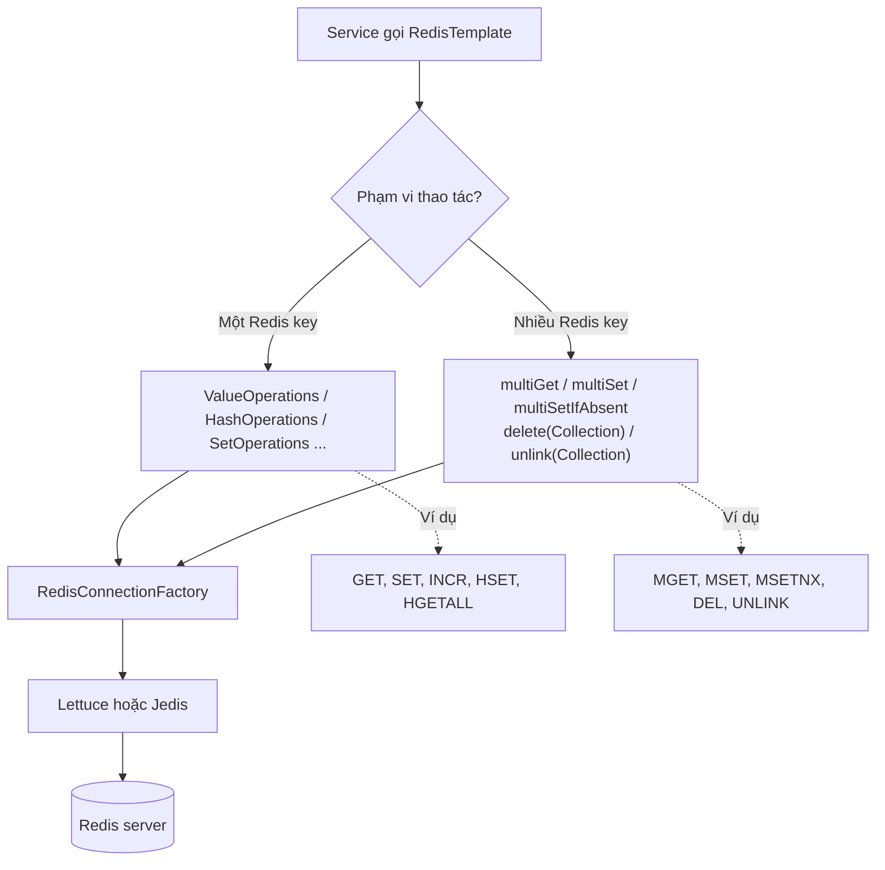
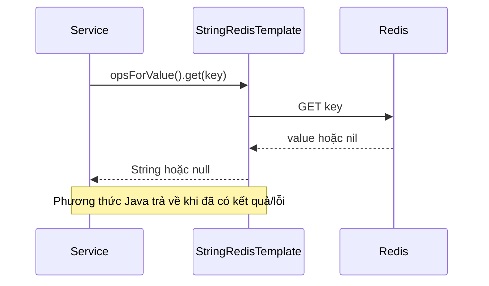
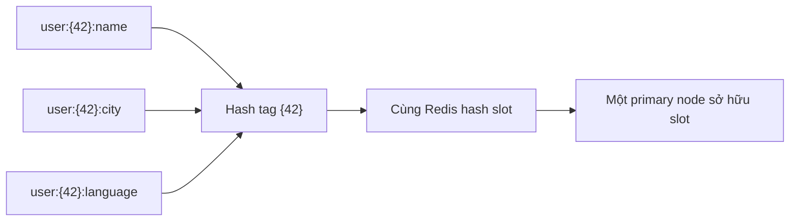

# Thao tác đồng bộ với một khóa hoặc nhiều khóa bằng RedisTemplate

Trong Spring Data Redis, `RedisTemplate` cung cấp các thao tác Redis theo phong cách đồng bộ (*synchronous*): mã Java gọi phương thức, chờ kết quả rồi tiếp tục xử lý. Các phương thức này có thể tác động lên **một Redis key** như `GET`, `SET`, `INCR`, hoặc **nhiều Redis key** như `MGET`, `MSET`, `MSETNX` và `DEL` với danh sách key.

Khi học chủ đề này, cần phân biệt rõ hai trục:

- **Đồng bộ hay bất đồng bộ** nói về cách caller Java nhận kết quả. Với `RedisTemplate` thông thường, thread đang gọi sẽ chờ thao tác hoàn tất hoặc thất bại. Với API reactive hoặc asynchronous, cách biểu diễn kết quả khác.
- **Một key hay nhiều key** nói về phạm vi một Redis operation. Một lệnh Redis có thể làm việc với một hoặc nhiều key; ngoài ra ứng dụng có thể gọi nhiều lệnh lần lượt, dùng pipeline hoặc dùng transaction. Chúng không có cùng tính nguyên tử.

Ví dụ trong bài sử dụng `StringRedisTemplate` để dễ đọc dữ liệu qua Redis CLI; kiến thức áp dụng tương tự cho `RedisTemplate<K,V>` khi đã cấu hình serializer phù hợp.

## 1. Bản đồ các thao tác đồng bộ



| Ý định | API Spring Data Redis | Lệnh Redis điển hình | Số Redis key |
|---|---|---|---|
| Đọc một giá trị | `opsForValue().get(key)` | `GET` | Một |
| Ghi một giá trị có TTL | `opsForValue().set(key, value, duration)` | `SET ... EX/PX` | Một |
| Ghi khi key chưa tồn tại | `opsForValue().setIfAbsent(key, value)` | `SET ... NX` | Một |
| Tăng bộ đếm | `opsForValue().increment(key)` | `INCR` | Một |
| Đọc nhiều field của một Hash | `opsForHash().multiGet(key, fields)` | `HMGET` | **Một Redis key**, nhiều field |
| Ghi nhiều field vào một Hash | `opsForHash().putAll(key, map)` | `HSET` với nhiều cặp field/value | **Một Redis key**, nhiều field |
| Đọc nhiều Redis String key | `opsForValue().multiGet(keys)` | `MGET` | Nhiều |
| Ghi nhiều Redis String key | `opsForValue().multiSet(map)` | `MSET` | Nhiều |
| Chỉ ghi cả nhóm nếu tất cả key chưa tồn tại | `opsForValue().multiSetIfAbsent(map)` | `MSETNX` | Nhiều |
| Xóa nhiều key | `delete(keys)` | `DEL` hoặc tổ hợp lệnh phù hợp client/topology | Nhiều |
| Gỡ nhiều key và giải phóng bộ nhớ bất đồng bộ phía Redis | `unlink(keys)` | `UNLINK` hoặc cách thực thi phù hợp | Nhiều |

Lệnh được nêu là **đường thực thi điển hình**, không phải cam kết rằng mọi driver và mọi Redis topology đều gửi đúng một network request cho mọi overload API. Ví dụ, Redis Cluster có những giới hạn multi-key và client có thể xử lý theo từng node. Vì vậy cần xét cả serializer, Redis data type, topology và yêu cầu atomicity.

## 2. Chuẩn bị một ứng dụng Spring Boot dùng RedisTemplate

Với Gradle Groovy:

```groovy
dependencies {
    implementation 'org.springframework.boot:spring-boot-starter-data-redis'
}
```

Ví dụ cấu hình Redis standalone trên máy phát triển:

```yaml
spring:
  data:
    redis:
      host: localhost
      port: 6379
      connect-timeout: 2s
      timeout: 3s
```

Trong Spring Boot 3.x, starter Redis thường tạo `RedisConnectionFactory` và cung cấp `StringRedisTemplate` cùng `RedisTemplate` khi các điều kiện auto-configuration được đáp ứng. `StringRedisTemplate` sử dụng serializer chuỗi cho key và value; nhờ đó key và giá trị được lưu bằng UTF-8 dễ kiểm tra.

`RedisTemplate<K,V>` tổng quát hơn. Key/value, hash key/hash value có thể cần serializer riêng. Nếu service ghi JSON bằng một template nhưng đọc bằng template dùng JDK serializer, dữ liệu có thể không deserialize được dù cả hai sử dụng cùng Redis server.

Trong các ví dụ:

```java
import org.springframework.data.redis.core.StringRedisTemplate;
import org.springframework.stereotype.Service;

@Service
public class RedisLessonService {
    private final StringRedisTemplate redis;

    public RedisLessonService(StringRedisTemplate redis) {
        this.redis = redis;
    }
}
```

Class trên chỉ minh họa cách inject dependency. Những phương thức hoàn chỉnh sẽ được xây dựng ở các phần sau. Redis server phải đang chạy và phải truy cập được từ **môi trường của JVM**; cấu hình YAML tự nó không khởi động Redis.

## 3. Thao tác đồng bộ với một Redis key

### 3.1. GET, SET và DELETE

`ValueOperations<K,V>` là nhóm thao tác dành cho Redis String values. Một key có thể chứa chuỗi, số được biểu diễn dưới dạng chuỗi hoặc byte của object đã serialize.

```java
import java.time.Duration;
import org.springframework.data.redis.core.StringRedisTemplate;
import org.springframework.stereotype.Service;

@Service
public class VerificationCodeStore {
    private final StringRedisTemplate redis;

    public VerificationCodeStore(StringRedisTemplate redis) {
        this.redis = redis;
    }

    public void save(String userId, String code) {
        String key = "verify:user:" + userId;
        redis.opsForValue().set(key, code, Duration.ofMinutes(5));
    }

    public String read(String userId) {
        return redis.opsForValue().get("verify:user:" + userId);
    }

    public boolean remove(String userId) {
        Boolean deleted = redis.delete("verify:user:" + userId);
        return Boolean.TRUE.equals(deleted);
    }
}
```

Luồng gọi của `read()`:



Nếu `GET` thực thi thành công nhưng key không tồn tại, `get()` trả `null`. Trường hợp không kết nối được Redis hoặc command timeout là **lỗi truy cập**, không tương đương key vắng mặt.

`set(key, value, Duration)` ghi giá trị và gắn thời gian sống trong một thao tác Redis phù hợp. Nếu thay bằng `set(key, value)` rồi gọi `expire(key, ...)`, đó là **hai thao tác**; nếu lời gọi `expire` lỗi, key có thể không có TTL như mong muốn.

### 3.2. SET NX: chỉ tạo key khi chưa tồn tại

```java
import java.time.Duration;

Boolean created = redis.opsForValue().setIfAbsent(
    "registration:request:evt-123",
    "processing",
    Duration.ofMinutes(2)
);

if (Boolean.TRUE.equals(created)) {
    // Caller đã tạo key lần đầu.
}
```

`setIfAbsent` mang ngữ nghĩa tương ứng với lệnh `SET ... NX`; việc kiểm tra “key chưa tồn tại” và ghi key do Redis thực hiện trong cùng một lệnh.

Đừng thay nó bằng:

```java
if (!Boolean.TRUE.equals(redis.hasKey(key))) {
    redis.opsForValue().set(key, value);
}
```

Hai request có thể cùng thấy `hasKey(key) == false` trước khi cả hai gọi `set`. Đây là **race condition giữa bước kiểm tra và bước ghi** (*check-then-act*).

`setIfAbsent` có thể hữu ích cho idempotency marker đơn giản, nhưng một key tự hết hạn không đồng nghĩa đã có distributed lock an toàn. Khi cần lock đúng nghĩa, phải có owner token và cơ chế release/chống xóa nhầm lock, đồng thời xem xét TTL, failover và thời gian xử lý thực tế.

### 3.3. INCR: cập nhật bộ đếm một cách nguyên tử

```java
import org.springframework.data.redis.core.StringRedisTemplate;

public Long countView(StringRedisTemplate redis, String articleId) {
    return redis.opsForValue()
        .increment("metrics:article:" + articleId + ":views");
}
```

Redis thực hiện `INCR` trên một key như một lệnh nguyên tử. Khi nhiều thread cùng gọi `increment`, chúng không phải tự đọc số về Java rồi tăng và ghi lại.

So sánh:

```java
// Cách dễ mất cập nhật khi chạy đồng thời:
String current = redis.opsForValue().get(key);
long next = current == null ? 1 : Long.parseLong(current) + 1;
redis.opsForValue().set(key, Long.toString(next));
```

Giữa `GET` và `SET`, một caller khác có thể ghi giá trị mới. Redis không tự hiểu hai lệnh này là một transaction. `INCR` giải quyết đúng trường hợp tăng số nguyên khi value hợp lệ.

**Lưu ý khi timeout:** nếu Redis thực hiện `INCR` nhưng phản hồi bị mất, caller có thể nhận timeout dù bộ đếm đã tăng. Retry `INCR` không có operation ID/chống trùng có thể tăng hai lần. *Atomic* không có nghĩa *exactly-once across network retries*.

### 3.4. Các lệnh khác trên một key

```java
// Kiểm tra tồn tại:
Boolean exists = redis.hasKey("user:42:name");

// Đặt TTL cho key đang tồn tại:
Boolean expiryApplied = redis.expire(
    "user:42:name",
    Duration.ofMinutes(15)
);

// Xem TTL còn lại:
Duration remaining = redis.getExpire("user:42:name");

// Lấy giá trị cũ và đặt giá trị mới:
String previous = redis.opsForValue()
    .getAndSet("user:42:name", "Lan");

// Xóa một key:
Boolean deleted = redis.delete("user:42:name");
```

`getAndSet` là thao tác tương ứng với ý nghĩa atomic của Redis `GETSET` hoặc cơ chế lệnh tương đương, giúp lấy giá trị cũ và cập nhật giá trị mới trong một operation. Dùng nó thay cho `GET` rồi `SET` nếu nghiệp vụ thực sự cần tính chất đó.

`getExpire` yêu cầu phân biệt key có TTL, không TTL hoặc không tồn tại. Ở Redis CLI, `TTL` trả `-1` cho key tồn tại nhưng không có expiry, `-2` cho key không tồn tại. Ở Spring Data Redis, cần xem contract trả về `Duration` của API/phiên bản dùng để xử lý hai sentinel một cách đúng đắn.

## 4. Một key Redis Hash nhưng nhiều field

**Nhiều field không phải là nhiều Redis key.** Đây là điểm gây nhầm lẫn phổ biến khi thấy tên `multiGet`.

Ví dụ muốn lưu hồ sơ của user `42` trong một Redis Hash:

```text
Redis key: user:42:profile
Redis TYPE: hash
Fields:
    name     -> Lan
    city     -> Hanoi
    language -> vi
```

Với `StringRedisTemplate`:

```java
import java.util.LinkedHashMap;
import java.util.List;
import java.util.Map;
import org.springframework.data.redis.core.StringRedisTemplate;
import org.springframework.stereotype.Service;

@Service
public class ProfileHashStore {
    private final StringRedisTemplate redis;

    public ProfileHashStore(StringRedisTemplate redis) {
        this.redis = redis;
    }

    public void saveFields() {
        Map<String, String> fields = new LinkedHashMap<>();
        fields.put("name", "Lan");
        fields.put("city", "Hanoi");
        fields.put("language", "vi");

        redis.opsForHash().putAll("user:42:profile", fields);
    }

    public List<Object> readTwoFields() {
        return redis.opsForHash().multiGet(
            "user:42:profile",
            List.of("name", "language")
        );
    }
}
```

`putAll` ghi nhiều field vào **cùng một Redis key**, thường thông qua `HSET` với nhiều cặp field-value. `multiGet` của `HashOperations` đọc các field được yêu cầu, thường thông qua `HMGET`.

Quan sát bằng Redis CLI:

```bash
redis-cli TYPE user:42:profile
# hash

redis-cli HMGET user:42:profile name language
# Lan
# vi
```

So sánh hai kiểu `multiGet`:

| API | Đầu vào | Redis key thực tế | Lệnh điển hình |
|---|---|---|---|
| `redis.opsForHash().multiGet(key, fields)` | **Một** key Hash và nhiều tên field | `user:42:profile` | `HMGET` |
| `redis.opsForValue().multiGet(keys)` | **Nhiều** key String | `user:42:name`, `user:42:city`... | `MGET` |

Hai cách tổ chức này ảnh hưởng tới TTL, phân bố hash slot trong Cluster và cách update dữ liệu. Một Redis Hash có TTL cấp **key**, không mặc định có TTL độc lập cho từng field. Hash do Template quản lý thủ công cũng không tự tạo mapping/index như Redis Repository với `@RedisHash`.

## 5. Đọc nhiều Redis key bằng multiGet

Khi mỗi thuộc tính được lưu thành một Redis String key:

```text
user:42:name     -> Lan
user:42:city     -> Hanoi
user:42:language -> vi
```

Ta có thể đọc từng key bằng ba lời gọi `get`, hoặc gom lại trong một lời gọi `multiGet`:

```java
import java.util.List;
import org.springframework.data.redis.core.StringRedisTemplate;

List<String> keys = List.of(
    "user:42:name",
    "user:42:city",
    "user:42:language"
);

List<String> values = redis.opsForValue().multiGet(keys);

if (values != null) {
    for (int i = 0; i < keys.size(); i++) {
        String key = keys.get(i);
        String value = values.get(i);
        System.out.println(key + " = " + value);
    }
}
```

Ý nghĩa quan trọng:

- `multiGet` trả danh sách kết quả **tương ứng thứ tự key đầu vào**. Không nên ghép cặp key/value dựa trên thứ tự ngẫu nhiên của một `HashSet`.
- Key không tồn tại có thể tương ứng một phần tử `null` trong kết quả. Redis `MGET` cho từng key thiếu trả nil, không tự coi đó là lỗi.
- Trong ngữ cảnh pipeline hoặc transaction, contract của một số phương thức template cho phép trả `null` trước khi kết quả được tổng hợp. Ở đường đồng bộ thông thường ngoài pipeline/transaction, caller dùng kết quả cuối cùng.
- `MGET` chỉ phù hợp với Redis String keys. Nếu một key đang có Redis Hash, List hoặc loại khác, Redis có thể trả nil cho vị trí không có String value theo semantics của `MGET`; đừng diễn giải tất cả nil là “key hoàn toàn không tồn tại” nếu chưa xác minh `TYPE`.
- Trong Redis Cluster, nhiều-key command có giới hạn hash slot. Các key thuộc nhiều slot có thể bị từ chối hoặc được client xử lý theo chiến lược riêng; không thể mặc định toàn bộ nhóm được đọc nguyên tử.

### 5.1. Khi nào nên dùng multiGet?

Nếu cần đọc cùng lúc 20 thuộc tính được lưu thành 20 String keys, `multiGet` thường tiết kiệm round trips hơn 20 lời gọi `get` tuần tự trên một Redis node. Đổi lại, payload reply lớn hơn và cần kiểm soát memory/latency nếu số lượng key rất lớn.

`multiGet` hợp lý khi:

- Các key đã được biết trước, ví dụ danh sách ID từ một truy vấn khác.
- Các value đều được lưu ở dạng Redis String với serializer tương thích.
- Nhóm key đủ nhỏ để một request không tạo payload quá lớn.
- Topology Redis hỗ trợ multi-key access cho nhóm key đó.

Nếu chỉ muốn quét key theo prefix, **`MGET` không tự tìm ra key**. Bạn cần có danh sách key; tìm key theo pattern là thao tác khác, thường dùng `SCAN` có giới hạn và phù hợp với topology.

## 6. Ghi nhiều Redis key bằng multiSet

`ValueOperations.multiSet(Map<K,V>)` cho phép gửi nhiều cặp key/value:

```java
import java.util.LinkedHashMap;
import java.util.Map;
import org.springframework.data.redis.core.StringRedisTemplate;

public void saveProfile(StringRedisTemplate redis) {
    Map<String, String> values = new LinkedHashMap<>();
    values.put("user:42:name", "Lan");
    values.put("user:42:city", "Hanoi");
    values.put("user:42:language", "vi");

    redis.opsForValue().multiSet(values);
}
```

Trên một Redis standalone node, thao tác điển hình là `MSET`:

```redis
MSET user:42:name Lan user:42:city Hanoi user:42:language vi
```

`MSET` ghi các cặp key/value như một lệnh Redis. Redis thực thi lệnh đơn lẻ nguyên tử trong phạm vi instance liên quan: client khác không quan sát trạng thái chỉ mới cập nhật một phần **giữa các phần tử của cùng lệnh MSET**. Tuy nhiên:

- `MSET` ghi đè value đã tồn tại, không chỉ tạo các key mới.
- `MSET` không cung cấp TTL riêng trong cùng cú pháp như `SET key value EX ...`.
- Nếu phải ghi cả value và TTL cho nhiều key, một bước `multiSet` rồi nhiều bước `expire` **không nguyên tử như một lệnh duy nhất**.
- Trong Redis Cluster, không mặc định `MSET` cho key khác hash slot sẽ có ngữ nghĩa atomic giống một Redis standalone node.

### 6.1. MSET không đồng nghĩa “ghi nhiều entity Repository”

Nếu dùng `RedisTemplate.opsForValue().multiSet`, các value được ghi dưới dạng Redis String theo serializer của template. Nó không gọi `repository.saveAll(entities)` và không tạo secondary index/metadata của Redis Repository.

Ví dụ:

```text
multiSet(
  user:42:name = "Lan",
  user:42:city = "Hanoi"
)
```

khác với việc lưu một entity `UserProfile` qua `@RedisHash`. Hai cách có key layout và cơ chế truy vấn khác nhau.

### 6.2. Đặt TTL đúng cho nhóm key

Giả sử nghiệp vụ cần ba key cùng hết hạn sau 5 phút. Có vài lựa chọn:

1. Nếu ba dữ liệu là một aggregate logic, cân nhắc **một Redis Hash key** rồi đặt TTL một lần cho key.
2. Nếu vẫn cần ba String keys, gọi `SET` có duration cho từng key; có thể dùng pipeline để giảm round trips, nhưng pipeline **không tự cho atomicity xuyên các lệnh**.
3. Nếu phải bảo đảm cùng lúc “tạo nhiều key và TTL”, cân nhắc Lua script/transaction phù hợp, với giới hạn Redis Cluster cùng hash slot.

Không có thuộc tính của `RedisSerializer` tự động cấp TTL. TTL do API ghi key, `expire`, cache configuration hoặc lớp sở hữu dữ liệu quyết định.

## 7. multiSetIfAbsent: tất cả key phải chưa tồn tại

`ValueOperations.multiSetIfAbsent(Map<K,V>)` được thiết kế cho ý định: **chỉ ghi cả nhóm khi không có key nào trong nhóm đã tồn tại**.

```java
import java.util.Map;

Boolean created = redis.opsForValue().multiSetIfAbsent(
    Map.of(
        "checkout:order:42:status", "NEW",
        "checkout:order:42:owner", "worker-7"
    )
);

if (Boolean.TRUE.equals(created)) {
    // Nhóm key được tạo theo điều kiện tất cả đều chưa tồn tại.
} else {
    // Có ít nhất một key đã tồn tại (trong lối gọi thông thường).
}
```

Ở Redis standalone, thao tác tương ứng là `MSETNX`. Nếu **một trong các key đã tồn tại**, Redis không ghi **bất kỳ** key nào trong nhóm. Việc kiểm tra điều kiện và ghi các key là atomic trong một lệnh trên một node.

Giả sử:

```text
Ban đầu:
    checkout:order:42:status = "PAID"
    checkout:order:42:owner  không tồn tại

MSETNX status="NEW" owner="worker-7"
    → trả false
    → status vẫn "PAID"
    → owner vẫn chưa tồn tại
```

Khác với cách sai sau:

```java
for (Map.Entry<String, String> e : values.entrySet()) {
    redis.opsForValue().setIfAbsent(e.getKey(), e.getValue());
}
```

Vòng lặp tạo những key chưa có **từng cái một**; một số key có thể được tạo dù các key khác đã tồn tại. `multiSetIfAbsent` phản ánh ý định “cả nhóm hoặc không nhóm nào” trong phạm vi được Redis hỗ trợ.

Lưu ý: `MSETNX` không gắn TTL; key có thể tồn tại vĩnh viễn nếu không có bước expire hoặc cleanup. Với use case lock/idempotency, việc cần expiry đúng hạn là một phần của thiết kế. Cũng không thể dùng `MSETNX` xuyên các hash slot mà kỳ vọng atomicity của một node.

## 8. Xóa nhiều key: delete và unlink

`RedisTemplate` cho phép xóa nhóm key đã biết:

```java
import java.util.List;

Long deletedCount = redis.delete(List.of(
    "cart:42:items",
    "cart:42:total",
    "cart:42:coupon"
));
```

`delete(Collection<K>)` trả số key đã xóa theo kết quả driver; **không phải số key truyền vào**. Nếu một vài key không tồn tại, số lượng xóa có thể nhỏ hơn danh sách đầu vào.

Với Redis hỗ trợ `UNLINK`:

```java
Long unlinkedCount = redis.unlink(List.of(
    "cache:report:old:1",
    "cache:report:old:2"
));
```

`UNLINK` gỡ key khỏi keyspace theo ngữ nghĩa lệnh Redis và để quá trình thu hồi bộ nhớ của value diễn ra bất đồng bộ phía server. Tuy nhiên **lời gọi Java `unlink(...)` qua RedisTemplate vẫn là lời gọi đồng bộ** đối với kết quả lệnh; “asynchronous” ở đây chủ yếu nói về giải phóng bộ nhớ nội bộ của Redis.

Khi nào cân nhắc `UNLINK`?

- Xóa những key có payload lớn mà việc giải phóng bộ nhớ ngay trên main thread có thể gây độ trễ.
- Dọn nhiều key trong công việc bảo trì có kiểm soát.

Không nên hiểu `UNLINK` là tương đương một “background task Java” hoặc đảm bảo an toàn tuyệt đối khi xóa key. Vẫn phải xác định key owner, prefix, số lượng key và ảnh hưởng đến Repository index/cache.

Với Redis Cluster, một nhóm key có thể phân bố trên các shard. Việc xóa nhiều key qua thư viện có thể được tách theo node, và không thể coi toàn bộ thao tác là một transaction nguyên tử xuyên các shard.

## 9. Một lệnh nhiều key, nhiều lệnh tuần tự và pipelining khác nhau ra sao?

Ba cách có thể trả cùng dữ liệu cuối cùng khi không có concurrency, nhưng khác nhau ở số round trips và tính nguyên tử.

### 9.1. Các lời gọi đồng bộ tuần tự

```java
String name = redis.opsForValue().get("user:42:name");
String city = redis.opsForValue().get("user:42:city");
String language = redis.opsForValue().get("user:42:language");
```

Mỗi lời gọi đợi kết quả rồi lời gọi sau mới bắt đầu theo thứ tự code trên. Nó dễ đọc và cho phép xử lý từng kết quả, nhưng có thể chịu nhiều round trips và những giá trị được đọc tại **những thời điểm khác nhau**.

### 9.2. Một lệnh nhiều key

```java
List<String> values = redis.opsForValue().multiGet(
    List.of("user:42:name", "user:42:city", "user:42:language")
);
```

Với Redis standalone, `MGET` là **một lệnh**: Redis xử lý các key trong cùng một operation. Nó thường giảm round trips. Tuy nhiên, một `MGET` không tự biến những hoạt động trước/sau nó thành transaction.

### 9.3. Pipeline: gửi nhiều lệnh để giảm round trips

Pipelining cho phép gửi nhiều Redis commands mà không cần chờ reply của **từng lệnh** trước khi gửi lệnh tiếp theo. Spring Data Redis có `executePipelined`:

```java
import java.util.List;
import org.springframework.data.redis.core.RedisCallback;
import org.springframework.data.redis.core.StringRedisTemplate;
import org.springframework.data.redis.serializer.StringRedisSerializer;

public List<Object> readWithPipeline(StringRedisTemplate redis) {
    StringRedisSerializer serializer = new StringRedisSerializer();

    return redis.executePipelined((RedisCallback<Object>) connection -> {
        connection.stringCommands().get(
            serializer.serialize("user:42:name")
        );
        connection.stringCommands().get(
            serializer.serialize("user:42:city")
        );
        connection.stringCommands().get(
            serializer.serialize("user:42:language")
        );
        // Callback của pipeline phải trả null; kết quả nằm ở danh sách ngoài.
        return null;
    });
}
```

Điểm cần hiểu:

- `executePipelined` **vẫn đợi** các phản hồi để trả về `List<Object>` cho Java caller. API này không tự trở thành reactive.
- Những lệnh được gửi theo pipeline nhưng Redis vẫn xử lý **từng lệnh**; client khác có thể tác động giữa các lệnh tùy cách scheduling/connection/server.
- Pipeline không tự rollback những lệnh đã thực thi nếu một lệnh sau thất bại.
- Kết quả pipeline được template deserialize theo serializer và ngữ nghĩa reply tương ứng; code gọi cần hiểu kiểu dữ liệu của từng phần tử.
- Pipeline có lợi khi nhiều operation độc lập không có một multi-key command thích hợp hoặc cần nhiều kiểu lệnh. Với hàng nghìn lệnh, nên chia batch và kiểm soát memory.

Nếu toàn bộ nhu cầu là đọc các Redis String keys nằm trên một node và thuộc phạm vi `MGET`, `multiGet` thường đơn giản hơn pipeline ba lệnh `GET`.

### 9.4. Bảng so sánh

| Cách thực hiện | Số lời gọi từ code | Lệnh Redis | Tính nguyên tử |
|---|---|---|---|
| Ba lần `get(key)` tuần tự | Ba | Ba `GET` | Mỗi `GET` riêng lẻ, không có snapshot chung |
| Một lần `multiGet(keys)` | Một | Thường một `MGET` | Một lệnh trên một Redis node; có caveat Cluster |
| Một lần `executePipelined` chứa ba `GET` | Một API call | Ba `GET` | Không có atomicity xuyên cả ba |
| `MULTI/EXEC` bao ba lệnh | Một transaction scope | Nhiều lệnh được queue rồi thực thi cùng transaction | Không interleave các lệnh của transaction trên một Redis node; semantics khác rollback DB |

## 10. Đồng bộ Java không đồng nghĩa với atomic transaction

Một hiểu nhầm quan trọng:

```java
redis.opsForValue().set("order:42:status", "PAID");
redis.opsForValue().increment("order:42:revision");
```

Đây là **hai lời gọi Java đồng bộ**: caller chờ lệnh đầu trước khi gửi lệnh sau. Tuy nhiên, nếu lệnh thứ hai thất bại, lệnh đầu có thể đã thành công. Một client khác có thể quan sát `status=PAID` trong khi `revision` chưa tăng.

Muốn có thao tác nguyên tử phù hợp, cần lựa chọn theo bài toán:

- **Một lệnh Redis atomic đã có sẵn** như `INCR`, `SET NX`, `MSET`, `MSETNX` là lựa chọn đơn giản nhất nếu semantics phù hợp.
- **Lua script / Redis Functions** có thể kiểm tra điều kiện và thay đổi nhiều key atomically trong phạm vi Redis node và các ràng buộc Cluster.
- **Redis transaction `MULTI/EXEC`** nhóm nhiều lệnh theo mô hình Redis, có thể kết hợp `WATCH` để kiểm soát optimistic concurrency.
- Nếu cần nhất quán giữa Redis và database bên ngoài, Redis transaction không tự bao phủ giao dịch của database đó.

### 10.1. Ví dụ MULTI/EXEC qua SessionCallback

Spring Data Redis có `SessionCallback` để đảm bảo nhiều thao tác trong callback sử dụng connection/session thích hợp:

```java
import java.util.List;
import org.springframework.dao.DataAccessException;
import org.springframework.data.redis.core.RedisOperations;
import org.springframework.data.redis.core.SessionCallback;
import org.springframework.data.redis.core.StringRedisTemplate;

public List<Object> markPaid(StringRedisTemplate redis) {
    return redis.execute(new SessionCallback<List<Object>>() {
        @Override
        @SuppressWarnings({"unchecked", "rawtypes"})
        public <K, V> List<Object> execute(RedisOperations<K, V> operations)
                throws DataAccessException {
            // Callback chạy với StringRedisTemplate trong ví dụ này.
            RedisOperations<String, String> strings =
                (RedisOperations) operations;

            strings.multi();
            strings.opsForValue().set("order:42:status", "PAID");
            strings.opsForValue().increment("order:42:revision");
            return strings.exec();
        }
    });
}
```

Vì `SessionCallback` định nghĩa phương thức generic, ví dụ dùng unchecked cast trong phạm vi đã biết template là `StringRedisTemplate`. Trong code production, có thể đóng gói adapter đủ kiểu hoặc dùng API cấp thấp có hợp đồng rõ ràng. Kết quả của các operation khi đang queue trong `MULTI` thường chưa sẵn sàng tại thời điểm gọi; kết quả thực được trả ở `exec()`.

**Redis transaction không giống transaction SQL:**

- Redis thực thi các lệnh đã queue bằng `MULTI/EXEC` theo thứ tự, không interleave lệnh từ client khác ở giữa các lệnh của transaction trên cùng node.
- Redis không có cơ chế rollback toàn bộ transaction tương tự RDBMS nếu một lệnh trong `EXEC` báo lỗi runtime; những lệnh khác vẫn có thể đã được thực thi.
- Nếu muốn chỉ cập nhật khi dữ liệu không đổi, cần `WATCH` hoặc một cách atomic compare-and-set tương ứng; chỉ `MULTI/EXEC` chưa giải quyết bài toán read-modify-write ở client.
- Với Redis Cluster, cần xem giới hạn cùng hash slot và mức hỗ trợ transaction của client/driver; đừng mặc định chỉ thêm `MULTI` là có thể giao dịch nhiều shard.

Spring Data Redis có cơ chế hỗ trợ tham gia Spring transaction khi cấu hình; nó **không mặc định biến mọi phương thức `@Transactional` thành Redis transaction**, và semantics cũng không bằng transaction xuyên Redis + JDBC.

## 11. Redis Cluster: vấn đề hash slot với nhiều key

Redis Cluster phân bố Redis keys theo **hash slots**. Nhiều-key command như `MGET`, `MSET`, `MSETNX` có thể chịu ràng buộc rằng các key cùng hash slot. Ví dụ:

```text
user:42:name
user:42:city
user:42:language
```

Tên giống nhau về mặt con người không bảo đảm ba key trên nằm cùng slot. Nếu muốn các key của một user cùng slot, có thể dùng **hash tag**:

```text
user:{42}:name
user:{42}:city
user:{42}:language
```

Redis Cluster tính hash slot từ nội dung trong cặp ngoặc nhọn, tức `42` cho cả ba key:



Nhờ đó, một multi-key command phù hợp có thể chạy trên nhóm này mà không gặp lỗi `CROSSSLOT` do key nằm khác slot. Nhưng:

- Một hash tag chung quá rộng như `{all-users}` làm nhiều key dồn về cùng slot, giảm phân tán tải.
- Key khác user ID nên phân bố trên nhiều slot khi nhu cầu là scale.
- Trên Cluster, vẫn cần kiểm tra hỗ trợ của driver cho từng Redis command và các thay đổi topology/failover.
- Nếu đang dùng multiGet/HashOperations trong code, **Redis Hash là một key** nên tất cả field của nó tự cùng node, không cần hash tag cho từng field.

Khi dữ liệu của một entity thường được đọc/ghi cùng nhau, cân nhắc một Redis Hash key hoặc một JSON String key thay vì trải rộng thành nhiều key chỉ để có vẻ linh hoạt.

## 12. Timeout, lỗi từng phần và retry

“Đồng bộ” không có nghĩa mọi thao tác sẽ thành công hoặc thất bại rõ ràng ngay tức thì. Có thể xảy ra:

- Redis connection chưa sẵn sàng.
- Command timeout khi server đã xử lý lệnh nhưng reply về muộn/mất.
- Một batch gửi qua pipeline có một số lệnh đã thực thi trước khi connection hỏng.
- Driver reconnect trong lúc request đang chờ.
- Multi-key command bị từ chối vì Cluster hash slots không tương thích.

### 12.1. Một lệnh multi-key bị timeout

Với `MSET` trên Redis standalone, nếu caller nhận timeout **không thể kết luận Redis chưa ghi**. Redis có thể đã thực hiện lệnh nguyên tử rồi mất phản hồi. Nếu retry với cùng value, trạng thái cuối có thể giống nhau; nhưng nếu có consumer phản ứng với key changes hoặc TTL, vẫn phải xem hệ quả.

Với `INCR` hoặc `LPUSH`, retry sau timeout dễ tạo duplicate effect. **Không retry mù lệnh non-idempotent**.

### 12.2. Nhiều lệnh tuần tự lỗi ở giữa

Giả sử:

```java
redis.opsForValue().set("invoice:42:status", "PAID");
redis.opsForValue().set("invoice:42:paidBy", "u-7");
redis.opsForValue().set("invoice:42:paidAt", "2026-11-12T08:00:00Z");
```

Nếu lệnh thứ ba lỗi, hai lệnh trước có thể đã ghi thành công. Không thể dựa vào việc các method Java được gọi liên tiếp để xem cả ba trường là một transaction.

Nếu các giá trị là một thực thể logic phải luôn thống nhất, nên cân nhắc lưu trong một Hash/JSON, dùng transaction hoặc Lua với điều kiện phù hợp, hoặc chọn database authoritative ngoài Redis rồi cập nhật cache theo cơ chế đồng bộ xác định.

### 12.3. Phân biệt nil và exception

```java
import org.springframework.dao.DataAccessException;

try {
    String value = redis.opsForValue().get("user:42:name");
    if (value == null) {
        // Redis đọc thành công, key không có giá trị String đọc được.
    } else {
        // Đã nhận kết quả.
    }
} catch (DataAccessException ex) {
    // Redis không thể thực hiện/hoàn tất thao tác; xử lý theo policy.
    throw ex;
}
```

Trong ngữ cảnh thuần Redis String, `null` thường có nghĩa key không tồn tại. Với `MGET`, cần thêm giả thiết tất cả key đều đúng Redis type để phân biệt nil do không tồn tại và nil do key không phải String. Lỗi truy cập thường được Spring Data chuyển sang hệ exception của Spring, có thể cần xem cause chain để phân biệt timeout, kết nối và lỗi command.

## 13. Hiệu năng: round trip, số key và kích thước payload

Giả sử network round trip tốn 2 ms và Redis xử lý mỗi lệnh rất nhanh. Ba lần `GET` tuần tự có thể tốn thêm ba lượt mạng, trong khi một `MGET` thường giảm số lượt đi về. Tuy nhiên, đây chỉ là mô hình giải thích, **không phải benchmark hay cam kết latency**.

```text
GET k1 → reply  | GET k2 → reply | GET k3 → reply
      (nhiều round trips, thực hiện tuần tự)

MGET k1 k2 k3 → reply [v1, v2, v3]
      (một multi-key command ở Redis standalone)

PIPELINE GET k1, GET k2, GET k3 → replies
      (nhiều Redis commands, giảm thời gian chờ giữa các lần gửi)
```

| Kỹ thuật | Lợi ích | Chi phí/điểm cần chú ý |
|---|---|---|
| `GET` từng key | Cấu trúc đơn giản; xử lý lỗi và logic riêng từng key | Nhiều round trips nếu gọi tuần tự |
| `MGET` | Gom nhiều String key trong một lệnh | Giới hạn loại dữ liệu/Cluster; reply lớn khi quá nhiều key |
| `MSET` | Ghi nhiều String key cùng lệnh | TTL và conditional update phải thiết kế riêng |
| Redis Hash + `HMGET` | Đọc vài field trong một aggregate | TTL cấp key; cập nhật index nếu dùng Repository cần ownership rõ |
| Pipeline | Gom nhiều lệnh khác loại, giảm round trips | Không atomic; result list phải xử lý cẩn thận |
| Transaction/Lua | Đáp ứng điều kiện atomicity của một luồng nhiều lệnh | Complexity, giới hạn Cluster, command latency và contention |

Đối với hàng trăm nghìn key, đừng đưa toàn bộ vào `multiGet` trong một lần. Chia batch theo giới hạn payload/memory, quan sát latency, giữ ordering trong kết quả và xử lý lỗi từng batch. Mục tiêu tối ưu là **thời gian đáp ứng và tính đúng của nghiệp vụ**, không chỉ ít lời gọi Java.

## 14. Lưu ý về RedisTemplate, serializer và thread safety

`RedisTemplate` được thiết kế để tái sử dụng như Spring bean sau khi cấu hình. Điều cần giữ rõ:

- Serializer cho key phải giống nhau giữa ghi và đọc. Với `StringRedisTemplate`, keys thường dễ quan sát qua Redis CLI.
- `RedisTemplate<String, Product>` dùng JSON value serializer khi gọi `opsForValue()` có thể tạo **Redis String chứa JSON**; không tự biến object thành Redis Hash.
- `opsForHash()` dùng hash key/hash value serializer. Một Redis Hash có thể chứa nhiều field mà field value lại là JSON payload.
- Redis Repository `@RedisHash` có hệ mapping/index/metadata của riêng nó. Tự dùng `multiSet` hoặc `HSET` vào key do Repository sở hữu có thể phá invariant của index và TTL.
- `RedisCacheManager` cho Spring Cache có serialization và TTL riêng; không tự dùng custom serializer của tất cả template nghiệp vụ.

Trong code concurrent, có thể chia sẻ bean template được khởi tạo đúng cách, nhưng đừng chia sẻ tùy tiện một Redis connection thấp tầng vốn có yêu cầu quản lý vòng đời/trạng thái riêng. Việc bật transaction/pipeline có thể gắn với connection trong callback; dùng đúng API của Spring để quản lý tài nguyên.

## 15. Quan sát bằng Redis CLI

Ví dụ sau minh họa cả một-key và multi-key commands:

```bash
# Một key String
redis-cli SET demo:one "hello" EX 60
redis-cli GET demo:one

# Hai key String trong một lệnh
redis-cli MSET demo:a "A" demo:b "B"
redis-cli MGET demo:a demo:b demo:missing

# Cả nhóm chỉ được ghi nếu không có key nào tồn tại
redis-cli MSETNX demo:c "C" demo:d "D"

# Một key Hash với nhiều field
redis-cli HSET demo:profile name "Lan" language "vi"
redis-cli HMGET demo:profile name language
redis-cli TYPE demo:profile

# Xóa nhiều key
redis-cli DEL demo:a demo:b
```

Nếu cần dò key theo pattern khi debug:

```bash
redis-cli --scan --pattern 'demo:*'
```

Tránh dùng `KEYS *` trên Redis production lớn vì có thể làm Redis bị chặn trong quá trình duyệt toàn bộ keyspace. Với Redis Cluster, công cụ quản trị cần xem xét toàn bộ các primary nodes; scan trên một node không tự đại diện toàn bộ cluster.

### 15.1. Những dấu hiệu cần ghi nhận

| Dấu hiệu | Khả năng cần xem |
|---|---|
| `multiGet` có `null` tại một vị trí | Key chưa tồn tại hoặc kiểu key không phù hợp với `MGET` |
| `multiSetIfAbsent` trả `false` | Ít nhất một key đã tồn tại trên đường thực thi hỗ trợ atomic `MSETNX` |
| `WRONGTYPE` | Dùng operation không phù hợp Redis TYPE của key |
| `CROSSSLOT` | Multi-key operation trên Cluster với các key khác slot |
| `delete(keys)` đếm ít hơn đầu vào | Một số key không tồn tại; cần xét mutation đồng thời |
| Pipeline trả kết quả ngoài thứ tự dự kiến | Logic caller ghép kết quả sai; xem thứ tự lệnh và serializer |
| Command timeout | Có thể là network/Redis chậm, chưa chắc lệnh chưa thực hiện |
| Redis Hash tồn tại nhưng Repository query sai | Có thể đã sửa Hash thủ công mà không cập nhật index do Repository quản lý |

## 16. Bốn tình huống lựa chọn cách làm

### Tình huống A — Tăng lượt xem bài viết

Mỗi request tăng một bộ đếm `metrics:article:42:views`. Chọn:

```java
Long views = redis.opsForValue()
    .increment("metrics:article:42:views");
```

Vì `INCR` là một lệnh atomic cho một key, nó phù hợp hơn tự `GET` rồi `SET`. Nếu phải bảo đảm request chỉ được tính một lần kể cả retry, cần thêm operation ID/chống trùng.

### Tình huống B — Đọc ba cài đặt được lưu thành ba String keys

Các key `user:{42}:theme`, `user:{42}:language` và `user:{42}:timezone` đều là String. Chọn `multiGet` để đọc đồng thời bằng một lệnh khi topology hỗ trợ, chú ý thứ tự và giá trị null.

```java
List<String> settings = redis.opsForValue().multiGet(List.of(
    "user:{42}:theme",
    "user:{42}:language",
    "user:{42}:timezone"
));
```

Đặt hash tag `{42}` có thể giúp ba key cùng slot trên Cluster. Nếu ứng dụng luôn đọc/cập nhật cả ba, cân nhắc lưu chung trong một Hash thay vì ba key độc lập.

### Tình huống C — Tạo hai key khi và chỉ khi cả hai đều chưa có

Nghiệp vụ muốn tạo `reservation:{100}:owner` và `reservation:{100}:status` theo điều kiện tất cả chưa tồn tại. `multiSetIfAbsent` phù hợp hơn vòng lặp `setIfAbsent` trên Redis standalone hoặc nhóm key cùng slot được hỗ trợ. Nếu cần TTL đồng nhất/atomic cùng thao tác, phải bổ sung thiết kế transaction/script tương ứng.

```java
Boolean reserved = redis.opsForValue().multiSetIfAbsent(
    Map.of(
        "reservation:{100}:owner", "u-7",
        "reservation:{100}:status", "PENDING"
    )
);
```

### Tình huống D — Ghi kết quả thanh toán và cập nhật revision

Hai thao tác `SET status=PAID` và `INCR revision` có thể không được phép tách rời. Gọi hai method RedisTemplate tuần tự không cho atomicity nhóm. Cần xác định điều kiện nghiệp vụ, chọn transaction/Lua khi phù hợp và không nhầm Redis transaction với giao dịch database.

Nếu Redis chỉ là cache của PostgreSQL, có thể an toàn hơn khi cập nhật PostgreSQL trước rồi invalidate các cache entries liên quan, thay vì cố coi Redis là nguồn sự thật về trạng thái thanh toán.

## 17. Những nhầm lẫn phổ biến

| Nhầm lẫn | Cách hiểu đúng |
|---|---|
| “RedisTemplate là đồng bộ nên hai lời gọi `set` liên tiếp nguyên tử.” | Đồng bộ chỉ nói về việc Java caller chờ; hai Redis commands vẫn riêng biệt. |
| “`multiGet` và `HashOperations.multiGet` giống nhau.” | Một cái đọc nhiều String **keys**, cái kia đọc nhiều **fields của một Hash key**. |
| “`multiSet` có TTL riêng cho từng key.” | `MSET` không tự gắn TTL; cần chiến lược khác nếu expiry là một phần của hợp đồng. |
| “`multiSetIfAbsent` tương đương vòng lặp `setIfAbsent`.” | Vòng lặp có thể ghi một phần; `MSETNX` trên một Redis node có điều kiện cả nhóm. |
| “Pipelining có nghĩa transaction.” | Pipeline tối ưu round trips, không tự đảm bảo atomicity. |
| “`UNLINK` là lời gọi Java không chờ kết quả.” | API template vẫn đồng bộ; giải phóng bộ nhớ value phía Redis mới là bất đồng bộ. |
| “Redis Cluster cho phép mọi `MGET` xuyên node như standalone.” | Cần xem hash slots và cách client xử lý; atomicity xuyên node không được bảo đảm. |
| “Một thao tác timeout chắc chắn chưa ghi dữ liệu.” | Reply có thể thất lạc sau khi Redis đã thực hiện mutation. |
| “Template String tự sinh Redis Repository index.” | Template không tự quản lý secondary index/entity mapping. |

## 18. Tư duy lựa chọn thao tác

Khi thiết kế một yêu cầu Spring Data Redis, hãy tự xác định:

1. **Có bao nhiêu Redis key?** Một String, một Hash nhiều field, hay nhiều key độc lập?
2. **Cần đồng bộ theo nghĩa nào?** Caller Java chờ kết quả, hay yêu cầu các thay đổi cùng xảy ra nguyên tử?
3. **Có lệnh Redis phù hợp trong một operation không?** `GET`/`SET`/`INCR`, `MGET`/`MSET`/`MSETNX`, `HMGET`/`HSET`…
4. **TTL có phải một phần bắt buộc của thao tác không?** Tránh tạo key rồi quên expire.
5. **Có concurrency và retry không?** Phải bảo toàn idempotency, đặc biệt với counter và các mutation.
6. **Redis đang chạy standalone hay Cluster?** Kiểm tra ràng buộc hash slot và hành vi driver.
7. **Ai sở hữu key?** Template, Repository hay Cache; tránh ghi chồng lên representation/index của thành phần khác.

**`RedisTemplate` đồng bộ giúp viết code Redis dễ theo dõi; các API một key hay nhiều key giúp biểu đạt đúng loại thao tác.** Khi cần tính nguyên tử, hãy dựa vào **ngữ nghĩa của từng Redis command hoặc transaction/script phù hợp**, thay vì suy ra từ tên “đồng bộ” hay việc các lệnh Java nằm cạnh nhau.
