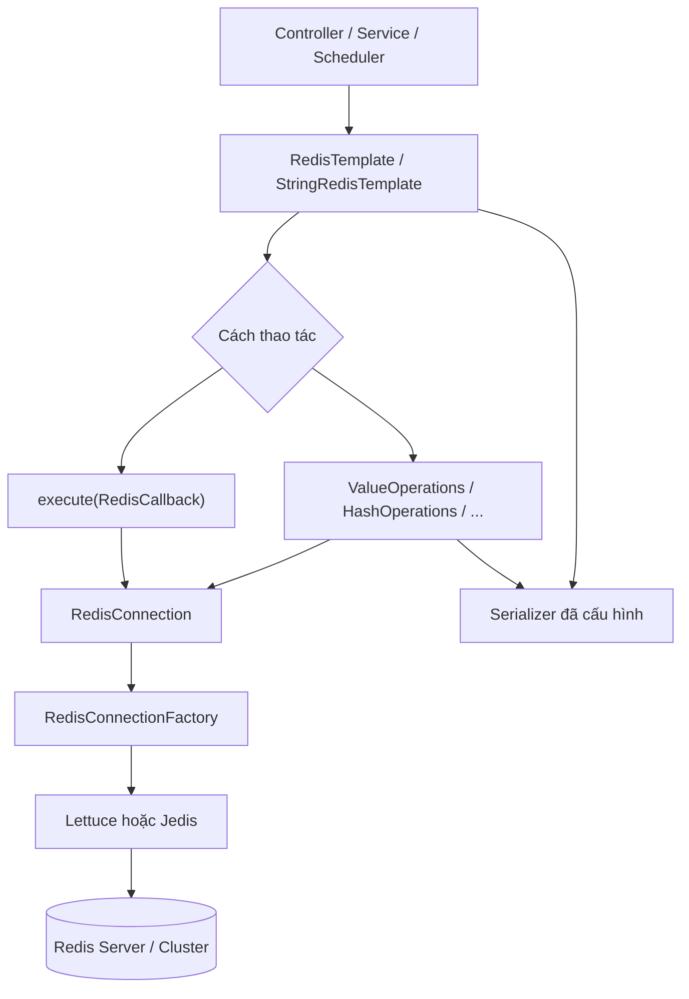
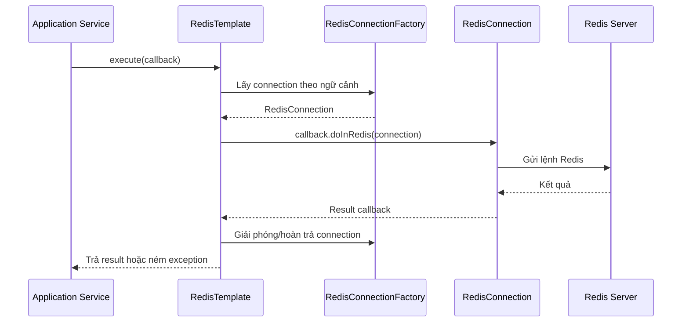
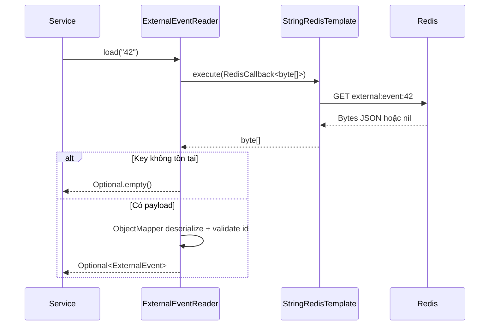

# Dùng RedisCallback để gọi lệnh ở tầng kết nối

## 1. RedisCallback là gì và nằm ở đâu trong RedisTemplate?

Trong Spring Data Redis, lập trình viên thường đọc/ghi dữ liệu bằng những API ở mức cao như `RedisTemplate.opsForValue()`, `opsForHash()`, `opsForSet()` và `StringRedisTemplate`. Các API này giúp code nghiệp vụ làm việc với đối tượng Java, tự dùng serializer đã cấu hình và ẩn đi phần lớn chi tiết quản lý kết nối.

Tuy nhiên, có những tình huống cần **gọi lệnh Redis trực tiếp qua tầng `RedisConnection`**: cần nhóm thao tác đặc biệt chưa được thể hiện thuận tiện bằng operations thông thường, cần truy cập kết quả bytes thô, tích hợp với giao thức có định dạng riêng hoặc cần kiểm soát ranh giới thao tác ở tầng kết nối. Khi đó, `RedisCallback<T>` là một cơ chế mở rộng của `RedisTemplate`.

`RedisCallback<T>` là functional interface có phương thức cốt lõi:

```java
@FunctionalInterface
public interface RedisCallback<T> {
    T doInRedis(RedisConnection connection) throws DataAccessException;
}
```

Ví dụ đơn giản nhất:

```java
String answer = stringRedisTemplate.execute(
        (RedisCallback<String>) connection ->
                connection.serverCommands().ping());
```

`execute(...)` lấy một connection theo cơ chế quản lý của Spring Data Redis, truyền nó vào callback, thực thi phần việc do bạn định nghĩa rồi xử lý việc giải phóng tài nguyên và dịch lỗi theo hợp đồng của template. Ở đây `ping()` gửi lệnh `PING` đến Redis và có thể nhận chuỗi `PONG`.

**RedisCallback không phải một Redis client độc lập.** Nó là một điểm mở rộng cho phép code ứng dụng truy cập `RedisConnection` đang được quản lý bởi template và `RedisConnectionFactory`.

### RedisCallback giải quyết bài toán nào?

Giả sử một hệ thống có quy ước key và value binary riêng. Với `opsForValue().get("account:42")`, template sẽ áp dụng serializers rồi trả object. Nếu cần quan sát chính xác byte Redis trả về, bạn có thể đi xuống tầng `RedisConnection` để đọc `byte[]` trực tiếp, sau đó tự giải mã theo định dạng cần thiết.

Đồng thời, callback giúp tránh kiểu viết rời rạc:

```java
RedisConnection connection = factory.getConnection();
try {
    // Gọi lệnh ở tầng thấp.
} finally {
    connection.close();
}
```

Đoạn mã trên có thể cần thiết khi chủ động quản lý connection, nhưng khi đang làm việc qua `RedisTemplate`, sử dụng `execute(RedisCallback<T>)` giúp tuân theo vòng đời connection mà Spring đã thiết lập.

## 2. Vị trí của RedisCallback trong kiến trúc Spring Data Redis



Sơ đồ mô tả ranh giới trách nhiệm: `RedisTemplate` là giao diện Spring; `RedisConnection` biểu diễn các lệnh ở mức gần giao thức; `RedisConnectionFactory` chịu trách nhiệm cung cấp kết nối theo driver. Khi dùng callback, **chính callback quyết định cách chuyển đối tượng thành bytes và giải mã kết quả**.

| Thành phần | Đầu vào điển hình | Mức trừu tượng | Ai quản lý serialization? |
|---|---|---|---|
| `opsForValue().get(key)` | `String`/`K` | Cao | `RedisTemplate` dùng serializer đã cấu hình |
| `opsForHash().put(...)` | Key, field, object Java | Cao | `RedisTemplate` dùng key/hash serializers |
| `execute(RedisCallback<T>)` | Hàm nhận `RedisConnection` | Thấp | Code callback chủ động chuyển đổi bytes |
| `RedisConnection` | `byte[]`, số, option của lệnh | Gần giao thức Redis | Không tự hiểu các kiểu nghiệp vụ Java |
| Native Lettuce/Jedis API | Tùy codec và API driver | Phụ thuộc driver | Codec hoặc cơ chế của driver đó |

**Ranh giới quan trọng:** callback truy cập cùng Redis nhưng **không tự áp dụng `keySerializer` hoặc `valueSerializer` của template cho mọi tham số bytes** mà bạn tự truyền vào `RedisConnection`. Muốn đọc cùng key như `opsForValue()`, code raw phải tạo ra **đúng byte key**.

## 3. Cách gọi RedisTemplate.execute(RedisCallback<T>)

Với Spring Boot, thêm Spring Data Redis starter:

```groovy
dependencies {
    implementation 'org.springframework.boot:spring-boot-starter-data-redis'
}
```

Ví dụ cấu hình local:

```yaml
spring:
  data:
    redis:
      host: localhost
      port: 6379
      connect-timeout: 2s
      timeout: 2s
```

Cấu hình này chỉ minh họa môi trường local; triển khai thật còn cần xác thực, TLS và topology phù hợp.

Inject `StringRedisTemplate` vào service:

```java
import java.nio.charset.StandardCharsets;
import org.springframework.data.redis.core.RedisCallback;
import org.springframework.data.redis.core.StringRedisTemplate;
import org.springframework.stereotype.Service;

@Service
public class RawGreetingStore {

    private final StringRedisTemplate redis;

    public RawGreetingStore(StringRedisTemplate redis) {
        this.redis = redis;
    }

    public void save(String userId, String greeting) {
        byte[] rawKey = ("greeting:" + userId)
                .getBytes(StandardCharsets.UTF_8);
        byte[] rawValue = greeting.getBytes(StandardCharsets.UTF_8);

        redis.execute((RedisCallback<Boolean>) connection ->
                connection.stringCommands().set(rawKey, rawValue));
    }

    public String find(String userId) {
        byte[] rawKey = ("greeting:" + userId)
                .getBytes(StandardCharsets.UTF_8);

        return redis.execute((RedisCallback<String>) connection -> {
            byte[] rawValue =
                    connection.stringCommands().get(rawKey);

            return rawValue == null
                    ? null
                    : new String(rawValue, StandardCharsets.UTF_8);
        });
    }
}
```

Ví dụ trên dùng `StringRedisTemplate` và UTF-8 để tạo cùng byte format với `StringRedisSerializer` mặc định của template chuỗi. Với key dạng plain text, có thể xác nhận trong `redis-cli`:

```redis
SET greeting:42 "Xin chào"
GET greeting:42
```

Ở code Java:

1. `StringRedisTemplate` được inject và tái sử dụng.
2. Callback là lambda nhận `RedisConnection`.
3. `connection.stringCommands().set(rawKey, rawValue)` ghi byte key/value.
4. `connection.stringCommands().get(rawKey)` trả `byte[]` hoặc `null`.
5. Callback tự giải mã byte thành `String`.
6. Giá trị trả về từ callback trở thành kết quả của `redis.execute(...)`.

Đối với `set` đơn giản, cách gọi cấp cao sẽ ngắn hơn:

```java
redis.opsForValue().set("greeting:" + userId, greeting);
String value = redis.opsForValue().get("greeting:" + userId);
```

Hai kiểu viết có thể tạo cùng dữ liệu **nếu byte format thống nhất**. Mục đích của ví dụ callback là làm rõ tầng kết nối và trách nhiệm chuyển đổi byte; trong service thông thường, hãy ưu tiên API cao hơn khi đáp ứng đủ.

### 3.1. Kiểu trả về của callback

`RedisCallback<T>` có kiểu generic `T` cho **kết quả Java của toàn callback**, không phải kiểu Redis value. Ví dụ:

```java
Long counter = redis.execute(
        (RedisCallback<Long>) connection -> {
            byte[] rawKey = "metrics:visits"
                    .getBytes(StandardCharsets.UTF_8);
            return connection.stringCommands().incr(rawKey);
        });
```

`Long` là kết quả `INCR` đã được Redis driver chuyển thành số. Với `GET`, callback nhận `byte[]` và tự quyết định có trả `String`, một DTO, một checksum hoặc `byte[]` nguyên bản.

Vì `RedisTemplate` có nhiều overload `execute(...)` dành cho callback và các abstraction khác, **cast tường minh sang `RedisCallback<T>` hoặc đặt kiểu biến rõ ràng** có thể giúp overload resolution trong ví dụ Java dễ đọc hơn.

### 3.2. Lệnh trả về null có phải Redis không có dữ liệu?

Chưa chắc. `GET` trả `null` khi key không tồn tại, nhưng trong một số ngữ cảnh pipeline hoặc transaction, kết quả trực tiếp của các lệnh có thể là `null` vì phản hồi được tổng hợp ở bước khác. Vì vậy cần phân biệt:

- `null` là kết quả hợp lệ của lệnh trong ngữ cảnh thực thi thường;
- `null` do API pipeline/transaction chưa trả kết quả;
- exception vì timeout, connection, serialization hoặc lỗi Redis.

Không gộp mọi trường hợp thành “key không tồn tại” trong code nghiệp vụ.

## 4. Tự serialize đúng bytes khi dùng RedisConnection

Điểm dễ gây lỗi nhất khi chuyển từ `ValueOperations` sang `RedisCallback` là **không thống nhất byte key và byte value**.

Với API mức cao:

```java
redisTemplate.opsForValue().set("product:42", product);
```

template dùng `keySerializer` để mã hóa `"product:42"` và dùng `valueSerializer` để mã hóa object `product`. Nếu cấu hình template dùng serializer JDK hoặc JSON, key/value bytes có thể khác với `String.getBytes(UTF_8)`.

Với callback raw:

```java
redisTemplate.execute((RedisCallback<byte[]>) connection ->
        connection.stringCommands().get(
                "product:42".getBytes(StandardCharsets.UTF_8)));
```

bạn đã **chủ động** chọn byte key UTF-8. Hai đoạn code chỉ truy cập cùng key khi key serializer của `redisTemplate` tạo đúng byte đó.

### 4.1. Dùng cùng serializer với template

Giả sử template đã được cấu hình dùng `StringRedisSerializer` cho key và `Jackson2JsonRedisSerializer<ProductSnapshot>` cho value. Một cách rõ ràng là dùng đúng serializer ở cả đường high-level và low-level:

```java
import java.time.Duration;
import org.springframework.context.annotation.Bean;
import org.springframework.context.annotation.Configuration;
import org.springframework.data.redis.connection.RedisConnectionFactory;
import org.springframework.data.redis.core.RedisTemplate;
import org.springframework.data.redis.serializer.Jackson2JsonRedisSerializer;
import org.springframework.data.redis.serializer.StringRedisSerializer;

public record ProductSnapshot(
        String id,
        String name,
        long priceCents) {}

@Configuration
class ProductRedisConfiguration {

    @Bean
    RedisTemplate<String, ProductSnapshot> productRedisTemplate(
            RedisConnectionFactory factory) {

        var template = new RedisTemplate<String, ProductSnapshot>();
        template.setConnectionFactory(factory);
        template.setKeySerializer(new StringRedisSerializer());
        template.setValueSerializer(
                new Jackson2JsonRedisSerializer<>(ProductSnapshot.class));
        template.setHashKeySerializer(new StringRedisSerializer());
        template.setHashValueSerializer(
                new Jackson2JsonRedisSerializer<>(ProductSnapshot.class));

        return template;
    }
}
```

Sau đó callback có thể dùng cùng serializer được đặt tên rõ:

```java
import org.springframework.data.redis.core.RedisCallback;
import org.springframework.data.redis.core.RedisTemplate;
import org.springframework.data.redis.serializer.Jackson2JsonRedisSerializer;
import org.springframework.data.redis.serializer.StringRedisSerializer;

public class ProductRawReader {

    private final RedisTemplate<String, ProductSnapshot> redis;

    private final StringRedisSerializer keySerializer =
            new StringRedisSerializer();

    private final Jackson2JsonRedisSerializer<ProductSnapshot>
            valueSerializer =
                    new Jackson2JsonRedisSerializer<>(ProductSnapshot.class);

    public ProductRawReader(
            RedisTemplate<String, ProductSnapshot> redis) {
        this.redis = redis;
    }

    public ProductSnapshot read(String id) {
        byte[] rawKey = keySerializer.serialize("product:" + id);

        return redis.execute(
                (RedisCallback<ProductSnapshot>) connection -> {
                    byte[] bytes =
                            connection.stringCommands().get(rawKey);

                    return bytes == null
                            ? null
                            : valueSerializer.deserialize(bytes);
                });
    }
}
```

Ví dụ tạo serializer riêng ở reader để làm rõ định dạng. Trong dự án thật, hãy tránh copy cấu hình theo cách dễ bị lệch: định nghĩa serializer/codec như thành phần dùng chung hoặc đóng gói thao tác trong một Redis adapter duy nhất. Nếu đổi cách cấu hình Jackson, mọi writer/reader phải đồng ý format mới.

### 4.2. Vấn đề key JDK binary và key String

Hai Java object `"product:42"` giống nhau về ký tự chưa chắc tạo cùng Redis key:

| Writer | Key serializer | Redis key bytes |
|---|---|---|
| `StringRedisTemplate` | `StringRedisSerializer` | UTF-8 của `product:42` |
| `RedisTemplate` cấu hình JDK serializer | `JdkSerializationRedisSerializer` | Java serialized String |
| Callback với `getBytes(UTF_8)` | Tự dùng UTF-8 | UTF-8 của `product:42` |

Một service đã ghi key bằng JDK serializer có thể “thấy” key qua chính template đó, nhưng Redis CLI `GET product:42` lại không tìm thấy. Redis không biết ký tự hiển thị; nó chỉ so khớp bytes.

**Quy ước tốt:** key và hash field ưu tiên dạng String/UTF-8 nếu không có lý do kỹ thuật đặc biệt. Với value DTO, quy định định dạng JSON/binary rõ ràng và chiến lược đọc khi schema thay đổi.

### 4.3. Không trộn dữ liệu thô với format đã qua mã hóa

Nếu template dùng JSON serializer và callback raw ghi `"hello"` bằng `getBytes(UTF_8)`, lần đọc bằng `opsForValue().get(...)` có thể thất bại vì `hello` không phải JSON hợp lệ (JSON string phải có dấu nháy trong byte payload). Tương tự, nếu template mong object DTO mà callback ghi chuỗi khác schema, việc deserialize sẽ lỗi dù key tìm thấy.

Lỗi này xuất phát từ **hợp đồng dữ liệu**, không phải RedisConnection hoạt động sai.

## 5. RedisConnection cung cấp những nhóm lệnh nào?

Spring Data Redis phân loại các command theo nhóm. `RedisConnection` hỗ trợ truy cập các command interface như `stringCommands()`, `hashCommands()`, `keyCommands()`, `setCommands()`, `listCommands()`, `zSetCommands()` và nhiều nhóm khác tùy phiên bản.

| Nhóm lệnh | Tương ứng Redis | Tình huống |
|---|---|---|
| `stringCommands()` | `GET`, `SET`, `INCR`, `MGET` | String value, counters |
| `hashCommands()` | `HGET`, `HSET`, `HDEL`, `HGETALL` | Hash field |
| `keyCommands()` | `DEL`, `EXISTS`, `EXPIRE`, `TTL` | Quản lý key và hạn dùng |
| `listCommands()` | `LPUSH`, `RPUSH`, `LPOP`, `LRANGE` | Danh sách Redis |
| `setCommands()` | `SADD`, `SISMEMBER`, `SMEMBERS` | Tập phần tử không trùng |
| `zSetCommands()` | `ZADD`, `ZRANGE`, các lệnh score/rank | Leaderboard hoặc hàng đợi theo điểm |
| `serverCommands()` | `PING`, `INFO` và một số thao tác server | Chẩn đoán có kiểm soát |
| `streamCommands()` | `XADD`, `XREAD` và những lệnh Stream | Log sự kiện, consumer group |

Tên nhóm, signature, kiểu trả về và khả năng hỗ trợ có thể thay đổi theo phiên bản Spring Data Redis/driver/Redis Server. Ở tầng raw, phần lớn dữ liệu key/value/field được truyền dạng `byte[]`, nhưng result có thể là `Boolean`, `Long`, `String`, danh sách/map hoặc kiểu chuyên biệt tương ứng command.

### 5.1. Ghi và đọc Redis Hash qua callback

Giả sử một giỏ hàng là Redis Hash: top-level key `cart:user-42`, field `sku-7`, value là số lượng dưới dạng text.

```java
import java.nio.charset.StandardCharsets;
import org.springframework.data.redis.core.RedisCallback;
import org.springframework.data.redis.core.StringRedisTemplate;

public final class RawCartReader {
    private final StringRedisTemplate redis;

    public RawCartReader(StringRedisTemplate redis) {
        this.redis = redis;
    }

    public void putQuantity(
            String userId, String sku, int quantity) {

        byte[] key = bytes("cart:" + userId);
        byte[] field = bytes(sku);
        byte[] value = bytes(Integer.toString(quantity));

        redis.execute((RedisCallback<Boolean>) connection ->
                connection.hashCommands().hSet(key, field, value));
    }

    public Integer getQuantity(String userId, String sku) {
        byte[] key = bytes("cart:" + userId);
        byte[] field = bytes(sku);

        return redis.execute((RedisCallback<Integer>) connection -> {
            byte[] raw = connection.hashCommands().hGet(key, field);
            return raw == null
                    ? null
                    : Integer.valueOf(
                            new String(raw, StandardCharsets.UTF_8));
        });
    }

    private static byte[] bytes(String text) {
        return text.getBytes(StandardCharsets.UTF_8);
    }
}
```

Với Redis CLI:

```redis
HGET cart:user-42 sku-7
HGETALL cart:user-42
```

`hSet(...)` trả `Boolean` theo hợp đồng command; cần phân biệt ý nghĩa giá trị trả về (thêm field mới hay cập nhật) với trạng thái toàn bộ nghiệp vụ. Nếu việc ghi phải tuân quy tắc “số lượng không âm, tổng lượng trong giỏ không vượt hạn mức”, chỉ gọi `HSET` là chưa đủ: cần kiểm tra đầu vào và thiết kế cạnh tranh đồng thời phù hợp.

Trong ví dụ, không có TTL. Nếu giỏ hàng cần hết hạn, đừng gọi `hSet` rồi `expire` tách rời mà **mặc định** hai lệnh nguyên tử như một khối; cân nhắc script hoặc cách thiết kế phù hợp nếu bất biến yêu cầu.

### 5.2. Đọc trạng thái tồn tại của key

Với API high-level:

```java
Boolean exists = stringRedisTemplate.hasKey("cart:user-42");
```

Khi muốn thao tác trực tiếp bytes:

```java
Boolean exists = stringRedisTemplate.execute(
        (RedisCallback<Boolean>) connection ->
                connection.keyCommands().exists(
                        "cart:user-42".getBytes(
                                StandardCharsets.UTF_8)));
```

Hai lời gọi có thể tương đương về kết quả khi key serializer là UTF-8. Với nhiều key hoặc Redis Cluster, cần hiểu giới hạn thao tác multi-key, hash slot và cách các adapter/driver thực thi lệnh.

### 5.3. Cẩn trọng với dữ liệu lớn

Ở tầng thấp, một callback có thể đọc cả hash lớn hoặc danh sách nhiều phần tử rồi giữ toàn bộ trong RAM. Việc viết callback không giúp lệnh Redis tiêu tốn ít tài nguyên hơn. Với dữ liệu có cardinality cao, cân nhắc giới hạn dữ liệu trả về, cursor/scan, hoặc cách tổ chức key phù hợp thay vì truy vấn `HGETALL`/`SMEMBERS` vô hạn trong request nóng.

## 6. Khi nào nên dùng callback thay vì opsForValue hoặc opsForHash?

Một lựa chọn hợp lý phụ thuộc vào mức kiểm soát cần thiết:

| Nhu cầu | Ưu tiên | Lý do |
|---|---|---|
| Đọc/ghi String thông thường | `opsForValue()` | Tự dùng serializer, code ngắn và dễ bảo trì |
| Hash CRUD thông thường | `opsForHash()` | Quản lý key/hash key/hash value serializer |
| Tăng bộ đếm, set TTL đơn giản | `opsForValue().increment()`, `expire()` | API rõ ngữ nghĩa |
| Đọc bytes raw hoặc giao thức binary riêng | `RedisCallback<T>` | Chủ động kiểm soát bytes và kết quả |
| Gọi command thấp tầng hay tổ hợp API đặc biệt | `RedisCallback<T>` | Tiếp cận `RedisConnection` khi operations chưa đủ |
| Nhiều lệnh cần giảm network round trip | `executePipelined(...)` | Pipelining có cơ chế thu thập result riêng |
| Nhiều lệnh cần transaction trên cùng connection | `SessionCallback` + transaction support phù hợp | Ranh giới transaction/connection rõ ràng |
| Một phép cập nhật nhiều bước phải nguyên tử tại Redis | Lua `RedisScript` hoặc primitive Redis phù hợp | Không dựa vào nhiều lệnh tuần tự riêng lẻ |
| Cần lưu log và consumer group | `StreamOperations`/listener container; raw callback khi cần | API cao hơn thường dễ quản lý message lifecycle |
| Luồng WebFlux/reactive | `ReactiveRedisTemplate` và API reactive | Tránh blocking request event loop |

**Chọn callback vì cần khả năng tầng thấp**, không chỉ để thay cách viết tất cả các `GET`/`SET`. Code callback thường phải tự xử lý byte serialization, lỗi và contract của từng command nên có chi phí bảo trì cao hơn.

## 7. Vòng đời RedisConnection trong execute: ai mở, ai đóng?

Một ưu điểm chính của `RedisTemplate.execute(RedisCallback<T>)` là **Spring quản lý vòng đời connection**.

Trình tự logic:



Trong callback:

- **Không gọi `connection.close()`** trên connection mà template giao cho callback. Template là thành phần quản lý release.
- **Không đóng `RedisConnectionFactory`** hay native Lettuce/Jedis client trong một request.
- **Không giữ `RedisConnection` vào field/static/cache** để dùng sau callback. Connection có vòng đời và trạng thái do template/factory quản lý.
- **Không gửi `RedisConnection` sang thread khác** để chạy sau khi callback kết thúc. Thread-safety của wrapper và ranh giới kết nối không được bảo đảm theo cách đó.
- **Không tự gọi `multi()`/`exec()` hoặc mở pipeline rồi bỏ dở** nếu không nắm rõ hợp đồng của những API tương ứng.

Ví dụ **sai** về vòng đời:

```java
private RedisConnection savedConnection;

public void leakConnection() {
    redis.execute((RedisCallback<Void>) connection -> {
        savedConnection = connection; // Sai: giữ connection ra ngoài scope.
        return null;
    });
}

public void later() {
    savedConnection.stringCommands().get(...); // Không an toàn.
}
```

Ví dụ **đúng** về phạm vi:

```java
public byte[] readRaw(byte[] key) {
    return redis.execute(
            (RedisCallback<byte[]>) connection ->
                    connection.stringCommands().get(key));
}
```

Nếu code chủ động gọi `connectionFactory.getConnection()` thay vì dùng template, chính code đó phải có `try/finally` hoặc `try-with-resources` theo contract của connection. Hai mô hình sở hữu không nên bị trộn lẫn.

### 7.1. Lettuce và Jedis có ảnh hưởng gì?

Với Lettuce, native connection cho command thông thường có thể được chia sẻ theo cơ chế của factory, trong khi wrapper `RedisConnection` vẫn có ranh giới sử dụng riêng. Với Jedis, driver thường quản lý các connection có tính chất gắn với từng lượt mượn trong pool. `RedisCallback` giúp service làm việc ở cùng abstraction Spring mà không cần tự quyết định lúc nào nên borrow hay return.

Không suy luận “mỗi callback tạo socket mới” hoặc “mọi callback đều dùng đúng một socket” trong mọi topology/cấu hình. Hành vi phụ thuộc driver, pooling, transaction, pub/sub và blocking command.

## 8. Một callback chứa nhiều lệnh có tự động nguyên tử không?

**Không.** `RedisTemplate.execute(callback)` giúp dùng một scope thao tác kết nối, nhưng không tự biến các lệnh trong callback thành Redis transaction.

Ví dụ:

```java
redis.execute((RedisCallback<Void>) connection -> {
    byte[] key = "rate:user-7".getBytes(StandardCharsets.UTF_8);

    connection.stringCommands().incr(key);
    connection.keyCommands().expire(key, 60);

    return null;
});
```

Hai command vẫn có thể xảy ra lỗi giữa chừng. Hơn nữa, nếu command khác xen vào, hoặc key đã có TTL, việc đặt lại TTL mỗi lần tăng có thể thay đổi ngữ nghĩa rate limit. Việc cùng nằm trong lambda Java không đảm bảo atomicity của Redis.

Để bảo đảm **tăng bộ đếm và chỉ đặt TTL khi tăng lần đầu** trong một thao tác phía Redis, có thể dùng Lua:

```lua
local current = redis.call('INCR', KEYS[1])
if current == 1 then
    redis.call('EXPIRE', KEYS[1], tonumber(ARGV[1]))
end
return current
```

Tích hợp bằng `RedisScript` là cách rõ ràng hơn so với tự quản lý protocol bytes khi nhu cầu là một phép tính nguyên tử:

```java
import java.util.List;
import org.springframework.data.redis.core.StringRedisTemplate;
import org.springframework.data.redis.core.script.DefaultRedisScript;
import org.springframework.data.redis.core.script.RedisScript;

public final class AtomicWindowCounter {

    private static final RedisScript<Long> SCRIPT =
            new DefaultRedisScript<>(
                    """
                    local current = redis.call('INCR', KEYS[1])
                    if current == 1 then
                        redis.call('EXPIRE', KEYS[1], tonumber(ARGV[1]))
                    end
                    return current
                    """,
                    Long.class);

    private final StringRedisTemplate redis;

    public AtomicWindowCounter(StringRedisTemplate redis) {
        this.redis = redis;
    }

    public long increment(String userId) {
        Long count = redis.execute(
                SCRIPT,
                List.of("rate:" + userId),
                "60");

        if (count == null) {
            throw new IllegalStateException("No Redis script result");
        }
        return count;
    }
}
```

Trong ví dụ này, cửa sổ 60 giây bắt đầu khi lần tăng đầu tiên diễn ra. Đây là **fixed-window counter** đơn giản, không phải rate limiter đầy đủ. Thiết kế production còn cần ngưỡng cho phép, xử lý overload, key cardinality, retry và chính sách khi Redis unavailable.

### 8.1. Redis MULTI/EXEC và SessionCallback

Redis hỗ trợ `MULTI`/`EXEC` để nhóm lệnh trong một transaction Redis. Khi muốn các Redis operations được thực hiện qua **cùng connection có trạng thái transaction**, `SessionCallback` là abstraction chuyên dụng của Spring Data Redis thường phù hợp hơn việc gọi các operation tùy ý bên ngoài transaction.

Ví dụ logic:

```text
SessionCallback
  |
  +-- operations.multi()
  +-- operations.opsForValue().set(...)
  +-- operations.opsForValue().increment(...)
  +-- operations.exec() -> list kết quả
```

Không đồng nhất Redis transaction với transaction ACID của hệ quản trị quan hệ: Redis không hỗ trợ rollback các command đã thực thi theo cách DB transaction rollback, và nếu cần compare-and-set lạc quan có thể phải dùng `WATCH` và retry phù hợp. Khi tham gia Spring transaction quản lý nhiều hệ thống, không mặc định Redis cùng transaction với JDBC.

`RedisCallback` vẫn có thể truy cập lệnh transaction ở tầng connection, nhưng việc tự phối hợp connection state, `WATCH`/`MULTI`/`EXEC` và rollback khi lỗi có nhiều chi tiết. Chỉ dùng hướng đó khi hiểu rõ hợp đồng và không có API cao hơn đáp ứng.

## 9. RedisCallback và pipelining

Pipelining là kỹ thuật gửi nhiều command qua kết nối mà không chờ phản hồi từng lệnh rồi mới gửi lệnh tiếp theo, nhằm giảm chi phí round trip trong trường hợp phù hợp. Spring Data Redis cung cấp `executePipelined(...)` dùng callback để định nghĩa nhóm lệnh cần gửi.

Ví dụ minh họa:

```java
import java.nio.charset.StandardCharsets;
import java.util.List;
import org.springframework.data.redis.core.RedisCallback;
import org.springframework.data.redis.core.StringRedisTemplate;

public final class PipelineGreetingWriter {

    private final StringRedisTemplate redis;

    public PipelineGreetingWriter(StringRedisTemplate redis) {
        this.redis = redis;
    }

    public List<Object> writeBatch() {
        return redis.executePipelined(
                (RedisCallback<Object>) connection -> {
                    connection.stringCommands().set(
                            bytes("greeting:1"), bytes("Hello"));
                    connection.stringCommands().set(
                            bytes("greeting:2"), bytes("Xin chào"));
                    connection.stringCommands().set(
                            bytes("greeting:3"), bytes("Bonjour"));

                    // Callback pipelined phải trả null.
                    return null;
                });
    }

    private static byte[] bytes(String value) {
        return value.getBytes(StandardCharsets.UTF_8);
    }
}
```

**Các điểm phân biệt:**

1. `executePipelined(...)` quản lý ranh giới pipeline, thu thập phản hồi và trả `List<Object>` theo thứ tự lệnh.
2. Callback pipelined **phải trả `null`**; không dùng giá trị return của callback để lấy kết quả từng command.
3. Command gọi trong pipeline có thể trả `null` ngay trong callback vì phản hồi được xử lý sau.
4. Kết quả pipeline có thể được Spring Data Redis deserialize theo serializer mặc định của template hoặc serializer được truyền vào overload tương ứng; cần hiểu kiểu trả về của từng command.
5. Pipeline **không tự bảo đảm atomicity**. Client khác có thể gửi command xen vào giữa các lệnh đã được Redis xử lý.
6. Pipeline nhiều command hoặc payload lớn làm tăng memory/latency; chia thành batch vừa phải và đo bằng workload thực tế.

### 9.1. Callback thường và callback pipelined khác nhau

| Tiêu chí | `execute(RedisCallback<T>)` | `executePipelined(RedisCallback<?>)` |
|---|---|---|
| Mục tiêu chính | Tùy biến thao tác kết nối cấp thấp | Gửi nhiều lệnh, gom phản hồi |
| Kết quả | Giá trị do callback trả | `List<Object>` phản hồi các lệnh |
| Lệnh bên trong callback | Thường nhận kết quả theo từng lời gọi | Kết quả trực tiếp có thể `null` |
| Serialization đầu vào | Callback tự xử lý raw arguments | Callback vẫn tự xử lý raw arguments |
| Atomicity của nhiều lệnh | Không tự có | Không tự có |
| Vòng đời connection | Template quản lý | Template quản lý |

Nếu chỉ cần `MGET`/`MSET` hoặc một lệnh multi-key tương ứng, hãy cân nhắc API native hợp lý trước khi tạo pipeline gồm hàng trăm lệnh đơn. Khi dùng Redis Cluster, multi-key command có thể chịu giới hạn hash slot; pipeline và routing cũng phụ thuộc topology.

## 10. Các vấn đề cần lưu ý khi callback xử lý byte[]

### 10.1. UTF-8 và StringRedisSerializer

Chuyển kiểu String sang byte dễ dàng:

```java
byte[] key = "demo:key".getBytes(StandardCharsets.UTF_8);
String decoded = new String(valueBytes, StandardCharsets.UTF_8);
```

Tuy nhiên, chỉ dùng thủ công `getBytes(UTF_8)` khi biết writer/reader thống nhất UTF-8. Nếu template dùng serializer JSON, JDK hoặc serializer tùy biến thì không thể thay thế ngẫu nhiên.

Với một `StringRedisTemplate` thông thường, `StringRedisSerializer` dùng UTF-8 nên raw bytes thường tương thích với key/value text của nó.

### 10.2. Byte null, empty, invalid

Redis `GET` trên key không tồn tại có thể trả `null`; **mảng byte dài 0** là một giá trị khác với null. Nếu ứng dụng có trường hợp lưu chuỗi rỗng, tránh viết `if (bytes == null || bytes.length == 0) return null;` rồi đánh mất sự khác nhau giữa “không có key” và “giá trị rỗng”.

Cần giới hạn kích thước dữ liệu và validate nội dung trước khi deserialize. Với input bên ngoài, parse JSON, số nguyên hoặc binary format có thể ném exception; đây là lỗi dữ liệu, không nên gộp với lỗi kết nối Redis.

### 10.3. Byte array là dữ liệu có thể thay đổi

`byte[]` trong Java có thể bị sửa sau khi tạo. Nếu một lớp giữ lại mảng byte để dùng bất đồng bộ, hoặc truyền mảng cho code khác chỉnh sửa, dữ liệu gửi/nhận có thể không như mong đợi. Khi xây adapter có cache hoặc có nhiều luồng, đừng giữ và chia sẻ byte array mutable một cách tùy tiện.

### 10.4. Không gán serializer cho response sai lệnh

Một số lệnh trả số `Long`, Boolean hoặc cấu trúc đặc thù chứ không phải JSON bytes. Callback cần hiểu signature của command:

- `GET` → bytes hoặc null.
- `INCR` → số.
- `HGET` → bytes hoặc null.
- `PING` → chuỗi phản hồi.
- `EXISTS` → trạng thái tồn tại theo contract API.

Đừng gọi JSON deserialize lên `Long` trả về từ `INCR` hoặc ép kết quả lệnh raw thành `byte[]` chỉ vì trước đó có dùng serializer.

## 11. Xử lý exception khi gọi RedisCallback

`RedisCallback#doInRedis(...)` có thể ném `DataAccessException` hoặc những exception thích hợp khác. Spring Data Redis chuyển nhiều lỗi từ driver sang hệ phân cấp exception của Spring để ứng dụng không phải phụ thuộc hoàn toàn vào Lettuce/Jedis.

Một service có thể muốn phân biệt:

| Trường hợp | Cách hiểu | Phản ứng tham khảo |
|---|---|---|
| `GET` trả null | Key không tồn tại hoặc đã hết hạn | Xử lý cache miss / optional result |
| Lỗi timeout | Không nhận được phản hồi trong deadline | Retry có kiểm soát; với lệnh ghi, xác minh tính idempotent |
| Lỗi kết nối | Không kết nối được Redis | Fallback hoặc báo lỗi theo vai trò Redis |
| Lỗi định dạng bytes | Đọc được data nhưng không giải mã được | Ghi nhận lỗi schema/serializer, không coi là cache miss mù |
| `WRONGTYPE` | Dùng command không đúng kiểu Redis key | Xác minh key namespace và writer |
| Lỗi command do Redis Server | Syntax, permission, policy hoặc trạng thái server | Sửa hợp đồng lệnh/quyền/config |

Ví dụ chấp nhận giá trị vắng mặt nhưng không che exception hạ tầng:

```java
public Optional<String> findGreeting(String userId) {
    byte[] rawKey = ("greeting:" + userId)
            .getBytes(StandardCharsets.UTF_8);

    String result = redis.execute(
            (RedisCallback<String>) connection -> {
                byte[] bytes =
                        connection.stringCommands().get(rawKey);
                return bytes == null
                        ? null
                        : new String(bytes, StandardCharsets.UTF_8);
            });

    return Optional.ofNullable(result);
}
```

Khi Redis unavailable, phương thức này có thể ném exception ra ngoài để tầng service quyết định. Nó không biến mọi lỗi thành `Optional.empty()`, vì như vậy sẽ làm mất khả năng phân biệt dữ liệu không tồn tại và hệ thống không hoạt động.

### 11.1. Timeout và retry lệnh ghi không idempotent

Xét:

```text
Java -- INCR key --> Redis thực thi INCR --> mạng lỗi
Java <-- timeout ------------------------- (phản hồi không tới)
```

Caller không thể suy luận lệnh chưa chạy. Nếu retry `INCR`, counter có thể tăng hai lần. RedisCallback không thay đổi điều này. Với thao tác quan trọng, cần idempotency key, transaction/unique constraint ở nguồn dữ liệu nghiệp vụ hoặc cơ chế ghi/đọc trạng thái có thể xác nhận.

### 11.2. Đừng giấu lỗi trong callback

Mẫu không nên dùng:

```java
redis.execute((RedisCallback<byte[]>) connection -> {
    try {
        return connection.stringCommands().get(rawKey);
    } catch (Exception ignored) {
        return null; // Không phân biệt lỗi kết nối với key không tồn tại.
    }
});
```

Nếu Redis đang giữ trạng thái phải chính xác, việc trả null có thể dẫn tới quyết định sai. Với cache thuần có thể có fallback về nguồn gốc, nhưng fallback đó nên được thực hiện có chủ đích ngoài adapter Redis và có bảo vệ tải.

## 12. Luồng xử lý đồng bộ và giới hạn của callback

`RedisTemplate.execute(RedisCallback<T>)` là một API **đồng bộ** trong tầng Spring Data Redis imperative. Trong callback, lời gọi command thông thường chờ hoặc trả kết quả theo cơ chế đồng bộ của `RedisConnection`.

Điều này ảnh hưởng trực tiếp đến thread gọi:

- Trong **Spring MVC** dùng request thread, callback có thể phù hợp khi lệnh ngắn, timeout rõ ràng.
- Trong **Spring WebFlux/Reactor**, gọi callback blocking trên Netty event loop có thể khiến nhiều request khác bị chậm. Nên dùng `ReactiveRedisTemplate` hoặc client reactive theo kiến trúc, thay vì gọi `block()` trên event loop.
- Trong **scheduler/consumer**, callback dài hoặc blocking Redis command có thể giữ thread và connection; cần tính đến số lượng task song song và cách dừng worker.
- Với **Redis Cluster**, callback có multi-key command phải chú ý hash slot và routing; việc gửi raw bytes không bỏ qua giới hạn của Redis Server.

Không nên thực hiện các công việc không liên quan hoặc kéo dài trong callback:

```java
redis.execute((RedisCallback<Void>) connection -> {
    byte[] result = connection.stringCommands().get(rawKey);

    // Không nên gọi REST API chậm, sleep dài hoặc xử lý báo cáo nặng
    // khi vẫn đang giữ scope kết nối của callback.

    return null;
});
```

Nên trả kết quả gọn ra ngoài rồi xử lý nghiệp vụ nặng sau khi template đã giải phóng connection.

## 13. Có nên gọi native Lettuce/Jedis từ RedisCallback?

`RedisConnection` là abstraction của Spring Data Redis. Một số triển khai có khả năng truy cập native connection/client, nhưng kiểu native API phụ thuộc driver, phiên bản và chế độ standalone/cluster.

Ví dụ về mặt khái niệm:

```text
RedisCallback
    |
    +-- RedisConnection (API trung lập Spring)
            |
            +-- Implementation Lettuce hoặc Jedis
                    |
                    +-- Native connection/client-specific API
```

Dùng API native có thể hữu ích khi cần tính năng chưa được Spring Data Redis hỗ trợ. Đổi lại, mã ứng dụng phụ thuộc vào driver, threading model, codec và vòng đời connection. Đặc biệt, đừng tự đóng native client lấy ra từ connection do Spring quản lý.

Nếu mục tiêu chỉ là điều khiển bytes và command Redis chuẩn, **`RedisConnection` đủ trong nhiều trường hợp**. Chỉ chuyển sang API native khi đã xác định rõ tính năng thiếu, cách chuyển đổi kết quả và ranh giới đóng tài nguyên.

## 14. Thiết kế một adapter bao quanh callback

Để code nghiệp vụ không phải lặp lại `byte[]`, serializer và rủi ro lifecycle, hãy đưa callback vào một lớp adapter có API rõ kiểu.

Giả sử service cần lưu một chuỗi binary được tạo từ hệ thống khác với TTL do business quyết định. Adapter có thể nhận `byte[]` hợp lệ và cung cấp phương thức tên rõ ràng:

```java
import java.nio.charset.StandardCharsets;
import java.time.Duration;
import java.util.Objects;
import org.springframework.data.redis.connection.RedisStringCommands;
import org.springframework.data.redis.core.RedisCallback;
import org.springframework.data.redis.core.StringRedisTemplate;
import org.springframework.data.redis.core.types.Expiration;
import org.springframework.stereotype.Repository;

@Repository
public class BinaryPayloadRedisAdapter {

    private final StringRedisTemplate redis;

    public BinaryPayloadRedisAdapter(StringRedisTemplate redis) {
        this.redis = redis;
    }

    public boolean put(String businessId, byte[] payload, Duration ttl) {
        Objects.requireNonNull(payload, "payload");

        if (ttl.isZero() || ttl.isNegative()) {
            throw new IllegalArgumentException("ttl must be positive");
        }

        byte[] key = ("payload:" + businessId)
                .getBytes(StandardCharsets.UTF_8);

        Boolean saved = redis.execute(
                (RedisCallback<Boolean>) connection ->
                        connection.stringCommands().set(
                                key,
                                payload,
                                Expiration.from(ttl),
                                RedisStringCommands.SetOption.upsert()));

        return Boolean.TRUE.equals(saved);
    }

    public byte[] read(String businessId) {
        byte[] key = ("payload:" + businessId)
                .getBytes(StandardCharsets.UTF_8);

        return redis.execute(
                (RedisCallback<byte[]>) connection ->
                        connection.stringCommands().get(key));
    }
}
```

Ở đây, `SET` có expiration được truyền trong **cùng lệnh**; tránh cửa sổ lỗi giữa `SET` và `EXPIRE`. `SetOption.upsert()` biểu thị ý định ghi đè nếu key đã tồn tại theo Redis SET thông thường. Phiên bản Spring Data Redis/Redis client cụ thể có thể điều chỉnh signature hoặc cách factory xử lý command option; ví dụ dựa trên dòng API Spring Data Redis 3.x.

Nếu payload do caller còn tiếp tục chỉnh sửa, cần xác định ownership của `byte[]` và cân nhắc sao chép khi cần để tránh dữ liệu thay đổi ngoài ý muốn. Trong nhiều use case lưu DTO thông thường, `RedisTemplate` cấu hình JSON serializer phù hợp hơn adapter binary như trên.

### 14.1. Validation phải đặt trước callback

Callback nên tập trung vào I/O Redis:

- Kiểm tra `businessId` hợp lệ, giới hạn độ dài key.
- Giới hạn kích thước `payload`.
- Kiểm tra TTL.
- Không chứa dữ liệu nhạy cảm trong key/log.
- Tách tên key theo namespace/môi trường/tenant.
- Đặt timeout, retry và fallback ở tầng phù hợp.

Không nên để callback thực hiện nhiều nhánh business rules trước khi gửi command; logic nặng giữ tài nguyên kết nối lâu hơn cần thiết.

### 14.2. Vì sao không nên tạo RedisConnectionFactory trong adapter?

Một anti-pattern:

```java
public byte[] read(String key) {
    LettuceConnectionFactory factory = new LettuceConnectionFactory();
    factory.afterPropertiesSet();
    RedisConnection connection = factory.getConnection();
    // ... Gửi command ...
}
```

Mỗi lần gọi có thể khởi tạo lại tài nguyên driver và không đóng đúng vòng đời. Trong Spring Boot, hãy inject một `RedisTemplate` hoặc `RedisConnectionFactory` do container quản lý. Việc tự tạo client/factory dành cho thành phần hạ tầng có ownership và cleanup rõ ràng, không phải cho một service method.

## 15. So sánh RedisCallback với các callback khác trong Spring Data Redis

Ngoài `RedisCallback`, Spring Data Redis có một số cơ chế callback/layer khác. Không nên nhầm tên:

| Cơ chế | Callback nhận gì? | Phù hợp khi |
|---|---|---|
| `RedisCallback<T>` | `RedisConnection` | Gọi command ở tầng kết nối, xử lý raw bytes |
| `SessionCallback<T>` | `RedisOperations` | Thao tác nhiều command có ngữ cảnh session/transaction |
| `executePipelined(RedisCallback<?>)` | `RedisConnection` trong pipeline | Phát nhiều lệnh, gom results |
| `RedisScript<T>` qua `execute(...)` | Script + key/args | Logic nhiều bước cần atomicity phía Redis |
| `ValueOperations`, `HashOperations` | Không có callback trực tiếp | CRUD theo object Java với serializer |
| `ReactiveRedisTemplate` | Reactive APIs (Mono/Flux) | Truy cập Redis trong pipeline không chặn caller |

**RedisCallback không thay thế RedisScript:** hai lệnh `GET` rồi `SET` trong một callback vẫn có thể bị thay đổi xen giữa bởi caller khác. Nếu cần compare-and-set nguyên tử, dùng primitive Redis hoặc script/transaction có thiết kế phù hợp.

**RedisCallback cũng không thay thế pipeline:** nhiều command trong `execute(...)` thường vẫn phải chờ từng phản hồi; pipeline cần `executePipelined(...)` hoặc API tương đương.

## 16. Các lỗi thường gặp khi dùng RedisCallback

### Lỗi 1: Dùng getBytes nhưng template đã ghi key bằng JDK serializer

**Triệu chứng:** `opsForValue().get(key)` đọc được dữ liệu, còn callback raw `GET UTF8(key)` trả null.

**Nguyên nhân:** key serializer của template tạo bytes khác UTF-8.

**Cách xử lý:** thống nhất và dùng đúng key serializer; migration dữ liệu khi thay đổi format, không tự suy luận từ Java generic.

### Lỗi 2: Gọi callback rồi quên giải mã

**Triệu chứng:** callback trả `byte[]`, code nghiệp vụ cố ép sang `ProductSnapshot`.

**Nguyên nhân:** tầng RedisConnection không tự dùng value serializer của template cho raw bytes.

**Cách xử lý:** dùng cùng serializer với writer và deserialize trong adapter, hoặc dùng operations cấp cao.

### Lỗi 3: Đóng connection trong callback

**Triệu chứng:** các lệnh tiếp theo lỗi bất thường, mất kết nối hoặc xuất hiện hành vi khó xác định.

**Nguyên nhân:** callback đóng tài nguyên do RedisTemplate quản lý.

**Cách xử lý:** để template giải phóng connection khi callback kết thúc; chỉ tự close connection khi chính mình chủ động mượn từ factory ngoài callback.

### Lỗi 4: Giữ RedisConnection để dùng sau callback

**Triệu chứng:** kết nối bị hủy/trả pool trước khi luồng khác sử dụng, hoặc chia sẻ wrapper không an toàn.

**Nguyên nhân:** connection thoát khỏi phạm vi callback.

**Cách xử lý:** hoàn thành I/O trong callback; trả dữ liệu đã sao chép hoặc object kết quả, không trả connection.

### Lỗi 5: Nghĩ một callback chứa hai lệnh là transaction

**Triệu chứng:** update một key thành công nhưng update key khác thất bại hoặc race với request khác.

**Nguyên nhân:** lambda Java không tạo atomicity tại Redis.

**Cách xử lý:** chọn `MULTI/EXEC`, `SessionCallback`, Lua hoặc thiết kế idempotent tùy yêu cầu.

### Lỗi 6: Nhận null từ lệnh trong pipeline rồi kết luận key không tồn tại

**Triệu chứng:** code xử lý pipeline bị lỗi logic, dù kết quả cuối danh sách pipeline có dữ liệu.

**Nguyên nhân:** lệnh trong callback pipelined không trả kết quả ngay như lời gọi bình thường.

**Cách xử lý:** callback pipeline trả null; xử lý `List<Object>` sau `executePipelined(...)` theo thứ tự command.

### Lỗi 7: Tái thử INCR sau timeout mà không có cơ chế chống trùng

**Triệu chứng:** counter tăng hơn số request nghiệp vụ thật.

**Nguyên nhân:** Redis có thể đã xử lý lệnh lần đầu nhưng client không nhận phản hồi.

**Cách xử lý:** xác định tính idempotent và yêu cầu exactly-once ở tầng nghiệp vụ; thiết kế theo request ID hoặc cơ chế ghi cuối thích hợp.

### Lỗi 8: Dùng RedisCallback blocking trong WebFlux event loop

**Triệu chứng:** request khác trên event loop cũng tăng độ trễ, p99 cao bất thường.

**Nguyên nhân:** lời gọi đồng bộ giữ thread chờ I/O Redis.

**Cách xử lý:** dùng reactive Redis APIs hoặc cô lập blocking work qua scheduler có giới hạn nếu phải tương thích code cũ.

### Lỗi 9: Dùng callback để thực thi tác vụ dài không liên quan Redis

**Triệu chứng:** connection/pool bị giữ lâu, nhiều request chờ tài nguyên.

**Nguyên nhân:** callback làm HTTP call, xử lý file hoặc tính toán nặng ngay trong phạm vi connection.

**Cách xử lý:** callback chỉ đọc/ghi và trả result; xử lý dữ liệu nặng sau khi đã thoát callback.

## 17. Tình huống hoàn chỉnh: Đọc blob và trả kết quả typed cho service

Hệ thống có một writer bên ngoài Java ghi value UTF-8 chứa JSON vào Redis. Ứng dụng Spring Boot muốn đọc trực tiếp bytes để validate nội dung trước khi parse. Có thể tạo adapter:

```java
import com.fasterxml.jackson.databind.ObjectMapper;
import java.io.IOException;
import java.nio.charset.StandardCharsets;
import java.util.Optional;
import org.springframework.data.redis.core.RedisCallback;
import org.springframework.data.redis.core.StringRedisTemplate;
import org.springframework.stereotype.Repository;

public record ExternalEvent(String id, String type) {}

@Repository
public class ExternalEventReader {
    private final StringRedisTemplate redis;
    private final ObjectMapper mapper;

    public ExternalEventReader(
            StringRedisTemplate redis,
            ObjectMapper mapper) {
        this.redis = redis;
        this.mapper = mapper;
    }

    public Optional<ExternalEvent> load(String id) {
        byte[] key = ("external:event:" + id)
                .getBytes(StandardCharsets.UTF_8);

        byte[] payload = redis.execute(
                (RedisCallback<byte[]>) connection ->
                        connection.stringCommands().get(key));

        if (payload == null) {
            return Optional.empty();
        }

        try {
            ExternalEvent event = mapper.readValue(
                    payload, ExternalEvent.class);

            if (!id.equals(event.id())) {
                throw new IllegalStateException(
                        "Redis event key and payload id mismatch");
            }
            return Optional.of(event);

        } catch (IOException exception) {
            throw new IllegalStateException(
                    "Invalid external event payload in Redis", exception);
        }
    }
}
```

Luồng xử lý:



Điểm kiến trúc: callback chỉ thực hiện I/O Redis, rồi connection được template giải phóng. Việc parse JSON và kiểm tra nội dung xảy ra **sau callback**, giúp scope kết nối ngắn hơn và tách lỗi kết nối khỏi lỗi dữ liệu.

Nếu toàn bộ dữ liệu này do Spring tự viết với serializer JSON thống nhất, có thể chuyển sang `RedisTemplate<String, ExternalEvent>.opsForValue().get(key)` cho đơn giản. Callback hữu ích ở ví dụ này vì dữ liệu đến từ writer ngoài Java và ứng dụng chủ động kiểm tra bytes.

## 18. Vận hành và hiệu năng khi dùng tầng kết nối

Callback raw không khiến Redis trở nên nhanh hơn một cách tự động. Độ trễ chịu ảnh hưởng của:

- Số command và số round trip.
- Kích thước key/value.
- Thời gian serialize/deserialize.
- Connection pooling và thời gian chờ kết nối.
- Redis Server CPU/memory, command complexity, topology cluster.
- Network latency, TLS và reconnect.
- Thời gian thực hiện công việc ngay trong callback.

Khi benchmark, so sánh trên cùng workload và cùng serializer. Nếu gọi `RedisCallback` để làm một `GET`, lợi ích có thể chỉ là khả năng kiểm soát bytes; việc bỏ qua abstraction không đảm bảo cải thiện đáng kể p95/p99.

Cần theo dõi exception/timeout của lời gọi, latency Redis, số kết nối, pool wait time và kích thước payload. Nếu dùng callback để scan nhiều key, tránh `KEYS *` trong production; với `SCAN` phải quản lý cursor, giới hạn batch và chấp nhận đặc tính trả trùng/thiếu trong giai đoạn keyspace thay đổi theo contract của Redis.

Khi ứng dụng dừng, callback đang chạy có thể gặp lỗi nếu connection/client bị shutdown. Hệ thống nên ngừng nhận công việc mới, có deadline cho request/consumer đang chạy, rồi để Spring đóng connection factory/client theo lifecycle. **Không tự shutdown driver từ bên trong callback.**

## 19. Ghi nhớ về RedisCallback

`RedisCallback<T>` là cách `RedisTemplate` đưa ứng dụng xuống **tầng lệnh `RedisConnection`**. Nó phù hợp khi cần truy cập bytes thô, tích hợp với định dạng riêng hoặc dùng một command API thấp tầng mà operations thông thường chưa thể hiện thuận tiện.

Có năm ranh giới quan trọng:

1. **Serialization:** callback tự quản lý `byte[]`, phải thống nhất key/value format với những writer/reader khác.
2. **Ownership:** template lấy và giải phóng connection; callback không giữ hoặc đóng connection ngoài phạm vi cho phép.
3. **Atomicity:** một lambda chứa nhiều lệnh không tự tạo transaction; dùng primitive, script hoặc transaction khi bất biến yêu cầu.
4. **Execution:** `execute(RedisCallback)` là API đồng bộ; `executePipelined` và reactive APIs có cơ chế kết quả/luồng khác.
5. **Error semantics:** timeout và retry không bảo đảm lệnh trước chưa thực thi; ứng dụng phải thiết kế idempotency theo mức độ quan trọng.

Khi hiểu các ranh giới đó, người học có thể dùng `RedisCallback` như một công cụ kỹ thuật chính xác, đồng thời giữ code nghiệp vụ ngắn và dễ bảo trì bằng `ValueOperations`/`HashOperations` ở những chỗ API cấp cao đã đủ.

