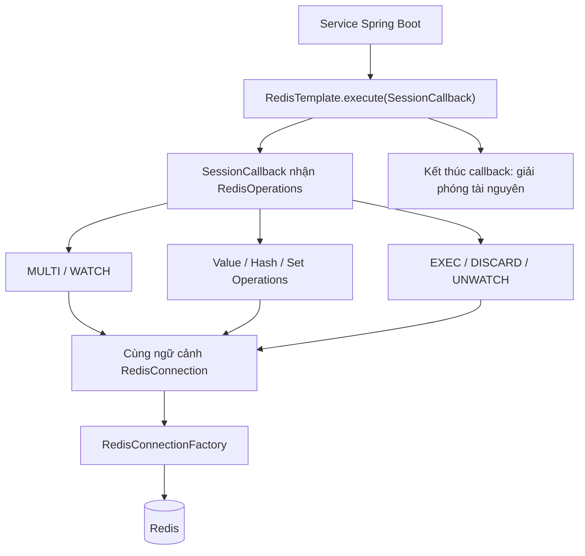
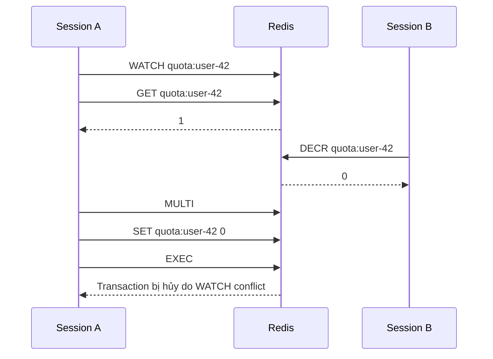

# Dùng SessionCallback để giữ các thao tác trong cùng phiên kết nối

## 1. Bài toán: nhiều lệnh Redis có cần cùng một kết nối không?

Trong ứng dụng Spring Boot, việc đọc hoặc ghi một khóa Redis thường chỉ cần một lời gọi:

```java
String status = redisTemplate.opsForValue().get("jobs:status:v1:42");
redisTemplate.opsForValue().set("jobs:status:v1:42", "RUNNING");
```

Với các lời gọi độc lập, `RedisTemplate` có thể lấy kết nối từ `RedisConnectionFactory` để thực hiện từng thao tác rồi giải phóng tài nguyên theo cơ chế quản lý của Spring Data Redis. Cách này phù hợp khi các thao tác không cần chia sẻ trạng thái **của kết nối**.

Tuy nhiên, một số khả năng của Redis gắn trạng thái trực tiếp với connection:

- **`MULTI` / `EXEC`:** các lệnh sau `MULTI` được xếp hàng trên connection hiện tại; `EXEC` thực thi hàng lệnh của chính connection ấy.
- **`WATCH`:** Redis theo dõi thay đổi của một hoặc nhiều khóa cho transaction trên connection đã gọi `WATCH`.
- **Pipelining:** client gửi một chuỗi lệnh theo một ngữ cảnh kết nối và thu phản hồi tương ứng, thường theo batch.

Nếu `MULTI` chạy trên kết nối A, lệnh `SET` lại dùng kết nối B và `EXEC` dùng kết nối C, không thể hình thành transaction mong muốn. Redis không nhận biết các connection này cùng thuộc một phương thức Java.

**`SessionCallback<T>`** là API Spring Data Redis giúp thực hiện nhiều thao tác `RedisOperations` trong **cùng một phiên kết nối logic**, với vòng đời do `RedisTemplate` quản lý. Đây là công cụ quan trọng khi dùng Redis transaction, `WATCH` hoặc các chuỗi lệnh cần chung connection.



Đây là **cùng ngữ cảnh kết nối trong thời gian thực thi callback**, không phải lời hứa rằng một đối tượng SessionCallback sẽ giữ mãi một socket TCP riêng, hay tất cả thao tác Java bên trong tự động trở nên nguyên tử.

## 2. Hiểu đúng RedisTemplate, RedisOperations và SessionCallback

`RedisTemplate<K,V>` là lớp truy cập Redis đồng bộ phổ biến trong Spring Data Redis. `StringRedisTemplate` là biến thể dùng chuỗi, thuận tiện cho khóa và giá trị văn bản. Cả hai triển khai hợp đồng `RedisOperations<K,V>` với các phương thức như `opsForValue()`, `opsForHash()`, `multi()`, `exec()`, `watch()` và `discard()`.

Giao diện callback có hình thức:

```java
public interface SessionCallback<T> {
    T execute(RedisOperations operations) throws DataAccessException;
}
```

*Đây là cách biểu diễn giản lược chữ ký để thấy vai trò của callback; các generic/API cụ thể phụ thuộc phiên bản Spring Data Redis.*

Khi gọi:

```java
T result = redisTemplate.execute(sessionCallback);
```

Spring Data Redis chuẩn bị phạm vi phiên, truyền đối tượng `RedisOperations` vào callback, cho phép các thao tác thuộc phạm vi này dùng chung kết nối phù hợp, rồi dọn binding và giải phóng tài nguyên khi callback kết thúc.

| Thành phần | Chịu trách nhiệm | Điều cần nhớ |
|---|---|---|
| `RedisTemplate` / `StringRedisTemplate` | API lệnh, serializer và kết nối theo hợp đồng Spring Data Redis | Thường là bean dùng chung sau khi cấu hình |
| `RedisConnectionFactory` | Cấp connection cho driver Lettuce/Jedis | Làm việc với connection pool/chia sẻ native connection theo cấu hình |
| `SessionCallback<T>` | Xác định phạm vi thao tác cùng session | Callback nhận `RedisOperations` để gọi nhiều lệnh |
| `RedisOperations` trong callback | Gửi các lệnh Redis của phiên hiện tại | Dùng đối tượng được truyền vào cho toàn bộ chuỗi cần kết nối chung |
| Redis server | Lưu trạng thái connection-specific cho transaction, WATCH | Server xử lý đúng theo giao thức Redis, không biết transaction Spring bên ngoài |

### SessionCallback **có** và **không có** tác dụng gì?

`SessionCallback` **có** tác dụng:

1. Cho phép nhiều lời gọi template cùng đi qua một phiên kết nối thích hợp.
2. Là nơi đặt `WATCH`, `MULTI`, các lệnh được xếp hàng và `EXEC`/`DISCARD`.
3. Giúp sử dụng serializer, cơ chế exception translation và connection management của `RedisTemplate`.
4. Kết thúc phạm vi tài nguyên khi lời gọi `execute(...)` hoàn tất, kể cả khi callback ném exception (theo cơ chế cleanup của framework).

`SessionCallback` **không tự**:

- Gọi `MULTI` hoặc tạo Redis transaction.
- Bảo đảm rollback tất cả lệnh theo kiểu database quan hệ.
- Tạo một distributed lock, bảo vệ khóa khỏi mọi request khác.
- Gộp nhiều lệnh thành pipeline nếu không gọi API pipeline thích hợp.
- Tạo giao dịch ACID xuyên PostgreSQL và Redis.
- Duy trì session qua `@Async`, một thread khác, hoặc các lời gọi `execute(...)` tách rời.

Điểm phân biệt này giúp tránh lỗi phổ biến: chỉ bao nhiều lệnh trong callback rồi cho rằng chúng đã trở thành **một thao tác nguyên tử**.

## 3. Ví dụ cơ bản: một Redis transaction trong SessionCallback

Giả sử khi bắt đầu job, ứng dụng muốn ghi trạng thái `RUNNING` và tăng bộ đếm số job đã bắt đầu. Đây là ví dụ về hai thao tác trên Redis cần được xếp hàng và thực thi trong một transaction Redis.

```java
import java.util.List;

import org.springframework.dao.DataAccessException;
import org.springframework.data.redis.core.RedisOperations;
import org.springframework.data.redis.core.SessionCallback;
import org.springframework.data.redis.core.StringRedisTemplate;
import org.springframework.stereotype.Service;

@Service
public class JobStartStore {

    private final StringRedisTemplate redis;

    public JobStartStore(StringRedisTemplate redis) {
        this.redis = redis;
    }

    public List<Object> markStarted(String jobId) {
        String stateKey = "jobs:state:v1:" + jobId;
        String counterKey = "jobs:started:total:v1";

        return redis.execute(new SessionCallback<List<Object>>() {
            @Override
            @SuppressWarnings({"rawtypes", "unchecked"})
            public List<Object> execute(RedisOperations operations)
                    throws DataAccessException {

                operations.multi();
                try {
                    operations.opsForValue()
                            .set(stateKey, "RUNNING");
                    operations.opsForValue()
                            .increment(counterKey);

                    return operations.exec();
                } catch (RuntimeException failure) {
                    // Best effort: dọn hàng đợi nếu MULTI còn mở.
                    try {
                        operations.discard();
                    } catch (RuntimeException cleanupFailure) {
                        failure.addSuppressed(cleanupFailure);
                    }
                    throw failure;
                }
            }
        });
    }
}
```

Khi thực thi bình thường, luồng lệnh về cơ bản là:

```text
Connection A:
    MULTI
    SET jobs:state:v1:job-42 RUNNING      -> QUEUED
    INCR jobs:started:total:v1          -> QUEUED
    EXEC                               -> [kết quả SET, kết quả INCR]

SessionCallback kết thúc -> Spring giải phóng ngữ cảnh connection
```

Các bước có ý nghĩa riêng:

1. `redis.execute(callback)` mở một phạm vi phiên thao tác.
2. Callback **phải dùng `operations` nhận được** để thực hiện cả `multi()`, các lệnh ghi và `exec()`.
3. `multi()` chuyển connection vào trạng thái queue lệnh Redis.
4. Các lệnh `set` và `increment` được queue; ứng dụng không thể coi giá trị trả về ở thời điểm này là kết quả thực thi thật.
5. `exec()` yêu cầu Redis thực thi transaction; danh sách kết quả được trả về sau khi kết thúc.
6. Nếu exception phát sinh trước khi transaction đóng, callback cố gắng `discard()` để dọn hàng đợi. Nếu connection hỏng hoặc `EXEC` đã đến server nhưng mất phản hồi, `discard()` không thể khôi phục những thay đổi đã xảy ra.

**Phạm vi nguyên tử của `EXEC`:** Redis không cho phép lệnh của client khác chen giữa các lệnh được thực thi trong cùng transaction, nhưng Redis không cung cấp rollback kiểu RDBMS khi một lệnh đã chạy rồi phát sinh lỗi thực thi ở lệnh tiếp theo. Nếu một trong hai key là dữ liệu tài chính/nguồn sự thật, phải xem xét các yêu cầu bền vững và giao dịch nghiệp vụ riêng.

### Chú ý: với Redis Cluster

Transaction đa khóa như `stateKey` và `counterKey` trong ví dụ phải thỏa các ràng buộc multi-key của Redis Cluster. Hai khóa tùy ý thường không cùng hash slot, nên ví dụ minh họa cho Redis standalone hoặc cấu hình nơi các lệnh được Redis cho phép; trong Cluster cần thiết kế các key cùng slot nếu muốn một transaction đa khóa. Chỉ ghép hash tag khi phù hợp phân bố dữ liệu, vì gom quá nhiều khóa nóng vào một slot có thể làm lệch tải.

## 4. Tại sao phải dùng RedisOperations truyền vào callback?

So sánh hai cách viết:

```java
redis.execute(new SessionCallback<List<Object>>() {
    @Override
    @SuppressWarnings({"rawtypes", "unchecked"})
    public List<Object> execute(RedisOperations operations) {
        operations.multi();
        operations.opsForValue().set("job:42", "RUNNING");
        return operations.exec();
    }
});
```

Đây là cách phù hợp: mọi lệnh liên quan tới transaction dùng `operations` của phiên.

Ngược lại, cách sau rất dễ gây hiểu nhầm:

```java
redis.execute(new SessionCallback<List<Object>>() {
    @Override
    @SuppressWarnings({"rawtypes", "unchecked"})
    public List<Object> execute(RedisOperations operations) {
        operations.multi();

        // Đừng trộn một template/factory/client khác tùy ý:
        anotherRedisTemplate.opsForValue()
                .set("job:42", "RUNNING");

        return operations.exec();
    }
});
```

`anotherRedisTemplate` có thể dùng factory khác, serializer khác, Redis endpoint khác hoặc một connection khác. Lệnh `SET` khi đó không nhất thiết nằm trong transaction đã mở bởi `operations.multi()`.

Một quy tắc thực tế là **truyền mọi thao tác Redis thuộc cùng phiên qua đối tượng `operations` được cung cấp**. Nếu cần gọi một phương thức trợ giúp, truyền `RedisOperations` cho phương thức đó thay vì để phương thức tự tìm template/connection khác.

```java
@SuppressWarnings({"rawtypes", "unchecked"})
private void enqueueJobCommands(
        RedisOperations operations, String stateKey) {
    operations.opsForValue().set(stateKey, "RUNNING");
    operations.opsForValue().increment("jobs:started:total:v1");
}
```

Helper trên không cần biết connection được lấy như thế nào; nó tham gia vào phạm vi session do caller quản lý. Helper không nên tự gọi `multi()` hoặc `exec()` nếu caller đã sở hữu ranh giới transaction.

## 5. Giá trị trả về bên trong MULTI và sau EXEC

Một nhầm lẫn gây lỗi nghiệp vụ là sử dụng kết quả của `get()`, `increment()` hoặc `setIfAbsent()` khi transaction đang trong giai đoạn queue:

```java
operations.multi();

Long count = (Long) operations.opsForValue()
        .increment("stats:views:v1");

// count có thể là null vì lệnh mới được queue!
List<Object> result = operations.exec();
```

Khi đã gọi `MULTI`, Redis thường trả `QUEUED` cho command thay vì giá trị thật. Spring Data Redis có thể biểu diễn kết quả tạm thời của lời gọi Operations dưới dạng `null`. Phải lấy kết quả từ **`exec()`** sau khi Redis thực thi các lệnh.

```text
Trước MULTI:   INCR counter  ->  Long (ví dụ 15)
Trong MULTI:  INCR counter  ->  QUEUED / API thường trả null
Sau EXEC:     danh sách kết quả -> giá trị số sau khi tăng
```

**Thứ tự kết quả:** danh sách từ `exec()` phản ánh thứ tự các command đã queue, nhưng Java type cụ thể phụ thuộc command, serializer và cách Spring Data Redis chuyển đổi kết quả. Không hard-code cast toàn bộ phần tử của danh sách về `String` hoặc `Long` khi chưa xác định hợp đồng dữ liệu của từng command.

Với `WATCH`, `EXEC` có thể không thực thi do một khóa theo dõi đã thay đổi; ứng dụng phải kiểm tra trường hợp transaction bị hủy, thông thường thể hiện bằng kết quả `null` từ API transaction trong ngữ cảnh tương ứng. Cần phân biệt **abort do optimistic locking** với **exception kết nối** và **kết quả lệnh bị lỗi**.

## 6. Dùng WATCH trong cùng session để cập nhật có điều kiện

`WATCH` là lệnh đặc biệt quan trọng vì trạng thái theo dõi khóa tồn tại **trước `MULTI`** và vẫn gắn với connection. Ví dụ hai yêu cầu muốn trừ cùng một quota tạm:



Nếu A tự đọc qua một connection khác không được WATCH theo dõi, cách kiểm tra giá trị ở ứng dụng mất tác dụng bảo vệ kỳ vọng. Do đó, toàn bộ trình tự **WATCH → đọc giá trị → MULTI → ghi → EXEC** phải dùng cùng phiên connection.

Một ví dụ minh họa có xử lý xung đột:

```java
import java.util.List;
import org.springframework.data.redis.core.RedisOperations;
import org.springframework.data.redis.core.SessionCallback;

public enum QuotaResult {
    USED, EXHAUSTED, CONFLICT
}

public QuotaResult consumeOneQuota(String userId) {
    String key = "quota:remaining:v1:" + userId;

    return redis.execute(new SessionCallback<QuotaResult>() {
        @Override
        @SuppressWarnings({"rawtypes", "unchecked"})
        public QuotaResult execute(RedisOperations operations) {
            boolean multiOpened = false;
            operations.watch(key);

            try {
                String raw = (String) operations
                        .opsForValue().get(key);

                long remaining =
                        raw == null ? 0 : Long.parseLong(raw);

                if (remaining <= 0) {
                    operations.unwatch();
                    return QuotaResult.EXHAUSTED;
                }

                operations.multi();
                multiOpened = true;

                operations.opsForValue()
                        .set(key, Long.toString(remaining - 1));

                List<Object> result = operations.exec();
                multiOpened = false;

                return result == null
                        ? QuotaResult.CONFLICT
                        : QuotaResult.USED;
            } catch (RuntimeException failure) {
                try {
                    if (multiOpened) {
                        operations.discard();
                    } else {
                        operations.unwatch();
                    }
                } catch (RuntimeException cleanupFailure) {
                    failure.addSuppressed(cleanupFailure);
                }
                throw failure;
            }
        }
    });
}
```

Ví dụ này minh họa một quota tồn tại trong Redis, không ngụ ý Redis tự bảo đảm độ bền phù hợp với giao dịch tài chính. Nó cũng sử dụng `SET` cho giá trị mới; nếu khóa cần giữ nguyên TTL cũ thì phải thiết kế cách duy trì TTL (hoặc dùng một cách cập nhật nguyên tử khác) theo đúng yêu cầu. `SET` thông thường có thể làm mất TTL đã đặt.

**Hai tình huống khác nhau:**

- `EXHAUSTED`: giá trị đọc được không đủ, ứng dụng chủ động `UNWATCH` rồi không ghi.
- `CONFLICT`: `EXEC` không thực hiện được do khóa đã bị thay đổi sau khi `WATCH`. Có thể retry bằng **một phiên mới**, đọc lại dữ liệu và giới hạn số lần thử.

Trong hệ thống có cạnh tranh rất cao, một lệnh Redis nguyên tử sẵn có hoặc Lua script có thể phù hợp hơn việc lặp `WATCH`/`MULTI`/`EXEC`. Chọn theo tính chất điều kiện cập nhật và đo tỷ lệ conflict. Không tự retry vô hạn trong callback.

## 7. SessionCallback không thay thế atomic command

Xét bộ đếm lượt xem:

```java
// Redis INCR vốn đã tăng nguyên tử trên một khóa:
Long count = redis.opsForValue()
        .increment("page:views:v1:42");
```

Nếu chỉ muốn tăng một bộ đếm, không cần viết `SessionCallback` với transaction vì `INCR` đã có semantics cần thiết. Tương tự, `SET key value NX EX ...` có thể phù hợp cho thao tác tạo khóa nếu chưa tồn tại kèm TTL; Spring Data Redis có các overload như `setIfAbsent(key, value, Duration)`.

`SessionCallback` hữu ích khi cần **các thao tác phải dùng chung connection**, còn tính nguyên tử đến từ **lệnh Redis** hoặc **`MULTI/EXEC`**, không đến từ callback tự thân.

Ví dụ không đủ an toàn:

```java
redis.execute(new SessionCallback<Void>() {
    @Override
    @SuppressWarnings({"rawtypes", "unchecked"})
    public Void execute(RedisOperations operations) {
        String oldValue = (String)
                operations.opsForValue().get("counter:v1");
        long next = Long.parseLong(oldValue) + 1;
        operations.opsForValue().set(
                "counter:v1", Long.toString(next));
        return null;
    }
});
```

Hai client khác nhau vẫn có thể xen lệnh giữa `GET` và `SET` vì callback không giữ khóa độc quyền. Khi không có `WATCH` hoặc một cơ chế nguyên tử khác, cập nhật có thể bị mất. Với bộ đếm số, chỉ dùng `increment` thường vừa đơn giản vừa đúng hơn.

## 8. SessionCallback và RedisCallback khác nhau ở điểm nào?

Spring Data Redis có hai kiểu callback thường gây nhầm:

| Tiêu chí | `RedisCallback<T>` | `SessionCallback<T>` |
|---|---|---|
| Tham số callback | `RedisConnection` | `RedisOperations` |
| Tầng API | Lệnh Redis mức thấp, thường làm việc với `byte[]` | Các nhóm Operations theo kiểu Java và serializer của template |
| Mục đích điển hình | Gọi low-level command chưa thuận tiện ở API template | Chuỗi thao tác RedisTemplate cần chung phiên |
| Serialization | Caller thường chủ động encode/decode byte khi dùng low-level API | Template áp serializer đã cấu hình |
| Connection management | Template cấp connection và giải phóng sau callback | Template quản lý binding của phiên và giải phóng sau callback |
| Transaction `MULTI/EXEC` | Có thể thao tác trực tiếp trên cùng `RedisConnection` | Có thể gọi `operations.multi()/exec()` cho các lệnh template |
| Sử dụng | Khi thật sự cần API connection mức thấp | Ưu tiên cho code thao tác theo RedisOperations nhiều bước |

Ví dụ `RedisCallback`:

```java
import java.nio.charset.StandardCharsets;
import org.springframework.data.redis.core.RedisCallback;

String key = "feature:flag:v1";

byte[] rawValue = redis.execute(
        (RedisCallback<byte[]>) connection -> {
            byte[] rawKey = key.getBytes(StandardCharsets.UTF_8);
            return connection.stringCommands().get(rawKey);
        });
```

Code tự đưa key về `byte[]` vì đang ở tầng low-level. Nếu serializer key của template không phải UTF-8, cách tạo byte trực tiếp này có thể không đọc được dữ liệu mà `opsForValue()` lưu. Và **không đóng `connection` thủ công trong callback**; nó được cấp và quản lý bởi template.

Với `SessionCallback`, code sử dụng API cấp cao và không cần tự serialize:

```java
String result = redis.execute(new SessionCallback<String>() {
    @Override
    @SuppressWarnings({"rawtypes", "unchecked"})
    public String execute(RedisOperations operations) {
        return (String) operations.opsForValue().get(key);
    }
});
```

Ví dụ một lệnh trên chỉ nhằm cho thấy khác biệt API; trong thực tế gọi thẳng `redis.opsForValue().get(key)` gọn hơn và không cần SessionCallback.

## 9. Dùng SessionCallback với pipeline: cùng phiên nhưng mục tiêu khác

**Pipeline** giúp gửi nhiều lệnh mà không cần đợi phản hồi của từng lệnh trước khi gửi lệnh tiếp theo, qua đó giảm round trip mạng khi có một batch gồm các lệnh độc lập.

```text
Không pipeline:
  SET k1 -> đợi reply
  SET k2 -> đợi reply
  SET k3 -> đợi reply

Pipeline:
  gửi SET k1, SET k2, SET k3
  sau đó thu các reply tương ứng
```

Spring Data Redis cung cấp `executePipelined(SessionCallback<?>)`. Đây là một cách kết hợp SessionCallback với một chế độ xử lý lệnh do template chủ động mở/đóng:

```java
import java.util.List;
import java.time.Duration;
import org.springframework.data.redis.core.RedisOperations;
import org.springframework.data.redis.core.SessionCallback;

public List<Object> storeBatch(List<String> jobIds) {
    return redis.executePipelined(new SessionCallback<Object>() {
        @Override
        @SuppressWarnings({"rawtypes", "unchecked"})
        public Object execute(RedisOperations operations) {
            for (String jobId : jobIds) {
                operations.opsForValue().set(
                        "jobs:state:v1:" + jobId,
                        "QUEUED",
                        Duration.ofMinutes(20));
            }
            return null;
        }
    });
}
```

Điểm quan trọng:

1. `executePipelined` quản lý thời điểm mở, chạy và kết thúc pipeline qua template.
2. Callback pipeline **phải trả về `null`**; kết quả của các lệnh được trả về trong `List<Object>` từ `executePipelined` sau khi pipeline hoàn thành.
3. Không kiểm tra ngay `Boolean` hoặc giá trị lệnh `set/get/increment` bên trong callback để rẽ nhánh, bởi lời gọi trong pipeline thường chưa có kết quả cuối.
4. **Pipeline không tự tạo Redis transaction**. Những lệnh đã thực hiện trước lỗi không tự rollback.
5. Hạn chế số lệnh và tổng kích thước response mỗi batch; pipeline quá lớn có thể tạo áp lực buffer và RAM phía client/server.

`SessionCallback` là cách đóng gói chuỗi thao tác chung phiên, còn `executePipelined` là API của template xác định **chế độ pipeline**. Một `SessionCallback` gọi bằng `redis.execute(...)` thông thường không có pipelining chỉ nhờ việc nó thực hiện nhiều lệnh.

### So sánh transaction và pipeline

| Đặc điểm | `MULTI/EXEC` trong SessionCallback | `executePipelined(SessionCallback)` |
|---|---|---|
| Mục tiêu | Thực thi nhóm lệnh không xen kẽ với lệnh từ client khác | Giảm vòng đi mạng của nhiều lệnh |
| Cùng connection | Cần | Cần |
| Lệnh giữa chừng | Được queue cho đến `EXEC` | Được gửi/đệm để thu kết quả theo batch |
| Thời điểm nhận kết quả | Sau `exec()` | Sau `executePipelined()` |
| Tính nguyên tử của cả nhóm | Redis transaction có ngữ nghĩa thực thi nguyên tử, không rollback như RDBMS | Không |
| Xử lý xung đột optimistic | Có thể kết hợp `WATCH` | Không tự giải quyết |
| Phù hợp | Cập nhật nhiều khóa liên quan theo giới hạn Redis | Nạp cache, cập nhật độc lập số lượng lớn |

Có các trường hợp kết hợp transaction với pipeline, nhưng kết quả và thứ tự thu reply phức tạp hơn; không nên trộn nếu chưa kiểm chứng hợp đồng API của Spring Data Redis và giới hạn Redis trong môi trường đang dùng.

## 10. @Transactional của Spring và SessionCallback

Hai loại transaction thường bị gọi chung là “giao dịch”:

- **Transaction của Redis**: một connection thực hiện `MULTI`, queue lệnh và `EXEC` hoặc `DISCARD`.
- **Spring-managed transaction**: do `PlatformTransactionManager` điều phối, thường là transaction database khi ứng dụng dùng JPA/JDBC.

Chỉ dùng `@Transactional` trên một service **không mặc định** biến các lời gọi của `RedisTemplate` thành Redis `MULTI/EXEC`.

Spring Data Redis có tùy chọn hỗ trợ synchronization với transaction hiện hành, ví dụ cấu hình template:

```java
import org.springframework.context.annotation.Bean;
import org.springframework.context.annotation.Configuration;
import org.springframework.data.redis.connection.RedisConnectionFactory;
import org.springframework.data.redis.core.StringRedisTemplate;

@Configuration
class RedisTransactionSupportConfiguration {
    @Bean
    StringRedisTemplate transactionAwareStringRedisTemplate(
            RedisConnectionFactory connectionFactory) {
        StringRedisTemplate template =
                new StringRedisTemplate(connectionFactory);
        template.setEnableTransactionSupport(true);
        return template;
    }
}
```

Khi có Spring transaction hoạt động, template đã bật transaction support có thể gắn Redis connection với thread đang chạy và đồng bộ các thao tác Redis theo vòng đời transaction đó. **Cách này khác `SessionCallback` gọi `multi/exec` thủ công**:

| Câu hỏi | SessionCallback + `multi/exec` | Spring transaction support |
|---|---|---|
| Ai mở/đóng Redis transaction? | Callback gọi tường minh | Tích hợp theo transaction synchronization được cấu hình |
| Cần Spring `@Transactional`? | Không | Thường cần một transaction Spring đang hoạt động |
| Phạm vi connection | Phạm vi callback | Theo transaction/thread context |
| Lệnh đọc sau ghi đang queue | Không tự thấy giá trị vừa queue | Có thể được thực hiện trên connection khác vì write đang queue |
| SQL và Redis commit cùng ACID? | Không | Vẫn không |

**Không phối hợp tùy tiện hai mô hình transaction** trên cùng template trong một phương thức. Ví dụ, gọi `multi()` thủ công trong một template đã tham gia transaction Spring có thể tạo hành vi khó đoán nếu một transaction đã được mở/quản lý ở tầng khác. Chọn một cơ chế quản lý rõ ràng cho từng luồng xử lý và tách ranh giới dữ liệu.

### Tại sao không có commit nguyên tử SQL + Redis?

Xét ứng dụng cập nhật đơn hàng ở PostgreSQL rồi ghi cache Redis:

```java
@Transactional
public void completeOrder(String orderId) {
    orderRepository.complete(orderId);
    redisTemplate.opsForValue().set(
            "orders:state:v1:" + orderId,
            "COMPLETED");
}
```

Ngay cả khi bật hỗ trợ Redis transaction, **điều đó không tạo một distributed transaction ACID giữa PostgreSQL và Redis**. Có thể có tình huống DB commit thành công nhưng Redis mất mạng ở thời điểm cập nhật, hoặc ngược lại một side effect khác không đồng bộ như mong đợi.

Đối với dữ liệu nghiệp vụ chính thức, nên giữ nguồn sự thật ở hệ có giao dịch phù hợp; Redis dùng cho cache hoặc trạng thái dẫn xuất. Khi cần đồng bộ sau commit, cân nhắc cache invalidation, transactional outbox, retry có idempotency hoặc cơ chế đảm bảo theo yêu cầu ứng dụng.

## 11. Vòng đời connection, pool và tài nguyên

Trong `RedisTemplate.execute(SessionCallback)`, **template sở hữu việc cấp và giải phóng connection**. Code trong callback không nên lấy connection do framework đang dùng rồi tự đóng hoặc giữ reference để sử dụng sau khi callback trả về.

Các kiểu sử dụng thường gặp:

| Kiểu thao tác | Nguồn connection | Ai giải phóng? |
|---|---|---|
| `redis.opsForValue().get(key)` | Template/factory | Template |
| `redis.execute(SessionCallback)` | Template, giữ phạm vi session | Template sau callback |
| `redis.execute(RedisCallback)` | Template cấp `RedisConnection` | Template sau callback |
| `redis.executePipelined(...)` | Template mở pipeline | Template sau pipeline |
| `connectionFactory.getConnection()` gọi trực tiếp | Mã ứng dụng tự lấy | Mã ứng dụng phải đóng/trả đúng hợp đồng |
| Native connection Lettuce/Jedis trực tiếp | API client cụ thể | Theo contract của client/pool |

Ví dụ **chỉ dành cho mã đã tự lấy kết nối**:

```java
import org.springframework.data.redis.connection.RedisConnection;

try (RedisConnection connection = connectionFactory.getConnection()) {
    // Chỉ thao tác low-level trong phạm vi này.
    // Chủ thể đã lấy connection chịu trách nhiệm close/return.
}
```

Không chép `connection.close()` vào trong `RedisCallback`, cũng không tự đóng native Lettuce connection mà `LettuceConnectionFactory` đang chia sẻ. `RedisConnection.close()` có thể mang nghĩa trả wrapper/connection về factory hoặc pool; không nhất thiết đóng TCP socket ngay.

### 11.1. Lettuce và Jedis có ảnh hưởng gì?

Lettuce thường dùng Netty, cho phép một số native connection thông thường được chia sẻ cho lệnh độc lập; nhưng transaction, lệnh blocking và kết nối có trạng thái cần xử lý phạm vi riêng. Jedis truyền thống thường mượn connection từ pool khi cần phục vụ nhiều thread đồng thời. Spring Data Redis che giấu nhiều chi tiết này sau `RedisConnectionFactory` và template.

**Một `RedisConnection` wrapper trong Spring Data Redis không nên tự ý chia sẻ giữa các thread**, ngay cả khi driver native bên dưới có cơ chế chia sẻ. SessionCallback giúp thao tác đồng bộ theo phạm vi call-site rõ ràng, không phải một đối tượng connection dùng toàn cục.

### 11.2. Giữ session càng ngắn càng tốt

Sai lầm thường gặp:

```java
redis.execute(new SessionCallback<Void>() {
    @Override
    @SuppressWarnings({"rawtypes", "unchecked"})
    public Void execute(RedisOperations operations) {
        operations.watch("job:state:v1:42");

        // Minh họa điều nên tránh:
        slowRemotePaymentRequest(); // Có thể mất vài giây!

        operations.multi();
        operations.opsForValue().set("job:state:v1:42", "DONE");
        operations.exec();
        return null;
    }
});
```

Đoạn này giữ session/`WATCH` trong lúc gọi một hệ thống bên ngoài. Khi nhiều request làm như vậy, kết nối có thể bị giữ lâu, pool cạn, tỷ lệ WATCH conflict tăng và timeout xuất hiện.

Cách tổ chức tốt hơn: chuẩn bị dữ liệu, gọi hệ thống bên ngoài và xác định điều kiện trước khi mở session Redis; khi đã mở session chỉ thực hiện chuỗi Redis cần chung connection, hoàn tất ngay bằng `EXEC`/`DISCARD`/`UNWATCH`.

Với nghiệp vụ thanh toán, gọi bên ngoài còn có thể tạo side effect không thể rollback, nên cần một workflow idempotent có nguồn trạng thái chính thức riêng; Redis transaction không quản lý điều đó.

## 12. Đồng bộ giữa các thread: SessionCallback không phải cơ chế bất đồng bộ

Trong mô hình đồng bộ, session binding của Spring Data Redis gắn với ngữ cảnh thread gọi. Không tự tạo `CompletableFuture`, `@Async` hoặc thread mới trong callback rồi giả định lệnh ở thread mới dùng cùng Redis connection.

```java
redis.execute(new SessionCallback<Void>() {
    @Override
    @SuppressWarnings({"rawtypes", "unchecked"})
    public Void execute(RedisOperations operations) {
        operations.multi();

        // Không làm việc này để gửi lệnh thuộc transaction:
        CompletableFuture.runAsync(() ->
                anotherRedisTemplate.opsForValue()
                        .set("job:state:v1:42", "RUNNING"));

        operations.exec();
        return null;
    }
});
```

Trong ví dụ trên, callback có thể kết thúc trước khi tác vụ chạy ở thread khác; tác vụ đó cũng có thể dùng connection khác. Nó không phải phần được bảo vệ của Redis transaction.

**Nếu ứng dụng dùng WebFlux/reactive**, hãy dùng `ReactiveRedisTemplate`/`ReactiveStringRedisTemplate` và contract quản lý connection/transaction reactive tương ứng. Không lấy `SessionCallback` đồng bộ rồi gọi `block()` trên event loop. Reactive APIs trả publisher (`Mono`/`Flux`) và quản lý ngữ cảnh thực thi khác với callback synchronous.

## 13. Những lỗi thường gặp và cách chẩn đoán

| Triệu chứng | Nguyên nhân có thể xảy ra | Hướng giải quyết |
|---|---|---|
| `EXEC` trả rỗng hoặc không có lệnh như dự kiến | `MULTI` và lệnh đã được gửi ở các connection/ngữ cảnh khác nhau | Gói `multi`, commands và `exec` trong một `SessionCallback`, dùng `operations` của callback |
| Kết quả `increment` trong transaction là `null` | Lệnh còn ở trạng thái `QUEUED` | Đọc kết quả sau `exec()` |
| `EXEC` bị hủy bất ngờ | `WATCH` phát hiện khóa bị thay đổi | Phân biệt conflict và lỗi kết nối; retry có giới hạn trên phiên mới |
| Transaction bị bỏ dở khi exception | Callback thoát sau `MULTI` mà chưa `EXEC`/`DISCARD` | Cleanup best effort và giải phóng resource; xem trạng thái connection khi lỗi |
| Các request Redis bị chậm dù server ít tải | Session giữ connection lâu hoặc pool bị cạn | Đo pool wait, thời gian callback, bỏ I/O ngoài Redis ra khỏi session |
| Code GET rồi SET trong SessionCallback vẫn mất cập nhật | Callback giữ connection nhưng không khóa khóa Redis | Dùng lệnh nguyên tử, WATCH hoặc script có điều kiện |
| `SessionCallback` không thực thi song song reactive | API synchronous và gắn phạm vi thread | Dùng ReactiveRedisTemplate trong ứng dụng reactive |
| Timeout sau `EXEC` khiến kết quả không rõ | Server có thể đã thực thi nhưng response bị mất | Xác định thao tác idempotent/operation ID; không retry mù |
| Gọi `DISCARD` khi không có `MULTI` | Cleanup không đúng trạng thái transaction | Chỉ discard khi transaction có thể còn mở; xử lý cleanup exception |
| Java value không đọc được như mong đợi | Serializer value/key của template khác với dữ liệu đã ghi | Dùng serializer và key schema nhất quán; xem contract dữ liệu |

### Vì sao lỗi timeout không chứng minh Redis chưa thực thi?

Ứng dụng có thể gửi `EXEC` tới Redis, Redis đã thực thi, nhưng kết nối mất trước khi phản hồi được nhận. Lúc này caller nhận exception dù dữ liệu có thể đã thay đổi. Retry toàn bộ transaction có `INCR` không có idempotency sẽ có nguy cơ tăng hai lần.

Giải pháp phải bắt đầu từ **tính chất nghiệp vụ**: ghi operation ID, lệnh chỉ thực hiện nếu chưa xử lý, dùng một script nguyên tử cho check-and-set, hoặc thiết kế cơ chế đối soát với nguồn sự thật. `SessionCallback` không thể tự phân biệt tất cả trạng thái “đã thực thi / chưa thực thi” sau lỗi mạng.

## 14. Quy tắc viết callback dễ đọc và dễ duy trì

Một callback tốt nên:

1. **Có một mục đích rõ ràng**: ví dụ “giảm quota nếu còn” hoặc “ghi trạng thái và bộ đếm”.
2. **Giới hạn thời gian**: thực hiện các Redis command cần thiết rồi kết thúc.
3. **Sử dụng đúng `operations`** cho mọi command thuộc cùng session.
4. **Đặt ranh giới transaction rõ**: `WATCH` nếu cần, `MULTI`, queue, `EXEC` hoặc `DISCARD`/`UNWATCH` ở đường lỗi.
5. **Không dựa vào giá trị của lệnh đang queue** để đưa ra quyết định.
6. **Trả kết quả có ý nghĩa**: phân biệt thành công, conflict, dữ liệu không đủ và lỗi hệ thống.
7. **Tránh tác vụ ngoài Redis**: không gọi HTTP, không chờ người dùng, không xử lý CPU nặng khi session còn mở.
8. **Không chuyển thread giữa phiên** nếu dùng API đồng bộ.
9. **Giới hạn retry**: đặc biệt khi WATCH conflict hoặc lỗi mạng.
10. **Tách adapter khỏi business logic**: để service bên ngoài gọi phương thức theo nghiệp vụ, không cần biết `MULTI`, serializer hay key schema.

Ví dụ một adapter chỉ để lộ API nghiệp vụ:

```java
@Repository
public class RateQuotaRedisStore {
    private final StringRedisTemplate redis;

    public RateQuotaRedisStore(StringRedisTemplate redis) {
        this.redis = redis;
    }

    public QuotaResult consume(String subjectId) {
        // Ở đây triển khai SessionCallback WATCH/MULTI/EXEC
        // giống ví dụ ở mục 6, và ánh xạ thành QuotaResult.
        return consumeOneQuota(subjectId);
    }
}
```

*Đoạn trên là phác thảo cấu trúc lớp*: phương thức `consumeOneQuota` tượng trưng cho phần implementation ở ví dụ trước; khi đưa vào dự án thực phải đặt phương thức đó trong lớp phù hợp và bảo đảm đầy đủ dependency, phạm vi khóa, lỗi parsing và TTL.

### Chọn cấu trúc khóa phù hợp

Ví dụ:

```text
jobs:{job-42}:state:v1
jobs:{job-42}:attempts:v1
quota:remaining:v1:user-42
```

Các khóa có cùng hash tag `{job-42}` được Redis Cluster định tuyến vào cùng slot, hữu ích khi cần transaction đa khóa trong phạm vi một job. Không nên tùy tiện đặt tất cả key của mọi job trong cùng một tag chung vì dễ tạo hotspot.

Đặt namespace, phiên bản schema và ID ổn định; tránh chứa token, dữ liệu cá nhân hoặc bí mật trực tiếp trong key. `SessionCallback` không làm thay đổi cách Redis key được serialize; template vẫn áp dụng serializer đã cấu hình.

## 15. Tình huống chọn SessionCallback hay giải pháp khác

| Yêu cầu | Công cụ phù hợp | Lý do |
|---|---|---|
| Đọc một khóa | `opsForValue().get(key)` | Không cần session nhiều lệnh |
| Tăng bộ đếm nguyên tử | `opsForValue().increment(key)` | Redis `INCR` nguyên tử cho một khóa |
| Ghi nhiều lệnh cần cùng `MULTI/EXEC` | `execute(SessionCallback)` | Giữ chung kết nối cho hàng lệnh transaction |
| Đọc kiểm tra rồi ghi nếu dữ liệu chưa thay đổi | `SessionCallback` với `WATCH/MULTI/EXEC` | Cần cùng connection từ lúc WATCH đến EXEC |
| Nạp nhiều key cache độc lập với throughput tốt | `executePipelined(SessionCallback)` | Giảm số round trip, không cần atomic transaction |
| Cần làm việc trực tiếp với byte/lệnh low-level | `RedisCallback` | Truy cập `RedisConnection` |
| Một điều kiện cập nhật nguyên tử phức tạp, ít round trip | Redis Lua script hoặc lệnh tích hợp phù hợp | Có thể đơn giản hơn WATCH có retry |
| Cập nhật dữ liệu nghiệp vụ ở SQL và cache Redis | Transaction ở DB + đồng bộ/cache invalidation sau commit | Không có commit phân tán ACID mặc định |
| Luồng WebFlux hoàn toàn reactive | `ReactiveRedisTemplate` và reactive transaction/session API | Tránh block event loop |

## 16. Kết luận

`SessionCallback` là cách diễn đạt rõ ràng trong Spring Data Redis rằng **một nhóm thao tác `RedisOperations` cần cùng ngữ cảnh kết nối**. Điều đó đặc biệt quan trọng vì `MULTI`, `EXEC` và `WATCH` là các lệnh có trạng thái gắn với connection Redis.

Khi sử dụng:

- Gọi `redisTemplate.execute(new SessionCallback<...>() { ... })`.
- Thực hiện **mọi lệnh thuộc phiên qua `RedisOperations operations`** được truyền vào callback.
- Nếu cần Redis transaction, chủ động tổ chức `MULTI`, các lệnh và `EXEC`/`DISCARD` trong phạm vi callback.
- Nếu cần optimistic locking, bắt đầu bằng `WATCH` trên cùng connection, đọc và quyết định trước `MULTI`, rồi xử lý xung đột khi `EXEC` bị hủy.
- Nếu mục tiêu là giảm round trip, dùng `executePipelined` và hiểu rằng pipeline không tự có tính nguyên tử.
- Để template quản lý vòng đời resource, giữ callback ngắn và thiết kế đường lỗi/retry có kiểm soát.

Việc **giữ cùng phiên kết nối** giải quyết một điều kiện kỹ thuật quan trọng, nhưng độ đúng của nghiệp vụ còn phụ thuộc vào chọn đúng lệnh nguyên tử, kiểm soát cạnh tranh, TTL, serializer, tính bền vững của Redis và cách ứng dụng phản ứng khi mất kết nối.
