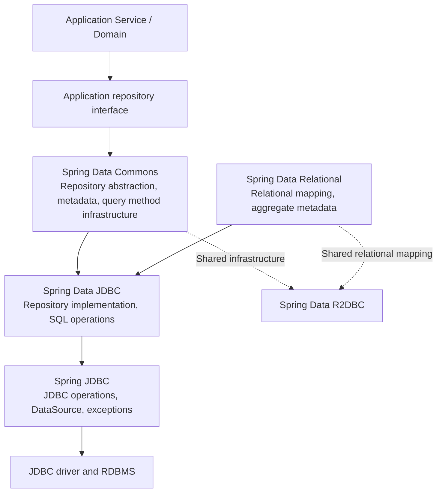

# Roles of Spring Data Relational, Spring Data Commons, and Spring Data JDBC

When building a Java application that stores data in a relational database, we often encounter three similar-sounding names: **Spring Data Commons**, **Spring Data Relational**, and **Spring Data JDBC**. They are not three peer alternatives. Each component addresses a different layer of responsibility, and Spring Data JDBC builds upon the foundations provided by the other two.

This lesson focuses on each component's place in the Spring Data ecosystem, how they collaborate when a repository reads or writes data, and how that design shapes the domain model.

## 1. The Big Picture

Spring Data is a family of projects that unifies how applications work with different data sources. The shared layer provides the repository concept, pagination types, metadata, and repository creation mechanisms; each specialized module handles how to access a particular kind of data store.

In the relational database branch:

- **Spring Data Commons** provides shared contracts and infrastructure across many Spring Data modules, without being tied to JDBC or any specific database engine.
- **Spring Data Relational** provides the *aggregate*-based object–relational mapping model, table/column metadata, and relational concepts shared between Spring Data JDBC and Spring Data R2DBC.
- **Spring Data JDBC** implements **synchronous, blocking relational data access over JDBC**, including repositories, SQL operation generation/execution, and converting data rows into objects according to that mapping model.

Behind Spring Data JDBC lie **Spring JDBC** (such as `JdbcTemplate`, `NamedParameterJdbcOperations`), the JDBC driver, and the database. Spring JDBC is a lower-level SQL access library; it does not provide Spring Data JDBC's aggregate/repository model on its own.



The diagram illustrates **logical responsibilities**, not a fixed call chain: Spring Data JDBC's code relies simultaneously on abstractions from Commons and metadata from Relational.

## 2. Spring Data Commons: Repository Contracts and Shared Infrastructure

### 2.1. Primary Role

Spring Data Commons is the shared foundation for modules such as Spring Data JDBC, JPA, MongoDB, and others. Thanks to this layer, developers can use a relatively consistent repository vocabulary even when the underlying storage mechanisms differ.

Common concepts from Commons:

| Component | Role |
| --- | --- |
| `Repository<T, ID>` | Marker interface indicating a repository managing domain type `T` and key type `ID`. |
| `CrudRepository<T, ID>` | Contract for `save`, `findById`, `findAll`, `deleteById`, and basic CRUD operations. |
| `ListCrudRepository<T, ID>` | CRUD variant returning `List` for operations that return multiple objects. |
| `PagingAndSortingRepository<T, ID>` | Pagination/sorting contract; in Spring Data 3.x it does not automatically extend `CrudRepository`, so you must extend both when you want both sets of capabilities. |
| `Pageable`, `Page`, `Sort` | Types describing pages, paginated results, and sort order. |
| `@Id`, `@Version`, `@CreatedDate` | Shared metadata annotations for identity, optimistic locking, and auditing (actual support depends on the module and configuration). |
| Repository factory/proxy and query method infrastructure | Infrastructure enabling specialized modules to create repository implementations and process query methods. |

Example declaring an interface using the Commons contract:

```java
import org.springframework.data.repository.ListCrudRepository;

public interface BookRepository extends ListCrudRepository<Book, Long> {
}
```

`ListCrudRepository` itself **does not know** where the `books` table is located, what SQL to run, or which JDBC driver to use. When Spring Data JDBC is present and the repository is configured for JDBC, the JDBC module supplies the actual implementation for that interface.

### 2.2. Understanding Declared Query Methods Properly

You can declare additional methods:

```java
import java.util.Optional;
import org.springframework.data.repository.ListCrudRepository;

public interface BookRepository extends ListCrudRepository<Book, Long> {
    Optional<Book> findByIsbn(String isbn);
}
```

Spring Data Commons provides the infrastructure to parse repository method descriptors; **Spring Data JDBC** is responsible for implementing the query in line with relational mapping and the SQL dialect. You should not assume a method name is supported identically across all Spring Data modules: query derivation capabilities and supported expressions can vary.

**Scope boundary:** Simply adding `spring-data-commons` to an application will not produce a working JDBC repository. Commons is not a database connectivity library, does not manage drivers, and does not contain a JDBC SQL executor.

## 3. Spring Data Relational: Mapping Model and Aggregates

### 3.1. What Does Relational Own?

Spring Data Relational is the shared relational data mapping foundation, specifically used by Spring Data JDBC and Spring Data R2DBC. This component describes how Java classes correspond to tables/columns and ownership relationships within an aggregate.

Examples of annotations in the `org.springframework.data.relational.core.mapping` namespace:

- `@Table("books")`: specifies the table corresponding to the domain type.
- `@Column("book_title")`: specifies the column name when it differs from the default name.
- `@MappedCollection`: describes a collection of elements owned within the same aggregate; can configure the foreign key column and the order/key column.
- `@Embedded`: maps properties of a value object into columns of the same table, according to configuration.

Components such as `RelationalMappingContext` and `RelationalPersistentEntity` hold metadata about entities, properties, table/column names, and relationships inside the aggregate. This is the foundation a data access module like JDBC uses to decide which rows to read and write.

**Distinction:** The `@Id` annotation in Spring Data JDBC examples is usually imported from `org.springframework.data.annotation.Id` (Commons), while `@Table` is imported from `org.springframework.data.relational.core.mapping.Table` (Relational). Seeing both annotations together on a single class directly reflects the collaboration between the modules.

### 3.2. Aggregate Is a Key Boundary

An **aggregate** is a group of domain objects managed consistently through an **aggregate root**. Repositories are usually designed for the root; child elements are owned by the root, and saving the root can trigger insert/delete operations on tables holding child elements.

Suppose `PurchaseOrder` is the aggregate root, containing multiple `OrderLine` items:

```java
import java.util.ArrayList;
import java.util.List;
import org.springframework.data.annotation.Id;
import org.springframework.data.relational.core.mapping.MappedCollection;
import org.springframework.data.relational.core.mapping.Table;

@Table("purchase_orders")
public class PurchaseOrder {
    @Id
    private Long id;

    @MappedCollection(idColumn = "order_id", keyColumn = "line_position")
    private List<OrderLine> lines = new ArrayList<>();

    // Constructors, domain behavior, and accessors omitted.
}

@Table("order_lines")
class OrderLine {
    @Id
    private Long id;
    private String sku;
    private int quantity;
}
```

Here, `order_lines.order_id` is the column linking to the order, while `line_position` stores the position in the `List`. Actual table and column names must match the SQL schema.

```text
purchase_orders
  id (PK)
       |
       | 1 - N: order_lines.order_id
       v
order_lines
  id (PK)
  order_id (FK)
  line_position
  sku
  quantity
```

`OrderLine` instances belong to the lifecycle of `PurchaseOrder`. When saving an existing aggregate, Spring Data JDBC's write strategy may delete and re-insert the referenced child rows, even if only a small portion of the data changed. This is an implication to consider when an aggregate has large collections or requires stable child identifiers.

For a relationship from one aggregate to another **independent aggregate**, you typically store only the identifier key (such as `customerId` or `AggregateReference<Customer, Long>`), rather than modeling the entire other object as a collection owned by the root. That preserves aggregate boundaries and avoids misunderstandings about cascading.

### 3.3. Does Relational Access the Database Directly?

**No.** Relational defines *how data is mapped*; it is not a standalone JDBC engine. Opening connections, generating SQL statements, executing them, and receiving results belong to specialized layers like Spring Data JDBC working with Spring JDBC.

The name "Spring Data Relational" also does not mean "every technique for working with relational databases" or imply a reactive API: Spring Data JDBC is the blocking branch; Spring Data R2DBC is a separate reactive branch that shares part of the relational mapping foundation.

## 4. Spring Data JDBC: Synchronous Persistence Implementation on JDBC

### 4.1. What Does Spring Data JDBC Add?

Spring Data JDBC combines Commons' repository infrastructure with Relational's metadata/aggregates to:

1. Create implementations for application-declared repositories.
2. Map objects and aggregates to relational tables and columns.
3. Generate SQL operations for CRUD and many repository queries.
4. Execute operations through Spring JDBC, `DataSource`, and the JDBC driver.
5. Convert retrieved data into domain objects while integrating with Spring's transaction infrastructure.

Along this path, JDBC remains **synchronous and blocking**: a query operation occupies the executing thread until the query returns a result or fails. It fits the Spring MVC / traditional JDBC model; it does not become non-blocking simply by using a repository abstraction.

### 4.2. Minimal Example: Saving and Finding a Book

Suppose an application uses Spring Boot with a PostgreSQL database. In a Gradle Groovy project, add:

```groovy
dependencies {
    implementation 'org.springframework.boot:spring-boot-starter-data-jdbc'
    runtimeOnly 'org.postgresql:postgresql'
}
```

Spring Boot manages compatible Spring Data module versions via dependency management. The Data JDBC starter brings in the required dependencies for Spring Data JDBC, Relational, Commons, and Spring JDBC; the database's JDBC driver must be present on the classpath.

Illustrative connection configuration (replace values for your deployment environment):

```properties
spring.datasource.url=jdbc:postgresql://localhost:5432/library
spring.datasource.username=library_app
spring.datasource.password=replace_me
```

Illustrative schema:

```sql
CREATE TABLE books (
    id BIGINT GENERATED BY DEFAULT AS IDENTITY PRIMARY KEY,
    title VARCHAR(255) NOT NULL,
    isbn VARCHAR(32) NOT NULL UNIQUE
);
```

Immutable entity using a Java `record`:

```java
import org.springframework.data.annotation.Id;
import org.springframework.data.relational.core.mapping.Table;

@Table("books")
public record Book(
    @Id Long id,
    String title,
    String isbn
) {}
```

Repository:

```java
import java.util.Optional;
import org.springframework.data.repository.ListCrudRepository;

public interface BookRepository extends ListCrudRepository<Book, Long> {
    Optional<Book> findByIsbn(String isbn);
}
```

Service:

```java
import java.util.Optional;
import org.springframework.stereotype.Service;
import org.springframework.transaction.annotation.Transactional;

@Service
public class BookService {
    private final BookRepository books;

    public BookService(BookRepository books) {
        this.books = books;
    }

    @Transactional
    public Book create(String title, String isbn) {
        return books.save(new Book(null, title, isbn));
    }

    @Transactional(readOnly = true)
    public Optional<Book> findByIsbn(String isbn) {
        return books.findByIsbn(isbn);
    }
}
```

With valid repository and datasource configuration, Spring Boot can auto-configure Spring Data JDBC repositories. Calling `save(new Book(null, ...))` signals a new entity under the default ID-based state detection; when the database generates the key, Spring Data JDBC returns the saved object with the assigned ID. The `findByIsbn` method is implemented by the JDBC module as the corresponding query according to mapping rules.

Spring Data JDBC **does not automatically create schemas from entities like the typical Hibernate DDL workflow**. Applications should manage schemas via migrations such as Flyway/Liquibase or explicitly configured SQL initialization. The example above only illustrates the relevant components and does not cover setting up the database, running migrations, or creating a complete application.

### 4.3. Tracing a `save` Call

Suppose we call:

```java
Book saved = books.save(new Book(null, "Spring Data", "ISBN-001"));
```

The processing flow can be understood as follows:

| Step | Who provides the capability? | Meaning |
| --- | --- | --- |
| 1. Application calls `BookRepository.save` | Interface from Commons; repository implementation provided by JDBC | Business code does not have to write JDBC statements manually. |
| 2. Detect new entity, read metadata | Commons and Relational, used by JDBC | Identifies ID, `books` table, properties, and mapping rules. |
| 3. Prepare write operation | Spring Data JDBC | Chooses insert/update and builds the appropriate SQL operation. |
| 4. Execute SQL | Spring JDBC + JDBC driver | Acquires a connection via `DataSource`, binds parameters, and communicates with the database. |
| 5. Return result | Spring Data JDBC + mapping infrastructure | Maps generated values/ID and returns the domain object to the service. |

Exact class names and SQL statements may vary by version, dialect, and aggregate type. The responsibility model outlined above remains the key point to remember.

## 5. Comparing Responsibilities of the Three Components

| Criterion | Spring Data Commons | Spring Data Relational | Spring Data JDBC |
| --- | --- | --- | --- |
| Core question | "How are repositories represented and shared?" | "How do objects/aggregates map to the relational model?" | "How are aggregates persisted and queried with JDBC?" |
| Target audience | Multiple Spring Data modules | Relational data modules such as JDBC, R2DBC | Applications using SQL databases over JDBC |
| Representative APIs/concepts | `CrudRepository`, `ListCrudRepository`, `Pageable`, `@Id` | `@Table`, `@Column`, `@MappedCollection`, relational metadata | JDBC repositories, `JdbcAggregateTemplate`, JDBC query mapping |
| Executes JDBC SQL itself? | No | No | Yes, in collaboration with Spring JDBC |
| Depends on the relational aggregate model? | No | Yes, defines metadata | Yes, uses it for persistence |
| Used directly as a complete persistence layer? | No | No | Yes, together with datasource/driver/schema |

The Maven/Gradle artifact names generally correspond to `spring-data-commons`, `spring-data-relational`, and `spring-data-jdbc`. In a Spring Boot application, the standard approach is to declare the `spring-boot-starter-data-jdbc` starter rather than picking individual artifact versions separately.

## 6. Distinguishing from Spring JDBC, Spring Data JPA, and Spring Data R2DBC

The three names in the title are easily confused with related technologies:

| Technology | How it works and differences |
| --- | --- |
| **Spring JDBC** | Direct JDBC SQL execution utilities handling connections, statements, and exceptions; developers write SQL and mapping themselves when using `JdbcTemplate`/`NamedParameterJdbcTemplate`. |
| **Spring Data JDBC** | Repositories and relational aggregate mapping over JDBC; fewer implicit mechanisms than JPA, but comes with constraints around aggregates and saving child collections. |
| **Spring Data JPA** | Repositories built on a JPA provider (usually Hibernate); includes persistence context, dirty checking, association mapping, lazy loading, and many other ORM capabilities. |
| **Spring Data R2DBC** | Relational data repositories/mapping over R2DBC, using reactive APIs to access the database in a non-blocking model when both driver and pipeline support it. |
| **Spring Data Relational** | The shared mapping model that JDBC and R2DBC rely on, not an independent connectivity method. |

Notable differences between Spring Data JDBC and JPA:

- Spring Data JDBC **has no JPA persistence context**, no `EntityManager`, and does not perform dirty checking on objects within a session. After modifying a domain object, you must call the save operation explicitly.
- Spring Data JDBC favors **aggregate roots and explicit ownership relationships**. JPA annotations such as `@Entity`, `@OneToMany`, and `@ManyToOne` are not how relationships are configured for Spring Data JDBC.
- Spring Data JDBC is often more predictable regarding access boundaries and aggregate lifecycles, but does not have the full suite of relationship loading strategies or caching of a JPA ORM.
- Updating an aggregate with many child rows can incur significant write cost; keep aggregates reasonably sized and consider dedicated SQL queries for specialized tasks when appropriate.

**There is no universally better choice for every problem.** If the data model needs a rich ORM with complex associations and a persistence context, Spring Data JPA may be suitable. If you want repositories for aggregates with a SQL database and relatively direct persistence behavior, Spring Data JDBC is a strong candidate. If the application requires a reactive data access pipeline, consider Spring Data R2DBC alongside driver/database support.

## 7. Common Practical Misconceptions

### "Having `CrudRepository` means I'm already using Spring Data JDBC?"

Not necessarily. `CrudRepository` belongs to Commons. Whether the repository actually uses JDBC, JPA, or another module depends on dependencies and repository configuration. Sharing the same base interface does not mean sharing the same SQL generation mechanism or persistence semantics.

### "`@Table` and `@Id` both come from Spring Data JDBC?"

Not necessarily. In Spring Data JDBC examples, `@Table` comes from Spring Data Relational, while `@Id` comes from Spring Data Commons. The annotations originate from different modules and are used together by the JDBC module.

### "Can JPA relationship annotations be applied in Spring Data JDBC?"

You shouldn't. Spring Data JDBC does not implement JPA mapping. Design aggregates and use Spring Data Relational mappings, such as `@MappedCollection` for child data owned by the root; for independent aggregates, store an appropriate key reference.

### "Calling `save` is identical to JPA's `persist`/`merge`?"

No. Spring Data JDBC decides between insert and update based on new-entity detection (by default typically inspecting ID or version; customizable via `Persistable`). It does not operate through a persistence context like JPA. In particular, updating a root with child collections can trigger more DELETE/INSERT statements than expected.

### "Using Spring Data JDBC means you don't need to know SQL?"

No. You still need to understand schemas, primary/foreign keys, indexes, transactions, dialects, query costs, and migration plans. Repositories reduce CRUD boilerplate; they do not replace database design.

## 8. Choosing the Right API Layer During Development

At the **domain service** level, express CRUD needs clearly via repositories, keep aggregate boundaries business-meaningful, and use transactions when a use case involves multiple operations that must stay consistent.

At the **data access** level, prefer Spring Data JDBC repositories when queries and aggregate lifecycles fit the default model. For aggregation queries, reports, complex joins, or batch updates, feel free to write explicit SQL using an appropriate JDBC API—including `JdbcTemplate` or `NamedParameterJdbcOperations`—rather than forcing every operation through an aggregate repository.

At the **architecture** level, there is no need to choose between "Commons vs. Relational vs. JDBC" as competing libraries: Commons and Relational form the foundation for JDBC. The real choice is usually among **data access models** such as Spring Data JDBC, Spring Data JPA, plain Spring JDBC, or Spring Data R2DBC, based on synchronous/reactive needs, mapping complexity, and desired persistence behavior.

## 9. Applied Scenario

An order management system has the following requirements:

1. Create an order and its order lines in a single transaction.
2. Retrieve an order by ID.
3. Link an order to a customer, which is an independent aggregate.
4. Generate a monthly total revenue report.

Responsibilities can be allocated as follows:

- **Commons**: the `OrderRepository` interface extends `ListCrudRepository<Order, Long>`, using `Optional` and the repository contracts.
- **Relational**: `@Table` for the order and order lines, `@MappedCollection` for lines belonging to the order, and a `customerId` property pointing to the customer aggregate.
- **JDBC**: implements `save`/`findById` for the aggregate, interacting with SQL through Spring JDBC.
- **Direct SQL when needed**: the revenue aggregation query is written separately in a read repository or `NamedParameterJdbcOperations`, returning a report DTO; there is no need to load entire aggregates into memory just to sum numbers.

This example shows how repository/aggregate boundaries serve write-side business logic, while specialized read queries can choose techniques well suited to the database.

## 10. Remembering the Relationship Between the Three Components

> **Spring Data Commons** defines the shared repository contracts and infrastructure. **Spring Data Relational** describes how domain objects/aggregates map onto relational structures. **Spring Data JDBC** uses both foundations to perform synchronous persistence through Spring JDBC and the JDBC driver.

When reading a Spring Data JDBC codebase, ask yourself: *where does the repository interface come from, where does the mapping metadata come from, and which component actually executes the SQL?* Answering those three questions will help you trace execution flows, configure dependencies accurately, and choose appropriate aggregate designs.
