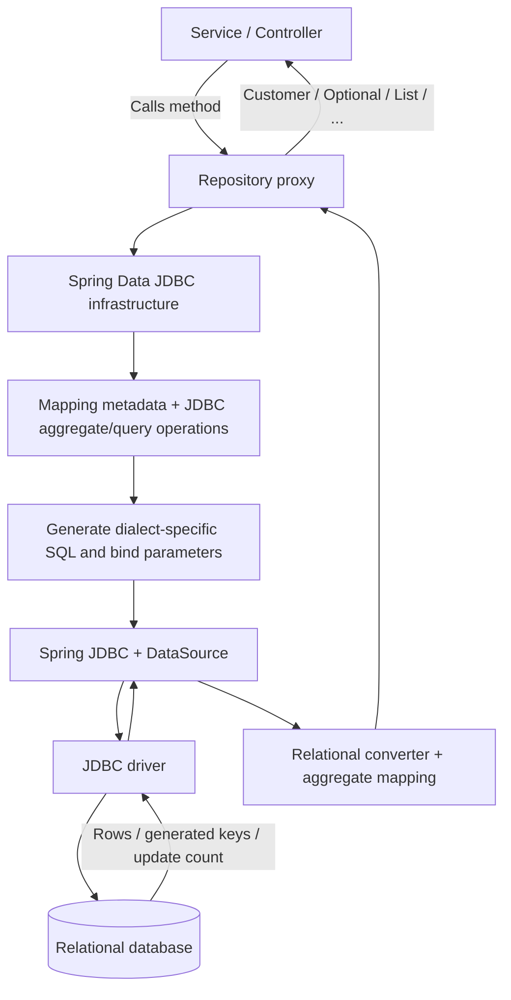

# Processing Flow from a Repository Call to SQL and Returned Objects

In **Spring Data JDBC**, application code typically only calls `repository.findById(id)`, `repository.save(entity)`, or a derived query method such as `findByEmail(email)`. Behind those concise calls lies a chain of work: Spring Data identifies the operation, reads mapping metadata, generates SQL suitable for the database engine, passes parameters through JDBC, and converts the SQL result back into Java objects.

This lesson traces the **actual path of data**, from the service layer to the database and back to the service. The focus is **Spring Data JDBC** within the Spring Data Relational ecosystem; this mechanism differs from JPA/Hibernate in that there is no persistence context managing entities, no automatic dirty checking of fields, and no `flush()` required to synchronize object state.

## 1. Running Example

Suppose a customer management application has the following table (illustrative DDL for a database supporting `IDENTITY` syntax, such as H2 or PostgreSQL):

```sql
CREATE TABLE customers (
    id BIGINT GENERATED BY DEFAULT AS IDENTITY PRIMARY KEY,
    name VARCHAR(150) NOT NULL,
    email VARCHAR(255) NOT NULL
);
```

Mapping the table to a Java aggregate root:

```java
import org.springframework.data.annotation.Id;
import org.springframework.data.relational.core.mapping.Table;

@Table("customers")
public record Customer(
        @Id Long id,
        String name,
        String email
) {}
```

Declaring the repository:

```java
import java.util.List;
import org.springframework.data.repository.CrudRepository;

public interface CustomerRepository extends CrudRepository<Customer, Long> {
    List<Customer> findByEmail(String email);
}
```

In a service, it can be used as follows:

```java
Customer created = customerRepository.save(
        new Customer(null, "Lan", "lan@example.com")
);

Optional<Customer> found = customerRepository.findById(created.id());

List<Customer> matches = customerRepository.findByEmail("lan@example.com");

Customer renamed = customerRepository.save(
        new Customer(created.id(), "Lan Anh", created.email())
);
```

`@Table` identifies the target table; `@Id` marks the primary key. Spring Data JDBC knows which Java fields map to columns. With an immutable `record`, when the database generates `id`, the object **returned from `save`** holds the new `id`; you should not assume the input reference was mutated in place.

> The SQL statements below show **semantic equivalents** and do not guarantee identical generated SQL strings across Spring Data JDBC versions or dialects. Identifier quoting, column ordering, pagination syntax, and auto-generated key retrieval can differ.

## 2. Layers Involved in a Call



Each component has a specific role:

| Component | Primary responsibility |
|---|---|
| **Repository proxy** | Spring creates an implementation at runtime from the repository interface. The proxy routes built-in CRUD methods, derived queries, `@Query` methods, or custom implementations. |
| **Repository/aggregate operations** | CRUD operations are typically backed by `SimpleJdbcRepository` and `JdbcAggregateOperations` (usually `JdbcAggregateTemplate`); queries have their own execution mechanism. |
| **Relational mapping context / converter** | Reads `@Table`, `@Id`, `@Column`, aggregate relationships, column names, and Java ↔ JDBC type conversion rules. |
| **SQL generation + Dialect** | Determines tables, columns, conditions, `SELECT`/`INSERT`/`UPDATE`/`DELETE` statement types, and database-appropriate syntax. |
| **Spring JDBC** | Acquires a `Connection`, creates a `PreparedStatement`, binds parameters, executes SQL, and processes the `ResultSet` or affected row count. |
| **JDBC driver + database** | Sends commands to the database, executes them, and returns data or generated keys. |

Internal class names may change across versions, but these **responsibility boundaries** are a useful way to trace a request when debugging.

## 3. Read Path: `findById(id)`

Given the call:

```java
Optional<Customer> result = customerRepository.findById(42L);
```

### Step 1 — The Proxy Identifies the Operation

`CustomerRepository` is an interface, but at application startup Spring Data registers a repository bean with a runtime implementation. When `findById` is called, the call is routed to the CRUD execution path matching entity type `Customer` and ID type `Long`.

Built-in methods like `findById` do not require writing JDBC code manually. Entity metadata tells Spring that the table is `customers`, the key property is `id`, along with the names and types of the remaining columns.

### Step 2 — Generate `SELECT` and Bind Parameters

Illustrative SQL:

```sql
SELECT id, name, email
FROM customers
WHERE id = ?;
```

The value `42` is bound to the placeholder via JDBC; user input is never concatenated directly into the SQL string. Spring JDBC commonly uses named parameters at a higher level (`:id`) and converts them into placeholders that `PreparedStatement` can process.

Mapping metadata and the dialect determine the exact SQL expression. In real applications, connections may participate in an open transaction or be acquired and released per operation.

### Step 3 — Database Returns Rows, Spring Builds the Object

The JDBC driver returns a `ResultSet`. Spring Data JDBC reads each column value, converts types appropriately, and then constructs `Customer` using the record constructor:

```text
ResultSet:
    id = 42
    name = "Lan"
    email = "lan@example.com"
                 |
                 v
Customer(42L, "Lan", "lan@example.com")
                 |
                 v
Optional.of(customer)
```

If no row matches the ID, the method returns `Optional.empty()`. If valid data exists, the caller receives `Optional<Customer>`. When the entity is an aggregate with mapped child components, Spring Data must also load and assemble the child data to construct the aggregate; the number of `SELECT` statements and loading strategy depend on mapping structure, version, and configuration.

### Two-Way Sequence

```mermaid
sequenceDiagram
    participant Service
    participant Repo as Repository proxy
    participant Data as Spring Data JDBC
    participant JDBC as Spring JDBC / Driver
    participant DB as Database
    Service->>Repo: findById(42)
    Repo->>Data: Execute CRUD + Customer metadata
    Data->>JDBC: SELECT ... WHERE id = ?; bind 42
    JDBC->>DB: Execute SQL
    DB-->>JDBC: ResultSet (0 or 1 root row)
    JDBC-->>Data: Column values
    Data-->>Repo: Mapped Customer / not found
    Repo-->>Service: Optional<Customer>
```

## 4. Query Derived from Method Name: `findByEmail`

Spring Data parses method names declared in the repository:

```java
List<Customer> findByEmail(String email);
```

Here, `find...By` is the query pattern, and `Email` refers to the `email` property of `Customer`. With:

```java
List<Customer> customers = customerRepository.findByEmail("lan@example.com");
```

The SQL may correspond to:

```sql
SELECT id, name, email
FROM customers
WHERE email = ?;
```

The parameter is bound, result rows are mapped to `Customer`, and then collected into `List<Customer>`; if there are no matches, an empty list is returned. This is **query derivation**: the method name instructs Spring Data to generate the query. Support for specific keywords and condition combinations should be checked against the Spring Data JDBC version in use.

If you need control over the SQL statement, you can declare an explicit query:

```java
import org.springframework.data.jdbc.repository.query.Query;
import org.springframework.data.repository.query.Param;

@Query("SELECT id, name, email FROM customers WHERE LOWER(email) = LOWER(:email)")
List<Customer> findEmailIgnoringCase(@Param("email") String email);
```

In this case, **Spring uses the developer-provided SQL**, still binds parameters, executes via JDBC, and maps rows to the return type. With custom queries for complex aggregates, you must ensure the columns and object construction satisfy mapping requirements.

## 5. Write Path: `save(entity)`

`save` follows the **aggregate** processing path rather than simply converting one object into one fixed SQL command. Before writing, Spring Data must decide whether the entity is new or already exists according to entity state detection rules.

```mermaid
flowchart TD
    A[repository.save(customer)] --> B[Detect whether entity is new or existing]
    B -->|New| C[INSERT aggregate]
    B -->|Existing| D[UPDATE aggregate]
    C --> E[Bind data + execute JDBC]
    D --> E
    E --> F[Receive generated key / version / write result]
    F --> G[Return saved aggregate]
```

### 5.1. When the Object Is New: `INSERT`

Example:

```java
Customer input = new Customer(null, "Lan", "lan@example.com");
Customer saved = customerRepository.save(input);
```

In typical mappings using `@Id Long`, a `null` ID signals a new aggregate. Spring Data JDBC builds an `INSERT` statement and binds the properties to persist:

```sql
INSERT INTO customers (name, email)
VALUES (?, ?);
```

If the ID column is auto-generated by the database, JDBC retrieves the generated key and Spring Data populates that ID into the returned aggregate. For immutable types like `record`, this usually produces a new instance:

```java
input.id(); // null
saved.id(); // Database-generated ID, e.g. 42
```

IDs can be application-assigned, generated by a callback, or generated by the database; not every entity uses the same ID generation strategy.

### 5.2. When the Object Is Treated as Existing: `UPDATE`

Example:

```java
Customer changed = new Customer(42L, "Lan Anh", "lan@example.com");
Customer saved = customerRepository.save(changed);
```

Illustrative SQL:

```sql
UPDATE customers
SET name = ?, email = ?
WHERE id = ?;
```

There is no automatic tracking of which fields changed like JPA's persistence context. Consequently, **calling a setter or creating a new object in memory does not automatically trigger an `UPDATE`**; the application must call `save`, and the write is generally based on the aggregate state passed in, not a diff produced by dirty checking.

`save` is also **not implicitly a SQL UPSERT** (`INSERT ... ON CONFLICT ...`). For an object with an ID that has no matching row, the outcome depends on the update mechanism and affected-row check; you should not treat `save` as a command guaranteed to insert if `UPDATE` finds no row.

### 5.3. How Is `isNew` Determined?

Common scenarios:

| Entity state | Typical behavior |
|---|---|
| `@Id Long id = null` | Considered new; executes `INSERT`. |
| `@Id Long id = 42L` | Usually considered existing; executes `UPDATE`. |
| Has `@Version` | The version value participates in new-entity detection and concurrent update control. |
| Entity implements `Persistable` | Can provide `isNew()` directly to control state, useful when IDs are assigned upfront. |

The rules can be customized. Do not mechanically assume `id != null` when an aggregate uses pre-assigned IDs, `@Version`, or `Persistable`.

### 5.4. With `@Version`: Optimistic Locking

Suppose `Customer` has a property annotated with `@Version`. On update, the SQL can include a concurrency condition on both the ID and the previous version:

```sql
UPDATE customers
SET name = ?, email = ?, version = ?
WHERE id = ? AND version = ?;
```

If another transaction has already updated the record and changed its version, the update statement affects 0 rows; Spring Data JDBC detects the conflict and raises an optimistic locking error, typically in the `OptimisticLockingFailureException` family. This prevents silently overwriting changes made by another party.

## 6. Writing and Reading an Aggregate with Child Elements

In Spring Data JDBC, the **aggregate** is the data consistency boundary. A repository is usually declared for the **aggregate root**; child elements belonging to that aggregate are saved and loaded alongside the root.

For example, an order containing multiple order lines:

```java
import java.util.List;
import org.springframework.data.annotation.Id;
import org.springframework.data.relational.core.mapping.MappedCollection;
import org.springframework.data.relational.core.mapping.Table;

@Table("orders")
public record Order(
        @Id Long id,
        String customerName,
        @MappedCollection(idColumn = "order_id", keyColumn = "line_index")
        List<OrderLine> lines
) {}

@Table("order_lines")
public record OrderLine(String sku, int quantity) {}
```

For example, the `order_lines` table has columns `order_id`, `line_index`, `sku`, and `quantity`. `idColumn` specifies the column referencing the root; `keyColumn` stores the element's index in the `List`.

When calling `orderRepository.save(order)`, a single Java call **can generate multiple SQL statements**: writing to the `orders` table first, then writing rows into `order_lines` with the `order_id` foreign key. For an existing aggregate, collection management may delete and recreate child rows to reflect the full aggregate state, depending on the relationship and mapping. Do not assume every `save` runs only one row update or minimally updates only changed elements.

When calling `findById`, the framework reconstructs `Order` along with the `OrderLine` items belonging to the aggregate; reading may require multiple queries or an appropriate loading strategy, rather than guaranteeing a single SQL `JOIN` from a single Java call.

A relationship **between two independent aggregates** is typically represented by an ID or `AggregateReference` rather than a deeply framework-managed object tree like JPA entity associations. This clarifies which objects fall within the update scope of `save`.

## 7. Common Methods and Return Types

| Call | Typical SQL operation | Java return type |
|---|---|---|
| `save(entity)` | `INSERT` or `UPDATE`; may add SQL for child elements | Saved aggregate, possibly with new ID/version |
| `findById(id)` | `SELECT ... WHERE id = ?` | `Optional<T>` |
| `findAll()` | `SELECT` (plus SQL loading child elements if needed) | `Iterable<T>` per `CrudRepository` |
| `findByEmail(email)` | `SELECT ... WHERE email = ?` | `List<Customer>` per declared signature |
| `existsById(id)` | Existence check query | `boolean` |
| `count()` | `SELECT COUNT(...)` | `long` |
| `deleteById(id)` | `DELETE`, may delete child rows belonging to the aggregate | `void` |

This shows the **correspondence between repository semantics and SQL tasks**, not a guarantee that exactly one SQL statement runs per method. For instance, `save`/`delete` on an aggregate with collections can issue multiple statements; depending on configuration, callbacks, optimistic locking, and secondary queries may also run.

## 8. Mapping Data on the Return Path

JDBC only knows column values and driver-specific types; Spring Data JDBC must reconstruct the Java model used by the service.

### Mapping Columns, Names, and Constructors

`RelationalMappingContext` and the converter use metadata to determine:

- Which table an entity resides in (`@Table`), which property is the primary key (`@Id`), and explicit column names when `@Column` is specified.
- Which Java property corresponds to each JDBC value; default column names also depend on the naming strategy.
- How to instantiate objects via constructors/records or property setters; immutable objects are supported when mapped appropriately.
- How to convert types: numbers, strings, dates/times, enums, and registered custom converters.

For example, if the schema has column `display_name` while Java uses `displayName`, you can specify:

```java
@Column("display_name")
private String displayName;
```

When specialized data types exist (such as value objects or vendor-specific types), a reading/writing `Converter` may be needed. Conversion works in both directions: **object values → JDBC parameters** when writing, and **JDBC column values → objects** when reading.

### Return Values Are Not Necessarily a Single Entity

The return type is determined by the repository method signature and operation type: `Optional<Customer>`, `List<Customer>`, `boolean`, `long`, `void`, or the saved aggregate. The framework handles row counts and mapping before returning to the service; the service does not iterate over a `ResultSet` directly when using standard repositories.

## 9. Where Do Transactions, Callbacks, and Error Handling Fit?

**Transactions** wrap JDBC operations when transaction management is properly configured. If a business use case involves multiple operations that must succeed or fail together, place the transaction boundary at the service layer:

```java
import org.springframework.stereotype.Service;
import org.springframework.transaction.annotation.Transactional;

@Service
public class RegistrationService {
    private final CustomerRepository customers;

    public RegistrationService(CustomerRepository customers) {
        this.customers = customers;
    }

    @Transactional
    public Customer register(String name, String email) {
        // Can coordinate additional repositories/work within the same transaction.
        return customers.save(new Customer(null, name, email));
    }
}
```

`@Transactional`, via Spring transaction management, coordinates connections, commits, and rollbacks. An aggregate `save` involving multiple writes must be treated as a consistent operation; service-layer transactions are especially important when coordinating **multiple repository calls**. The `readOnly = true` attribute, when used, is primarily a transaction management and optimization hint and cannot be relied upon as an absolute SQL write barrier on every database.

Spring Data JDBC also supports **entity callbacks** (such as before-convert, before/after-save, after-convert) to add logic like auditing or data normalization. Callbacks participate in the pipeline right before or after mapping/writing; they do not turn Spring Data JDBC into a dirty-checking ORM.

If the database or driver reports an error, Spring JDBC translates many `SQLException` errors into Spring's unified `DataAccessException` hierarchy (for example, constraint violations). This lets the service layer handle errors by category with less dependence on database-specific error codes.

## 10. Observing SQL to Understand an Actual Call

When learning or debugging, you can enable appropriate logging levels in `application.yml`:

```yaml
logging:
  level:
    org.springframework.jdbc.core: DEBUG
    org.springframework.jdbc.core.StatementCreatorUtils: TRACE
    org.springframework.data.jdbc.core: DEBUG
```

`org.springframework.jdbc.core` usually reveals the SQL executed by Spring JDBC; `StatementCreatorUtils` at `TRACE` can provide details on parameter binding. Depending on version, driver, and logging setup, verbosity may differ. Lower logging levels in environments with sensitive data, because parameter values may be logged.

When reading logs, trace three points:

1. **Java method called:** `save`, `findById`, `findByEmail`, or `deleteById`? Does the aggregate have collections?
2. **Executed SQL and parameters:** is the operation `SELECT`, `INSERT`, `UPDATE`, or `DELETE`, does the `WHERE` clause match the expected ID/version, and how many statements did a single call produce?
3. **Java result:** was the returned ID/version updated, is the `Optional` empty, and do the object count and aggregate structure match the returned rows?

Simple trace example:

```text
Customer input = new Customer(null, "Lan", "lan@example.com")
    -> CustomerRepository.save(input)
    -> Identify new aggregate
    -> INSERT INTO customers (...) VALUES (...)
    -> Database generates id = 42
    -> Customer saved = new Customer(42, "Lan", "lan@example.com")

CustomerRepository.findById(42)
    -> SELECT ... FROM customers WHERE id = 42
    -> JDBC ResultSet (1 row)
    -> Converter constructs Customer(42, "Lan", "lan@example.com")
    -> Optional.of(Customer(...))
```

## 11. Common Misconceptions When Tracing the Flow

| Misconception | Actual Spring Data JDBC mechanism |
|---|---|
| "Declaring a repository automatically creates tables." | Repositories primarily map and execute data operations. The schema must exist; usually managed with migrations like Flyway/Liquibase or init scripts. |
| "Fetching an entity and editing a field automatically updates the database." | There is no dirty checking or persistence context; `save` must be called to persist changes. |
| "`save` always runs a single SQL statement." | An aggregate with child elements may require multiple SQL statements in one save. |
| "`save` automatically detects that a row doesn't exist and inserts it." | `isNew` rules decide the insert/update branch; pre-assigned IDs require appropriate configuration. |
| "`findById` always corresponds to exactly one `SELECT`." | An aggregate with child relationships may require additional reads; strategies also vary by version. |
| "Relationships will be lazy-loaded like Hibernate." | Spring Data JDBC does not rely on ORM lazy-loading proxies; aggregate data is normally assembled when reading the aggregate. |
| "Method names can turn into arbitrarily complex SQL." | Derived queries support specific conventions; complex SQL may require `@Query` or custom JDBC operations. |

## 12. Remembering the Data Journey

For **reads**: `Repository method → proxy/query resolution → mapping metadata → SQL SELECT + parameters → JDBC/DB → ResultSet → converter/aggregate mapping → Optional/List/entity`.

For **writes**: `Repository.save → determine new/existing state → build aggregate changes → SQL INSERT/UPDATE (possibly multiple statements) → JDBC/DB → generated key/version → returned aggregate`.

The key takeaway for application design is that **the unit persisted and loaded is the aggregate**, while the repository is an abstraction over SQL/JDBC. Understanding this boundary lets you reason about when SQL executes, how many statements may fire, how data enters `PreparedStatement`, and why the service ultimately receives a specific Java object.
