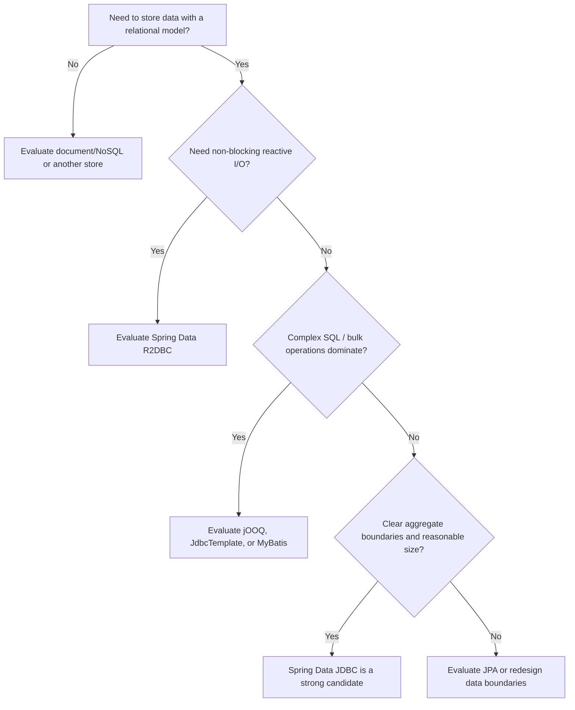

# When to Choose Spring Data JDBC vs. Other Solutions?

## 1. The Actual Decision to Make

A Spring Boot application using a relational database has several ways to access data: Spring Data JDBC, Spring Data JPA/Hibernate, `JdbcTemplate`, jOOQ, MyBatis, or Spring Data R2DBC. These tools can all read and write SQL data, but they differ in **programming model, relationship management, SQL control, and operational cost**.

**Spring Data JDBC is a strong choice when data can be organized into clear aggregates, business operations are primarily CRUD and transactions on individual aggregates, and the development team wants to avoid complex ORM state management.** It is not automatically the best choice simply because the system uses a SQL database.

To choose well, answer four questions:

1. What is the unit of business consistency: an order together with its order lines, or a web of many interconnected objects?
2. Are the main tasks saving/updating aggregates, or reporting, searching, and querying with many `JOIN`s?
3. Does the application run in a synchronous/blocking model, or does it need non-blocking reactive data streams?
4. Does the team prefer working through repositories and an object model, or writing and optimizing SQL explicitly?

## 2. Understanding Spring Data JDBC Correctly Before Choosing

Spring Data JDBC belongs to the Spring Data ecosystem and uses JDBC to interact with relational databases. It provides table–object mapping, repositories, queries derived from method names, custom SQL, transactions, and mechanisms such as optimistic locking. However, **Spring Data JDBC is not a stripped-down JPA**: it has a distinct data-ownership and object-lifecycle model.

| Characteristic | Spring Data JDBC | Spring Data JPA with Hibernate |
| --- | --- | --- |
| Approach | Persists and loads aggregates relatively directly | Manages entities inside a persistence context |
| Object state | No JPA-style persistence context / dirty checking | Tracks managed entities; supports dirty checking |
| Relationships | Favors ownership **inside the aggregate**; references other aggregates by ID | Has `@ManyToOne`, `@OneToMany`, `@ManyToMany`, and multiple mapping strategies |
| Lazy loading | Does not provide Hibernate-style lazy-loading proxies | Can use lazy loading; requires controlling emitted queries |
| Updates | Typically calls `repository.save(...)` explicitly | Managed entities can be synchronized on flush/commit |
| Query language | SQL and repository methods | JPQL, Criteria API, native SQL, repository methods |
| Best suited for | Well-bounded aggregates with modest owned collections | Complex entity models and relationships needing rich ORM features |

### Aggregate Is the Key Boundary

In Domain-Driven Design (DDD), an **aggregate** is a cluster of objects modified together under a consistent set of rules; the **aggregate root** is the primary entry point for access and persistence.

Example:

```text
PurchaseOrder (aggregate root)
├── OrderLine #1  (belongs to the order)
├── OrderLine #2  (belongs to the order)
└── OrderLine #3  (belongs to the order)

Customer (another aggregate root)
└── Not part of PurchaseOrder's lifecycle

PurchaseOrder.customerId -> Customer ID
```

When adding or removing an `OrderLine`, we modify `PurchaseOrder`. When updating `Customer` details, we handle the customer aggregate separately. That an order *references* a customer does not mean the order *owns* the entire customer entity.

This model fits Spring Data JDBC very well. Conversely, if the application wants to traverse chains of object associations like `order.getCustomer().getAddresses()` and tune lazy/eager loading, JPA is usually a better fit.

## 3. Cases Where You Should Choose Spring Data JDBC

### 3.1. Small or Medium Aggregates with Clear Ownership Boundaries

Common examples include orders and order lines, shopping carts and cart items, goods receipts and receipt lines, or configurations and configuration entries. The child set shares its lifecycle with the aggregate root; those child objects do not need to act as independent aggregates.

In this situation, a repository for the aggregate root is usually clear enough:

- Create an order along with its lines in a single save operation.
- Load the order to validate business rules.
- Update order status or contents and save it back.
- Use database keys and constraints to maintain consistency.

A factor to examine is **child-set size and modification frequency**. Do not assume an aggregate containing thousands of frequently changing elements will be cheap to save with Spring Data JDBC.

### 3.2. Wanting a Transparent Data Model and Save Operations

Spring Data JDBC does not use a Hibernate-style persistence context. Someone reading the code sees a `save` call and knows the application is explicitly requesting to persist the aggregate; there is no need to predict when dirty checking or flush will emit SQL. This is a strength when the team wants code whose behavior is easy to trace.

However, **model transparency does not mean one `save` produces only one SQL statement**. Child tables may still be rewritten when saving an existing aggregate. Inspect actual SQL statements in write-heavy workflows.

### 3.3. Most Business Operations Are CRUD with Moderately Simple Queries

Repositories are very useful for lookups by ID, searching by a few columns, simple filtering, pagination, and moderate custom SQL. This model fits data-management services with clear transactions that do not need to navigate a rich object-relationship graph.

For example: a warehouse issue-slip service with operations to create slips, view details, change status, and query by warehouse/date. If most use cases access a slip together with its lines, Spring Data JDBC is a sensible candidate.

### 3.4. Using Spring Boot in a Synchronous Execution Model

JDBC is a blocking API: database calls hold the thread while waiting for results. In Spring MVC applications or synchronous batch jobs, this is usually a simple and well-suited model.

If the system requires a non-blocking reactive pipeline from HTTP down to the database, look at Spring Data R2DBC and check driver, library, and transaction support. Using WebFlux **does not make JDBC non-blocking**; what matters is the entire I/O execution path.

## 4. Example: An Aggregate Well Suited to Spring Data JDBC

Suppose the system has `purchase_orders` and `order_lines`. An order owns its lines; the customer is a separate aggregate referenced via `customerId`.

Declaring dependencies in Spring Boot (Gradle Groovy example):

```groovy
dependencies {
    implementation 'org.springframework.boot:spring-boot-starter-data-jdbc'
    runtimeOnly 'org.postgresql:postgresql'
}
```

The minimal model below illustrates the mapping. The types are placed in the same package; in a real project, place them in separate files:

```java
import java.math.BigDecimal;
import java.util.ArrayList;
import java.util.List;

import org.springframework.data.annotation.Id;
import org.springframework.data.annotation.Version;
import org.springframework.data.relational.core.mapping.MappedCollection;
import org.springframework.data.relational.core.mapping.Table;
import org.springframework.data.repository.CrudRepository;

@Table("purchase_orders")
class PurchaseOrder {
    @Id
    Long id;

    @Version
    Long version;

    Long customerId;
    String status;

    @MappedCollection(idColumn = "order_id", keyColumn = "line_no")
    List<OrderLine> lines = new ArrayList<>();
}

@Table("order_lines")
record OrderLine(String sku, int quantity, BigDecimal unitPrice) {
}

interface PurchaseOrderRepository
        extends CrudRepository<PurchaseOrder, Long> {
}
```

With PostgreSQL, a matching illustrative schema is:

```sql
CREATE TABLE purchase_orders (
    id          BIGINT GENERATED BY DEFAULT AS IDENTITY PRIMARY KEY,
    version     BIGINT,
    customer_id BIGINT NOT NULL,
    status      VARCHAR(24) NOT NULL
);

CREATE TABLE order_lines (
    order_id    BIGINT NOT NULL REFERENCES purchase_orders(id),
    line_no     INTEGER NOT NULL,
    sku         VARCHAR(64) NOT NULL,
    quantity    INTEGER NOT NULL CHECK (quantity > 0),
    unit_price  DECIMAL(12, 2) NOT NULL,
    PRIMARY KEY (order_id, line_no)
);
```

Example creating an order in the same package:

```java
PurchaseOrder order = new PurchaseOrder();
order.customerId = 42L;
order.status = "NEW";
order.lines.add(new OrderLine("BOOK-001", 2, new BigDecimal("150.00")));

PurchaseOrder saved = repository.save(order);
Long newOrderId = saved.id;
```

Design details to note:

1. `@Id` identifies the aggregate root key; `@Version` supports optimistic locking under concurrent updates.
2. `@MappedCollection` defines how `OrderLine` items in the aggregate are stored in another table. Here `order_id` is the foreign key and `line_no` stores the element's position in the `List`.
3. `customerId` is a scalar value. Do not place a `Customer` object under `PurchaseOrder` if customers have an independent lifecycle.
4. The schema must be managed by an appropriate initialization/migration tool such as Flyway or Liquibase. Spring Data JDBC does not provide a schema generation/update mechanism like `hibernate.hbm2ddl.auto`.
5. The example focuses on mapping. A real application also needs business validation, authorization, data constraints, and transaction demarcation.

### Easy-to-Miss Detail: Saving an Existing Aggregate

Spring Data JDBC does not use dirty checking to diff individual mutations in an object graph. With typical aggregate persistence, when updating a root, the framework may **delete and re-insert the child entities owned by the root** to bring the database to the new aggregate state; the root itself is updated separately. Thus, changing only `status` on an order with many `OrderLine` items can still result in multiple writes to `order_lines`.

This is not a bug: it comes from how Spring Data JDBC manages aggregates. However, it impacts latency, locks, foreign keys, triggers, auditing, and write volume. Before choosing it, estimate child counts, root update frequency, and whether individual child IDs/identities must be preserved.

If you need high-frequency updates to individual order lines independently, consider **shrinking the aggregate or redefining ownership boundaries**; another option is explicit SQL for that specialized operation. Any such choice must align with business consistency rules rather than merely trying to save SQL statements.

## 5. Cases Where You Should Choose Another Solution

### 5.1. Spring Data JPA/Hibernate: Rich Entity Models and Associations

Consider JPA first when the application frequently navigates across many entities, has complex associations, and benefits from an identity map, dirty checking, lazy loading, fetch strategies, and advanced ORM capabilities. For example: an administrative system with intertwined relationships across users, groups, roles, policies, and domain entities accessed along multiple paths.

JPA also has its own costs: you must understand the persistence context, transactions, cascades, fetch plans, N+1 queries, and flush timing. Do not choose it merely to "avoid SQL"; when performance matters, you still have to measure the actual SQL executed.

**Signal to choose JPA:** most code operates across interconnected entities and benefits from ORM entity management.

### 5.2. `JdbcTemplate` / `NamedParameterJdbcTemplate`: Direct Control Over SQL

This is a strong option when SQL is central to the use case: bulk updates, interacting with existing tables with unusual layouts, calling stored procedures, focused reports needing exact optimization, or having only a handful of queries.

`JdbcTemplate` handles connections, resources, and Spring exception translation, while the team writes SQL and maps results with `RowMapper`. `NamedParameterJdbcTemplate` supports named parameters, making SQL easier to read.

**Signal to choose JdbcTemplate:** individual SQL statements need explicit design and control; building an entire aggregate/repository model does not pay off proportionally.

### 5.3. jOOQ: Complex SQL Queries with Strong Type Safety

jOOQ offers a DSL for writing SQL in Java with strong type checking and broad access to SQL features. It is often worth considering for reports with many `JOIN`s, CTEs, window functions, complex aggregations, or dynamic filters.

Trade-offs to weigh include code generation from the schema, dialect coupling, and licensing terms for the database edition/type in use. You can use jOOQ for complex reads alongside another solution managing aggregate writes.

**Signal to choose jOOQ:** SQL expressiveness and optimization matter more than persisting whole aggregates.

### 5.4. MyBatis: Hand-Written SQL with Structured Mapping

MyBatis fits organizations that want to keep explicit SQL in mappers, leverage sophisticated result mappings, and write structured dynamic SQL. It is useful in systems with extensive hand-crafted SQL or legacy schemas.

In return, the team maintains the mappers and queries; MyBatis does not automatically enforce Spring Data JDBC's aggregate lifecycle rules.

### 5.5. Spring Data R2DBC: End-to-End Non-Blocking Reactive

R2DBC targets relational database access via reactive APIs. Consider it when the application has a genuine need for non-blocking I/O, solid driver and database support, and a team fluent in `Publisher`/`Mono`/`Flux`, cancellation, backpressure, and reactive transaction boundaries.

Reactive does not guarantee that an individual SQL query runs faster. For synchronous CRUD systems, JDBC is usually simpler. Never put blocking JDBC calls onto an event-loop thread and assume the whole pipeline is non-blocking.

### 5.6. Document / NoSQL Databases: A Fundamentally Different Storage Model

If data consists mainly of independent documents with nested structures, per-record schema flexibility, document-centric access patterns, and minimal reliance on relational constraints, consider Spring Data MongoDB or a suitable specialized data store.

Database choice should rest on query patterns, consistency, transactions, indexing, and operations. **Do not choose NoSQL simply because records have many JSON fields**, and do not force a document model into SQL tables if mapping overhead outweighs relational benefits.

## 6. Situational Selection Table

| Scenario | Option to evaluate first | Questions to check |
| --- | --- | --- |
| CRUD for orders and lines sharing the same lifecycle | **Spring Data JDBC** | Is the child set small and updated alongside the order? |
| Many interconnected entities needing lazy loading and in-transaction state tracking | **JPA/Hibernate** | Are fetch plans and cascades designed clearly? |
| Reporting reads with multiple `JOIN`s, window functions, CTEs | **jOOQ** or SQL via `JdbcTemplate` | Does SQL need a type-safe DSL or just a few static queries? |
| Bulk writes, updating a few columns across millions of rows | **`JdbcTemplate` / batch SQL**, jOOQ, or dedicated bulk solutions | Can you avoid loading and re-saving entire aggregates? |
| Legacy SQL and tightly controlled mappers | **MyBatis** or `JdbcTemplate` | What is the maintenance cost of mapping and SQL? |
| Reactive pipeline with supporting DB driver and libraries | **Spring Data R2DBC** | Is the entire I/O path truly non-blocking? |
| Each record is a nested document needing flexible schemas | **Spring Data MongoDB** or a suitable document store | How important are relational constraints and multi-record transactions? |
| Aggregate-based writes with complex reporting reads | **Spring Data JDBC + jOOQ/JdbcTemplate** | Are write/read boundaries and transactions clearly separated? |

These options are not mutually exclusive. A single service can use Spring Data JDBC for `PurchaseOrder` writes, `JdbcTemplate` for specialized updates, and jOOQ for reporting. What matters is defining **who owns each table/write task**, avoiding two mechanisms mutating the same data under conflicting assumptions.

## 7. Practical Decision Process

You can follow this sequence:

1. **Choose the storage type first.** Does the domain need foreign keys, relational constraints, transactions, and SQL? If yes, a relational database is a natural candidate.
2. **Determine the execution model.** For blocking applications, JDBC makes sense. For genuinely reactive pipelines, evaluate R2DBC along with driver and transaction models.
3. **Sketch the aggregates.** Identify roots, owned objects, ID references, consistency rules, and transactions. If aggregates are clear, continue evaluating Spring Data JDBC.
4. **Classify queries.** Compare the ratio of aggregate CRUD to reporting, complex search, and bulk updates. If complex SQL dominates, jOOQ/`JdbcTemplate` may fit better.
5. **Check write volume.** How many child entities does an aggregate have? How many rows might a small edit rewrite? Are localized updates, preserved child IDs, or trigger-based auditing required?
6. **Evaluate team skills and operations.** Does the team understand DDD aggregates or JPA better? How are schema migrations handled? Are SQL logging, timing metrics, and execution-plan inspection ready?

A condensed decision tree:



Note: this diagram is for initial screening. Specific systems may still combine multiple solutions by use case.

## 8. Four Technical Notes That Can Change the Decision

### 8.1. Inter-Aggregate Relationships Are Not Ownership Relationships

Child objects owned by a root are saved as part of the aggregate. Objects with independent lifecycles should be referenced by ID or an appropriate reference type, instead of turning the entire relationship web into one huge aggregate.

For example, `Order` has `customerId`, `Payment` has `orderId`, and `Shipment` has `orderId`. These three roots can have separate transactions or events depending on business rules. When multiple roots in one database must update atomically, coordinate them in a `@Transactional` service; aggregate boundaries do not automatically prohibit multi-aggregate transactions.

### 8.2. Optimistic Locking Detects Conflicts, Not Replace Business Checks

`@Version` on an aggregate root helps detect concurrent updates through version checks. If two tasks read the same order and both save, the later write can fail with an optimistic locking error rather than silently overwriting. The application must decide whether to retry, report a conflict, or ask for a reload.

A version column does not replace `UNIQUE`, `FOREIGN KEY`, `CHECK`, or business constraints in the database/service. When multiple aggregates participate in one invariant, consider locking/transactions at the appropriate level.

### 8.3. Fast Reads and Fast Writes Are Two Different Problems

Spring Data JDBC reduces ORM complexity, yet does not automatically optimize every query. When loading an aggregate with multiple child tables, watch how SQL executes; when saving a large aggregate, watch the number of `DELETE`/`INSERT` statements. For reports needing just a few columns across multiple tables, SQL returning DTOs/projections directly is usually cleaner than loading batches of full aggregates.

Measure at least: SQL count per use case, rows read/written, response time at expected data scale, indexes, and execution plans for critical queries. Never infer performance solely from a technology's name.

### 8.4. Moving from JPA to JDBC Is More Than Swapping Dependencies

JPA annotations and assumptions—such as `@Entity`, `@ManyToOne`, `@OneToMany`, `CascadeType`, `FetchType.LAZY`, JPQL, and dirty checking—do not translate one-to-one into Spring Data JDBC. You must redesign aggregate boundaries, collection mapping, queries, update flows, and migrations.

For example, JPA code that mutates a field on a managed entity may flush on transaction commit; with Spring Data JDBC, you must save changes explicitly. A JPA many-to-many relationship may need to be modeled as aggregates/join entities with explicit lifecycles, or handled with explicit SQL.

## 9. Three Decision Examples

**Example A — Goods Receipt Processing Service.** Each receipt has 5–30 lines, is edited and approved as a whole receipt, and product/supplier tables exist independently. Spring Data JDBC fits well because each receipt is a clear aggregate; use IDs to reference products and suppliers. Verify line-update behavior before finalizing the choice.

**Example B — Multi-Layered Authorization Management System.** Users, groups, roles, permissions, and policies have interwoven relationships; the team needs to navigate and manage multiple entities within the same transaction. JPA/Hibernate is worth prioritizing if ORM features meaningfully cut boilerplate and fetch strategies are kept under control. For specialized permission queries, explicit SQL can still serve as a complement.

**Example C — Revenue Analytics Dashboard.** A query aggregates revenue by product, month, and region, compares prior periods, and computes rankings. The core involves `JOIN`s, grouping, window functions, and summary DTOs; jOOQ or `JdbcTemplate` usually fits better than trying to model a report as an aggregate saved via a repository.

## 10. Conclusion and Quick Selection Criteria

Choose **Spring Data JDBC** when the business model has small-to-medium aggregates, clear root/child ownership, mostly CRUD transactions, blocking I/O, and a team that wants explicit control over object persistence lifecycles.

Evaluate **JPA** first for rich entity management and object relationship graphs; **JdbcTemplate/jOOQ/MyBatis** when complex SQL or targeted writes take center stage; **R2DBC** when end-to-end reactive is required; and **other databases** when the relational storage model does not match the nature of the data.

The ultimate differentiator is not how many annotations you write, but the question: **which data access model accurately expresses business boundaries, produces predictable SQL, and handles real workloads at reasonable maintenance cost?**
