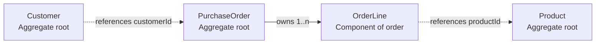
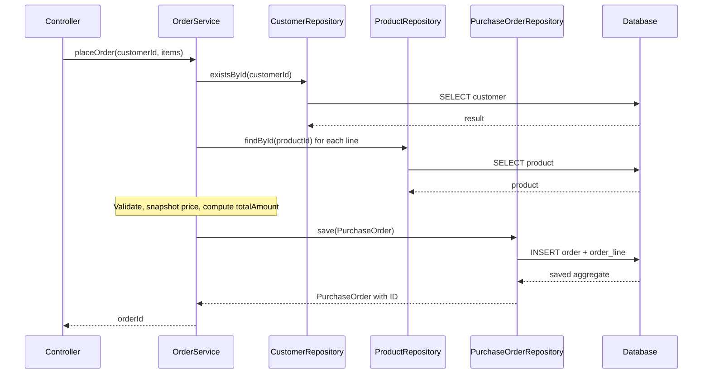

# Spring Data JDBC Learning Roadmap and the Running Order Model

Spring Data JDBC helps Java applications store and query relational data in an object-oriented way, while keeping the model relatively close to tables and SQL statements. To learn this technology systematically, this curriculum uses an **e-commerce store order management problem** as a running scenario: customers pick products, create orders with multiple lines, confirm or cancel orders, and query purchase history.

This lesson serves as a learning map and aligns our domain language. The code snippets illustrate basic architecture and mapping; subsequent lessons will progressively fill in configuration, queries, transactions, testing, and optimization.

## 1. What Should You Be Able to Do After This Roadmap?

Learners should be able to:

1. Explain how Spring Data JDBC fits into the Spring Data ecosystem, when it suits applications using relational databases, and how it differs from JPA in key ways.
2. Translate order management requirements into **aggregates**, entities, value objects, tables, primary keys, foreign keys, and data constraints.
3. Use repositories to insert, read, update, and delete data along aggregate boundaries; distinguish queries derivable from method names from SQL queries that must be written explicitly.
4. Place order creation/confirmation/cancellation logic inside appropriate transactions, keeping total amounts and statuses consistent.
5. Write database integration tests, diagnose mapping and query mismatches, and recognize performance and concurrent-update issues.

**Recommended prerequisites:** core Java, classes/records/interfaces, collections, SQL (`SELECT`, `INSERT`, `UPDATE`, `DELETE`, `JOIN`), primary/foreign keys, dependency injection, and basic Spring Boot application structure. Knowing plain JDBC helps highlight what boilerplate Spring Data JDBC eliminates.

## 2. Fixed Business Context

Suppose a store sells multiple products. One customer can place multiple orders; each order has one or more order lines. Each line records the purchased product, quantity, and **unit price at the time of ordering**. The order tracks the total amount and processing status.

The domain objects play the following roles:

| Concept | Meaning | Representative data |
| --- | --- | --- |
| `Customer` | A customer with an independent identity, existing separately from individual orders. | `id`, `name`, `email` |
| `Product` | A product in the catalog with a current selling price. | `id`, `sku`, `name`, `currentPrice` |
| `PurchaseOrder` | An order responsible for the validity and lifecycle of its lines. | `id`, `customerId`, `status`, `totalAmount`, `lines` |
| `OrderLine` | One purchase line belonging to exactly one order; has no independent lifecycle. | `productId`, `productNameSnapshot`, `quantity`, `unitPrice` |

Example: customer **Lan** buys 2 keyboards at **120,000 VND each** and 1 mouse at **45,000 VND each**. The order has two lines; the total amount is:

`2 × 120,000 + 1 × 45,000 = 285,000 VND`.

If tomorrow the keyboard price rises to 130,000 VND, the old order still keeps `unitPrice = 120000.00`. This is why an order line stores a **snapshot** of the product name and unit price, rather than always re-reading the current price from `Product`.

### Shared Business Rules

- An order must have at least one order line.
- `quantity > 0`, `unitPrice >= 0`, non-negative total amount; monetary values use `BigDecimal`, never `double`/`float`.
- `totalAmount = Σ(quantity × unitPrice)`; the system calculates the total from lines rather than trusting a total submitted by the client.
- Customers and products are referenced by valid IDs.
- A new order starts with status `CREATED`. In this simplified model, `CREATED → CONFIRMED` or `CREATED → CANCELLED`; `CONFIRMED` and `CANCELLED` are terminal states. State transition rules are validated in the business layer.
- Editing the line list and recalculating the total are only allowed while the order is `CREATED`. Refunds, shipping, inventory, discounts, and taxes are outside the scope of the starter model and can be added once fundamentals are solid.

These rules serve both as design requirements and as the basis for writing tests later.

## 3. Aggregate Boundaries: The Most Crucial Decision

Spring Data JDBC models persistence around **aggregates**. An aggregate is a cluster of objects with a consistency boundary; changes to internal objects go through the **aggregate root**.

In this example, there are three independent aggregate roots: `Customer`, `Product`, and `PurchaseOrder`. `OrderLine` is a component inside the `PurchaseOrder` aggregate.



**Mapping rule:** `PurchaseOrder` owns its `OrderLine` items and stores `customerId` to reference `Customer`. Each `OrderLine` stores `productId` to reference `Product`. Having foreign keys in SQL **does not automatically turn** `Customer` or `Product` into child objects of the order.

Why choose these boundaries?

- When saving an order, the entire list of lines and the total amount must stay consistent together.
- Updating a product's price must not automatically rewrite previously placed orders.
- Customers and products can change without re-saving every related order.
- Primary repositories are organized by root: `CustomerRepository`, `ProductRepository`, `PurchaseOrderRepository`. No `OrderLineRepository` is needed when order lines exist only inside orders.

Do not confuse this structure with an arbitrary ORM entity graph. Spring Data JDBC **does not provide JPA/Hibernate-style lazy loading or dirty checking**. When saving an aggregate with child collections, Spring Data JDBC may delete and re-insert child rows to synchronize the current state. Choosing overly large aggregates or treating every related table as a child therefore leads to unnecessary writes and unclear business boundaries.

## 4. From Business Domain to Relational Database

An initial schema design looks like this:

| Table | Role | Keys and links |
| --- | --- | --- |
| `customer` | Stores customer profiles. | PK `id`; unique `email` |
| `product` | Stores catalog and current prices. | PK `id`; unique `sku` |
| `purchase_order` | Stores order header, customer, status, total amount. | PK `id`; FK `customer_id → customer.id` |
| `order_line` | Stores line items and price/name snapshots. | Composite PK `(order_id, line_no)`; FK `order_id → purchase_order.id`, `product_id → product.id` |

The name `purchase_order` is chosen instead of `order` to avoid clashing with SQL's `ORDER BY` keyword. Each line is identified by the pair `(order_id, line_no)`, where `line_no` is its position in the order's list.

The DDL example below uses **PostgreSQL**; auto-generated ID syntax, timestamp types, and certain constraints may differ in H2, MySQL, or other engines:

```sql
CREATE TABLE customer (
    id BIGINT GENERATED BY DEFAULT AS IDENTITY PRIMARY KEY,
    name VARCHAR(150) NOT NULL,
    email VARCHAR(255) NOT NULL UNIQUE
);

CREATE TABLE product (
    id BIGINT GENERATED BY DEFAULT AS IDENTITY PRIMARY KEY,
    sku VARCHAR(50) NOT NULL UNIQUE,
    name VARCHAR(180) NOT NULL,
    current_price NUMERIC(19, 2) NOT NULL
        CHECK (current_price >= 0)
);

CREATE TABLE purchase_order (
    id BIGINT GENERATED BY DEFAULT AS IDENTITY PRIMARY KEY,
    customer_id BIGINT NOT NULL REFERENCES customer(id),
    status VARCHAR(20) NOT NULL,
    total_amount NUMERIC(19, 2) NOT NULL
        CHECK (total_amount >= 0),
    created_at TIMESTAMPTZ NOT NULL DEFAULT CURRENT_TIMESTAMP
);

CREATE TABLE order_line (
    order_id BIGINT NOT NULL REFERENCES purchase_order(id),
    line_no INTEGER NOT NULL,
    product_id BIGINT NOT NULL REFERENCES product(id),
    product_name_snapshot VARCHAR(180) NOT NULL,
    quantity INTEGER NOT NULL CHECK (quantity > 0),
    unit_price NUMERIC(19, 2) NOT NULL CHECK (unit_price >= 0),
    PRIMARY KEY (order_id, line_no)
);

CREATE INDEX idx_purchase_order_customer_created
    ON purchase_order (customer_id, created_at DESC);
```

`CHECK` and `FOREIGN KEY` constraints protect data right in the database; validation in Java is still necessary to return clear business error messages. In production systems, schema migrations should be versioned and run in a controlled way (such as with Flyway/Liquibase), rather than modifying tables manually on every startup.

**Point to remember:** this design treats products and customers as referenced data. If a product has already appeared in orders, you should not hard-delete it arbitrarily; a better approach is marking it discontinued so foreign keys and purchase history remain intact.

## 5. Visualizing the Java Mapping with Spring Data JDBC

The snippet below presents the model using Java `record`s. This is a minimal example for reading the mapping structure, without validation, services, APIs, or error handling:

```java
import java.math.BigDecimal;
import java.util.List;
import org.springframework.data.annotation.Id;
import org.springframework.data.relational.core.mapping.MappedCollection;
import org.springframework.data.relational.core.mapping.Table;

@Table("customer")
public record Customer(
    @Id Long id,
    String name,
    String email
) {}

@Table("product")
public record Product(
    @Id Long id,
    String sku,
    String name,
    BigDecimal currentPrice
) {}

public enum OrderStatus {
    CREATED, CONFIRMED, CANCELLED
}

// Part of the PurchaseOrder aggregate; no standalone repository.
@Table("order_line")
public record OrderLine(
    Long productId,
    String productNameSnapshot,
    int quantity,
    BigDecimal unitPrice
) {}

@Table("purchase_order")
public record PurchaseOrder(
    @Id Long id,
    Long customerId,
    OrderStatus status,
    BigDecimal totalAmount,
    @MappedCollection(idColumn = "order_id", keyColumn = "line_no")
    List<OrderLine> lines
) {
    public PurchaseOrder {
        lines = List.copyOf(lines);
    }
}
```

In a real Java project, each `public` type resides in its own identically named file. These types are shown together here for easy comparison.

Explanation of notable annotations and conventions:

| Element | Purpose |
| --- | --- |
| `@Table("purchase_order")` | Specifies the mapped table of the aggregate root. |
| `@Id Long id` | Marks the primary key; `null` on a new object means it does not yet have an ID. |
| `@MappedCollection(idColumn = "order_id", keyColumn = "line_no")` | Links `OrderLine` items belonging to the current order via `order_id`, storing list order in `line_no`. |
| `customerId`, `productId` | References by key value; does not declare JPA `@ManyToOne` associations. |
| `BigDecimal` | Represents money accurately at the agreed decimal scale. |
| `OrderStatus` | Enum persisted by status name under the commonly used default mapping. |

Because `OrderLine` has no separate `@Id` here, the collection position `line_no` together with `order_id` identifies each SQL row. If you later decide to add a separate ID to each line, you must update the Java mapping, schema, and lifecycle handling so they stay consistent.

The aggregate root repository can be very concise:

```java
import java.util.List;
import org.springframework.data.repository.CrudRepository;

public interface PurchaseOrderRepository
        extends CrudRepository<PurchaseOrder, Long> {

    List<PurchaseOrder> findByCustomerId(Long customerId);
}
```

In this example, `save(order)` saves the aggregate, `findById(id)` loads the aggregate, `deleteById(id)` deletes the aggregate per repository policy; `findByCustomerId(...)` is a derived query based on the root's `customerId` property. Be sure to inspect executed SQL, child-collection loading efficiency, and delete behavior in deeper lessons.

### How to Create an Order

The service-layer flow can be expressed as:

1. Receive `customerId` and `(productId, quantity)` pairs from the request; reject empty lists or invalid quantities.
2. Verify the customer exists; load each product from `ProductRepository` to obtain the **name and price at the time of ordering**.
3. Build `OrderLine` instances with snapshot data; calculate the total using `BigDecimal`.
4. Construct `PurchaseOrder(id = null, status = CREATED, ...)` and call `PurchaseOrderRepository.save(...)` inside a transaction.
5. Return the ID from the **value returned by the repository**; with immutable records, the saved object may be a new instance holding the generated ID.

The total calculation looks like:

```java
BigDecimal total = lines.stream()
    .map(line -> line.unitPrice()
        .multiply(BigDecimal.valueOf(line.quantity())))
    .reduce(BigDecimal.ZERO, BigDecimal::add);
```

For example:

```java
var lines = List.of(
    new OrderLine(11L, "Keyboard", 2, new BigDecimal("120000.00")),
    new OrderLine(12L, "Mouse",    1, new BigDecimal("45000.00"))
);

var order = new PurchaseOrder(
    null, 1L, OrderStatus.CREATED,
    new BigDecimal("285000.00"), lines
);

PurchaseOrder saved = purchaseOrderRepository.save(order);
Long newOrderId = saved.id();
```

The final snippet assumes customer `id = 1` and both products already exist, and that the repository is injected into the service. This illustrates the save operation, **not a replacement for validating IDs, reading prices from the database, and computing totals in the service**. In the complete exercise, clients only send product IDs and quantities; never trust `unitPrice` or `totalAmount` supplied directly by the client.

## 6. Read/Write Flow and Transactions

An order moves through the layers in sequence:



When a business workflow requires multiple write operations to succeed or fail together, the service layer uses `@Transactional`. For example, if creating the order header succeeds but inserting a line fails, the transaction must roll back so no partial order is saved. With blocking JDBC, transactions typically bind to the executing thread; do not assume this mechanism automatically works the same way in a reactive/R2DBC pipeline.

Transitioning `CREATED → CONFIRMED` should follow the sequence: load the order, validate current status, construct the new status, save it back, and return the result. In an application with concurrent requests, two transactions could read the same stale status; when we reach concurrency topics, we will consider `@Version` for optimistic locking (and a corresponding version column in the table), or another locking strategy as needed.

### Three Kinds of Consistency to Distinguish

- **Within an aggregate:** the line list and total amount must match; this is the direct responsibility of `PurchaseOrder` and the service.
- **Across aggregates:** an order references customer/product by ID; database constraints protect existence, while the service enforces business rules.
- **When two requests modify concurrently:** transactions ensure atomicity, but do not automatically eliminate every form of lost update. Versioning, locks, or conditional updates may be required.

## 7. Learning Roadmap from Foundations to Implementation

The roadmap below orders topics by dependency: understand SQL and aggregates first, then expand into queries and testing.

| Stage | Core topics | Practice on the order model | Expected outcome |
| --- | --- | --- | --- |
| **1. Foundations** | JDBC, Spring Data Relational, Spring Data JDBC vs. JPA/R2DBC; aggregate roots. | Draw boundaries for `Customer`, `Product`, `PurchaseOrder`, and `OrderLine`. | Explain why `OrderLine` belongs to the order while `Product` is independent. |
| **2. Application setup** | Data JDBC starter, driver, datasource, environment config, schema/migrations. | Create `customer`, `product`, `purchase_order`, and `order_line` tables. | Connect to DB successfully and diagnose configuration/schema errors. |
| **3. Mapping** | `@Table`, `@Id`, property naming, `@MappedCollection`, immutable objects, converters as needed. | Map the four Java types to tables and the line collection. | Save and reload an order with all lines intact. |
| **4. Repository & SQL** | `CrudRepository`, derived queries, `@Query`, pagination/sorting, projections, mapping limits. | Find orders by customer, view order by ID, filter by status or creation date. | Decide where to use repository methods vs. explicit SQL. |
| **5. Business logic & transactions** | Services, validation, `@Transactional`, atomicity, rollback, state transitions. | Create orders, compute totals, confirm/cancel; test invalid requests. | No half-written orders/lines; status transitions obey rules. |
| **6. Aggregate lifecycle** | Updating child collections, delete/reinsert, deleting aggregates, IDs and foreign keys. | Update quantity while `CREATED`, recalculate total, inspect child rows. | Understand generated SQL and avoid mutating data outside the root boundary. |
| **7. Reliability & performance** | Optimistic locking, indexes, loading multiple aggregates, batching, measuring SQL. | Test concurrent confirmation; query history across many orders and lines. | Spot lost updates and redundant queries and propose solutions. |
| **8. Testing & operations** | `@DataJdbcTest`, integration tests, test databases, migrations, logging, troubleshooting. | Verify mappings, rollbacks, constraints, queries, and state rules. | Have a reproducible test suite and controlled schema evolution. |

In the first stage, there is no need to memorize every annotation. The main goal is building one clean end-to-end path: **SQL schema → Java mapping → repository → business logic → transaction → test**. Only after that path works reliably should you expand into optimization, concurrent updates, and more complex relationships.

### Distinguishing Three Easily Confused Technologies

| Technology | Approach | What to keep in mind when learning |
| --- | --- | --- |
| **Spring JDBC / JdbcTemplate** | Write SQL manually and explicitly manage mapping, parameters, and results. | Direct query control; requires writing more data-wiring code yourself. |
| **Spring Data JDBC** | Repositories + aggregate mapping on blocking SQL/JDBC. | Simple model, clear aggregate lifecycle; do not expect JPA lazy loading or persistence context. |
| **Spring Data JPA** | Entity/persistence-context ORM (usually Hibernate). | Supports entity associations, dirty checking, and fetch options; save/update behavior differs from JDBC. |

**Spring Data R2DBC** is a reactive interface for accessing relational databases, not an annotation variant of the same JDBC repository. Throughout this roadmap, examples primarily use synchronous/blocking JDBC.

## 8. Running Practice Sequence

To give every topic observable evidence, use the same sample dataset:

| Data | Illustrative value |
| --- | --- |
| Customer | `Customer(id=1, name="Lan", email="lan@example.test")` |
| Product 1 | `Product(id=11, sku="KB-01", name="Keyboard", currentPrice=120000.00)` |
| Product 2 | `Product(id=12, sku="MS-01", name="Mouse", currentPrice=45000.00)` |
| Order creation request | `customerId=1`, `(productId=11, quantity=2)`, `(productId=12, quantity=1)` |
| Initial outcome | 1 `CREATED` order, 2 lines, total `285000.00` |

Suggested practice in order:

1. **Save and reload:** call `save` and `findById`; verify both lines map to the same order and `line_no` preserves the expected order.
2. **Query history:** find orders by `customerId`, try filtering by status and sorting by `created_at` with appropriate SQL.
3. **Preserve historical prices:** update `product.current_price` from `120000.00` to `130000.00`; reload the created order and verify the `unitPrice` snapshot remains `120000.00`.
4. **Edit an unconfirmed order:** change keyboard quantity from 2 to 3, recalculate total `405000.00`; observe the write impact on `order_line`.
5. **Test invalid inputs:** try an empty line list, quantity 0, nonexistent product ID, and a forged total amount. No valid order should be produced from invalid requests.
6. **Test status rules:** confirm an order once; try editing lines or confirming again and verify against business rules.
7. **Test rollback and contention:** intentionally trigger an error during a write step; then try two concurrent update requests to see why versioning or locking is needed.

Each exercise should produce at least one concrete observation: returned object state, table rows, logged SQL statements, or test assertions. Do not rely solely on an HTTP `200` response to conclude the repository persisted data properly.

## 9. Technical Decisions That Must Remain Consistent

**Names and IDs.** Use `PurchaseOrder` for the Java class and `purchase_order` for the table, and `OrderLine`/`order_line` for lines. Order ID is `Long`, and references to customers/products are scalar IDs. The example uses `List<OrderLine>`; therefore, the collection needs the position column `line_no`.

**Prices and totals.** Current prices live on `Product.currentPrice`; locked-in transaction prices live on `OrderLine.unitPrice`. `PurchaseOrder.totalAmount` is recalculated from the line list when creating/updating an order, never trusted from client parameters. In production, define rounding rules, currency, taxes, and promotions before extending the formula.

**Lifecycle.** Modify and delete `OrderLine` items through `PurchaseOrder`; do not expose an arbitrary API to delete child rows independently. Saving an aggregate may rewrite child collections; inspect SQL on critical child tables or transactions to avoid misjudging write costs.

**Queries differ from updates.** History views may need projections, SQL joins, or specialized queries to fetch display data efficiently. Reporting query results should not automatically be treated as full aggregates to be saved back.

**Correctness across layers.** APIs validate input, domain/services enforce rules, the database guards FKs and constraints, transactions guarantee atomicity, and tests prove behavior. No single layer completely replaces the others.

## 10. Knowledge Map for Self-Testing Before the Next Lesson

After finishing the overview section, ask yourself:

- Why is `OrderLine` saved under `PurchaseOrder`, while `Product` is only referenced via `productId`?
- If a product's price changes, which columns on an existing order **must not change**?
- Which table has a composite primary key, and which column links order lines to the order?
- Why use `BigDecimal` and calculate totals in the application rather than accepting a precomputed total from the request?
- How does `@Transactional` prevent partial writes, and why is it insufficient on its own for all concurrent updates?
- What is the difference between how Spring Data JDBC saves aggregates and how JPA tracks entities?

If you can explain these questions using the flow **customer → create order → order lines → save/load/query → confirm**, you have a shared mental model for the technical topics ahead without having to switch domain examples for every new concept.
