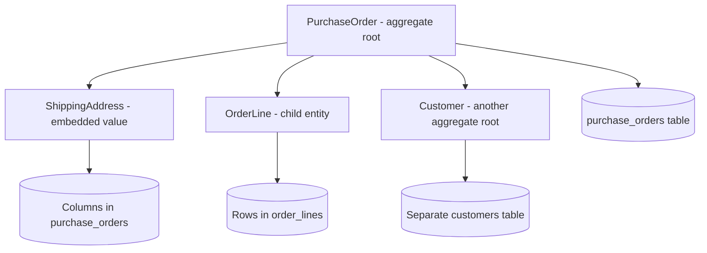

# Distinguishing Same-Table Embedded Objects from Separate-Table Entities

In **Spring Data Relational JDBC**, a Java object can be mapped in three ways: its fields are flattened into the **same row and same table** as the owning object; the object is stored as **separate rows in another table while still belonging to the same aggregate**; or the object is an **independent aggregate root**, referenced by ID from the current aggregate.

These three cases can look similar in Java because they are all represented by fields with an object type. However, they differ in schema, lifecycle, saving behavior, querying, and consistency boundaries. Choosing the wrong model easily leads to redundant tables, hard-to-manage relationships, unintended data writes, or misunderstandings of Spring Data JDBC behavior.

This lesson focuses on how to distinguish between an **embedded value object in the same table** and an **entity in a separate table**, while placing them within the aggregate model of Spring Data JDBC.

## 1. Three Ways to Represent an Object in the Relational Model

Suppose a sales system has orders, shipping addresses, order lines, and customers:



| Relationship Type | Storage Location | Lifecycle | Spring Data JDBC Mechanism |
|---|---|---|---|
| Embedded value object | Columns on the same table as the root | Follows the owning object; no independent identity | `@Embedded` |
| Child entity within the same aggregate | Rows in a separate table, with a foreign key to the root | Owned by the root and saved through the root | `@MappedCollection` |
| Reference to another aggregate root | Separate table of the referenced aggregate | Has an independent lifecycle and save operations | Scalar ID or `AggregateReference` |

Key point to remember: **a separate table does not automatically mean a separate aggregate root**. A child entity can live in a separate table while still being part of an aggregate root. Conversely, another aggregate root also has its own table, but is only referenced via a key and is not owned by the current root.

## 2. What Is an Embedded Value Object?

An **embedded value object** is an object that describes a meaningful value in the domain, but does not need its own identity and does not have a lifecycle independent of the owning object.

For example, a shipping address has street, city, and postal code components:

```java
public record ShippingAddress(
        String street,
        String city,
        String postalCode
) {
}
```

`ShippingAddress` has no `@Id`, does not need its own repository, and does not need a `shipping_addresses` table. It is simply a value object embedded into the aggregate root.

### 2.1. Using Spring Data Relational's `@Embedded`

Spring Data JDBC supports embedded objects via the annotation:

```java
import org.springframework.data.relational.core.mapping.Embedded;

@Embedded(
    onEmpty = Embedded.OnEmpty.USE_NULL,
    prefix = "shipping_"
)
private ShippingAddress shippingAddress;
```

The exact annotation is `org.springframework.data.relational.core.mapping.Embedded`. It instructs Spring Data Relational to flatten the properties of `ShippingAddress` into columns of the table holding `PurchaseOrder`.

Aggregate root example:

```java
import org.springframework.data.annotation.Id;
import org.springframework.data.relational.core.mapping.Embedded;
import org.springframework.data.relational.core.mapping.Table;

@Table("purchase_orders")
public class PurchaseOrder {

    @Id
    private Long id;

    private String orderCode;

    @Embedded(
        onEmpty = Embedded.OnEmpty.USE_NULL,
        prefix = "shipping_"
    )
    private ShippingAddress shippingAddress;

    protected PurchaseOrder() {
    }

    public PurchaseOrder(String orderCode, ShippingAddress shippingAddress) {
        this.orderCode = orderCode;
        this.shippingAddress = shippingAddress;
    }

    public Long getId() {
        return id;
    }

    public ShippingAddress getShippingAddress() {
        return shippingAddress;
    }
}
```

If the naming strategy converts property names to snake_case, the properties of the embedded object are mapped with the corresponding prefix:

| Java Property | Column in `purchase_orders` |
|---|---|
| `shippingAddress.street` | `shipping_street` |
| `shippingAddress.city` | `shipping_city` |
| `shippingAddress.postalCode` | `shipping_postal_code` |

The prefix helps avoid column name collisions when the root has multiple embedded objects containing properties with the same names.

### 2.2. Schema for an Embedded Object

The address does not have its own table. Its columns reside directly in the orders table:

```sql
CREATE TABLE purchase_orders (
    id BIGINT GENERATED BY DEFAULT AS IDENTITY PRIMARY KEY,
    order_code VARCHAR(40) NOT NULL,
    shipping_street VARCHAR(180),
    shipping_city VARCHAR(100),
    shipping_postal_code VARCHAR(20)
);
```

A row might look like this:

| id | order_code | shipping_street | shipping_city | shipping_postal_code |
|---:|---|---|---|---|
| 101 | PO-101 | 12 Main Street | Hanoi | 100000 |
| 102 | PO-102 | 5 Lake Road | Da Nang | 550000 |

When reading row `PO-101`, Spring Data JDBC creates `PurchaseOrder` and constructs `ShippingAddress` from the three `shipping_*` columns. There is no query to read a separate address table because that table does not exist in this model.

### 2.3. When Should You Use Embedded?

Use an embedded value object when:

- The object only makes sense in the context of the owning aggregate.
- The object does not need its own ID.
- The object is not accessed or saved independently via a repository.
- The object's attributes are usually read together with the root.
- Changes to the object should be persisted as part of saving the root.
- The object's structure expresses a domain concept with multiple fields rather than just a single field.

Good examples: a shipping address captured at order placement time; an effective date range; monetary information consisting of an amount and currency; coordinates consisting of latitude and longitude.

Poor examples: a customer with its own lifecycle referenced by many orders; a product updated independently; a long history list that needs to be queried separately.

**Embedded is not a way to create a relationship between two tables.** It is a way to organize Java objects while the object's data is flattened into the same table.

## 3. The `onEmpty` Rule: Handling Empty Embedded Objects

An important question when reading data is: if all columns of an embedded object are `NULL`, should Spring Data JDBC restore the property as `null` or create an empty object?

`@Embedded` has an `onEmpty` attribute with two main options:

| Value | Meaning When All Embedded Columns Are `NULL` |
|---|---|
| `Embedded.OnEmpty.USE_NULL` | The embedded property is restored as `null` |
| `Embedded.OnEmpty.USE_EMPTY` | Spring Data attempts to create an empty embedded object according to the type's mapping/constructor |

Example:

```java
@Embedded(
    onEmpty = Embedded.OnEmpty.USE_NULL,
    prefix = "shipping_"
)
private ShippingAddress shippingAddress;
```

With `USE_NULL`, if `shipping_street`, `shipping_city`, and `shipping_postal_code` are all `NULL`, `shippingAddress` can be `null`.

If `USE_EMPTY` is used, the framework creates an empty embedded instance when all columns have no values. This is useful when the domain wants to distinguish an empty object from `null`, but the constructor and property types must support the corresponding instantiation.

### 3.1. Distinguishing Null from an Empty Object

```java
ShippingAddress absent = null;

ShippingAddress empty = new ShippingAddress(
        null,
        null,
        null
);
```

These two states are not the same:

- `null`: no address has been declared.
- Empty object: an address value exists, but its components have not been filled in.

Choose according to business rules. If an address is required, validate it when creating the order rather than relying on `onEmpty` to guarantee valid data.

### 3.2. Be Careful with Primitives in Embedded Objects

For example, avoid using primitives if columns can be `NULL`:

```java
public record GeoPoint(
        double latitude,
        double longitude
) {
}
```

`double` cannot represent `null`; when mapping SQL null data, primitive types may receive default values or cause issues depending on the conversion path. If you need to distinguish "no coordinates" from a value of 0, use wrapper types:

```java
public record GeoPoint(
        Double latitude,
        Double longitude
) {
}
```

This is especially important with `USE_EMPTY`: the empty object must be able to represent the absence of data.

### 3.3. Nested Embedded Objects

A value object can contain another value object, depending on the mapping capabilities of the Spring Data Relational version. When using nested embedded objects, make the prefix clear at each level to avoid duplicate column names and verify the actual mapping metadata and schema.

Avoid creating overly deep embedded structures. If an object has many independently changing parts, needs its own ID, or is queried separately, that may be a sign to extract it into another table or aggregate.

## 4. An Entity in a Separate Table That Still Belongs to the Same Aggregate

Not every child object should be flattened into the root table. An order can have many order lines, each consisting of an SKU, quantity, and unit price. This is repeating data that may require a separate row per line.

In Spring Data JDBC, a child collection belonging to an aggregate root can be mapped via `@MappedCollection`.

Example:

```java
import java.util.ArrayList;
import java.util.List;

import org.springframework.data.annotation.Id;
import org.springframework.data.relational.core.mapping.MappedCollection;
import org.springframework.data.relational.core.mapping.Table;

@Table("purchase_orders")
public class PurchaseOrder {

    @Id
    private Long id;

    private String orderCode;

    @MappedCollection(
        idColumn = "order_id",
        keyColumn = "line_index"
    )
    private List<OrderLine> lines = new ArrayList<>();

    protected PurchaseOrder() {
    }

    public PurchaseOrder(String orderCode) {
        this.orderCode = orderCode;
    }

    public void addLine(String sku, int quantity, long unitPriceCents) {
        if (quantity <= 0 || unitPriceCents < 0) {
            throw new IllegalArgumentException("Invalid order line");
        }
        lines.add(new OrderLine(sku, quantity, unitPriceCents));
    }

    public Long getId() {
        return id;
    }

    public List<OrderLine> getLines() {
        return List.copyOf(lines);
    }
}
```

Child entity:

```java
import org.springframework.data.annotation.Id;
import org.springframework.data.relational.core.mapping.Table;

@Table("order_lines")
public class OrderLine {

    @Id
    private Long id;

    private String sku;

    private int quantity;

    private long unitPriceCents;

    protected OrderLine() {
    }

    public OrderLine(String sku, int quantity, long unitPriceCents) {
        this.sku = sku;
        this.quantity = quantity;
        this.unitPriceCents = unitPriceCents;
    }

    public Long getId() {
        return id;
    }

    public String getSku() {
        return sku;
    }

    public int getQuantity() {
        return quantity;
    }

    public long getUnitPriceCents() {
        return unitPriceCents;
    }
}
```

Here:

- `PurchaseOrder` is the aggregate root.
- `OrderLine` is a child entity owned by the root.
- Each `OrderLine` is stored as a row in the `order_lines` table.
- `order_id` is the column linking back to the root.
- `line_index` preserves the element's order in the `List`.

### 4.1. Schema for a Child Entity

```sql
CREATE TABLE purchase_orders (
    id BIGINT GENERATED BY DEFAULT AS IDENTITY PRIMARY KEY,
    order_code VARCHAR(40) NOT NULL
);

CREATE TABLE order_lines (
    id BIGINT GENERATED BY DEFAULT AS IDENTITY PRIMARY KEY,
    order_id BIGINT NOT NULL REFERENCES purchase_orders(id),
    line_index INTEGER NOT NULL,
    sku VARCHAR(64) NOT NULL,
    quantity INTEGER NOT NULL CHECK (quantity > 0),
    unit_price_cents BIGINT NOT NULL CHECK (unit_price_cents >= 0),
    UNIQUE (order_id, line_index)
);
```

An order can have multiple lines:

| order_id | line_index | sku | quantity | unit_price_cents |
|---:|---:|---|---:|---:|
| 101 | 0 | BOOK-01 | 2 | 15000 |
| 101 | 1 | PEN-02 | 3 | 5000 |
| 102 | 0 | BAG-03 | 1 | 250000 |

Unlike embedded objects, each order line has its own data row. However, they still belong to the `PurchaseOrder` aggregate because business operations to add or remove lines are performed through the root and child data is saved together with the root.

### 4.2. Meaning of `idColumn` and `keyColumn`

`@MappedCollection` has important configuration attributes:

- **`idColumn`:** the column name on the child table storing the ID of the aggregate root. In the example, this is `order_id`.
- **`keyColumn`:** the column name storing the position/key of an element in the collection, typically used for `List` or `Map`. In the example, this is `line_index`.

Do not confuse `idColumn` with the child's own ID. `order_id` is the foreign key to `PurchaseOrder`; `OrderLine.id` is the identifier of each individual order line.

If `Set` is used instead of `List`, there is no positional order like a list, so `keyColumn` is generally not needed for ordering. If `Map` is used, the key column can store the entry key according to the appropriate mapping.

### 4.3. A Child Entity Is Not a Separate Aggregate Root

Even though `OrderLine` has its own table and `@Id`, that does not automatically turn it into an independent aggregate root.

In the model above:

- Business code modifies order lines through `PurchaseOrder`.
- The primary persistence repository is `PurchaseOrderRepository`.
- The foreign key `order_id` links the child to the root.
- The child has a lifecycle dependent on the root.
- Multiple aggregate roots should not simultaneously own or modify the same child.

If `OrderLine` needs to be updated independently, has separate access permissions, is referenced by multiple workflows, or has a lifecycle independent of the order, re-evaluate the aggregate boundary.

## 5. Another Aggregate Root in a Separate Table: Referencing by ID

Suppose each order belongs to a customer. A customer can be used by many orders, updated independently, and has its own lifecycle. In that case, `Customer` is another aggregate root—neither an embedded object nor a child of `PurchaseOrder`.

A simple representation:

```java
import org.springframework.data.annotation.Id;
import org.springframework.data.relational.core.mapping.Column;
import org.springframework.data.relational.core.mapping.Table;

@Table("purchase_orders")
public class PurchaseOrder {

    @Id
    private Long id;

    @Column("customer_id")
    private Long customerId;
}
```

Schema:

```sql
CREATE TABLE customers (
    id BIGINT GENERATED BY DEFAULT AS IDENTITY PRIMARY KEY,
    display_name VARCHAR(160) NOT NULL
);

CREATE TABLE purchase_orders (
    id BIGINT GENERATED BY DEFAULT AS IDENTITY PRIMARY KEY,
    order_code VARCHAR(40) NOT NULL,
    customer_id BIGINT NOT NULL REFERENCES customers(id)
);
```

`PurchaseOrder` holds `customerId`. When customer details are needed, a service or query reads `Customer` through its corresponding repository. Spring Data JDBC does not automatically create a JPA-style lazy proxy to access `order.getCustomer().getName()`.

### 5.1. Using `AggregateReference`

Spring Data JDBC provides an explicit reference type:

```java
import org.springframework.data.jdbc.core.mapping.AggregateReference;
import org.springframework.data.relational.core.mapping.Column;

@Column("customer_id")
private AggregateReference<Customer, Long> customer;
```

Create a reference from an ID:

```java
AggregateReference<Customer, Long> customerRef =
        AggregateReference.to(customerId);
```

`AggregateReference<Customer, Long>` represents a reference to the `Customer` aggregate via an ID of type `Long`. It does not hold a loaded `Customer` object and does not automatically issue a query to fetch the customer.

You can use `Long customerId` if you want a simpler model without generic reference types. `AggregateReference` is useful when you want to clearly express aggregate boundaries in the domain model.

### 5.2. Why Not Embed Customer into PurchaseOrder?

If the entire customer object were placed into `PurchaseOrder` as an embedded object:

- Customer columns would be duplicated across every order.
- When the customer's name or address changes, older orders might retain stale snapshots or inconsistent duplicate data.
- There would no longer be a clear boundary between customer-owned data and order-owned data.
- Saving an order could write data not owned by the order.

If the business requires a snapshot of the shipping address at the time of ordering, store a **value object owned by the order** (such as `ShippingAddress`) instead of referencing the Customer's current address. Snapshots and references serve two different purposes.

## 6. Deep Comparison of the Three Models

| Criterion | Embedded (`@Embedded`) | Child Entity (`@MappedCollection`) | Aggregate Reference |
|---|---|---|---|
| Has its own table? | No | Yes | Yes, on the referenced aggregate |
| Has its own ID? | No | Can have a child ID | The referenced aggregate has its own ID |
| Has a foreign key? | Not needed for embedded | Child table has an FK to the root | Root may store an FK/ID to another aggregate |
| Who owns the lifecycle? | Fully owned by the root | Root owns the child | The referenced aggregate owns itself |
| Saved via which repository? | Root's repository | Root's repository | Each aggregate's repository in separate operations |
| Can be accessed independently? | No in the persistence model | Usually operated on through the root | Yes, via the target aggregate's own repository |
| Suitable for | Value objects | Child collections belonging to the root | Relationships between two independent aggregates |

Concrete examples:

- `ShippingAddress`: embedded in `PurchaseOrder`, because it is a snapshot belonging to the order.
- `OrderLine`: child entity in a separate table, because there are multiple lines belonging to the order's lifecycle.
- `Customer`: independent aggregate root, because it can be referenced by many orders and updated separately.

**Do not choose a model based solely on field count or whether a separate table exists.** Start from the domain's identity, lifecycle, and consistency boundaries.

## 7. How Embedded Objects and Child Tables Affect Saving

### 7.1. When Saving an Embedded Object

When calling the repository to save the root, the properties of `ShippingAddress` are mapped to columns of the `purchase_orders` row. There is no insert or update to a separate address table.

Conceptual SQL example:

```sql
INSERT INTO purchase_orders (
    order_code,
    shipping_street,
    shipping_city,
    shipping_postal_code
)
VALUES (?, ?, ?, ?);
```

When updating the root, the embedded values are also written according to the root's mapping. No separate repository is needed for `ShippingAddress`.

### 7.2. When Saving a Child Collection

With `@MappedCollection`, saving the root can trigger write operations for child rows in a separate table. For example:

```java
PurchaseOrder order = new PurchaseOrder("PO-2026-101");
order.addLine("BOOK-01", 2, 15000);
order.addLine("PEN-02", 3, 5000);

PurchaseOrder saved = purchaseOrderRepository.save(order);
```

Spring Data JDBC manages the link between root and child according to collection metadata. The exact SQL statements depend on aggregate state, database, IDs, and framework version; do not assume it works like JPA per-child dirty checking.

For aggregate collections, saving the root again may involve deleting and reinserting dependent rows according to Spring Data JDBC's strategy. Therefore:

- Keep aggregates reasonably sized.
- Avoid overly large collections if individual elements only need frequent updates.
- Do not save the root just to change one child if the cost of rewriting the collection is too high.
- Consider splitting the aggregate when children require independent access or lifecycles.

### 7.3. When Saving an Aggregate Reference

If `PurchaseOrder` contains `customerId`, saving the order only writes the referenced ID into the `customer_id` column; it does not imply saving the entire `Customer`.

If you want to create both a new customer and a new order, the service can explicitly call the two repositories within an appropriate transaction:

```java
@Transactional
public PurchaseOrder createOrder(String customerName, String orderCode) {
    Customer customer = customers.save(new Customer(customerName));

    PurchaseOrder order = new PurchaseOrder(
            orderCode,
            customer.getId()
    );

    return orders.save(order);
}
```

These are two aggregate roots saved via two repository operations. The same JDBC transaction can span both operations when they share the same transaction manager/DataSource and thread context; this boundary must be configured properly. Aggregate references do not automatically create cascade persistence.

## 8. Reading Data: Which Objects Are Constructed and When?

### 8.1. Embedded Objects Are Constructed from the Same Row

When reading `PurchaseOrder`, Spring Data JDBC retrieves the `shipping_*` columns and constructs `ShippingAddress`. No additional query is needed for the embedded object.

### 8.2. Child Entities Are Read with the Aggregate

When reading an aggregate root, Spring Data JDBC also restores the components belonging to the aggregate according to the mapping. `OrderLine` instances are constructed from rows in `order_lines` with the matching `order_id`.

Spring Data JDBC does not provide a JPA-style lazy-loading relationship proxy model. Therefore, consider aggregate size and actual queries when designing child collections.

### 8.3. Aggregate References Do Not Automatically Load the Target Object

When reading a `PurchaseOrder` with `customerId`, the framework restores the ID/reference value. It does not automatically load `Customer` just because the property has type `AggregateReference<Customer, Long>`.

If customer details are needed:

```java
PurchaseOrder order = orders.findById(orderId).orElseThrow();

Customer customer = customers.findById(order.getCustomerId())
        .orElseThrow();
```

In real applications, you can use a join query or projection when display data from multiple aggregates is needed. That is a querying choice; it does not turn those aggregates into a single aggregate.

## 9. How to Decide Whether an Object Should Be Embedded or in a Separate Table

You can use the following questions during domain design.

### 9.1. Does the Object Have an Independent Identity?

If it has no separate identity and only carries meaning as a value, embedded is usually appropriate.

Examples: snapshot address, date range, monetary information.

If the object needs an ID to be referenced, updated, or deleted independently, consider an entity in a separate table. Then ask further whether it is a child or an aggregate root.

### 9.2. Can the Object Exist Outside the Root?

- Cannot reasonably exist without the root → usually embedded or a child entity.
- Has an independent lifecycle and is referenced by multiple roots → usually a separate aggregate root.

For example, `OrderLine` has no meaning outside `PurchaseOrder`; `Customer` can exist before and after many orders.

### 9.3. Is the Data Repeated Many Times?

A small object with a few fields can be flattened into the root table. If the same entity is referenced by many roots, duplicating all its data can lead to inconsistent updates. In that case, storing a reference ID usually makes more sense.

### 9.4. Does It Need Independent Querying or Updating?

If the business needs to search, paginate, update, or apply authorization to a child without loading the root, this may be a signal that the child is a separate aggregate root. A very large collection can also indicate that the current aggregate boundary is too wide.

### 9.5. Must Changes Be Atomic with the Root?

If changing the object must always accompany changing the root, embedded or a child entity may fit. If the data has its own transactions and lifecycle, split the aggregates and design a coordination mechanism.

| Question | Leans Toward Embedded | Leans Toward Separate Table |
|---|---|---|
| Has its own identity? | No | Yes |
| Has an independent lifecycle? | No | Possibly yes |
| Needs access via a separate repository? | No | Yes |
| Multiple elements of the same kind? | None or few | Multi-element collection |
| Referenced by multiple aggregates? | No | Possibly yes |
| Needs independent querying/pagination? | Rarely | Frequently |
| Attributes saved together with the root? | Yes | Possibly no |

These answers are design heuristics, not mechanical rules. A child entity in a separate table can still lack an independent lifecycle.

## 10. Common Design and Mapping Pitfalls

| Symptom / Design Issue | Cause | Resolution |
|---|---|---|
| Embedded object generates wrong column names | Prefix or naming strategy does not match schema | Use prefix, verify column names and migrations |
| Embedded object is always null | All embedded columns are NULL and `onEmpty=USE_NULL` | Determine whether `USE_EMPTY` or column data is needed |
| Empty embedded object when domain expects null | `USE_EMPTY` is used | Choose `USE_NULL` if that matches the domain meaning |
| Address unintentionally saved in a separate table | Designed as a separate entity/repository instead of embedded | Use `@Embedded` and columns in the same table |
| Child collection is not saved | Missing `@MappedCollection` or mismatched FK column | Check `idColumn`, schema, and mapping |
| Child rows are out of order | List lacks a suitable `keyColumn` or index column mismatch | Configure `keyColumn` and unique constraint |
| Root rewrites many child rows | Large aggregate collection, root updated frequently | Shrink aggregate or split lifecycle |
| Customer saved redundantly on multiple orders | Embedding full customer data instead of referencing root | Store ID / `AggregateReference` |
| Expecting `order.getCustomer()` to query automatically | Confused with JPA lazy-loading | Load target aggregate via repository or query/projection |
| Using `@OneToMany`/`@ManyToOne` but JDBC does not behave as expected | Using JPA annotations in Spring Data JDBC | Use `@MappedCollection` or ID/reference |
| Using JPA `@Embeddable`/`@Embedded` | Imported wrong package | Use `org.springframework.data.relational.core.mapping.Embedded` |
| Confusing a child entity with an aggregate root | Seeing the child has its own ID/table and assuming independence | Identify who owns the lifecycle and repository boundary |
| Invalid FK on save | Referenced ID does not exist yet or schema lacks proper relation | Save target aggregate first, check FK and transaction |

## 11. Model Selection Scenarios

### Scenario A: Order Shipping Address

The address is recorded at the time the order is placed and is not updated independently through a repository. When the customer changes their default address, the address on past orders must remain unchanged.

**Choose an embedded value object** or snapshot value object within the aggregate:

```java
@Embedded(prefix = "shipping_")
private ShippingAddress shippingAddress;
```

Data is stored in the same `purchase_orders` table. It is not a reference to the Customer's current address.

### Scenario B: Multiple Order Lines in an Order

An order has multiple order lines, each containing an SKU, quantity, and unit price at the time of ordering. Order lines belong to the order's lifecycle and are manipulated through the order.

**Choose a child entity in a separate table**:

```java
@MappedCollection(idColumn = "order_id", keyColumn = "line_index")
private List<OrderLine> lines;
```

Rows reside in `order_lines`, with a foreign key pointing to `purchase_orders`.

### Scenario C: Customer Used by Many Orders

Customers are created and edited independently, and many orders reference them. When changing a customer's name, there is no need to rewrite every order.

**Choose an aggregate reference**:

```java
private AggregateReference<Customer, Long> customer;
```

Or store `customerId` directly. The `purchase_orders` table holds a reference key to the `customers` table.

### Scenario D: Payment Method with Its Own Lifecycle

If a payment method has an ID, verification status, history, and is used across many orders, it may be a separate aggregate root. If the order only stores a snapshot like `paymentMethodLabel` at the time of purchase, that snapshot can be an embedded value.

**Decide based on the meaning of the data**: a reference describes a current object; an embedded snapshot describes a value recorded in the past.

## 12. Testing Mapping for Each Relationship Type

Each mapping style should be tested separately against a test database. A test can use `@DataJdbcTest` and the repository:

```java
@DataJdbcTest
class PurchaseOrderMappingTest {

    @Autowired
    PurchaseOrderRepository orders;

    @Test
    void savesEmbeddedAddressAndChildLines() {
        PurchaseOrder order = new PurchaseOrder(
                "PO-101",
                new ShippingAddress(
                        "12 Main Street",
                        "Hanoi",
                        "100000"
                )
        );

        order.addLine("BOOK-01", 2, 15000);
        order.addLine("PEN-02", 3, 5000);

        PurchaseOrder saved = orders.save(order);

        PurchaseOrder loaded = orders.findById(saved.getId())
                .orElseThrow();

        assertThat(loaded.getShippingAddress().city()).isEqualTo("Hanoi");
        assertThat(loaded.getLines()).hasSize(2);
        assertThat(loaded.getLines().get(0).getSku()).isEqualTo("BOOK-01");
    }
}
```

The test requires a schema with `purchase_orders` and `order_lines` tables matching the mapping. The example above focuses on embedded objects and child collections; repositories, constructors, and getters must align with your project's complete domain code.

Some cases worth testing:

- Embedded object with full data is saved and read back.
- Embedded object with all `NULL` columns is restored according to `onEmpty`.
- Prefix prevents collisions when the root has two embedded objects with identical property names.
- Empty child collection and multi-element collection.
- `List` ordering is preserved by `keyColumn`.
- Child rows link to the correct root ID.
- Aggregate reference only stores the ID; reading the aggregate does not automatically load the referenced object.
- FK prevents referencing a non-existent ID.
- Transaction rolls back when saving root/child fails midway (if the service sets an appropriate transaction boundary).

For embedded objects and child entities, inspecting the SQL or table data after saving helps verify that object mapping matches the schema. Pure Java unit tests do not prove that the repository produces the right database rows.

## 13. Habits Not to Carry Over from JPA to Spring Data JDBC

| JPA Habit | Appropriate Mindset for Spring Data JDBC |
|---|---|
| Putting `@Embeddable` on value types | Use relational `@Embedded` on root properties |
| Using `@OneToMany(cascade = ALL)` for child collections | Use `@MappedCollection` and define aggregate ownership |
| Using `@ManyToOne(fetch = LAZY)` to link roots | Store ID or `AggregateReference`, query other roots separately |
| Expecting automatic dirty-checking on entities | Call repository `save(...)` to save the aggregate |
| Using cascade persist to automatically save referenced objects | Save independent aggregate roots via their respective repositories |
| Using `@JoinColumn` to control every relationship | Use appropriate relational mapping and `@MappedCollection` |
| Expecting a lazy proxy to query on getter calls | Explicitly load the required aggregate or use a query/projection |
| Relying on a persistence context to track objects | Understand each repository read/save is a JDBC operation per aggregate |

Spring Data JDBC has a simpler persistence context model, which requires aggregate boundaries to be designed explicitly.

## 14. Key Principles to Remember

When deciding whether an object should be embedded in the same table or placed in a separate table, distinguish three concepts:

1. **Embedded value object:** no separate identity; properties are flattened into root columns; use `@Embedded`, prefix, and `onEmpty` to control mapping.
2. **Child entity in an aggregate:** can have its own ID and separate table; the root owns its lifecycle; use `@MappedCollection` to map the collection and foreign key.
3. **Independent aggregate root:** has its own repository and lifecycle; another root stores an ID or `AggregateReference`, without JPA-style automatic cascading or lazy-loading.

An order's snapshot address typically fits embedded; order lines belonging to an order typically fit a child table; a customer used across many orders is typically an independent aggregate root.

**Start from the domain's identity, ownership, and lifecycle, and only then choose annotations and schemas.** When the model is defined properly, `@Embedded`, `@MappedCollection`, and `AggregateReference` will accurately express how data is stored and the boundaries managed by Spring Data JDBC.
