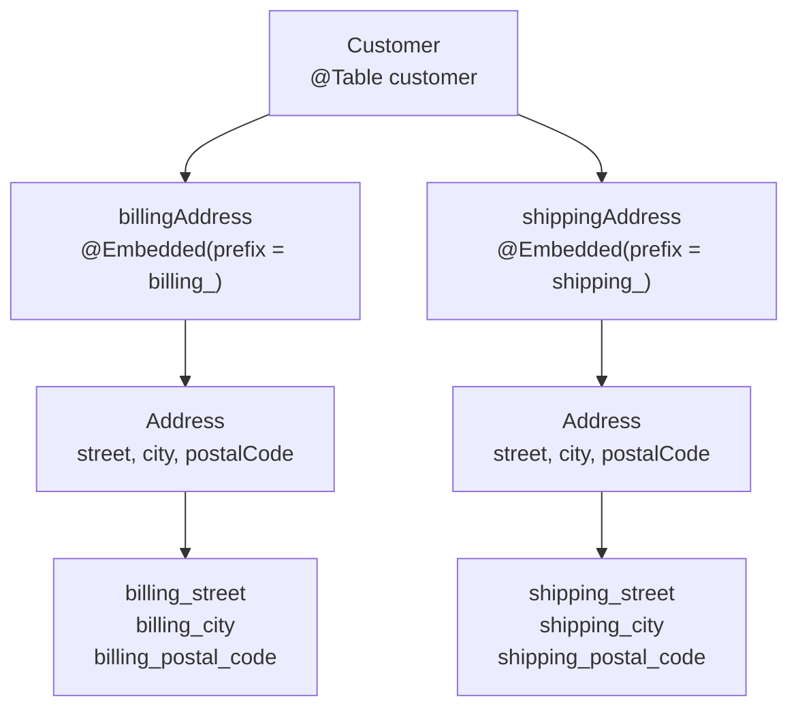

# Embedding Multiple Properties of the Same Type Without Column Name Collisions

In an order management application, a customer may have both a billing address and a shipping address. Both addresses share the same structure—street, city, and postal code—but carry different business meanings. If both are stored in the same `customer` table, we need a mapping mechanism so their properties do not write to the same set of column names.

Spring Data JDBC solves this case using `@Embedded` combined with the `prefix` attribute. Each embedded object is flattened into columns in the aggregate root's row; the prefix creates a dedicated namespace for each object. This lesson covers using multiple properties of the same type, designing the SQL schema, handling empty/null objects, and testing the mapping.

## 1. The Problem: One Address Type, Multiple Roles

Suppose the customer table stores two addresses:

- `billingAddress`: address used for invoicing.
- `shippingAddress`: address for receiving deliveries.

Both share the same structure:

| Java Property | Meaning |
| --- | --- |
| `street` | House number, street name, or detailed street address. |
| `city` | City/district according to application data conventions. |
| `postalCode` | Postal code. |

A Java value object can be declared once:

```java
public record Address(
    String street,
    String city,
    String postalCode
) {}
```

If you embed a single `Address` without specifying a prefix, the conventional columns may be `street`, `city`, and `postal_code`. However, if you embed two objects of the same type into one table, both will try to use those same column names. A table structure cannot have two columns with the same name.

We need to separate the property names into two groups:

| Embedded Object | Prefix | Conventionally Generated Columns |
| --- | --- | --- |
| `billingAddress` | `billing_` | `billing_street`, `billing_city`, `billing_postal_code` |
| `shippingAddress` | `shipping_` | `shipping_street`, `shipping_city`, `shipping_postal_code` |

This is the direct use case for `@Embedded(prefix = "...")`.

## 2. `@Embedded` and `prefix`

`@Embedded` belongs to Spring Data Relational:

```java
import org.springframework.data.relational.core.mapping.Embedded;
```

This annotation is placed on an aggregate root property to indicate that the property's value is stored in the same row as the root, by mapping its inner properties to columns of the root table.

Example:

```java
import org.springframework.data.annotation.Id;
import org.springframework.data.relational.core.mapping.Embedded;
import org.springframework.data.relational.core.mapping.Table;

@Table("customer")
public record Customer(
    @Id Long id,
    String name,
    @Embedded(prefix = "billing_")
    Address billingAddress,
    @Embedded(prefix = "shipping_")
    Address shippingAddress
) {}
```

Spring Data JDBC combines the prefix with the column names derived from `Address` properties:

- `billingAddress.street` → `billing_street`.
- `billingAddress.postalCode` → `billing_postal_code`.
- `shippingAddress.street` → `shipping_street`.
- `shippingAddress.postalCode` → `shipping_postal_code`.

The prefix is prepended to the column name during mapping; it does not change Java property names and does not create extra tables. Choosing a prefix with a separator such as an underscore keeps column names readable and unambiguous.

### Mapping Diagram



Both properties share the same Java type, yet their mapping metadata differs because a prefix is configured on each property.

## 3. Designing the Corresponding SQL Schema

Both embedded objects live in the same row of the `customer` table. Illustrative PostgreSQL DDL:

```sql
CREATE TABLE customer (
    id BIGINT GENERATED BY DEFAULT AS IDENTITY PRIMARY KEY,
    name VARCHAR(150) NOT NULL,

    billing_street VARCHAR(250),
    billing_city VARCHAR(100),
    billing_postal_code VARCHAR(20),

    shipping_street VARCHAR(250),
    shipping_city VARCHAR(100),
    shipping_postal_code VARCHAR(20)
);
```

There is no separate `address` table in this model. Each address occupies a group of columns in the `customer` table. When loading a customer, Spring Data JDBC reads the corresponding columns and constructs two `Address` values.

If the billing address is required while the shipping address is optional, the schema can enforce business constraints:

```sql
CREATE TABLE customer (
    id BIGINT GENERATED BY DEFAULT AS IDENTITY PRIMARY KEY,
    name VARCHAR(150) NOT NULL,

    billing_street VARCHAR(250) NOT NULL,
    billing_city VARCHAR(100) NOT NULL,
    billing_postal_code VARCHAR(20),

    shipping_street VARCHAR(250),
    shipping_city VARCHAR(100),
    shipping_postal_code VARCHAR(20),

    CONSTRAINT ck_customer_shipping_address_all_or_none
    CHECK (
        (shipping_street IS NULL
            AND shipping_city IS NULL
            AND shipping_postal_code IS NULL)
        OR
        (shipping_street IS NOT NULL
            AND shipping_city IS NOT NULL)
    )
);
```

The `CHECK` constraint above is just one business option: either there is no shipping address, or all required fields are present. If postal code is also required when an address exists, add `shipping_postal_code IS NOT NULL` to the second branch. If an address can omit components depending on country rules, adjust the constraint accordingly.

`@Embedded` does not generate these columns automatically. The schema must be created or updated via SQL migrations, Flyway/Liquibase, or your database management workflow.

## 4. Reusing One Value Object Type

`Address` does not need to know which prefix it is embedded with. It only describes address data:

```java
package com.example.shop.domain;

public record Address(
    String street,
    String city,
    String postalCode
) {}
```

The aggregate root reuses that type:

```java
package com.example.shop.domain;

import org.springframework.data.annotation.Id;
import org.springframework.data.relational.core.mapping.Embedded;
import org.springframework.data.relational.core.mapping.Table;

@Table("customer")
public record Customer(
    @Id Long id,
    String name,

    @Embedded(prefix = "billing_")
    Address billingAddress,

    @Embedded(prefix = "shipping_")
    Address shippingAddress
) {}
```

Benefits:

- No need to create two nearly identical types such as `BillingAddress` and `ShippingAddress` just to change column names.
- Address data rules are centralized in one type.
- Property names on the aggregate root express the business role.
- Prefixes keep the two objects' column names separate when coexisting in one row.
- Domain methods can be added to `Address` if needed, such as formatting an address for display or normalizing strings.

A value object should focus on its own values and rules. It does not need to hold `customerId`, a repository, or persistence state. If an address has an independent identity and lifecycle, the embedded model may no longer be appropriate.

## 5. Handling Empty Embedded Objects with `onEmpty`

An important question is: if all columns of an embedded object are `NULL`, will Spring Data JDBC create an object with null properties or set the root property to null?

`@Embedded` has an `onEmpty` attribute to choose the behavior when all columns of the embedded value are null. Two main options:

| Value | Behavior When All Embedded Object Columns Are SQL NULL |
| --- | --- |
| `Embedded.OnEmpty.USE_NULL` | The embedded property is set to `null`. |
| `Embedded.OnEmpty.USE_EMPTY` | The framework creates the embedded object even when all component values are null. |

Optional shipping address example:

```java
@Embedded(
    prefix = "shipping_",
    onEmpty = Embedded.OnEmpty.USE_NULL
)
Address shippingAddress
```

If `shipping_street`, `shipping_city`, and `shipping_postal_code` are all null, `shippingAddress` will be null.

If you want to represent "no data yet, but still have an empty object", use:

```java
@Embedded(
    prefix = "shipping_",
    onEmpty = Embedded.OnEmpty.USE_EMPTY
)
Address shippingAddress
```

With the `Address` record, an object is constructed with null components if all columns are null and `USE_EMPTY` behavior is applied.

`onEmpty` only governs the case where **all columns of the embedded object are null**. If only some columns are null, the framework still has data to construct the object and the corresponding properties can receive null. For instance, if `shipping_street` has a value while `shipping_city` is null, the object is not considered "empty" in the all-columns-null sense.

Therefore, `USE_NULL` does not replace validation for a partially missing address. If a complete address is required, use SQL constraints and validation/domain logic to guarantee required components.

### Choosing `onEmpty` by Semantics

- Use `USE_NULL` when having no data in any column means no address value exists.
- Use `USE_EMPTY` when the domain wants to distinguish an object that is present whose components have no values yet.
- For required objects, ideally the schema disallows all columns being null, and the domain also checks that the object is non-null.

Do not choose `USE_EMPTY` merely to dodge constructor errors. It can produce an object without data that other layers mistakenly treat as a valid address.

## 6. Prefixes Must Be Unique and Non-Colliding

When embedding multiple properties of the same type, each prefix must produce a distinct set of column names. Example:

```java
@Table("customer")
public record Customer(
    @Id Long id,
    @Embedded(prefix = "billing_") Address billingAddress,
    @Embedded(prefix = "shipping_") Address shippingAddress,
    @Embedded(prefix = "registered_") Address registeredAddress
) {}
```

Conventional columns:

| Prefix | Columns |
| --- | --- |
| `billing_` | `billing_street`, `billing_city`, `billing_postal_code` |
| `shipping_` | `shipping_street`, `shipping_city`, `shipping_postal_code` |
| `registered_` | `registered_street`, `registered_city`, `registered_postal_code` |

Avoid generic or overlapping prefixes that easily cause duplicate names:

```java
// Inappropriate: two groups may generate some of the same column names.
@Embedded(prefix = "address_") Address billingAddress,
@Embedded(prefix = "address_") Address shippingAddress
```

If both properties use `address_`, the `street`, `city`, and `postal_code` components map to the exact same columns. That is a mapping conflict and cannot represent two independent values.

In addition to prefixes between embedded objects, check for collisions with direct root properties. For example, if the root already has `billing_city`, an embedded prefix `billing_` could produce the same column name. Column naming conventions must be designed for the entire table, not just per object.

## 7. Combining `@Column` with Prefixes

If column names inside a value object do not follow the default naming strategy, `@Column` can be placed on properties of the value type. The prefix at the embedding site distinguishes roles, while custom column names describe the property portion of the name.

Example:

```java
import org.springframework.data.relational.core.mapping.Column;

public record Address(
    @Column("street_name") String street,
    String city,
    String postalCode
) {}
```

When embedded with prefixes:

```java
@Embedded(prefix = "billing_")
Address billingAddress,

@Embedded(prefix = "shipping_")
Address shippingAddress
```

The corresponding mapped columns will follow patterns like `billing_street_name`, `shipping_street_name`, and the prefixed city/postal code columns. Check SQL logs and metadata for your version of Spring Data JDBC if the schema uses many custom names; DDL must match the mapping outcome exactly.

Do not use `@Column` as a substitute for prefixes when needing the same value type on multiple properties. `@Column("street_name")` placed on `Address.street` applies the same name everywhere it is embedded; prefixes on each root property are what separate the column groups.

## 8. Embedded Objects vs. Separate Entities/Aggregates

An address can be an embedded value object or an entity with its own table. The decision depends on identity and lifecycle.

| Criterion | Embedded Value Object | Separate Entity / Aggregate |
| --- | --- | --- |
| Storage location | Columns in the root's table. | Separate table. |
| Separate identity | No independent ID in the embedded model. | Has its own ID or key. |
| Lifecycle | Read and written together with the root. | Can be managed independently. |
| Separate repository | Not needed. | Can have its own repository. |
| Lookup / linking | Usually via the root and flat columns. | Can be queried/joined by ID. |
| Multiple objects of the same type | Use prefixes to distinguish columns. | Each row has its own key and link. |

If the address is simply a set of values describing the customer and is saved/updated together with the customer, `@Embedded` fits. If the address can be shared across multiple customers, has an independent history, carries verification status, or requires separate lifecycle management, a separate address aggregate/table may be more sensible.

Do not confuse `@Embedded` with `@MappedCollection`:

- `@Embedded` flattens a value object's properties into columns in the same row.
- `@MappedCollection` represents a collection/map of child objects usually stored as rows in a separate table linked back to the aggregate root.

A property of the same type can be embedded multiple times; doing so does not create extra aggregate roots or repositories.

## 9. Queries, Repositories, and Updating Embedded Objects

The repository operates on the root as usual:

```java
import org.springframework.data.repository.CrudRepository;

public interface CustomerRepository
        extends CrudRepository<Customer, Long> {
}
```

When saving a new customer, columns for both addresses are written to the same `customer` row. When calling `findById`, Spring Data JDBC reconstructs `billingAddress` and `shippingAddress` from their respective prefixed column groups.

Example:

```java
var customer = new Customer(
    null,
    "Lan",
    new Address("12 Nguyen Hue", "Ho Chi Minh City", "700000"),
    new Address("88 Le Loi", "Ho Chi Minh City", "700000")
);

Customer saved = customerRepository.save(customer);

Customer loaded = customerRepository.findById(saved.id())
    .orElseThrow();
```

The example above illustrates object mapping; real services should normalize and validate addresses according to business rules before saving.

If only the shipping address changes, construct a new aggregate with the new `shippingAddress` and save the root. Because embedded objects have no separate ID, there is no independent repository operation like `addressRepository.save(shippingAddress)`. How Spring Data JDBC writes aggregates may update multiple columns belonging to the root; inspect actual SQL and set transaction boundaries in the service when a business flow involves multiple operations.

### Searching by Embedded Properties

If you need to find customers by shipping city, the embedded property is mapped to a prefixed column such as `shipping_city`. You can define queries using the property path / derived query capabilities of your Spring Data JDBC version, or use explicit SQL when clarity is needed:

```sql
SELECT id, name,
       billing_street, billing_city, billing_postal_code,
       shipping_street, shipping_city, shipping_postal_code
FROM customer
WHERE shipping_city = :city;
```

If a query returns a full `Customer`, it must supply the columns required to map the root and its embedded properties. If only `id` and `name` are needed, use a projection/DTO instead of mapping an incomplete column set into a full aggregate.

## 10. Nullability and Validation Rules per Embedded Object

Two addresses of the same type can have different rules:

- Billing address is required.
- Shipping address is optional.
- Business registration address may appear only for certain customer types.

`@Embedded` does not enforce whether an object is required. Use `onEmpty` to define behavior when all embedded columns are null, and use database/domain validation for specific constraints.

Example:

```java
@Table("customer")
public record Customer(
    @Id Long id,
    String name,

    @Embedded(
        prefix = "billing_",
        onEmpty = Embedded.OnEmpty.USE_NULL
    )
    Address billingAddress,

    @Embedded(
        prefix = "shipping_",
        onEmpty = Embedded.OnEmpty.USE_NULL
    )
    Address shippingAddress
) {
    public Customer {
        Objects.requireNonNull(billingAddress, "billingAddress is required");
    }
}
```

With this design, if all billing columns are null, mapping produces `billingAddress == null`; the compact constructor rejects it because billing address is required. To prevent invalid data from entering the database, the schema should still enforce `NOT NULL` on required billing columns. Constructor validation adds domain protection when objects are constructed from other sources.

Shipping address allows null; its corresponding columns allow SQL NULL. If only certain components can be null, explicitly decide whether the object is valid. You can validate inside `Address` or in the service.

## 11. Common Pitfalls When Using Multiple Embedded Objects

| Symptom | Cause | Resolution |
| --- | --- | --- |
| Two addresses overwrite or read the same values | Both properties use the same prefix or lack distinguishing prefixes. | Assign a distinct, unique prefix per property. |
| Column not found | DDL does not match prefix + property name after naming strategy. | Cross-check `@Embedded`, `@Column`, and SQL schema. |
| One object always becomes null | All columns in its prefix group are null and `onEmpty = USE_NULL`. | Check data; choose `USE_EMPTY` only if the domain expects an empty object. |
| Object is created but some fields are null | Only some columns in the embedded group have values. | Define component nullability and validate the object. |
| Constructor fails to instantiate object | Primitives/constructor reject null or constructor mapping is wrong. | Use suitable nullable types, fix data/schema, or configure persistence creator. |
| Added a field to `Address` and application fails | Table lacks the new column or migration has not run. | Create migrations before deploying code that depends on the new column. |
| Query reports missing column when mapping `Customer` | Custom `SELECT` does not return all embedded columns. | Use a complete query or a dedicated projection. |
| New prefix collides with root column | Column name is already used by another property. | Redesign table-wide naming conventions. |
| Used `@Embedded` expecting an address table | Confused embedded with child entity/table. | Use a separate table and appropriate relationship mapping if independent lifecycle is needed. |

When debugging, enable SQL logging in development and inspect actual column names. Do not look only at Java property names; Spring Data JDBC applies the naming strategy and prefixes before sending SQL.

## 12. Practice Exercise: Billing and Shipping Using the Same Address Type

Practice in order:

1. Create the `customer` table with two column groups: `billing_*` and `shipping_*`.
2. Create an `Address` record containing `street`, `city`, and `postalCode`.
3. Create `Customer` with two `Address` properties, each with its own prefix.
4. Use the repository to save a customer with two different addresses, then read it back and compare every value.
5. Save a customer without a shipping address; test `USE_NULL` and observe the property after reading.
6. Test `USE_EMPTY` and compare with `USE_NULL`.
7. Temporarily use the same prefix for both properties to observe column name conflicts; then restore unique prefixes.
8. Add a `countryCode` field to `Address`, write a migration adding `billing_country_code` and `shipping_country_code`, and verify the mapping.
9. Write tests for required billing address, optional shipping address, and an embedded object with incomplete data.

The expected outcome is that the same `Address` type is reconstructed accurately into two independent properties without mixing columns or duplicating Java classes.

## 13. Self-Check Questions

- Why can two properties of the same `Address` type not share the same set of column names?
- Does `@Embedded(prefix = "billing_")` change Java property names or SQL column names?
- Which properties of an embedded value get combined with the prefix?
- Why must `billing_*` and `shipping_*` columns be created in the same table?
- How do `USE_NULL` and `USE_EMPTY` differ when all embedded columns are SQL NULL?
- If one embedded column has a value while the others are null, does `onEmpty` turn the whole object into null?
- When should you use an embedded value object vs. creating a separate table/aggregate?
- How does `@Embedded` differ from `@MappedCollection`?
- When adding a property to a value type, what needs to change in the schema?
- Why can a custom query returning too few columns fail to construct the aggregate root?

Mastering `@Embedded(prefix = ...)` enables reusing value objects in the same row while keeping distinct column names for each role. When multiple properties share a Java type, choose prefixes according to domain semantics, create matching schemas, and select appropriate nullability. `@Embedded` handles the mapping; DDL/migrations and validation ensure the actual data structure obeys business rules.
