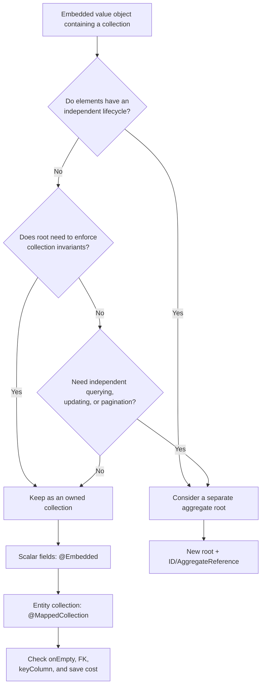

# Embedded Objects Containing Collections and Choosing Aggregate Boundaries

In Spring Data JDBC, an **embedded object** is commonly used to represent a value object belonging to an aggregate root. Its simple properties are mapped into the same data row as the aggregate root. However, a value object can also contain a collection, such as a list of delivery instructions or configuration items.

In that case, two things must be clearly understood:

1. **The embedded object still belongs to the aggregate root.** It does not automatically become an independent aggregate just because it has its own Java structure.
2. **The inner collection may be stored as rows in another table.** Having elements in a separate table does not automatically turn them into independent aggregate roots.

Confusing object boundaries, table boundaries, and aggregate boundaries can easily result in overly large save operations, unintended data deletions, or a failure to enforce business invariants.

This lesson uses an order example with embedded delivery details and a list of delivery instructions. From there, we distinguish how scalar fields and collections are mapped, examine lifecycles, and identify signs indicating when to keep a collection inside the aggregate vs. splitting it into a separate aggregate.

## 1. Distinguishing Three Concepts: Object, Table, and Aggregate

Before applying annotations, separate three concepts:

- **Object in Java:** how data and behavior are organized in the domain model.
- **Table in the database:** the storage structure of rows and columns.
- **Aggregate:** a business consistency boundary where one aggregate root controls related changes.

These three concepts do not have to map one-to-one.

Example:

```text
PurchaseOrder aggregate
┌─────────────────────────────────────────┐
│ PurchaseOrder (aggregate root)          │
│                                         │
│ DeliveryDetails (embedded value object) │
│   recipient                             │
│   phone                                 │
│   street                                │
│   instructions                          │
│     ├── DeliveryInstruction             │
│     └── DeliveryInstruction             │
└─────────────────────────────────────────┘

Database:
  purchase_orders       <- root + scalar fields of the embedded object
  delivery_instructions <- owned collection elements
```

Here:

- `PurchaseOrder` is the aggregate root.
- `DeliveryDetails` is an embedded value object with no independent identity or repository.
- Simple properties of `DeliveryDetails` are stored in the `purchase_orders` table.
- `DeliveryInstruction` elements are owned components within the aggregate; they are stored as rows in the `delivery_instructions` table.
- All changes to the collection are still managed through `PurchaseOrder`.

**An embedded object can span multiple tables when it contains a collection.** Using `@Embedded` does not mean all data inside that object must become columns of a single table.

## 2. What Is an Embedded Object in Spring Data JDBC?

An embedded object is a way to model a **value object** that is meaningful in the domain without needing its own table or identity. Spring Data Relational provides the `@Embedded` annotation to map that object's properties into the parent entity's table.

Example of a delivery address:

```java
public record DeliveryAddress(
        String recipient,
        String phone,
        String street,
        String city,
        String postalCode
) {
}
```

`DeliveryAddress` describes a complete business value. It can be replaced as a unit, and does not necessarily have an independent lifecycle or get queried via its own repository.

Aggregate root using it:

```java
import org.springframework.data.annotation.Id;
import org.springframework.data.relational.core.mapping.Embedded;
import org.springframework.data.relational.core.mapping.Table;

@Table("purchase_orders")
public record PurchaseOrder(
        @Id Long id,
        String status,
        @Embedded(prefix = "delivery_")
        DeliveryAddress deliveryAddress
) {
}
```

With prefix `delivery_`, `DeliveryAddress` properties are mapped to columns in the same table:

| Java Property | Column in `purchase_orders` |
| --- | --- |
| `id` | `id` |
| `status` | `status` |
| `deliveryAddress.recipient` | `delivery_recipient` |
| `deliveryAddress.phone` | `delivery_phone` |
| `deliveryAddress.street` | `delivery_street` |
| `deliveryAddress.city` | `delivery_city` |
| `deliveryAddress.postalCode` | `delivery_postal_code` |

PostgreSQL schema example:

```sql
CREATE TABLE purchase_orders (
    id BIGINT GENERATED BY DEFAULT AS IDENTITY PRIMARY KEY,
    status VARCHAR(30) NOT NULL,
    delivery_recipient VARCHAR(150),
    delivery_phone VARCHAR(30),
    delivery_street VARCHAR(250),
    delivery_city VARCHAR(100),
    delivery_postal_code VARCHAR(20)
);
```

No `delivery_addresses` table is needed just because Java has a `DeliveryAddress` class. This differs from an entity referenced via a one-to-many relationship.

### 2.1. Why Use a Value Object?

Value objects typically share these traits:

- Defined by their internal values rather than a separate ID.
- Meaningful within the context of the owning aggregate.
- Have no independent repository or lifecycle.
- Can be replaced as a unit when values change.
- Group related attributes into a named domain concept.

For example, a delivery address has a recipient, phone number, street, city, and postal code. Putting them into `DeliveryAddress` expresses business meaning more clearly than an aggregate with five loose fields.

However, creating a separate class does not automatically make it an embedded value object. **Mapping and business boundaries** determine its role.

## 3. What Is Special About a Collection Inside an Embedded Object?

Suppose `DeliveryDetails` also contains a list of delivery instructions:

```java
public record DeliveryInstruction(String text) {
}

public record DeliveryDetails(
        String recipient,
        String phone,
        String street,
        List<DeliveryInstruction> instructions
) {
}
```

The first three properties are simple values; `instructions` is a collection of child objects.

Spring Data JDBC handles them through two different mechanisms:

| Component | Mapping Approach |
| --- | --- |
| `recipient`, `phone`, `street` | Embedded object properties, flattened into columns in the root table. |
| `instructions` | Collection of owned entities, mapped as a one-to-many relationship with elements stored in a separate table. |

Diagram:

```text
PurchaseOrder
    |
    +-- DeliveryDetails (embedded)
            |
            +-- recipient  --------> purchase_orders.delivery_recipient
            +-- phone      --------> purchase_orders.delivery_phone
            +-- street     --------> purchase_orders.delivery_street
            |
            +-- instructions
                    |
                    +-- item 1 ----> delivery_instructions row 1
                    +-- item 2 ----> delivery_instructions row 2
```

A collection is not turned into a single object column merely because it resides inside an embedded object. For entity collections, Spring Data JDBC maps each element using the aggregate's collection/relationship mechanism.

### 3.1. Entity Collections Differ from Simple-Type Collections

Distinguish between:

- `List<DeliveryInstruction>`: a collection of child entity objects, which can be mapped as rows in a relational table.
- `List<String>` or `List<Integer>`: a collection of simple types. Spring Data Relational can map arrays/collections of simple types to an SQL array column if the database and driver support that type.

Do not assume `List<String>` is always stored in a child table like `List<DeliveryInstruction>`. If each simple element needs to be stored as an independent row, consider modeling it as a meaningful child entity type or using storage tailored to your database.

## 4. Mapping Collections with @MappedCollection

The `@MappedCollection` annotation configures how a `List`, `Set`, or `Map` of child objects is mapped within an aggregate.

Two commonly needed attributes:

- `idColumn`: name of the foreign key column on the child table pointing to the aggregate root's ID.
- `keyColumn`: name of the column storing an element's position in a `List` or key in a `Map`. For a `Set`, the key column has no effect.

Example:

```java
import java.util.List;

import org.springframework.data.relational.core.mapping.MappedCollection;

public record DeliveryDetails(
        String recipient,
        String phone,
        String street,

        @MappedCollection(
                idColumn = "order_id",
                keyColumn = "instruction_position"
        )
        List<DeliveryInstruction> instructions
) {
}
```

In this example, `order_id` links each instruction to its owning `PurchaseOrder`. `instruction_position` stores the element's position in the list.

A corresponding child table might be:

```sql
CREATE TABLE delivery_instructions (
    order_id BIGINT NOT NULL
        REFERENCES purchase_orders(id),
    instruction_position INTEGER NOT NULL,
    text VARCHAR(500) NOT NULL,
    PRIMARY KEY (order_id, instruction_position)
);
```

An order can have multiple instructions:

```text
purchase_orders
---------------
id = 501
status = 'DRAFT'
delivery_recipient = 'Nguyen An'
delivery_street = '12 Nguyen Trai'

delivery_instructions
---------------------
order_id | instruction_position | text
---------+----------------------+-------------------------
501      | 0                    | Call before delivery
501      | 1                    | Deliver at reception desk
```

Rows in `delivery_instructions` do not need a separate global ID if the composite key `(order_id, instruction_position)` satisfies the model's needs. If the business requires an independent identity per instruction, design the key and mapping accordingly; having its own ID still does not turn an instruction into an aggregate root.

### 4.1. List, Set, and Map Have Different Semantics

| Collection Type | Meaning | Relational Columns Usually Needed |
| --- | --- | --- |
| `List<T>` | Ordered, allows duplicate elements depending on domain handling. | Foreign key + position/index. |
| `Set<T>` | Unordered set; element uniqueness per Java equality. | Foreign key; key column is not needed. |
| `Map<K,T>` | Each element has a key. | Foreign key + map key column. |

For instance, `Map<String, DeliveryInstruction>` could use keys like `"FRONT_DESK"`, `"CONTACT"`. When using `Map`, the key must be a suitable simple type and the schema needs a column to store the key.

Do not pick `List` just because it is familiar if ordering is meaningless. Conversely, if the order of delivery instructions matters, `List` and a position column preserve order when reading back.

### 4.2. Why Must keyColumn Be Declared for a List?

A relational table with only `order_id` is insufficient to restore list ordering. If an order has multiple instructions, the database needs position information:

```text
order_id | instruction_position | text
---------+----------------------+-----------------------
501      | 0                    | Call before delivery
501      | 1                    | Deliver at reception desk
501      | 2                    | Do not call after 9 PM
```

`instruction_position` is the element key within the aggregate's collection. It is not an aggregate ID and not necessarily an independent business identity.

## 5. Full Example: An Embedded Object Containing a Collection

Let us build a `PurchaseOrder` aggregate with:

- Order information.
- `DeliveryDetails` as an embedded value object.
- Recipient, phone, and address fields stored in the root row.
- `List<DeliveryInstruction>` stored as child rows.
- All instructions managed through `PurchaseOrder`.

### 5.1. Aggregate Root

```java
import java.util.List;

import org.springframework.data.annotation.Id;
import org.springframework.data.relational.core.mapping.Embedded;
import org.springframework.data.relational.core.mapping.Table;

@Table("purchase_orders")
public record PurchaseOrder(
        @Id Long id,
        String status,

        @Embedded(
                prefix = "delivery_",
                onEmpty = Embedded.OnEmpty.USE_NULL
        )
        DeliveryDetails deliveryDetails
) {
}
```

`@Embedded` indicates that `DeliveryDetails` is mapped into `PurchaseOrder`'s table. The prefix prevents column name collisions if the aggregate has another embedded object with a `phone` or `street` property.

### 5.2. Embedded Value Object

```java
import java.util.List;

import org.springframework.data.relational.core.mapping.MappedCollection;

public record DeliveryDetails(
        String recipient,
        String phone,
        String street,
        String city,

        @MappedCollection(
                idColumn = "order_id",
                keyColumn = "instruction_position"
        )
        List<DeliveryInstruction> instructions
) {
    public DeliveryDetails {
        instructions = instructions == null
                ? List.of()
                : List.copyOf(instructions);
    }
}
```

`DeliveryDetails` has no `@Id` and needs no separate repository. The constructor normalizes a null collection to an empty collection so the domain has a clear rule: a delivery details object always holds a list of instructions, which may be empty.

This is a design choice for the example. If the domain wants to distinguish "no list provided" from "an explicit empty list", do not normalize the two states indiscriminately.

### 5.3. Collection Element

```java
import org.springframework.data.relational.core.mapping.Table;

@Table("delivery_instructions")
public record DeliveryInstruction(String text) {

    public DeliveryInstruction {
        if (text == null || text.isBlank()) {
            throw new IllegalArgumentException(
                    "Instruction text is required"
            );
        }
    }
}
```

`DeliveryInstruction` is stored as rows in the `delivery_instructions` table. In this example it is an owned component of the aggregate, not an independent root.

### 5.4. Repository Only for the Aggregate Root

```java
import org.springframework.data.repository.CrudRepository;

public interface PurchaseOrderRepository
        extends CrudRepository<PurchaseOrder, Long> {
}
```

There is no need to create `DeliveryDetailsRepository` or `DeliveryInstructionRepository` just to manipulate these components. Changes go through the aggregate root.

### 5.5. Creating and Saving the Aggregate

```java
import java.util.List;

PurchaseOrder order = new PurchaseOrder(
        null,
        "DRAFT",
        new DeliveryDetails(
                "Nguyen An",
                "0900000000",
                "12 Nguyen Trai",
                "Hanoi",
                List.of(
                        new DeliveryInstruction("Call before delivery"),
                        new DeliveryInstruction("Deliver at reception desk")
                )
        )
);

PurchaseOrder saved = purchaseOrderRepository.save(order);
```

Logically, Spring Data JDBC performs:

1. Insert the root row into `purchase_orders`.
2. Map scalar fields of `DeliveryDetails` into columns prefixed with `delivery_`.
3. Obtain the ID of `PurchaseOrder`.
4. Insert `DeliveryInstruction` elements into `delivery_instructions` with `order_id` set to the root ID and the corresponding `instruction_position`.

Diagram:

```text
PurchaseOrderRepository.save(order)
                |
                v
         INSERT purchase_orders
                |
                +-- id generated by database
                |
                +-- delivery_recipient
                +-- delivery_phone
                +-- delivery_street
                +-- delivery_city
                |
                v
      INSERT delivery_instructions
                |
                +-- order_id = root id
                +-- instruction_position = 0
                +-- instruction_position = 1
```

This is a single aggregate save at the domain level, though it may involve multiple SQL statements. Proper transactions ensure changes within the same aggregate commit or roll back consistently.

### 5.6. Reading the Aggregate Back

```java
PurchaseOrder loaded = purchaseOrderRepository.findById(saved.id())
        .orElseThrow();

DeliveryDetails details = loaded.deliveryDetails();

System.out.println(details.recipient());
System.out.println(details.instructions().size());
System.out.println(details.instructions().get(0).text());
```

Spring Data JDBC restores:

- Columns `delivery_recipient`, `delivery_phone`, `delivery_street`, and `delivery_city` into `DeliveryDetails`.
- Rows in `delivery_instructions` into the `instructions` collection.
- Ownership relationships via `order_id` and each element's position.

Java objects are restored according to the domain model, even though their data spans multiple tables.

## 6. Meaning of @Embedded.onEmpty When an Object Has a Collection

This is an important caveat when an embedded object contains a collection.

`@Embedded` has an `onEmpty` attribute to decide how to restore the embedded object when all of its columns are null:

- `USE_NULL`: the embedded property is set to `null` if all its mapped properties are null.
- `USE_EMPTY`: attempts to construct an instance of the embedded type with nullable properties instead of setting the entire object to null.

Example of an object with only scalar fields:

```java
public record ContactDetails(
        String phone,
        String email
) {
}
```

If `contact_phone` and `contact_email` are both null, with `USE_NULL` `contactDetails` can be restored as null.

However, if the embedded object contains a collection or map, behavior has a special nuance:

> Embedded entities containing a Collection or Map are always considered non-empty, because a collection/map can at least exist as an empty collection/map. Therefore, the embedded object will not become null solely due to `onEmpty = USE_NULL`.

Example:

```java
public record DeliveryDetails(
        String recipient,

        @MappedCollection(
                idColumn = "order_id",
                keyColumn = "instruction_position"
        )
        List<DeliveryInstruction> instructions
) {
}
```

Suppose:

- `delivery_recipient` in the root row is SQL `NULL`.
- There are no rows in `delivery_instructions`.
- The collection is restored as an empty collection.

Because the embedded object contains a collection, `DeliveryDetails` is still considered non-empty under the mapping rules. `@Embedded(onEmpty = USE_NULL)` does not automatically turn it into null merely because its scalar fields are null.

### 6.1. Distinguishing a Null Object from an Empty Collection

These states are different:

| Domain State | Meaning |
| --- | --- |
| `deliveryDetails == null` | No delivery details are represented as an object. |
| `deliveryDetails != null` and `instructions.isEmpty()` | Delivery details object exists, but currently has no instructions. |
| `deliveryDetails != null` and `instructions.size() > 0` | Delivery details object exists and has instructions. |

If the domain must distinguish these three states, design constructors, factories, DTOs, and mappings explicitly. Do not rely on `onEmpty` to produce a null state when a collection prevents the framework from interpreting it that way.

### 6.2. When to Use USE_NULL vs. USE_EMPTY?

| Requirement | Choice |
| --- | --- |
| Want embedded property to be null when there is no scalar data. | `USE_NULL` or shorthand `@Embedded.Nullable`. |
| Always want the object restored, even when all columns are null. | `USE_EMPTY` or shorthand `@Embedded.Empty`. |
| Embedded object contains a collection/map and you want the object to become null automatically when the collection is empty. | `USE_NULL` does not achieve that meaning; remodel or handle explicitly in the domain. |
| Empty collection is a valid state of the object. | Keep the object and empty collection; this is usually the simpler model. |

The `@Embedded.Nullable` and `@Embedded.Empty` shortcuts simplify configuring `onEmpty`. If you need a prefix or other attributes, use the explicit `@Embedded(...)` form.

## 7. An Owned Collection Does Not Mean an Independent Aggregate

Having a collection stored in a separate table can tempt beginners into giving each element its own repository. However, **aggregate boundaries are not determined by table count**.

For example, `DeliveryInstruction`:

- Only makes sense in the context of an order.
- Is not shared across multiple orders.
- Is created, edited, and deleted according to the order's rules.
- Does not need to be queried as an independent aggregate root.
- When the order is deleted, its instructions must also be handled under that lifecycle.

Therefore, the collection still belongs to the `PurchaseOrder` aggregate.

```text
PurchaseOrder aggregate
    |
    +-- DeliveryDetails (embedded)
            |
            +-- DeliveryInstruction A
            +-- DeliveryInstruction B

Repository:
  PurchaseOrderRepository

Not needed:
  DeliveryDetailsRepository
  DeliveryInstructionRepository
```

A one-to-many relationship in the database does not mean the child entity is a root. It may simply be how owned components are stored.

## 8. When Should a Collection Be Split into a Separate Aggregate?

There are cases where a collection is no longer suitable to manage as part of the current aggregate.

Consider splitting when one or more of the following signs appear:

### 8.1. Elements Have an Independent Lifecycle

If an element can exist before or after the parent aggregate, and is created and deleted according to its own business workflow, it may need to become an aggregate root.

For example, a `DeliveryTask` can be assigned, tracked, retried, and keep its own status history independently after the order has been confirmed. It can be a separate aggregate referencing `orderId`.

### 8.2. Multiple Aggregates Reference the Same Object

If the same object is shared by multiple aggregates, do not model it as a component simultaneously owned by all of those roots.

For example, a `Carrier` or `Warehouse` can be referenced by many orders. In that case, `PurchaseOrder` holds an ID referencing the other aggregate rather than owning the entire object.

### 8.3. The Collection Is Too Large

If an aggregate contains tens of thousands or millions of elements, loading or saving the aggregate each time can become expensive:

- Loading one root may require reading many child rows.
- Updating an owned collection may require deleting and reinserting child rows to reflect aggregate state.
- It is hard to paginate a collection when all elements are accessed through one root.
- Long transactions and write contention can increase.

This is a sign to review aggregate boundaries. A large collection does not automatically mandate splitting, but if elements are queried, updated, and paginated independently, splitting is usually more sensible.

### 8.4. Elements Need Independent and Frequent Updates

If multiple workflows need to update different elements in the collection concurrently, routing every change through a single root can cause conflicts and widen the write scope.

An independent aggregate can have its own repository, version, and transactions. The original root keeps an ID or reference to query when needed.

### 8.5. Consistency Rules Do Not Need to Be Protected Together

If an element's state is not part of an invariant that must be checked atomically alongside the root, do not force them into the same aggregate just because they appear related on a UI screen.

For example, shipment tracking history can grow continuously after an order is confirmed. Appending a tracking event does not necessarily require saving the entire order again.

### 8.6. Decision Table

| Question | Keep Inside Aggregate | Consider Splitting Aggregate |
| --- | --- | --- |
| Element lifecycle | Dependent on root | Independent |
| Create/edit/delete control | Controlled by root | Has its own business workflows |
| Sharing | Not shared across multiple roots | Referenced by multiple roots |
| Collection size | Small/medium, manageable with root | Very large, needs pagination |
| Write frequency | Usually changed together with root | Updated independently and frequently |
| Consistency | Must be guarded together with root | Can coordinate at service/process level |
| Repository | Managed by root repository | Separate root has its own repository |

Do not split simply because a class has many properties or a collection is stored in a separate table. Base the decision on **lifecycle, business rules, access patterns, and frequency of change**.

## 9. Model Before and After Splitting the Aggregate

Suppose an order has a list of delivery tasks. Initially, if the tasks are merely small instructions managed alongside the order, the model might be:

```text
PurchaseOrder aggregate
┌───────────────────────────┐
│ PurchaseOrder             │
│  id                       │
│  status                   │
│                           │
│  DeliveryDetails          │
│    recipient              │
│    instructions[]         │
└───────────────────────────┘
```

If delivery tasks have an independent lifecycle:

```text
PurchaseOrder aggregate             DeliveryTask aggregate
┌──────────────────────┐           ┌─────────────────────────┐
│ PurchaseOrder        │           │ DeliveryTask            │
│ id                   │◄──────────│ orderId                 │
│ status               │ reference │ status                  │
└──────────────────────┘           │ assignedCourierId       │
                                   │ retryCount               │
                                   └─────────────────────────┘
```

After splitting:

- `DeliveryTask` has its own ID and its own repository.
- `orderId` is a reference to `PurchaseOrder`.
- Updating task status does not necessarily require re-saving the entire order.
- If a business operation needs to synchronize order and task states, the service must coordinate transactions or events appropriately.

Java example:

```java
@Table("delivery_tasks")
public record DeliveryTask(
        @Id Long id,
        Long orderId,
        String status,
        int retryCount
) {
}
```

```java
public interface DeliveryTaskRepository
        extends CrudRepository<DeliveryTask, Long> {
}
```

This is an independent reference model. If `DeliveryTask` remains just a small item managed together with the order and has no separate lifecycle, there is no need to split it this way.

## 10. Impact of Saving and Deleting Collections

Spring Data JDBC saves aggregate state according to ownership boundaries. For a collection of child entities, updating the aggregate may involve deleting and reinserting child rows to reflect the current collection.

Example:

```text
Initial state:
PurchaseOrder 501
  instructions:
    0: "Call before delivery"
    1: "Deliver at reception desk"

After modifying the object:
PurchaseOrder 501
  instructions:
    0: "Call before delivery"
    1: "Leave package at security"

After save:
  Root is updated to the new state
  Collection rows are synchronized to the new state
```

Do not assume the framework only updates the single modified child row like an ORM with dirty checking. Spring Data JDBC's aggregate save strategy must be accounted for when collections are large or updated frequently.

### 10.1. Removing an Element

To remove an instruction, create the new collection state through the root's domain API, then save the root. Child rows no longer in the collection will be handled according to aggregate mapping.

```java
List<DeliveryInstruction> revised =
        List.of(new DeliveryInstruction("Call before delivery"));

DeliveryDetails revisedDetails = new DeliveryDetails(
        "Nguyen An",
        "0900000000",
        "12 Nguyen Trai",
        "Hanoi",
        revised
);

PurchaseOrder revisedOrder = new PurchaseOrder(
        existing.id(),
        existing.status(),
        revisedDetails
);

purchaseOrderRepository.save(revisedOrder);
```

This illustrates immutable objects. Real applications should encapsulate changes inside domain methods on the aggregate root to enforce valid state transitions.

### 10.2. Deleting the Aggregate Root

When deleting a `PurchaseOrder`, owned `DeliveryInstruction` rows must also be handled. The database needs appropriate foreign keys and deletion policies; Spring Data JDBC manages child rows according to aggregate mapping.

If the collection has been split into a separate aggregate, deleting an order no longer automatically deletes every independent `DeliveryTask`. In that case, define an explicit business policy: reject deletion, mark as canceled, publish an event, or run a separate cleanup workflow.

## 11. Collections of Simple Types and Storage Options

A collection inside an embedded object can be a collection of entities or a collection of simple values. Storage differs between the two.

### 11.1. Entity Collections

Example:

```java
List<DeliveryInstruction> instructions;
```

Each element is an object with its own properties and is mapped to rows in a relational table. `@MappedCollection` can configure the foreign key and key column.

### 11.2. Simple-Type Collections

Example:

```java
List<String> tags;
```

Spring Data Relational supports arrays and collections of simple types when the database has a corresponding array column type. Some databases support SQL arrays, though support level and binding behavior depend on the dialect and driver.

If the database does not support arrays or the application needs to query individual elements in SQL, consider:

- Modeling each element as a child entity and storing it in a separate table.
- Using a custom converter to store a value in a suitable format if it truly represents a single value field.
- Using a JSON structure if the database, driver, and query requirements fit.

Do not pick JSON or arrays merely to reduce table count if business logic requires filtering, constraints, or updating individual elements independently.

### 11.3. When to Use a Child Table?

If each element needs:

- Individual querying via SQL conditions.
- Its own unique constraints or foreign keys.
- Multiple attributes and validation rules.
- Ordering or identification within the collection.
- Persistence together with the aggregate root under ownership.

then a relational child table is usually the clear choice.

## 12. Multiple Embedded Objects in the Same Aggregate

An aggregate can contain multiple value objects of the same type. Prefixes prevent column name collisions.

For example, an order with a shipping address and a billing address:

```java
@Table("purchase_orders")
public record PurchaseOrder(
        @Id Long id,

        @Embedded(prefix = "shipping_")
        Address shippingAddress,

        @Embedded(prefix = "billing_")
        Address billingAddress
) {
}

public record Address(
        String street,
        String city,
        String postalCode
) {
}
```

The root table may contain:

```sql
CREATE TABLE purchase_orders (
    id BIGINT GENERATED BY DEFAULT AS IDENTITY PRIMARY KEY,

    shipping_street VARCHAR(250),
    shipping_city VARCHAR(100),
    shipping_postal_code VARCHAR(20),

    billing_street VARCHAR(250),
    billing_city VARCHAR(100),
    billing_postal_code VARCHAR(20)
);
```

Both `Address` objects have the same Java type, yet map to two distinct column groups.

If each embedded object also contains a collection, configure collection mappings so back-references and key columns do not collide. With multiple collections inside the same aggregate, verify the schema and naming strategy explicitly rather than letting default column names overlap.

## 13. Common Misconceptions

**"Using `@Embedded` puts the entire object and its collection into a single column."** Incorrect. Simple properties are flattened into the root row; entity collections are mapped as separate relationships, usually in a child table.

**"If an embedded object has a collection, that collection becomes an aggregate root."** Incorrect. The collection can still be an owned component of the original root. A child table does not imply a new aggregate root.

**"Having a separate table means needing a separate repository."** Incorrect. Repositories are normally designed for aggregate roots. Child entities are managed through the root's repository when they belong to the aggregate.

**"`@Embedded.Nullable` will make the object null if the collection is empty."** Incorrect. Embedded entities containing a Collection or Map are considered non-empty even when the collection/map is empty; it will not become null solely because scalar fields are null.

**"`List<String>` is always stored just like `List<ChildEntity>`."** Incorrect. Collections of simple types can be mapped to an SQL array if supported by the database; entity collections are a one-to-many relationship.

**"Splitting a collection into another table means the aggregate is already split."** Incorrect. An aggregate is a domain boundary; a table is a storage structure. One aggregate can span multiple tables.

**"Every time one element in a collection is modified, Spring Data JDBC only updates that row."** Do not assume this. Saving an owned collection may delete and reinsert child rows to synchronize aggregate state.

**"The larger a collection gets, the more it belongs in the root because it's the same business area."** Not necessarily. Size, update frequency, pagination, concurrency, and independent lifecycle are all criteria to weigh.

**"An embedded object cannot contain a collection."** Incorrect. Spring Data Relational has mapping rules for embedded entities containing a Collection/Map; the key point to remember is that `onEmpty` semantics change because a collection/map always causes the embedded object to be treated as non-empty.

## 14. Process for Choosing Aggregate Boundaries for Embedded Objects Containing Collections

When designing a value object with a collection, analyze in order:

1. **Identify the meaning of the embedded object.** Is it a group of values or an entity with its own identity and lifecycle?
2. **Identify who owns the collection.** Do the elements only have meaning inside the root, or are they managed independently?
3. **Identify consistency rules.** Must changes to the collection be validated together with the root's state?
4. **Choose the collection type.** Use List when order matters, Set for an unordered set, and Map when keys are needed.
5. **Choose storage.** Scalar fields use `@Embedded`; entity collections use relationship mapping like `@MappedCollection`; simple-type collections may use arrays if the database supports them.
6. **Design the schema.** Clearly specify embedded column prefixes, the child table's FK, and List/Map key columns.
7. **Check `onEmpty`.** If the embedded object contains a collection/map, remember it is always treated as non-empty under mapping rules.
8. **Evaluate size and load.** If the collection is large, needs pagination, or is updated independently, consider splitting into its own aggregate root.
9. **Encapsulate operations.** Allow collection changes through domain behavior on the root if it remains inside the aggregate.
10. **Inspect SQL and transactions.** Observe actual write operations, constraints, and collection synchronization costs.



This diagram aids design discussions; the final decision must rest on business rules and how the system accesses data.

## 15. Practice Exercise

Build an order aggregate with embedded delivery details and a collection of delivery instructions.

### Step 1: Create the Schema

Create the two tables `purchase_orders` and `delivery_instructions` as in the example. Define foreign key `order_id` and composite primary key `(order_id, instruction_position)`.

### Step 2: Create the Object Model

Create:

- `PurchaseOrder` as the aggregate root.
- `DeliveryDetails` as the embedded value object.
- `DeliveryInstruction` as the child entity in the collection.
- `PurchaseOrderRepository` as the repository managing the root.

### Step 3: Save and Read

Create an order with two delivery instructions. Call `save`, read back by ID, and verify:

- Recipient details are mapped to columns prefixed with `delivery_`.
- There are two rows in `delivery_instructions`.
- The order of the two elements is restored accurately.
- No separate repository is needed for `DeliveryDetails` or `DeliveryInstruction`.

### Step 4: Test an Empty Collection and onEmpty

Create a `DeliveryDetails` with null scalar fields and an empty collection. Set `@Embedded(onEmpty = USE_NULL)` and read it back.

Observe that an embedded object containing a Collection/Map is treated as non-empty and does not automatically become null just because scalar fields are null.

### Step 5: Test Modifying the Collection

Read the order, replace the instruction list, and save. Inspect the SQL statements and child table data. Do not assume only the modified row is updated.

### Step 6: Evaluate Splitting the Aggregate

Suppose the number of instructions grows to hundreds of thousands and each instruction has its own status, assignee, and execution timestamp. Answer:

- Does it still make sense to load all instructions along with the order?
- Is there a need for pagination and updating individual instructions independently?
- Does an instruction have its own lifecycle?
- Should a separate `DeliveryTask` root referencing `orderId` be created?

## 16. Summary

- `@Embedded` represents a value object in the same table as its parent entity; simple properties are flattened into columns, and prefixes can be used to avoid name collisions.
- An embedded object can contain a Collection/Map. Entity collections are mapped as one-to-many relationships and stored in child tables; elements can still belong to the original aggregate root.
- `@MappedCollection` configures the foreign key column and key column for List/Map. Set collections do not need a key column.
- Embedded entities containing a Collection or Map are always treated as non-empty, even with an empty collection; `@Embedded(onEmpty = USE_NULL)` does not make the object null merely because scalar properties are null.
- Owned collections do not automatically become independent aggregates. Repositories should be placed on the aggregate root.
- Split a collection when elements have an independent lifecycle, are shared, need independent querying/updating/pagination, or make the aggregate too large.
- Saving collections can generate multiple SQL statements and re-synchronize child rows; account for that cost in your design.
- Aggregate boundaries are determined by business semantics; the number of classes, tables, or foreign keys does not dictate ownership by itself.

When you properly understand the relationship between **embedded value objects, owned collections, and aggregate roots**, you can organize a clear Java model while staying in control of how Spring Data JDBC persists data across multiple tables. What must be decided before choosing annotations is **who owns the collection's lifecycle and business rules**; only then should you choose the corresponding mapping and schema.
