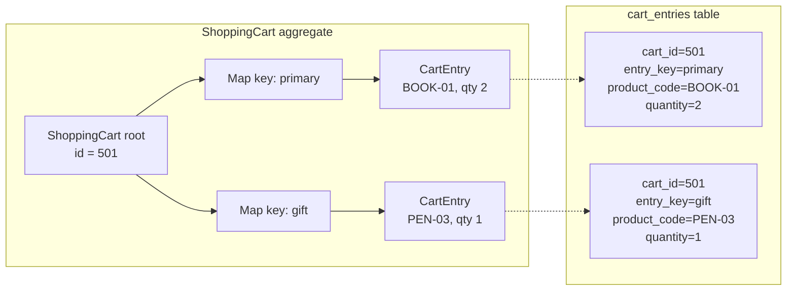
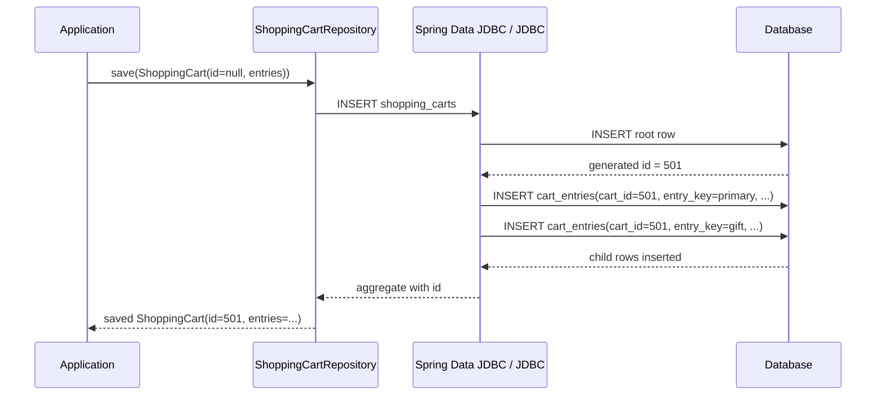

# Mapping a `Map` with Simple Keys and Entity Values

In **Spring Data JDBC**, a `Map<K, V>` can represent a group of elements belonging to an aggregate root: **the key `K` is a simple type that can be stored as a single column value**, while **the value `V` is a child entity** whose properties are stored as columns of the collection table. Spring Data JDBC needs to know two things: which column links the child row to the root, and which column stores the Map key. The `@MappedCollection` annotation provides both pieces of information via `idColumn` and `keyColumn`.

This lesson uses the example of a shopping cart whose entries are keyed by string keys. Each entry is a child entity containing a product code and a quantity. We will walk through the Java model, DDL, saving/reading, generated SQL, and the design decisions to consider.

## 1. A Map in an aggregate holds two distinct kinds of data

Suppose a shopping cart has the following entries:

```text
ShoppingCart
  id = 501
  entries = {
    "primary" -> CartEntry(productCode="BOOK-01", quantity=2),
    "gift"    -> CartEntry(productCode="PEN-03", quantity=1)
  }
```

In each Map pair:

- **Map key** (`"primary"`, `"gift"`) is a simple key chosen by the application. It identifies the slot/meaning of the entry in the cart's Map.
- **Map value** (`CartEntry`) is a child entity containing data properties such as `productCode` and `quantity`.
- **Aggregate root** (`ShoppingCart`) owns the Map and governs the lifecycle of its entries. Entries are not independent aggregates simply because each entry is stored in a database row.

Relationally, the table storing the Map needs to hold all three groups of information:

1. The aggregate root's ID to know which shopping cart the row belongs to.
2. The Map key to reconstruct the `key -> value` pair when reading.
3. The value entity's columns to construct the `CartEntry` object.



The Map key is neither a column name nor automatically a property of `CartEntry`. It is **the value stored in the `keyColumn` column**. The properties of `CartEntry` are stored in separate columns.

## 2. Declaring the root entity and value entity

Example using `String` as the key and `CartEntry` as the value:

```java
import java.util.Map;
import org.springframework.data.annotation.Id;
import org.springframework.data.relational.core.mapping.MappedCollection;
import org.springframework.data.relational.core.mapping.Table;

@Table("shopping_carts")
public record ShoppingCart(
        @Id Long id,
        @MappedCollection(idColumn = "cart_id", keyColumn = "entry_key")
        Map<String, CartEntry> entries
) {}

@Table("cart_entries")
public record CartEntry(
        String productCode,
        int quantity
) {}
```

Key annotations:

- `@Table("shopping_carts")` specifies the table of the aggregate root.
- `@Id` marks the primary key of the root. Spring Data JDBC uses this ID to save and look up the aggregate.
- `@MappedCollection(idColumn = "cart_id", keyColumn = "entry_key")` specifies the column linking back to the root and the column storing the Map key.
- `@Table("cart_entries")` specifies the table holding `CartEntry` values.

`CartEntry` is a child entity saved through `ShoppingCart`. It does not need a separate repository when its lifecycle genuinely belongs to the shopping cart. In this model, the pair **`cart_id` + `entry_key`** can serve as the key identifying the child row in the table; there is no need to add an independent ID for each entry just to make the Map work.

`String` is a simple, readable example that maps directly to `VARCHAR`. Other simple key types can be used when Spring Data JDBC can convert them to the corresponding JDBC type and the database has a suitable column type. A Map key should be a stable, meaningful value that does not require an object graph to represent.

## 3. Understanding `idColumn` and `keyColumn`

In `@MappedCollection`, the two attributes serve two distinct roles:

| Attribute | Example value | Meaning |
|---|---|---|
| `idColumn` | `cart_id` | Column in the child table holding the ID of the `ShoppingCart` aggregate root. |
| `keyColumn` | `entry_key` | Column in the child table holding the key of each element in the `Map`. |

With sample data:

| cart_id | entry_key | product_code | quantity |
|---:|---|---|---:|
| 501 | `primary` | `BOOK-01` | 2 |
| 501 | `gift` | `PEN-03` | 1 |

Spring Data JDBC reads rows with `cart_id = 501`, takes `entry_key` as the key, and builds the remaining columns into `CartEntry`:

```java
Map<String, CartEntry> entries = Map.of(
        "primary", new CartEntry("BOOK-01", 2),
        "gift", new CartEntry("PEN-03", 1)
);
```

If `keyColumn` is omitted or misconfigured to a different column name, the framework cannot restore the expected Map keys for the schema. If `idColumn` does not match the column linking back to the root, child rows may not be found or write operations may fail with a missing-column error.

## 4. DDL for the root table and Map value table

The schema needs one table for the root and one table for the value entity:

```sql
CREATE TABLE shopping_carts (
    id BIGINT GENERATED BY DEFAULT AS IDENTITY PRIMARY KEY
);

CREATE TABLE cart_entries (
    cart_id BIGINT NOT NULL,
    entry_key VARCHAR(60) NOT NULL,
    product_code VARCHAR(50) NOT NULL,
    quantity INTEGER NOT NULL,

    CONSTRAINT pk_cart_entries PRIMARY KEY (cart_id, entry_key),
    CONSTRAINT fk_cart_entries_cart
        FOREIGN KEY (cart_id) REFERENCES shopping_carts(id),
    CONSTRAINT ck_cart_entries_quantity CHECK (quantity > 0)
);
```

This DDL illustrates identity syntax that works on several engines such as H2; ID generation syntax should be adjusted for the target database. Meaning of the columns:

- `cart_id`: foreign key pointing to `shopping_carts.id`, corresponding to `idColumn`.
- `entry_key`: stores the Map key, corresponding to `keyColumn`.
- `product_code`, `quantity`: properties of the `CartEntry` entity.
- `PRIMARY KEY (cart_id, entry_key)`: guarantees a key appears only once within the same shopping cart.
- `CHECK (quantity > 0)`: enforces the data constraint in the database.

The composite primary key matches Map semantics: within the same root, keys are unique. Two different shopping carts can still both use the key `primary`, because `cart_id` is part of the key.

Table creation order must create the root before the child table so the foreign key can reference `shopping_carts(id)`. When deleting data manually, child rows normally must be deleted before the root row, unless an appropriate cascade is designed.

## 5. Declare a repository only for the aggregate root

The repository works with `ShoppingCart`:

```java
import org.springframework.data.repository.CrudRepository;

public interface ShoppingCartRepository
        extends CrudRepository<ShoppingCart, Long> {
}
```

There is no need to declare a `CartEntryRepository` when `CartEntry` is only a child entity belonging to the cart. Allowing a service to update `CartEntry` independently, bypassing the root, could accidentally break rules that the aggregate is responsible for protecting.

Creating a Map and saving the aggregate:

```java
import java.util.LinkedHashMap;
import java.util.Map;

Map<String, CartEntry> entries = new LinkedHashMap<>();
entries.put("primary", new CartEntry("BOOK-01", 2));
entries.put("gift", new CartEntry("PEN-03", 1));

ShoppingCart draft = new ShoppingCart(null, entries);
ShoppingCart saved = shoppingCartRepository.save(draft);

Long cartId = saved.id();
```

Because the new root has `id == null`, Spring Data JDBC inserts the root, receives the generated ID, and uses that ID to save the Map value rows. With immutable records, use the **object returned from `save`** to obtain the generated ID.

## 6. `INSERT` flow: save the root first, then save the Map entries

A single call:

```java
ShoppingCart saved = shoppingCartRepository.save(draft);
```

can generate multiple SQL statements. General flow:



Illustrative SQL:

```sql
INSERT INTO shopping_carts DEFAULT VALUES;
-- Database generates id = 501.

INSERT INTO cart_entries (cart_id, entry_key, product_code, quantity)
VALUES (501, 'primary', 'BOOK-01', 2);

INSERT INTO cart_entries (cart_id, entry_key, product_code, quantity)
VALUES (501, 'gift', 'PEN-03', 1);
```

This SQL illustrates the semantics; the columnless insert syntax and how generated keys are retrieved depend on the dialect/driver. Writing the root first ensures its ID is available to populate `cart_id` in the child table.

Because the root and child rows belong to the same aggregate, save operations should run in an appropriate transaction so a failure in one write step does not leave a root with missing entries or orphaned child rows. Spring Data JDBC repositories have transaction behavior for save operations; if a use case coordinates multiple other operations, place `@Transactional` on the application service to define the commit/rollback boundary.

## 7. `SELECT` flow: reconstructing the Map from key column and entity fields

When calling:

```java
ShoppingCart cart = shoppingCartRepository.findById(501L)
        .orElseThrow();

CartEntry primary = cart.entries().get("primary");
```

Spring Data JDBC reads the root and the child rows belonging to the root. A semantically equivalent query to read the Map values:

```sql
SELECT cart_id, entry_key, product_code, quantity
FROM cart_entries
WHERE cart_id = ?;
-- bind: 501
```

For each row:

1. `cart_id` identifies which aggregate root the row belongs to.
2. `entry_key` becomes the Map key.
3. `product_code` and `quantity` are mapped into `CartEntry`.
4. The key/value pair is added to `ShoppingCart`'s Map.

Result:

```java
cart.entries().get("primary")
// CartEntry("BOOK-01", 2)

cart.entries().get("gift")
// CartEntry("PEN-03", 1)
```

Spring Data JDBC does not use JPA-style lazy-loading proxies for this relationship. When reading the aggregate, the components belonging to the aggregate are loaded to build the aggregate state. Therefore, a root with a very large Map can incur significant read cost.

## 8. Modifying the Map and saving the aggregate again

A Map follows unique-key rules. You can add, replace, or remove an entry by operating on the Map before saving the root:

```java
ShoppingCart cart = shoppingCartRepository.findById(501L)
        .orElseThrow();

Map<String, CartEntry> changedEntries = new LinkedHashMap<>(cart.entries());
changedEntries.put("gift", new CartEntry("PEN-03", 2));
changedEntries.put("accessory", new CartEntry("CASE-02", 1));
changedEntries.remove("primary");

ShoppingCart changed = new ShoppingCart(cart.id(), changedEntries);
ShoppingCart savedAgain = shoppingCartRepository.save(changed);
```

In this example:

- `gift` has its quantity updated from 1 to 2.
- `accessory` is a new key.
- `primary` is removed.

With immutable entities, creating a new root containing the new Map is a clear way to express changes. After `save`, continue using the returned object.

Spring Data JDBC manages child components as part of the aggregate. When updating an aggregate that has a collection, the framework may delete the old child rows belonging to the root and re-insert the entries in the current state, rather than updating only one column on a single row. Therefore, **a small Map change can generate multiple SQL statements**. Do not assume this mechanism always performs a minimal diff between two Maps.

Implications:

- Keep the Map at a size appropriate for a single aggregate.
- Avoid Maps with hundreds of thousands of elements if only one entry is updated frequently.
- If an entry needs to be updated independently of the root, consider splitting it into a separate aggregate.
- Do not write directly to `cart_entries` from another code path while bypassing `ShoppingCart`'s rules.

## 9. Map keys must be simple and stable

The Map key is written to a single column, so it should be a value representable by a simple SQL type:

| Key type | Suggested DDL column | Notes |
|---|---|---|
| `String` | `VARCHAR(...)` | Suitable for codes, role names, or stable labels. |
| `Integer` / `Long` | `INTEGER` / `BIGINT` | Suitable for sequence numbers or numeric codes. |
| `UUID` | Native UUID type or `VARCHAR(36)` | Physical type depends on database/driver. |
| `Enum` | `VARCHAR(...)` or custom storage type | Requires consistent converter and stored representation. |

These are examples of convertible types; ensure your project's converters and JDBC driver support the chosen representation.

Do not use a complex entity as a Map key because the key must be stored as a simple column value and compared reliably. If a complex business object needs to act as an identifier, use its simple ID/code as the key.

### The key is part of the child row's identity

With a schema having:

```sql
PRIMARY KEY (cart_id, entry_key)
```

changing the key `primary` to `main` means deleting the old pair and creating a new pair. A key should not be treated as an arbitrary display label that can be freely renamed without affecting the entry's identity.

Additionally, keys must be non-null. Java `Map` does not allow two entries with the same key; DDL with a composite primary key reinforces that condition in the database. If keys are case-sensitive strings or subject to a specific collation, consider the database's comparison rules to avoid collisions between values that Java treats as distinct.

## 10. Map does not imply display order

`Map` models a key/value relationship; it does not inherently model business order. Even if the code constructs a `LinkedHashMap`, the row order returned from SQL is not guaranteed if the query has no `ORDER BY`. Do not rely on the physical order of rows in the database to establish a stable ordering.

If order is part of the business logic (for example, steps that must run in positions 1, 2, 3), consider:

- Using `List<Value>` if index/position is the primary meaning.
- Using meaningful numeric keys and a read query with an appropriate `ORDER BY` if a Map is still needed.
- Storing an extra `position` property inside the value if both an identifying key and display order are needed.

A Map key is not automatically a sort order. If deterministic ordering is needed, design and query for it explicitly.

## 11. Entity as value vs. scalar as value

Two forms can be distinguished:

```java
Map<String, String> labels;
Map<String, CartEntry> entries;
```

In the first form, the value is a simple scalar; each row needs a column for the key and a column for the value. In the second form, the value is an entity with multiple properties; each row needs a key column and columns corresponding to the value entity's properties.

For example, with `Map<String, CartEntry>`, the `cart_entries` table has columns:

```text
cart_id       -> aggregate root ID
entry_key     -> Map key
product_code  -> CartEntry.productCode
quantity      -> CartEntry.quantity
```

The Map key does not replace `CartEntry`'s properties; nor does it mean the value entity must be serialized into a JSON string. This is relational mapping into columns of a child table.

## 12. Ownership: when should the value entity belong to the aggregate?

Making an entity the value of a Map usually makes sense when:

- The value only has meaning within the scope of the root.
- The value's lifecycle depends on the root: deleting the root removes the entries as well.
- Rules for adding, replacing, and removing entries are guarded by the root.
- The Map size fits aggregate loading/saving.

For example, `CartEntry` is part of a shopping cart. An entry does not necessarily need an independent repository because operations to add items, change quantities, or remove entries happen through `ShoppingCart`.

Conversely, if the value is a catalog product referenced by many shopping carts with an independent lifecycle, do not embed the entire mutable `Product` inside every cart. The Map can store `productId` or SKU inside the value, and the application service can query `ProductRepository` separately when needed. In that setup, `Product` is an independent aggregate root; `CartEntry` remains a component of `ShoppingCart`.

Distinguishing **owned value entities** from **other referenced aggregates** prevents a single `save(root)` from inadvertently becoming an update path for shared data.

## 13. Transactions and foreign key constraints

When saving the root and Map values, the operation sequence generally needs to:

1. Insert the root to obtain its ID.
2. Insert child rows with `idColumn` set to the root ID and `keyColumn` set to the Map key.
3. Commit the transaction when all operations succeed.

If a child row violates `CHECK`, `NOT NULL`, `UNIQUE`, or data types, the transaction must roll back related changes so the aggregate is not left half-saved. When a use case performs additional repository operations that must be atomic together, place `@Transactional` on the coordinating service.

Example:

```java
import org.springframework.stereotype.Service;
import org.springframework.transaction.annotation.Transactional;

@Service
public class ShoppingCartService {
    private final ShoppingCartRepository carts;

    public ShoppingCartService(ShoppingCartRepository carts) {
        this.carts = carts;
    }

    @Transactional
    public ShoppingCart addEntry(Long cartId, String key, CartEntry entry) {
        ShoppingCart current = carts.findById(cartId).orElseThrow();
        Map<String, CartEntry> entries = new LinkedHashMap<>(current.entries());
        entries.put(key, entry);
        return carts.save(new ShoppingCart(current.id(), entries));
    }
}
```

This example illustrates transaction boundaries and Map manipulation; in a real project, add checks for key, quantity, cart status, and handling when the root is not found.

## 14. Common pitfalls when mapping a Map

| Symptom | Common cause | How to check |
|---|---|---|
| Database reports missing `cart_id` column | `idColumn` does not match DDL | Compare `@MappedCollection` with child table column names. |
| Keys are not restored properly | `keyColumn` missing or misspelled | Check the key-storing column and actual data. |
| Duplicate key error | Root ID + Map key pair is duplicated | Check composite primary key and key-generation logic. |
| Foreign key error when saving child | Root lacks ID yet or reference column is wrong | Check generated ID and insert order. |
| Value entity is not mapped | Value type's table/column names mismatch | Check `@Table`, `@Column`, naming strategy, and DDL. |
| Map loads with missing entries | Custom query fetches incomplete data or join condition is wrong | Check `cart_id` and selected columns. |
| Map update generates more SQL than expected | Aggregate collection is synchronized via root | Inspect SQL logs and evaluate aggregate size. |
| Entry order changes | SQL has no guaranteed order | Use `ORDER BY` or a `List` model if order is a business requirement. |
| Wanting to update value alone without loading root | Value actually has an independent lifecycle but is modeled as a child | Consider splitting aggregates and referencing by ID. |

When debugging, cross-check three layers: **the Map in the Java object**, **`idColumn`/`keyColumn` in metadata**, and **the physical columns of the value table**. SQL logs will reveal which table the framework is querying, which column filters by root, and which column supplies the key.

## 15. Practice exercise: verifying keys and values are stored separately

With `ShoppingCart`, `CartEntry`, and the two defined tables, you can try:

1. Create a Map with two pairs `primary -> CartEntry(...)` and `gift -> CartEntry(...)`; call `save` and retrieve the ID from the returned object.
2. Query `cart_entries` directly by `cart_id` to observe the two rows with their respective `entry_key` along with `product_code` and `quantity`.
3. Call `findById` to reload the root; use `entries().get("primary")` and `entries().get("gift")` to confirm the key/value pairs are reconstructed.
4. Change the value for key `gift`, add key `accessory`, and remove key `primary`; save the aggregate again and observe the SQL on the child table.
5. Try putting the same key twice into a Java Map: the second `put` replaces the existing key's value. Try inserting two rows with duplicate `(cart_id, entry_key)` directly in the database to see the composite primary key prevent duplicates.
6. Try a key longer than the `VARCHAR(60)` limit or an invalid quantity to observe database constraints and how errors propagate to the application layer.

The goal of this exercise is to see clearly that **the key and the value entity are stored as distinct columns**, and the root ID ties those rows into one aggregate. No separate repository is needed for the Map entry when it belongs to the root's lifecycle.

## 16. Principles to remember

For `Map<SimpleKey, EntityValue>` in Spring Data JDBC:

- The Map is a collection owned by the aggregate root.
- `idColumn` stores the root's ID in the value entity's table.
- `keyColumn` stores the Map key in the value entity's table.
- The value entity's properties become the remaining columns.
- The root repository is the gateway for accessing and saving the aggregate; the value entity does not by default have its own repository.
- Simple keys must be convertible to a JDBC type and have stable meaning.
- The Map key typically combines with the root ID to ensure child row uniqueness.
- Saving the aggregate can generate multiple SQL statements and re-synchronize the collection; consider Map size, transactions, and lifecycle.

When you need a Map with simple keys and entity values, model the child table with **a root reference column, a key column, and the value's columns**, then declare `@MappedCollection(idColumn = ..., keyColumn = ...)` matching the DDL. This preserves the key/value structure of a Java Map in a relational model while respecting the aggregate boundaries Spring Data JDBC uses when reading and writing data.
