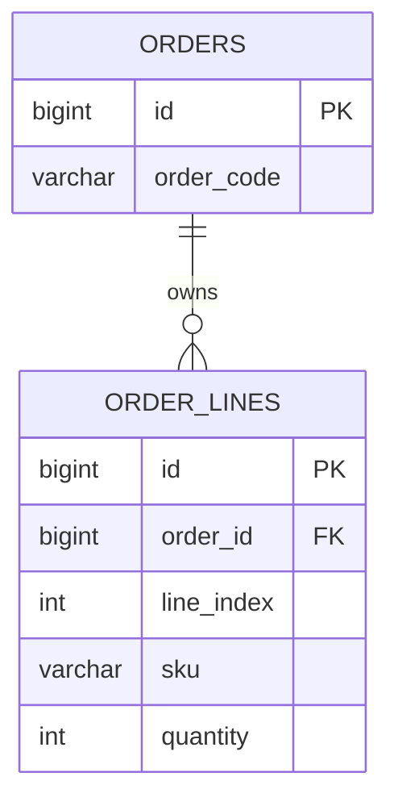

# Distinguishing Spring Data JDBC Child Deletion from ON DELETE CASCADE

In **Spring Data Relational JDBC**, an aggregate root can own child entities stored in separate tables. When deleting an aggregate through a repository, Spring Data JDBC performs the necessary delete operations for components belonging to the aggregate. Meanwhile, **ON DELETE CASCADE** is behavior enforced by the database management system when a referenced row is deleted under a foreign key constraint.

Both mechanisms can cause rows in a child table to disappear, yet they differ in control point, scope, timing, and triggering conditions. Confusing the two easily leads to orphaned data, accidentally deleting another aggregate, or assuming a direct DELETE statement will be handled by Spring Data JDBC the same way as a repository delete.

This lesson explains how Spring Data JDBC manages child entity lifecycles, how database cascade works, how the two mechanisms interact, and how to choose an appropriate deletion policy.

## 1. Starting from the aggregate model

Suppose an application manages orders. An order has multiple order lines. An order line only has meaning within the order that owns it, is added or removed through the order, and is persisted together with the aggregate root.

```java
import java.util.ArrayList;
import java.util.List;

import org.springframework.data.annotation.Id;
import org.springframework.data.relational.core.mapping.MappedCollection;
import org.springframework.data.relational.core.mapping.Table;

@Table("orders")
public class PurchaseOrder {

    @Id
    private Long id;

    private String orderCode;

    @MappedCollection(idColumn = "order_id", keyColumn = "line_index")
    private List<OrderLine> lines = new ArrayList<>();

    protected PurchaseOrder() {
    }

    public PurchaseOrder(String orderCode) {
        this.orderCode = orderCode;
    }

    public void addLine(String sku, int quantity) {
        lines.add(new OrderLine(sku, quantity));
    }

    public void removeLine(Long lineId) {
        lines.removeIf(line -> line.getId().equals(lineId));
    }
}
```

```java
import org.springframework.data.annotation.Id;
import org.springframework.data.relational.core.mapping.Table;

@Table("order_lines")
public class OrderLine {

    @Id
    private Long id;

    private String sku;
    private int quantity;

    protected OrderLine() {
    }

    public OrderLine(String sku, int quantity) {
        this.sku = sku;
        this.quantity = quantity;
    }

    public Long getId() {
        return id;
    }
}
```

In this model:

- **PurchaseOrder** is the aggregate root.
- **OrderLine** is a child entity belonging to the aggregate.
- **@MappedCollection** describes the child collection stored in a separate table.
- **order_id** is the column in the child table linking back to the root's ID.
- The public repository for aggregate operations is typically **PurchaseOrderRepository**.



Basic schema:

```sql
CREATE TABLE orders (
    id BIGINT GENERATED BY DEFAULT AS IDENTITY PRIMARY KEY,
    order_code VARCHAR(40) NOT NULL
);

CREATE TABLE order_lines (
    id BIGINT GENERATED BY DEFAULT AS IDENTITY PRIMARY KEY,
    order_id BIGINT NOT NULL REFERENCES orders(id),
    line_index INTEGER NOT NULL,
    sku VARCHAR(64) NOT NULL,
    quantity INTEGER NOT NULL CHECK (quantity > 0),
    UNIQUE (order_id, line_index)
);
```

In this DDL, the foreign key ensures each order line points to a valid order. However, because **ON DELETE CASCADE** is not declared, the database does not automatically delete order lines when an order is deleted directly. Spring Data JDBC can still manage child deletion when the aggregate is deleted through the repository.

## 2. Spring Data JDBC deletes children according to aggregate lifecycle

Spring Data JDBC treats entities referenced via the aggregate root's mapping as components belonging to the aggregate. When deleting an aggregate root through a repository, the framework knows which dependent tables must be processed based on mapping metadata.

Repository:

```java
public interface PurchaseOrderRepository
        extends CrudRepository<PurchaseOrder, Long> {
}
```

Deleting via repository:

```java
orders.deleteById(orderId);
```

For an aggregate with a child collection mapped by **@MappedCollection**, Spring Data JDBC issues the statements needed to delete dependent rows before deleting the root. Logically, the order is usually:

1. Identify the aggregate root ID to delete.
2. Delete child rows belonging to the root in mapped collection tables.
3. Delete the aggregate root row.
4. Complete the transaction according to the transaction manager in use.

Conceptual SQL may look like:

```sql
DELETE FROM order_lines
WHERE order_id = ?;

DELETE FROM orders
WHERE id = ?;
```

This is a logical description, not a guarantee of exact SQL or statement counts across every version, mapping, and database. Spring Data JDBC may generate statements according to the specific aggregate structure and metadata. What matters is that the framework **knows which children belong to the aggregate** and performs deletion according to that lifecycle.

### 2.1. Where does this mechanism come from?

The child deletion mechanism comes from **Spring Data JDBC's aggregate mapping**:

- The repository operates on the aggregate root.
- Spring Data Relational knows which properties are embedded, child collections, or references.
- Dependent entities are handled as part of persistence operations on the aggregate.
- When deleting the root, the framework performs the required deletes for managed components inside the aggregate.

This is application/framework-layer behavior. It is not a property of the foreign key and does not require the database to cascade on its own to work.

### 2.2. Removing a child from a collection is also aggregate persistence

Suppose an order has three lines, and you remove one line from the collection and save the root:

```java
PurchaseOrder order = orders.findById(orderId)
        .orElseThrow();

order.removeLine(lineId);

orders.save(order);
```

Spring Data JDBC synchronizes the aggregate state with the database and runs the SQL operations needed so the collection in the database reflects the saved aggregate. The child row removed from the aggregate is deleted per the collection persistence mechanism.

This differs from deleting the entire root. The root still exists; only one child is removed.

Do not assume Spring Data JDBC always emits a single DELETE statement for that exact child or always uses the same SQL strategy as JPA. Exact execution depends on mapping and version. When optimizing SQL or handling large collections, observe the actual statements emitted.

## 3. What is ON DELETE CASCADE?

**ON DELETE CASCADE** is a referential action declared on a foreign key. It instructs the database to automatically delete referencing rows whenever the referenced row in the parent table is deleted.

Example:

```sql
CREATE TABLE orders (
    id BIGINT GENERATED BY DEFAULT AS IDENTITY PRIMARY KEY,
    order_code VARCHAR(40) NOT NULL
);

CREATE TABLE order_lines (
    id BIGINT GENERATED BY DEFAULT AS IDENTITY PRIMARY KEY,
    order_id BIGINT NOT NULL,
    line_index INTEGER NOT NULL,
    sku VARCHAR(64) NOT NULL,
    quantity INTEGER NOT NULL CHECK (quantity > 0),

    CONSTRAINT fk_order_lines_order
        FOREIGN KEY (order_id)
        REFERENCES orders(id)
        ON DELETE CASCADE
);
```

Now if an SQL statement deletes an order directly:

```sql
DELETE FROM orders
WHERE id = 101;
```

The database automatically deletes the **order_lines** rows with **order_id = 101**. The application does not need to issue an extra child DELETE statement.

### 3.1. When does the database execute cascade?

Cascade is database behavior triggered whenever a parent row is deleted and the corresponding foreign key has **ON DELETE CASCADE**. It is not a Spring listener, does not require calling a repository, and does not depend on whether the Java class has **@MappedCollection**.

Delete paths that can trigger database cascade include:

- Direct SQL DELETE via an SQL client.
- DELETE statement from **JdbcTemplate** or a JDBC connection.
- Another application deleting the parent row.
- A custom DML statement in the application.
- A delete statement emitted by a framework, if it deletes the parent row while child rows still exist.

If children were already deleted beforehand by Spring Data JDBC, then when the parent is deleted the database has no remaining children to cascade. Both mechanisms can be configured together, though they do not necessarily both delete a given row during a single repository delete.

### 3.2. Cascade is a foreign key rule

Databases can provide other behaviors besides CASCADE:

| Referential action | Meaning when referenced row is deleted |
|---|---|
| **CASCADE** | Automatically deletes referencing rows |
| **RESTRICT** | Prevents deleting parent row while child rows still reference it, per DB rules |
| **NO ACTION** | Checks the constraint; check timing depends on the database and deferrability |
| **SET NULL** | Sets the foreign key column on child rows to NULL if the schema allows it |
| **SET DEFAULT** | Sets the foreign key column to its default if supported by the database and the value satisfies constraints |

If no referential action is declared, the default is typically equivalent to **NO ACTION** or **RESTRICT** depending on the database. Check the documentation for your database engine; do not assume all databases share identical check timing or syntax.

## 4. Direct comparison of the two mechanisms

| Criterion | Spring Data JDBC aggregate deletion | Database ON DELETE CASCADE |
|---|---|---|
| Control point | Spring Data JDBC mapping/repository | Foreign key in the database |
| Trigger condition | Repository operation on aggregate root or corresponding persistence operation | A parent row is DELETED and the FK has cascade |
| Knows which children belong to the aggregate | Yes, from mapping metadata | Does not know Java aggregates; relies on FK |
| Depends on @MappedCollection? | Yes, for child collections managed as part of the aggregate | No |
| Works with direct SQL deletes? | Does not automatically run aggregate lifecycle | Yes, if the FK is declared cascade |
| Applies to every row referencing via FK? | Only dependents managed by the aggregate mapping | Yes, according to the triggered FK constraint |
| Deletes referenced aggregate roots? | Does not automatically delete another aggregate just because a reference exists | Only if the other aggregate's FK is configured CASCADE; requires careful consideration |
| Depends on repository? | Yes | No |
| Scope | Aggregate persistence model | Referential integrity in the DB |

Way to remember it:

- **Spring Data JDBC:** "These are the children belonging to this aggregate; when deleting the aggregate, the framework handles them."
- **ON DELETE CASCADE:** "If the referenced row is deleted, the database automatically deletes rows referencing it via the foreign key."

Both can result in child rows being deleted, but their reasons and trigger paths differ.

## 5. How can the two mechanisms work together?

You can declare both **@MappedCollection** and **ON DELETE CASCADE** for the same relationship:

```java
@Table("orders")
public class PurchaseOrder {

    @Id
    private Long id;

    @MappedCollection(idColumn = "order_id", keyColumn = "line_index")
    private List<OrderLine> lines = new ArrayList<>();
}
```

DDL:

```sql
FOREIGN KEY (order_id)
REFERENCES orders(id)
ON DELETE CASCADE
```

When calling repository delete, Spring Data JDBC manages dependent rows per the aggregate. If it deletes children first and then deletes the parent, database cascade simply finds no remaining children to delete. This is normal behavior, not an error.

When another process deletes the parent directly without knowing aggregate mapping, database cascade ensures child rows are not left behind.

### 5.1. When should you use both?

Combining them can make sense if:

- The application uses Spring Data JDBC as its primary access path.
- The database is also accessed by scripts, batch jobs, or other applications.
- You want integrity protection when a parent is deleted outside the repository.
- Children genuinely belong to the parent's ownership and deleting the parent must delete the children.

Evaluate the impact on triggers, audit tables, CDC, or logic depending on delete operations. When Spring Data JDBC deletes children explicitly, triggers on the child table may run during that operation; when database cascade deletes children, trigger/CDC behavior depends on the database engine. Do not assume both delete paths leave the same operational trace.

### 5.2. When should CASCADE NOT be used?

Do not add **ON DELETE CASCADE** mechanically if:

- The child table holds data that must be retained after the root is deleted.
- Child rows are shared or referenced by other objects.
- Deleting a parent could unintentionally trigger deleting massive amounts of data.
- Archival/audit or retention requirements exist.
- The referenced row is actually an independent aggregate root.

If a row is genuinely a child belonging to an aggregate, deleting it with the root usually makes sense. If it is an independent aggregate, design a separate reference and deletion policy.

## 6. Distinguishing child entities from aggregate references when deleting

This is a very easy point to confuse. An object with a foreign key is not necessarily a child belonging to the aggregate.

### 6.1. Child belonging to the aggregate

For example, **OrderLine** belonging to **PurchaseOrder**:

```java
@MappedCollection(idColumn = "order_id")
private List<OrderLine> lines;
```

When deleting **PurchaseOrder** via the repository, Spring Data JDBC handles **OrderLine** rows according to the aggregate lifecycle.

### 6.2. Referenced aggregate root

For example, **PurchaseOrder** referencing **Customer**:

```java
@Column("customer_id")
private Long customerId;
```

Or:

```java
private AggregateReference<Customer, Long> customer;
```

**Customer** is an independent aggregate root. Deleting an order **does not mean deleting the customer**. Spring Data JDBC does not cascade-delete another aggregate simply because the root stores an ID/reference.

If the database declares:

```sql
FOREIGN KEY (customer_id)
REFERENCES customers(id)
ON DELETE CASCADE
```

then this cascade direction means: **deleting a Customer will delete the PurchaseOrders referencing that Customer**. That is usually a dangerous policy and unsuitable for orders that need to keep history. Typically **RESTRICT**/**NO ACTION** or another business-appropriate policy should be used.

A cascade direction on a foreign key acts in the **direction of deleting the referenced row**. Read carefully which table holds the FK and which table is being referenced.

### 6.3. Snapshot value object with no foreign key

A shipping address captured at order placement time can be an embedded value object. When deleting the order, the address columns disappear with the order row. There is no child table and no FK cascade needed.

This shows that not every piece of data related to an order requires its own table.

## 7. Deleting aggregates via repository vs. deleting with direct SQL

### 7.1. Repository delete

```java
orders.deleteById(orderId);
```

This is the path where Spring Data JDBC knows the aggregate mapping. The framework handles dependent entities belonging to the aggregate before deleting the root.

### 7.2. JdbcTemplate or direct JDBC

```java
jdbcTemplate.update(
        "DELETE FROM orders WHERE id = ?",
        orderId
);
```

This is a direct SQL statement. Spring Data JDBC does not automatically load the aggregate, inspect **@MappedCollection**, or run an aggregate deletion plan simply because the statement is called inside the same Spring application.

The outcome depends on database constraints:

- FK has **ON DELETE CASCADE**: the database deletes the children.
- FK has no cascade and children remain: the database normally rejects deleting the parent due to an FK violation.
- No FK exists: the parent can be deleted and the children become orphaned data.

### 7.3. Custom DML query

A custom DELETE statement via a repository query is also direct DML at the database layer; do not treat it as equivalent to an aggregate-aware repository delete.

Conceptual example:

```java
@Modifying
@Query("DELETE FROM orders WHERE id = :id")
void deleteOrderRow(@Param("id") Long id);
```

Exact syntax and annotation support depend on the Spring Data JDBC version. Even when using a custom modifying query, you are instructing the database to execute DML. Aggregate child cleanup is not automatically inferred from the query. Ensure FKs/cascade are in place or organize the delete statements explicitly within an appropriate transaction.

**Do not use bulk DELETE in place of repository aggregate delete if you need to preserve aggregate lifecycle semantics.**

## 8. What happens if ON DELETE CASCADE is not declared?

Consider the DDL:

```sql
CREATE TABLE orders (
    id BIGINT PRIMARY KEY
);

CREATE TABLE order_lines (
    id BIGINT PRIMARY KEY,
    order_id BIGINT NOT NULL REFERENCES orders(id),
    sku VARCHAR(64) NOT NULL
);
```

If child data exists:

```sql
INSERT INTO orders(id) VALUES (1);
INSERT INTO order_lines(id, order_id, sku)
VALUES (10, 1, 'BOOK-01');
```

Deleting the parent directly:

```sql
DELETE FROM orders WHERE id = 1;
```

The database rejects the operation in standard FK configurations because an **order_lines** row still references **orders.id = 1**.

This is **referential integrity protection**, not a bug in Spring Data JDBC. If you want to delete via direct SQL without using cascade, you must delete the children first:

```sql
BEGIN;

DELETE FROM order_lines WHERE order_id = 1;
DELETE FROM orders WHERE id = 1;

COMMIT;
```

Both statements must be in the same transaction to avoid a half-finished state if the second statement fails. You must also handle other child tables if the aggregate has multiple types of dependent entities.

With Spring Data JDBC's repository delete, the framework already has the mapping to handle dependent entities; an FK without cascade can still work properly.

## 9. Cascade and transactions: atomicity of deletion

Whether Spring Data JDBC deletes children with separate statements or the database deletes children via FK cascade, operations must run in an appropriate transaction to guarantee atomicity.

Example:

```java
import org.springframework.stereotype.Service;
import org.springframework.transaction.annotation.Transactional;

@Service
public class OrderDeletionService {

    private final PurchaseOrderRepository orders;

    public OrderDeletionService(PurchaseOrderRepository orders) {
        this.orders = orders;
    }

    @Transactional
    public void deleteOrder(long orderId) {
        orders.deleteById(orderId);
    }
}
```

When the repository and transaction manager share the same DataSource, deleting dependents and the root executes within Spring's transaction. If a step fails, the transaction can roll back according to Spring's exception/rollback rules.

With direct SQL, database cascade occurs inside the DELETE statement and that statement/connection's transaction. If the transaction rolls back, cascade-deleted rows are also restored per the database's transaction guarantees.

### 9.1. Cascade is not an asynchronous delete mechanism

**ON DELETE CASCADE** does not queue a background job to delete later. It is a referential constraint behavior processed by the database during the parent row deletion. With a very large number of children, deletion can take significant time, hold locks, and generate substantial transaction logs.

If millions of child rows must be deleted, plan for performance, locking, transaction size, indexes on foreign keys, and batching/partitioning options. Do not assume cascade is always fast just because application code has a single DELETE statement.

### 9.2. Transaction boundaries across multiple aggregates or multiple stores

A single-datasource JDBC transaction can wrap operations across multiple tables in the same database. However, it cannot automatically roll back emails, message brokers, APIs, or other databases.

If deleting an order must also publish an event or update another system, design a coordination mechanism (such as a transactional outbox or compensating workflow). **ON DELETE CASCADE** only manages rows linked by foreign keys within that database.

## 10. Other deletion styles: soft delete and archival

Physical delete must be distinguished from soft delete.

### 10.1. Physical delete

SQL DELETE removes rows from the table. This is the operation that can trigger **ON DELETE CASCADE**.

### 10.2. Soft delete

Soft delete typically updates a flag or timestamp:

```sql
UPDATE orders
SET deleted_at = CURRENT_TIMESTAMP
WHERE id = ?;
```

This is an UPDATE, not a DELETE. Therefore, **ON DELETE CASCADE is not triggered**. Child rows remain intact unless the application explicitly updates them or has a separate mechanism.

If the business wants to soft-delete an entire aggregate, clearly define whether children share the same status or remain queryable/auditable. You can store status on the root and filter on read, or update child statuses according to specific rules.

### 10.3. Archiving instead of deleting

If order data must be retained for business or legal requirements, you can transition to an archive status or move data to archival storage. Putting FK cascade in this case may be inappropriate because physically deleting the root would permanently wipe out the children.

## 11. Common errors when combining the two mechanisms

| Symptom | Possible cause | How to resolve |
|---|---|---|
| Repository delete removes children, direct SQL does not | Spring Data JDBC handles aggregate; FK does not declare CASCADE | Add FK ON DELETE CASCADE if direct deletes must also remove children, or delete children explicitly |
| Direct SQL fails with foreign key error | Default FK blocks deleting parent while children exist | Delete children first in a transaction or configure CASCADE if business rules allow |
| Orphaned children after direct SQL | No FK or no cascade and constraint was bypassed | Add FK, audit existing data, and review deletion policy |
| Deleting order removes customer | FK from order to customer has ON DELETE CASCADE in an unintended direction | Use RESTRICT/NO ACTION or fix the relationship direction/semantics |
| Using @MappedCollection but expecting direct SQL to understand it | Mapping is only used by Spring Data JDBC through persistence operations | Use repository aggregate delete or declare database FK actions |
| Root delete fails despite CASCADE | Another constraint, trigger, other child table, or database config | Read DB error, inspect all FKs/triggers and SQL statements |
| Soft delete leaves children behind | UPDATE does not trigger ON DELETE CASCADE | Design a soft-delete policy for the aggregate |
| Triggers/audits record child deletes differently | Explicit framework deletes and database cascade/triggers intervene along different paths | Identify the actual delete path, inspect triggers and audits |
| Unintended deletion of referenced aggregate | Confusing child ownership with references to independent aggregates | Use ID/reference, do not cascade-delete target aggregates |
| Deleting collection child while root remains | This is an aggregate collection mutation, not root deletion | Update the collection and save root via a domain method |

## 12. Designing a deletion policy per relationship

Define a dedicated policy for each link:

| Relationship | Example | Spring Data JDBC | FK policy to consider |
|---|---|---|---|
| Embedded | Snapshot address in order | Saved with root, no child table | No separate FK |
| Child belonging to aggregate | OrderLine belonging to Order | @MappedCollection; root repository manages it | ON DELETE CASCADE can supplement for direct SQL |
| Mandatory aggregate reference | Order referencing Customer | Stores ID/AggregateReference; does not delete Customer when deleting Order | RESTRICT/NO ACTION is usually more appropriate |
| Optional aggregate reference | Ticket referencing an Agent that might be deleted | Stores nullable ID or reference | SET NULL may be used if business rules permit |
| Shared lookup/reference data | Order referencing Currency | Does not cascade-delete shared data | Usually block deletion while references remain |

There is no one-size-fits-all cascade policy for every relationship. Answer:

1. Who owns the child row's lifecycle?
2. Can the child row exist independently after the root is deleted?
3. Which applications have permission to delete from the root table directly?
4. Does the database need protection for operations outside Spring Data JDBC?
5. Are there audit, retention, archive, or soft-delete requirements?

## 13. Practice example: repository delete vs. direct SQL

Suppose two tables contain data:

```sql
INSERT INTO orders (id, order_code)
VALUES (101, 'PO-101');

INSERT INTO order_lines (id, order_id, line_index, sku, quantity)
VALUES
    (1001, 101, 0, 'BOOK-01', 2),
    (1002, 101, 1, 'PEN-02', 3);
```

### Case A: FK without ON DELETE CASCADE

- Calling **orders.deleteById(101)** via Spring Data JDBC: the framework handles children per aggregate mapping, then deletes the root.
- Running **DELETE FROM orders WHERE id = 101** directly: the database rejects it while children remain due to the foreign key.

### Case B: FK with ON DELETE CASCADE

- Calling repository delete: Spring Data JDBC can delete children explicitly first; the database then deletes the root with no children left to cascade.
- Running SQL DELETE directly on orders: the database deletes the root and automatically cascades deletion to referencing order_lines.
- Running delete from another application: the database still enforces the FK action, without needing Spring Data JDBC.

### Case C: order_lines is a shared table, not a child

If data rows are actually referenced by many orders (a different model from ordinary order lines), do not configure cascade to delete shared rows just because one root has a foreign key. Model the relationship with accurate ownership, usually as a separate aggregate root and an association table with a clearly defined lifecycle.

### Self-check questions

1. Why can repository delete remove children even when the FK does not declare **ON DELETE CASCADE**?
2. Why can a direct DELETE statement be rejected by the FK in the same schema?
3. If Order references Customer, should the FK **orders.customer_id** use **ON DELETE CASCADE**?
4. Does soft delete via UPDATE trigger database cascade?
5. When a child is removed from **@MappedCollection** and the root is saved, is that database cascade or aggregate persistence?
6. If a batch job outside the application deletes orders, which mechanism protects child rows?

Hints:

- Repository aggregate deletion uses Spring Data JDBC mapping metadata to handle dependent entities.
- Direct SQL only triggers behavior defined by database constraints.
- Cascading in the direction of deleting Customer would delete all orders referencing that Customer, which is usually inappropriate for historical order data.
- UPDATE is not DELETE, so it does not trigger **ON DELETE CASCADE**.
- Removing a child from a collection is an aggregate synchronization operation.
- FK cascade or an explicit child deletion workflow protects data during operations outside the repository.

## 14. Principles to remember

When designing data deletion in Spring Data JDBC, separate two responsibilities:

1. **Spring Data JDBC manages aggregate lifecycle.** Children mapped as components of an aggregate are handled when saving/deleting the root via the repository. **@MappedCollection** describes child collections; an aggregate reference is not an owned child.
2. **The database manages referential integrity.** **ON DELETE CASCADE** is foreign key behavior when a parent row is deleted, regardless of whether the delete command came from Spring, an SQL client, or another application.

For Order and OrderLine, repository aggregate delete can remove order lines according to the mapping. If the database also needs to clean up children automatically on direct SQL, **ON DELETE CASCADE** can be declared on **order_lines.order_id**. For Order and Customer, deleting an Order should not delete the Customer just because a reference exists; choose an FK policy that protects independent aggregates.

**Determine ownership first, then choose the deletion mechanism at the application layer and constraints at the database layer.** When both layers are designed intentionally, the application preserves proper aggregate semantics while protecting data from SQL operations outside the repository.
