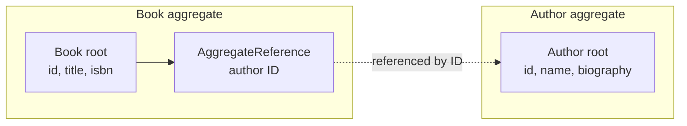

# Using AggregateReference to Represent Typed References

In Domain-Driven Design (DDD), an aggregate has its own boundary and lifecycle. When one aggregate needs to know about another aggregate, we typically store the **identifier of the referenced aggregate** rather than embedding the entire object inside the owning model. In Spring Data JDBC, the **`AggregateReference<T, ID>`** type expresses that intent explicitly with compile-time type checking.

For example, a `Book` needs to know its author. `Book` and `Author` are two independent aggregates: a book has its own ordering/publishing lifecycle, while an author has their own profile and can be referenced by many books. The `author` property of `Book` can use `AggregateReference<Author, Long>` to indicate that it holds the ID of an aggregate root of type `Author`.

This lesson explains how to declare, create, save, read, and test `AggregateReference`; distinguishes it from owned child entity collections mapped with `@MappedCollection`; and clarifies what `AggregateReference` does **not** do automatically, such as loading the target object, cascading persistence, or creating database foreign keys.

## 1. Why Do We Need an Aggregate Reference Type?

Suppose a library application has two business areas:

- **Author aggregate:** manages the author's name, biography, contact details, and profile status.
- **Book aggregate:** manages the title, ISBN, publication status, and data belonging to the book's lifecycle.

One author can have many books. A book references one primary author. However, updating an author's biography does not mean loading and re-saving all of that author's books.

If you model the full `Author` object inside `Book`:

```java
public class Book {
    private Long id;
    private String title;
    private Author author;
}
```

readers of the code might mistakenly assume `Author` is a child object owned by `Book`. This blurs aggregate boundaries and easily leads to false expectations about loading and saving data.

A clearer approach is storing a reference:

```java
private AggregateReference<Author, Long> author;
```

This property states: "Book references an Author using a Long identifier." It does not claim that Book owns Author or manages Author's lifecycle.

### 1.1. Plain ID vs. AggregateReference

You can use a property of type `Long authorId`:

```java
private Long authorId;
```

This is simple and completely valid when the application only needs to store the ID. However, the property name does not carry full type information about the referenced aggregate. Both `authorId` and `publisherId` might be `Long`, making it easy to pass the wrong ID in code.

`AggregateReference<T, ID>` adds type semantics:

- `T`: type of the referenced aggregate root.
- `ID`: identifier type of that aggregate root.

For example:

```java
AggregateReference<Author, Long> author;
AggregateReference<Publisher, Long> publisher;
```

Both hold a `Long` ID, but the reference type clearly shows different targets. The compiler can help catch passing an Author reference where a Publisher reference is expected.

### 1.2. Which Package Does AggregateReference Belong To?

In Spring Data JDBC, import:

```java
import org.springframework.data.jdbc.core.mapping.AggregateReference;
```

This is Spring Data JDBC's built-in support type for representing aggregate references. It clarifies domain intent and supports mapping the target aggregate's ID to a column in the table being saved.

## 2. How Does AggregateReference<T, ID> Work?

`AggregateReference` is an abstraction carrying the ID of another aggregate. Its generic structure can be understood as:

```java
AggregateReference<Author, Long> authorReference;
```

| Component | Meaning |
| --- | --- |
| `AggregateReference` | Wrapper type representing a reference to another aggregate. |
| `Author` | Type of the referenced aggregate root. |
| `Long` | ID type of the `Author` aggregate root. |
| `getId()` | Retrieves the ID held inside the reference. |
| `AggregateReference.to(id)` | Creates a reference from a known ID. |

Creating a reference:

```java
AggregateReference<Author, Long> reference =
    AggregateReference.to(42L);
```

Getting the ID:

```java
Long authorId = reference.getId();
```

Key point: `AggregateReference` is **not a lazy-loading proxy**. When calling `getId()`, the framework does not automatically query the database to fetch the `Author` object. It simply returns the ID stored in the reference.

To obtain the author's details, the application calls the corresponding repository:

```java
Author author = authorRepository.findById(reference.getId())
    .orElseThrow();
```

This keeps data retrieval decisions in the application/service layer.

## 3. Modeling Two Independent Aggregates

Domain example:



The two aggregates have independent repositories and lifecycles:

- `AuthorRepository` operates on the Author root.
- `BookRepository` operates on the Book root.
- `Book` only stores the Author's identifier.
- Changing Author details does not automatically require re-saving Book.
- To display author details alongside a book, the application explicitly queries Author when needed.

This boundary is especially useful when one aggregate is referenced by many others. One `Author` can be pointed to by many `Book` instances, while still having a single place responsible for updating the author profile.

## 4. Declaring the Domain Model with AggregateReference

Suppose the authors table is:

```sql
CREATE TABLE authors (
    id BIGINT GENERATED BY DEFAULT AS IDENTITY PRIMARY KEY,
    name VARCHAR(160) NOT NULL,
    biography TEXT
);
```

And the books table is:

```sql
CREATE TABLE books (
    id BIGINT GENERATED BY DEFAULT AS IDENTITY PRIMARY KEY,
    title VARCHAR(255) NOT NULL,
    isbn VARCHAR(32) NOT NULL UNIQUE,
    author_id BIGINT NOT NULL,
    CONSTRAINT fk_books_author
        FOREIGN KEY (author_id) REFERENCES authors(id)
);
```

Author domain model:

```java
package example.library.domain;

import org.springframework.data.annotation.Id;
import org.springframework.data.relational.core.mapping.Table;

@Table("authors")
public record Author(
    @Id Long id,
    String name,
    String biography
) {}
```

Book domain model:

```java
package example.library.domain;

import org.springframework.data.annotation.Id;
import org.springframework.data.relational.core.mapping.Column;
import org.springframework.data.relational.core.mapping.Table;
import org.springframework.data.jdbc.core.mapping.AggregateReference;

@Table("books")
public record Book(
    @Id Long id,
    String title,
    String isbn,
    @Column("author_id")
    AggregateReference<Author, Long> author
) {}
```

Here:

- `Author` is an independent aggregate root.
- `Book` is an independent aggregate root.
- `author` is a typed reference to Author.
- `@Column("author_id")` maps the `author` property to the physical foreign key column `author_id`.
- The value stored in `author_id` is the Author's ID, not the entire Author object.

`@Column` belongs to Spring Data Relational. `@Id` belongs to Spring Data Commons. `AggregateReference` is provided by Spring Data JDBC.

### 4.1. Using ID Types Other Than Long

If Author uses UUID:

```java
@Table("authors")
public record Author(
    @Id UUID id,
    String name
) {}
```

Book declares:

```java
AggregateReference<Author, UUID> author;
```

The ID type in the generic parameter must match the ID type of the referenced aggregate root. The database column and JDBC mapping must also support that type.

Generics express the type relationship in Java; they do not automatically convert a `BIGINT` schema into `UUID` or vice versa.

## 5. Creating References and Saving Aggregates

To create a new Book, the application first needs to know the Author's ID. With database-generated IDs, you typically save the Author first, retrieve the ID from the returned object, and then create the `AggregateReference`.

Repositories:

```java
import org.springframework.data.repository.ListCrudRepository;

public interface AuthorRepository
        extends ListCrudRepository<Author, Long> {
}

public interface BookRepository
        extends ListCrudRepository<Book, Long> {
}
```

Application service:

```java
import org.springframework.data.jdbc.core.mapping.AggregateReference;
import org.springframework.stereotype.Service;
import org.springframework.transaction.annotation.Transactional;

@Service
public class BookApplicationService {

    private final AuthorRepository authors;
    private final BookRepository books;

    public BookApplicationService(
        AuthorRepository authors,
        BookRepository books
    ) {
        this.authors = authors;
        this.books = books;
    }

    @Transactional
    public Book createBook(
        String title,
        String isbn,
        String authorName
    ) {
        Author author = authors.save(
            new Author(null, authorName, null)
        );

        AggregateReference<Author, Long> authorReference =
            AggregateReference.to(author.id());

        Book book = new Book(
            null,
            title,
            isbn,
            authorReference
        );

        return books.save(book);
    }
}
```

Processing flow:

1. Create and save the Author aggregate.
2. The database generates an ID for Author.
3. Retrieve the ID from the object returned by `authors.save`.
4. Create `AggregateReference<Author, Long>` using `AggregateReference.to(author.id())`.
5. Create Book with that reference.
6. Save Book; Spring Data JDBC writes the Author ID into the `author_id` column.

`@Transactional` wraps the use case because this example wants creating the author and book to succeed or roll back together. That is a business choice for this creation flow; in a real system, Author may already exist and the service simply receives the author ID.

### 5.1. When the Author Already Exists

If the user selects an existing author:

```java
@Transactional
public Book createBookForExistingAuthor(
    String title,
    String isbn,
    Long authorId
) {
    Author author = authors.findById(authorId)
        .orElseThrow(() ->
            new IllegalArgumentException("Author not found")
        );

    return books.save(new Book(
        null,
        title,
        isbn,
        AggregateReference.to(author.id())
    ));
}
```

You can verify that the Author exists before creating the Book to return a clear business error. A database foreign key remains the final safeguard against an ID without a matching row, especially under concurrent transactions or writes from another writer.

If the use case only needs to store a reference already validated elsewhere, you can create it directly from the ID. `AggregateReference.to(id)` does not automatically call a repository to verify that the ID exists.

### 5.2. Pre-Assigned IDs

If the application generates UUIDs for Author:

```java
UUID authorId = UUID.randomUUID();

Author author = authors.save(
    new Author(authorId, "Nguyen An", null)
);

Book book = new Book(
    null,
    "Spring Data JDBC",
    "ISBN-001",
    AggregateReference.to(authorId)
);

books.save(book);
```

In this example, the ID is known in advance, yet saving Author must still succeed before Book is written if a foreign key requires Author to exist. Ordering and transactions must align with the schema.

## 6. Reading References and Retrieving the Target Aggregate

When reading Book:

```java
Book book = bookRepository.findById(bookId)
    .orElseThrow();

Long authorId = book.author().getId();
```

`book.author()` returns an `AggregateReference` containing the ID. No Author query is executed automatically just because Book was read.

To fetch Author:

```java
Author author = authorRepository.findById(
    book.author().getId()
).orElseThrow();
```

If an API response needs details of both Book and Author, the application service can coordinate both repositories and construct a DTO:

```java
public record BookDetails(
    Long id,
    String title,
    String isbn,
    Long authorId,
    String authorName
) {}

@Transactional(readOnly = true)
public BookDetails getBookDetails(Long bookId) {
    Book book = books.findById(bookId)
        .orElseThrow();

    Author author = authors.findById(book.author().getId())
        .orElseThrow();

    return new BookDetails(
        book.id(),
        book.title(),
        book.isbn(),
        author.id(),
        author.name()
    );
}
```

This approach is clear but performs two queries. For screens that retrieve many Books and Authors, consider a dedicated query to avoid N+1 queries. You can use a custom SQL JOIN or projection for the read model without merging two aggregates into one large aggregate.

## 7. AggregateReference vs. @MappedCollection

These two mechanisms have different meanings and should not be used interchangeably.

### 7.1. @MappedCollection: Child Elements Owned by the Root

For example, an order with multiple order lines:

```java
@Table("purchase_orders")
public class PurchaseOrder {

    @Id
    private Long id;

    @MappedCollection(idColumn = "order_id")
    private Set<OrderLine> lines = new HashSet<>();
}
```

`OrderLine` is part of the `PurchaseOrder` aggregate. The root manages the lifecycle and changes of the collection. Spring Data JDBC saves and loads child entities along with the aggregate root.

### 7.2. AggregateReference: Reference to an Independent Root

For example, Book referencing Author:

```java
@Table("books")
public record Book(
    @Id Long id,
    String title,
    AggregateReference<Author, Long> author
) {}
```

Author is an independent aggregate. Book only holds the reference ID. Saving Book does not mean saving or deleting Author.

| Criterion | `@MappedCollection` | `AggregateReference` |
| --- | --- | --- |
| Meaning | Collection of objects owned by the root. | Reference to another aggregate root. |
| Lifecycle | Tied to the aggregate owner. | Independent of the aggregate holding the reference. |
| Persisted data | Properties of child entities/value objects in the related table. | ID of the target aggregate. |
| Data loading | Aggregate mapping restores child components along with the root. | Does not automatically load the target object. |
| Cascade persistence | Child components are processed during root persistence according to mapping. | Does not cascade to the referenced aggregate. |
| Example | PurchaseOrder → OrderLine. | Book → Author. |

Practical rule of thumb: **if an object's lifecycle belongs to the root, consider `@MappedCollection`; if the object is an independent aggregate, reference its root by ID or `AggregateReference`.**

## 8. AggregateReference Is Not a JPA Relationship

Developers familiar with Spring Data JPA may be used to annotations such as:

```java
@ManyToOne
@JoinColumn(name = "author_id")
private Author author;
```

That is JPA association mapping. Spring Data JDBC does not use JPA's persistence context or association semantics.

With Spring Data JDBC:

```java
@Column("author_id")
private AggregateReference<Author, Long> author;
```

Key differences:

- `AggregateReference` holds an ID, not an entity proxy.
- No automatic lazy loading when calling a getter.
- No automatic cascade persist/remove to the target aggregate.
- No dirty checking on Author when saving Book.
- The application service decides when to read or modify Author.
- Database foreign keys are separate constraints managed by the schema.

Do not replace `AggregateReference` with a JPA-style association object and expect Spring Data JDBC to handle it like Hibernate.

## 9. Column Mapping and Existing Schemas

By naming convention, a property named `author` might be mapped to a default column name according to Spring Data Relational's rules. However, an actual schema may use `author_id`, `writer_no`, or another legacy name.

Use `@Column` to specify the column name explicitly:

```java
@Column("author_id")
AggregateReference<Author, Long> author
```

With records, the annotation is placed on the record component as shown in section 4.

The database schema needs the corresponding column:

```sql
ALTER TABLE books
ADD COLUMN author_id BIGINT;

ALTER TABLE books
ADD CONSTRAINT fk_books_author
FOREIGN KEY (author_id) REFERENCES authors(id);
```

This is just a migration example for an existing table; if the column must be `NOT NULL`, existing data must be handled before adding the constraint. For example:

1. Add a nullable column.
2. Backfill valid author IDs for existing books.
3. Verify no `NULL` values or orphan IDs remain.
4. Set `NOT NULL`.
5. Add/validate the foreign key.

`@Column` only guides column-name mapping. It does not execute DDL or create foreign keys automatically.

### 9.1. Is a Foreign Key Mandatory?

`AggregateReference` can store an ID even if the database has no foreign key constraint, yet in standard relational schemas a foreign key should be used if data rules require references to be valid.

Without a constraint, the application could store a non-existent ID due to a bug, manual query, or race condition. When reading Book, querying Author may find no matching row.

Constraint decisions should consider:

- Should temporary references to an as-yet-uncreated aggregate be allowed?
- When an Author is deleted, how should referencing Books be handled?
- Should Author be soft-deleted to preserve book history?
- Is the database written to by multiple applications?

Do not default to `ON DELETE CASCADE` for every foreign key. Deleting an Author does not necessarily mean deleting all Books; business policies such as restrict, soft delete, or controlled reassignment are usually needed.

## 10. AggregateReference and Identifier Types

The `ID` generic parameter should match the ID of the target aggregate root.

### 10.1. Long IDs

```java
AggregateReference<Author, Long> author;
```

### 10.2. UUID IDs

```java
AggregateReference<Author, UUID> author;
```

### 10.3. String IDs

```java
AggregateReference<ExternalAccount, String> account;
```

The data type must have matching mapping/conversion in JDBC and the schema. Generics do not automatically convert ID values; they mainly express type relationships in Java.

### 10.4. Distinguishing Two Aggregates with the Same ID Type

```java
AggregateReference<Author, Long> author;
AggregateReference<Publisher, Long> publisher;
```

Even though both IDs are `Long`, the generic type makes the target aggregate type explicit. This reduces errors from passing the wrong ID in service code and constructors.

For example:

```java
AggregateReference<Author, Long> authorRef =
    AggregateReference.to(authorId);

AggregateReference<Publisher, Long> publisherRef =
    AggregateReference.to(publisherId);
```

Avoid using a generic property like `Long relatedId` for multiple relationship types if the domain needs to express the reference target clearly.

## 11. Aggregate References Inside Child Entities

`AggregateReference` is not only useful on the root. A child entity can also reference another independent aggregate.

For example, an `OrderLine` belongs to `PurchaseOrder` but references the `Product` aggregate:

```java
@Table("order_lines")
public class OrderLine {

    @Id
    private Long id;

    @Column("product_id")
    private AggregateReference<Product, Long> product;

    private int quantity;
}
```

Model:

```text
PurchaseOrder aggregate
    |
    +-- OrderLine
            |
            +-- AggregateReference<Product, Long>
                    |
                    +-- Product aggregate (independent)
```

`OrderLine` is saved as a component belonging to `PurchaseOrder`; `Product` remains independent. When reading `PurchaseOrder`, Spring Data JDBC materializes `OrderLine` and the `AggregateReference` containing the product ID. It does not automatically load `Product`.

If a snapshot of product details at order time is needed (such as name, unit price, SKU), `OrderLine` can store those snapshot fields alongside the `Product` reference. When `Product` changes in the future, historical order data does not have to change with it.

## 12. Queries and JOINs with AggregateReference

`AggregateReference` does not automatically generate JOINs during repository reads. For example:

```java
Book book = books.findById(bookId).orElseThrow();
```

this operation loads `Book` and the Author ID stored in the corresponding column. If the response needs `Author`, the service must call the Author repository or a dedicated query.

You can write SQL for a read model:

```sql
SELECT
    b.id,
    b.title,
    b.isbn,
    a.id AS author_id,
    a.name AS author_name
FROM books b
JOIN authors a ON a.id = b.author_id
WHERE b.id = :bookId;
```

The query can be implemented using `@Query` or a custom repository using `NamedParameterJdbcOperations`. Results should be mapped into a read-oriented DTO/projection rather than building a nested object graph and saving it as a single aggregate.

### 12.1. Avoiding N+1 Queries

If you load 100 `Book` instances and then call `authorRepository.findById` for each book, the application can execute 101 queries (one book query and 100 author queries).

Some approaches to address this:

- A JOIN query returning DTOs for read use cases that need combined data.
- Querying a list of Authors by a set of IDs when a repository/query fits.
- Caching stable reference data if consistency policies allow.
- Separating the read model from the write model when screens have complex read requirements.

These read optimizations do not alter aggregate boundaries in the write model.

## 13. Handling Lifecycle and Consistency Between Aggregates

Two independent aggregates do not automatically change together in a single save. When `Book` references `Author`:

- Editing a Book's title: only involves the Book aggregate.
- Editing an Author's biography: only involves the Author aggregate.
- Deleting an Author: requires a policy defining what happens to referencing Books.
- Changing a Book's primary Author: updates the reference inside the Book aggregate according to business rules.

If a use case needs to change multiple aggregates, the application service coordinates the repositories and appropriate transactions. Within a single database, you can use the same transaction if atomicity is required and the transaction manager configuration allows it. For distributed systems, coordination mechanisms like domain events, outbox, or sagas are needed rather than expecting one JDBC transaction to span multiple services.

`AggregateReference` does not provide eventual consistency, event publication, or distributed transactions. It solely represents a typed reference relationship.

### 13.1. Deleting a Referenced Aggregate

Suppose Author ID 42 is referenced by several Books. If the database has a foreign key with default restrict/no action behavior, deleting the Author will be rejected while Books still reference it.

This is usually desirable because it prevents orphan data. The application can:

- Disallow deleting an Author while Books exist.
- Mark the Author inactive/deleted (soft delete).
- Reassign Books to another Author through a controlled use case.
- Allow clearing the reference when the domain permits it and explicitly update related data.

Do not expect Spring Data JDBC to cascade-delete other aggregates when deleting a root targeted by `AggregateReference`.

## 14. Testing AggregateReference

Repository tests should verify that the reference is stored as an ID and read back into the proper reference type.

Test slice example:

```java
@DataJdbcTest
class BookRepositoryTest {

    @Autowired
    AuthorRepository authors;

    @Autowired
    BookRepository books;

    @Test
    void storesAndReadsAuthorReference() {
        Author author = authors.save(
            new Author(null, "Nguyen An", "Writer")
        );

        Book book = books.save(new Book(
            null,
            "Spring Data JDBC",
            "ISBN-001",
            AggregateReference.to(author.id())
        ));

        Book loaded = books.findById(book.id())
            .orElseThrow();

        assertThat(loaded.author().getId())
            .isEqualTo(author.id());
    }
}
```

The test requires a schema containing the `authors` and `books` tables with the `author_id` column. When using a test slice, configure the test database and schema matching the dialect in use.

Additional cases worth testing:

- Saving a Book with a valid Author ID.
- Referencing a non-existent ID when the database has a foreign key: confirm the database rejects the write.
- Reading Book and then loading Author through a separate repository.
- Modifying Book does not modify Author.
- Deleting a referenced Author follows the designed policy/constraint.
- Using UUID or other ID types to confirm proper mapping.
- Ensuring DTO/JOIN queries work when use cases need combined data.

### 14.1. Testing Type Safety

Generics act as a compile-time safeguard. For example:

```java
AggregateReference<Author, Long> authorRef =
    AggregateReference.to(10L);

AggregateReference<Publisher, Long> publisherRef =
    AggregateReference.to(20L);
```

When assigning to a property of type `AggregateReference<Author, Long>`, a `Publisher` reference is incompatible in its generic type. The IDE/compiler catches this mistake before any query runs.

However, generics do not verify that the ID actually exists in the database. Existence checks remain the responsibility of repository/application logic or foreign key constraints.

## 15. Common Misconceptions

| Misconception | Reality |
| --- | --- |
| AggregateReference contains the entire other aggregate object. | It holds the ID and type metadata of the referenced aggregate. |
| Reading Book automatically loads Author. | No; Author must be queried via a repository or separate query. |
| AggregateReference automatically creates foreign keys. | No; schema/migrations must define constraints if needed. |
| Saving Book cascades save to Author. | No; the two aggregates have independent persistence lifecycles. |
| AggregateReference is equivalent to JPA `@ManyToOne`. | No; it does not provide JPA entity associations/proxies/lazy loading. |
| Generics guarantee that the ID exists. | No; generics only provide Java type checking. |
| Use AggregateReference for every collection. | No; child entities owned by a root typically use `@MappedCollection`. |
| AggregateReference automatically performs JOINs. | No; combined queries must be designed separately. |
| Deleting an aggregate root automatically deletes referencing roots. | No; policies and database constraints must be defined. |

## 16. When Should You Use AggregateReference?

Consider `AggregateReference` when:

- One aggregate needs to store a relationship to an independent aggregate root.
- You want to express the target aggregate type and ID type directly in Java.
- You want to avoid embedding large object graphs inside an aggregate.
- You want to avoid the misconception that a referenced object belongs to the owning object's lifecycle.
- Multiple ID types share the same primitive type and you want clearer code.
- You want to map a foreign key column in Spring Data JDBC without JPA associations.

You do not need `AggregateReference` when:

- The relationship is actually child entities/value objects belonging to the same aggregate; use collection mapping instead.
- There is only a simple ID and a wrapper type adds little domain value.
- A complex JOIN read model is needed; use a dedicated query/DTO.
- ORM lazy loading/cascading with JPA semantics is required; that is a different persistence model.

### Decision Table

| Scenario | Representation |
| --- | --- |
| Book references Author aggregate | `AggregateReference<Author, Long>` |
| PurchaseOrder owns OrderLine collection | `@MappedCollection` |
| Only storing a plain ID value without needing a typed reference | `Long authorId` or appropriate ID type |
| Need JOIN of Book and Author for reporting | SQL query/projection/DTO |
| Need a snapshot of author name at publication time | Value object/snapshot field on Book, optionally alongside a reference |
| Need multiple aggregates coordinated in one use case | Application service/domain events/appropriate transaction |

## 17. Implementation Steps

1. Determine whether the target object is truly an **independent aggregate root** or merely a child belonging to the current aggregate.
2. Identify the ID type of the target root.
3. Declare an `AggregateReference<AggregateRoot, ID>` property.
4. Use `AggregateReference.to(id)` to construct a reference from a known ID.
5. Use `@Column` if the foreign key column name differs from the property name or convention.
6. Manage foreign keys and migrations with schema/database tooling; do not expect annotations to generate DDL.
7. Save the referenced aggregate first if its ID is database-generated and constraints require that row to exist.
8. When the target object is needed, call its repository or a dedicated query; do not assume automatic loading.
9. Design delete policies, transactions, and concurrency around aggregate boundaries.
10. Test ID round-trips, foreign keys, and combined read use cases.

> **`AggregateReference<T, ID>` represents a typed reference to an independent aggregate root by its ID.** It clarifies domain boundaries in Java code while keeping persistence of the two aggregates independent. Loading the target object, validating existence, JOINs, cascading, or creating foreign keys must all be designed in the appropriate layer.

### References

- [Spring Data JDBC — Reference Documentation](https://docs.spring.io/spring-data/relational/reference/jdbc.html): overview of persistence and aggregates in Spring Data JDBC.
- [Spring Data JDBC — Mapping](https://docs.spring.io/spring-data/relational/reference/jdbc/mapping.html): mapping domain objects, aggregates, and references.
- [Spring Data Relational — Reference Documentation](https://docs.spring.io/spring-data/relational/reference/): metadata and relational concepts.
- [Domain-Driven Design — Martin Fowler](https://martinfowler.com/bliki/DomainDrivenDesign.html): domain modeling mindset and business boundaries.
