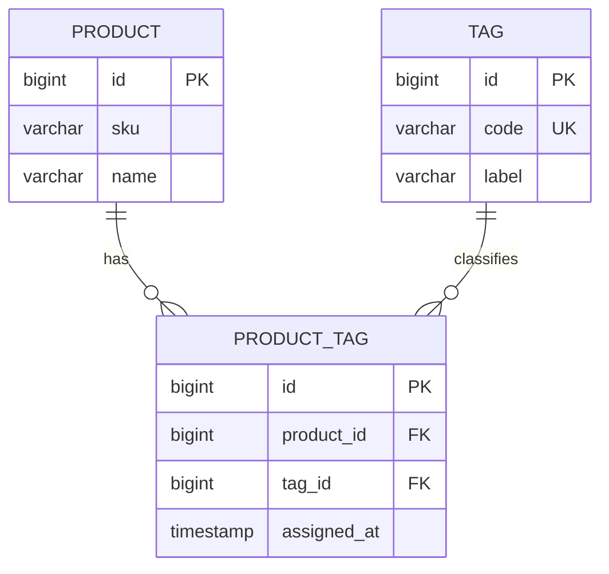

# Modeling Many-to-Many with an Association Aggregate or Join Table

In a store management model, one product can carry many tags, and one tag can be attached to many products. This is a familiar **many-to-many** relationship in relational databases. However, Spring Data JDBC organizes data around aggregate boundaries, so you should not carry over JPA's `@ManyToMany` mindset verbatim.

The right design starts with the lifecycle of the relationship. If the link has its own data and rules, you can model it as an **association aggregate**. If the link is purely a technical join table, you can manage the join table with a custom repository/JDBC. If the link rows are solely one-sided dependent components, they can be a child collection of exactly one aggregate root. This lesson uses `Product` and `Tag` to explain each option.

## 1. From Domain Relationship to Join Table

Suppose a store has:

- `Product`: a product in the catalog.
- `Tag`: a classification label such as `wireless`, `office`, `gaming`.
- One product can have many tags attached.
- One tag can be used for many products.

Relationship:



In a relational model, a many-to-many relationship is typically implemented using a join table `product_tag`. Each row in the join table represents a link between exactly one product and one tag.

Sample data:

| product_id | tag_id | Meaning |
| ---: | ---: | --- |
| 101 | 1 | Product 101 has tag `wireless`. |
| 101 | 2 | Product 101 has tag `office`. |
| 102 | 1 | Product 102 also has tag `wireless`. |
| 103 | 3 | Product 103 has tag `gaming`. |

Do not store a list of IDs as a string like `"1,2,3"` in a single column if you need querying, foreign key checks, or updating individual links. A join table preserves relational integrity and lets the database protect the validity of each pair.

## 2. Aggregate Boundaries in Spring Data JDBC

Spring Data JDBC does not provide an arbitrary JPA-style entity relationship model with `@ManyToMany`. Instead, it focuses on aggregate roots and objects belonging to that aggregate's lifecycle.

With `Product` and `Tag`:

- `Product` is an independent aggregate.
- `Tag` is an independent aggregate.
- The relationship between them is represented by IDs and link data.
- You should not embed the full `Tag` inside `Product` as if the tag were privately owned by the product, because one tag is shared by many products.

An important principle: **each link row should have only one clear aggregate owner**. Do not let both `Product` and `Tag` declare and write the same set of join rows as a child collection. Doing so causes saving one aggregate to overwrite or delete data managed by the other side.

There are three common choices:

| Model | Who owns the link rows? | When suitable |
| --- | --- | --- |
| Independent association aggregate `ProductTag` | The `ProductTag` aggregate itself. | The relationship has attributes, status, behavior, or needs independent management. |
| Child collection of one root | One side, e.g., `Product`. | The link depends only on one root and has no independent lifecycle. |
| Technical join table | Custom repository/JDBC or dedicated SQL. | The relationship is pure membership with no separate domain object needed. |

No single option fits every problem. Choose based on semantics and how the relationship is updated and queried.

## 3. Schema Design for Product, Tag, and ProductTag

PostgreSQL example:

```sql
CREATE TABLE product (
    id BIGINT GENERATED BY DEFAULT AS IDENTITY PRIMARY KEY,
    sku VARCHAR(50) NOT NULL UNIQUE,
    name VARCHAR(180) NOT NULL
);

CREATE TABLE tag (
    id BIGINT GENERATED BY DEFAULT AS IDENTITY PRIMARY KEY,
    code VARCHAR(50) NOT NULL UNIQUE,
    label VARCHAR(100) NOT NULL
);

CREATE TABLE product_tag (
    id BIGINT GENERATED BY DEFAULT AS IDENTITY PRIMARY KEY,
    product_id BIGINT NOT NULL
        REFERENCES product(id) ON DELETE CASCADE,
    tag_id BIGINT NOT NULL
        REFERENCES tag(id) ON DELETE CASCADE,
    assigned_at TIMESTAMPTZ NOT NULL DEFAULT CURRENT_TIMESTAMP,
    CONSTRAINT uq_product_tag UNIQUE (product_id, tag_id)
);

CREATE INDEX idx_product_tag_tag_product
    ON product_tag (tag_id, product_id);
```

Key decisions:

- Two foreign keys ensure every link points to a real product and a real tag.
- `UNIQUE (product_id, tag_id)` prevents attaching the same tag multiple times to the same product.
- A dedicated ID on `product_tag` lets the relationship be managed as an independent aggregate.
- `assigned_at` is an attribute of the link itself, recording when the tag was attached.
- The index `(tag_id, product_id)` supports reverse lookups from a tag to products. The unique constraint on `(product_id, tag_id)` already supports product-first queries; the reverse index serves the opposite direction.

`ON DELETE CASCADE` on both foreign keys means that when a product or tag is deleted, its corresponding link rows are deleted. It does **not delete other tags or other products**. If the business requires preserving link history, use soft delete/audit or another policy instead of physical cascade deletion.

You can choose a composite primary key `(product_id, tag_id)` instead of a surrogate ID. A composite key fits a pure join table well, whereas if you want to use `CrudRepository<ProductTag, Long>` or reference the link as an object with a simple ID, a surrogate `id` key is often more convenient. The unique constraint is still required to protect the link pair.

## 4. Option A: Modeling the Link as a Separate Aggregate

Use `ProductTag` when the relationship has its own business significance. For instance, beyond the two IDs, the link also has:

- Assignment timestamp.
- Creator of the link.
- Display order of the tag on the product.
- Approval status.
- Tagging source or moderation notes.

Then `ProductTag` is not just a technical row, but a domain object with its own lifecycle.

### Association Entity

```java
package com.example.catalog.domain;

import java.time.Instant;

import org.springframework.data.annotation.Id;
import org.springframework.data.relational.core.mapping.Table;

@Table("product_tag")
public record ProductTag(
    @Id Long id,
    Long productId,
    Long tagId,
    Instant assignedAt
) {}
```

Here `productId` and `tagId` are scalar IDs. Spring Data JDBC does not automatically load `Product` and `Tag` when reading a `ProductTag`; the service queries the corresponding aggregates when validation or display requires them.

Repository:

```java
package com.example.catalog.repository;

import java.util.List;
import java.util.Optional;

import com.example.catalog.domain.ProductTag;
import org.springframework.data.repository.CrudRepository;

public interface ProductTagRepository
        extends CrudRepository<ProductTag, Long> {

    List<ProductTag> findByProductId(Long productId);

    List<ProductTag> findByTagId(Long tagId);

    Optional<ProductTag> findByProductIdAndTagId(
        Long productId,
        Long tagId
    );
}
```

`ProductRepository` and `TagRepository` remain separate repositories for their respective aggregate roots. Do not create a repository expecting automatic bidirectional navigation like JPA.

### Service Coordinating Tag Attachment

Service example:

```java
package com.example.catalog.service;

import java.time.Instant;

import com.example.catalog.domain.ProductTag;
import com.example.catalog.repository.ProductRepository;
import com.example.catalog.repository.ProductTagRepository;
import com.example.catalog.repository.TagRepository;

import org.springframework.stereotype.Service;
import org.springframework.transaction.annotation.Transactional;

@Service
public class ProductTagService {

    private final ProductRepository products;
    private final TagRepository tags;
    private final ProductTagRepository links;

    public ProductTagService(
            ProductRepository products,
            TagRepository tags,
            ProductTagRepository links) {
        this.products = products;
        this.tags = tags;
        this.links = links;
    }

    @Transactional
    public ProductTag attach(Long productId, Long tagId) {
        products.findById(productId).orElseThrow();
        tags.findById(tagId).orElseThrow();

        return links.findByProductIdAndTagId(productId, tagId)
            .orElseGet(() -> links.save(
                new ProductTag(null, productId, tagId, Instant.now())
            ));
    }

    @Transactional
    public void detach(Long productId, Long tagId) {
        links.findByProductIdAndTagId(productId, tagId)
            .ifPresent(link -> links.deleteById(link.id()));
    }
}
```

This is an illustrative flow; a production application needs specific business exceptions when a product/tag is missing, caller authorization checks, and handling of unique constraint violations under concurrent requests.

Why use `@Transactional`?

- Checking the existence of both aggregates and creating the link belong to the same business unit.
- If the insert fails, the transaction can roll back operations within the same database/transaction.
- When removing a link, the delete executes in a transaction consistent with related business steps.

However, two concurrent requests can both observe "does not exist" and both insert. Checking in Java alone does not prevent race conditions. The database `UNIQUE (product_id, tag_id)` constraint is the final safeguard; the service should handle duplicates according to an idempotent policy or return an appropriate conflict error.

### When Should ProductTag Be an Aggregate Root?

Choose a separate aggregate if:

- The link has its own behavior and invariants.
- The link needs to be created, approved, canceled, or audited independently.
- There are multiple attributes on the link.
- APIs or business workflows operate directly on individual links.
- You need to query or paginate links as an independent data source.

Do not create an aggregate root just to wrap every join row if the link is purely a technical detail with no rules or independent lifecycle. Each extra aggregate root adds another repository, transaction boundary, and load/save operations to manage.

## 5. Option B: Join Rows as a Child Collection of One Aggregate

If the link depends only on one side—for example, tag assignments are always added/removed through Product management operations—you can keep the link rows as a child collection of `Product`.

In this approach:

- `Product` owns the rows in `product_tag`.
- Each row holds `tagId` to reference the independent `Tag`.
- `Tag` does not declare a reverse collection writing the same rows.
- The repository operates on `Product`; no separate repository is needed for the child link.

Example:

```java
package com.example.catalog.domain;

import org.springframework.data.relational.core.mapping.Table;

@Table("product_tag")
public record ProductTagEntry(
    Long tagId
) {}
```

```java
package com.example.catalog.domain;

import java.util.List;

import org.springframework.data.annotation.Id;
import org.springframework.data.relational.core.mapping.MappedCollection;
import org.springframework.data.relational.core.mapping.Table;

@Table("product")
public record Product(
    @Id Long id,
    String sku,
    String name,
    @MappedCollection(idColumn = "product_id", keyColumn = "position")
    List<ProductTagEntry> tags
) {}
```

Corresponding schema:

```sql
CREATE TABLE product (
    id BIGINT GENERATED BY DEFAULT AS IDENTITY PRIMARY KEY,
    sku VARCHAR(50) NOT NULL UNIQUE,
    name VARCHAR(180) NOT NULL
);

CREATE TABLE tag (
    id BIGINT GENERATED BY DEFAULT AS IDENTITY PRIMARY KEY,
    code VARCHAR(50) NOT NULL UNIQUE,
    label VARCHAR(100) NOT NULL
);

CREATE TABLE product_tag (
    product_id BIGINT NOT NULL REFERENCES product(id) ON DELETE CASCADE,
    position INTEGER NOT NULL,
    tag_id BIGINT NOT NULL REFERENCES tag(id),
    PRIMARY KEY (product_id, position),
    UNIQUE (product_id, tag_id)
);
```

`@MappedCollection` maps the child collection to rows in `product_tag`, with `product_id` as the link column to the root and `position` as the list element key/index. `tag_id` remains only a reference ID; Spring Data JDBC does not auto-load the Tag object.

This approach works well when modifying the tag list always means modifying the `Product` aggregate. When saving `Product`, Spring Data JDBC manages the child collection according to the aggregate lifecycle; updating the collection can cause child rows to be deleted and re-inserted. If the list is very large or you only need to add/remove a single link, consider efficiency and opt for an association aggregate or a custom repository operating on a single row.

**What to avoid:** never let both `Product` and `Tag` own `product_tag` simultaneously. One side owns the collection; the other side only references by ID and queries via repository/SQL when needed.

## 6. Option C: Pure Join Table via Custom Repository/JDBC

If the join table only expresses membership and has no attributes or separate domain lifecycle, you may not need a `ProductTag` domain object. A custom repository using `JdbcTemplate` operates directly on the join table.

Example:

```java
@Repository
public class ProductTagJdbcRepository {

    private final JdbcTemplate jdbc;

    public ProductTagJdbcRepository(JdbcTemplate jdbc) {
        this.jdbc = jdbc;
    }

    public int attach(long productId, long tagId) {
        return jdbc.update("""
            INSERT INTO product_tag (product_id, tag_id)
            VALUES (?, ?)
            """, productId, tagId);
    }

    public int detach(long productId, long tagId) {
        return jdbc.update("""
            DELETE FROM product_tag
            WHERE product_id = ? AND tag_id = ?
            """, productId, tagId);
    }

    public List<Long> findTagIds(long productId) {
        return jdbc.queryForList("""
            SELECT tag_id
            FROM product_tag
            WHERE product_id = ?
            ORDER BY tag_id
            """, Long.class, productId);
    }
}
```

This example uses a pure join-table schema with primary/unique key `(product_id, tag_id)` and no dedicated ID or `assigned_at`. If the database uses a separate schema, include the schema name in SQL or use an agreed schema/search path mechanism.

Advantages:

- Clear SQL that only inserts or deletes the exact link needed.
- No need to load the entire aggregate just to add one join row.
- Can use database-specific SQL for optimization or idempotency.

Trade-offs:

- The application layer manages SQL, parameters, and results manually.
- Does not receive automatic aggregate mapping for the join table.
- Must ensure custom JDBC uses the same transaction manager/datasource as other repositories if business logic needs a shared transaction.
- Must not update the join table via custom JDBC at the same time a collection mapping also owns the same rows.

In PostgreSQL, `ON CONFLICT DO NOTHING` can make attach operations idempotent; that syntax is vendor-specific. If portability is required, handle unique violations appropriately for the database or use a controlled general mechanism.

## 7. Comparing the Three Approaches

| Criterion | Independent association aggregate | Child collection on Product | Custom join table |
| --- | --- | --- | --- |
| Domain class for the link | Yes, `ProductTag`. | Yes, child entry. | Not required. |
| Dedicated repository | Yes. | No; manipulated via Product root. | Adapter/custom repository. |
| Link has its own attributes | Very suitable. | Possible if still owned by Product. | Possible, though SQL/DTO must be managed manually. |
| Updating a single link | Via the association repository. | May require saving the Product aggregate again. | Direct SQL, usually concise. |
| Lifecycle boundary | Independent link. | Dependent on Product. | Managed inside the adapter. |
| Bidirectional queries | Derived queries by productId/tagId or SQL. | Usually needs SQL query for reverse direction. | Write queries as needed. |
| Link-specific business rules | Clearly expressed in association service/domain. | Placed in Product aggregate/service. | Placed in service and database. |
| Best suited for | Relationships with domain meaning. | Relationships dependent on one root. | Pure membership needing direct join-row operations. |

A practical rule of thumb:

- Has `assignedAt`, `role`, `position`, status, or separate auditing: consider an association aggregate.
- Join rows only exist within a single Product and are updated together with Product: a child collection can fit.
- Relationship is simply an ID pair to add/remove/query: a join table and custom JDBC are usually simpler.

## 8. Querying Many-to-Many in Both Directions

With a join table, finding a product's tags:

```sql
SELECT t.id, t.code, t.label
FROM tag t
JOIN product_tag pt ON pt.tag_id = t.id
WHERE pt.product_id = :productId
ORDER BY t.code;
```

Finding products with a specific tag:

```sql
SELECT p.id, p.sku, p.name
FROM product p
JOIN product_tag pt ON pt.product_id = p.id
WHERE pt.tag_id = :tagId
ORDER BY p.name;
```

If you want products having **all** tags in a list, the query must group and count matching tags:

```sql
SELECT p.id, p.sku, p.name
FROM product p
JOIN product_tag pt ON pt.product_id = p.id
WHERE pt.tag_id IN (:tagIds)
GROUP BY p.id, p.sku, p.name
HAVING COUNT(DISTINCT pt.tag_id) = :requestedTagCount;
```

How collection parameters are bound to `IN (:tagIds)` depends on the `NamedParameterJdbcTemplate`/driver API; the SQL above illustrates logic rather than exact parameter syntax for every JDBC template. When the input list is empty, handle it separately in the service since `IN ()` is invalid SQL in many databases.

Join query results for display usually fit a DTO/projection rather than a full aggregate. DTO example:

```java
public record ProductTagView(
    Long productId,
    String productName,
    Long tagId,
    String tagCode,
    String tagLabel
) {}
```

A custom repository can use a `RowMapper<ProductTagView>` to map each joined row. This avoids trying to build a many-to-many object graph outside aggregate boundaries.

## 9. Safely Deleting and Updating Relationships

Deleting a link does not mean deleting either of the linked aggregates. If removing tag `wireless` from product 101, the operation only deletes row `(101, wirelessTagId)` from the join table.

```sql
DELETE FROM product_tag
WHERE product_id = 101
  AND tag_id = 1;
```

Both `product` and `tag` records remain intact. When deleting a product or tag, the FK policy determines whether link rows are cascaded, blocked, or must be handled manually.

If the relationship has state or history, do not hard-delete when the user only wants to unlink. You can add `removed_at`, `status`, or an audit table as required. In that case, the unique constraint may need redesigning to allow multiple attach/detach records over time while still permitting only one active link.

When using an association aggregate, update operations should pass through the service responsible for invariants—for example, allowing only active tags to be attached, or disallowing tags from a restricted group. Do not put all that logic in controllers or rely solely on foreign keys.

## 10. Transactions, Race Conditions, and Consistency

An attach operation might include:

1. Verifying that Product exists and is allowed to be edited.
2. Verifying that Tag exists and is active.
3. Checking whether the link already exists.
4. Creating the link row.
5. Recording audit/events if business logic requires.

If these operations use the same database, a transaction boundary can be placed at the service:

```java
@Transactional
public void attachTag(Long productId, Long tagId) {
    // Load/validate product.
    // Load/validate tag.
    // Insert association row.
    // Persist any related database state.
}
```

A transaction guarantees that participating operations commit or roll back together. However, a transaction at the default isolation level does not guarantee two concurrent requests won't create the same link. Both can read that the `(product_id, tag_id)` pair does not exist and then both insert.

Therefore, combine:

- `UNIQUE(product_id, tag_id)` in the database.
- Handling duplicate/unique violations in the service per API policy.
- Optionally dialect-specific idempotent inserts if business rules allow.
- Optimistic locking or appropriate locks if concurrent operations also change another aggregate's state.

Do not replace the unique constraint with `if (!exists) save(...)` in Java. That check helps UX and idempotency, but it is insufficient against race conditions.

## 11. Common Design Mistakes

| Mistake | Consequence | Adjustment |
| --- | --- | --- |
| Using `@ManyToMany` like JPA in Spring Data JDBC | Expecting relationship mapping not provided in that manner. | Use scalar IDs, a join table, or an association aggregate. |
| Embedding full Tag inside Product | Product pulls in objects belonging to an independent aggregate. | Store `tagId` in the link. |
| Product and Tag both owning the join-row collection | Two aggregates writing the same dataset. | Pick only one owner or create a separate association root. |
| Missing unique constraint on the ID pair | Duplicate links can be created. | Add `UNIQUE(product_id, tag_id)`. |
| Checking existence only in Java | Race conditions can still create duplicates. | Use database constraints and error handling. |
| Deleting ProductTag and also deleting Product/Tag | Can delete source data unintentionally. | Delete only link rows on detach; configure FK cascade by policy. |
| Child collection grows too large | Each root save can trigger many child-row sync operations. | Consider an association aggregate or custom SQL per link. |
| Running a join query and mapping into full aggregates | Results may miss columns or mismatch aggregate boundaries. | Use DTO/projection/RowMapper for read views. |
| Join table has business attributes yet is treated as a pure link | No clear place to manage link status/audit/rules. | Model `ProductTag` as an association aggregate. |

## 12. Practice Exercise on the Product–Tag Model

Follow these steps in order:

1. Create three tables `product`, `tag`, `product_tag` with FKs and a unique constraint.
2. Create two aggregate roots `Product` and `Tag` with separate repositories.
3. Create `ProductTag` as an association aggregate storing both IDs and the attachment timestamp.
4. Write transactional attach/detach service methods; test missing product/tag cases.
5. Attach the same tag to two products; verify one tag is shared rather than duplicated into two aggregates.
6. Try attaching the same pair twice; check the unique constraint and idempotency policy.
7. Query tags by product and products by tag with joins; map results to a DTO.
8. Delete a link and confirm both original aggregates remain.
9. Try deleting a Product or Tag to observe FK cascade behavior per the DDL.
10. Compare an association root with a custom repository using `JdbcTemplate`; choose one clear ownership model for join rows and avoid writing the same table via two uncoordinated paths.

You can extend the exercise with `assignedBy`, `position`, or `status` attributes on the link to see when a pure join table starts carrying domain meaning and should become an association aggregate.

## 13. Self-Check Questions

- Why shouldn't Spring Data JDBC be modeled like JPA `@ManyToMany`?
- What foreign keys does a many-to-many join table have, and why is a unique constraint on the key pair needed?
- When should `ProductTag` be an independent aggregate root?
- When can join rows be a child collection of `Product`?
- Why shouldn't `Tag` also own the same link rows simultaneously?
- When is a custom repository with `JdbcTemplate` simpler than an association entity?
- How do you query in both directions without loading the full aggregate graph?
- Does a transaction prevent two requests from creating the same link? Which constraint protects against this?
- When deleting a link, why must you not also delete Product or Tag?
- If the join table has status and history, how should the schema change?

Many-to-many modeling in Spring Data JDBC begins with the question: **who owns the lifecycle of the link row?** If the link has its own rules, give it an aggregate root. If it depends on one side, make it a child collection of that root. If it is purely a technical join table, operate on it via a custom repository/SQL. Whichever choice you make, ID references, foreign keys, unique constraints, and transactions must accurately reflect business rules.
