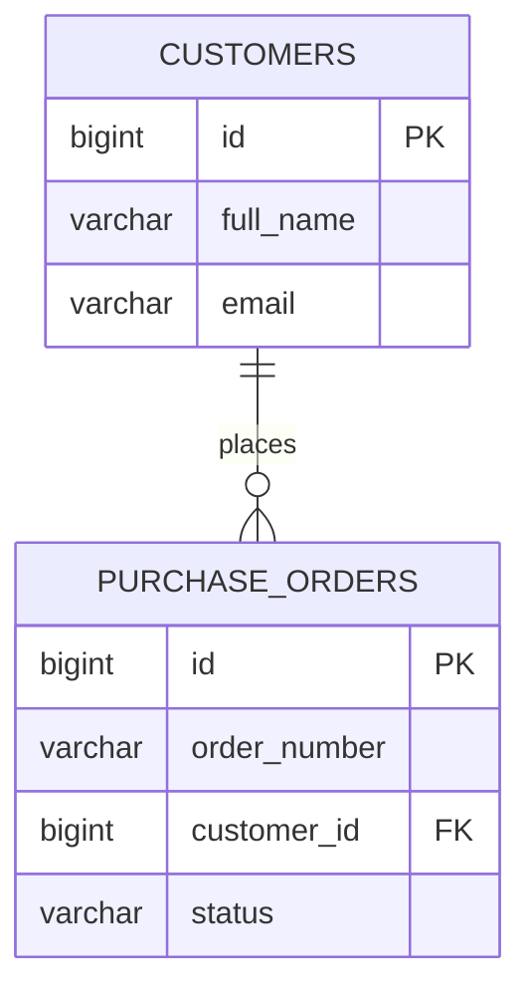

# Explicitly Loading Related Data via Repository or Read Query

In **Spring Data Relational JDBC**, an aggregate root is the boundary that Spring Data JDBC manages when reading and writing data. When an aggregate references another aggregate, that reference usually stores only the **ID** of the referenced aggregate. Loading the related object is therefore an explicit decision made by the application.

For example, a `PurchaseOrder` stores `customerId` to reference `Customer`. When calling `orderRepository.findById(id)`, the application receives the order according to that aggregate's mapping. If the customer's name and email are needed, the service can next call `customerRepository.findById(customerId)`. If a report screen needs to combine orders, customers, and total amounts, a read query using JOIN may be more suitable.

This lesson presents two approaches for loading related data:

1. **Repository loading:** loading the related aggregate using its own repository.
2. **Read query:** writing a read query combining multiple tables and mapping results into a DTO/read model.

The choice depends on whether the application needs to work with **domain aggregates** or needs a **read data shape** aggregated from multiple tables.

## 1. An Aggregate Reference Does Not Mean an Auto-Loaded Object Graph

Suppose a sales system has two aggregates:

- `Customer`: customer information, managed independently.
- `PurchaseOrder`: order, referencing the customer who placed it.



A simple Java model:

```java
@Table("customers")
public record Customer(
    @Id Long id,
    String fullName,
    String email
) {}

@Table("purchase_orders")
public record PurchaseOrder(
    @Id Long id,
    String orderNumber,
    @Column("customer_id") Long customerId,
    String status
) {}
```

`customerId` is the reference value pointing to `Customer`'s primary key. When loading `PurchaseOrder`, Spring Data JDBC reads the `customer_id` column as an ID value; it does not automatically load the full `Customer` object via lazy-loading proxies as commonly seen in JPA.

This is intentional. Spring Data JDBC does not maintain a persistence context with implicitly loaded object graphs. An aggregate is read according to its mapping; data from another aggregate is explicitly requested by the application when needed.

### 1.1. Referencing by ID

```java
PurchaseOrder order = orderRepository.findById(42L)
    .orElseThrow();

Long customerId = order.customerId();

Customer customer = customerRepository.findById(customerId)
    .orElseThrow();
```

Both read operations are explicit: read the order by ID, then read the customer by the ID stored in the order. No hidden SQL statement is triggered simply because the service calls `order.customerId()`; that merely reads an ID value already present on the object.

If an aggregate needs to reference multiple other aggregates, each reference can still be stored as an ID. The application chooses when to load and how much data to fetch.

### 1.2. Using AggregateReference to Express Relationships

Spring Data JDBC provides `AggregateReference` to represent a typed reference to another aggregate:

```java
import org.springframework.data.jdbc.core.mapping.AggregateReference;

@Table("purchase_orders")
public record PurchaseOrder(
    @Id Long id,
    String orderNumber,

    @Column("customer_id")
    AggregateReference<Customer, Long> customer,

    String status
) {}
```

Creating a reference:

```java
PurchaseOrder order = new PurchaseOrder(
    null,
    "ORD-0042",
    AggregateReference.to(7L),
    "NEW"
);
```

`AggregateReference<Customer, Long>` expresses that the property references the `Customer` aggregate using a `Long` ID. It **does not mean** Spring Data JDBC will automatically load `Customer` when loading `PurchaseOrder`.

For simple applications, an ID property like `Long customerId` can also fit well. `AggregateReference` is useful when you want to clearly express the target aggregate type and reference semantics in the domain model.

### 1.3. Distinguishing from Objects in the Same Aggregate

| Data kind | Common representation | When reading the aggregate root |
|---|---|---|
| Value object embedded in the same row | `@Embedded` | Columns are read from the same row |
| Child entity belonging to the same aggregate | Aggregate relationship mapping, e.g., collection of order lines | Loaded according to aggregate mapping rules |
| Another aggregate root | ID or `AggregateReference` | Only holds reference; content must be loaded separately |
| Read model combining multiple aggregates | DTO/projection from read query | Loads only the queried columns and rows |

This boundary matters when designing repositories. If `Customer` is an independent aggregate, do not treat it as a child entity merely because `PurchaseOrder` has a `customer_id` foreign key.

## 2. Declaring a Repository per Aggregate

With a two-aggregate model, each aggregate has its own repository:

```java
import org.springframework.data.repository.CrudRepository;

public interface CustomerRepository
        extends CrudRepository<Customer, Long> {
}

public interface PurchaseOrderRepository
        extends CrudRepository<PurchaseOrder, Long> {
}
```

A service can coordinate them:

```java
import org.springframework.stereotype.Service;
import org.springframework.transaction.annotation.Transactional;

@Service
public class OrderQueryService {

    private final PurchaseOrderRepository orders;
    private final CustomerRepository customers;

    public OrderQueryService(
            PurchaseOrderRepository orders,
            CustomerRepository customers) {
        this.orders = orders;
        this.customers = customers;
    }

    @Transactional(readOnly = true)
    public OrderWithCustomer findOrder(long orderId) {
        PurchaseOrder order = orders.findById(orderId)
            .orElseThrow(() -> new IllegalArgumentException("Order not found"));

        Customer customer = customers.findById(order.customerId())
            .orElseThrow(() -> new IllegalArgumentException("Customer not found"));

        return new OrderWithCustomer(order, customer);
    }
}
```

Result DTO:

```java
public record OrderWithCustomer(
    PurchaseOrder order,
    Customer customer
) {}
```

This approach fits when you need the full domain objects of each aggregate, want to leverage their repository/mapping logic, or need to run business logic involving both the order and the customer. Placing these calls in the service keeps orchestration at the application layer; the `PurchaseOrder` repository does not need to know how to load every detail of `Customer`.

## 3. Explicitly Loading Multiple Aggregates via Repository

A common scenario is displaying a list of orders alongside customer details. The simplest approach is loading each customer per order, but that can create performance issues.

### 3.1. Loading Each ID in a Loop

```java
List<PurchaseOrder> orders = loadOrders();

List<OrderWithCustomer> result = new ArrayList<>();

for (PurchaseOrder order : orders) {
    Customer customer = customerRepository
        .findById(order.customerId())
        .orElseThrow();

    result.add(new OrderWithCustomer(order, customer));
}
```

If there is 1 query to load the list of orders and N queries to load N customers, the total query count can be `1 + N`. This is commonly called the **N+1 queries** problem. With a list of 100 orders belonging to 100 customers, the service could issue 1 query for orders and 100 queries for customers.

N+1 is not always a bug: for a handful of records, reading by ID is very straightforward. But as lists grow, network latency, connection usage, and database load can rise significantly.

### 3.2. Using findAllById for Batch Loading

`CrudRepository` provides `findAllById(Iterable<ID>)`. We can collect unique customer IDs and load them at once:

```java
import java.util.ArrayList;
import java.util.HashMap;
import java.util.HashSet;
import java.util.List;
import java.util.Map;
import java.util.Set;

public List<OrderWithCustomer> loadOrdersWithCustomers() {
    List<PurchaseOrder> orders = loadOrders();

    Set<Long> customerIds = new HashSet<>();
    for (PurchaseOrder order : orders) {
        customerIds.add(order.customerId());
    }

    Map<Long, Customer> customerById = new HashMap<>();

    for (Customer customer : customerRepository.findAllById(customerIds)) {
        customerById.put(customer.id(), customer);
    }

    List<OrderWithCustomer> result = new ArrayList<>();

    for (PurchaseOrder order : orders) {
        Customer customer = customerById.get(order.customerId());

        if (customer == null) {
            throw new IllegalStateException(
                "Missing customer " + order.customerId()
            );
        }

        result.add(new OrderWithCustomer(order, customer));
    }

    return result;
}
```

The logical query count typically drops to one query loading orders and one operation loading customers whose IDs are in the set. The underlying implementation may split queries depending on driver/database limits.

`findAllById` returns the matched entities; do not rely on the result order matching the input ID order. Therefore, the example builds a `Map<Long, Customer>` keyed by ID and joins them back in the original order sequence.

### 3.3. Deduplicating IDs

Multiple orders can belong to the same customer. Using a `Set` ensures each ID is sent only once in the query:

```java
Set<Long> customerIds = orders.stream()
    .map(PurchaseOrder::customerId)
    .collect(Collectors.toSet());
```

If `customerId` can be null in your data model, explicitly decide how to handle nulls before calling `findAllById`. For required foreign keys, a `NOT NULL` schema constraint and domain validation should prevent missing-reference states.

### 3.4. Limiting Batch Size

Putting all IDs into a single query is not always suitable. Databases and drivers have limits on the number of bind parameters or SQL statement size. For very large lists:

- Split IDs into reasonably sized batches.
- Use paged or ID-range read queries.
- Consider a JOIN query if the result is actually a read model.
- Measure performance on the target database and driver.

Batch loading avoids one query per row, though there is no universal optimal batch size for all systems.

## 4. Repository Queries to Load Filtered Aggregates

It is not always necessary to load everything and filter in Java. You can declare query methods so the database returns only relevant aggregates.

For example, finding orders by customer:

```java
import java.util.List;
import org.springframework.data.repository.CrudRepository;

public interface PurchaseOrderRepository
        extends CrudRepository<PurchaseOrder, Long> {

    List<PurchaseOrder> findByCustomerId(Long customerId);

    List<PurchaseOrder> findByStatus(String status);
}
```

Derived query methods are parsed by Spring Data from the property path to generate the appropriate query. The reference column remains an ID; the result consists of `PurchaseOrder` aggregates without automatically attaching full `Customer` objects.

### 4.1. Using @Query When Explicit SQL Is Needed

If conditions are complex or need specific SQL syntax, you can declare a query explicitly:

```java
import java.util.List;
import org.springframework.data.jdbc.repository.query.Query;
import org.springframework.data.repository.CrudRepository;
import org.springframework.data.repository.query.Param;

public interface PurchaseOrderRepository
        extends CrudRepository<PurchaseOrder, Long> {

    @Query("""
        SELECT id, order_number, customer_id, status
        FROM purchase_orders
        WHERE customer_id = :customerId
          AND status = :status
        ORDER BY id DESC
        """)
    List<PurchaseOrder> findCustomerOrders(
        @Param("customerId") Long customerId,
        @Param("status") String status
    );
}
```

When a query returns the `PurchaseOrder` aggregate, it must select all columns required to map that aggregate. Do not omit `customer_id` or other required columns simply because the current screen does not display them.

If only a few fields are needed for display, a DTO/read model is usually better than loading an entity and discarding most of its data.

## 5. Read Queries Combining Multiple Aggregates via JOIN

A list screen might need the order ID and number, status, customer name, and total amount. This is data combined from multiple tables, yet the screen does not necessarily need full Java aggregates. You can write a **read query** using JOIN and return a DTO.

### 5.1. Illustrative Schema

```sql
CREATE TABLE customers (
    id BIGINT PRIMARY KEY,
    full_name VARCHAR(120) NOT NULL,
    email VARCHAR(255) NOT NULL
);

CREATE TABLE purchase_orders (
    id BIGINT PRIMARY KEY,
    order_number VARCHAR(40) NOT NULL,
    customer_id BIGINT NOT NULL REFERENCES customers(id),
    status VARCHAR(20) NOT NULL
);

CREATE TABLE order_items (
    order_id BIGINT NOT NULL REFERENCES purchase_orders(id),
    product_id BIGINT NOT NULL,
    quantity INTEGER NOT NULL CHECK (quantity > 0),
    unit_price NUMERIC(19, 2) NOT NULL CHECK (unit_price >= 0),
    PRIMARY KEY (order_id, product_id)
);
```

### 5.2. JOIN and Aggregation

```sql
SELECT
    o.id AS order_id,
    o.order_number,
    o.status,
    c.full_name AS customer_name,
    COALESCE(SUM(oi.quantity * oi.unit_price), 0) AS total_amount
FROM purchase_orders o
JOIN customers c
    ON c.id = o.customer_id
LEFT JOIN order_items oi
    ON oi.order_id = o.id
GROUP BY
    o.id,
    o.order_number,
    o.status,
    c.full_name
ORDER BY o.id DESC;
```

Meaning:

- `JOIN customers` fetches the customer's name from the other aggregate.
- `LEFT JOIN order_items` retains orders without line items.
- `SUM(quantity * unit_price)` computes the line total.
- `COALESCE(..., 0)` turns an empty sum into 0.
- `GROUP BY` produces one result row per order.

This query is a **read model**. It does not mean `PurchaseOrder` is loaded with the entire `Customer` or saved as a single aggregate.

### 5.3. Mapping to a DTO with NamedParameterJdbcTemplate

```java
import java.math.BigDecimal;

public record OrderSummary(
    long orderId,
    String orderNumber,
    String status,
    String customerName,
    BigDecimal totalAmount
) {}
```

Read repository:

```java
import java.util.List;
import java.util.Map;
import org.springframework.jdbc.core.namedparam.NamedParameterJdbcTemplate;
import org.springframework.stereotype.Repository;

@Repository
public class OrderSummaryRepository {

    private final NamedParameterJdbcTemplate jdbc;

    public OrderSummaryRepository(NamedParameterJdbcTemplate jdbc) {
        this.jdbc = jdbc;
    }

    public List<OrderSummary> findAllSummaries() {
        String sql = """
            SELECT
                o.id AS order_id,
                o.order_number,
                o.status,
                c.full_name AS customer_name,
                COALESCE(
                    SUM(oi.quantity * oi.unit_price),
                    0
                ) AS total_amount
            FROM purchase_orders o
            JOIN customers c ON c.id = o.customer_id
            LEFT JOIN order_items oi ON oi.order_id = o.id
            GROUP BY
                o.id, o.order_number, o.status, c.full_name
            ORDER BY o.id DESC
            """;

        return jdbc.query(
            sql,
            Map.of(),
            (rs, rowNum) -> new OrderSummary(
                rs.getLong("order_id"),
                rs.getString("order_number"),
                rs.getString("status"),
                rs.getString("customer_name"),
                rs.getBigDecimal("total_amount")
            )
        );
    }
}
```

Use `getBigDecimal` for `NUMERIC` columns to preserve exact decimal precision; avoid converting monetary totals through `double`.

This class uses Spring JDBC because it executes a read query with JOIN/GROUP BY and the result is not a pure aggregate root. This provides a clean separation between repositories managing aggregates and repositories dedicated to reading reports.

### 5.4. Parameterized Queries

When filtering by status or customer, bind parameters instead of concatenating strings:

```java
public List<OrderSummary> findByStatus(String status) {
    String sql = """
        SELECT
            o.id AS order_id,
            o.order_number,
            o.status,
            c.full_name AS customer_name,
            COALESCE(SUM(oi.quantity * oi.unit_price), 0) AS total_amount
        FROM purchase_orders o
        JOIN customers c ON c.id = o.customer_id
        LEFT JOIN order_items oi ON oi.order_id = o.id
        WHERE o.status = :status
        GROUP BY
            o.id, o.order_number, o.status, c.full_name
        ORDER BY o.id DESC
        """;

    return jdbc.query(
        sql,
        Map.of("status", status),
        (rs, rowNum) -> new OrderSummary(
            rs.getLong("order_id"),
            rs.getString("order_number"),
            rs.getString("status"),
            rs.getString("customer_name"),
            rs.getBigDecimal("total_amount")
        )
    );
}
```

`:status` is a named bind parameter. Never concatenate request input directly into the SQL string. If table/column names or sort directions must vary, identifiers cannot be bound like ordinary values; select them from an application allowlist.

## 6. A JOIN Query Can Produce Multiple Rows per Aggregate

In a one-to-many JOIN, an order with multiple line items produces multiple intermediate rows. For example:

```sql
SELECT o.id, o.order_number, oi.product_id, oi.quantity
FROM purchase_orders o
JOIN order_items oi ON oi.order_id = o.id
WHERE o.id = 42;
```

If order 42 has three line items, the result contains three rows all having `o.id = 42`. That is normal for SQL JOINs.

When the goal is one `OrderSummary` per order, use `GROUP BY` and aggregate functions like `SUM`. When the goal is a detail list, you can map each row to a detail line and group in Java.

### 6.1. Avoiding Duplicate Counting or Summing When Joining Multiple Child Sets

Suppose an order has many `order_items` and many `order_notes`. Joining both child sets directly causes each item to pair with every note; intermediate rows multiply by the product of counts. Then `SUM(oi.quantity * oi.unit_price)` can get inflated.

You can aggregate each child set first and then JOIN:

```sql
WITH item_totals AS (
    SELECT order_id,
           SUM(quantity * unit_price) AS total_amount
    FROM order_items
    GROUP BY order_id
),
note_counts AS (
    SELECT order_id,
           COUNT(*) AS total_notes
    FROM order_notes
    GROUP BY order_id
)
SELECT
    o.id,
    COALESCE(it.total_amount, 0) AS total_amount,
    COALESCE(nc.total_notes, 0) AS total_notes
FROM purchase_orders o
LEFT JOIN item_totals it ON it.order_id = o.id
LEFT JOIN note_counts nc ON nc.order_id = o.id;
```

This technique keeps each child table at the right level of aggregation before combining. Always clarify the *grain* of the result: one row per order, per line item, or per note.

## 7. Reading Aggregates and Reading Projections Serve Different Purposes

| Application need | Suitable result | Loading approach |
|---|---|---|
| Edit order details | `PurchaseOrder` aggregate | `PurchaseOrderRepository.findById` |
| Execute business logic on a customer | `Customer` aggregate | `CustomerRepository.findById` |
| List of orders with customer name | `OrderSummary` DTO | JOIN query/read repository |
| Total revenue by status | Aggregated DTO/projection | GROUP BY query |
| Single order details including child lines in the same aggregate | Aggregate root and mapped child entities | Aggregate repository |
| List of many orders with customers | Aggregates + batch-loaded customers or JOIN projection | Choose based on intended usage |

A useful guideline: **if you intend to modify and save an aggregate, load the aggregate; if you only need to present combined data, consider a read model.**

Do not load a huge object graph just to display three columns on screen. Conversely, do not fetch a trimmed-down DTO and substitute it for an aggregate when performing state-changing business updates.

## 8. Organizing Services: Orchestration at the Application Layer

The service can choose the loading strategy per use case.

### 8.1. One Aggregate and One Reference

```java
@Transactional(readOnly = true)
public OrderWithCustomer getOrder(long orderId) {
    PurchaseOrder order = orders.findById(orderId)
        .orElseThrow(() -> new OrderNotFoundException(orderId));

    Customer customer = customers.findById(order.customerId())
        .orElseThrow(() -> new CustomerNotFoundException(order.customerId()));

    return new OrderWithCustomer(order, customer);
}
```

This is simple and readable when loading a single order and a single customer.

### 8.2. List of Aggregates with Batch Loading

```java
@Transactional(readOnly = true)
public List<OrderWithCustomer> getOrdersWithCustomers() {
    List<PurchaseOrder> orders = loadCurrentPageOfOrders();

    Set<Long> customerIds = orders.stream()
        .map(PurchaseOrder::customerId)
        .collect(Collectors.toSet());

    Map<Long, Customer> customerById = new HashMap<>();

    for (Customer customer : customers.findAllById(customerIds)) {
        customerById.put(customer.id(), customer);
    }

    return orders.stream()
        .map(order -> {
            Customer customer = customerById.get(order.customerId());

            if (customer == null) {
                throw new IllegalStateException(
                    "Customer reference cannot be resolved"
                );
            }

            return new OrderWithCustomer(order, customer);
        })
        .toList();
}
```

This illustrates service-level orchestration. It can be extracted into a helper or a dedicated query service when related-data loading logic is reused.

### 8.3. Read Model for List Views

```java
@Transactional(readOnly = true)
public List<OrderSummary> getOrderSummaries() {
    return orderSummaryRepository.findAllSummaries();
}
```

The list screen does not load individual aggregates itself. The query selects exactly the needed columns and returns the appropriate DTO.

## 9. Transactions and Consistency When Loading from Multiple Sources

When a service calls two repositories sequentially, both `SELECT` statements can participate in the same transaction if called within the same transaction context using the same datasource/transaction manager.

```java
@Transactional(readOnly = true)
public OrderWithCustomer load(long orderId) {
    PurchaseOrder order = orders.findById(orderId).orElseThrow();
    Customer customer = customers.findById(order.customerId()).orElseThrow();

    return new OrderWithCustomer(order, customer);
}
```

However, `readOnly = true` does not mean every database automatically gives an immutable snapshot across all queries. Actual isolation depends on the transaction manager and DBMS. Under default `READ COMMITTED` isolation, data can change between two `SELECT` statements in the same transaction depending on the database.

If a screen must reflect a consistent snapshot, consider the isolation level, a single JOIN query, or a suitable snapshot reading strategy. Do not assume that wrapping two repository calls in one transaction always guarantees they observe the exact same version of data.

### 9.1. Related Data May Disappear or Become Invalid

Even when tables use foreign keys, referenced data can change due to delete policies, soft-delete status, or historical data rules. The service must define how to handle missing related aggregates:

- Report a data-inconsistency error.
- Display a deleted/hidden reference state if business rules permit.
- Use a snapshot of data captured at transaction time—for example, storing the customer name on the order if invoice history must keep the name at purchase time.

Not every screen should fetch current customer details. Historical invoices usually need to retain the name/address snapshot from issuance time, whereas a customer admin screen may need current data.

## 10. Pagination When Loading Related Data

For large lists, paginate the aggregate root before loading related data.

### 10.1. Loading a Page of Orders Then Batching Customers

A common workflow:

1. Load a page of `PurchaseOrder` in a stable order.
2. Collect customer IDs present in that page.
3. Call `CustomerRepository.findAllById` once (or in batches if too large).
4. Join data using an ID-keyed map.

Avoid loading all orders first and collecting IDs if the table can grow to hundreds of thousands of rows.

### 10.2. Caution with LIMIT/OFFSET After a One-to-Many JOIN

```sql
SELECT o.id, o.order_number, oi.product_id
FROM purchase_orders o
LEFT JOIN order_items oi ON oi.order_id = o.id
ORDER BY o.id
LIMIT 20 OFFSET 0;
```

`LIMIT 20` limits **joined rows**, not 20 orders. If an order has multiple line items, the page may contain fewer than 20 orders or truncate some lines of the last order.

A safe approach is paginating root IDs first:

```sql
WITH page_orders AS (
    SELECT id
    FROM purchase_orders
    ORDER BY id DESC
    LIMIT :pageSize OFFSET :offset
)
SELECT o.id, o.order_number, oi.product_id, oi.quantity
FROM page_orders p
JOIN purchase_orders o ON o.id = p.id
LEFT JOIN order_items oi ON oi.order_id = o.id
ORDER BY o.id DESC, oi.product_id;
```

If using keyset pagination, you can replace `OFFSET` with predicates on the sort key and ID. The key rule is **paginate on the root set**, then expand to child rows.

## 11. Indexes and Read Query Performance

When loading related aggregates by ID, primary key columns are already indexed in most standard schemas. When finding orders by `customer_id`, consider an index:

```sql
CREATE INDEX idx_purchase_orders_customer_id
    ON purchase_orders(customer_id);
```

If frequently filtering by both customer and status:

```sql
CREATE INDEX idx_purchase_orders_customer_status
    ON purchase_orders(customer_id, status);
```

Indexes should be based on real workloads and execution plans. Do not index every column because indexes consume storage and add `INSERT`/`UPDATE`/`DELETE` overhead.

For JOINs, check whether join columns are properly indexed, filters are selective, joins unexpectedly multiply intermediate rows, and queries return unused columns. Use `EXPLAIN`/`EXPLAIN ANALYZE` for your DBMS to inspect query plans when optimizing. Measure on realistic data volumes; a query that runs fast on 10 rows says little about performance at millions of rows.

## 12. Organizing Read Repositories and Custom Queries

A clean layout keeps aggregate repositories and read repositories separate:

```text
application/
  order/
    PurchaseOrderRepository.java
    CustomerRepository.java
    OrderQueryService.java
    OrderWithCustomer.java
    read/
      OrderSummaryRepository.java
      OrderSummary.java
```

- `PurchaseOrderRepository` manages the order aggregate.
- `CustomerRepository` manages the customer aggregate.
- `OrderQueryService` coordinates explicit loading via repositories.
- `OrderSummaryRepository` runs multi-table read queries and maps DTOs.
- `OrderSummary` is a read result, not an aggregate for saving.

Package names and folder layout can vary by project; what matters is not mixing aggregate management responsibilities with reporting reads when the two flows have different requirements.

### 12.1. Custom Repository Fragments

If a complex read query belongs closely to the order context, you can create a fragment:

```java
public interface PurchaseOrderReadOperations {
    List<OrderSummary> findSummariesForStatus(String status);
}
```

```java
@Repository
public class PurchaseOrderReadOperationsImpl
        implements PurchaseOrderReadOperations {

    private final NamedParameterJdbcTemplate jdbc;

    public PurchaseOrderReadOperationsImpl(
            NamedParameterJdbcTemplate jdbc) {
        this.jdbc = jdbc;
    }

    @Override
    public List<OrderSummary> findSummariesForStatus(String status) {
        // Execute SQL JOIN and map OrderSummary here.
        return List.of();
    }
}
```

```java
public interface PurchaseOrderRepository
        extends CrudRepository<PurchaseOrder, Long>,
                PurchaseOrderReadOperations {
}
```

The stubbed implementation merely illustrates the fragment structure. If queries serve multiple screens or reports, a standalone read repository class is also a good option.

### 12.2. Do Not Use Read Queries to Silently Update Aggregates

JOIN/DTO queries should stay focused on reading. When changing status, balances, or domain invariants, use update APIs aligned with aggregates and transactions. Direct SQL updates still have their place, but you must explicitly account for how they interact with optimistic locking, version, audit, and lifecycle callbacks.

## 13. Common Mistakes

| Symptom | Possible cause | Resolution |
|---|---|---|
| Order loads without customer object | Aggregate only stores reference ID | Explicitly call customer repository or read query |
| Each order triggers an extra customer SELECT | N+1 queries | Collect IDs and use `findAllById` |
| Wrong customer matched to order | Relying on return order of `findAllById` | Build an ID-keyed map |
| Summary query returns the same order multiple times | One-to-many JOIN multiplies rows | GROUP BY, aggregate, or group DTOs by root |
| Total amount is multiplied | Joining multiple independent child sets | Aggregate each child set before JOIN |
| Page has fewer orders than page size | LIMIT/OFFSET applied after JOIN | Paginate roots first, then load related data |
| Customer data changes between two SELECTs | Transaction isolation does not provide desired snapshot | Consider isolation level or a single read query |
| Using DTOs to update aggregates | Read models lack full lifecycle/domain invariants | Load the aggregate via repository before updating |
| Historical data displays current customer name | Order only stores customer ID | Store a snapshot of data needed at transaction time |
| JOIN query returns too many columns | Using `SELECT *` or unnecessary joins | Select only columns needed for the read model |
| SQL injection in filters | Concatenating input into SQL string | Use bind parameters |

## 14. Practice Exercises

Use the `Customer` and `PurchaseOrder` model from the beginning.

**Exercise 1. Load one customer by reference**

An order has `customerId = 7`. Write a service snippet that loads the customer via the repository.

```java
Customer customer = customerRepository.findById(7L)
    .orElseThrow(() -> new IllegalArgumentException("Customer not found"));
```

Key point: retrieving `customerId` from the order does not automatically trigger a query.

**Exercise 2. Batch loading to avoid N+1**

Given a list of orders, collect unique customer IDs and call `findAllById` once. Then build an ID-keyed map to reattach them to the orders.

```java
Set<Long> ids = orders.stream()
    .map(PurchaseOrder::customerId)
    .collect(Collectors.toSet());

Map<Long, Customer> byId = new HashMap<>();

for (Customer customer : customerRepository.findAllById(ids)) {
    byId.put(customer.id(), customer);
}
```

**Exercise 3. Write a read query**

Write SQL returning order number, status, and customer name using a JOIN.

```sql
SELECT o.id, o.order_number, o.status, c.full_name
FROM purchase_orders o
JOIN customers c ON c.id = o.customer_id
WHERE o.status = :status
ORDER BY o.id DESC;
```

Use a named parameter for `status`, map to a DTO, and select only the columns the screen needs.

**Exercise 4. Analyze the one-to-many JOIN issue**

An order has 4 line items. How many rows does a query joining `order` with `order_items` return?

**Answer:** 4 rows for that order. If you need one row per order, you must aggregate or group the line items.

**Exercise 5. Pagination**

Why should you not apply `LIMIT 20` directly to the result of a JOIN between orders and order items when the goal is 20 orders?

**Answer:** `LIMIT` restricts joined rows, not root aggregates. Fetch 20 order IDs first and then JOIN the lines for those orders.

**Exercise 6. Choosing repository vs. read query**

A screen needs to edit a customer's email and validate domain rules. Should you use a JOIN DTO or load the `Customer` aggregate?

**Answer:** Load the `Customer` aggregate using `CustomerRepository` to run domain operations. DTO read models should only serve reading/presentation.

**Exercise 7. Preserving invoice history**

An order must display the customer name and address exactly as they were when the invoice was issued, even if the customer later changes address. Is storing only `customerId` enough?

**Answer:** No. You must store a snapshot of historical fields to preserve on the order/invoice or an appropriate snapshot structure. Reading the current customer only provides current data.

## 15. Key Takeaways

- In Spring Data JDBC, references to other aggregates typically store **IDs**; loading related aggregates is an explicit action.
- **Repository loading** fits when you need domain objects and the logic of each aggregate.
- Use `findAllById` with collected IDs to reduce N+1 queries; match results by ID rather than relying on order.
- **Read queries with JOIN** fit when screens/reports need a projection across multiple tables.
- Use DTOs/read models for read results; load the real aggregate when modifying and persisting domain state.
- With one-to-many JOINs, define the single-row grain clearly and avoid double counting/summing.
- Paginate roots before joining child data.
- Transactions and isolation levels govern consistency across multiple reads; `readOnly` alone does not guarantee a snapshot.
- If transaction-time details must be preserved, store a snapshot rather than always reading current values via reference.

### References

- [Spring Data JDBC — Reference Documentation](https://docs.spring.io/spring-data/relational/reference/jdbc.html)
- [Spring Data Relational — Aggregate Roots](https://docs.spring.io/spring-data/relational/reference/jdbc/mapping.html)
- [Spring Data JDBC — Query Methods](https://docs.spring.io/spring-data/relational/reference/jdbc/query-methods.html)
- [Spring Framework — JDBC Core](https://docs.spring.io/spring-framework/reference/data-access/jdbc/core.html)
- [Spring Data Commons — CrudRepository API](https://docs.spring.io/spring-data/commons/docs/current/api/org/springframework/data/repository/CrudRepository.html)

When implementing, verify against the documentation for your exact Spring Data Relational version and database engine, especially regarding aggregate reference declarations, query mapping, pagination, and transaction isolation.
