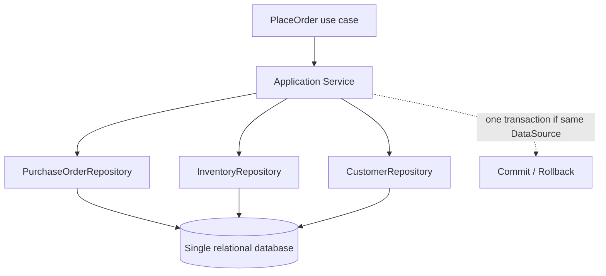
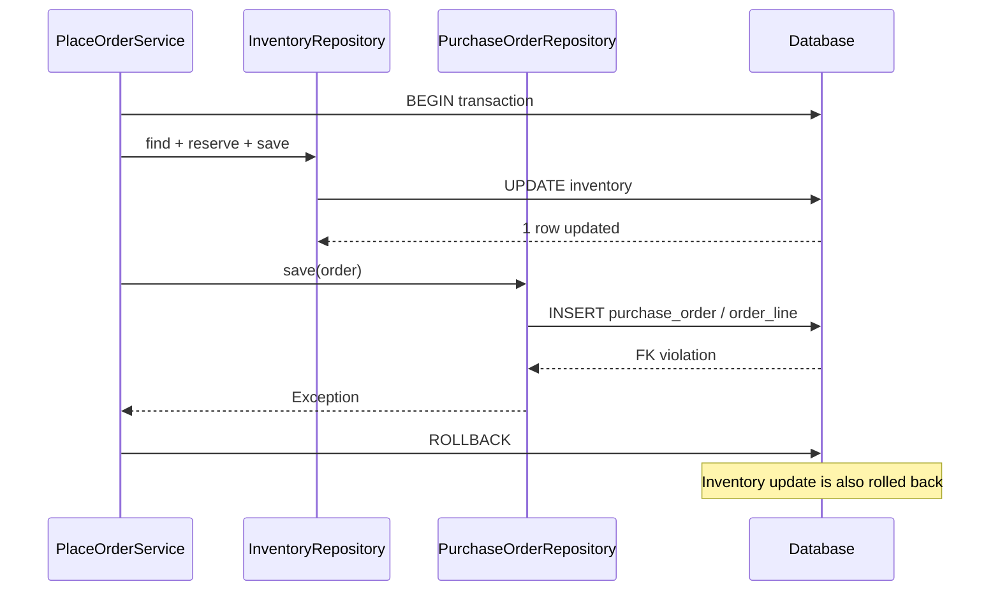
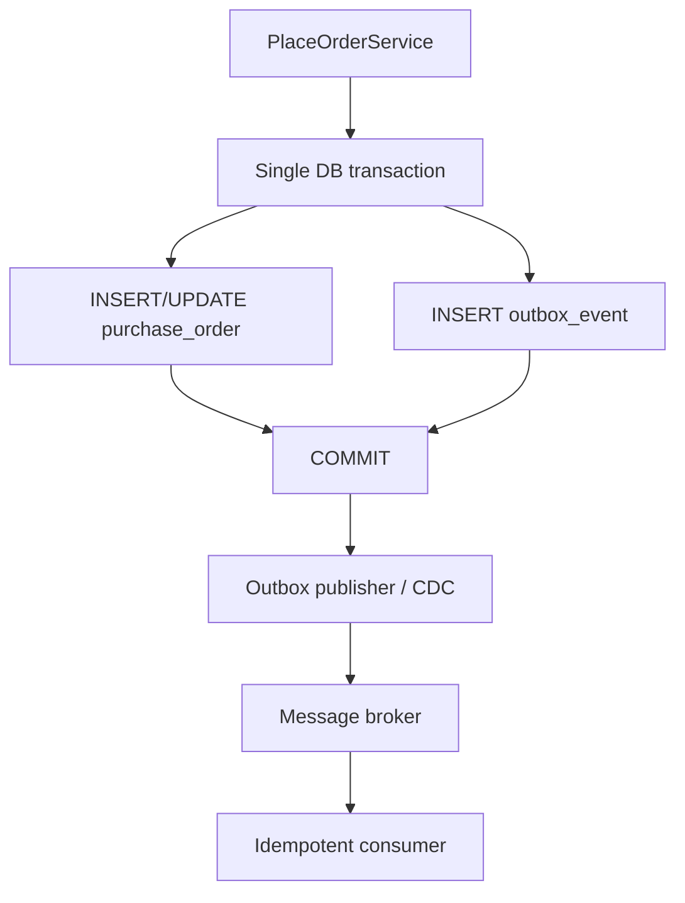

# Transaction Boundaries and Consistency Choices Across Multiple Aggregates

In **Spring Data Relational JDBC**, each aggregate has one root and serves as the data-ownership boundary in the domain model. However, a single use case may need to modify **multiple aggregates**: placing an order creates a `PurchaseOrder`, decreases `Inventory` stock, and might also update `Customer` credit limit status.

At this point, distinguish two concepts:

- **Aggregate boundary** defines which group of entities must be protected by the invariants and lifecycle of one root.
- **Transaction boundary** defines which set of database operations must commit or roll back together.

These two boundaries are related, but they do not have to coincide. A single database transaction can update multiple aggregate roots in the same database. Conversely, if aggregates live in separate services or databases, a regular JDBC `@Transactional` cannot turn them into a distributed ACID transaction.

This lesson explains how to pick the appropriate consistency level: local transactions when atomicity is needed, optimistic locking and constraints to protect concurrent data, transactional outbox for reliable event publishing, and sagas when workflows span multiple steps or services.

## 1. How Do Aggregate Boundaries Differ from Transaction Boundaries?

Suppose a sales system has three aggregate roots:

```text
PurchaseOrder (root)
  - order status
  - owned OrderLines

Inventory (root)
  - available sellable quantity for a product

Customer (root)
  - customer status
  - credit limit
```

`PurchaseOrder` can reference `Customer` and `Product` by ID or `AggregateReference`. `Inventory` is a separate root. Placing an order is a use case coordinating repositories:



Each repository still operates on its own aggregate root. Being in the same transaction does not make `Inventory` a child entity of `PurchaseOrder`, nor does it allow `PurchaseOrder` to own `Customer`.

| Concept | Question answered | Example |
|---|---|---|
| Aggregate boundary | Who owns the entities and enforces internal invariants? | `PurchaseOrder` owns `OrderLine` |
| Transaction boundary | Which database operations commit/roll back together? | Reserving inventory and saving the order in one transaction |
| Service/use-case boundary | Which business action coordinates multiple aggregates? | `PlaceOrderService.place(...)` |
| Distributed workflow boundary | How is a workflow across services/databases resumed and recovered? | Ordering, payment, and shipping saga |

**Design rule:** first determine which invariants belong to which aggregate; then decide whether the use case needs one database transaction or a workflow coordinating multiple transactions. Never enlarge an aggregate just to avoid coordinating multiple repositories.

## 2. Choosing Consistency Levels Based on Business Requirements

Not every change across multiple aggregates needs the same degree of synchronization. Ask what must be true immediately when the use case returns success.

| Scenario | Typically suitable consistency level | Suggested mechanism |
|---|---|---|
| Editing one aggregate and its owned child entities | Immediate within the same transaction | `repository.save(root)` |
| Two aggregates in the same relational database must succeed or fail together | Local ACID | `@Transactional` on the application service |
| Two concurrent transactions modify the same aggregate | Conflict detection or intentional locking | `@Version`, constraints, conditional updates, or row locks |
| Updating database and publishing an event to a broker | Never lose events after commit | Transactional outbox + publisher/retry |
| Workflow across multiple services/databases, potentially long-running | Eventual consistency with state and compensation | Saga/process manager |
| Data only needs updating on reporting screens after a short delay | Eventual consistency/read model | Projections, idempotent consumers |

For example, **never overselling inventory** is a critical invariant. If an order is confirmed while inventory reservation fails, the system must not return "order placed successfully" as though everything finished. This can be solved with a shared transaction if both aggregates are in the same database, or with a saga if reservation happens in an independent inventory service.

On the other hand, updating customer order-count statistics can be handled asynchronously if a few seconds of lag violates no business rule. Choose consistency levels based on the consequences of temporary divergence, not personal technical preference.

## 3. Multiple Aggregates in the Same Database: Using a Local Transaction

Spring Data JDBC uses Spring transaction management and a JDBC `DataSource`. When repositories share **the same DataSource and the same transaction manager**, a transaction opened on an application service can span multiple `save()` calls and JDBC queries.

Example order-placement flow:

1. Read `Inventory` and check remaining quantity.
2. Reserve quantity inside the `Inventory` aggregate.
3. Create and save `PurchaseOrder`.
4. If all succeed, commit; if a step fails and triggers rollback, both changes roll back.

### Application Service Coordinating the Transaction

```java
package com.example.sales;

import org.springframework.stereotype.Service;
import org.springframework.transaction.annotation.Transactional;

@Service
public class PlaceOrderService {

    private final InventoryRepository inventoryRepository;
    private final PurchaseOrderRepository orderRepository;

    public PlaceOrderService(
            InventoryRepository inventoryRepository,
            PurchaseOrderRepository orderRepository) {
        this.inventoryRepository = inventoryRepository;
        this.orderRepository = orderRepository;
    }

    @Transactional
    public PurchaseOrder place(long productId, int quantity, long customerId) {
        if (quantity <= 0) {
            throw new IllegalArgumentException("quantity must be positive");
        }

        Inventory inventory = inventoryRepository.findById(productId)
                .orElseThrow(() -> new IllegalArgumentException("Product not found"));

        inventory.reserve(quantity);
        inventoryRepository.save(inventory);

        PurchaseOrder order = new PurchaseOrder(customerId);
        order.addLine(productId, quantity, inventory.getUnitPriceCents());

        return orderRepository.save(order);
    }
}
```

`@Transactional` is placed on the **application service**, where the full use case is visible. There is no need to place separate transactions around individual repository calls; the outer transaction encompasses inner calls. Repository methods may carry default transaction metadata, and they join the active service transaction under the default `REQUIRED` propagation.

`Inventory` and `PurchaseOrder` remain two independent aggregate roots. The service coordinates operation order and the transaction, while each root protects its internal invariants via domain methods such as `inventory.reserve(quantity)` and `order.addLine(...)`.

### Conditions for Two Repositories to Truly Share a Transaction

- Both connect to the **same database resource/DataSource**.
- Both are managed by a transaction manager compatible with that JDBC `DataSource`, typically `JdbcTransactionManager` or `DataSourceTransactionManager`.
- JDBC operations obtain connections through Spring-managed mechanisms (Spring Data JDBC, `JdbcTemplate`, `NamedParameterJdbcTemplate`, or integrated code).
- The method is invoked through a Spring transaction proxy on a managed bean; do not call another `@Transactional` method via `this` expecting the proxy to open a new transaction.

If two repositories use two different `DataSource` instances or two different transaction managers, default `@Transactional` does not automatically merge them into a distributed transaction. You must explicitly configure the chosen transaction manager or use an architecture designed for multiple resources.

### Rolling Back When a Later Step Fails

Suppose `inventoryRepository.save(inventory)` succeeds, but `orderRepository.save(order)` hits a foreign key error. If both operations are inside the same database transaction, transaction rollback reverts both the inventory change and the order.



Spring `@Transactional` rolls back by default on `RuntimeException` and `Error`. Checked exceptions do not trigger rollback by default; if business logic throws a checked exception that must roll back, declare `rollbackFor` accordingly:

```java
@Transactional(rollbackFor = OrderRejectedException.class)
public PurchaseOrder place(...) throws OrderRejectedException {
    // coordinate repositories
}
```

Never catch and swallow an exception if the transaction must roll back. If you need to convert an exception into a business result, either mark rollback explicitly or let the exception exit the transaction boundary and translate it in an outer caller layer.

## 4. Concurrency Control When Multiple Use Cases Modify the Same Aggregate

A shared transaction ensures atomicity of operations within itself, but does not by itself prevent races between two distinct transactions.

Suppose inventory currently has 5 units. Two concurrent requests both read 5 and try to reserve 4. If both compute `available = 1` from stale reads and overwrite each other, the system can oversell actual stock.

### Optimistic Locking with `@Version`

```java
@Table("inventory")
public class Inventory {

    @Id
    private Long productId;

    @Version
    private Long version;

    private int available;

    private long unitPriceCents;

    protected Inventory() {}

    public void reserve(int quantity) {
        if (quantity <= 0 || quantity > available) {
            throw new InsufficientStockException();
        }
        available -= quantity;
    }

    public int getAvailable() { return available; }
    public long getUnitPriceCents() { return unitPriceCents; }
}
```

Spring Data JDBC generates a conditional update using both ID and version. Logically:

```sql
UPDATE inventory
SET available = :newAvailable,
    version = :newVersion
WHERE product_id = :productId
  AND version = :oldVersion;
```

If another transaction updated the same row first, `version = :oldVersion` no longer matches. Spring Data JDBC detects the unexpected row update count and throws an optimistic locking failure. The current transaction rolls back; the application service can return a conflict error or perform a bounded retry after re-reading fresh state.

`@Version` protects updates to the aggregate root. If inventory rows are modified by custom SQL, batch jobs, or another service without incrementing `version`, repository optimistic locking may miss those changes. Every write path must follow the same versioning convention or use another database-level mechanism.

### Conditional Updates and Database Constraints

For a simple invariant like "available cannot be negative", an atomic SQL statement can be used:

```sql
UPDATE inventory
SET available = available - :quantity
WHERE product_id = :productId
  AND available >= :quantity;
```

If 1 row is updated, the reservation succeeded; if 0 rows are updated, either the product does not exist or stock is insufficient. Distinguish the two cases with an extra query if business rules require it. You can also add a constraint:

```sql
ALTER TABLE inventory
ADD CONSTRAINT ck_inventory_available_nonnegative
CHECK (available >= 0);
```

Conditional updates often suit atomic quantity adjustments well. However, direct custom SQL must be designed alongside optimistic locking/versioning and entity mapping; if it bypasses the version field relied upon by repositories, concurrency state can become inconsistent.

### Pessimistic Locking

If a use case must read and then decide based on locked data, consider `SELECT ... FOR UPDATE` inside a transaction. Locking behavior, timeouts, deadlocks, and syntax support depend on the database. Pessimistic locking helps when contention is frequent and retries are expensive, though holding locks longer reduces throughput.

**Do not default to the highest isolation level.** Use constraints for simple invariants, optimistic locking when contention is relatively rare, and row locks or serializable isolation when there is a clear reason. Test using genuinely concurrent transactions against the target database.

## 5. Why Shouldn't Transactions Wrap HTTP Calls or Long-Running Work?

A JDBC transaction holds a database connection and may hold row locks until commit/rollback. If inside `@Transactional` you perform an HTTP call to a payment service, wait for user input, upload large files, or run long jobs, database resources remain held unnecessarily.

Anti-pattern example:

```java
@Transactional
public void checkout(...) {
    inventoryRepository.save(...);
    paymentClient.charge(...); // network call while DB transaction is open
    orderRepository.save(...);
}
```

If the payment service times out, the transaction may hold locks for a long time and roll back the database, yet there is no guarantee the external payment was also reversed. You can end up with **payment succeeded while the database rolled back**.

For external integrations, separate into steps with explicit states:

1. Record the payment request state or event to publish within a local transaction.
2. Commit the database.
3. Send the request to the external system via a worker or orchestrator with an idempotency key.
4. Receive the outcome and update state in another local transaction.
5. If a later step fails, retry or run compensating actions according to business rules.

## 6. Transactional Outbox: Writing Data and Events in the Same Transaction

A common mistake is updating an aggregate and immediately publishing an event:

```java
@Transactional
public PurchaseOrder place(...) {
    PurchaseOrder order = orderRepository.save(...);
    eventPublisher.publishEvent(new OrderPlaced(order.getId()));
    return order;
}
```

If the event is sent to a broker before database commit, consumers can receive `OrderPlaced` while the database transaction later rolls back. If you commit first and the process crashes before publishing, the event is lost. This is the **dual-write problem**: the database and message broker are two independent resources.

The transactional outbox solves this by persisting an event record in the **same database transaction** as the aggregate:



Outbox table example:

```sql
CREATE TABLE outbox_event (
    event_id UUID PRIMARY KEY,
    aggregate_type VARCHAR(100) NOT NULL,
    aggregate_id VARCHAR(100) NOT NULL,
    event_type VARCHAR(150) NOT NULL,
    payload TEXT NOT NULL,
    occurred_at TIMESTAMP NOT NULL,
    published_at TIMESTAMP NULL
);
```

Inside the same service transaction:

```java
@Transactional
public PurchaseOrder place(...) {
    PurchaseOrder order = orderRepository.save(...);

    outboxRepository.save(new OutboxEvent(
            UUID.randomUUID(),
            "PurchaseOrder",
            order.getId().toString(),
            "OrderPlaced",
            serialize(new OrderPlacedPayload(order.getId())),
            Instant.now()
    ));

    return order;
}
```

If the transaction rolls back, neither the order nor the outbox row exists. If it commits, a publisher can read the outbox and dispatch the event afterward. The publisher can run on a schedule, use `FOR UPDATE SKIP LOCKED` if supported by the database, or use CDC to tail the transaction log.

### Outbox Does Not Guarantee Exactly-Once Delivery

A publisher can send a message successfully and crash before marking `published_at`. On restart, it resends the same event. Therefore, an outbox typically provides **at-least-once delivery**, not end-to-end exactly-once delivery.

Consumers should be idempotent:

- Every event has a unique `event_id`.
- The consumer stores processed IDs in an inbox/deduplication table within the same transaction as its data updates.
- If the same event arrives again, the consumer skips repeating completed business side effects.
- Retries must use backoff and route failing messages to an appropriate dead-letter flow.

An outbox also needs retention/cleanup policies for published events, lag monitoring, and poison-event handling. If multiple events for the same aggregate must stay ordered, use a sequence/version or partition key; relying solely on `occurred_at` timestamps may not guarantee ordering.

## 7. Sagas When a Use Case Spans Multiple Services/Databases

Suppose `Order Service`, `Inventory Service`, and `Payment Service` use separate databases. A single local JDBC transaction manager cannot commit all three databases atomically. A suitable workflow is a saga:

```mermaid
flowchart TD
    A["Order: create Pending"] --> B["Inventory: reserve stock"]
    B --> C{ "Reserve succeeded?" }
    C -->|Yes| D["Payment: authorize/charge"]
    C -->|No| X["Order: Rejected"]
    D --> E{ "Payment succeeded?" }
    E -->|Yes| F["Order: Confirmed"]
    E -->|No| G["Inventory: release stock"]
    G --> H["Order: PaymentFailed"]
```

Each step is a **local transaction** inside the service that owns that data. When a later step fails, the saga triggers **compensation** actions for previously completed steps—for example, `releaseReservation` after inventory reservation succeeded but payment failed.

Compensation is not a technical database rollback. It is a new business action that can itself fail, be retried, and requires idempotency. For instance, if goods have already been packed or shipped, "undoing delivery" may be a return workflow rather than erasing past events.

### Choreography vs. Orchestration

| Saga style | Coordination approach | Suitable when |
|---|---|---|
| Choreography | Services publish/consume events and decide the next step independently | Short flows, few branches, clear responsibilities |
| Orchestration | A process manager/orchestrator tracks state and sends commands | Multi-step flows, timeouts, complex error branches and compensation |

With sagas, persist workflow state so it recovers after restarts. Never hold a database transaction open while waiting across multiple services. Each service uses an outbox for reliable event/command dispatch, consumers handle messages idempotently, and the saga defines clear timeouts, retries, and compensations.

## 8. Which Application Layer Should Own the Transaction Boundary?

In a Spring application, transactions should normally start at the **application service**—where a complete use case executes. Repositories focus on aggregate persistence; domain methods enforce internal invariants.

```text
Controller
   |
   v
PlaceOrderService (@Transactional)
   |-- InventoryRepository.findById/save
   |-- PurchaseOrderRepository.save
   |-- OutboxRepository.save (if publishing events)
   |
   v
Commit / Rollback
```

Do not let controllers open transactions spanning multiple service calls, and do not put `@Transactional` on every domain method. Transactions are a concern of the application/persistence boundary; domain objects should keep business behavior unaware of transaction managers.

### Key `@Transactional` Attributes to Understand

```java
@Transactional(
    propagation = Propagation.REQUIRED,
    isolation = Isolation.READ_COMMITTED,
    timeout = 10
)
public PurchaseOrder place(...) {
    // use case
}
```

| Attribute | Meaning | Notes |
|---|---|---|
| `propagation = REQUIRED` | Joins existing transaction or starts a new one | Spring default; repositories typically join the service transaction |
| `REQUIRES_NEW` | Suspends current transaction and starts an independent one | Can commit even if outer transaction rolls back; avoid casual use for work that must stay atomic with an aggregate |
| `NESTED` | Nested transaction using savepoints if manager/resource supports it | Not supported by all transaction managers |
| `isolation` | Selects isolation level for a new transaction | Actual behavior depends on the database; isolation does not replace invariants/constraints |
| `timeout` | Bounds transaction duration as supported by the manager | Not a guaranteed mechanism to cancel an external HTTP call |
| `readOnly = true` | Signals a read-only transaction to the manager/driver | Not a security boundary or a hard block on all write statements |
| `rollbackFor` | Specifies additional exceptions triggering rollback | Defaults to RuntimeException/Error; checked exceptions require configuration to roll back |

`@Transactional` normally works via proxies. Methods must be called through a bean proxy; self-invocation such as `this.innerTransactionalMethod()` will not trigger a new transaction interceptor. With Spring Data JDBC, ensure you use the transaction manager bound to the repository's `DataSource`.

## 9. Caution with Multiple DataSources or Multiple Transaction Managers

If an application has separate business and audit databases:

```text
BusinessDataSource → businessTransactionManager
AuditDataSource    → auditTransactionManager
```

A single `@Transactional` annotation does not automatically commit or roll back both databases together. Specify which manager to use (`@Transactional("businessTransactionManager")`) and design audit recording appropriately. If audit logs must strictly commit alongside business state yet live in another database, this is a multi-resource problem; consider an outbox or an intentional distributed mechanism rather than assuming two local JDBC transactions coordinate automatically.

XA/2-phase commit can coordinate multiple resources in supported environments, but brings coordinator complexity, driver/database configuration, recovery nuances, and operational cost. In modern service architectures, outbox + saga are often easier to reason about for long-running business workflows. Do not adopt distributed transactions just because two repositories differ.

## 10. Idempotency and Retries Are Part of Consistency

When a request times out, the client does not know whether the server committed. If the client resends the same place-order command, it could create two orders or reserve inventory twice. A transaction guarantees atomicity of **a single execution**, but does not recognize two requests as carrying the same intent.

One solution is an idempotency key:

```sql
CREATE TABLE command_deduplication (
    idempotency_key VARCHAR(100) PRIMARY KEY,
    command_type VARCHAR(100) NOT NULL,
    result_reference VARCHAR(100),
    created_at TIMESTAMP NOT NULL
);
```

Within the order-placement transaction, check/insert the idempotency key and create the order. The unique constraint protects against two concurrent requests using the same key. Repeated requests can return the stored result instead of re-executing business side effects.

Retries must classify errors:

- **Optimistic lock conflict:** can re-read fresh state and perform bounded retries of the entire use case if business rules allow.
- **Deadlock/serialization failure:** the database may require retrying the transaction; retry the entire transaction, not just the last statement.
- **Validation/business rejection:** do not retry automatically because business state will not change merely by trying again.
- **Network timeout calling an external service:** outcome may be unknown; rely on idempotency keys and workflow state rather than issuing a new payment request with a new ID.

Never put a retry loop inside a transaction already marked rollback-only and keep reusing that same transaction. Let the transaction end, then open a fresh transaction for the retry attempt.

## 11. Testing Transaction Boundaries and Consistency

A test that only verifies repositories A and B both save successfully does not prove they share a transaction. Test mid-way failure scenarios as well.

### Testing Multi-Aggregate Rollback

In an integration test:

1. Seed `Inventory.available = 5`.
2. Call `PlaceOrderService.place(...)` with a valid quantity so inventory decreases.
3. Intentionally cause the order-save step to fail (for example, by violating a test constraint).
4. After the transaction finishes, reload inventory and assert `available` is still 5.
5. Assert no order was created.

This test proves both operations ran inside the same transaction. Use the same database engine and DataSource as application configuration; do not mock repositories if your goal is verifying JDBC rollback.

### Testing Concurrent Optimistic Locking

Create two independent transactions that both read the same `Inventory` at the same version. Have both decrement stock and save. Expected outcome: one transaction commits; the other fails with an optimistic locking exception and rolls back. Verify final stock is non-negative and only one reservation succeeded.

### Testing Outbox

- If saving the aggregate fails, no outbox event is committed.
- If aggregate and outbox commit together, the publisher can read the event.
- Re-delivering an event with the same `event_id` does not cause the consumer to apply business logic twice.
- A publisher crashing after sending but before marking published does not lose the event; the consumer safely deduplicates.

### Testing Sagas

- Each local transaction step can be retried.
- Timeouts do not create duplicate commands.
- Compensations can re-run without causing double side effects.
- Workflow state can recover after a process restart.

For concurrency tests, use two real connections/transactions, coordinate execution order with a synchronization barrier, and run against a real database via Testcontainers. Sequential execution inside a single test transaction does not reproduce race conditions.

## 12. Common Design Mistakes

| Symptom | Cause | Resolution |
|---|---|---|
| Both repositories save, but a later error fails to roll back earlier writes | Operations run in separate transactions or use different DataSources/managers | Place transaction at the application service; confirm shared DataSource and transaction manager |
| `@Transactional` has no effect | Self-invocation, bean not proxied by Spring, unmanaged method | Call through Spring bean proxy and check transaction configuration |
| Inventory goes negative under concurrent requests | Checking quantity only in memory without protecting concurrent updates | `@Version`, conditional updates, row locks, and CHECK constraints |
| Event sent while order rolled back | Publishing to broker before database commit | Transactional outbox or after-commit flow with proper recovery |
| Order committed with no event | DB committed and process crashed before publish | Write outbox in the same transaction as the order |
| Consumer processes an event twice | Outbox publisher retries after missing acknowledgment | Event IDs and idempotent consumer/inbox |
| Payment succeeded while database rolled back | HTTP call inside DB transaction; two resources lack shared ACID | Saga, idempotency, and compensation |
| Retries reserve inventory twice | Missing idempotency key or retrying only part of the use case | Command idempotency and full-transaction retries |
| Transaction holds connections/locks too long | HTTP calls, user waits, or heavy processing inside transaction | Shorten transaction; move non-DB work into separate workflows |
| Using `REQUIRES_NEW` commits part of business logic while the rest rolls back | Independent sub-transaction outside desired atomic boundary | Use only when independence is intentional; otherwise use `REQUIRED` |

## 13. Process for Choosing Transaction Boundaries

When designing a multi-aggregate use case, follow this sequence:

1. **List invariants.** Which conditions must hold immediately when the use case reports success?
2. **Assign invariants to aggregate roots.** Each root protects its own data and owned child entities.
3. **Identify resources.** Do the aggregates live in the same database/DataSource or across multiple services/databases?
4. **If same database:** place `@Transactional` on the application service so repositories commit/roll back together when needed.
5. **If different resources:** determine which steps can be eventually consistent, which events need an outbox, and which workflows need sagas and compensation.
6. **Protect concurrency.** Choose `@Version`, unique/check constraints, conditional updates, or locks per invariant.
7. **Protect retries.** Use idempotency keys for commands and events; separate retryable errors from business rejections.
8. **Test failure paths.** Intentionally fail a mid-way step and verify rollback/outbox/compensation and workflow recovery.

### Quick Decision Table

| Question | Suitable choice |
|---|---|
| All changes within a single aggregate? | Single `repository.save(root)` in a local transaction |
| Multiple aggregates in the same database must succeed together? | `@Transactional` at the application service |
| Need to protect an update from race conditions? | Optimistic/pessimistic locking, conditional SQL, and constraints |
| Need to publish events after commit without losing them? | Transactional outbox |
| Workflow spans multiple services with compensating steps? | Saga/process manager |
| Requests/events may be redelivered? | Idempotency keys, inbox/deduplication, and bounded retries |

**Bottom line:** aggregates define ownership and invariants; transactions define which operations commit or roll back together. Use a single JDBC transaction when multiple aggregates in the same database require atomicity. When workflows cross databases or services, shift to outbox and sagas with explicitly designed idempotency, retries, and compensation.

## Official References

- [Spring Framework — Declarative Transaction Management](https://docs.spring.io/spring-framework/reference/data-access/transaction/declarative.html): `@Transactional`, proxies, and rollback rules.
- [Spring Framework — Transaction Propagation](https://docs.spring.io/spring-framework/reference/data-access/transaction/declarative/tx-propagation.html): `REQUIRED`, `REQUIRES_NEW`, `NESTED`.
- [Spring Framework — Transaction Isolation](https://docs.spring.io/spring-framework/reference/data-access/transaction/declarative/tx-isolation.html): isolation levels and transaction configuration.
- [Spring Data JDBC — Transactionality](https://docs.spring.io/spring-data/relational/reference/jdbc/transactions.html): default repository transactions and service-layer transactions.
- [Spring Data JDBC — Optimistic Locking](https://docs.spring.io/spring-data/relational/reference/jdbc/mapping.html): `@Version` and conflict handling on updates.
- [Spring Framework — JDBC Transaction Management](https://docs.spring.io/spring-framework/reference/data-access/jdbc/connections.html): transaction-bound JDBC connection management.
