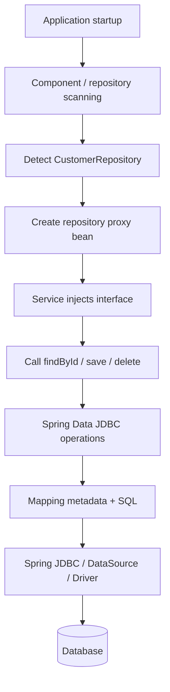

# Declaring Repositories, `CrudRepository`, and `ListCrudRepository`

In **Spring Data JDBC**, a repository is the API that the service layer uses to read and write aggregates in the database. Instead of manually writing a DAO class for each entity, an application declares a **repository interface** and extends a foundational interface such as `CrudRepository` or `ListCrudRepository`. Spring Data generates the implementation at runtime, connecting repository methods to mapping metadata, JDBC operations, and the corresponding SQL statements.

The two commonly used interfaces are related by inheritance:

- **`CrudRepository<T, ID>`** provides basic CRUD operations. Multi-record read methods such as `findAll()` and `findAllById(...)` return `Iterable`.
- **`ListCrudRepository<T, ID>`** extends `CrudRepository` and redeclares several methods to return `List`, which fits when the application wants to work directly with a collection supporting ordered access via the List API.

The core point is that Spring Data JDBC repositories operate at the **aggregate root boundary**. If a class is a child entity owned by a root, saving or loading it normally goes through the root's repository. A repository is not a Java class that automatically creates tables; the schema still needs to be managed with SQL scripts or migrations.

## 1. What is a repository interface?

In the traditional DAO approach, developers might manually create an interface and an implementation class:

```java
public interface CustomerDao {
    Customer findById(Long id);
    void insert(Customer customer);
    void update(Customer customer);
    void delete(Long id);
}
```

They then have to manually write an implementation using `JdbcTemplate`, prepare SQL statements, bind parameters, read `ResultSet`, and convert rows into objects. Spring Data JDBC provides a repository mechanism to reduce this boilerplate code.

Declaring a repository:

```java
import org.springframework.data.repository.CrudRepository;

public interface CustomerRepository
        extends CrudRepository<Customer, Long> {
}
```

The interface above does not declare any custom methods written by the application, yet it already has the inherited CRUD methods. Spring Data registers the repository bean and creates an implementation proxy when the application starts. A service can inject this interface like a normal dependency.

```java
import org.springframework.stereotype.Service;

@Service
public class CustomerService {
    private final CustomerRepository customers;

    public CustomerService(CustomerRepository customers) {
        this.customers = customers;
    }

    public Customer getCustomer(Long id) {
        return customers.findById(id).orElseThrow();
    }
}
```

The service depends on the `CustomerRepository` contract; it does not need to know how the concrete JDBC implementation constructs a `PreparedStatement`.

## 2. Repository generic types: `T` and `ID`

The general declaration of `CrudRepository` looks like this:

```java
public interface CrudRepository<T, ID> {
    // General CRUD methods.
}
```

The two type parameters mean:

| Generic | Meaning | Example in `CustomerRepository` |
|---|---|---|
| `T` | The aggregate root type managed by the repository | `Customer` |
| `ID` | The data type of the root's ID | `Long` |

With:

```java
public interface CustomerRepository
        extends CrudRepository<Customer, Long> {
}
```

Spring Data knows this repository operates on `Customer`, and the identifier key has type `Long`. Therefore, `findById` accepts `Long`; `save` accepts `Customer` or a compatible subtype and returns the saved object.

An ID can be `Long`, `Integer`, `UUID`, `String`, or another type if supported by mapping and the database. The generic type must be consistent with the `@Id` property of the aggregate root. Do not declare a repository using `Long` when the root has a `UUID` ID.

## 3. Preparing an aggregate for repository management

Example using the `customers` table:

```sql
CREATE TABLE customers (
    id BIGINT GENERATED BY DEFAULT AS IDENTITY PRIMARY KEY,
    name VARCHAR(120) NOT NULL,
    email VARCHAR(200) NOT NULL
);
```

Entity:

```java
import org.springframework.data.annotation.Id;
import org.springframework.data.relational.core.mapping.Table;

@Table("customers")
public record Customer(
        @Id Long id,
        String name,
        String email
) {}
```

`@Table` specifies the table name; `@Id` marks the primary key. Without `@Table`, Spring Data Relational can derive the table name from a naming strategy, though declaring it explicitly makes examples easier to cross-reference with the DDL.

Notes:

- `@Id` here is `org.springframework.data.annotation.Id`, not the JPA annotation.
- `@Table` here is `org.springframework.data.relational.core.mapping.Table`.
- The entity needs an instantiation mechanism compatible with mapping, such as a constructor or a record's canonical constructor.
- The repository does not automatically create the `customers` table; the DDL must be executed before CRUD operations run.

## 4. `CrudRepository`: basic methods

`CrudRepository<T, ID>` provides common operations to save, read, check, and delete aggregates. The signatures below are in generic form; `T` and `ID` are replaced by the repository's concrete types.

### Save group

```java
<S extends T> S save(S entity);
<S extends T> Iterable<S> saveAll(Iterable<S> entities);
```

- `save(entity)` saves one aggregate and returns the aggregate after saving. The result may contain a database-generated ID or a new version.
- `saveAll(entities)` saves multiple aggregates and returns an `Iterable` containing the saved results.
- The generic `<S extends T>` allows saving a subtype of `T` when the application's type model requires it.

In Spring Data JDBC, `save` typically chooses `INSERT` or `UPDATE` based on the new-entity detection mechanism. When an aggregate has mapped child components, a single save can generate multiple SQL statements.

### Lookup group

```java
Optional<T> findById(ID id);
boolean existsById(ID id);
Iterable<T> findAll();
Iterable<T> findAllById(Iterable<ID> ids);
long count();
```

- `findById` returns `Optional<T>` because the record might not exist.
- `existsById` returns `boolean` to check existence.
- `findAll` returns all aggregates managed by the repository.
- `findAllById` finds aggregates whose IDs are in the provided set.
- `count` returns the number of records matching the repository.

Do not use `findAll()` to load an entire very large table just to find a few records. As data grows, consider conditional queries, paging/sorting, or an appropriate read model.

### Delete group

```java
void deleteById(ID id);
void delete(T entity);
void deleteAllById(Iterable<? extends ID> ids);
void deleteAll(Iterable<? extends T> entities);
void deleteAll();
```

Delete methods affect the aggregates managed by the repository. For an aggregate with children, deleting the root may trigger deletion of rows belonging to the aggregate according to the mapping and database constraints. Understand the aggregate lifecycle before calling bulk deletion.

## 5. `ListCrudRepository`: `List`-typed results

`ListCrudRepository<T, ID>` extends `CrudRepository<T, ID>` and changes the return types of multi-record read operations (while also providing `List` for `saveAll`):

```java
public interface ListCrudRepository<T, ID>
        extends CrudRepository<T, ID> {

    @Override
    <S extends T> List<S> saveAll(Iterable<S> entities);

    @Override
    List<T> findAll();

    @Override
    List<T> findAllById(Iterable<ID> ids);
}
```

Therefore, you can declare:

```java
import org.springframework.data.repository.ListCrudRepository;

public interface CustomerRepository
        extends ListCrudRepository<Customer, Long> {
}
```

With this repository:

```java
List<Customer> all = customers.findAll();
List<Customer> selected = customers.findAllById(List.of(1L, 2L, 3L));
List<Customer> saved = customers.saveAll(newCustomers);
```

The caller receives `List<Customer>` directly and can use collection operations such as `get(index)`, `size()`, `stream()`, or pass it to APIs requiring a `List` without manually converting from `Iterable`.

### Quick comparison

| Method | `CrudRepository` | `ListCrudRepository` |
|---|---|---|
| `save(entity)` | `S` | `S` (inherited) |
| `saveAll(entities)` | `Iterable<S>` | `List<S>` |
| `findById(id)` | `Optional<T>` | `Optional<T>` (inherited) |
| `findAll()` | `Iterable<T>` | `List<T>` |
| `findAllById(ids)` | `Iterable<T>` | `List<T>` |
| `existsById(id)` | `boolean` | `boolean` (inherited) |
| `count()` | `long` | `long` (inherited) |
| Delete methods | `void` | `void` (inherited) |

The primary difference is in the **returned collection type**, not a completely different SQL model or database mapping approach. Both are Spring Data CRUD repositories.

## 6. When to choose `CrudRepository`, when to choose `ListCrudRepository`?

Choose `CrudRepository` when:

- Existing APIs only need `Iterable` and want to depend on a minimal contract.
- Repository callers already process results as `Iterable`.
- The project already uses repository interfaces based on `CrudRepository` and does not need to change signatures.

Choose `ListCrudRepository` when:

- `findAll`, `findAllById`, and `saveAll` are used as `List`.
- The service layer frequently needs `size`, index-based access, or to pass a `List` to another API.
- You want the return type to clearly show that the collection is materialized as a list.

For example, both interfaces can be used for the same aggregate:

```java
public interface CustomerCrudRepository
        extends CrudRepository<Customer, Long> {
}

public interface CustomerListRepository
        extends ListCrudRepository<Customer, Long> {
}
```

In real applications, normally only **one repository interface** is needed per aggregate. The two declarations above are only to illustrate the choice; do not register two repositories managing the same aggregate without a clear purpose.

`List` does not mean the query is automatically paginated or streamed. `findAll()` is still an operation that reads all results for the repository. If a table is large, use a bounded query mechanism rather than choosing `CrudRepository` hoping `Iterable` will lazily read row by row.

## 7. How does Spring Data JDBC create repository beans?

When a Spring Boot application has the `spring-boot-starter-data-jdbc` dependency, auto-configuration can detect repository interfaces within the scanned package area and register corresponding beans. When a service injects `CustomerRepository`, Spring provides a proxy implementing the repository contract.

Overview flow:



The application does not call `new CustomerRepository()` directly because an interface has no constructor. The bean is managed by Spring and created by the repository infrastructure.

In a typical Spring Boot setup, repositories are scanned from the package of the `@SpringBootApplication` class downward. If repositories sit outside the scan scope, you can reorganize packages or configure `@EnableJdbcRepositories` with the appropriate base packages.

Example structure:

```text
com.example.shop
├── ShopApplication.java
├── customer
│   ├── Customer.java
│   ├── CustomerRepository.java
│   └── CustomerService.java
└── order
    ├── PurchaseOrder.java
    └── PurchaseOrderRepository.java
```

Placing the application class in `com.example.shop` allows subpackages to be discovered under the default scan configuration.

## 8. Declaring custom methods beyond CRUD

A repository interface can add query methods based on property names:

```java
import java.util.List;
import java.util.Optional;
import org.springframework.data.repository.ListCrudRepository;

public interface CustomerRepository
        extends ListCrudRepository<Customer, Long> {

    Optional<Customer> findByEmail(String email);

    List<Customer> findByNameContaining(String keyword);

    boolean existsByEmail(String email);
}
```

Spring Data parses the method name to determine the entity property and generates the corresponding query. `findByEmail` references the Java property `email`, not a table or column name written directly in a SQL string. With the default naming strategy, property `email` maps to column `email`; if the property uses `@Column` to rename the column, that metadata is used to generate the query.

If explicit SQL is needed, Spring Data JDBC supports `@Query`:

```java
import org.springframework.data.jdbc.repository.query.Query;
import org.springframework.data.repository.query.Param;

@Query("SELECT id, name, email FROM customers WHERE LOWER(email) = LOWER(:email)")
List<Customer> findEmailIgnoringCase(@Param("email") String email);
```

SQL inside `@Query` is database SQL, so table and column names must be physical identifiers. A custom query must return enough columns to construct the declared return type. Do not confuse Spring Data JDBC's `@Query` with JPA's JPQL/HQL.

## 9. What do CRUD methods mean in Spring Data JDBC?

The CRUD names are familiar, but their behavior must be understood in terms of Spring Data JDBC's aggregate model.

### `save` is not always an `INSERT`

```java
Customer saved = customers.save(
        new Customer(null, "Lan", "lan@example.com")
);
```

With a `null` ID, an entity is usually identified as new and inserted. If the entity has an existing ID, the framework usually takes the update branch. Detection rules can be influenced by `@Version` or `Persistable.isNew()`.

There is no dirty checking like in JPA: modifying an object in memory does not automatically execute SQL; `save` must be called. Use the returned object to obtain the updated ID or version, especially with immutable entities.

### `findById` returns `Optional`

```java
Optional<Customer> found = customers.findById(42L);
```

When no record is found, the result is empty; never assume `findById` always returns an object. The service layer typically translates the missing case into a business error or an appropriate response.

### `deleteById` and `delete` remove the aggregate

```java
customers.deleteById(42L);
```

For aggregates with child components, deletion must consider child tables and foreign keys. Spring Data JDBC manages data by root; deletion may issue SQL statements depending on the mapping. Do not assume a root repository always deletes strictly a single row from the root table in every case.

### `findAll` is an unbounded operation

```java
List<Customer> all = customers.findAll();
```

This method is suitable for small datasets or clearly bounded administrative tasks. For tables that grow continuously, declare conditional queries, limit results, or use appropriate paging/sorting mechanisms.

## 10. Repositories manage aggregate roots, not necessarily one repository per table

Suppose an order has multiple order lines:

```java
@Table("purchase_orders")
public record PurchaseOrder(
        @Id Long id,
        @MappedCollection(idColumn = "order_id", keyColumn = "line_no")
        List<OrderLine> lines
) {}
```

If `OrderLine` is strictly a child belonging to the lifecycle of `PurchaseOrder`, the repository is typically declared for the root:

```java
public interface PurchaseOrderRepository
        extends CrudRepository<PurchaseOrder, Long> {
}
```

There is no need for an `OrderLineRepository` just because the DDL has an `order_lines` table. `@MappedCollection` describes the child rows belonging to the root; `save(order)` can write both the root and its children as a single aggregate. Creating an independent CRUD repository for a child could allow a service to modify children while bypassing the order's invariants.

Conversely, if `Product` is an independent aggregate root referenced by multiple orders, a `ProductRepository` makes sense. One repository per **aggregate root** aligns much more closely with business boundaries than one repository per table.

## 11. `ListCrudRepository` does not replace specialized queries or pagination

A common misconception is thinking `ListCrudRepository` loads data page by page because the result is a `List`. In reality, `List` is only the return collection type; it contains no page number, total pages, or total elements information.

If paging/sorting is needed, Spring Data provides separate abstractions such as `PagingAndSortingRepository` and corresponding query capabilities, depending on the version and module. Since Spring Data 3.0, `PagingAndSortingRepository` no longer extends `CrudRepository`; if both CRUD and paging/sorting are needed, you can combine the appropriate interfaces instead of assuming pagination is built into `ListCrudRepository`.

Example of combining interfaces:

```java
public interface CustomerRepository extends
        ListCrudRepository<Customer, Long>,
        PagingAndSortingRepository<Customer, Long> {
}
```

Specific paginated query capabilities should be checked against the Spring Data JDBC version in use and the declared query style. Do not assume every query method or custom `@Query` automatically supports `Page<T>` simply because the repository extends a paging interface.

## 12. Common mistakes when declaring repositories

| Symptom | Possible Cause | Fix |
|---|---|---|
| Cannot inject repository bean | Interface is outside the scan package or repository infrastructure is not configured | Check `@SpringBootApplication` package, dependencies, and `@EnableJdbcRepositories` if needed |
| `findById` accepts the wrong type | Generic `ID` does not match the `@Id` type | Align `CrudRepository<Customer, Long>` with `Long` ID |
| Property not found in derived query | Method uses DB column name instead of Java property or has a typo | Name the method after the entity property |
| SQL reports table does not exist | Schema not created or wrong `@Table` | Check DDL and table mapping |
| `save` does not insert as expected | ID/version makes entity appear already existing | Check new/existing state detection, `@Version`, and `Persistable` |
| `findAll` returning `Iterable` is inconvenient | Repository extends `CrudRepository` | Use `ListCrudRepository` if the API needs `List` |
| `ListCrudRepository` does not solve oversized datasets | `List` is not pagination/streaming | Design bounded queries, pagination, or batch reading |
| Children are not saved as expected | Child is not mapped as owned by the root | Check `@MappedCollection`, ID/key columns, and aggregate boundary |
| Custom SQL fails to map entity | Query lacks columns or uses wrong physical names | Cross-check DDL, `@Column`, and return type |

When troubleshooting, check in this order: **has the repository bean been created → are the root/ID generics correct → how is the method resolved → table/column metadata → actual SQL and DDL**. This narrows down whether the issue lies in Spring configuration, interface declaration, or mapping/database.

## 13. Complete example: CRUD via a service

A service can use the foundational methods as follows:

```java
import java.util.List;
import org.springframework.stereotype.Service;
import org.springframework.transaction.annotation.Transactional;

@Service
public class CustomerService {
    private final CustomerRepository customers;

    public CustomerService(CustomerRepository customers) {
        this.customers = customers;
    }

    @Transactional
    public Customer create(String name, String email) {
        Customer draft = new Customer(null, name, email);
        return customers.save(draft);
    }

    public Customer get(Long id) {
        return customers.findById(id)
                .orElseThrow(() -> new IllegalArgumentException("Customer not found"));
    }

    public List<Customer> list() {
        return customers.findAll();
    }

    @Transactional
    public Customer rename(Long id, String newName) {
        Customer current = get(id);
        Customer changed = new Customer(
                current.id(), newName, current.email());
        return customers.save(changed);
    }

    @Transactional
    public void remove(Long id) {
        customers.deleteById(id);
    }
}
```

In this example, `CustomerRepository` extends `ListCrudRepository<Customer, Long>`, so `list()` can return `List<Customer>` directly. If switched to `CrudRepository`, the return type would need adjusting or the `Iterable` would need converting as appropriate.

`@Transactional` on the service expresses business boundaries. A simple CRUD operation may already have a transaction in the repository infrastructure, but when a service coordinates multiple steps that must commit or rollback together, a transaction at the application service makes the scope explicit.

## 14. Practice exercise comparing the two interfaces

Using the `Customer` entity, DDL, and Spring Data JDBC dependency from earlier sections, you can try:

1. Declare `CustomerRepository extends CrudRepository<Customer, Long>`; call `findAll()` and observe that the declared return type is `Iterable<Customer>`.
2. Change the repository to `CustomerRepository extends ListCrudRepository<Customer, Long>`; call `findAll()` again and observe that the return type is `List<Customer>`.
3. Try `findAllById(List.of(1L, 2L))` and `saveAll(...)` to see that these methods also return `List` through `ListCrudRepository`.
4. Call `findById` with a non-existent ID and handle `Optional.empty()`.
5. Add a `findByEmail` method using the Java property name, then compare the logged SQL against column names in the DDL.
6. Create an aggregate with children mapped via `@MappedCollection`; call `save(root)` and observe how a single root repository interface can manage multiple tables belonging to the aggregate.

There is no need to create two different repositories managing the same aggregate in an application just to compare them; you can switch the extended interface during the exercise or write separate tests for each return type.

## 15. Key takeaways

- A repository is an **interface describing operations on an aggregate root**; Spring Data JDBC provides the implementation through a proxy bean.
- `T` is the aggregate root type; `ID` is the root's ID type.
- `CrudRepository<T, ID>` provides basic CRUD, with multi-record read operations returning `Iterable`.
- `ListCrudRepository<T, ID>` extends `CrudRepository` and returns `List` for `saveAll`, `findAll`, and `findAllById`.
- `List` is not synonymous with pagination or streaming; `findAll()` can still load large datasets.
- Derived queries use **Java property names**; SQL inside `@Query` uses **physical table/column names**.
- Spring Data JDBC repositories manage aggregates by root; do not create a separate repository for every child table by default.
- DDL must exist and match metadata; declaring a repository does not automatically create the schema.

When starting a Spring Data JDBC repository, identify the aggregate root and ID type first, then choose `CrudRepository` if an `Iterable` contract is sufficient or `ListCrudRepository` if callers need `List`. From that interface, Spring Data provides CRUD consistent with the aggregate's mapping and SQL, allowing the service layer to focus on business rules rather than repeating JDBC boilerplate.
