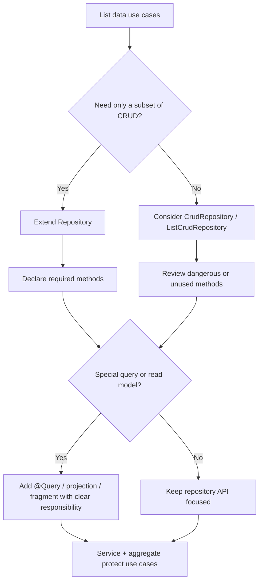

# Choosing Exposed Methods and Avoiding Overly Broad Repositories

In **Spring Data JDBC**, a repository interface is the contract that application services use to read and write aggregates. Extending `CrudRepository` or `ListCrudRepository` gives the application a fairly complete set of CRUD operations. That is convenient for small examples, yet not every aggregate should expose operations like `findAll()`, `deleteAll()`, or `saveAll()` to the entire codebase.

Good repository design starts with the question: **Which data operations do the use cases genuinely need, and which operations could violate business rules if called arbitrarily?** Spring Data lets you expose a narrower method set by extending `Repository<T, ID>` and declaring only the required methods. When needed, you can separate read/write contracts, use business-meaningful queries, or compose repository fragments for specialized processing.

## 1. A repository is an aggregate access contract

Example of a `Customer` aggregate:

```java
import org.springframework.data.annotation.Id;
import org.springframework.data.relational.core.mapping.Table;

@Table("customers")
public record Customer(
        @Id Long id,
        String name,
        String email,
        boolean active
) {
    public Customer rename(String newName) {
        if (newName == null || newName.isBlank()) {
            throw new IllegalArgumentException("Name must not be blank");
        }
        return new Customer(id, newName, email, active);
    }

    public Customer deactivate() {
        return new Customer(id, name, email, false);
    }
}
```

And the corresponding table:

```sql
CREATE TABLE customers (
    id BIGINT GENERATED BY DEFAULT AS IDENTITY PRIMARY KEY,
    name VARCHAR(120) NOT NULL,
    email VARCHAR(200) NOT NULL UNIQUE,
    active BOOLEAN NOT NULL
);
```

A repository can be declared with `CrudRepository`:

```java
import org.springframework.data.repository.CrudRepository;

public interface CustomerRepository
        extends CrudRepository<Customer, Long> {
}
```

With a single line of inheritance, the API already exposes `save`, `saveAll`, `findById`, `existsById`, `findAll`, `findAllById`, `count`, `deleteById`, `delete`, `deleteAllById`, `deleteAll`, and related CRUD operations. Those methods are helpful in many contexts, yet a business application may only need a small subset.

A repository is a **technical persistence API**; it does not automatically become the place where all business rules live. The aggregate root must still enforce invariants, while the application service coordinates use cases and transactions.

## 2. Why should you not expose every CRUD method?

An overly broad interface lets any class injecting the repository invoke operations the use cases never intended:

```java
customers.deleteAll();
customers.findAll();
customers.saveAll(importedCustomers);
```

These calls can cause issues:

- **Excessive deletion**: `deleteAll()` does not express any business rule permitting deletion of all customers. An accidental call can have major consequences.
- **Over-fetching**: `findAll()` can materialize all aggregates, consuming memory and time as the table grows.
- **Writes bypassing workflow**: `saveAll()` on directly imported data can skip validation or state-transition steps required by the use case.
- **Spreading technical coupling**: multiple services depend on generic CRUD operations, making changes to data policies harder to control.
- **Unclear intent**: `deleteById(id)` merely says delete by ID, whereas business rules may require closing the account, recording an audit trail, or rejecting deletion while orders exist.

Hiding a method from an interface is not a database authorization mechanism or a security boundary. It is a way to narrow **the contract that application code is encouraged to use**. Actual access control must still be enforced at the application, transaction, database, and authorization layers.

## 3. Using `Repository<T, ID>` to expose only needed methods

`Repository<T, ID>` is Spring Data's foundational marker interface. It conveys the domain type and ID type without inheriting all CRUD methods. You can declare a repository with only the operations needed:

```java
import java.util.List;
import java.util.Optional;
import org.springframework.data.repository.Repository;

public interface CustomerRepository
        extends Repository<Customer, Long> {

    Optional<Customer> findById(Long id);

    <S extends Customer> S save(S customer);

    boolean existsByEmail(String email);

    List<Customer> findByActiveTrue();
}
```

Here the repository exposes only:

- `findById`: load one aggregate by ID.
- `save`: persist the aggregate after the use case has applied valid changes.
- `existsByEmail`: check an existence condition on a business property.
- `findByActiveTrue`: fetch active customers.

Methods such as `deleteAll`, `findAll`, and `saveAll` are absent from this contract. Spring Data still recognizes CRUD methods declared with compatible signatures and supplies implementations from the repository infrastructure. Other query methods are handled through query derivation or declared queries.

The generic `<S extends Customer> S save(S customer)` keeps the general signature used by CRUD repositories. If the domain does not need subtypes, a simpler signature `Customer save(Customer customer)` can also express a narrower API; choose signatures compatible with how Spring Data repositories are configured in your project.

### `@RepositoryDefinition` as an alternative declaration

Instead of extending `Repository`, you can annotate the interface with `@RepositoryDefinition` and specify the domain class and ID class:

```java
import java.util.Optional;
import org.springframework.data.repository.RepositoryDefinition;

@RepositoryDefinition(domainClass = Customer.class, idClass = Long.class)
public interface CustomerRepository {
    Optional<Customer> findById(Long id);
    Customer save(Customer customer);
}
```

Both declaration styles define a domain-specific repository without exposing all of `CrudRepository`. In most projects, extending `Repository<T, ID>` expresses type relationships more cleanly and is more convenient when creating shared base interfaces.

## 4. Creating a minimal base repository for a group of aggregates

If multiple aggregates need the same small set of operations, you can create a shared generic interface. Annotate it with `@NoRepositoryBean` so Spring Data does not try to create a bean directly for the generic interface before a concrete domain type is bound:

```java
import java.util.Optional;
import org.springframework.data.repository.NoRepositoryBean;
import org.springframework.data.repository.Repository;

@NoRepositoryBean
public interface AggregateRepository<T, ID> extends Repository<T, ID> {
    Optional<T> findById(ID id);

    <S extends T> S save(S aggregate);
}
```

Concrete repositories:

```java
public interface CustomerRepository
        extends AggregateRepository<Customer, Long> {
    boolean existsByEmail(String email);
}

public interface InvoiceRepository
        extends AggregateRepository<Invoice, Long> {
    Optional<Invoice> findByInvoiceNumber(String invoiceNumber);
}
```

The base interface exposes only necessary shared operations. It should not become a dumping ground for every method some aggregate might happen to need. Adding `deleteAll`, `findAll`, `saveAll`, `count`, and `deleteById` “just in case” gradually bloats the base repository and forces every child repository to carry that contract.

When different groups of use cases exist, create smaller capability interfaces or declare specific methods on concrete repositories.

## 5. Splitting read and write contracts when needs differ

Some applications want to restrict where reading and writing occur. You can model two small interfaces:

```java
import java.util.Optional;
import org.springframework.data.repository.NoRepositoryBean;
import org.springframework.data.repository.Repository;

@NoRepositoryBean
public interface AggregateReader<T, ID> extends Repository<T, ID> {
    Optional<T> findById(ID id);
}

@NoRepositoryBean
public interface AggregateWriter<T, ID> extends Repository<T, ID> {
    <S extends T> S save(S aggregate);
}
```

A concrete repository can combine both capabilities:

```java
public interface CustomerRepository
        extends AggregateReader<Customer, Long>,
                AggregateWriter<Customer, Long> {
    boolean existsByEmail(String email);
}
```

This helps express APIs more clearly in codebases with multiple services or modules. However, splitting interfaces **does not automatically create separate read and write databases**; both can still share the same repository bean and the same DataSource. It is a way to organize contracts, not a full CQRS implementation.

If a module only needs reads, it can inject an abstraction offering only `findById`/queries. Another module can coordinate changes through an application service with write access. This separation helps readers immediately see responsibilities without scanning every standard CRUD method.

## 6. Choosing methods by use case rather than by table

A repository does not need a method for every SQL query or every column. Start from use cases:

| Use Case | Possible Repository Contract | Reason |
|---|---|---|
| View customer details | `findById(id)` | One aggregate by ID |
| Check if email is already used | `existsByEmail(email)` | Only a boolean result is needed |
| List active customers | `findByActiveTrue()` or bounded query | Expresses the business condition |
| Rename customer | `findById` + `save` | Load root, apply domain behavior, save |
| Deactivate account | `findById` + `save` after `deactivate()` | Protects state-transition rules |
| Delete all customers | Should not be a general public method unless an authorized use case exists | Dangerous operation needing a dedicated workflow |

Query method names should express predicates using entity properties. If a query is complex or needs a projection, use `@Query` or a custom repository fragment rather than piling on CRUD methods without clear use-case meaning.

## 7. Example application service enforcing business rules

Using the minimal repository from section 3:

```java
import org.springframework.stereotype.Service;
import org.springframework.transaction.annotation.Transactional;

@Service
public class CustomerService {
    private final CustomerRepository customers;

    public CustomerService(CustomerRepository customers) {
        this.customers = customers;
    }

    @Transactional
    public Customer rename(Long id, String newName) {
        Customer current = customers.findById(id)
                .orElseThrow(() -> new IllegalArgumentException("Customer not found"));

        Customer changed = current.rename(newName);
        return customers.save(changed);
    }

    @Transactional
    public Customer deactivate(Long id) {
        Customer current = customers.findById(id)
                .orElseThrow(() -> new IllegalArgumentException("Customer not found"));

        Customer changed = current.deactivate();
        return customers.save(changed);
    }
}
```

The repository supplies two persistence operations. The `Customer` aggregate performs domain behavior such as validating the name and producing the new state; the service coordinates lookup, mutation, and saving inside a transaction. Callers have no `deleteAll()` method to accidentally wipe out the table.

If business requirements call for deleting accounts, implement a `closeAccount` or `deleteCustomer` use case in the service with checks for orders, related data, auditing, and retention policies. Do not turn `deleteById` into the default business API just because a CRUD interface happens to include it.

## 8. Do not use an overly broad repository to replace domain services

A poor design often features a “kitchen-sink” repository:

```java
public interface CustomerRepository extends CrudRepository<Customer, Long> {
    List<Customer> findBy...(...);
    void deleteBy...(...);
    long countBy...(...);
    // Many methods serving only a few special use cases.
}
```

A large repository is not automatically wrong merely for having many methods. The problem arises when it mixes unrelated responsibilities: aggregate CRUD, reporting, ad-hoc search, bulk updates, imports, data deletion, and operations spanning different business boundaries.

You can separate by responsibility:

- **Aggregate repository**: load/save aggregate roots and queries supporting write use cases.
- **Read query/projection**: reporting queries or list screens, potentially returning DTOs instead of materializing aggregates.
- **Repository fragment/custom implementation**: specialized JDBC work, batching, or complex queries needing custom code.
- **Application service**: coordinating multiple repositories, transactions, and use-case rules.

Do not create a new repository solely to have an interface with fewer methods if two interfaces still do the same thing without establishing clearer responsibility boundaries. Split when there are genuine differences in write permissions, result types, lifecycles, or reasons to change.

## 9. Specialized read queries: `findAll()` is not always needed

An admin screen may only need ID, name, and email of active customers. Loading every full aggregate via `findAll()` and filtering in Java is unnecessary.

A specialized query can return a projection:

```java
public record CustomerSummary(Long id, String name, String email) {}
```

Depending on projection support and the Spring Data JDBC version in use, declare an appropriate read query:

```java
import java.util.List;
import org.springframework.data.jdbc.repository.query.Query;
import org.springframework.data.repository.query.Param;

@Query("""
    SELECT id, name, email
    FROM customers
    WHERE active = :active
    ORDER BY name
    """)
List<CustomerSummary> findSummariesByActive(@Param("active") boolean active);
```

Custom SQL uses physical table and column names. The return type must be supported by Spring Data JDBC mapping; if a projection is complex or spans multiple queries, use a custom repository fragment or `JdbcTemplate` for clearer mapping control.

This example shows how a repository API can provide **a purpose-built read operation** instead of exposing `findAll()` everywhere. It also avoids loading unnecessary aggregates or child components for a summary screen.

## 10. Repository fragments for specialized operations

When processing does not fit query derivation or a simple `@Query`, you can create a repository fragment.

Fragment interface:

```java
public interface CustomerSearchOperations {
    List<CustomerSummary> searchActiveCustomers(String keyword, int limit);
}
```

Implementation using `NamedParameterJdbcTemplate` or `JdbcTemplate`:

```java
import java.util.List;
import org.springframework.jdbc.core.namedparam.NamedParameterJdbcTemplate;
import org.springframework.jdbc.core.namedparam.MapSqlParameterSource;

public class CustomerSearchOperationsImpl implements CustomerSearchOperations {
    private final NamedParameterJdbcTemplate jdbc;

    public CustomerSearchOperationsImpl(NamedParameterJdbcTemplate jdbc) {
        this.jdbc = jdbc;
    }

    @Override
    public List<CustomerSummary> searchActiveCustomers(String keyword, int limit) {
        String sql = """
            SELECT id, name, email
            FROM customers
            WHERE active = TRUE
              AND LOWER(name) LIKE LOWER(:pattern)
            ORDER BY name
            LIMIT :limit
            """;

        var params = new MapSqlParameterSource()
                .addValue("pattern", "%" + keyword + "%")
                .addValue("limit", limit);

        return jdbc.query(sql, params, (rs, rowNum) ->
                new CustomerSummary(
                        rs.getLong("id"),
                        rs.getString("name"),
                        rs.getString("email")));
    }
}
```

Compose the fragment into the repository:

```java
public interface CustomerRepository
        extends AggregateRepository<Customer, Long>, CustomerSearchOperations {
}
```

Spring Data repository infrastructure composes the fragment implementation into the repository proxy. Under the common naming convention, the implementation uses the fragment name plus the `Impl` suffix; projects may configure a different postfix. The `LIMIT` SQL clause in the example is dialect-dependent; adjust it for your target database.

Fragments give specialized SQL its own boundary instead of cluttering the CRUD interface with implementation details. However, do not use fragments as a catch-all for business logic; each fragment should have a clear data-access responsibility.

## 11. Do not let custom updates break aggregate invariants

A repository method like:

```java
@Modifying
@Query("UPDATE customers SET active = FALSE WHERE id = :id")
int deactivateDirectly(@Param("id") Long id);
```

updates the database directly without loading the aggregate or calling `Customer.deactivate()`. If the operation needs to check current state, record an audit trail, or coordinate other data, this style can bypass domain rules.

Custom modifying queries must also explicitly account for:

- `WHERE` predicates and affected row counts.
- Version columns if the aggregate uses optimistic locking.
- Transactions and related side effects.
- Synchronizing caches or read models if the application maintains them.
- Child rows belonging to the aggregate if the operation affects them.

Direct bulk updates remain useful for well-defined operations, such as batch status transitions under a simple policy. Treat them as an intentional separate write path where invariants and concurrency are explicitly controlled. Do not add bulk methods merely to save a few `save` calls.

## 12. Distinguishing a narrow API from security authorization

When a repository declares only `findById` and `save`, it makes the Java API cleaner, but it does not mean external users cannot access the database. If another class has `JdbcTemplate`, another repository, or direct SQL privileges, it can still perform those operations.

Therefore, protective layers have distinct responsibilities:

| Layer | Responsibility |
|---|---|
| Repository interface | Constrains the persistence contract used by modules |
| Application service | Controls use cases and coordinates transactions |
| Aggregate/domain model | Enforces invariants and valid state transitions |
| Authorization | Verifies whether the caller has permission to perform the action |
| Database constraints/permissions | Protects data validity and access rights at the storage tier |

Do not rely on “not declaring `deleteAll`” as a security measure. Still, omitting dangerous operations helps prevent programming mistakes and makes code intent clearer.

## 13. Signs a repository is becoming too broad

Several indicators suggesting a redesign:

- Most services only use `findById` and `save`, yet all of them receive `deleteAll`, `findAll`, and `saveAll`.
- One interface mixes reporting queries, batch jobs, aggregate CRUD, and module-specific search logic from multiple modules.
- Bulk update methods modify children directly, bypassing the aggregate root.
- Generic technical methods like `updateStatus` actually hide several distinct business rules.
- `findAll()` is called and filtered/sorted in Java across multiple places.
- Many modules depend on a concrete repository and call methods outside their own use cases.
- Every change to one group of queries forces unrelated services to be modified or retested.

There is no fixed maximum method count for a repository. Evaluate by **cohesion**: do the methods share a single reason to exist, the same aggregate, and the same data-access responsibility?

## 14. Process for designing the exposed method set

When creating a new repository, you can follow these steps:

1. **Identify the aggregate root and ID type.** A repository should manage one clearly bounded root.
2. **List the use cases.** For example: view details, check existence, rename, deactivate, search list.
3. **Map use cases to required queries/commands.** `findById`, `existsByEmail`, `findByActiveTrue`, `save`.
4. **Do not extend broad CRUD out of habit.** If only a subset is needed, extend `Repository<T, ID>` and declare the required methods.
5. **Separate specialized read queries when needed.** Use projections, `@Query`, or fragments for reports and list screens.
6. **Keep invariants in aggregates/services.** The repository should not become a backdoor modifying data outside workflows.
7. **Review delete and bulk update exposure.** Expose them only with clear use cases, checks, and transactions.
8. **Re-evaluate as requirements evolve.** Add methods when real use cases arise, rather than pre-adding every hypothetical operation.

Decision diagram:



## 15. Practice exercise: narrowing `CustomerRepository`

Start with a broad repository:

```java
public interface CustomerRepository
        extends CrudRepository<Customer, Long> {
    List<Customer> findByActiveTrue();
    boolean existsByEmail(String email);
}
```

Follow these steps:

1. Locate usages of the repository in services and identify which methods are actually called.
2. If use cases only need `findById`, `save`, `existsByEmail`, and `findByActiveTrue`, change the interface to `Repository<Customer, Long>` and declare those exact four methods.
3. Handle renaming and account deactivation in the application service by loading the aggregate, calling domain behavior, and saving the result.
4. Review any places calling `findAll` or `deleteAll`. If they represent a real administrative feature, design a use case with explicit authorization and preconditions; if they are leftover test code, remove unnecessary calls.
5. If a list screen only needs a few columns, create a dedicated projection/query instead of loading full aggregates.
6. Inspect executed SQL to verify query methods still map properties and columns properly.

The goal is for the interface to reflect the exact capabilities use cases are permitted to invoke. A small repository is not an end in itself; it helps when it clarifies responsibilities and data-modification paths.

## 16. Key takeaways

- `CrudRepository` and `ListCrudRepository` are convenient, yet expose a relatively broad CRUD set.
- `Repository<T, ID>` lets you declare only the methods a module needs; `@RepositoryDefinition` is an equivalent declaration option.
- `@NoRepositoryBean` marks generic base interfaces that are not concrete repository beans.
- Choose methods based on use cases and aggregate roots, not table counts.
- Separate read queries/projections or repository fragments when data-access responsibilities differ.
- Application services coordinate transactions; aggregates/domain models enforce invariants.
- Narrowing an interface reduces misuse, but does not replace authorization or database permissions.
- Expose `findAll`, `deleteAll`, bulk updates, and custom SQL only when backed by a clear business reason and appropriate safeguards.

In Spring Data JDBC, a repository should expose **exactly the set of operations required by the aggregate's use cases**. Start from `Repository<T, ID>` when you want a narrow contract; add methods as real read/write needs arise; separate specialized queries when responsibilities diverge. That design keeps repositories understandable, prevents CRUD interfaces from turning into sprawling catch-all APIs, and ensures every data mutation path respects aggregate boundaries.
