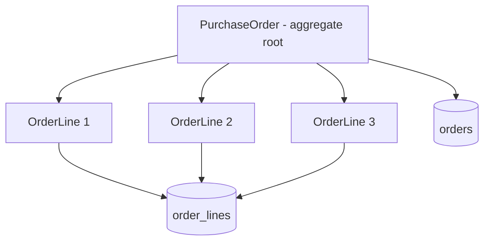

# Why Updates Can Delete and Re-insert Child Rows

In **Spring Data Relational JDBC**, when saving an existing aggregate root, Spring Data JDBC can update the root row while **deleting the child entity rows mapped within the aggregate and re-inserting child rows according to the object's current state**. This is an intentional persistence strategy of Spring Data JDBC, not an SQL bug and not the database guessing that child data has changed.

This differs from what many developers are used to in JPA, where a persistence context tracks managed entities and dirty checking can update individual changed entities. Spring Data JDBC does not maintain a persistence context to compare the entire before-and-after object state. The repository receives the current aggregate and persists it according to the aggregate boundary.

Understanding this mechanism helps you anticipate generated SQL, trigger/audit side effects, costs for large collections, foreign key constraints, and proper aggregate design.

## 1. Starting from the aggregate root and child entities

Suppose an order has multiple order lines. The order is the aggregate root; order lines are only modified through the order and are persisted as part of the aggregate.

```java
import java.util.ArrayList;
import java.util.List;

import org.springframework.data.annotation.Id;
import org.springframework.data.relational.core.mapping.MappedCollection;
import org.springframework.data.relational.core.mapping.Table;

@Table("orders")
public class PurchaseOrder {

    @Id
    private Long id;

    private String orderCode;

    @MappedCollection(
        idColumn = "order_id",
        keyColumn = "line_index"
    )
    private List<OrderLine> lines = new ArrayList<>();

    protected PurchaseOrder() {
    }

    public PurchaseOrder(String orderCode) {
        this.orderCode = orderCode;
    }

    public void addLine(String sku, int quantity, long unitPriceCents) {
        if (quantity <= 0 || unitPriceCents < 0) {
            throw new IllegalArgumentException("Invalid order line");
        }
        lines.add(new OrderLine(sku, quantity, unitPriceCents));
    }

    public void changeQuantity(int index, int quantity) {
        if (quantity <= 0) {
            throw new IllegalArgumentException("Quantity must be positive");
        }
        lines.get(index).changeQuantity(quantity);
    }

    public List<OrderLine> getLines() {
        return List.copyOf(lines);
    }

    public Long getId() {
        return id;
    }
}
```

```java
import org.springframework.data.annotation.Id;
import org.springframework.data.relational.core.mapping.Table;

@Table("order_lines")
public class OrderLine {

    @Id
    private Long id;

    private String sku;
    private int quantity;
    private long unitPriceCents;

    protected OrderLine() {
    }

    public OrderLine(String sku, int quantity, long unitPriceCents) {
        this.sku = sku;
        this.quantity = quantity;
        this.unitPriceCents = unitPriceCents;
    }

    public void changeQuantity(int quantity) {
        this.quantity = quantity;
    }

    public Long getId() {
        return id;
    }

    public String getSku() {
        return sku;
    }

    public int getQuantity() {
        return quantity;
    }

    public long getUnitPriceCents() {
        return unitPriceCents;
    }
}
```

Repository operating on the root:

```java
import org.springframework.data.repository.CrudRepository;

public interface PurchaseOrderRepository
        extends CrudRepository<PurchaseOrder, Long> {
}
```

The key mapping is `@MappedCollection`. It tells Spring Data JDBC that `lines` is a child entity collection belonging to the `PurchaseOrder` aggregate, stored in a separate table and linked back to the root via the `order_id` column.

Illustrative schema:

```sql
CREATE TABLE orders (
    id BIGINT GENERATED BY DEFAULT AS IDENTITY PRIMARY KEY,
    order_code VARCHAR(40) NOT NULL
);

CREATE TABLE order_lines (
    id BIGINT GENERATED BY DEFAULT AS IDENTITY PRIMARY KEY,
    order_id BIGINT NOT NULL REFERENCES orders(id),
    line_index INTEGER NOT NULL,
    sku VARCHAR(64) NOT NULL,
    quantity INTEGER NOT NULL CHECK (quantity > 0),
    unit_price_cents BIGINT NOT NULL CHECK (unit_price_cents >= 0),
    UNIQUE (order_id, line_index)
);
```

The aggregate can be visualized as:



The `order_lines` rows are dependent rows belonging to the aggregate. Having their own primary key on each row does not make them independent aggregate roots.

## 2. Saving a new aggregate vs. an existing aggregate

Two cases must be distinguished.

### 2.1. Inserting a new aggregate

When the root does not yet exist in the database, Spring Data JDBC creates the root first to obtain an ID, then persists the child components that depend on that ID.

General flow:

1. Insert the `orders` row.
2. Receive the root ID if generated by the database.
3. Insert `order_lines` rows with `order_id` set to the root ID.
4. Complete the operation within an appropriate transaction.

Illustrative SQL:

```sql
INSERT INTO orders (order_code)
VALUES ('PO-100');

-- Suppose the database generates id = 100.
INSERT INTO order_lines (
    order_id, line_index, sku, quantity, unit_price_cents
)
VALUES
    (100, 0, 'BOOK-01', 2, 15000),
    (100, 1, 'PEN-02', 3, 5000);
```

These statements only illustrate the mapping semantics; actual SQL and generated key retrieval depend on the database and driver.

### 2.2. Updating an existing aggregate

When an aggregate root already exists and is saved again, Spring Data JDBC does not diff the entire collection to update only modified children. Its strategy for referenced entities within an aggregate is to **delete the stored dependent rows and re-insert the child entities present in the current aggregate**.

For example, suppose an aggregate initially has three lines:

| order_id | line_index | sku | quantity |
|---:|---:|---|---:|
| 100 | 0 | BOOK-01 | 2 |
| 100 | 1 | PEN-02 | 3 |
| 100 | 2 | BAG-03 | 1 |

You modify only the quantity of the first line:

```java
PurchaseOrder order = orders.findById(100L)
        .orElseThrow();

order.changeQuantity(0, 4);

orders.save(order);
```

From a business perspective, only one value changed. At the persistence layer, however, Spring Data JDBC may perform logic equivalent to:

```sql
-- Update the aggregate root according to the current state.
UPDATE orders
SET order_code = ?
WHERE id = ?;

-- Delete the dependent rows belonging to the mapped collection.
DELETE FROM order_lines
WHERE order_id = ?;

-- Re-insert the children currently present in the aggregate.
INSERT INTO order_lines (
    order_id, line_index, sku, quantity, unit_price_cents
)
VALUES (?, 0, 'BOOK-01', 4, 15000);

INSERT INTO order_lines (
    order_id, line_index, sku, quantity, unit_price_cents
)
VALUES (?, 1, 'PEN-02', 3, 5000);

INSERT INTO order_lines (
    order_id, line_index, sku, quantity, unit_price_cents
)
VALUES (?, 2, 'BAG-03', 1, 250000);
```

This describes the **logical strategy**, not an exact SQL transcript for every version or aggregate type. Actual statements may differ in ordering, batching, and statement count. The main point is that dependent entities within an aggregate are synchronized according to the saved aggregate state, rather than relying on per-child dirty tracking.

**Therefore, an unchanged child can still be deleted and re-inserted when the root is saved.**

## 3. Why did Spring Data JDBC choose this strategy?

### 3.1. No persistence context is maintained

JPA typically has a persistence context holding managed entities. When an entity is loaded, the persistence provider can track both its initial state and current state. At flush time, dirty checking identifies which entities and properties changed in order to emit targeted `UPDATE` statements.

Spring Data JDBC takes a different approach:

- The repository reads data and returns Java objects.
- Objects do not live inside a long-lived persistence context tracked by the framework.
- When `save(aggregate)` is called, the framework receives the current aggregate.
- The framework does not keep an automatic snapshot of every child prior to mutation for per-child comparison.
- The aggregate is saved according to its mapping and lifecycle.

Having no persistence context does not mean Spring Data JDBC cannot map objects. It has metadata and conversions to read and write objects, but it does not maintain managed state like JPA.

### 3.2. The aggregate is the consistency unit

Spring Data JDBC treats the aggregate root as the persistence entry point for the components belonging to the aggregate. A save operation on the root must synchronize dependent entities to match the current state of the aggregate.

The delete-and-reinsert strategy for collections allows the framework to apply a relatively simple, consistent rule:

- Children remaining in the current aggregate are saved.
- Children removed from the aggregate are no longer persisted.
- New children added to the aggregate are inserted.
- The framework avoids needing complex old/new object graph diffing like an ORM with a persistence context.

This fits small aggregates where the root and its children are manipulated as a single unit.

### 3.3. JDBC focuses on straightforward SQL statements

Spring Data JDBC builds directly on JDBC and relational mapping. It does not simulate the full behavior of an ORM managing an in-memory object graph. Synchronizing dependent rows via delete/insert is a simple and predictable strategy at the aggregate level.

In return, the application must design aggregates reasonably. If a root contains tens of thousands of children and only one changes at a time, re-saving the whole collection can be costly. That is a signal to revisit the aggregate boundary or data access pattern.

## 4. Deleting and re-inserting does not mean the root is deleted too

Distinguish between two kinds of rows:

- **Aggregate root row:** the row in the `orders` table. When the root already exists, Spring Data JDBC normally updates this row with an `UPDATE`.
- **Dependent child rows:** rows in `order_lines` belonging to the mapped collection. They may be deleted and re-inserted when saving the aggregate.

| Component | When saving a new aggregate | When saving an existing aggregate |
|---|---|---|
| Root row | INSERT | UPDATE |
| Embedded value object | Written to columns of the root | Updates columns of the root |
| Child collection in `@MappedCollection` | INSERT children | Delete dependent rows and INSERT current child state |
| Aggregate reference | Writes referenced ID in root | Updates ID if reference changes |
| Referenced aggregate root | Not auto-inserted just because of reference | Not auto-updated/deleted just because root stores reference |

Embedded objects are flattened into columns of the root table, so there is no child table to delete/insert. An aggregate reference is a link to another aggregate; it is not an owned child collection belonging to the root.

## 5. Consequences when child rows are deleted and re-inserted

### 5.1. Unchanged children still generate database writes

Suppose an order has 200 lines. You edit the quantity of a single line and call save on the root. Spring Data JDBC may delete and re-insert all 200 lines.

Consequences:

- More DELETE/INSERT statements than the number of business changes.
- Increased write volume and transaction log size.
- Longer lock retention times.
- Extra work for indexes and constraints.
- Higher load on the database and connection pool.

This is why aggregates should be kept moderately sized, matching a single business consistency unit.

### 5.2. Triggers and auditing on the child table may fire again

If the child table has a trigger:

```sql
CREATE TRIGGER order_lines_audit_trigger
AFTER INSERT OR DELETE ON order_lines
FOR EACH ROW
EXECUTE FUNCTION audit_order_line_change();
```

the delete/insert strategy can fire DELETE and INSERT triggers for children, even for children whose business data did not change.

This can produce audit or CDC events that readers misinterpret as the user deleting and recreating every order line. When designing auditing, distinguish between:

- A business operation "edit one line."
- Technical statements emitted by the persistence layer.
- Events captured by triggers or CDC.

If auditing needs to reflect business intent, record explicit domain events in the service layer rather than inferring all behavior from physical INSERT/DELETE statements.

### 5.3. Default columns and timestamps on children

Suppose the child table has a column:

```sql
created_at TIMESTAMP NOT NULL DEFAULT CURRENT_TIMESTAMP
```

If a child row is deleted and re-inserted, the database default may be applied on the new insert. The row creation timestamp may change even though the line's content did not change.

Similarly, triggers updating `updated_at`, sequences, audit tables, or CDC may reflect technical insert/delete cycles.

If you need to preserve child creation timestamps across aggregate saves, explicitly model that property and check whether the actual INSERT writes the preserved value. Do not rely on database defaults to preserve history if rows are recreated.

### 5.4. Foreign keys from other tables referencing a child

This is a critical architectural consequence.

Suppose another table references `order_lines.id`:

```sql
CREATE TABLE shipment_line_links (
    id BIGINT PRIMARY KEY,
    order_line_id BIGINT NOT NULL REFERENCES order_lines(id)
);
```

If Spring Data JDBC deletes child rows before re-inserting them, the foreign key from `shipment_line_links` can block the deletion because the row is still referenced. If cascade is configured, linked rows may be deleted along with it, which is usually unintended. If `SET NULL` is used, linked data loses its reference.

This illustrates that a child entity belonging to an aggregate should not be directly referenced by multiple external aggregates as an independent object. If data must be referenced independently, consider promoting it to its own aggregate root and designing a stable reference.

**A separate table does not automatically turn a child into an aggregate root.** Ownership and lifecycle determine that.

### 5.5. Child IDs and generated values

If a child has an ID, distinguish application-assigned IDs from database-generated IDs. The child persistence strategy may re-issue INSERTs, and ID handling depends on the mapping, current ID values, ID type, and database.

Do not assume every save allocates new IDs or that every save preserves existing IDs. Check the generated-key behavior of your specific Spring Data JDBC version and schema if child IDs carry meaning outside the aggregate.

A safe design rule is **do not use a dependent child's ID as a stable public identifier for other aggregates** when the child is managed as part of an aggregate root.

## 6. Distinguishing from ON DELETE CASCADE

Spring Data JDBC deleting and re-inserting children when saving an aggregate is not the same as `ON DELETE CASCADE`.

| Criterion | Saving an aggregate in Spring Data JDBC | Database ON DELETE CASCADE |
|---|---|---|
| When it runs | When saving an existing aggregate with dependent entities | When deleting a row referenced by a cascading FK |
| Behavior | Deletes existing dependent rows and inserts current child state | Deletes referencing rows when the parent is DELETEd |
| Controlled by | Spring Data JDBC mapping/persistence operation | Database foreign key |
| Does the root need to be deleted? | No; the root may only be UPDATEd | Yes; the referenced row is DELETEd |
| Can it run while the root still exists? | Yes, when saving the root | Not from parent delete cascade; only when a corresponding parent DELETE occurs |
| Depends on `@MappedCollection`? | Yes, for dependent collections | No |
| Affects child triggers? | Possibly, due to child DELETE/INSERT | Possibly, due to database cascade DELETE on child |

For example: calling `orders.save(order)` to modify one line can produce child DELETE/INSERT statements while the `orders` row remains intact. Conversely, `ON DELETE CASCADE` does not run when the root row is only UPDATEd.

Do not use `ON DELETE CASCADE` as a blanket explanation for every time child rows disappear. Inspect the actual SQL statements and the repository operations invoked.

## 7. Transactions protect consistency during delete and re-insert

If Spring Data JDBC deletes children and the subsequent insert of new children fails, the application must not leave the aggregate with partial children. Aggregate save operations must execute inside an appropriate transaction so changes roll back on error.

Service example:

```java
import org.springframework.stereotype.Service;
import org.springframework.transaction.annotation.Transactional;

@Service
public class OrderService {

    private final PurchaseOrderRepository orders;

    public OrderService(PurchaseOrderRepository orders) {
        this.orders = orders;
    }

    @Transactional
    public PurchaseOrder changeQuantity(
            long orderId,
            int lineIndex,
            int newQuantity
    ) {
        PurchaseOrder order = orders.findById(orderId)
                .orElseThrow();

        order.changeQuantity(lineIndex, newQuantity);

        return orders.save(order);
    }
}
```

When the transaction manager and repository share the same DataSource, root and child operations participate in the same JDBC transaction. If a child insert statement fails due to a constraint, transaction rollback restores the pre-transaction state according to the database's transactional guarantees.

Key points to remember:

- Calls must pass through a Spring bean/proxy for transaction annotations to apply in standard proxy mode.
- Do not manually open JDBC connections detached from the transaction.
- Do not run DB operations for the same aggregate across separate threads expecting them to share a transaction automatically.
- Exceptions requiring rollback must exit the transaction boundary or mark the transaction rollback-only appropriately.
- JDBC transactions cannot roll back emails, HTTP requests, or messages already sent to external systems.

Without a transaction wrapping the entire operation, a failure mid-sequence can leave inconsistent data depending on how individual statements execute. Keep transaction boundaries around the atomic business unit.

## 8. Why doesn't Spring Data JDBC just UPDATE changed children?

A common question is: "Why doesn't the framework compare the order lines and just UPDATE one row?"

To do that in general, the persistence layer would need to know at least:

1. The initial state of children in the database.
2. The current state in the object.
3. The identity of each child across both states.
4. Which children were added, removed, or modified.
5. Which changes affect collection order or foreign keys.
6. Which operations must execute to preserve aggregate invariants.

If the framework kept a snapshot of the object graph or a persistence context, it could track changes, but it would have to maintain state, identity maps, lifecycles, and much more complex ORM rules.

Spring Data JDBC chose a sessionless model. When saving, the current aggregate is the complete description of the data to persist. For moderately sized aggregates, this strategy is easy to reason about and fits an aggregate-centric approach. In return, applications should not build giant aggregates just to bundle unrelated data with different lifecycles.

## 9. Optimizing design when child collections are large

### 9.1. Keep aggregates small and business-meaningful

If a root contains tens of thousands of children and children are frequently updated independently, deleting and re-inserting the entire collection can be very expensive.

For example, a `Customer` with millions of `LoginHistory` records. If login history were modeled as a child collection of `Customer`, every save of `Customer` could have to synchronize a huge collection.

Consider extracting `LoginHistory` into its own aggregate root with its own repository. Adding a login record then writes only a small aggregate instead of saving `Customer` alongside its entire history.

### 9.2. Separate data with independent lifecycles

A child may belong as its own aggregate root if it:

- Can be created, deleted, or updated independently.
- Requires separate paginated queries.
- Exists in large numbers.
- Is referenced by many other components.
- Has its own audit or retention rules.
- Needs optimized single-row updates.

When separated, the former root stores an ID or reference to the new aggregate instead of owning the collection.

### 9.3. Use targeted SQL for narrow update operations

If an operation only needs to increment a counter or update a status on a single child row, consider custom SQL/`JdbcTemplate` rather than loading and saving a large aggregate.

Example:

```java
@Repository
public class OrderLineCommands {

    private final JdbcTemplate jdbc;

    public OrderLineCommands(JdbcTemplate jdbc) {
        this.jdbc = jdbc;
    }

    public int changeQuantity(long lineId, int quantity) {
        return jdbc.update(
                "UPDATE order_lines SET quantity = ? WHERE id = ?",
                quantity,
                lineId
        );
    }
}
```

This is a direct SQL command. It **does not automatically synchronize an aggregate object currently held in memory**. If you later save a stale aggregate whose collection does not reflect this change, the data can be overwritten by that collection state.

Therefore, only use targeted SQL when ownership and aggregate state are clearly controlled. Either reload the aggregate afterward, or model the child as its own aggregate root so a command repository updates directly within the proper boundary.

Custom SQL must also participate in an appropriate transaction and preserve constraints and business invariants. Do not update aggregate children directly from multiple places without clear ownership rules.

### 9.4. Do not turn an aggregate into a batch container

If a root is only used to group multiple tables together for convenient saving, revisit the domain model. An aggregate is not a folder containing every table with a foreign key. It is a consistency boundary where invariants must be enforced during writes.

Large child collections are often a signal to review the model before trying to work around the delete/insert strategy.

## 10. Impact of collection ordering

With `List`, ordering can be stored via a key column:

```java
@MappedCollection(
    idColumn = "order_id",
    keyColumn = "line_index"
)
private List<OrderLine> lines;
```

When the collection is saved again, Spring Data JDBC must synchronize elements and positions according to the current list state. For example, swapping two lines can alter the key/index of multiple rows. For large collections, rewriting dependent rows involves more work than a single simple `UPDATE`.

If order has no business meaning, consider `Set` or an appropriate collection model. If order is meaningful, keep `List` with an explicit key column; do not assume SQL read order without corresponding mapping or ordering semantics.

Never rely on the physical order of rows in a database table as business order. Use an explicit order column or a query with an appropriate `ORDER BY`.

## 11. Child rows with generated IDs: understanding their role

For example, `OrderLine` has:

```java
@Id
private Long id;
```

This ID can be useful for mapping and identifying rows in the table, yet if `OrderLine` remains a child saved through the aggregate root, its lifecycle depends on the root.

If an external system stores `order_line_id` for long-term references, the delete/re-insert strategy for dependent rows can conflict with FKs or identity expectations. Ask:

- Do other tables truly need to reference the child directly?
- Should the child be its own aggregate root?
- Can we reference the root and use a stable business key instead of the child ID?
- Do we need to store a snapshot or an association entity with its own lifecycle?

Do not rely on IDs accidentally being preserved in one specific configuration to treat a child as an independently referenced object.

## 12. Distinguishing relationship types on save

Not every nested object is deleted and re-inserted like a child collection.

| Component | Mapping | Behavior when saving root |
|---|---|---|
| Root row | `@Table`, `@Id` | Insert if new; update if already existing |
| Embedded value | `@Embedded` | Embedded columns written in the root row |
| Child collection | `@MappedCollection` | Dependent rows may be deleted and re-inserted according to current collection state |
| Aggregate reference | ID or `AggregateReference` | Root saves ID/reference; target aggregate is not automatically saved/deleted |
| Entity not in aggregate mapping | Not referenced as dependent | Does not automatically participate in root save |

For instance, an embedded `ShippingAddress` does not create a separate table. `OrderLine` is a child collection with its own table. `Customer` is another aggregate root referenced by ID. Simply seeing an object-typed field is not enough to conclude how Spring Data JDBC will handle it.

## 13. Diagnosing unexpected DELETE/INSERT statements

If SQL logs show DELETE followed by INSERT of multiple child rows during a single save, investigate in sequence:

1. **Identify the repository method:** did code call `save(root)`, delete, a custom query, or `JdbcTemplate`?
2. **Determine root state:** is the root new or already existing?
3. **Inspect mappings:** which properties use `@MappedCollection`?
4. **Check aggregate size:** how many children are in the collection?
5. **Read SQL by table:** is DELETE happening on the child table or the root table?
6. **Check triggers/auditing:** which triggers fire on child DELETE/INSERT?
7. **Check FKs:** do any tables directly reference the child?
8. **Check transactions:** do statements share the same transaction and roll back on error?
9. **Revisit ownership:** does the child truly belong to the root or should it be a separate aggregate?

| Symptom | Possible explanation | Resolution |
|---|---|---|
| Editing one child logs DELETEs for many children | Aggregate save synchronizes collection via delete/insert strategy | Evaluate aggregate size and save frequency |
| Audit trigger logs DELETE/INSERT for unchanged children | Triggers react to physical statements | Distinguish persistence mechanics from domain events |
| Child `created_at` changes after root save | DB default applied when child is re-inserted | Persist the timestamp to preserve, or change auditing/model |
| FK from another table blocks root save | Child is referenced outside the aggregate | Extract child into its own aggregate or redesign the reference |
| Large child collection makes save slow | Many dependent rows rewritten | Shrink aggregate, use controlled targeted SQL, or split aggregate |
| Direct SQL child update is overwritten after root save | Stale aggregate object holds old state and save re-synchronizes collection | Reload root, fix ownership, or split repository |
| Root row remains after child DELETE | Child rows are synchronized; root is only UPDATEd | Distinguish statements on root table vs. child table |
| Mid-operation failure leaves incomplete collection | Transaction boundary does not cover all operations | Use proper transactions and verify rollback |

## 14. Testing aggregate persistence behavior

An integration test can verify the data after save, but understanding the SQL strategy requires observing SQL logs or using an appropriate datasource proxy/test instrumentation.

Functional test example:

```java
@DataJdbcTest
class PurchaseOrderRepositoryTest {

    @Autowired
    PurchaseOrderRepository orders;

    @Test
    void savesUpdatedAggregateState() {
        PurchaseOrder order = new PurchaseOrder("PO-100");
        order.addLine("BOOK-01", 2, 15000);
        order.addLine("PEN-02", 3, 5000);

        PurchaseOrder saved = orders.save(order);

        PurchaseOrder loaded = orders.findById(saved.getId())
                .orElseThrow();

        loaded.changeQuantity(0, 4);

        PurchaseOrder updated = orders.save(loaded);

        PurchaseOrder reloaded = orders.findById(updated.getId())
                .orElseThrow();

        assertThat(reloaded.getLines()).hasSize(2);
        assertThat(reloaded.getLines().get(0).getQuantity()).isEqualTo(4);
    }
}
```

This test assumes the domain has the corresponding `changeQuantity(...)` method. It verifies that the aggregate state is persisted, not the number of DELETE/INSERT statements by itself. To inspect SQL, enable appropriate logging or use JDBC observation tools and check the actual statements emitted by the version in use.

### 14.1. Testing triggers and auditing

If the child table has triggers, write integration tests verifying the number of audit rows after:

- Inserting a new aggregate.
- Saving an unchanged aggregate.
- Saving an aggregate where only one child changed.
- Deleting an aggregate.

This test reveals whether triggers reflect persistence operations or business operations. Never infer audit event counts solely from Java field mutations.

### 14.2. Testing foreign keys and rollback

Create another table referencing the child to confirm whether the schema blocks child deletion. If that FK causes aggregate save to fail, verify transaction rollback and reconsider the aggregate boundary.

Do not hastily add `ON DELETE CASCADE` just to make a test pass; cascading may delete related data that the business needs to retain.

## 15. Self-check questions

1. **Why can saving an existing aggregate delete and re-insert all child rows?** Because Spring Data JDBC does not maintain a persistence context/snapshot to dirty-check individual children; it synchronizes dependent entities according to the current aggregate state.
2. **Is the root row deleted and re-inserted too?** Normally an existing root is UPDATEd; the delete/re-insert strategy applies to managed dependent entities.
3. **Can unchanged children still be rewritten?** Yes, children in a mapped collection can still be deleted and re-inserted.
4. **Is this `ON DELETE CASCADE`?** No. This is Spring Data JDBC's persistence strategy; FK cascade only triggers when the referenced row is DELETEd.
5. **Are embedded value objects deleted/re-inserted like a child table?** There are no separate child rows; embedded columns live on the root table.
6. **Is an `AggregateReference` saved alongside its target aggregate?** No. The root stores the ID/reference; the target aggregate has its own repository and lifecycle.
7. **Why might triggers record extra events?** Because triggers react to physical DELETE/INSERT statements, even when a child's business data did not change.
8. **What happens if a child is referenced by multiple other tables?** Foreign keys can block child deletion; this is a sign to review ownership or aggregate boundaries.
9. **Should custom UPDATEs be used to avoid rewriting collections?** They can be used for narrow operations, but you must control transactions, invariants, and aggregate state so a stale root save does not overwrite them.
10. **When should a child be extracted into a separate aggregate?** When the child has an independent lifecycle, queries, updates, or external references, or when the collection becomes too large.

## 16. Key takeaway

When calling `save` on an existing aggregate in Spring Data JDBC, remember that the framework synchronizes aggregate state according to its persistence strategy: the root is updated, while dependent entities in managed collections may be deleted and re-inserted based on the current state. This happens because Spring Data JDBC does not keep a persistence context to diff individual children like JPA dirty checking.

An important consequence is that a small change in Java can generate many database write operations. Triggers, auditing, default timestamps, foreign keys, and performance can all be affected. For small child collections that genuinely belong to the root's lifecycle, this approach fits the aggregate model well. For large collections, independently referenced rows, or frequent single-row updates, consider splitting aggregates or using targeted SQL with clear ownership rules.

**Design aggregates around business consistency boundaries, not out of a desire to bundle multiple tables into one save call.** Once you understand the delete/insert strategy properly, you can predict the SQL and avoid surprises when running Spring Data Relational JDBC.
