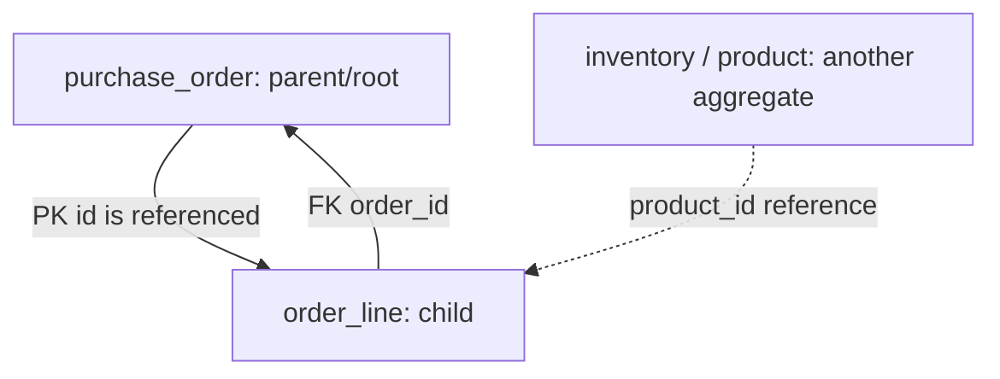
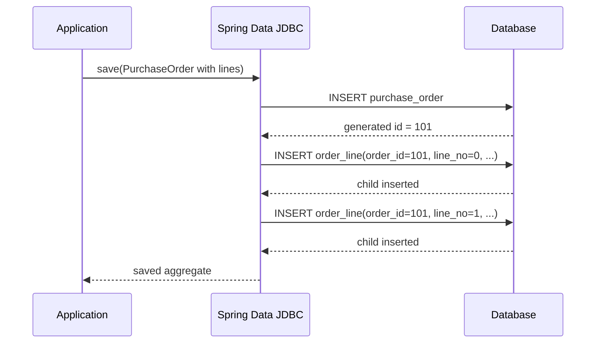
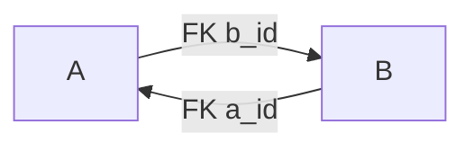

# SQL Statement Ordering and the Impact of Foreign Key Constraints

In **Spring Data Relational JDBC**, a single `repository.save(aggregate)` call can produce multiple SQL statements for the aggregate root and its owned child entities. The order of those statements must match the relationships between tables. If a child table has a foreign key pointing to a parent table, the database typically requires **the parent to exist before inserting the child** and **the child to be deleted before deleting the parent**.

Therefore, when designing aggregates and schemas, you need to understand three layers together:

- **Aggregate mapping:** Spring Data JDBC knows which collections and entities the root owns.
- **SQL action ordering:** insert, update, and delete operations are ordered to persist the aggregate.
- **Database constraints:** foreign keys, unique/check constraints, and cascade rules determine whether the database accepts or rejects each statement.

This lesson explains how to read SQL ordering across parent-child relationships, how to design FKs for aggregates and cross-aggregate references, and how to handle constraint errors within transactions.

## 1. Parent-child model and foreign keys

Suppose a `PurchaseOrder` owns multiple `OrderLine` instances:

```text
PurchaseOrder (aggregate root)
  id = 101
  lines
    ├── OrderLine (id = 501)
    └── OrderLine (id = 502)
```

Relational schema:

```sql
CREATE TABLE purchase_order (
    id BIGINT GENERATED BY DEFAULT AS IDENTITY PRIMARY KEY,
    status VARCHAR(30) NOT NULL
);

CREATE TABLE order_line (
    id BIGINT GENERATED BY DEFAULT AS IDENTITY PRIMARY KEY,
    order_id BIGINT NOT NULL,
    product_id BIGINT NOT NULL,
    quantity INTEGER NOT NULL CHECK (quantity > 0),
    CONSTRAINT fk_order_line_order
        FOREIGN KEY (order_id) REFERENCES purchase_order(id)
);
```

`order_line.order_id` is an FK pointing to `purchase_order.id`. This is an ownership relationship within the aggregate. When the database checks FKs immediately at statement execution time, every `order_line` row must reference an existing `purchase_order`.

Dependency diagram:



The direction of FK dependency runs from the child table to the parent table. Thus, SQL operation order generally follows the reverse direction for deletion:

| Operation | Order compatible with typical FKs |
|---|---|
| Insert a new aggregate | Insert root/parent first, insert children second |
| Delete an aggregate | Delete children first, delete root/parent second |
| Replace child collection when saving an existing aggregate | Delete old child rows before re-inserting new child rows |
| Change FK to another parent | Ensure target parent exists before updating the FK |

This ordering follows **data dependencies**. The number of statements, exact SQL syntax, and generated key handling can vary across databases, dialects, and Spring Data JDBC versions.

## 2. Inserting a new aggregate: root first, children second

When saving a new aggregate, Spring Data JDBC must write the root to obtain its ID before it can write child entities with an FK pointing back to that ID.

Domain model example:

```java
@Table("purchase_order")
public class PurchaseOrder {

    @Id
    private Long id;

    private String status;

    @MappedCollection(idColumn = "order_id", keyColumn = "line_no")
    private List<OrderLine> lines = new ArrayList<>();

    protected PurchaseOrder() {}

    public PurchaseOrder(String status) {
        this.status = status;
    }

    public void addLine(Long productId, int quantity) {
        lines.add(new OrderLine(productId, quantity));
    }
}
```

```java
@Table("order_line")
public class OrderLine {

    @Id
    private Long id;

    @Column("product_id")
    private Long productId;

    private int quantity;

    protected OrderLine() {}

    public OrderLine(Long productId, int quantity) {
        this.productId = productId;
        this.quantity = quantity;
    }
}
```

Saving the root:

```java
PurchaseOrder order = new PurchaseOrder("DRAFT");
order.addLine(10L, 2);
order.addLine(15L, 1);

PurchaseOrder saved = purchaseOrderRepository.save(order);
```

With database-generated identity IDs, the logical flow is typically:



If IDs are pre-assigned by the application (such as UUIDs), the root ID is already known, yet the FK dependency order remains the same: the root must be inserted before the children so the child FKs are valid. Having an ID already does not mean children can be inserted before the root.

If a child also references another aggregate root via `product_id`, that product must also exist before inserting `OrderLine`, unless the database uses deferred FKs and the relevant conditions are met. For independent aggregates, the application normally creates/persists the referenced root first before saving an aggregate that uses its ID.

## 3. Deleting an aggregate: children first, root second

With an FK `order_line.order_id REFERENCES purchase_order(id)` that forbids deleting a parent while children remain, deleting the aggregate requires removing child rows first.

```sql
DELETE FROM order_line WHERE order_id = 101;
DELETE FROM purchase_order WHERE id = 101;
```

That is the dependency order required when the database checks FKs immediately at statement execution. Spring Data JDBC knows which collections belong to the aggregate and executes deletes for owned entities according to the mapping before deleting the root.

With nested collections:

```text
PurchaseOrder
  └── OrderLine
        └── LineNote
```

If `line_note.order_line_id` points to `order_line.id`, and `order_line.order_id` points to `purchase_order.id`, deletion order must proceed from deepest to outermost:

```sql
DELETE FROM line_note WHERE order_line_id IN (...);
DELETE FROM order_line WHERE order_id = 101;
DELETE FROM purchase_order WHERE id = 101;
```

General rule: **delete dependent nodes before referenced nodes**. Within an aggregate tree, deletion proceeds in the reverse order of insertion.

Do not assume the framework simply sends a single `DELETE FROM purchase_order ...` and lets the database delete all children automatically. That only happens if the schema defines `ON DELETE CASCADE` and the deletion relies on cascade. Spring Data JDBC manages the lifecycle of owned entities; inspect actual SQL logs and DDL rather than relying on cascade assumptions.

## 4. Saving an existing aggregate: updating root and synchronizing child entities

Spring Data JDBC does not behave like an ORM keeping a persistence context and dirty-checking each child. When saving an existing aggregate, the framework may **delete referenced child entities and re-insert the current collection state**. The root is updated according to its state. This affects SQL ordering and write costs.

Example:

```java
PurchaseOrder order = purchaseOrderRepository.findById(orderId)
        .orElseThrow();

order.changeStatus("CONFIRMED");
order.addLine(20L, 1);

purchaseOrderRepository.save(order);
```

For an aggregate with a child collection, the logical steps may include:

1. Delete child rows currently belonging to the root to replace the collection.
2. Update the root row (including version check if `@Version` is present).
3. Insert child rows representing the current collection.

The exact order among certain actions can depend on the implementation/version and aggregate structure. What is mandatory under standard FKs is never inserting a child before its parent exists, and never deleting a parent while children still reference it. If you need to verify the exact statement ordering in your application, enable logging and test against the exact Spring Data JDBC version and target database.

### Why delete and re-insert children?

Spring Data JDBC treats the aggregate as the unit of persistence. When receiving the new state of an aggregate, the framework does not keep an old snapshot to compute a per-child diff like Hibernate. Instead of comparing the entire object graph, it synchronizes referenced entities using Spring Data JDBC's persistence strategy.

Consequences:

- A minor change on the root can trigger many statements for a large collection.
- Child IDs may be regenerated if children use generated keys.
- Triggers, audit tables, or other tables referencing child IDs may be affected.
- FKs from external tables pointing directly to a child can cause delete/re-insert to fail or alter semantics.

If a child has an independent lifecycle, is referenced from multiple places, or needs independent updates, consider making it a separate aggregate root and referencing it by ID. Do not let an entity act simultaneously as an owned child and as a shared object referenced by many other aggregates.

## 5. FKs to another aggregate root: not an ownership relationship

Suppose `PurchaseOrder` references `Customer` and each `OrderLine` references `Product`:

```text
Customer (independent root)
  id = 42

Product (independent root)
  id = 10

PurchaseOrder (independent root)
  customerId = 42
  lines
    OrderLine(productId = 10)
```

The schema can define FKs:

```sql
CREATE TABLE purchase_order (
    id BIGINT GENERATED BY DEFAULT AS IDENTITY PRIMARY KEY,
    customer_id BIGINT NOT NULL REFERENCES customer(id)
);

CREATE TABLE order_line (
    id BIGINT GENERATED BY DEFAULT AS IDENTITY PRIMARY KEY,
    order_id BIGINT NOT NULL REFERENCES purchase_order(id),
    product_id BIGINT NOT NULL REFERENCES product(id),
    quantity INTEGER NOT NULL
);
```

In the domain model, store `customerId`/`productId` or `AggregateReference<Customer, Long>`/`AggregateReference<Product, Long>` rather than direct entity properties when they are independent roots.

This has two ordering consequences:

- When creating an order, `Customer` must exist before inserting the order if FKs are checked immediately. `Product` must exist before inserting the line.
- When deleting `Customer` or `Product`, the database can reject the delete if orders or lines still reference it. That is usually the right behavior because referenced roots have independent lifecycles; order history should not be silently wiped just because a customer or product is deleted.

An FK between aggregate roots is a **data referential integrity constraint**, not a transfer of ownership from one root to another. Spring Data JDBC does not automatically cascade `save()` to an independent aggregate just because a field holds an `AggregateReference`.

## 6. Are FKs checked immediately or deferred?

Many databases check FKs immediately when a statement executes (*immediate constraints*). Some databases allow FKs to be declared `DEFERRABLE`, deferring validation until the end of the transaction.

PostgreSQL example:

```sql
ALTER TABLE order_line
ADD CONSTRAINT fk_order_line_order
FOREIGN KEY (order_id)
REFERENCES purchase_order(id)
DEFERRABLE INITIALLY DEFERRED;
```

With this constraint, PostgreSQL can allow statements to create temporarily invalid reference states within a transaction, provided all FKs are valid when checked at the end of the transaction/commit. State can be altered with `SET CONSTRAINTS` when needed.

However:

- Not every database supports deferrable FKs.
- Not every type of constraint can be deferred.
- Deferred constraints only postpone **when the check runs**; they do not fix an invalid relationship at transaction end.
- Spring Data JDBC does not automatically configure all FKs as deferred; that belongs to database DDL and transaction SQL.
- If a transaction commits with an invalid FK, the commit still fails and the entire transaction rolls back.

Therefore, design parent-before-child and child-before-parent ordering as the default. Rely on deferred FKs only when there is a specific requirement, database support, and integration tests proving the behavior.

## 7. `ON DELETE CASCADE`, `RESTRICT`, and `SET NULL`

FKs can specify actions when a referenced row is deleted:

| Action | Effect | When to consider |
|---|---|---|
| `NO ACTION` | Rejects if referencing rows still exist at check time | Common default; protects referenced data |
| `RESTRICT` | Rejects parent deletion while children exist; timing differences depend on database | Preventing deletion of a root that is still in use |
| `CASCADE` | Database automatically deletes child rows when parent is deleted | Pure ownership relationships with clearly controlled semantics |
| `SET NULL` | Sets child FK to `NULL` | Optional relationships where the FK column is nullable and domain allows unlinking |

Example:

```sql
FOREIGN KEY (order_id)
REFERENCES purchase_order(id)
ON DELETE CASCADE
```

`ON DELETE CASCADE` can be helpful for data wholly dependent on a root, but you must understand how it interacts with SQL emitted by Spring Data JDBC. If the framework already deletes children first, cascade may have no rows left to delete; if a direct database delete path exists, cascade cleans up children automatically. The vital rule is **do not use cascade to accidentally delete independent aggregates**.

In particular, do not place `ON DELETE CASCADE` from `purchase_order.customer_id` to `customer.id` if deleting a customer would wipe out all historical orders. Those are two independent aggregate roots; `RESTRICT`/`NO ACTION` is usually more appropriate, or soft delete/anonymization per data retention policy.

`SET NULL` also requires a nullable column and a domain model that accepts losing the reference. If `customer_id` is mandatory to understand order history, mark it `NOT NULL` and do not use `SET NULL`.

## 8. Circular references and FK cycles

Consider two tables with mandatory FKs pointing to each other:

```text
Table A: b_id NOT NULL → Table B.id
Table B: a_id NOT NULL → Table A.id
```

When neither row exists yet, with immediate FK checks, you cannot insert A before B because B does not exist; nor can you insert B before A because A does not exist. This is a **dependency cycle** in the schema.



Possible resolutions include:

1. **Redesign the relationship:** remove one FK direction or replace one edge with an ID reference that is not mandatory at creation time.
2. **Make one side nullable:** insert A with `b_id = NULL`, insert B with `a_id = A.id`, then update A to set `b_id = B.id` within the same transaction.
3. **Deferred FK:** only when supported by the database and all required constraints are declared deferrable; insert both rows in one transaction and validate on commit.
4. **Use a join/link table:** represent the relationship after both roots already exist instead of embedding mandatory bidirectional FKs.

In Spring Data JDBC, the sustainable solution is usually to **avoid circular ownership and avoid mandatory FKs that create cycles**. Aggregates should have a clear ownership structure; cross-aggregate references use IDs, and creating two roots is coordinated in a feasible order.

## 9. FKs to join tables and many-to-many relationships

For a many-to-many relationship between `Student` and `Course`, the join table `Enrollment` has two FKs:

```sql
CREATE TABLE enrollment (
    student_id BIGINT NOT NULL REFERENCES student(id),
    course_id BIGINT NOT NULL REFERENCES course(id),
    enrolled_at TIMESTAMP NOT NULL,
    status VARCHAR(30) NOT NULL,
    PRIMARY KEY (student_id, course_id)
);
```

Insert ordering must ensure both `Student` and `Course` already exist before creating an `Enrollment`. When deleting an enrollment, delete the link row first; when deleting a student or course, handle referencing enrollments according to the FK policy.

If `Enrollment` has its own business state and lifecycle, it can be modeled as a separate aggregate root. If the join table is purely a persistence detail, it can be manipulated through an appropriate repository or query. Do not create two direct bidirectional entity collections and expect Spring Data JDBC to manage many-to-many relationships automatically like an ORM.

## 10. SQL ordering, transactions, and rollback on FK violations

Statements within a single aggregate save are normally executed in a transaction. If a statement violates an FK, unique constraint, or check constraint, the database returns an error. Spring translates the JDBC error into a data access exception hierarchy, commonly `DataIntegrityViolationException` or a related subtype.

Example:

```java
@Transactional
public PurchaseOrder placeOrder(Long customerId, Long productId) {
    // If customerId does not exist, INSERT purchase_order may violate the FK.
    PurchaseOrder order = new PurchaseOrder(customerId);
    order.addLine(productId, 1);
    return orderRepository.save(order);
}
```

If an error occurs and exits the transaction as a `RuntimeException`, Spring rolls back by default. Do not catch `DataIntegrityViolationException` and continue committing previous operations as if the aggregate had been saved successfully.

An important caveat: if an application service catches an exception and turns it into a normal return inside a transactional method, the transaction interceptor may see the method complete normally. If the transaction was already marked rollback-only by a lower layer, the final commit can throw `UnexpectedRollbackException`. Let exceptions propagate out of the transaction boundary or explicitly mark rollback by design.

### FKs do not replace business validation

An FK can ensure `product_id` exists, but it does not ensure:

- The product is currently available for sale.
- The product is in stock.
- The customer is not blocked.
- The product price is valid at the time of ordering.
- The order transitions states according to domain rules.

These invariants must be checked in the application/domain layer and protected with appropriate concurrency controls. FKs protect **referential integrity**, not business rules.

## 11. Observing SQL ordering in practice

In development/test environments, enable JDBC logging to inspect statements:

```yaml
logging:
  level:
    org.springframework.jdbc.core: DEBUG
```

For specific drivers, additional driver/database logging can be enabled when necessary. Do not enable logging of sensitive bind values in production.

When inspecting, focus on these questions:

1. Was the root inserted before the children?
2. Was the database-generated ID retrieved before binding the child FK?
3. When deleting, were the deepest child tables handled before parent tables?
4. When saving an existing aggregate, were old children replaced under the proper FK?
5. Did an FK to an independent aggregate root reference an already existing ID?
6. If a constraint failed on the last statement, were earlier statements rolled back?

Do not deduce SQL order solely from field order in Java classes. Ordering is determined by mappings, the action planner, the dialect, and database constraints.

## 12. Integration testing with real FKs

A valuable test should verify inserts, deletes, and rollbacks on a database with FK enforcement enabled. H2 can be useful for fast tests, but differences in DDL, deferred constraints, generated keys, identifiers, and SQL dialects make testing on the target database essential.

Example verifying root and child persistence:

```java
@DataJdbcTest
class PurchaseOrderRepositoryTest {

    @Autowired PurchaseOrderRepository repository;
    @Autowired JdbcTemplate jdbcTemplate;

    @Test
    void savesRootBeforeOwnedLinesAndLoadsThemBack() {
        PurchaseOrder order = new PurchaseOrder("DRAFT");
        order.addLine(10L, 2);
        order.addLine(15L, 1);

        PurchaseOrder saved = repository.save(order);

        Integer rootCount = jdbcTemplate.queryForObject(
                "SELECT COUNT(*) FROM purchase_order WHERE id = ?",
                Integer.class,
                saved.getId()
        );
        Integer lineCount = jdbcTemplate.queryForObject(
                "SELECT COUNT(*) FROM order_line WHERE order_id = ?",
                Integer.class,
                saved.getId()
        );

        assertThat(rootCount).isEqualTo(1);
        assertThat(lineCount).isEqualTo(2);

        PurchaseOrder loaded = repository.findById(saved.getId()).orElseThrow();
        assertThat(loaded.getLines()).hasSize(2);
    }
}
```

This test requires the schema and corresponding `product` data if `order_line.product_id` has an FK. If a test only aims to verify the order-child FK, it can omit the product FK in a dedicated fixture or pre-insert valid product roots. Do not omit an FK present in the production schema and conclude the test is fully representative.

### Testing rollback on invalid FKs

In integration tests, you can attempt to insert a child referencing a non-existent root using direct JDBC and verify that the database rejects it. For multi-repository use cases, intentionally make a later step violate a constraint and confirm earlier data is gone after rollback.

Do not rely on test methods that run inside a single test-managed transaction that always rolls back at the end to prove service transaction behavior works properly; tests need explicit transaction boundary control (for example, invoking the service in its own transaction and verifying in a separate transaction after the method finishes).

## 13. Common mistakes

| Symptom | Common cause | Resolution |
|---|---|---|
| Child insert fails with FK violation | Parent does not exist yet or FK binds wrong ID | Check parent insert, generated key, and `idColumn` |
| Root delete fails with FK violation | Children or another aggregate still reference the root | Delete owned children first; handle independent references per business rules |
| Saving existing aggregate fails when replacing collection | External table references child ID that the framework deletes/re-inserts | Extract child with independent lifecycle into its own root or change schema/reference |
| Inserting two new roots with mutual FKs fails | Mandatory FK cycle under immediate constraints | Redesign to unidirectional, nullable+update, or deferred FK if supported |
| Child rows deleted unexpectedly | Overly broad `ON DELETE CASCADE` | Review ownership and FK actions; avoid cascading across independent aggregates |
| H2 tests pass but production fails | Differences in dialect, FK timing, generated keys, or DDL | Test with the exact production database/driver |
| `DataIntegrityViolationException` yet partial data remains | Operations not in the same transaction or exception mishandled | Place transaction on service and verify rollback |
| Child insert uses stale or null root ID | Incorrect root ID generation/aggregate mapping | Check generated keys and when FK is bound |
| Deleting collection takes many statements | Aggregate contains many child levels | Re-evaluate aggregate size, SQL queries, and lifecycle needs |

## 14. Process for designing SQL ordering and FKs

When adding a new relationship, follow this sequence:

1. **Determine ownership:** which aggregate does the child entity belong to, or is it an independent aggregate root?
2. **Draw FK dependencies:** which table references which; check whether cycles exist.
3. **Choose DDL:** PKs, FKs, nullability, unique/check constraints, and appropriate `ON DELETE` actions.
4. **Map collections:** use `@MappedCollection(idColumn, keyColumn)` for owned entities; use IDs/`AggregateReference` for other roots.
5. **Verify write order:** parent before child; child before parent on delete; referenced roots must exist before writing FKs.
6. **Define transactions:** group atomic operations in a single JDBC transaction; understand rollback rules.
7. **Observe SQL:** inspect actual statements, generated IDs, and dependency order.
8. **Test on real database:** test inserts, collection updates, deletes, FK violations, rollbacks, and concurrency.

### Quick decision table

| Relationship | Domain mapping | Ordering to watch |
|---|---|---|
| Root owns child | `@MappedCollection` | Insert root before child; delete child before root |
| Child owns grandchild | `@MappedCollection` on child | Insert top-down from owner; delete bottom-up from deepest level |
| Order references Customer | `customerId`/`AggregateReference` | Customer must exist before order if FK is immediate |
| OrderLine references Product | `productId`/`AggregateReference` | Product must exist before line if FK is immediate |
| Two roots with mandatory circular reference | Revisit model/schema | Break cycle or intentionally use deferred FKs |
| Many-to-many | Join table / link aggregate | Both parents exist before link row |

**Core takeaway:** Spring Data JDBC plans write operations based on aggregate mappings, while the database decides whether they satisfy FKs. A clear root-child design lets the framework insert top-down from parent to child and delete bottom-up from child to parent. For references between independent aggregates, ensure the referenced root already exists and avoid cascades that accidentally delete data with its own lifecycle. Transactions ensure all changes either succeed together or roll back when a constraint fails.

## Official references

- [Spring Data JDBC — Mapping](https://docs.spring.io/spring-data/relational/reference/jdbc/mapping.html): aggregate mapping, `@MappedCollection`, and entity relationships.
- [Spring Data JDBC — Persisting Entities](https://docs.spring.io/spring-data/relational/reference/jdbc/entity-persistence.html): inserting, updating, and deleting aggregates and owned entities.
- [Spring Data JDBC — Transactionality](https://docs.spring.io/spring-data/relational/reference/jdbc/transactions.html): transactions in repository and service layers.
- [Spring Framework — Declarative Transaction Management](https://docs.spring.io/spring-framework/reference/data-access/transaction/declarative.html): `@Transactional` and rollback rules.
- [PostgreSQL — Constraints](https://www.postgresql.org/docs/current/ddl-constraints.html): foreign keys, `ON DELETE`, and deferrable constraints.
- [MySQL — InnoDB Foreign Key Constraints](https://dev.mysql.com/doc/refman/8.4/en/innodb-foreign-key-constraints.html): FK checking and referential actions.
