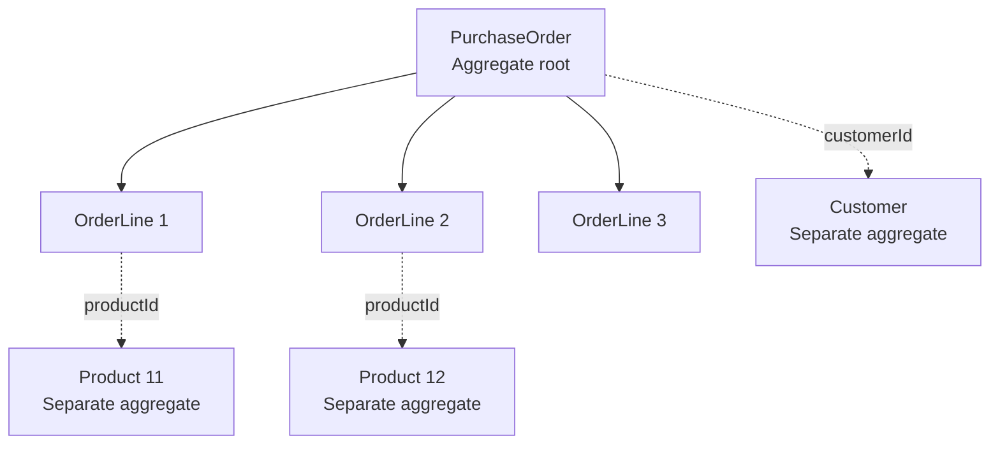
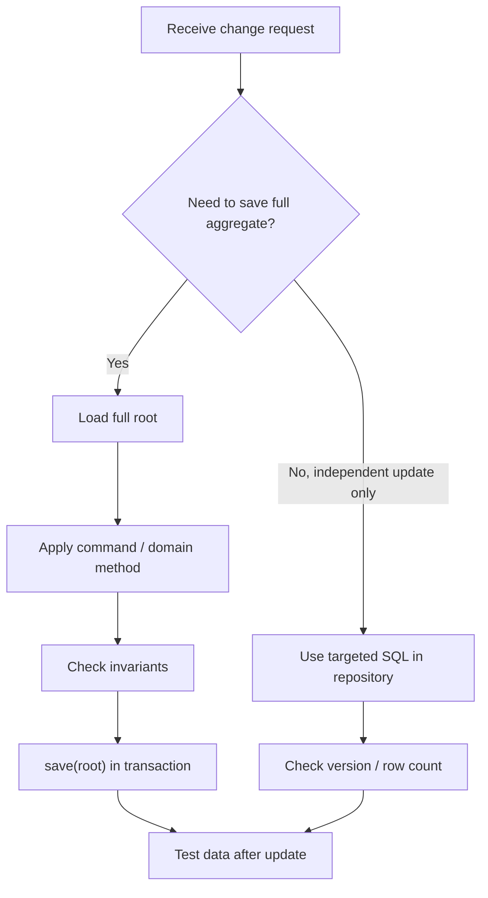

# Risk of Data Loss When Saving a Partially Loaded Aggregate

Spring Data JDBC persists data by **aggregate root**. When saving an existing aggregate, the framework works with the current state of the object passed in. Therefore, if an application loads or constructs only part of an aggregate and calls `save(...)`, omitted components may be interpreted as no longer belonging to the aggregate.

The most common risk lies in child collections mapped with `@MappedCollection`: when updating the root, Spring Data JDBC may delete existing child rows and re-insert the elements present in the current object. If the object contains only a subset of the list, omitted rows can be lost. Scalar properties on the root can also be overwritten with `null` or default values if the application builds an incomplete object.

This lesson uses `PurchaseOrder` and `OrderLine` to show how the issue occurs, distinguish owned data from referenced aggregates, and choose safe update approaches.

## 1. An aggregate is a unit of data with clear boundaries

In Spring Data JDBC, an aggregate root represents the unit that a repository loads and persists. Child objects within the root's boundary are managed alongside the root. For example:

- `PurchaseOrder` is the aggregate root.
- `OrderLine` is a component owned by the order.
- `Customer` and `Product` are independent aggregates; the order stores IDs referencing them.



`OrderLine` belongs to the order's ownership. When saving the order, the framework synchronizes the entire set of order lines belonging to the order. `Customer` and `Product` are referenced by ID; they have separate lifecycles and do not become child objects deleted when saving `PurchaseOrder`.

This is the key to understanding the impact of `save(...)`: the framework needs **the complete current state of the part of the aggregate owned by the root** to synchronize it to the database.

## 2. Order aggregate example

A simple model:

```java
package com.example.orders.domain;

import java.math.BigDecimal;

public record OrderLine(
    Long productId,
    int quantity,
    BigDecimal unitPrice
) {}
```

```java
package com.example.orders.domain;

import java.util.List;

import org.springframework.data.annotation.Id;
import org.springframework.data.relational.core.mapping.MappedCollection;
import org.springframework.data.relational.core.mapping.Table;

@Table("purchase_order")
public record PurchaseOrder(
    @Id Long id,
    Long customerId,
    String status,
    String note,
    @MappedCollection(
        idColumn = "order_id",
        keyColumn = "line_no"
    )
    List<OrderLine> lines
) {}
```

Illustrative schema:

```sql
CREATE TABLE purchase_order (
    id BIGINT GENERATED BY DEFAULT AS IDENTITY PRIMARY KEY,
    customer_id BIGINT NOT NULL,
    status VARCHAR(20) NOT NULL,
    note VARCHAR(500)
);

CREATE TABLE order_line (
    order_id BIGINT NOT NULL
        REFERENCES purchase_order(id) ON DELETE CASCADE,
    line_no INTEGER NOT NULL,
    product_id BIGINT NOT NULL,
    quantity INTEGER NOT NULL CHECK (quantity > 0),
    unit_price NUMERIC(19, 2) NOT NULL CHECK (unit_price >= 0),
    PRIMARY KEY (order_id, line_no)
);
```

An existing order:

| order_id | customer_id | status | note |
| ---: | ---: | --- | --- |
| 1001 | 7 | `CREATED` | `Deliver during business hours` |

Current order lines:

| order_id | line_no | product_id | quantity | unit_price |
| ---: | ---: | ---: | ---: | ---: |
| 1001 | 0 | 11 | 2 | 120000.00 |
| 1001 | 1 | 12 | 1 | 45000.00 |

The order has two lines. When the repository loads the full aggregate, the object reflects both order lines.

## 3. How does Spring Data JDBC save an existing aggregate?

At a high level, saving has two cases:

- **New aggregate:** no ID yet; the framework inserts the root and the child objects owned by the root.
- **Existing aggregate:** ID already exists; the framework updates the root and synchronizes child objects according to the current collection state.

For dependent entities stored in an aggregate's collection, Spring Data JDBC does not operate like JPA/Hibernate with a persistence context and per-element dirty checking. When updating an existing aggregate, the persistence mechanism may delete existing dependent rows of the root and re-insert the child rows currently present in the passed-in object.

Example of the logical SQL that may be generated:

```sql
-- Existing root.
UPDATE purchase_order
SET customer_id = ?,
    status = ?,
    note = ?
WHERE id = ?;

-- Synchronize the root's child collection.
DELETE FROM order_line
WHERE order_id = ?;

-- Re-insert the lines present in the current aggregate.
INSERT INTO order_line
    (order_id, line_no, product_id, quantity, unit_price)
VALUES
    (?, ?, ?, ?, ?);
```

This is a behavioral illustration to understand the impact, not a guarantee of exact ordering or SQL syntax across every version or dialect. Enable SQL logging and inspect the actual statements of your version when diagnosing.

Consequence: the child collection in the object passed to `save(...)` must be treated as **the complete state the application wants persisted for the root**. If the object contains two lines, those two lines are the current list; if the object contains an empty list, the application is representing the root as having no child lines left.

## 4. Incident: building a partial object and calling save

Suppose an API only allows editing the order note. Request:

```json
{
  "note": "Deliver before 17:00"
}
```

A dangerous approach is constructing a new aggregate from the ID and request:

```java
PurchaseOrder partial = new PurchaseOrder(
    1001L,
    7L,
    "CREATED",
    request.note(),
    List.of()
);

purchaseOrderRepository.save(partial);
```

This object has `id = 1001`, so it represents an existing aggregate. However, `lines` is an empty list. The framework does not know the request only intended to update the note; it sees the current collection state as empty.

After synchronization, the `order_line` rows belonging to order 1001 can be deleted. The two existing order lines do not appear in the new object, so they are not re-inserted.

Before saving:

```text
PurchaseOrder 1001
  note = "Deliver during business hours"
  lines:
    - product 11, quantity 2
    - product 12, quantity 1
```

Partially constructed object:

```text
PurchaseOrder 1001
  note = "Deliver before 17:00"
  lines:
    (empty)
```

Potential result:

```text
PurchaseOrder 1001
  note = "Deliver before 17:00"
  lines:
    (empty)

order_line:
  No rows remaining for order_id = 1001
```

An operation intended to edit one field has accidentally deleted the aggregate's child data.

### Null and empty collections do not always mean the same thing

For collections, do not assume `null` means "keep existing data." How the framework handles null depends on the property type, mapping, and version; a null collection can also cause errors during mapping or saving. `List.of()` explicitly represents an empty collection and can result in deleting existing child rows.

The safe rule is never to pass a partial object to `save(root)` unless you are certain it holds the full aggregate state. Never use null or empty to implicitly represent "field not sent in PATCH."

## 5. Second risk: root scalar properties get overwritten

Data loss does not happen only with child collections. Suppose `PurchaseOrder` has `customerId`, `status`, and `note`. The request sends only `note`, yet a mapper constructs an object with omitted fields set to null or default:

```java
PurchaseOrder partial = new PurchaseOrder(
    1001L,
    null,          // Absent from request
    null,          // Absent from request
    "Deliver before 17:00",
    List.of()
);
purchaseOrderRepository.save(partial);
```

When saving the root, mapped properties can be written to the database using the object's values. If `customer_id` or `status` receives null, one of two things can happen:

- The database rejects the write due to a `NOT NULL` or foreign key constraint.
- If the column is nullable, the existing value can be overwritten with SQL `NULL`.

If primitives are used, omitted values may become `0` or `false`, which likewise does not mean "keep the previous value."

Thus, an object with an ID is not synonymous with a partial update command. `save(...)` persists object state; it cannot know which fields were sent in an HTTP request and which were omitted.

## 6. Scenarios prone to producing incomplete aggregates

| Source of object creation | How the issue occurs |
| --- | --- |
| PATCH API | Maps only fields present in the request onto a new root object; omitted fields become null/default/empty. |
| Update DTO | Mapper converts a partial DTO directly into an entity instead of loading the current aggregate first. |
| Custom query | Query selects only a subset of columns, yet the result is treated as a complete aggregate. |
| Batch job | Job knows only an ID and one field to change, constructs a new root, and calls save. |
| Event/message | Event carries a delta like `statusChanged`, and the consumer constructs an aggregate missing child rows. |
| Cache | Cache stores only a summary/projection, which is then reused as input to save the root. |
| Test fixture | Test builds a root with an existing ID without populating the corresponding child collection. |

### Full repository load vs. projection serve two different purposes

A repository call such as:

```java
PurchaseOrder order = purchaseOrderRepository.findById(id)
    .orElseThrow();
```

is designed to read the aggregate according to its mapping, including dependent components managed by Spring Data JDBC. This is the right approach when preparing to modify an aggregate and save it back.

Conversely, a list screen may only need ID, status, and total amount. Do not reuse a trimmed-down projection/DTO and treat it as a full `PurchaseOrder`. Keep read models and write models separate:

```java
public record OrderSummary(
    Long id,
    String status,
    BigDecimal totalAmount
) {}
```

`OrderSummary` is read data for display. It does not represent the complete `PurchaseOrder` and should never be passed to the aggregate repository's `save`.

For custom queries returning an entity/aggregate, verify the query's mapping contract and ensure the result contains all required data. If the goal is to fetch only a subset of data, use a DTO, projection, or dedicated `RowMapper`.

## 7. Distinguishing owned child objects from referenced aggregates

Not every ID appearing in an aggregate represents a child object deleted when saving the root.

| Relationship | Representation | Impact when saving root |
| --- | --- | --- |
| Owned child object | `@MappedCollection` | Spring Data JDBC manages child row lifecycles under the aggregate root; children omitted from the collection state may be deleted. |
| Embedded value object | `@Embedded` | Properties are flattened into columns of the root row; a partial object can overwrite those columns. |
| Referenced external aggregate | Scalar ID or `AggregateReference` | Root holds the reference; saving root does not mean saving/deleting the referenced aggregate. |

For example, `PurchaseOrder.customerId` references a customer. Saving the order does not delete the customer if the order object does not contain customer details. By contrast, `PurchaseOrder.lines` is an owned child collection, so the collection's state directly affects `order_line` rows.

Similarly, if `Product` references an independent `Category` by ID, do not put the entire category into a child collection merely for save convenience. Choosing the right aggregate boundaries early prevents unintended cascades.

## 8. Safe approach 1: load the full aggregate, modify, then save

For business operations that update an aggregate, the standard pattern is:

1. Load the root via the repository.
2. Modify properties or child collections via domain behavior.
3. Preserve unchanged components.
4. Save the complete aggregate.

For an immutable record, you can provide a method returning a copy that preserves the collection:

```java
@Table("purchase_order")
public record PurchaseOrder(
    @Id Long id,
    Long customerId,
    String status,
    String note,
    @MappedCollection(idColumn = "order_id", keyColumn = "line_no")
    List<OrderLine> lines
) {
    public PurchaseOrder withNote(String newNote) {
        return new PurchaseOrder(
            id,
            customerId,
            status,
            newNote,
            lines
        );
    }
}
```

Service:

```java
@Service
public class OrderService {

    private final PurchaseOrderRepository orders;

    public OrderService(PurchaseOrderRepository orders) {
        this.orders = orders;
    }

    @Transactional
    public PurchaseOrder changeNote(Long orderId, String newNote) {
        PurchaseOrder current = orders.findById(orderId)
            .orElseThrow(() -> new OrderNotFoundException(orderId));

        PurchaseOrder changed = current.withNote(newNote);
        return orders.save(changed);
    }
}
```

Here `findById` loads the current aggregate, including its order lines. `withNote` preserves `lines` and other scalars, changing only `note`. On `save`, the submitted collection state still contains the original two lines.

If using a mutable class instead of a record, invoke `changeNote(...)` on the loaded object. Whether mutable or immutable, the rule is the same: apply updates on an aggregate that holds all state to be preserved.

`@Transactional` ensures the load-modify-save sequence executes within one transaction. However, a transaction does not turn a partial object into a full one; the application must still load the proper aggregate and handle concurrency.

## 9. Safe approach 2: use commands/DTOs for PATCH

HTTP PUT and PATCH have different semantics:

- PUT typically replaces the resource representation per the API contract.
- PATCH modifies only part of the resource; fields absent from the patch must usually remain unchanged.

Do not map a PATCH request directly into an aggregate. Use a command/DTO that expresses the exact update intent:

```java
public record ChangeOrderNoteRequest(
    String note
) {}
```

The service loads the full aggregate and applies the command:

```java
@Transactional
public PurchaseOrder changeNote(
        Long orderId,
        ChangeOrderNoteRequest request) {

    PurchaseOrder current = orders.findById(orderId)
        .orElseThrow(() -> new OrderNotFoundException(orderId));

    return orders.save(current.withNote(request.note()));
}
```

If PATCH must distinguish three cases:

1. Field omitted: keep existing value.
2. Field sent as null: clear value if domain allows.
3. Field sent with value: update.

then the DTO needs an explicit way to represent **field presence**. A plain Java reference field cannot distinguish "omitted" from "explicitly null" after deserialization if both become null. Use a patch wrapper type, JSON Merge Patch, or a JSON library feature supporting nullable/presence semantics suited to your API.

Conceptual example:

```java
public sealed interface PatchField<T>
        permits Missing, Present {}

public record Missing<T>() implements PatchField<T> {}

public record Present<T>(T value) implements PatchField<T> {}
```

`Missing` means no change requested; `Present(null)` can represent a request to clear the value if business rules allow it. This is only an illustrative model; JSON deserialization must be configured to retain whether a field appeared in the payload.

## 10. Safe approach 3: targeted SQL updates

Not every change requires loading and saving the entire aggregate. If you only need to update a scalar column without synchronizing child collections, you can use explicit SQL via a custom repository/`JdbcTemplate`:

```java
@Repository
public class OrderUpdateRepository {

    private final JdbcTemplate jdbc;

    public OrderUpdateRepository(JdbcTemplate jdbc) {
        this.jdbc = jdbc;
    }

    public int updateNote(Long orderId, String note) {
        return jdbc.update("""
            UPDATE purchase_order
            SET note = ?
            WHERE id = ?
            """, note, orderId);
    }
}
```

This statement updates only `note`; it does not synchronize `order_line`, thus leaving order lines untouched. The return value indicates the number of affected rows; the service should handle `0` according to the API contract.

When using this approach:

- Place SQL inside a dedicated adapter/repository rather than scattering statements across controllers.
- Use the same datasource/transaction manager if the operation participates in a transaction alongside Spring Data repositories.
- Verify permissions and business invariants before updating.
- If optimistic locking is used, check and increment version in the SQL statement.
- If changing the scalar affects invariants involving child rows, update all required data within the same transaction.

Example versioned update:

```sql
UPDATE purchase_order
SET note = :note,
    version = version + 1
WHERE id = :id
  AND version = :expectedVersion;
```

If affected rows equal 0, either the order was not found or the version changed; query/reconcile to return the right error. Never ignore version checks just because custom SQL is used.

### When should you use targeted SQL?

- An independent field must be updated frequently.
- The child collection is large and rewriting it entirely is undesirable.
- A batch operation updates multiple roots matching a condition.
- Writes are vendor-specific or require dedicated optimization.

However, targeted SQL shifts responsibility onto the application for invariants and rules normally coordinated by `save(aggregate)`. Choose it deliberately and test thoroughly.

## 11. Safe approach 4: extract associations into independent aggregates

If a child collection is very large or individual links must be updated independently, consider changing the model boundary. For instance, instead of keeping `OrderLine` as a child of `PurchaseOrder`, in an appropriate domain each line could be modeled as a separate aggregate with its own ID and repository.

Then:

- The order root references lines by ID or queries them via a repository/SQL.
- Modifying one line does not require saving the order's entire collection.
- Services must enforce invariants that were previously protected inside a single aggregate.
- Transactions may need to coordinate multiple aggregates if business rules require consistency.

Do not split aggregates solely to avoid a single delete/re-insert. Aggregate boundaries are a domain decision: if order total, quantities, and status must remain consistent across all lines, keeping `OrderLine` inside the order aggregate may still be the right design. Consider splitting only when lines have independent lifecycles or volumes.

## 12. What does optimistic locking help with—and what doesn't it help with?

Spring Data JDBC supports optimistic locking with a `@Version` property. When two transactions load the same root version and both update it, the save from the transaction holding the stale version can fail because the version has changed.

Example:

```java
@Table("purchase_order")
public record PurchaseOrder(
    @Id Long id,
    @Version Long version,
    Long customerId,
    String status,
    String note,
    @MappedCollection(idColumn = "order_id", keyColumn = "line_no")
    List<OrderLine> lines
) {}
```

DDL needs a corresponding version column, for example:

```sql
ALTER TABLE purchase_order
ADD COLUMN version BIGINT NOT NULL DEFAULT 0;
```

Optimistic locking detects **overwrites caused by two reads of the same version**, but it cannot detect that the application intentionally built an aggregate missing its child rows. If a partial object carries the valid current version and is saved ahead of other changes, the save can still delete omitted child rows.

Distinguish two classes of bugs:

| Problem | Appropriate protection mechanism |
| --- | --- |
| One request saves stale state after another request already updated the root | `@Version` and handling optimistic locking failure. |
| The current object already lacks child rows because an API/mapper omitted them | Load full aggregate, use PATCH command, or use targeted SQL. |
| Two requests concurrently create a duplicate link | Database unique constraint and duplicate handling. |
| A multi-statement operation must succeed or fail together | Transaction on the same datasource. |

Never view `@Version` as a substitute for loading the full aggregate.

## 13. Testing to detect data loss risks

A useful integration test should create an aggregate with multiple child rows, then execute an operation changing a single field. The test must prove the order lines remain intact.

Scenario:

1. Create order 1001 with two lines.
2. Save and verify two rows exist in `order_line`.
3. Call the `changeNote` service using full root load-then-save.
4. Reload the order and verify the new note and that two lines still exist.
5. Run targeted SQL to update the note and confirm the line count is unchanged.
6. Construct a partial object with an existing ID and empty collection in an isolated test to demonstrate the dangerous behavior; inspect SQL/logs and post-save data.
7. If using `@Version`, create two reads of the same version, save the first, and confirm the second hits an optimistic locking failure.

Example assertion:

```java
PurchaseOrder loaded = orders.findById(orderId).orElseThrow();

assertThat(loaded.note()).isEqualTo("Deliver before 17:00");
assertThat(loaded.lines()).hasSize(2);
```

When testing the effect of a partial object, use an isolated fixture and a test transaction/database that can roll back or be cleaned up explicitly. The goal is to demonstrate that data omitted from the snapshot can be lost, not to introduce dangerous practices into production services.

You can query the child table directly:

```sql
SELECT order_id, line_no, product_id, quantity
FROM order_line
WHERE order_id = 1001
ORDER BY line_no;
```

Do not inspect only the API response. A successful response does not prove the child collection remained intact.

## 14. Decision workflow before calling save

Before every `save(root)` call, answer:

1. Is this root new or already existing?
2. If existing, was the object loaded completely from the repository, or constructed from a DTO/query/cache/event?
3. Do `@MappedCollection` collections contain all child rows that must be kept?
4. Were scalars omitted from the request preserved from the loaded root?
5. Are `@Embedded` value objects accidentally being set to null/default?
6. Should a single field be updated via SQL instead of saving the whole aggregate?
7. Is there concurrency requiring optimistic locking or constraint protection?
8. Do operations need to execute inside one transaction?

The safe flow can be summarized as:



## 15. Misconceptions to avoid

- **"Having an ID means save only updates modified fields."** False. `save` persists the passed object's state; the framework cannot know which fields were present in a PATCH.
- **"An empty collection means leave the collection unchanged."** False in aggregate snapshot semantics. An empty list can represent an aggregate that currently has no child rows.
- **"Not loading child rows means the framework keeps them automatically."** Never assume this. If the saved object omits child rows that should stay, synchronization can delete them.
- **"`@Transactional` prevents data loss from partial objects."** False. Transactions make operations atomic; they do not supply missing state.
- **"`@Version` prevents all write errors."** False. Version detects some concurrent updates; it cannot detect that the current object was missing data from the start.
- **"Aggregate references and child collections cascade identically."** False. Owned child rows have lifecycles managed by the root; referenced aggregates have independent lifecycles.
- **"Projections can be used directly to save entities."** Never do this. Projections hold only data tailored for a specific read purpose.
- **"Splitting children into separate aggregates is always better."** False. Splitting aggregates alters consistency boundaries and business responsibilities.

## 16. Self-check questions

- Why must Spring Data JDBC treat a child collection as the current state of the aggregate?
- When saving an existing root, what can happen to `@MappedCollection` rows missing from the object?
- Why should a PATCH request changing only `note` not be mapped directly onto a new `PurchaseOrder`?
- What is the difference between `List.of()` and "field omitted" in an API?
- Why can a scalar omitted from a DTO also be overwritten with null/default?
- How does a full repository `findById` differ in purpose from an `OrderSummary` projection?
- Why does an aggregate referenced by ID not share the same lifecycle as a child collection?
- When should targeted SQL be used instead of `save(root)`?
- Which class of errors does `@Version` detect, and why cannot it fix a partial object?
- What should be verified in the database after an aggregate update operation?

When working with Spring Data JDBC, treat `save(aggregate)` as persisting **the aggregate state the application currently holds**. Before calling save on an existing root, ensure the object holds all child rows and scalars that must be preserved. For partial changes, load the full root and apply a command; if only an independent field needs updating, use targeted SQL. This preserves aggregate boundaries and prevents turning a small PATCH operation into unintended data deletion.
