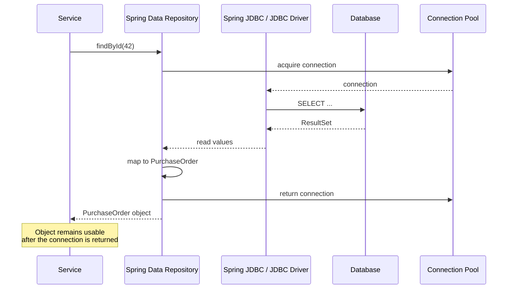
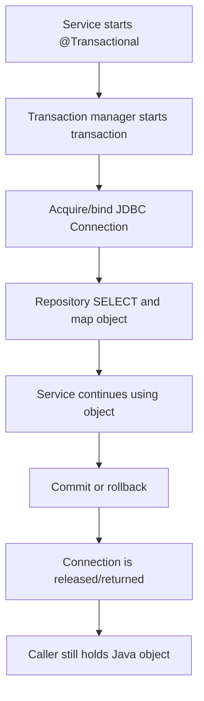
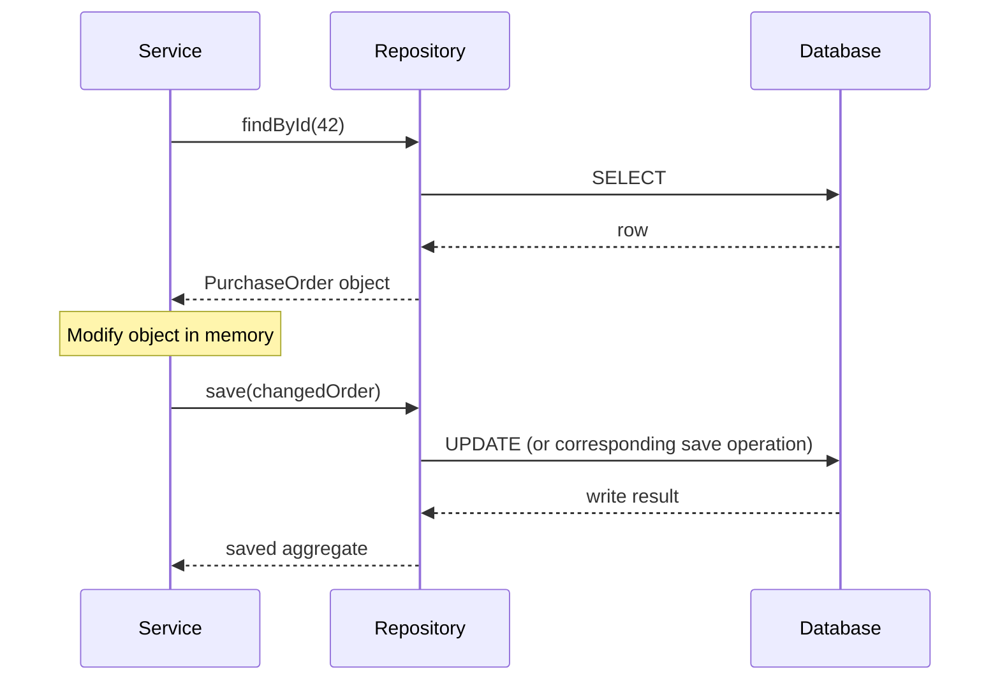
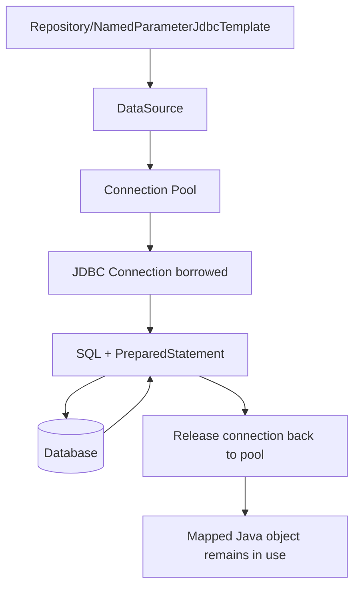

# Loaded Objects and Their Connection-Detached Lifecycle

In **Spring Data Relational JDBC**, when calling a repository to load an aggregate, the result is a plain Java object containing the data read from the database. That object can continue to be used after the query finishes and the JDBC connection is returned to the pool. It **does not need to keep a connection open** to read properties, and modifying the object in memory does not automatically write data back to the database.

This is an important characteristic of Spring Data JDBC: the framework does not maintain a long-lived persistence context/session to manage loaded objects. It maps data during the repository operation, releases JDBC resources according to the operation or transaction scope, and returns the object to the application.

Therefore, three lifecycles must be distinguished:

1. **Java Object:** lives according to program references and scope; it can exist long after the query ends.
2. **JDBC Connection:** a resource used to communicate with the database; managed and released/returned according to the operation or transaction scope.
3. **Transaction:** the commit or rollback scope for database operations; has its own start and end points.

Understanding this separation helps avoid common assumptions from JPA/Hibernate such as automatic lazy loading, dirty checking, persistence contexts, or automatic flushing of changes when a transaction ends.

## 1. Three distinct lifecycles

An order reading flow can be visualized as:



The sequence above illustrates the case without a long service transaction spanning multiple operations. If a transaction is active, the connection is typically kept bound to the transaction until the transaction ends. In both cases, the Java object does not become part of the connection.

| Component | Role | When does it end? |
|---|---|---|
| Loaded object | Java data the application is using | When no longer referenced and reclaimed by the garbage collector, or when the application explicitly drops references |
| JDBC Connection | Database communication resource | When released by the operation/transaction; a connection pool may reclaim it for reuse |
| JDBC Statement/ResultSet | Executes SQL and reads results | After results are processed and resources are closed |
| Transaction | Groups database operations into a commit/rollback unit | Upon commit, rollback, or completion by the transaction manager |

**Core point:** a loaded object is not a connection, does not own a connection, and does not need a connection to read the fields already mapped into it.

## 2. A loaded object is a normal Java object

Domain example:

```java
import org.springframework.data.annotation.Id;
import org.springframework.data.relational.core.mapping.Table;

@Table("purchase_orders")
public record PurchaseOrder(
    @Id Long id,
    String orderNumber,
    String status
) {}
```

Repository:

```java
import org.springframework.data.repository.CrudRepository;

public interface PurchaseOrderRepository
        extends CrudRepository<PurchaseOrder, Long> {
}
```

Service:

```java
PurchaseOrder order = repository.findById(42L)
    .orElseThrow();

// Read properties after the repository method has returned.
System.out.println(order.orderNumber());
System.out.println(order.status());
```

Once `findById` completes, values have been mapped into the object. Reading `order.orderNumber()` sends no additional SQL and requires no open connection.

This also holds if the object is passed to another layer, placed in a collection, or used to build a response DTO:

```java
PurchaseOrder order = repository.findById(42L)
    .orElseThrow();

String orderNumber = order.orderNumber();

OrderResponse response = new OrderResponse(
    order.id(),
    orderNumber,
    order.status()
);
```

`OrderResponse` is built from existing Java data. It does not need to access the database just to read properties of `order`.

### 2.1. Do not hold on to a ResultSet for later use

Distinguish mapped domain objects from raw JDBC resources. A `ResultSet` depends on the `Statement` and connection used to execute the query. Do not return a `ResultSet` out of a callback and use it after the JDBC operation ends.

Unsafe:

```java
// Bad idea: ResultSet is a JDBC resource, not standalone domain data.
ResultSet result = executeQueryAndReturnResultSet();
return result;
```

The right way is to map results immediately inside the JDBC processing scope:

```java
List<PurchaseOrder> orders = jdbc.query(
    "SELECT id, order_number, status FROM purchase_orders",
    (rs, rowNum) -> new PurchaseOrder(
        rs.getLong("id"),
        rs.getString("order_number"),
        rs.getString("status")
    )
);
```

The `orders` list contains Java objects independent of `ResultSet`. After Spring JDBC finishes the callback and closes/releases the necessary resources, the application can still use that list.

## 3. Spring Data JDBC does not maintain a persistence context

In JPA/Hibernate, an entity can be managed by a persistence context while a session/entity manager is active. Property changes on a managed entity can be detected via dirty checking and written to the database upon flush.

Spring Data JDBC has a simpler model:

- The repository loads the aggregate and returns the mapped object.
- The framework does not keep a long-lived identity map/session for that object.
- Modifying the object in memory is not automatically detected to write to the database.
- To persist changes, the application calls repository or aggregate operations explicitly.

Because there is no persistence context managing object state, calling the same repository method twice can produce two distinct Java objects, even though they represent the same database row.

```java
PurchaseOrder first = repository.findById(42L).orElseThrow();
PurchaseOrder second = repository.findById(42L).orElseThrow();

System.out.println(first.id().equals(second.id())); // true
System.out.println(first == second);                // false
```

These are two separate instances in memory. Spring Data JDBC does not promise that two reads of the same ID will return the same object instance.

### 3.1. No lazy-loading proxies for aggregate references

Suppose `PurchaseOrder` stores the customer's ID:

```java
@Table("purchase_orders")
public record PurchaseOrder(
    @Id Long id,
    String orderNumber,
    Long customerId
) {}
```

When reading:

```java
PurchaseOrder order = orderRepository.findById(42L)
    .orElseThrow();

Long customerId = order.customerId();
```

`customerId` is a value already present in the object. There is no proxy installed on the property to automatically load `Customer` when you access a method.

If customer details are needed:

```java
Customer customer = customerRepository.findById(order.customerId())
    .orElseThrow();
```

This is an explicit query. The application decides when to load another aggregate and can use batch loading or a read query if data from multiple tables is needed.

### 3.2. No automatic dirty checking

With a mutable class:

```java
PurchaseOrder order = repository.findById(42L).orElseThrow();

order.setStatus("PAID");
```

If `PurchaseOrder` is a mutable class, the setter statement only modifies the object in memory. It **does not automatically run an UPDATE**, and there is no persistence context tracking this change.

You must save explicitly:

```java
repository.save(order);
```

With an immutable Java record, you create a new instance:

```java
PurchaseOrder before = repository.findById(42L).orElseThrow();

PurchaseOrder changed = new PurchaseOrder(
    before.id(),
    before.orderNumber(),
    "PAID"
);

PurchaseOrder saved = repository.save(changed);
```

Use the object returned from `save` for subsequent processing, especially if the entity has a database-generated ID or an updated version.

## 4. Connections are managed per operation and transaction

JDBC connections are finite resources. An application should not keep a connection open simply because it holds a domain object.

In a typical Spring Boot application, the `DataSource` may use a connection pool. Spring JDBC and the transaction manager acquire a connection when needed, use the connection associated with the current transaction, and release it back to the pool upon completion.

### 4.1. When there is no enclosing service transaction

A repository call completes its read work and then releases JDBC resources according to the framework mechanism. The physical connection may not be completely closed; with a pool, it is typically returned to the pool for reuse.

```text
repository.findById(42)
    → acquire connection from DataSource/pool
    → execute SELECT
    → map ResultSet to object
    → release connection back to pool
    → return object to service
    → service continues using the object
```

Do not interpret "the connection is released" as "the TCP socket is definitely closed." With a pool, physical connections are normally kept open for reuse; what is released is the current operation's lease on the connection.

### 4.2. When `@Transactional` is present

If the service has a transaction:

```java
@Transactional
public PurchaseOrder loadAndProcess(long id) {
    PurchaseOrder order = repository.findById(id).orElseThrow();

    // Perform additional operations in the same transaction if needed.
    return order;
}
```

The transaction manager coordinates the transaction. With a typical JDBC transaction, the connection is bound to the transaction context and retained until the transaction commits or rolls back. JDBC operations participating in the transaction can share that transaction-bound connection.

After the service method finishes and the transaction commits/rolls back, the connection is released/returned according to the DataSource mechanism. The returned object remains a plain Java object and continues to exist as long as the caller holds a reference.



### 4.3. A transaction does not turn an object into a managed object

`@Transactional` controls database transaction boundaries. It does not create a JPA-style persistence context and does not cause every object loaded inside the method to be tracked automatically.

Example:

```java
@Transactional
public void process(long id) {
    PurchaseOrder order = repository.findById(id).orElseThrow();

    // Modifying the object does not automatically write to the database.
    // Must call save or an explicit write operation.
}
```

When the method finishes, the transaction may commit successfully, but without a write operation, changes exist only in memory and disappear once the object is no longer referenced.

## 5. Object lifecycle does not match transaction lifecycle

Consider three cases:

| Case | Object | Connection/transaction |
|---|---|---|
| Read without a long service transaction | Returned after the read operation and kept in use | Connection is released per operation |
| Read inside a transaction | Returned while the transaction is still active | Connection is typically kept until the end of the transaction |
| Return object from a transactional method | Object continues to exist if caller retains a reference | Transaction has ended; connection is released |

Example:

```java
public PurchaseOrder load(long id) {
    return repository.findById(id).orElseThrow();
}

PurchaseOrder order = load(42L);

// Properties can be read here.
System.out.println(order.status());
```

There is no need to keep a transaction open to read properties of a mapped object. If further queries are needed later, the application starts a new database operation with an appropriate transaction/connection.

### 5.1. Do not keep transactions open for work that does not need the database

An anti-pattern is keeping a transaction open long simply to hold an object within a processing scope:

```java
@Transactional
public Report buildReport(long id) {
    PurchaseOrder order = repository.findById(id).orElseThrow();

    callRemoteService();       // May take several seconds
    renderLargeDocument();     // Does not need the database
    return createReport(order);
}
```

If work outside the database does not need to participate in the transaction, keeping the transaction open throughout that work can occupy a connection for a long time, increase connection pool pressure, and extend lock duration.

You can split the data-reading step into a short transaction, then process Java data outside any transaction:

```java
public Report buildReport(long id) {
    PurchaseOrderSnapshot snapshot = orderReader.loadSnapshot(id);

    callRemoteService();
    renderLargeDocument();

    return createReport(snapshot);
}
```

`PurchaseOrderSnapshot` is a DTO containing only the data needed for the subsequent work. Splitting this way also helps limit what is exposed outside the persistence layer.

## 6. Changes to a loaded object must be saved explicitly

A typical update flow:



### 6.1. Mutable entity

```java
PurchaseOrder order = repository.findById(42L).orElseThrow();

order.setStatus("PAID");

// Only modified in memory up to this point.
repository.save(order);
```

### 6.2. Immutable record

```java
PurchaseOrder before = repository.findById(42L).orElseThrow();

PurchaseOrder changed = new PurchaseOrder(
    before.id(),
    before.orderNumber(),
    "PAID"
);

PurchaseOrder saved = repository.save(changed);
```

Records do not allow modifying fields after creation, so we create a new object. Saving is still explicit.

### 6.3. `save` does not mean a native UPSERT

`save` is a repository/aggregate API. Spring Data JDBC determines whether an entity is new or existing using its state-detection mechanism (for example, ID/version or a custom `Persistable`), then performs the corresponding save operation.

Do not assume `save` is always a database statement like `INSERT ... ON CONFLICT DO UPDATE` or `MERGE`. If business logic requires an atomic conditional update, use an appropriate SQL update and check the affected row count, or use optimistic locking.

## 7. A loaded object can become stale

Because an object is not tied to a connection, there is a consequence: the object is a **data snapshot at the time of reading**, not a window that automatically updates with the database.

Example:

```text
Time T1:
  Request A reads Order 42, status = NEW

Time T2:
  Request B updates Order 42, status = PAID

Time T3:
  Request A still holds an object with status = NEW
```

The object in Request A does not automatically change to `PAID` when Request B updates the database. If Request A needs the latest value, it must query again or use concurrency control.

### 7.1. Re-reading to get the latest state

```java
PurchaseOrder current = repository.findById(42L).orElseThrow();
```

This is a fresh query, which can see committed changes according to the current transaction's isolation level. If running inside a transaction with snapshot isolation/repeatable read, the result may still reflect the transaction's snapshot; understand your database's isolation levels.

### 7.2. Lost updates when saving a stale object

A dangerous scenario:

```text
A reads status = NEW
B reads status = NEW
B saves status = PAID
A saves stale object with status = CANCELLED
```

Without protection, A's save can overwrite the status that B just updated. This is a **lost update**.

To detect conflicts, you can use optimistic locking with `@Version`:

```java
import org.springframework.data.annotation.Id;
import org.springframework.data.annotation.Version;
import org.springframework.data.relational.core.mapping.Table;

@Table("purchase_orders")
public record PurchaseOrder(
    @Id Long id,
    String orderNumber,
    String status,
    @Version Long version
) {}
```

Spring Data JDBC uses the version to check the version during aggregate updates. If another transaction has already updated the version beforehand, the save operation can fail with an optimistic locking error instead of silently overwriting.

The schema needs a corresponding version column, for example:

```sql
ALTER TABLE purchase_orders
    ADD COLUMN version BIGINT NOT NULL DEFAULT 0;
```

The column name and type must match the actual mapping. For a new entity, Spring Data JDBC manages the initial version and increments it during the save process.

### 7.3. `@Version` does not keep connections open longer

Optimistic locking is a mechanism for checking data state on write. It does not require the object to hold a connection from read time until save time. The object remains independent of the connection; the version simply carries the information needed to detect whether the data has changed.

## 8. Passing objects across threads or storing them in a cache

Because a loaded Java object does not depend on a connection, the object/DTO can be passed to another thread in memory. However, doing so **does not propagate transactions** and does not guarantee the object is still fresh.

### 8.1. Do not pass ResultSets or connections to background tasks

Do not do:

```java
executor.submit(() -> {
    // Using the request thread's ResultSet/Connection after its scope has ended.
});
```

JDBC resources belong to the operation/transaction management mechanism; do not retain and use them after the framework has released them.

If a background task needs data, pass a mapped DTO/object:

```java
OrderSnapshot snapshot = orderReader.loadSnapshot(orderId);

executor.execute(() -> {
    notificationService.sendOrderUpdate(snapshot);
});
```

The task receives already-read Java data. If the task needs to read more or update the database, it must execute its own repository/JDBC operations inside an appropriate transaction.

### 8.2. Cached objects do not automatically stay in sync with the database

If a cache stores `PurchaseOrder`, subsequent reads may return a stale object after another transaction updates the database. You need an appropriate cache eviction, TTL, invalidation, or versioning policy.

Having no persistence context means there is no automatic mechanism synchronizing every object sitting in memory. A cache is a separate layer that must be designed separately.

### 8.3. Mutable objects shared across multiple threads

A mutable Java object can be modified concurrently by multiple threads. Spring Data JDBC does not provide memory locks or synchronization for loaded domain objects. Avoid sharing mutable objects without control; prefer immutable DTOs/records for data passed across layers or threads.

## 9. Distinguishing Spring Data JDBC from JPA/Hibernate

Here is an important comparison table when migrating from JPA to Spring Data JDBC:

| Concept | Spring Data JDBC | JPA/Hibernate |
|---|---|---|
| Persistence context/session | No long-lived JPA-style persistence context | Has a persistence context/Session |
| Object after loading | Java object independent of the connection | Entity can be in a managed state inside the persistence context |
| Dirty checking | Does not track property changes to auto-write | Supported for managed entities |
| Lazy loading | No JPA-style relationship lazy-loading proxies | Can use lazy proxies/collections |
| Automatic flush | No JPA-style persistence context flush mechanism | Has flush synchronizing managed state |
| Identity map | Does not keep a single instance per ID within a session | Persistence context manages identity |
| Modifying data | Call repository/aggregate operations explicitly | Can mutate managed entities then flush/commit |
| JDBC connections | Managed by Spring JDBC/transaction manager | Managed by provider and transaction integration |

Do not use the term "detached entity" in the strict JPA sense to describe an object loaded by Spring Data JDBC. Spring Data JDBC does not place an object into a persistence context only to detach it later; the object is mapped and returned as plain Java data from the start.

### 9.1. Same example, two ways of thinking

**JPA mindset:**

```java
@Transactional
public void markPaid(long id) {
    PurchaseOrder order = entityManager.find(PurchaseOrder.class, id);
    order.setStatus("PAID");

    // With a managed entity, dirty checking can write on flush.
}
```

**Spring Data JDBC mindset:**

```java
@Transactional
public void markPaid(long id) {
    PurchaseOrder order = repository.findById(id).orElseThrow();

    PurchaseOrder changed = new PurchaseOrder(
        order.id(),
        order.orderNumber(),
        "PAID"
    );

    repository.save(changed);
}
```

In Spring Data JDBC, calling `save` is an explicit write step. The framework does not detect arbitrary changes inside objects just because a transactional method finishes.

## 10. Connection pools, transaction managers, and resources

A web application can handle many concurrent requests while database connections are limited. A connection pool manages reusing physical connections to avoid creating new ones continuously.

Typical flow:



Inside a transaction, the transaction manager can hold the borrowed connection until commit/rollback. If a service invokes multiple repository methods in the same transaction against the same DataSource, those operations can share the connection bound to that transaction.

### 10.1. Do not manually close connections managed by Spring

When using Spring Data JDBC repositories or `JdbcTemplate`, do not manually obtain and close connections managed by the framework. If writing plain JDBC, use `DataSourceUtils` or the appropriate Spring mechanism to participate in transactions, rather than always calling `dataSource.getConnection()` and closing it independently of the transaction manager.

JDBC code that manages resources manually must use try-with-resources for `Connection`, `Statement`, and `ResultSet` when those resources are created and owned by that code itself.

### 10.2. A connection pool is not an object cache

A connection pool holds connections for reuse. It does not hold `PurchaseOrder` objects or automatically synchronize domain objects. These are completely different concepts:

- A pool optimizes database communication resources.
- An application cache holds data/objects in memory.
- A persistence context (if a technology provides one) manages entity state within a session scope.

Spring Data JDBC relies on Spring's DataSource/connection management, without turning the connection pool into a persistence context.

## 11. When do you need a DTO snapshot instead of an aggregate?

When you need to pass data out of a service, to a background task, or to an API, consider a DTO containing only the necessary fields.

```java
public record OrderSnapshot(
    Long orderId,
    String orderNumber,
    String status,
    Long customerId
) {}
```

Mapper:

```java
public OrderSnapshot toSnapshot(PurchaseOrder order) {
    return new OrderSnapshot(
        order.id(),
        order.orderNumber(),
        order.status(),
        order.customerId()
    );
}
```

Benefits of a DTO:

- Avoids exposing the entire domain model to APIs.
- Reduces the chance of accidentally using a stale object as an aggregate for updates.
- Avoids pulling in unnecessary child collections/entities.
- Easy to serialize and pass through messages/background jobs.
- Clearly expresses that the data was captured at read time.

A snapshot can still become stale over time. If a background task needs the latest state, it should re-read the database by ID rather than assuming the DTO always reflects current data.

## 12. A clean aggregate processing workflow

An order-updating use case can be structured as:

```java
@Service
public class PurchaseOrderService {

    private final PurchaseOrderRepository repository;

    public PurchaseOrderService(PurchaseOrderRepository repository) {
        this.repository = repository;
    }

    @Transactional
    public PurchaseOrder markPaid(long orderId) {
        PurchaseOrder current = repository.findById(orderId)
            .orElseThrow(() -> new IllegalArgumentException("Order not found"));

        if (!"NEW".equals(current.status())) {
            throw new IllegalStateException("Only NEW orders can be paid");
        }

        PurchaseOrder changed = new PurchaseOrder(
            current.id(),
            current.orderNumber(),
            "PAID",
            current.version()
        );

        return repository.save(changed);
    }
}
```

This example assumes the model has a `version` as shown in the optimistic locking section. In a real application, keep state transition rules in the domain/service and define how optimistic locking errors are handled. If an atomic status condition at the database level is required, use a conditional UPDATE statement and check the affected row count.

Steps:

1. Start a transaction in the service.
2. Load the aggregate via the repository.
3. Validate state and domain rules.
4. Construct the new state in memory.
5. Call `save` explicitly.
6. Transaction commits or rolls back.
7. The returned object continues to exist after the transaction ends; the connection is released according to the transaction manager.

## 13. Common mistakes and misconceptions

| Symptom/assumption | Cause | Accurate view or fix |
|---|---|---|
| Thinking the object becomes unusable after the connection closes | Confusing Java objects with `ResultSet` | Mapped objects are independent; read properties normally |
| Changing a field without the database updating | Expecting dirty checking | Call repository/aggregate operations to save |
| Expecting a getter call to fire a query | Expecting JPA-style lazy loading | Spring Data JDBC does not auto-load other aggregates via proxies |
| Two `findById` calls returning two instances | Expecting an identity map | No persistence context guarantees the same instance |
| Stale object data after another request updates it | Object is a read-time snapshot | Re-read or use optimistic locking on write |
| Transaction finishes without saving changes | No explicit write operation | Call `save`/update |
| Connections held too long | Transaction wraps non-DB tasks | Shorten transactions; do non-DB work after reading a snapshot |
| `ResultSet` no longer usable | Statement/connection already closed | Map `ResultSet` into objects/DTOs inside the callback |
| Background task uses the request's connection | Sharing JDBC resources across wrong scopes | Pass DTO/ID; task runs its own queries |
| Cached object does not reflect database | No cache invalidation | Design TTL/eviction/invalidation |
| Two requests overwrite each other | Stale object saved without version check | Use `@Version` or conditional updates |

## 14. Practice exercises

### Exercise 1. Does an object need a connection to read properties?

A service calls `repository.findById(42L)` and receives `PurchaseOrder`. After the repository method returns, the connection is returned to the pool. Can `order.status()` be called?

**Answer:** Yes. Values have already been mapped into the Java object; getters do not need a connection.

### Exercise 2. Does modifying an object automatically run UPDATE?

```java
PurchaseOrder order = repository.findById(42L).orElseThrow();
order.setStatus("PAID");
```

Does the database change automatically?

**Answer:** No. The change is only in memory. You must call `repository.save(order)` or an appropriate explicit write operation.

### Exercise 3. Do two reads of the same ID return the same object instance?

```java
PurchaseOrder a = repository.findById(42L).orElseThrow();
PurchaseOrder b = repository.findById(42L).orElseThrow();
```

**Answer:** Not guaranteed. Two reads can produce two distinct instances. Spring Data JDBC does not have an identity map/session like a JPA persistence context.

### Exercise 4. When the transaction ends, does the returned object disappear?

**Answer:** No. The object continues to exist as long as references remain. The transaction and connection end according to their own lifecycles; the garbage collector only reclaims the object when it is no longer referenced and eligible for collection.

### Exercise 5. When should `@Version` be used?

**Answer:** When you need to detect that an object was loaded from an older version that another transaction updated before saving. Optimistic locking helps avoid silent overwrites in appropriate scenarios.

### Exercise 6. Should a transaction stay open when sending an email or making an HTTP call?

**Answer:** Usually not needed if that work is not part of the database transaction. Read the needed data, end the transaction, then send the email/make the HTTP call using a DTO snapshot or ID. If business rules require ensuring an event is emitted only after commit, consider an after-commit hook or the outbox pattern.

### Exercise 7. Can a `ResultSet` be returned to a controller?

**Answer:** You should not. A `ResultSet` depends on a statement/connection. Map it into entities or DTOs before JDBC resources are released.

## 15. Things to remember

- Objects loaded by Spring Data JDBC are **Java objects independent of JDBC connections**.
- Connections and statements are short-lived resources; objects can live longer.
- Transactions define commit/rollback scope and do not create a JPA-style persistence context.
- Spring Data JDBC has no lazy-loading proxies, dirty checking, or JPA-style auto-flush.
- Object changes stay in memory; persisting requires calling repository/aggregate operations or explicit SQL.
- Objects can become stale after another request updates the database; use re-reads, optimistic locking, or conditional updates depending on business needs.
- Do not hold transactions/connections open for non-database work that does not need to participate in the transaction.
- Map `ResultSet` into entities/DTOs within the callback scope; do not retain JDBC resources after the operation finishes.

### References

- [Spring Data Relational — JDBC Reference](https://docs.spring.io/spring-data/relational/reference/jdbc.html)
- [Spring Data Relational — Entity Persistence](https://docs.spring.io/spring-data/relational/reference/jdbc/entity-persistence.html)
- [Spring Framework — JDBC Core](https://docs.spring.io/spring-framework/reference/data-access/jdbc/core.html)
- [Spring Framework — Data Access and Transactions](https://docs.spring.io/spring-framework/reference/data-access/transaction.html)
- [Spring Data Commons — CrudRepository API](https://docs.spring.io/spring-data/commons/docs/current/api/org/springframework/data/repository/CrudRepository.html)

When applying this in practice, verify transaction and connection pool behavior against your application's actual configuration. Clearly distinguish mapped domain objects, JDBC resources, and transaction contexts to design safe data lifecycles.
