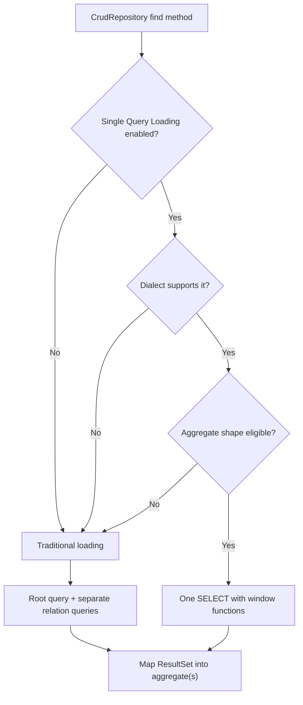

# Single Query Loading Limits by Version, Dialect, and Aggregate Structure

**Single Query Loading** is a mechanism for reading one or more aggregates using a single `SELECT` statement, instead of loading the root and then issuing additional queries for each collection. This feature reduces round-trips and mitigates the N+1 query pattern in eligible cases.

However, not every repository method, database, or aggregate structure can use this mechanism. Spring Data JDBC only attempts to apply it when **enabled on `JdbcMappingContext`**, supported by the dialect, and satisfied by the aggregate's structural constraints. If any condition is not met, the framework automatically falls back to default multi-statement loading.

A key design consideration is that a single SQL statement does not automatically make every aggregate faster to load. Single Query Loading still has to read all child data, process the result set, and build the object graph. For large aggregates or unsuitable queries, you need to measure performance and choose a dedicated read strategy.

## 1. What problem does Single Query Loading solve?

With traditional loading, Spring Data JDBC reads the aggregate root first. If the root owns collections, the framework executes additional queries to load child entities. When reading many roots, the number of queries can grow with the number of aggregates.

For example, an admin page reading 50 orders, each with an `OrderLine` list:

```text
SELECT ... FROM purchase_order;

SELECT ... FROM order_line WHERE order_id = 101;
SELECT ... FROM order_line WHERE order_id = 102;
SELECT ... FROM order_line WHERE order_id = 103;
...
SELECT ... FROM order_line WHERE order_id = 150;
```

If each aggregate has multiple direct collections, corresponding groups of queries can be generated. This is an N+1 pattern: one query fetches the roots, followed by many queries fetching the owned elements.

Single Query Loading constructs a more complex `SELECT` statement to read the root and eligible collections together. The result is still a relational table, but the framework organizes rows so the aggregate structure can be reconstructed.



**One query** here refers to the number of statements used to load the aggregate in a supported operation. It does not mean the database reads only a single row, nor that all data is stored in a single JSON column.

## 2. Mechanism for producing one result set from multiple collections

Suppose `PurchaseOrder` has two direct collections: `lines` and `payments`.

```java
@Table("purchase_order")
public class PurchaseOrder {

    @Id
    private Long id;

    private String status;

    @MappedCollection(idColumn = "order_id", keyColumn = "line_no")
    private List<OrderLine> lines = new ArrayList<>();

    @MappedCollection(idColumn = "order_id", keyColumn = "payment_no")
    private List<Payment> payments = new ArrayList<>();
}
```

If two child tables are joined directly via `LEFT JOIN`, the database can produce a Cartesian product between collections. For instance, an order with 4 lines and 3 payments can produce 12 result rows, repeating data from each line and each payment.

Single Query Loading uses **window/analytic functions** such as `row_number()` and `count(*)` to number elements per parent. General idea:

```sql
SELECT
    order_id,
    line_no,
    row_number() OVER (PARTITION BY order_id ORDER BY line_no) AS line_row,
    count(*) OVER (PARTITION BY order_id) AS line_count
FROM order_line;
```

A similar subquery is built for the other collection. Collections are combined by numbered row order, along with conditions handling missing rows to avoid a full Cartesian product. The result set can represent elements from multiple collections in a single row stream, and the mapper then reconstructs each collection.

This is a conceptual description, not the literal SQL emitted by every Spring Data JDBC version. The actual SQL is fairly intricate and depends on the dialect and how the framework handles mapped columns. Do not copy internal SQL into your repositories manually.

The key point is that this technique requires **window functions** and an aggregate structure representable by the current algorithm. That is why the dialect and object graph shape determine eligibility.

## 3. Which Spring Data JDBC versions have Single Query Loading?

Single Query Loading was introduced in **Spring Data JDBC 3.2**. Before 3.2, the default aggregate loading mechanism loaded the root and then ran separate queries for owned entities.

At the time of writing (November 2026), the stable documentation for Spring Data Relational **3.5.13** and **4.1.2** both publish the same core set of limitations:

| Version | Feature status | Notes |
|---|---|---|
| Before 3.2 | No Single Query Loading | Uses traditional multi-statement loading |
| 3.2 and later | Single Query Loading available | Must be enabled in mapping context; runs only when dialect, query method, and aggregate qualify |
| 3.5.13 (stable) | Available, structural and method limits remain | Official docs retain limits on nested collections, `AggregateReference`, embedded, and dialects |
| 4.1.2 (stable) | Available, same core limits | Current docs still mark the feature as experimental |

A historical note: the initial announcement post for 3.2.0-M2 showed a simple example with a single collection. Current stable documentation describes broader support, including multiple direct collections, while still prohibiting **nested collections**. When upgrading versions, consult the documentation for the exact release you run rather than treating a milestone blog post example as the entire contract.

Do not assume upgrading from 3.5 to 4.1 automatically removes all limitations. Stable 4.1.2 documentation still lists the conditions above and still treats the feature as experimental. When evaluating newer releases or previews, verify the release documentation and actual APIs.

## 4. Dialect and database limitations

Single Query Loading requires a dialect capable of expressing SQL with analytic/window functions. Spring Data JDBC 4.1.2 documentation states that among the dialects provided by Spring Data JDBC, **all except H2 and HSQL** support Single Query Loading. H2 and HSQL do not support the analytic functions required for this mechanism.

| Built-in database / dialect | Single Query Loading per current docs | Reason / notes |
|---|---|---|
| PostgreSQL | Yes | Dialect supports window functions |
| MySQL | Yes | Dialect supports window functions on suitable versions |
| MariaDB | Yes | Dialect supports window functions on suitable versions |
| Microsoft SQL Server | Yes | Dialect supports analytic/window functions |
| Oracle | Yes | Dialect supports analytic/window functions |
| DB2 | Yes | Dialect supports analytic/window functions |
| H2 | No | Dialect does not support Single Query Loading due to lacking required analytic functions per Spring Data JDBC docs |
| HSQLDB | No | Same analytic function limitation |

This list reflects **built-in Spring Data JDBC dialects**, not every server version a vendor has ever released. For databases with custom or self-implemented dialects, verify actual SQL execution capability and the `supportsSingleQueryLoading()` feature flag.

### Why passing H2 tests does not prove Single Query Loading runs in production

Many projects use H2 for `@DataJdbcTest` because of its lightweight setup. However, H2 does not support Single Query Loading under Spring Data JDBC's dialect. Even with the flag enabled in tests, the framework can still fall back to traditional loading.

Therefore:

- Functional mapping tests on H2 remain valuable.
- H2 tests do not prove the production database uses Single Query Loading.
- If you need to verify statement counts or performance, run integration tests against the same engine/dialect as production, such as PostgreSQL Testcontainers.
- Inspect the actual SQL; do not rely solely on the application starting up cleanly or repositories returning the right objects.

## 5. Aggregate structure limitations

In stable documentation for 3.5.13 and 4.1.2, an aggregate must meet these main conditions:

| Structure | Can use Single Query Loading? | Explanation |
|---|---|---|
| Root with no collections | No collection-loading benefit; normal root query | No child entities to combine |
| Root with one direct collection | Yes, if other conditions pass | Basic supported structure |
| Root with multiple direct collections | Yes, if other conditions pass | Algorithm uses window functions to combine sibling collections |
| Collection inside another child collection | No | Nested collections are not yet supported |
| Nested `Map` inside aggregate | No | `Map` also falls under the nested collection limitation |
| Aggregate using `AggregateReference` | No | Not yet in the supported structure set |
| Aggregate using embedded entities | No | Embedded entities are not yet supported |
| Aggregate with collections and regular scalar properties | Possibly | Scalar properties do not disqualify the aggregate by themselves |

### 5.1. Direct collections are supported

Example of a root owning two direct collections:

```java
@Table("purchase_order")
public class PurchaseOrder {

    @Id
    private Long id;

    private String status;

    @MappedCollection(idColumn = "order_id", keyColumn = "line_no")
    private List<OrderLine> lines;

    @MappedCollection(idColumn = "order_id", keyColumn = "payment_no")
    private List<Payment> payments;
}
```

`OrderLine` and `Payment` do not own further collections. This is an aggregate with multiple collections at the same level. With a supported dialect and an eligible `CrudRepository` operation, the framework can use Single Query Loading.

### 5.2. Nested collections are not yet supported

Example:

```java
@Table("purchase_order")
public class PurchaseOrder {

    @Id
    private Long id;

    @MappedCollection(idColumn = "order_id")
    private List<OrderLine> lines;
}

@Table("order_line")
public class OrderLine {

    @Id
    private Long id;

    @MappedCollection(idColumn = "order_line_id")
    private List<LineNote> notes;
}
```

The path `PurchaseOrder → lines → notes` has a nested collection level. Per published limitations, this aggregate is not eligible for Single Query Loading. Spring Data JDBC falls back to default loading with separate statements for related elements.

### 5.3. `AggregateReference` and embedded entities

Example of a root with a reference to another aggregate:

```java
@Table("purchase_order")
public class PurchaseOrder {

    @Id
    private Long id;

    private AggregateReference<Customer, Long> customer;

    @MappedCollection(idColumn = "order_id")
    private List<OrderLine> lines;
}
```

Or a root with an embedded value:

```java
@Embedded(onEmpty = Embedded.OnEmpty.USE_NULL)
private DeliveryAddress deliveryAddress;
```

Both structures are in the current list of Single Query Loading limitations. If business logic requires these mappings, you can still use Spring Data JDBC normally; just do not expect the single-query mechanism to apply when loading that aggregate.

**Fallback does not mean the mapping is broken.** An aggregate with nested collections, `AggregateReference`, or embedded entities can still be read using traditional loading. This is a limitation of the optimization, not a ban on using that domain structure.

## 6. Repository method type limitations

Single Query Loading currently applies only to **`CrudRepository` find methods**. Official documentation explicitly states it does not apply to:

- Derived query methods, such as `findByStatus(...)`.
- Annotated query methods, such as methods with `@Query`.

Repository example:

```java
public interface PurchaseOrderRepository
        extends CrudRepository<PurchaseOrder, Long> {

    // CrudRepository find methods: may be eligible.
    // purchaseOrderRepository.findById(id)
    // purchaseOrderRepository.findAll()
    // purchaseOrderRepository.findAllById(ids)

    // Derived query: does not use Single Query Loading.
    List<PurchaseOrder> findByStatus(String status);

    // Annotated query: does not use Single Query Loading.
    @Query("SELECT * FROM purchase_order WHERE status = :status")
    List<PurchaseOrder> findAllByStatus(@Param("status") String status);
}
```

Even though the last two methods return `PurchaseOrder`, that does not mean they execute through Single Query Loading. They follow their own query execution path; related entities can be loaded via additional SQL statements.

Do not confuse **a query returning an aggregate root** with **a query eligible for Single Query Loading**. Both the return type and the method origin matter.

## 7. Enabling Single Query Loading in `JdbcMappingContext`

Single Query Loading should not be assumed enabled simply because Spring Data JDBC 3.2 or later is used. You must call:

```java
mappingContext.setSingleQueryLoadingEnabled(true);
```

In a configuration based on `AbstractJdbcConfiguration`, you can override the `jdbcMappingContext(...)` bean, call the default implementation, and then enable the flag:

```java
package com.example.config;

import java.util.Optional;

import org.springframework.context.annotation.Bean;
import org.springframework.context.annotation.Configuration;
import org.springframework.data.jdbc.core.mapping.JdbcMappingContext;
import org.springframework.data.jdbc.repository.config.AbstractJdbcConfiguration;
import org.springframework.data.relational.core.mapping.NamingStrategy;
import org.springframework.data.jdbc.core.convert.JdbcCustomConversions;
import org.springframework.data.relational.core.mapping.RelationalManagedTypes;

@Configuration
public class JdbcConfiguration extends AbstractJdbcConfiguration {

    @Override
    @Bean
    public JdbcMappingContext jdbcMappingContext(
            Optional<NamingStrategy> namingStrategy,
            JdbcCustomConversions customConversions,
            RelationalManagedTypes jdbcManagedTypes) {

        JdbcMappingContext context = super.jdbcMappingContext(
                namingStrategy,
                customConversions,
                jdbcManagedTypes
        );

        context.setSingleQueryLoadingEnabled(true);
        return context;
    }
}
```

This example uses the `AbstractJdbcConfiguration` API of Spring Data Relational 4.1.x. If the application already has its own JDBC configuration subclass, add the flag to the existing `JdbcMappingContext` bean; avoid creating a second mapping context bean or replacing the active naming strategy/custom conversions.

When using Spring Boot, the starter auto-configures much of the infrastructure. Adding an `AbstractJdbcConfiguration` subclass is an intentional infrastructure customization; check existing configuration so you do not register duplicate repository, converter, or dialect beans. The configuration must use the exact `JdbcMappingContext` that repositories actually receive.

### Does the dialect support it?

Dialects expose the `supportsSingleQueryLoading()` feature flag. When the mapping context flag is enabled, Spring Data JDBC attempts Single Query Loading only if the dialect supports it. You can inspect the `JdbcDialect` bean in your application to check your running database's capability:

```java
import org.springframework.data.jdbc.core.dialect.JdbcDialect;

@Component
public class JdbcCapabilityReporter {

    public JdbcCapabilityReporter(JdbcDialect dialect) {
        boolean supported = dialect.supportsSingleQueryLoading();
        // Record/log capability in development environments if needed.
    }
}
```

Do not force `supportsSingleQueryLoading()` to return `true` for a dialect that does not support window functions or cannot generate valid SQL. The feature flag describes the dialect's actual capability, not an arbitrary toggle.

## 8. What happens when an aggregate is not eligible?

Spring Data JDBC **falls back to the default aggregate loading mechanism** if a condition is not met. For example:

| Scenario | Expected outcome |
|---|---|
| Flag not enabled | Traditional loading |
| Flag enabled but using H2/HSQL dialect | Traditional loading |
| Flag enabled, PostgreSQL dialect, aggregate has nested collection | Traditional loading |
| Flag enabled, supported dialect, aggregate uses `AggregateReference` | Traditional loading |
| Flag enabled, supported dialect, method is a derived query | Traditional loading |
| Flag enabled, supported dialect, method is `CrudRepository.findById`, eligible aggregate | Can use Single Query Loading |

Fallback is intentional behavior to preserve correctness. The framework should not throw an exception just because an optimization cannot be applied. Consequently, an application can work correctly in terms of data while still issuing more queries than expected.

## 9. One query is not guaranteed to be faster

Single Query Loading reduces round-trips between the application and database, yet the SQL can be complex and the result set still contains all data needed to build the aggregates.

Factors affecting performance:

- Number of roots loaded in one call.
- Number of direct collections and cardinality of each collection.
- Width of each row, especially large text/blob columns.
- Indexes on PKs and FKs used for filtering/joining/partitioning.
- The database's ability to optimize window functions.
- Cost of transferring the result set over the network and constructing objects in the JVM.
- Memory needed to hold all aggregates in the collection.

If a query loads 1,000 aggregates, each with thousands of children, the statement count can drop sharply while the transferred data volume remains huge. Single Query Loading is not a mechanism for paginating child collections, nor does it turn a massive aggregate into lightweight data.

For screens needing only a few columns or aggregations across many aggregates, a dedicated DTO/projection query may fit better than loading full aggregates. For large collections that need pagination, use a separate child query rather than trying to load the whole aggregate.

## 10. Choosing indexes and reading execution plans

Single Query Loading queries leverage relationships between the root and collections. Indexes on child FKs are generally helpful for filtering by root ID and can help the database execute joins/partitions efficiently.

Example:

```sql
CREATE INDEX idx_order_line_order_id
    ON order_line(order_id);

CREATE INDEX idx_payment_order_id
    ON payment(order_id);
```

Do not create indexes by guessing. Use `EXPLAIN` or `EXPLAIN ANALYZE` on the target database with representative data to check:

- Does the root filter leverage an index?
- Does joining children by FK scan too many rows?
- Do window functions require large sorts or disk spills?
- Are cardinality estimates close to actual data?
- Does the result set transfer too many columns?

Single Query Loading can be a good choice for an aggregate with a few direct collections and moderate element counts. However, if a collection grows unboundedly, revisit aggregate boundaries or use paginated read queries.

## 11. Verifying Single Query Loading with actual SQL

Spring Data JDBC does not log all SQL on its own layer; statements are executed through Spring JDBC. You can enable logging in development/test environments:

```yaml
logging:
  level:
    org.springframework.jdbc: DEBUG
```

Then invoke eligible methods and observe:

```java
PurchaseOrder one = repository.findById(101L).orElseThrow();
List<PurchaseOrder> all = repository.findAll();
```

When Single Query Loading is applied, loading the root and eligible collections executes via a single `SELECT` instead of a root query plus relation queries. Generated SQL typically contains subqueries/window functions; do not compare by merely counting total log lines that include transactions, metadata, or other business queries.

To measure exact statement counts, use a datasource proxy or instrumentation tool in tests. Run tests against a real database/target dialect, turn off unrelated queries, and verify both aspects:

1. The resulting object graph has the expected elements, collection order, and values.
2. Actual statement counts drop as expected and overall duration improves on a representative dataset.

A test that only verifies `findById()` returns the right aggregate does not prove Single Query Loading ran; fallback can also return the right result.

## 12. Illustrative scenario matrix

| Version | Database | Structure | Method | Flag | Outcome |
|---|---|---|---|---|---|
| 3.1.x | PostgreSQL | Root + direct collection | `CrudRepository.findById` | N/A | Traditional loading |
| 3.5.x | PostgreSQL | Root + direct collection | `CrudRepository.findById` | Enabled | Single Query Loading possible |
| 4.1.x | PostgreSQL | Root + two direct collections | `CrudRepository.findAll` | Enabled | Single Query Loading possible |
| 4.1.x | H2 | Root + direct collection | `CrudRepository.findAll` | Enabled | Traditional loading due to unsupported dialect |
| 4.1.x | PostgreSQL | Root + nested collection | `CrudRepository.findById` | Enabled | Traditional loading due to ineligible structure |
| 4.1.x | PostgreSQL | Root + `AggregateReference` | `CrudRepository.findById` | Enabled | Traditional loading due to ineligible structure |
| 4.1.x | PostgreSQL | Root + embedded entity | `CrudRepository.findById` | Enabled | Traditional loading due to ineligible structure |
| 4.1.x | PostgreSQL | Root + direct collection | `findByStatus` | Enabled | Traditional loading because method is a derived query |
| 4.1.x | PostgreSQL | Root + direct collection | `@Query` method | Enabled | Traditional loading because annotated query |

"Single Query Loading possible" means published limitations are satisfied; proper mapping, dialect, and runtime SQL still need verification. This table summarizes main conditions and does not replace testing on your exact patch version and database.

## 13. When to use it vs. when to choose another approach

| Need | Suggested choice | Reason |
|---|---|---|
| Reading many aggregates with a few direct collections | Try Single Query Loading | Reduces round-trips when method and dialect qualify |
| Quick tests with H2 | Traditional loading in tests | H2 dialect does not support Single Query Loading |
| Aggregate with nested collections or embedded entities | Accept fallback or write custom query | Not yet in the supported structure set |
| Need `findByStatus()` on complex aggregates | Derived query/`@Query` + evaluate separate queries | Method is not covered by Single Query Loading |
| Multi-table reporting screen needing only a subset of fields | DTO/projection query | No need to build full aggregates |
| Very large child collection needing pagination | Separate repository/query for children | Single Query Loading does not paginate collections inside an aggregate |
| Custom database/dialect | Check feature flag and SQL capability | Must ensure analytic functions and generated SQL are compatible |

Do not complicate the domain model just to meet optimization conditions. Aggregate boundaries must first align with business invariants. Single Query Loading is a persistence-layer optimization option; when the domain structure does not fit, fallback preserves correct aggregate loading.

## 14. Safe rollout process

1. **Verify version:** use Spring Data JDBC 3.2 or later; read documentation for the exact running stable branch.
2. **Verify dialect:** confirm the database belongs to a supported dialect and the driver/server supports the needed window functions.
3. **Check aggregate shape:** no nested collections/Map, no `AggregateReference`, and no embedded entities per current limits.
4. **Check methods:** start with `CrudRepository` find methods; do not assume derived queries or `@Query` are optimized.
5. **Enable on mapping context:** call `setSingleQueryLoadingEnabled(true)` on the active `JdbcMappingContext` bean.
6. **Test on the right database:** use Testcontainers or an integration environment matching the production dialect; H2 does not prove this feature.
7. **Observe SQL:** confirm a single SELECT loads root and collections, rather than inferring from returned objects.
8. **Measure performance:** compare statement count, duration, database CPU, transferred data, and JVM heap on realistic datasets.
9. **Keep fallback in mind:** if aggregate structure or query methods change, re-check conditions; the framework can revert to default loading.

**Core point:** Single Query Loading starts in Spring Data JDBC 3.2, must be enabled in `JdbcMappingContext`, requires a dialect supporting window functions, and currently applies only to `CrudRepository` find methods on aggregates without nested collections, `AggregateReference`, or embedded entities. If conditions are not met, Spring Data JDBC automatically uses traditional loading. Verify SQL and performance on your target database before considering this optimization active.

## Official references

- [Spring Data Relational 4.1 — Persisting Entities / Loading Aggregates](https://docs.spring.io/spring-data/relational/reference/4.1/jdbc/entity-persistence.html): introduces Single Query Loading and lists current limitations.
- [Spring Data Relational 3.5 — Persisting Entities / Loading Aggregates](https://docs.spring.io/spring-data/relational/reference/3.5/jdbc/entity-persistence.html): cross-reference limitations in the 3.5 branch.
- [Spring Data JDBC — `RelationalMappingContext` API](https://docs.spring.io/spring-data/relational/reference/api/java/org/springframework/data/relational/core/mapping/RelationalMappingContext.html): `setSingleQueryLoadingEnabled(boolean)` and `isSingleQueryLoadingEnabled()`.
- [Spring Data JDBC — `JdbcMappingContext` API](https://docs.spring.io/spring-data/relational/reference/api/java/org/springframework/data/jdbc/core/mapping/JdbcMappingContext.html): JDBC-specific mapping context.
- [Spring Data JDBC — `Dialect` API](https://docs.spring.io/spring-data/relational/reference/api/java/org/springframework/data/relational/core/dialect/Dialect.html): `supportsSingleQueryLoading()` feature flag.
- [Spring Blog — Introducing Single Query Loading](https://spring.io/blog/2023/08/31/this-is-the-beginning-of-the-end-of-the-n-1-problem-introducing-single-query/): 3.2 launch history, window-function principles, and handling multiple collections.
