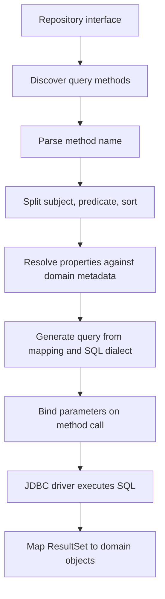

# Method Name Structure and Query Derivation Mechanism

## 1. From Java Method Name to SQL Statement

Spring Data JDBC lets you declare many queries directly on the repository interface without writing SQL manually for every simple case. Instead of creating an implementation for each method, you describe the query intent using **convention-based method names**:

```java
public interface CustomerRepository
        extends CrudRepository<Customer, Long> {

    List<Customer> findByLastName(String lastName);

    Optional<Customer> findByEmail(String email);

    List<Customer> findByStatusAndLastNameOrderByCreatedAtDesc(
            CustomerStatus status,
            String lastName
    );
}
```

Spring Data parses the method name, matches its parts against the properties of the domain type, and generates a query suited to the mapping, dialect, and data types. When the method is called, the parameters are bound to the SQL statement; the application does not need to concatenate input values into the query string.

This mechanism is commonly called **query derivation** or a **derived query**. It is useful for common filtering and sorting conditions, keeping repositories concise and readable. When a query becomes complex, involves multiple JOINs, uses database-specific SQL expressions, or requires fine-grained optimization, you should move to `@Query`, `JdbcTemplate`, or a dedicated SQL tool.

In this lesson, we will cover:

- The structure of a derived query method name.
- How the parser splits subject, predicate, operators, and `OrderBy`.
- How Java property names map to SQL columns.
- Commonly used keywords and how to choose return types.
- How the SQL statement is generated and parameters are bound.
- When query derivation is no longer appropriate.

## 2. General Structure of a Method Name

A derived query name typically has two main parts, separated by the `By` keyword:

```text
<Subject><By><Predicate><OrderBy><SortDirection>
```

For example:

```java
findTop10DistinctByStatusAndCreatedAtAfterOrderByCreatedAtDesc(...)
```

It can be read part by part:

| Part | Example | Meaning |
| --- | --- | --- |
| Subject/prefix | `find` | Query operation type |
| Modifier | `Top10Distinct` | Result limit and distinct requirement |
| Delimiter | `By` | Start of filter conditions |
| Predicate | `StatusAndCreatedAtAfter` | Conditions by property |
| Sort property | `CreatedAt` | Property used for sorting |
| Direction | `Desc` | Descending order |

The method name corresponds to the SQL intent:

```sql
SELECT DISTINCT ...
FROM customers
WHERE status = ?
  AND created_at > ?
ORDER BY created_at DESC
LIMIT 10;
```

This is a conceptual interpretation. The exact SQL depends on the database dialect, how the database limits row counts, table/column names, and the Spring Data JDBC version.

### 2.1. Subject: the part before `By`

The subject indicates whether the repository wants to read, count, check existence, or delete data. Common prefixes in Spring Data query derivation include:

| Prefix | Common meaning |
| --- | --- |
| `find...By` | Find and return data |
| `read...By` | Read data |
| `get...By` | Get data |
| `query...By` | Query data |
| `search...By` | Query data |
| `count...By` | Count matching records |
| `exists...By` | Check whether a matching record exists |
| `delete...By` / `remove...By` | Delete matching data, if the method and return type are supported by the module |

In practice, `find...By` is the most recognizable and widely used form. There is no need to vary prefixes just for the sake of variety; choose a name that clearly expresses intent.

For example:

```java
List<Customer> findByStatus(CustomerStatus status);
long countByStatus(CustomerStatus status);
boolean existsByEmail(String email);
```

These methods are still query methods derived from their names; they are not pre-existing inherited CRUD methods.

### 2.2. Modifier: additional parts in the subject

Several modifiers can appear before `By`:

- `Distinct`: requests non-duplicate results according to the query's semantics.
- `Top` or `First`: limits the number of results.
- Can include a count, such as `Top5` or `First10`.

For example:

```java
Optional<Customer> findFirstByStatusOrderByCreatedAtDesc(
        CustomerStatus status
);

List<Customer> findTop5ByStatusOrderByCreatedAtDesc(
        CustomerStatus status
);
```

The first method retrieves at most the first result in descending creation-date order. The second retrieves at most five results. If deterministic results are needed, always specify `OrderBy`; do not rely on the database's natural order.

### 2.3. `By`: boundary between operation and conditions

`By` is the marker that lets the parser recognize the predicate section. For example:

```java
findByEmail(String email)
```

`find` is the subject; `Email` is the property in the predicate.

Some long method names can be hard to read:

```java
findTop10DistinctByStatusAndCreatedAtAfterOrderByCreatedAtDesc(...)
```

If a method name starts accumulating many conditions and modifiers, consider a shorter name or use `@Query` so the SQL statement directly expresses the intent.

## 3. Predicate: describing filter conditions

The part after `By` is split into property-based conditions. The `And` and `Or` keywords combine conditions:

```java
List<Customer> findByFirstNameAndLastName(
        String firstName,
        String lastName
);

List<Customer> findByStatusOrPriority(
        CustomerStatus status,
        Integer priority
);
```

Equivalent meaning:

```sql
WHERE first_name = ?
  AND last_name = ?

WHERE status = ?
   OR priority = ?
```

### 3.1. Combining And and Or

For example:

```java
List<Customer> findByStatusAndCityOrPriority(
        CustomerStatus status,
        String city,
        Integer priority
);
```

Do not rely on natural-language reading to guess condition grouping. The parser splits the predicate into `Or` groups (each group may contain multiple `And` parts); the example above is logically interpreted as:

```sql
WHERE (status = ? AND city = ?)
   OR priority = ?
```

Method names do not provide arbitrary parenthesis syntax like a general Boolean expression. For complex conditions, multiple nested branches, or grouping different from the default, use `@Query` to express the SQL explicitly.

## 4. Commonly Used Condition Keywords

Spring Data has a standard set of keywords for query derivation. Exact support may vary across modules and versions; below are the groups commonly encountered when working with relational repositories. When using a less common keyword, check the Spring Data Relational documentation for your project's version and verify the actual SQL statement.

### 4.1. Equality and inequality comparisons

| Keyword | Method example | Meaning |
| --- | --- | --- |
| No operator, or `Is`, `Equals` | `findByStatus(status)` | Equals |
| `Not` | `findByStatusNot(status)` | Not equals |

For example:

```java
List<Customer> findByStatus(CustomerStatus status);
List<Customer> findByStatusNot(CustomerStatus status);
```

### 4.2. Numeric and date comparisons

| Keyword | Example | Meaning |
| --- | --- | --- |
| `LessThan` | `findByAgeLessThan(int age)` | Less than |
| `LessThanEqual` | `findByAgeLessThanEqual(int age)` | Less than or equal to |
| `GreaterThan` | `findByAgeGreaterThan(int age)` | Greater than |
| `GreaterThanEqual` | `findByAgeGreaterThanEqual(int age)` | Greater than or equal to |
| `Between` | `findByCreatedAtBetween(a, b)` | Within range |
| `Before` | `findByCreatedAtBefore(time)` | Before timestamp |
| `After` | `findByCreatedAtAfter(time)` | After timestamp |

Date examples:

```java
List<Customer> findByCreatedAtAfter(LocalDateTime from);

List<Customer> findByCreatedAtBetween(
        LocalDateTime from,
        LocalDateTime to
);
```

Be explicit about whether bounds are inclusive or exclusive based on the keyword's semantics and query type. If business logic requires a half-open interval `[start, end)`, write explicit SQL or combine `GreaterThanEqual` and `LessThan` to avoid ambiguity.

### 4.3. Null checks

| Keyword | Example | Meaning |
| --- | --- | --- |
| `IsNull` / `Null` | `findByPhoneIsNull()` | Column has NULL value |
| `IsNotNull` / `NotNull` | `findByPhoneIsNotNull()` | Column is not NULL |

For example:

```java
List<Customer> findByPhoneIsNull();
List<Customer> findByPhoneIsNotNull();
```

This is a clear way to express null filtering. In SQL, do not use `= NULL`; the proper condition is `IS NULL` or `IS NOT NULL`.

### 4.4. String searches

| Keyword | Example | Meaning |
| --- | --- | --- |
| `Like` | `findByNameLike(pattern)` | Matches SQL LIKE pattern |
| `NotLike` | `findByNameNotLike(pattern)` | Does not match pattern |
| `StartingWith` | `findByNameStartingWith(prefix)` | Starts with string |
| `EndingWith` | `findByNameEndingWith(suffix)` | Ends with string |
| `Containing` | `findByNameContaining(part)` | Contains string |
| `IgnoreCase` | `findByNameIgnoreCase(name)` | Case-insensitive comparison, if supported by type/database |

For example:

```java
List<Customer> findByNameStartingWith(String prefix);
List<Customer> findByNameContaining(String part);
List<Customer> findByNameIgnoreCase(String name);
```

`Like` generally lets you pass a pattern containing `%` and `_`. The keywords `StartingWith`, `EndingWith`, and `Containing` express more specific intent, and the framework builds the corresponding pattern.

String search performance depends on the database, collation, and indexes. `Containing` typically produces a pattern with wildcards on both ends (`%value%`), making ordinary B-tree indexes harder to utilize than prefix queries. For full-text search or fuzzy search, a specialized solution is needed.

### 4.5. Searching within a set of values

| Keyword | Example | Meaning |
| --- | --- | --- |
| `In` | `findByStatusIn(statuses)` | Value is in the set |
| `NotIn` | `findByStatusNotIn(statuses)` | Value is not in the set |

For example:

```java
List<Customer> findByStatusIn(
        Collection<CustomerStatus> statuses
);
```

The parameter can be a collection of values compatible with the property type. Define the behavior for empty collections explicitly; do not assume every database or version generates the same SQL for an empty list.

### 4.6. Boolean

| Keyword | Example | Meaning |
| --- | --- | --- |
| `True` | `findByActiveTrue()` | Boolean column is true |
| `False` | `findByActiveFalse()` | Boolean column is false |

For example:

```java
List<Customer> findByActiveTrue();
List<Customer> findByActiveFalse();
```

## 5. Combining Conditions and Sorting

A method can combine multiple properties:

```java
List<Customer> findByStatusAndCityOrderByCreatedAtDesc(
        CustomerStatus status,
        String city
);
```

The `OrderByCreatedAtDesc` part specifies descending order by the `createdAt` property. For ascending order, use `Asc`:

```java
List<Customer> findByStatusOrderByLastNameAscFirstNameAsc(
        CustomerStatus status
);
```

You can sort by multiple properties; the order of properties in the method name determines the priority order in `ORDER BY`.

### 5.1. Dynamic sorting with Sort

When the caller needs to choose the sort order at runtime, Spring Data JDBC supports using `Sort` in appropriate query methods:

```java
import org.springframework.data.domain.Sort;

List<Customer> findByStatus(
        CustomerStatus status,
        Sort sort
);
```

Invocation:

```java
List<Customer> result = repository.findByStatus(
        CustomerStatus.ACTIVE,
        Sort.by(
                Sort.Order.desc("createdAt"),
                Sort.Order.asc("lastName")
        )
);
```

The property names in `Sort` are domain model properties, not necessarily SQL column names. Verify sorting capabilities and syntax for your version of Spring Data JDBC. Do not accept arbitrary column name strings directly from a client and pass them into `Sort` without restricting to an allowlist of permitted properties; column names and sort directions are not bind parameters like filter values.

## 6. Java Property Names vs. SQL Column Names

Derived queries are built from **domain type property names**, not arbitrary SQL column names.

For example:

```java
@Table("customers")
public record Customer(
        @Id Long id,
        @Column("first_name") String firstName,
        @Column("last_name") String lastName,
        String email
) {
}
```

Repository:

```java
List<Customer> findByLastName(String lastName);
```

The method name uses `LastName`, which is the Java property. Spring Data mapping metadata knows that this property maps to the `last_name` column, so the query is generated based on the declared mapping.

Do not write:

```java
// Invalid query derivation intent if the domain has no last_name property:
List<Customer> findByLast_name(String value);
```

SQL column names are handled by `@Column`/naming strategy, whereas the method name must reference the Java property.

### 6.1. Nested property paths

Spring Data Commons supports parsing property paths via camel case names. For example, with a properly mapped value object:

```java
findByAddressZipCode(String zipCode)
```

The parser can split this into the path `address.zipCode` if the model has the corresponding properties and the mapping/dialect supports representing them.

When property names are ambiguous, an underscore can be used as an explicit path separator:

```java
findByAddress_ZipCode(String zipCode)
```

Do not interpret property traversal as meaning Spring Data JDBC automatically generates every JOIN across aggregate relationships. Spring Data JDBC focuses on aggregate mapping and does not provide JPA-style association/lazy-loading mechanisms. For queries spanning multiple tables or referencing another aggregate, check what SQL is supported and generally prefer `@Query` with an explicit JOIN.

### 6.2. Reserved CRUD method names

Certain methods inherited from `CrudRepository`, such as `findById`, `existsById`, and `deleteById`, have special meaning: they operate on the property annotated with `@Id`.

If a domain type has an ordinary property named `id` while the actual primary key is `pk`, the `findById(...)` method is still the reserved CRUD method for looking up by the entity's ID. If you want to query the ordinary `id` property, use a method name with a descriptive token in between, for example:

```java
Optional<Customer> findCustomerById(String businessId);
```

The name `findCustomerById` does not collide with the base repository's reserved `findById` signature; the parser can interpret `Id` after the `Customer` token as a property predicate. Choose clear names and check domain metadata to avoid confusing the primary key with a business identifier.

## 7. How Spring Data Creates Queries

Conceptually, the process can be described as follows:



Main steps:

1. **Repository discovery:** Spring Data locates repository interfaces within the configured scope.
2. **Query method discovery:** non-CRUD methods can be recognized as derived queries or processed according to annotations/configuration.
3. **Parsing:** the method name is parsed into subject, conditions, operators, and sorting.
4. **Property resolution:** property names are matched against the domain model; a nonexistent property can cause repository initialization to fail.
5. **SQL generation:** Spring Data JDBC uses mapping metadata and the dialect to generate an appropriate SQL statement.
6. **Parameter binding:** parameter values are bound via JDBC, separated from the SQL statement structure.
7. **Execution and mapping:** the JDBC driver runs the query; results are converted into the repository method's return type.

This explains why typos in property names usually surface when the application initializes the repository, rather than waiting until matching data exists. The method name is not treated as an arbitrary free-form SQL string.

## 8. Generated SQL and Parameter Binding

Example:

```java
List<Customer> findByStatusAndLastNameOrderByCreatedAtDesc(
        CustomerStatus status,
        String lastName
);
```

SQL intent:

```sql
SELECT ...
FROM customers
WHERE status = ?
  AND last_name = ?
ORDER BY created_at DESC;
```

When called:

```java
repository.findByStatusAndLastNameOrderByCreatedAtDesc(
        CustomerStatus.ACTIVE,
        "Nguyen"
);
```

The values `ACTIVE` and `Nguyen` are bound as parameters to the JDBC statement. The framework does not need to concatenate them directly into the SQL:

```text
SQL template:
  WHERE status = ? AND last_name = ?

Parameters:
  1 -> ACTIVE
  2 -> Nguyen
```

Parameter binding separates input data from SQL syntax, reducing SQL injection risk for **values**. It does not apply to table names, column names, or sort directions; those structural elements must be controlled by mapping and valid allowlists.

### Why isn't the SQL identical across every database?

The dialect can affect:

- How identifiers are quoted.
- How `Top`/`First` result limits are expressed.
- Boolean syntax and data types.
- How `LIKE`, case-insensitivity, or specialized expressions are represented.
- How certain Java types are bound and converted.

Therefore, the SQL statements in this lesson are illustrative shapes. When you need to verify, enable `org.springframework.jdbc` logging at DEBUG level or use an SQL inspection tool in your development environment.

## 9. Return Types Affect How Methods Are Used

Choose the return type based on the expected number of results:

| Return type | Usage |
| --- | --- |
| `Optional<Customer>` | Expects zero or one result; if more than one row is found, the framework throws a cardinality error instead of silently picking one row. |
| `Customer` | Expects a single result; zero or multiple results are handled according to repository semantics. |
| `List<Customer>` | Zero or more results. |
| `Iterable<Customer>` | Iterable result set. |
| `long` | Commonly used for `count...By`. |
| `boolean` | Commonly used for `exists...By`. |

For example:

```java
Optional<Customer> findByEmail(String email);
List<Customer> findByStatus(CustomerStatus status);
long countByStatus(CustomerStatus status);
boolean existsByEmail(String email);
```

If email is guaranteed unique by the database and business rules, `Optional<Customer>` is a clear choice. However, if the database lacks a unique constraint, the method can expose duplicate data by failing with a non-unique result error. Do not use `Optional` just because you want "any single result."

### Limiting results with First/Top

```java
Optional<Customer> findFirstByStatusOrderByCreatedAtDesc(
        CustomerStatus status
);

List<Customer> findTop10ByStatusOrderByCreatedAtDescIdAsc(
        CustomerStatus status
);
```

`First`/`Top` expresses a limit on the number of results. To keep results consistently reproducible when multiple rows share the same `createdAt`, add a secondary criterion such as ID to the ordering:

```java
List<Customer> findTop10ByStatusOrderByCreatedAtDescIdAsc(
        CustomerStatus status
);
```

A secondary sort criterion prevents nondeterministic result changes across runs when timestamps tie.

## 10. Complete Repository Example

Model:

```java
package com.example.customer;

import java.time.LocalDateTime;
import org.springframework.data.annotation.Id;
import org.springframework.data.relational.core.mapping.Column;
import org.springframework.data.relational.core.mapping.Table;

@Table("customers")
public record Customer(
        @Id Long id,
        @Column("first_name") String firstName,
        @Column("last_name") String lastName,
        String email,
        CustomerStatus status,
        @Column("created_at") LocalDateTime createdAt
) {
}
```

Enum:

```java
package com.example.customer;

public enum CustomerStatus {
    ACTIVE,
    INACTIVE,
    BLOCKED
}
```

Repository:

```java
package com.example.customer;

import java.time.LocalDateTime;
import java.util.List;
import java.util.Optional;

import org.springframework.data.domain.Sort;
import org.springframework.data.repository.CrudRepository;

public interface CustomerRepository
        extends CrudRepository<Customer, Long> {

    List<Customer> findByLastName(String lastName);

    Optional<Customer> findByEmail(String email);

    List<Customer> findByStatusAndLastNameOrderByCreatedAtDesc(
            CustomerStatus status,
            String lastName
    );

    List<Customer> findByCreatedAtBetween(
            LocalDateTime from,
            LocalDateTime to
    );

    List<Customer> findByFirstNameStartingWith(String prefix);

    List<Customer> findByStatusIn(List<CustomerStatus> statuses);

    List<Customer> findTop5ByStatusOrderByCreatedAtDescIdAsc(
            CustomerStatus status
    );

    long countByStatus(CustomerStatus status);

    boolean existsByEmail(String email);

    List<Customer> findByStatus(CustomerStatus status, Sort sort);
}
```

These methods illustrate common forms of derived queries. When adding a new method, Spring Data must be able to resolve all properties and keywords. If a return type or keyword is not supported by your module/version, the repository may fail to initialize or the query may not have the expected semantics; check the documentation and run integration tests against the target database.

## 11. When Should You Use @Query?

Query derivation is appropriate when the method name still expresses the intent concisely. Switch to `@Query` when:

- There are JOINs across multiple tables or queries crossing aggregate boundaries.
- There are SQL expressions, CTEs, window functions, subqueries, or database-specific functions.
- The predicate has multiple Boolean branches requiring explicit parentheses.
- You need precise control over projection, ordering, grouping, or SQL optimization.
- The method name becomes so long that it is harder to understand than the SQL statement.

For example:

```java
package com.example.customer;

import java.time.LocalDateTime;
import java.util.List;

import org.springframework.data.jdbc.repository.query.Query;
import org.springframework.data.repository.query.Param;
import org.springframework.data.repository.CrudRepository;

public interface CustomerRepository
        extends CrudRepository<Customer, Long> {

    @Query("""
        SELECT *
        FROM customers
        WHERE status = :status
          AND created_at >= :fromTime
        ORDER BY created_at DESC, id ASC
        """)
    List<Customer> findRecentByStatus(
            @Param("status") CustomerStatus status,
            @Param("fromTime") LocalDateTime fromTime
    );
}
```

This example illustrates named parameters in an SQL query. Table and column names must match the actual schema; the return type must be mappable from the selected columns.

### 11.1. Custom DML

For a direct update statement, Spring Data JDBC supports `@Modifying` together with `@Query`:

```java
@Modifying
@Query("""
    UPDATE customers
    SET status = :status
    WHERE id = :id
    """)
int updateStatus(
        @Param("id") Long id,
        @Param("status") CustomerStatus status
);
```

Returning the number of affected rows lets the caller know whether any record was updated. Direct DML statements can bypass aggregate behavior, domain model validation, or application-designed audit workflows. Only use them when direct SQL operations fit your business rules and transaction boundaries.

## 12. Limitations and Caveats of Query Derivation

### 12.1. Method names can become too long

For example:

```java
findByStatusAndRegionAndCreatedAtBetweenAndEmailEndingWith(...)
```

If a method name turns into a hard-to-read descriptive sentence, use `@Query` with clear SQL or split the use case into smaller methods.

### 12.2. Derived queries do not automatically generate every JOIN

Spring Data JDBC has an aggregate model and relationship mapping different from JPA. Just because the parser recognizes a property path does not mean it will automatically generate JOINs across aggregate references. When a query needs data from multiple tables, check the exact support; `@Query` with an explicit JOIN or an appropriate SQL tool is usually more predictable.

### 12.3. Wrong property names cause repository errors

If the entity has `lastName` but the method is written as `findByLastname` or `findByLastNmae`, the parser may fail to resolve the property. The error typically occurs when the repository is initialized. Use the exact Java property name; do not guess from SQL column names.

### 12.4. Null and three-state Boolean

A nullable column can have three states: true, false, and null. `findByActiveTrue()` and `findByActiveFalse()` do not necessarily cover all data if nulls exist. If business logic distinguishes "unset," query for null explicitly.

### 12.5. IgnoreCase and collation

Do not assume case-insensitive comparisons behave identically across all databases, locales, and collations. Inspect the generated SQL and actual collation rules; with multilingual data, uppercase/lowercase conversion can be more complex than ASCII.

### 12.6. Limits and sorting must be deterministic

`Top` or `First` without `OrderBy` does not guarantee selecting the same records across runs. If order matters, declare one or more sort criteria, typically including a unique key as the final tie-breaker.

### 12.7. Derived deletes and bulk updates require understanding side effects

`deleteBy...` methods or `@Modifying` SQL can issue direct write operations. For aggregates with owned relationships or domain invariants, consider whether direct deletion bypasses rules that must be enforced. Do not use bulk DML in place of domain behavior if deletion requires state checks, business cascades, or event publication.

## 13. Process for Reading and Designing a Method

When encountering an unfamiliar method, read it in order:

1. **Find the subject:** is the method finding, counting, checking existence, or deleting?
2. **Find `By`:** what conditions follow it?
3. **Split properties:** which Java property does each camel-case token reference?
4. **Identify keywords:** `Between`, `IsNull`, `Containing`, `In`, `GreaterThan`...?
5. **Split `And`/`Or`:** how are the conditions grouped?
6. **Read sorting:** is there `OrderBy`, which property, and which direction?
7. **Match parameters:** do the count, order, and Java types match the predicates?
8. **Read return type:** single result, multiple results, count, or exists?
9. **Check mapping and SQL:** does the property have `@Column`, and what SQL does the dialect produce?
10. **Assess complexity:** if the method name is hard to understand, switch to `@Query`.

For example:

```java
List<Customer> findTop10ByStatusAndCreatedAtAfterOrderByCreatedAtDesc(
        CustomerStatus status,
        LocalDateTime from
);
```

Read as a sentence:

> Find at most 10 Customers whose status equals the passed value and whose createdAt is after the from timestamp, ordered by createdAt descending.

This is a quick way to verify whether the method name matches the use case.

## 14. Testing Derived Queries

Do not only verify that the application starts up. An integration test with an appropriate database verifies the parser, mapping, and actual SQL:

```java
@DataJdbcTest
class CustomerRepositoryTest {

    @Autowired
    CustomerRepository repository;

    @Test
    void findsActiveCustomersByLastName() {
        repository.save(new Customer(
                null,
                "Lan",
                "Nguyen",
                "lan@example.test",
                CustomerStatus.ACTIVE,
                LocalDateTime.parse("2026-01-01T10:00:00")
        ));

        List<Customer> result =
                repository.findByStatusAndLastNameOrderByCreatedAtDesc(
                        CustomerStatus.ACTIVE,
                        "Nguyen"
                );

        assertThat(result).hasSize(1);
        assertThat(result.get(0).firstName()).isEqualTo("Lan");
    }
}
```

This is an illustrative skeleton; the test requires the appropriate schema and test dependencies in the project. You should also include non-matching data to verify that filtering actually works, test sorting with multiple rows, and test empty-result cases.

If production uses PostgreSQL, you should have integration tests on PostgreSQL for queries that depend on dialect, collation, or data types. H2 cannot prove that every SQL statement or semantics matches the production database identically.

## 15. Practice Exercises

**Exercise 1 — Basic predicates.** Create `findByStatus`, `findByLastName`, and `findByEmail`. Predict the corresponding SQL and verify using JDBC logs.

**Exercise 2 — And and Or.** Create `findByStatusAndCityOrPriority`. Rewrite the Boolean expression according to how the parser groups conditions. Then use `@Query` with explicit parentheses and compare.

**Exercise 3 — Keywords.** Try `Between`, `GreaterThanEqual`, `IsNull`, `StartingWith`, `Containing`, `In`, and `IgnoreCase`. Test boundary cases and against the target database.

**Exercise 4 — Sort and Top.** Write `findTop5ByStatusOrderByCreatedAtDescIdAsc`. Create multiple rows with the same timestamp to observe the role of the secondary sort criterion.

**Exercise 5 — Property mapping.** Change the Java property to `lastName` and the SQL column to `last_name` using `@Column`. Verify that the method still has to use `findByLastName`.

**Exercise 6 — Reserved methods.** Create an entity with primary key `pk` and a business property `id`. Compare `findById(...)` with `findCustomerById(...)` and identify which method looks up by the primary key.

**Exercise 7 — Moving to @Query.** Write a query that JOINs two tables. Explain why derived method naming is no longer an appropriate representation.

## 16. Key Takeaways

A Spring Data JDBC derived query method name generally consists of **subject + `By` + predicate + `OrderBy`**. The subject describes the operation type and modifiers like `Top`, `First`, and `Distinct`; the predicate references Java properties and combines conditions with `And`/`Or`; the sort section specifies properties along with `Asc`/`Desc` directions.

Spring Data parses the method name, resolves properties through mapping metadata, generates dialect-appropriate SQL, and binds parameter values through JDBC. Therefore, methods must use exact Java property names, while SQL column names are handled by mapping. Derived queries suit common conditions; multi-table queries, complex Boolean logic, or specialized SQL should be expressed using `@Query` or a dedicated SQL tool.

When designing a repository, prefer method names short enough that readers immediately understand the conditions and results. If you have to decode a long method name like a puzzle, that is a signal to write a more explicit query.

### References

- [Spring Data Relational – Query Methods](https://docs.spring.io/spring-data/relational/reference/jdbc/query-methods.html)
- [Spring Data Commons – Query Methods](https://docs.spring.io/spring-data/commons/reference/repositories/query-methods-details.html)
- [Spring Data Relational – JDBC Repositories](https://docs.spring.io/spring-data/relational/reference/jdbc/repositories.html)
