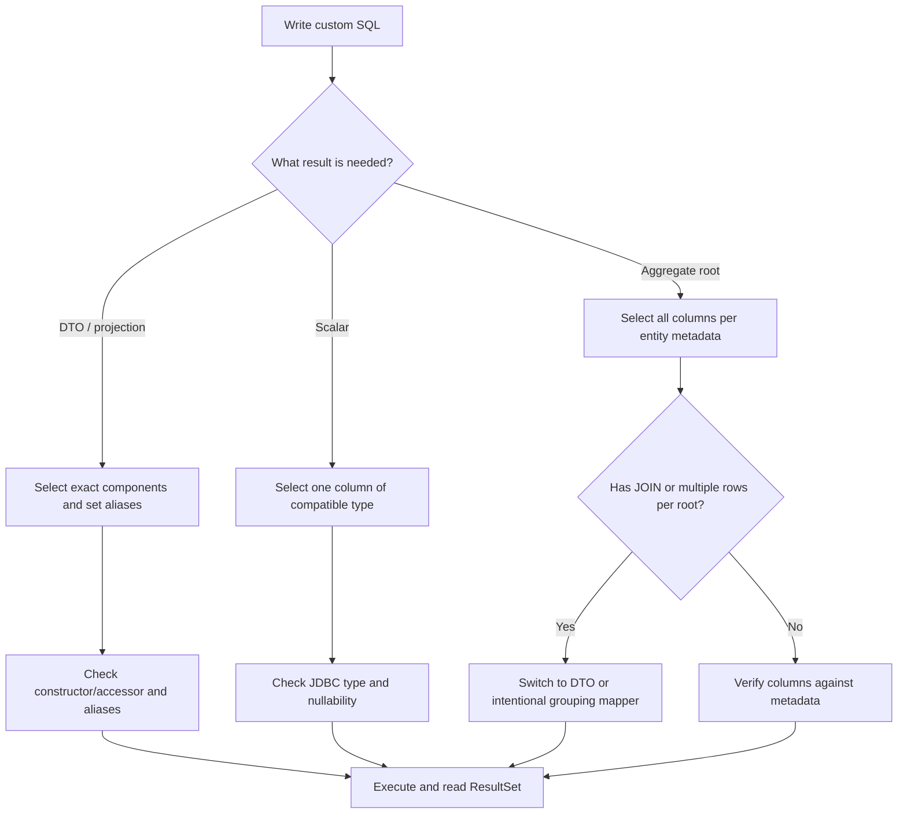

# Selecting Columns, Aliases, and Required Data for Result Mapping

In **Spring Data JDBC**, a custom SQL statement must do more than simply execute without error on the database. The returned result must also contain sufficient data and appropriate column names so Spring Data can convert each row of the `ResultSet` into the Java type declared by the repository. Therefore, when writing `@Query`, you need to design three parts together: **the result type**, **the column/alias list**, and **the data conversion rules**.

A query returning an aggregate root needs the persistent columns required by the entity. A query serving a reporting screen may only need a few columns, in which case a DTO/projection is a better fit. With `JOIN`s or computed expressions, aliases give result columns stable names and avoid name collisions. Nullable columns, SQL types, and record constructors must also be compatible with the actual data.

## 1. Executable SQL is not enough for mapping

Suppose the database has a `customers` table:

```sql
CREATE TABLE customers (
    id BIGINT GENERATED BY DEFAULT AS IDENTITY PRIMARY KEY,
    display_name VARCHAR(150) NOT NULL,
    email VARCHAR(200) NOT NULL,
    active BOOLEAN NOT NULL
);
```

Java entity:

```java
import org.springframework.data.annotation.Id;
import org.springframework.data.relational.core.mapping.Column;
import org.springframework.data.relational.core.mapping.Table;

@Table("customers")
public record Customer(
        @Id Long id,
        @Column("display_name") String name,
        String email,
        boolean active
) {}
```

The repository can declare an explicit SQL query:

```java
import java.util.Optional;
import org.springframework.data.jdbc.repository.query.Query;
import org.springframework.data.repository.CrudRepository;
import org.springframework.data.repository.query.Param;

public interface CustomerRepository extends CrudRepository<Customer, Long> {

    @Query("""
        SELECT id, display_name, email, active
        FROM customers
        WHERE id = :id
        """)
    Optional<Customer> findCustomerRow(@Param("id") Long id);
}
```

Here the SQL must return the columns needed to construct `Customer`: `id`, `display_name`, `email`, `active`. The `@Column("display_name")` metadata tells Spring Data that the `name` property corresponds to the physical column `display_name`.

A SQL statement can be valid for the database yet inappropriate for the return type. For example, `SELECT id, display_name FROM customers` runs fine, but it does not provide `email` and `active` to construct a complete `Customer`. If the return type needs to be `Customer`, select all data required by the mapping; if the use case only needs the ID and name, declare a projection/DTO representing just those two values.

## 2. Choose the result type before writing the column list

First determine what the repository method needs to return:

| Result type | When is it appropriate? | Columns to return |
|---|---|---|
| Aggregate root (`Customer`) | Use case needs to continue working with the aggregate and domain behavior | Persistent columns needed to map the root per metadata |
| `Optional<Customer>` | A root may not exist | Same as above; `Optional.empty()` when no row matches |
| DTO/record projection | Screen or report only needs a subset of read data | Columns corresponding to the DTO components |
| Interface projection | Only needs certain properties through supported accessors | Aliases/columns must match projection properties |
| Simple scalar (`Long`, `String`, `boolean`, etc.) | Query returns a single value such as count or existence | One column compatible with the result type |
| Collection of results | Multiple rows needed | Each row must be mappable to the element type |

Do not choose `Customer` solely because the source table is `customers`. If the query is an aggregate summary report, the result is effectively not a `Customer` aggregate. Using a DTO to describe the returned data is clearer and avoids pretending a report row is a full entity.

## 3. When returning an entity, select columns per entity metadata

For the entity:

```java
@Table("customers")
public record Customer(
        @Id Long id,
        @Column("display_name") String name,
        String email,
        boolean active
) {}
```

A query reading the entity should fetch all required columns:

```sql
SELECT id, display_name, email, active
FROM customers
WHERE active = TRUE;
```

Principles:

- **Primary key**: `id` must be present to identify the aggregate root.
- **Persistent properties**: properties needed to construct the entity must be returned with matching columns.
- **Column names**: use physical names in the database; `@Column` and naming strategy determine how Java properties are mapped.
- **Data types**: SQL types must be convertible to the Java types or registered converters.
- **Nullability**: nullable columns must be compatible with the property types and constructor.

In custom queries, avoid omitting columns just because a current screen does not display them yet. If the return type is an aggregate root, the goal is to construct the aggregate accurately per metadata, not merely the subset visible on a UI.

`SELECT *` may be convenient when tables are small, but an explicit column list lets readers know which fields the query depends on, avoids fetching unnecessary columns, and makes schema changes easier to detect. When a new column is added to a table, an explicit-column query does not change implicitly; this generally keeps the read contract more stable.

## 4. An alias is a column's name in the query result

An alias (`AS`) names a column in the `ResultSet`. An alias does not rename the physical column in the table, nor does it perform a migration.

Example:

```sql
SELECT display_name AS name
FROM customers;
```

The database still reads the `display_name` column; the column label in the result is set to `name`. This is useful when:

- Using computed expressions (`COUNT`, `SUM`, `CASE`, string concatenation, etc.).
- Joining multiple tables with overlapping column names like `id`, `name`, `created_at`.
- Returning a DTO whose property names differ from physical column names.
- Giving query results clear, stable column names.

### Aliases when mapping to an entity

For an entity with `@Column("display_name")`, the most direct approach is returning the exact column name `display_name`:

```sql
SELECT id, display_name, email, active
FROM customers;
```

If you alias a column, the alias must match the metadata used by the mapping. For instance, `display_name AS name` is only valid if the result label `name` maps properly to the target property under the version's metadata/configuration. Do not arbitrarily alias every column to Java property names assuming the mapping always understands them.

The safe rule is to **keep physical column names matching the metadata when returning entities**, unless there is a clear reason and you have verified how the alias is mapped.

### Aliases when mapping a DTO

For DTOs/projections, design aliases to match the property names of the result type. Example DTO with simple properties:

```java
public record CustomerSummary(Long id, String name, String email) {}
```

Query:

```java
@Query("""
    SELECT id AS id,
           display_name AS name,
           email AS email
    FROM customers
    WHERE active = TRUE
    ORDER BY display_name
    """)
List<CustomerSummary> findActiveSummaries();
```

Here the aliases `id`, `name`, `email` match the components of `CustomerSummary`. Using simple names keeps results readable and avoids case-folding differences across databases. For compound properties or camelCase aliases, pay attention to how the DBMS normalizes unquoted identifiers and how converters read column labels.

## 5. Required constructor/record data

Spring Data JDBC uses metadata and entity/DTO instantiation mechanisms to turn result rows into objects. For Java `record`s, the components define the data the constructor must receive.

Example:

```java
public record CustomerSummary(Long id, String name, String email) {}
```

When returning `CustomerSummary`, the query must supply data for the corresponding components:

```sql
SELECT id AS id,
       display_name AS name,
       email AS email
FROM customers;
```

If the query selects only `id` and `name`, it does not satisfy the contract of a record that also has `email`. Depending on the mapping type, missing fields can cause mapping to fail, pass unexpected values to the constructor, or produce inappropriate null/default values. Do not rely on implicit behavior; select all required columns or create a smaller DTO with only the needed components.

Example DTO needing only ID and name:

```java
public record CustomerName(Long id, String name) {}
```

```sql
SELECT id AS id, display_name AS name
FROM customers;
```

This accurately expresses the query's intent rather than returning an incomplete `Customer`.

## 6. Java types, SQL types, and nullability must be compatible

A correctly named column list is still not enough if values cannot be converted to the Java types. Check SQL types, converters, and nullability.

| Common SQL type | Common Java type | Points to watch |
|---|---|---|
| `BIGINT` | `Long` / `long` | `NULL` fits `Long`; primitive `long` cannot represent null |
| `INTEGER` | `Integer` / `int` | Use wrapper if the column can be null |
| `VARCHAR` | `String` | Check length and null values |
| `BOOLEAN` | `Boolean` / `boolean` | Primitive cannot represent an unknown/null state |
| `DECIMAL(p,s)` | `BigDecimal` | Watch precision, scale, and rounding |
| `DATE` | `LocalDate` | Represents date only, without time |
| `TIMESTAMP` | `LocalDateTime` or appropriate temporal type | Distinguish local time vs. instant with timezone |
| `UUID` / UUID string | `UUID` or `String` | Exact support depends on database/driver/converter |

Example query:

```sql
SELECT id, display_name, active
FROM customers
WHERE id = ?;
```

If `active` in the database can be `NULL`, an entity with `boolean active` cannot accurately represent that state. Change it to `Boolean`, or update DDL to `NOT NULL` if business rules require a deterministic value.

Similarly, `COUNT(*)` often returns large integer values; use `Long`/`long` for count results rather than assuming every dataset fits in `Integer`.

## 7. `JOIN` example: aliasing to avoid column name collisions

Suppose we need a report of order counts per customer. The schema has two tables:

```sql
CREATE TABLE customers (
    id BIGINT PRIMARY KEY,
    display_name VARCHAR(150) NOT NULL,
    email VARCHAR(200) NOT NULL
);

CREATE TABLE orders (
    id BIGINT PRIMARY KEY,
    customer_id BIGINT NOT NULL,
    total_amount DECIMAL(18, 2) NOT NULL,
    CONSTRAINT fk_orders_customer
        FOREIGN KEY (customer_id) REFERENCES customers(id)
);
```

Both tables have an `id` column. If a query returns `SELECT *`, the result has two columns named `id`; mapping by column label can become ambiguous or incorrect.

Instead, use explicit aliases and return a DTO:

```java
public record CustomerOrderStats(Long id, String name, Long orders) {}
```

```java
@Query("""
    SELECT c.id AS id,
           c.display_name AS name,
           COUNT(o.id) AS orders
    FROM customers c
    LEFT JOIN orders o ON o.customer_id = c.id
    GROUP BY c.id, c.display_name
    ORDER BY c.id
    """)
List<CustomerOrderStats> findOrderStats();
```

Roles of the aliases:

- `c.id AS id`: the customer's ID, avoiding confusion with `o.id`.
- `c.display_name AS name`: the customer's display name.
- `COUNT(o.id) AS orders`: order count, with alias matching the `orders` component.

`LEFT JOIN` preserves customers without orders; `COUNT(o.id)` returns `0` for customers with no matching order rows. If `COUNT(*)` were used, the row produced by `LEFT JOIN` still exists and the result could be `1` instead of `0`.

Because the result is aggregated data from two tables, `CustomerOrderStats` captures its nature better than trying to map it into `Customer`.

## 8. When `JOIN` returns multiple rows for the same root

A customer can have multiple orders. The query:

```sql
SELECT c.id, c.display_name, o.id, o.total_amount
FROM customers c
JOIN orders o ON o.customer_id = c.id;
```

will return multiple rows for one customer if that customer has multiple orders. This is a **one-to-many** result shape, not a single row per aggregate root.

Do not assume Spring Data JDBC will automatically group those `JOIN` rows into a `Customer` containing an `orders` collection simply because the entity has a relationship or the SQL joined two tables. A custom query method needs a return type that fits the shape of the rows it returns. For reports, return one DTO per row; for an aggregate needing full mapped children, use Spring Data JDBC's appropriate aggregate-reading mechanism or implement a dedicated mapper/fragment.

If you want one row per customer, aggregate or group the data in SQL:

```sql
SELECT c.id AS id,
       c.display_name AS name,
       COUNT(o.id) AS orders
FROM customers c
LEFT JOIN orders o ON o.customer_id = c.id
GROUP BY c.id, c.display_name;
```

If you want one row per order, the DTO should include both customer ID and order ID with distinct aliases:

```java
public record CustomerOrderRow(
        Long customerId,
        String customerName,
        Long orderId,
        BigDecimal totalAmount
) {}
```

In that case the query needs explicit aliases for all four columns, and the mapping must be configured/verified against the DTO component names. Result shape determines the return type; do not force multiple flat rows into a single aggregate without explicit grouping logic.

## 9. `NULL` in results and computed expressions

`JOIN`s, aggregate functions, and `CASE` expressions can produce `NULL` even when source columns have `NOT NULL` constraints.

Example:

```sql
SELECT c.id AS id,
       c.display_name AS name,
       o.total_amount AS amount
FROM customers c
LEFT JOIN orders o ON o.customer_id = c.id;
```

For customers without orders, `o.total_amount` is `NULL` because there is no matching row on the `orders` side. If the DTO declares `BigDecimal amount`, a reference type can represent null; if using a primitive type or logic requiring a non-null value, handle it explicitly.

If business logic wants a default total of 0, use `COALESCE`:

```sql
SELECT c.id AS id,
       c.display_name AS name,
       COALESCE(SUM(o.total_amount), 0) AS total
FROM customers c
LEFT JOIN orders o ON o.customer_id = c.id
GROUP BY c.id, c.display_name;
```

`COALESCE` changes the SQL result value; the `total` alias sets the result column name. The expression's type must be compatible with the Java type, and the database may infer numeric types from the arguments. For currency, preserve `DECIMAL`/`BigDecimal` instead of converting to `double` to avoid binary floating-point rounding errors.

## 10. Aliases for `CASE`, functions, and expressions

A computed column has no natural property name. Give it an alias so the result has a stable name:

```sql
SELECT id AS id,
       display_name AS name,
       CASE WHEN active THEN 'ACTIVE' ELSE 'INACTIVE' END AS state
FROM customers;
```

DTO:

```java
public record CustomerState(Long id, String name, String state) {}
```

The `state` alias connects the `CASE` expression to the `state` component. Without an alias, the database may return a driver- or DBMS-dependent expression label; mapping by name becomes unpredictable.

The same applies to functions:

```sql
SELECT customer_id AS customer_id,
       COUNT(*) AS order_count,
       MAX(total_amount) AS largest_order
FROM orders
GROUP BY customer_id;
```

Aliases must align with the result type and SQL types. Do not use an alias that collides with another column in the same result set, especially in multi-table queries.

## 11. Projections differ from aggregate roots

A projection represents a subset of data for reading. It is useful when a query does not need—or should not construct—an entire aggregate.

### DTO/record projection

```java
public record CustomerContact(Long id, String name, String email) {}
```

```java
@Query("""
    SELECT id AS id,
           display_name AS name,
           email AS email
    FROM customers
    WHERE active = TRUE
    """)
List<CustomerContact> findActiveContacts();
```

A DTO has a fixed structure, is easy to use in the service/API layer, and does not carry unnecessary aggregate properties.

### Interface projection

An interface projection can declare accessors for the values to read:

```java
public interface CustomerContactView {
    Long getId();
    String getName();
    String getEmail();
}
```

```java
@Query("""
    SELECT id AS id,
           display_name AS name,
           email AS email
    FROM customers
    WHERE active = TRUE
    """)
List<CustomerContactView> findActiveContactViews();
```

Projection capabilities and alias mapping behavior depend on the Spring Data JDBC version and supported projection forms. Keep aliases matching accessors and verify with integration tests on the actual database/driver. If complex mapping control is needed, a constructor DTO or custom `RowMapper` may be clearer.

## 12. Queries returning a single simple value

Not every query needs to construct an entity. For example, counting active customers:

```java
@Query("SELECT COUNT(*) FROM customers WHERE active = TRUE")
long countActiveCustomers();
```

SQL returns one numeric column, so the `long` return type accommodates counts larger than `int` range. For existence checks, you can return boolean in ways supported by the database and mapping, or use a derived `existsBy...` method when the condition is simple.

If the SQL returns multiple columns while the method declares `Long`, the result no longer fits a scalar type. Conversely, if the method returns a DTO while the SQL returns only one column, the constructor cannot receive enough data.

## 13. Query parameters and aliases are two different concepts

In `@Query`:

```java
@Query("""
    SELECT id AS id, display_name AS name, email AS email
    FROM customers
    WHERE active = :active
      AND email LIKE :pattern
    """)
List<CustomerContact> search(
        @Param("active") boolean active,
        @Param("pattern") String pattern
);
```

- `:active`, `:pattern` are **input parameters** bound into the SQL statement.
- `AS id`, `AS name`, `AS email` are **output aliases** for the result columns.

Parameters do not rename columns; aliases do not pass input values. Keeping the two roles distinct makes queries easier to read.

Do not concatenate user input directly into SQL strings. Use bound parameters to reduce SQL injection risk and let the driver handle data types properly. Bound parameters are for values, not for dynamically substituting table names, column names, or SQL keywords; if dynamic column/sort selection is needed, control it with an allowlist and build the query safely.

## 14. Custom SQL and data of aggregates with children

Spring Data JDBC organizes reads and writes around aggregate roots. When a repository method uses standard query mechanisms to load an aggregate, the framework knows the relationship metadata to fetch child components. With a custom `@Query`, you must understand the exact result type and mapping that the method requires.

A JOIN query returning columns from root and child does not automatically mean every row will be grouped into a child collection as expected. If a report is needed, map each row to a DTO. If a full aggregate must be constructed, use the appropriate aggregate-loading path or implement a custom repository fragment/`RowMapper` with explicit grouping logic and relationship control.

Example orders and order lines tables:

```sql
CREATE TABLE orders (
    id BIGINT PRIMARY KEY,
    order_number VARCHAR(40) NOT NULL
);

CREATE TABLE order_lines (
    id BIGINT PRIMARY KEY,
    order_id BIGINT NOT NULL,
    sku VARCHAR(40) NOT NULL,
    quantity INTEGER NOT NULL,
    FOREIGN KEY (order_id) REFERENCES orders(id)
);
```

A report query with one row per order line should use a DTO:

```java
public record OrderLineRow(Long orderId, String orderNumber,
                           Long lineId, String sku, Integer quantity) {}
```

SQL:

```sql
SELECT o.id AS order_id,
       o.order_number AS order_number,
       l.id AS line_id,
       l.sku AS sku,
       l.quantity AS quantity
FROM orders o
JOIN order_lines l ON l.order_id = o.id
WHERE o.id = :orderId
ORDER BY l.id;
```

Because the DTO has camelCase properties, the snake_case aliases above must be mapped according to the naming strategy/DTO mapping supported by your Spring Data JDBC version. To avoid depending on naming strategy rules, you can use simple aliases matching the properties or implement an explicit `RowMapper`. The critical point is not allowing the parent table's `id` and child table's `id` to appear under the same ambiguous label.

## 15. When should you use a custom `RowMapper`?

If the SQL result has a complex structure, multiple tables, nested data, or special aliases, a handwritten `RowMapper`/repository fragment can provide clearer control over converting `ResultSet` rows into DTOs.

Example JDBC mapper for a simple DTO:

```java
import java.sql.ResultSet;
import java.sql.SQLException;
import org.springframework.jdbc.core.RowMapper;

public class CustomerContactRowMapper implements RowMapper<CustomerContact> {
    @Override
    public CustomerContact mapRow(ResultSet rs, int rowNum) throws SQLException {
        return new CustomerContact(
                rs.getLong("id"),
                rs.getString("name"),
                rs.getString("email")
        );
    }
}
```

Here the mapper reads by exact aliases (`id`, `name`, `email`), so renaming physical columns has no effect as long as the SQL keeps those aliases. A custom mapper must handle nulls with primitives/wrappers, temporal types, enums, monetary values, and empty results on its own.

A fragment using `NamedParameterJdbcTemplate` can invoke the mapper:

```java
String sql = """
    SELECT id, display_name AS name, email
    FROM customers
    WHERE active = :active
    """;

return jdbc.query(sql,
        new MapSqlParameterSource("active", true),
        new CustomerContactRowMapper());
```

This is a custom JDBC query path, so the developer is responsible for mapping and transaction semantics. Use it when genuine control is needed; for simple queries, `@Query` and projections generally require less code.

## 16. Common mistakes when selecting columns and aliases

| Symptom | Common cause | Resolution |
|---|---|---|
| Column not found when running query | SQL uses wrong physical name or different schema | Compare DDL against executed SQL |
| Returned entity is missing data | `SELECT` does not fetch all persistent properties | Select all required columns or return a smaller projection |
| Constructor/record fails to instantiate | Columns/aliases do not match components or types cannot convert | Verify constructor, aliases, and converters |
| Unexpected null values | `LEFT JOIN`, `CASE`, or aggregate produces `NULL` | Use wrapper/nullable types or `COALESCE` per business rules |
| Wrong property mapped with `@Column` | Alias does not match the column name expected by mapping | Return physical column names or verified aliases |
| Duplicate `id` after JOIN | Two tables share the same column name | Alias each ID separately and return a DTO |
| DTO fails to map camelCase aliases | DBMS folds identifier case or naming strategy differs | Use simple aliases, proper quoting, or a RowMapper |
| Child data is not grouped into a collection | Flat query is treated as independent rows | Use aggregate-loading path or an explicit grouping mapper |
| Numeric/temporal type mismatch | SQL type is incompatible with Java type | Choose appropriate wrappers/`BigDecimal`/time types and converters |
| SQL injection in filtering | Input concatenated into SQL string | Use bind parameters; allowlist dynamic identifiers |

When debugging, record four pieces of information: **the method return type, the column/alias list in SQL, the labels and data types in the ResultSet, and the metadata/constructor of the Java type**. Comparing these four parts will pinpoint whether the issue lies in the SQL, schema, or mapping.

## 17. Workflow for designing the output of a `@Query`

Before writing a query, follow this sequence:

1. **Identify the purpose**: do you need a full aggregate, DTO, projection, or scalar?
2. **Determine the return type**: `Customer`, `Optional<Customer>`, `List<CustomerSummary>`, `long`, etc.
3. **List required data**: ID, persistent properties, constructor components, or computed values.
4. **Select physical columns**: cross-check `@Table`, `@Column`, naming strategy, and DDL.
5. **Define clear aliases**: especially for expressions, JOINs, and projections; avoid duplicate labels.
6. **Verify types and nullability**: `NULL`, `COUNT`, `SUM`, `LEFT JOIN`, `CASE`, date/time, and currency types.
7. **Bind parameters**: use `@Param` or appropriate binding rules; never concatenate input into SQL.
8. **Inspect actual SQL/results**: test on the database/driver the application uses, especially across dialects.
9. **Use a custom mapper when needed**: if the result shape does not suit automatic mapping, express the conversion explicitly.

Decision flowchart:



## 18. Practice exercise: same table, three result types

Using the `customers` table from the beginning, write three methods:

**A. Return an aggregate root**

```java
@Query("SELECT id, display_name, email, active FROM customers WHERE id = :id")
Optional<Customer> findFullCustomer(@Param("id") Long id);
```

The method needs all columns required by the entity.

**B. Return a DTO for a contact screen**

```java
public record CustomerContact(Long id, String name, String email) {}
```

```java
@Query("""
    SELECT id AS id, display_name AS name, email AS email
    FROM customers
    WHERE active = TRUE
    """)
List<CustomerContact> findContacts();
```

The method selects only the three values needed by the DTO.

**C. Return a scalar**

```java
@Query("SELECT COUNT(*) FROM customers WHERE active = TRUE")
long countActive();
```

The method returns a single numeric value.

Compare the column lists, aliases, and return types of the three methods. Then add a `LEFT JOIN` to the orders table to build a statistics DTO; alias each column and handle `COUNT`/`SUM` when a customer has no orders yet.

## 19. Principles to remember

- Design the **return type first**, then choose columns that fit that type.
- When returning an entity/aggregate root, select all persistent columns needed for mapping, including the ID.
- When returning a DTO/projection, select only the needed columns and alias them to match properties/constructors.
- With `@Column`, distinguish between Java property names and physical column names; custom SQL uses database identifiers.
- Aliases are labels in the query result; they do not modify the schema.
- `JOIN`s often introduce duplicate column names and multiple rows per root; separate aliases and DTOs represent the result accurately.
- Check `NULL`, SQL/Java types, converters, and constructors—especially with `LEFT JOIN`, `COUNT`, `SUM`, and `CASE`.
- Use bind parameters for values; never concatenate user input into SQL.
- If the result structure is too complex for automatic mapping, use a repository fragment and an explicit `RowMapper`.

A custom SQL query is only complete when **the returned data can be accurately mapped into the declared Java type**. Choosing the right columns, aliases, and data types upfront makes `@Query` readable, prevents runtime errors, and maintains a clear boundary between aggregates used for writes and DTOs/projections used for reads.
