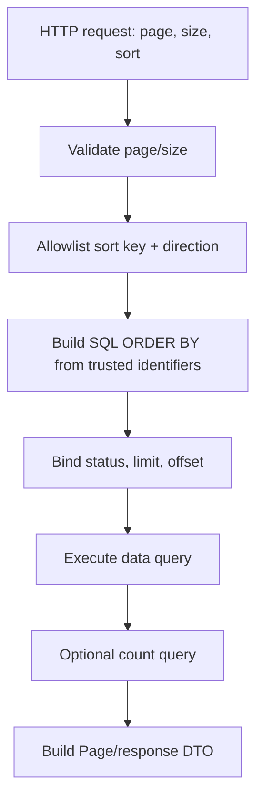

# Pagination, Sort, and Limit Constraints with Declarative SQL Queries

In **Spring Data Relational JDBC**, repository queries can be derived from method names or declared with SQL using `@Query`. Both approaches can return lists of data, but their support for applying pagination, sorting, and result limits differs.

The most important takeaway of this lesson is:

- **Derived queries** like `findByStatus(...)` can accept special parameters `Pageable`, `Sort`, and `Limit` so Spring Data automatically applies pagination, sorting, or limiting.
- **String-based queries** declaring SQL via `@Query` or named queries do not automatically support dynamic `Pageable`, `PageRequest`, `Sort`, and `Limit` parameters. Spring Data JDBC does not rewrite declarative SQL to insert those clauses.
- If you want to limit or sort a declarative SQL query, express it in **SQL**: use the database's syntax, bind values like counts and offsets with named parameters, and control sort columns/directions with an allowlist.

This distinction directly affects how repositories, pagination APIs, and reporting queries are designed in Spring Data JDBC.

## 1. Three ways to define queries in a repository

Spring Data JDBC supports several ways to build read queries. Determine the query type before deciding how to pass pagination or sorting.

### 1.1. Derived query: inferred from method name

Example:

```java
public interface PurchaseOrderRepository
        extends PagingAndSortingRepository<PurchaseOrder, Long> {

    List<PurchaseOrder> findByStatus(String status);

    List<PurchaseOrder> findByStatusOrderByCreatedAtDesc(String status);
}
```

Spring Data parses the method name, aggregate root properties, and parameters to generate SQL. Methods can accept `Pageable` or `Sort` to apply dynamic options.

```java
Page<PurchaseOrder> findByStatus(
    String status,
    Pageable pageable
);

List<PurchaseOrder> findByStatus(
    String status,
    Sort sort
);
```

These special parameters are recognized by the repository infrastructure. The application does not need to append `ORDER BY` or `LIMIT/OFFSET` to SQL itself.

### 1.2. String-based query: declaring SQL directly

Example:

```java
public interface PurchaseOrderRepository
        extends CrudRepository<PurchaseOrder, Long> {

    @Query("""
        SELECT id, order_number, customer_id, status, created_at
        FROM purchase_orders
        WHERE status = :status
        ORDER BY created_at DESC, id DESC
        """)
    List<PurchaseOrder> findByStatusSql(
        @Param("status") String status
    );
}
```

The SQL statement is written explicitly by the developer inside `@Query`. Spring Data JDBC binds named parameters and maps results according to the configured mapping.

However, Spring Data JDBC documentation clearly states that **string-based queries do not support pagination and do not accept `Sort`, `PageRequest`, or `Limit` as query parameters**. If results must be limited, express that intent in SQL and bind appropriate values.

This also applies to named queries declared in `META-INF/jdbc-named-queries.properties` because named queries are processed the same way as annotation-declared queries.

### 1.3. Custom read repository using Spring JDBC

For complex read queries, you can create a separate repository class using `NamedParameterJdbcTemplate`:

```java
@Repository
public class PurchaseOrderReadRepository {

    private final NamedParameterJdbcTemplate jdbc;

    public PurchaseOrderReadRepository(
            NamedParameterJdbcTemplate jdbc) {
        this.jdbc = jdbc;
    }

    // SQL is constructed and executed explicitly here.
}
```

This lets the application control `LIMIT/OFFSET`, `ORDER BY`, count queries, projections, and DTO mapping itself. It fits read models or reporting queries involving multiple tables.

## 2. What do Pageable, Page, Slice, Sort, and Limit mean?

These special types belong to Spring Data Commons and are supported by each module's repository infrastructure according to its capabilities.

| Type | Role | Key information |
|---|---|---|
| `Pageable` | Represents a pagination request | Page number, page size, sort |
| `Page<T>` | One page result with total metadata | Content, element counts, total pages |
| `Slice<T>` | One slice of data | Content and whether a next page exists |
| `Sort` | Describes sort order | Properties and ASC/DESC direction |
| `Limit` | Describes result count limit | Maximum row count or unlimited |

### 2.1. Pageable

Creating a page request:

```java
Pageable pageable = PageRequest.of(0, 20);
```

Pages are 0-indexed. Examples:

- `PageRequest.of(0, 20)`: first page, at most 20 elements.
- `PageRequest.of(1, 20)`: second page, at most 20 elements.
- `PageRequest.of(2, 50)`: third page, at most 50 elements.

`Pageable` can also carry sorting information:

```java
Pageable pageable = PageRequest.of(
    0,
    20,
    Sort.by(
        Sort.Order.desc("createdAt"),
        Sort.Order.asc("id")
    )
);
```

Property names in `Sort` for derived queries are typically Java property names mapped by Spring Data, such as `createdAt`. Do not confuse them with the physical SQL column name `created_at` when writing SQL manually.

### 2.2. Page and count queries

`Page<T>` provides total metadata:

```java
Page<PurchaseOrder> findByStatus(
    String status,
    Pageable pageable
);
```

To compute `totalElements` and `totalPages`, the repository infrastructure may run an additional count query. With large datasets or complex JOIN conditions, count queries can incur significant cost.

Use `Page` when the UI genuinely needs total element counts or total page counts.

### 2.3. Slice without total page count

```java
Slice<PurchaseOrder> findByStatus(
    String status,
    Pageable pageable
);
```

`Slice` only needs to know whether more data follows. Spring Data typically fetches one extra row beyond page size to determine if a next page exists, instead of counting all rows matching the query.

Use `Slice` when users only need a "Next" button or infinite scroll without displaying total pages.

### 2.4. List with Pageable

```java
List<PurchaseOrder> findByStatus(
    String status,
    Pageable pageable
);
```

You can return `List` if you only need the content within the page window. No `Page` metadata object is created, so no count query is needed solely to calculate total pages.

### 2.5. Sort when only ordering is needed

```java
List<PurchaseOrder> findByStatus(
    String status,
    Sort sort
);
```

If offset/page size is unnecessary and you only want to vary result ordering, `Sort` is cleaner than `Pageable`.

### 2.6. Limit when only a row cap is needed

In Spring Data Commons versions supporting `Limit`:

```java
List<PurchaseOrder> findByStatus(
    String status,
    Limit limit
);
```

Invocation:

```java
repository.findByStatus("NEW", Limit.of(10));
repository.findByStatus("NEW", Limit.unlimited());
```

`Limit` carries no page number or offset. It only describes the maximum number of rows to fetch. If both limiting and sorting are needed, `Sort` and `Limit` can be combined in supported query methods.

These special parameters depend on the Spring Data version. Check your project's dependency version before using `Limit` if the application runs on an older line.

## 3. Derived queries support dynamic pagination and sorting

With derived queries, the repository infrastructure knows how to parse properties and build queries. Example:

```java
public interface PurchaseOrderRepository
        extends PagingAndSortingRepository<PurchaseOrder, Long> {

    Page<PurchaseOrder> findByStatus(
        String status,
        Pageable pageable
    );

    Slice<PurchaseOrder> findByCustomerId(
        Long customerId,
        Pageable pageable
    );

    List<PurchaseOrder> findByStatus(
        String status,
        Sort sort
    );

    List<PurchaseOrder> findByStatus(
        String status,
        Sort sort,
        Limit limit
    );
}
```

Calling the repository:

```java
Pageable pageable = PageRequest.of(
    0,
    20,
    Sort.by(Sort.Order.desc("createdAt"))
);

Page<PurchaseOrder> page =
    repository.findByStatus("PAID", pageable);
```

Spring Data JDBC reads the page and sort information, then generates the query according to the dialect and mapping.

### 3.1. Sorting by multiple properties

```java
Sort sort = Sort.by(
    Sort.Order.desc("createdAt"),
    Sort.Order.asc("orderNumber"),
    Sort.Order.asc("id")
);

List<PurchaseOrder> orders =
    repository.findByStatus("PAID", sort);
```

Multiple sort criteria can be combined. Later properties break ties only when preceding properties have equal values.

Include a unique key as a tie-breaker, such as `id`. If you sort only by creation timestamp and multiple orders share the same timestamp, the order among those rows may be unstable.

### 3.2. Sort.unsorted and Pageable.unpaged

Special parameters should be passed non-null values. When no sorting or paging is desired:

```java
Sort sort = Sort.unsorted();
Pageable pageable = Pageable.unpaged();
```

With `Limit`, use `Limit.unlimited()` for no cap.

Do not pass `null` to express "no sort/paging"; use the corresponding factory methods.

### 3.3. Special parameters cannot be combined arbitrarily

A query method should not declare duplicate or conflicting special parameters:

```java
// Invalid: Pageable already contains Sort information.
List<PurchaseOrder> findByStatus(
    String status,
    Pageable pageable,
    Sort sort
);

// Invalid: Pageable already contains page size/limit.
List<PurchaseOrder> findByStatus(
    String status,
    Pageable pageable,
    Limit limit
);
```

`Pageable` already includes page size, offset, and sort. Standalone `Sort` is used when a query does not take Pageable. Standalone `Limit` is used when a query does not use Pageable. Certain combinations with `Top`/`First` keywords are supported by Spring Data Commons, though `Top/First` should not be mixed with `Limit` on the same method.

## 4. Key limitation: declarative @Query SQL does not automatically accept Pageable, Sort, or Limit

This is the core point of the lesson.

The following example is **not a supported usage** for string-based queries in Spring Data JDBC:

```java
@Query("""
    SELECT id, order_number, customer_id, status, created_at
    FROM purchase_orders
    WHERE status = :status
    """)
List<PurchaseOrder> findByStatusSql(
    @Param("status") String status,
    Pageable pageable
);
```

Likewise, do not declare `Sort` or `Limit` expecting Spring Data to rewrite the SQL statement automatically:

```java
@Query("""
    SELECT id, order_number, customer_id, status, created_at
    FROM purchase_orders
    WHERE status = :status
    """)
List<PurchaseOrder> findByStatusSql(
    @Param("status") String status,
    Sort sort
);
```

```java
@Query("""
    SELECT id, order_number, customer_id, status, created_at
    FROM purchase_orders
    WHERE status = :status
    """)
List<PurchaseOrder> findByStatusSql(
    @Param("status") String status,
    Limit limit
);
```

Spring Data JDBC documentation explicitly notes that string-based queries do not support pagination and do not accept `Sort`, `PageRequest`, or `Limit` as query parameters. To limit results, write the limiting clause in SQL and bind the corresponding values.

The practical reason is that the framework cannot safely and semantically rewrite every custom SQL statement automatically. A query may contain JOINs, GROUP BY, DISTINCT, UNION, subqueries, CTEs, ORDER BY, or database-specific syntax. Injecting a sort/limit snippet at an arbitrary position could break syntax or change semantics.

### 4.1. Writing LIMIT/OFFSET directly in SQL

PostgreSQL example:

```java
@Query("""
    SELECT id, order_number, customer_id, status, created_at
    FROM purchase_orders
    WHERE status = :status
    ORDER BY created_at DESC, id DESC
    LIMIT :limit OFFSET :offset
    """)
List<PurchaseOrder> findPageByStatus(
    @Param("status") String status,
    @Param("limit") int limit,
    @Param("offset") long offset
);
```

Here:

- `LIMIT :limit` caps the number of rows returned.
- `OFFSET :offset` skips the leading rows.
- `ORDER BY` is written explicitly in SQL.
- `:status`, `:limit`, and `:offset` are named bind parameters.

Spring Data JDBC supports **named parameters** for string-based queries. Binding LIMIT/OFFSET expressions must align with your DBMS syntax and driver. The example above uses PostgreSQL syntax; for other databases, use their corresponding pagination syntax.

### 4.2. Computing offset from page number and page size

If an external API receives page number and page size, convert them:

```java
int page = 2;
int size = 20;

long offset = (long) page * size;

List<PurchaseOrder> orders =
    repository.findPageByStatus("PAID", size, offset);
```

The result is the third 0-indexed page, skipping the first 40 rows and fetching up to the next 20 rows.

Casting to `long` before multiplying prevents `int` overflow when page number or size is large. In the service, still validate that page is non-negative, size is positive, and size does not exceed the API's maximum allowed cap.

### 4.3. Enforcing safe limits in the service

Never allow clients to request millions of rows arbitrarily. Example:

```java
public record PageRequestInput(int page, int size) {}

public List<PurchaseOrder> findPage(
        String status,
        PageRequestInput input) {

    if (input.page() < 0) {
        throw new IllegalArgumentException("Page must be nonnegative");
    }

    if (input.size() < 1 || input.size() > 100) {
        throw new IllegalArgumentException("Page size must be between 1 and 100");
    }

    long offset = (long) input.page() * input.size();

    return repository.findPageByStatus(
        status,
        input.size(),
        offset
    );
}
```

Bounding page size protects both the database and application from oversized queries. The maximum cap should be based on DTO size, workload, and API requirements.

## 5. Dynamic sorting with declarative SQL

With derived queries, Spring Data can use `Sort` to generate ORDER BY. With declarative SQL, no such automatic mechanism exists. The SQL statement needs either a static order or the application must select a safe ORDER BY clause itself.

### 5.1. Static sorting inside @Query

If only a fixed order is needed, write it directly:

```java
@Query("""
    SELECT id, order_number, customer_id, status, created_at
    FROM purchase_orders
    WHERE customer_id = :customerId
    ORDER BY created_at DESC, id DESC
    LIMIT :limit OFFSET :offset
    """)
List<PurchaseOrder> findRecentOrders(
    @Param("customerId") Long customerId,
    @Param("limit") int limit,
    @Param("offset") long offset
);
```

This is the simplest approach when business logic always wants newest orders first.

### 5.2. Column names cannot be bound as values

A common mistake is trying:

```sql
SELECT *
FROM purchase_orders
ORDER BY :sortColumn :direction;
```

Bind parameters represent **values**, and cannot substitute column names or SQL keywords. The database treats `:sortColumn` as a constant value, not an identifier to sort by.

Never concatenate client input directly into SQL:

```java
String sql = "SELECT * FROM purchase_orders ORDER BY " + request.sortBy();
```

If the client sends a string containing SQL syntax, the query can be altered unexpectedly. This creates SQL injection risk via identifiers.

### 5.3. Using an allowlist for sort columns and directions

If dynamic sorting is required, translate API choices into one of the application-controlled SQL identifiers.

```java
public enum OrderSortField {
    CREATED_AT,
    ORDER_NUMBER,
    STATUS
}
```

```java
public enum SortDirection {
    ASC,
    DESC
}
```

Selecting identifiers:

```java
private String toSqlColumn(OrderSortField field) {
    return switch (field) {
        case CREATED_AT -> "o.created_at";
        case ORDER_NUMBER -> "o.order_number";
        case STATUS -> "o.status";
    };
}

private String toSqlDirection(SortDirection direction) {
    return switch (direction) {
        case ASC -> "ASC";
        case DESC -> "DESC";
    };
}
```

Then build the SQL from allowlisted values:

```java
public List<PurchaseOrder> findPage(
        String status,
        OrderSortField sortField,
        SortDirection direction,
        int limit,
        long offset) {

    String column = toSqlColumn(sortField);
    String order = toSqlDirection(direction);

    String sql = """
        SELECT o.id, o.order_number, o.customer_id,
               o.status, o.created_at
        FROM purchase_orders o
        WHERE o.status = :status
        ORDER BY %s %s, o.id DESC
        LIMIT :limit OFFSET :offset
        """.formatted(column, order);

    MapSqlParameterSource parameters = new MapSqlParameterSource()
        .addValue("status", status)
        .addValue("limit", limit)
        .addValue("offset", offset);

    return jdbc.query(
        sql,
        parameters,
        purchaseOrderRowMapper
    );
}
```

In this example:

- `column` can only ever be one of the three code-defined column names.
- `order` can only be `ASC` or `DESC`.
- Data values like status, limit, and offset are still bound via parameters.
- `o.id DESC` acts as a tie-breaker so order stays stable when two rows share the primary sort value.

Formatting SQL with allowlisted identifiers is a controlled choice. Never use raw strings from a request to form column names or sort directions.

### 5.4. Expose only meaningful sort keys in the API

You do not have to expose every table column for sorting. An API might allow only:

```text
createdAt
orderNumber
status
```

Those keys are mapped to SQL identifiers in code. If a key is unrecognized, return a validation error or fall back to a documented API default.

For static declarative SQL, another option is creating a few separate methods:

```java
@Query("""
    SELECT id, order_number, customer_id, status, created_at
    FROM purchase_orders
    WHERE status = :status
    ORDER BY created_at DESC, id DESC
    LIMIT :limit
    """)
List<PurchaseOrder> findLatestByStatus(
    @Param("status") String status,
    @Param("limit") int limit
);

@Query("""
    SELECT id, order_number, customer_id, status, created_at
    FROM purchase_orders
    WHERE status = :status
    ORDER BY order_number ASC, id ASC
    LIMIT :limit
    """)
List<PurchaseOrder> findByStatusOrderedByNumber(
    @Param("status") String status,
    @Param("limit") int limit
);
```

This is an easy-to-control option when there are only a few fixed sort orders.

## 6. Page, Slice, and count queries with declarative SQL

Because string-based queries do not support `Pageable`, `PageRequest`, or `Sort` as query parameters, if you need a `Page<T>` object for custom SQL, the application must manage the page data and total count itself.

One option is using `NamedParameterJdbcTemplate` to execute:

1. A data query fetching page content with ORDER BY, LIMIT, and OFFSET.
2. A count query fetching the total number of rows matching the filter.
3. Constructing `PageImpl<T>` from both results.

### 6.1. DTO and read repository

```java
public record OrderSummary(
    long id,
    String orderNumber,
    String status,
    String customerName
) {}
```

```java
@Repository
public class OrderSummaryRepository {

    private final NamedParameterJdbcTemplate jdbc;

    public OrderSummaryRepository(NamedParameterJdbcTemplate jdbc) {
        this.jdbc = jdbc;
    }

    public Page<OrderSummary> findPage(
            String status,
            Pageable pageable) {

        if (pageable.isUnpaged()) {
            throw new IllegalArgumentException(
                "A paged request is required"
            );
        }

        String dataSql = """
            SELECT o.id,
                   o.order_number,
                   o.status,
                   c.full_name AS customer_name
            FROM purchase_orders o
            JOIN customers c ON c.id = o.customer_id
            WHERE o.status = :status
            ORDER BY o.created_at DESC, o.id DESC
            LIMIT :limit OFFSET :offset
            """;

        String countSql = """
            SELECT COUNT(*)
            FROM purchase_orders o
            WHERE o.status = :status
            """;

        MapSqlParameterSource parameters = new MapSqlParameterSource()
            .addValue("status", status)
            .addValue("limit", pageable.getPageSize())
            .addValue("offset", pageable.getOffset());

        List<OrderSummary> content = jdbc.query(
            dataSql,
            parameters,
            (rs, rowNum) -> new OrderSummary(
                rs.getLong("id"),
                rs.getString("order_number"),
                rs.getString("status"),
                rs.getString("customer_name")
            )
        );

        Long total = jdbc.queryForObject(
            countSql,
            new MapSqlParameterSource("status", status),
            Long.class
        );

        return new PageImpl<>(
            content,
            pageable,
            total == null ? 0 : total
        );
    }
}
```

This example uses `Pageable` as an input object on a **handwritten Java class**, not as a parameter on a `@Query` method. Because the code executes the SQL itself, it can read `getPageSize()` and `getOffset()` and bind them into SQL.

### 6.2. Count query must match the data query's conditions

The count query must count the exact same dataset that the data query paginates.

If the data query filters by:

```sql
WHERE o.status = :status
  AND o.customer_id = :customerId
```

then the count query must include both of those conditions as well.

If a one-to-many JOIN causes an order to appear across multiple rows, use `COUNT(DISTINCT o.id)` when the goal is counting orders:

```sql
SELECT COUNT(DISTINCT o.id)
FROM purchase_orders o
JOIN order_items i ON i.order_id = o.id
WHERE o.status = :status;
```

If the data query returns one row per order item, the count needs to count order items rather than orders. The count query must match the **grain** of the result.

### 6.3. When total row count is unnecessary, use Slice or a custom cursor

If the API only needs to know whether a next page exists, you can fetch `pageSize + 1` rows:

```sql
SELECT id, order_number, status
FROM purchase_orders
WHERE status = :status
ORDER BY created_at DESC, id DESC
LIMIT :fetchSize OFFSET :offset;
```

In code, `fetchSize = pageSize + 1`. If the result has more than page size rows, a next page exists; discard the extra row before returning the response.

This avoids running a count query. However, because declarative SQL does not build a `Slice` automatically, the custom repository needs to construct the appropriate DTO/result metadata itself.

## 7. OFFSET pagination and its limitations

`LIMIT/OFFSET` is easy to understand and works well for many small or medium lists:

```sql
SELECT id, order_number, status
FROM purchase_orders
ORDER BY created_at DESC, id DESC
LIMIT 20 OFFSET 40;
```

It skips 40 rows and fetches up to the next 20 rows.

### 7.1. Large offsets can be slow

When offsets reach hundreds of thousands, the database still has to process or scan past preceding rows to locate the start of the page. Cost can grow with the offset, especially with complex queries or unsuitable indexes.

Offset pagination remains useful when users need to jump to arbitrary pages and page depth is modest. For large feeds or continuously changing data, consider keyset pagination.

### 7.2. Data changing between pages

Suppose a user loads the first page, and then a new order is inserted ahead of older rows. When loading the next page via OFFSET, row positions shift. The user might see duplicate records or miss records between the two requests.

Stable sorting with a unique key prevents non-deterministic ordering when sort values tie, but **does not eliminate row shifts caused by data changes** between requests.

## 8. Keyset pagination for large datasets

Keyset pagination uses values from the last row of the current page as a cursor to fetch subsequent rows, instead of skipping a large number of rows.

Suppose the ordering is:

```sql
ORDER BY created_at DESC, id DESC
```

The next page after a row with `lastCreatedAt` and `lastId`:

```sql
SELECT id, order_number, status, created_at
FROM purchase_orders
WHERE status = :status
  AND (
      created_at < :lastCreatedAt
      OR (
          created_at = :lastCreatedAt
          AND id < :lastId
      )
  )
ORDER BY created_at DESC, id DESC
LIMIT :limit;
```

The pair `created_at` and `id` defines a deterministic order. The cursor predicate uses the same sort direction to select rows appearing after the last row of the previous page.

### 8.1. Why is a tie-breaker key required?

If you only use:

```sql
ORDER BY created_at DESC
```

multiple orders can share the same timestamp. A cursor holding only a timestamp cannot distinguish rows at the exact same instant. Adding unique `id` pins down the exact position.

### 8.2. When does keyset pagination fit?

- Feeds or order histories with very large row counts.
- Users primarily stepping forward from the current page to the next page.
- Sort keys have a stable total order suitable for comparison predicates.
- Wanting to avoid large offsets.

Keyset pagination is not convenient for jumping directly to page 500 because you need a cursor from the preceding page. With nullable sort keys, multiple columns, or mixed sort directions, cursor predicates must be carefully crafted to match NULL ordering and sort semantics.

## 9. Declarative SQL must use the database's pagination syntax

Because `@Query` does not rewrite SQL to add pagination, the pagination clause must match the running DBMS.

Illustrative examples:

| Database | Common syntax |
|---|---|
| PostgreSQL | `LIMIT :limit OFFSET :offset` |
| MySQL | `LIMIT :limit OFFSET :offset` |
| SQL Server | `ORDER BY ... OFFSET :offset ROWS FETCH NEXT :limit ROWS ONLY` |
| Modern Oracle | `OFFSET :offset ROWS FETCH NEXT :limit ROWS ONLY` |

Exact syntax and parameter binding support can depend on database/driver versions. Do not copy PostgreSQL syntax across every DBMS blindly.

### 9.1. OFFSET/FETCH requires ORDER BY

Some databases require `ORDER BY` when using `OFFSET ... FETCH`. Even if a database allows LIMIT without ORDER BY, results have no guaranteed stable order unless sorting is specified.

Always define an order when paginating. If two rows can share the sort value, add a unique key as a tie-breaker.

### 9.2. Do not hardcode incompatible database syntax

If the application supports multiple DBMSs, consider:

- Using derived repository queries where possible.
- Using dialects or abstractions provided by Spring Data/Spring JDBC when appropriate.
- Separating SQL per database when syntax diverges significantly.
- Verifying queries against each real database in integration tests.

Declarative SQL brings high control, while shifting pagination syntax responsibility onto the query author.

## 10. SQL injection and sort parameters

Data values must be bound:

```sql
WHERE status = :status
LIMIT :limit OFFSET :offset
```

Never concatenate strings:

```java
String sql = "SELECT * FROM purchase_orders WHERE status = '" + status + "'";
```

For sorting, remember:

- Values like status, customer ID, limit, and offset can be bound.
- Table names, column names, and ASC/DESC are SQL syntax/identifiers and cannot be substituted with normal bind parameters.
- Build identifiers only from an allowlist in code.
- Validate row limits and offsets before execution.

A safe sorting API can accept an enum instead of a raw column name:

```java
public enum OrderSort {
    NEWEST,
    ORDER_NUMBER,
    STATUS
}
```

Then map the enum to a fixed SQL snippet. Clients must never be allowed to send `o.created_at DESC; DROP TABLE...` directly as a sort expression.

## 11. Which approach fits each query scenario?

| Scenario | Approach to consider | Reason |
|---|---|---|
| Filter orders by status with standard pagination | Derived query + `Pageable` | Spring Data handles paging/sorting |
| Only need sorting by property | Derived query + `Sort` | No need to build ORDER BY manually |
| Only need at most N records | Derived query + `Limit` or `Top/First` | Expresses cap in method signature |
| Custom SQL with fixed order | `@Query` with `ORDER BY` + `LIMIT` | SQL states intent clearly |
| Custom SQL with dynamic page size/offset | `@Query` with named parameters in SQL | Explicitly binds limit and offset |
| Custom SQL with dynamic sorting | Custom repository + allowlist | Controlled SQL identifiers |
| Need `Page` metadata with custom SQL | Custom JDBC repository + count query + `PageImpl` | Full control over count and content |
| Large dataset, sequential scrolling | Keyset/cursor query | Avoids deep offsets |
| JOIN/GROUP BY reports | Custom read query/DTO | Controls projection and grain |

## 12. Comprehensive example: order list API

An endpoint receives:

```text
GET /orders?status=PAID&page=0&size=20&sort=createdAt,desc
```

When using a derived query, the service can translate the request into `Pageable`:

```java
Pageable pageable = PageRequest.of(
    page,
    size,
    Sort.by(
        Sort.Order.desc("createdAt"),
        Sort.Order.desc("id")
    )
);

Page<PurchaseOrder> result =
    orderRepository.findByStatus(status, pageable);
```

When using declarative `@Query` SQL, do not pass `Pageable` into that method. Instead, the service/custom repository needs to:

1. Validate page and size.
2. Convert the API sort key to an allowlisted SQL column.
3. Convert sort direction to controlled `ASC` or `DESC`.
4. Compute offset.
5. Bind status, limit, and offset.
6. Run a separate count query if the response requires a total count.
7. Return a DTO or page response.

Custom read query flow:



### 12.1. Example handling sort keys

```java
public enum OrderSortKey {
    CREATED_AT,
    ORDER_NUMBER
}

private String columnFor(OrderSortKey key) {
    return switch (key) {
        case CREATED_AT -> "o.created_at";
        case ORDER_NUMBER -> "o.order_number";
    };
}
```

The API parser should map external strings to an enum. If a key is unrecognized, return a validation error or use a documented default rather than concatenating request strings into SQL.

### 12.2. Stable ordering

If sorting by `created_at DESC`, add `id DESC`:

```sql
ORDER BY o.created_at DESC, o.id DESC
```

This secondary ordering ensures rows with identical timestamps keep a deterministic position. With keyset pagination, the cursor must include both values.

## 13. Common mistakes

| Symptom | Cause | Resolution |
|---|---|---|
| `@Query` ignores Pageable | String-based queries do not support dynamic pagination | Put LIMIT/OFFSET in SQL or use a derived query |
| Sort parameter does not change ORDER BY in declarative SQL | `@Query` does not inject Sort automatically | Write static ORDER BY or use a custom repository with an allowlist |
| Limit parameter rejected/has no effect | Passing `Limit` as a special parameter to a string-based query | Bind the limit value directly in SQL |
| Wrong total page count | Count query conditions differ from data query | Synchronize filters and count at the right grain |
| One order appears multiple times in results | One-to-many JOIN | Use GROUP BY or build a projection at the right grain |
| Pages skip/duplicate rows as data changes | Offset pagination over mutating data | Use stable sorting; consider keyset pagination |
| Rows with identical timestamps change order | ORDER BY has no tie-breaker | Add a unique key such as ID |
| Deep pages run slowly | Large OFFSET | Switch to keyset pagination or another paging strategy |
| SQL injection via sort | Concatenating raw sort keys into SQL | Allowlist identifiers and directions |
| Query fails on another database | Using dialect-specific LIMIT/OFFSET | Write SQL for the target DBMS and integration-test |
| Page query takes extra time | Count query scans full dataset | Use Slice/List if total count is not needed |
| Declarative SQL query returns incomplete entity | SELECT omits columns required for mapping | Select all columns needed by constructor/mapping |

## 14. Practice exercises

Use the `purchase_orders` table with columns `id`, `order_number`, `status`, `created_at`, and `customer_id`.

### Exercise 1. Paginated derived query

Declare a method fetching `PAID` orders by page, 20 orders per page:

```java
Page<PurchaseOrder> findByStatus(
    String status,
    Pageable pageable
);
```

Call:

```java
PageRequest.of(
    0,
    20,
    Sort.by(
        Sort.Order.desc("createdAt"),
        Sort.Order.desc("id")
    )
);
```

### Exercise 2. Declarative SQL with manual limits

Write a PostgreSQL query fetching the 20 newest orders, skipping the first 40:

```java
@Query("""
    SELECT id, order_number, customer_id, status, created_at
    FROM purchase_orders
    WHERE status = :status
    ORDER BY created_at DESC, id DESC
    LIMIT :limit OFFSET :offset
    """)
List<PurchaseOrder> findPage(
    @Param("status") String status,
    @Param("limit") int limit,
    @Param("offset") long offset
);
```

### Exercise 3. Why is ORDER BY :column not possible?

**Answer:** Named parameters bind values; they do not substitute identifiers or SQL keywords. Use an enum/allowlist to pick the column and sort direction.

### Exercise 4. Page or Slice?

A screen has only a "Load more" button and does not need total pages. Which should you use?

**Answer:** With a derived query, `Slice` is usually appropriate because you only need to know whether more data exists. With string-based SQL, limit to `pageSize + 1` manually and build corresponding metadata if needed.

### Exercise 5. Count query with JOIN

The data query JOINs `purchase_orders` with `order_items`, but the screen needs to count orders. When can `COUNT(*)` be wrong?

**Answer:** When an order has multiple order items, the JOIN produces multiple rows per order. Use `COUNT(DISTINCT o.id)` to count unique orders.

### Exercise 6. Deep OFFSET

An API needs to read through millions of orders ordered newest first. Why can large OFFSETs be inefficient, and how does keyset pagination help?

**Answer:** The database must process/skip many rows before the offset. Keyset pagination uses the key of the last row from the previous page to select subsequent rows directly, avoiding skipping a large offset.

### Exercise 7. Securing sorting

An API receives `sortBy` from requests. Describe how to convert it into SQL safely.

**Answer:** Map the string to an enum/allowlist, translate the enum to a code-controlled column name, and permit only ASC/DESC. Never concatenate raw request input into ORDER BY.

## 15. Things to remember

1. **Derived queries** can accept `Pageable`, `Sort`, and `Limit` according to the capabilities of the Spring Data JDBC version in use.
2. **String-based queries** via `@Query` or named queries do not automatically support pagination and do not accept `Sort`, `PageRequest`, or `Limit` as query parameters.
3. For declarative SQL, write `ORDER BY` and row-limiting syntax in SQL; bind values like filters, limit, and offset via named parameters.
4. Never bind column names or ASC/DESC as values. Use an allowlist for sort keys and directions.
5. `Page` may run a count query; `Slice` or paginated Lists fit when total counts are unnecessary.
6. Offset pagination is simple yet can slow down on deep pages and is sensitive to data mutations; keyset pagination suits sequential traversal of large datasets.
7. Always use deterministic ORDER BY with a unique tie-breaker, and write pagination syntax matching your database dialect.

### Official references

- [Spring Data JDBC — Query Methods](https://docs.spring.io/spring-data/relational/reference/jdbc/query-methods.html): derived queries, Pageable, Page, Slice, and limitations of string-based queries.
- [Spring Data Commons — Paging, Sorting and Limiting](https://docs.spring.io/spring-data/commons/reference/repositories/query-methods-details.html): Pageable, Sort, Limit types and rules for combining special parameters.
- [Spring Data Relational — Query API](https://docs.spring.io/spring-data/relational/docs/current/api/org/springframework/data/relational/core/query/Query.html): Query API for criteria queries and limit/offset/sort operations.
- [Spring Framework — JDBC Core](https://docs.spring.io/spring-framework/reference/data-access/jdbc/core.html): NamedParameterJdbcTemplate and executing parameterized SQL.

When implementing, check your specific Spring Data Relational version and DBMS. Derived query capabilities, the `Limit` type, and LIMIT/OFFSET syntax depend on version and dialect; with declarative SQL specifically, you must express limits and ordering directly in the query.
