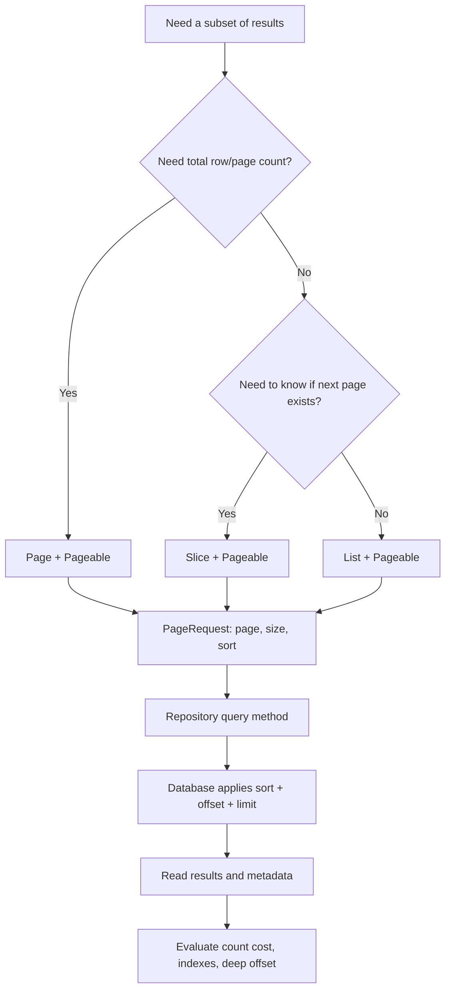

# Pagination with Pageable and PageRequest

When a table has thousands or millions of records, returning the entire result set in a single query often consumes excessive memory, data transfer time, and database resources. **Pagination** divides the results into smaller chunks so the application only loads the slice of data needed for display or processing.

In Spring Data JDBC, two key types are:

- **`Pageable`:** an abstraction describing a pagination request, including page number, page size, and sort order.
- **`PageRequest`:** a common implementation of `Pageable`, used to construct requests such as “first page, 20 elements, sorted by name”.

A repository method accepts `Pageable` so Spring Data JDBC applies the offset, row limit, and sort to the query. The result can be `Page`, `Slice`, or `List` depending on the metadata the application needs.

This lesson focuses on how to create `PageRequest`, declare repository methods, read page metadata, combine sorting, and choose the right result type.

## 1. Why Is Pagination Needed?

Suppose the `products` table has 100,000 products. An admin screen displays only 20 products at a time.

If loading everything:

```java
List<Product> products = productRepository.findAll();
```

The application must receive and hold the entire result set in memory, even though the screen only displays 20 rows. As data grows, this approach can increase response times and heap pressure.

Pagination lets you request individual ranges:

```text
Total data: 100,000 products

Page 0: first 20 products
Page 1: next 20 products
Page 2: next 20 products
...
Page 4,999: last 20 products
```

With a page size of 20, each query fetches at most 20 rows for the page content. This helps:

- Limit the number of objects loaded in a single request.
- Reduce data transferred from the database to the application.
- Support UIs with previous/next buttons or page numbers.
- Process data in chunks instead of loading the entire table.
- Combine dynamic sorting based on user selection.

**Pagination does not automatically make every query fast.** The database still has to find and sort matching data; very large offsets can be costly. Indexes and sort orders must be designed to match actual queries.

## 2. What Is Pageable?

`org.springframework.data.domain.Pageable` is an interface describing a pagination request. It provides the core information:

| Method | Meaning |
| --- | --- |
| `getPageNumber()` | Page number, starting at 0. |
| `getPageSize()` | Maximum number of elements per page. |
| `getOffset()` | Number of rows to skip before fetching data. |
| `getSort()` | Sort order of the results. |
| `hasPrevious()` | Whether a previous page exists. |
| `next()` | Creates a request for the next page. |
| `previousOrFirst()` | Creates a request for the previous page or the first page. |
| `isPaged()` / `isUnpaged()` | Checks whether pagination is enabled. |

Example:

```java
Pageable pageable = PageRequest.of(0, 20);
```

This request means:

- Fetch page 0, i.e., the first page.
- Each page has at most 20 elements.
- No dynamic sort specified.

### 2.1. Page Numbers Start at 0

Spring Data uses **zero-based page numbering**:

| Page number | Meaning | With page size 20 |
| --- | --- | --- |
| 0 | First page | Offset 0, fetches up to rows 1–20 |
| 1 | Second page | Offset 20, fetches up to rows 21–40 |
| 2 | Third page | Offset 40, fetches up to rows 41–60 |
| 3 | Fourth page | Offset 60, fetches up to rows 61–80 |

Formula:

\[
\text{offset} = \text{pageNumber} \times \text{pageSize}
\]

For example, page 3, size 25:

\[
\text{offset} = 3 \times 25 = 75
\]

The database skips 75 rows in the sort order and returns up to the next 25 rows.

If an external API uses 1-based page numbers, convert at the API boundary:

```java
int springPage = Math.max(requestedPage - 1, 0);
Pageable pageable = PageRequest.of(springPage, pageSize);
```

Do not pass 1-based page numbers directly into `PageRequest` if your API contract defines the first page as 1.

### 2.2. Page Size Must Be Greater Than 0

`PageRequest` requires:

- Non-negative page number.
- Page size greater than 0.

Valid examples:

```java
PageRequest.of(0, 20);
PageRequest.of(2, 50);
```

Invalid cases:

```java
PageRequest.of(-1, 20); // negative page number
PageRequest.of(0, 0);   // page size is 0
PageRequest.of(0, -5);  // negative page size
```

These cases throw `IllegalArgumentException` when creating the request. At the API layer, validate inputs and enforce a maximum page size to prevent clients from requesting an overly large page.

## 3. What Is PageRequest?

`PageRequest` is the standard implementation of `Pageable`. You create instances using factory methods rather than calling a constructor directly.

Common usages:

```java
PageRequest firstPage = PageRequest.of(0, 20);

PageRequest secondPage = PageRequest.of(1, 20);

PageRequest smallPage = PageRequest.ofSize(10);
```

Sorting can be specified at creation time:

```java
PageRequest newestFirst = PageRequest.of(
        0,
        20,
        Sort.by(Sort.Direction.DESC, "createdAt")
);
```

Or using `Sort`'s fluent API:

```java
Sort sort = Sort.by("name").ascending();

PageRequest pageable = PageRequest.of(0, 20, sort);
```

`PageRequest` is immutable: operations like `next()`, `previous()`, `withPage(...)`, or `withSort(...)` return a new object. They do not mutate the original instance.

```java
PageRequest first = PageRequest.of(0, 20);
PageRequest second = first.next();

System.out.println(first.getPageNumber());  // 0
System.out.println(second.getPageNumber()); // 1
```

## 4. Declaring a Repository Accepting Pageable

Spring Data JDBC supports pagination on query methods. Example repository:

```java
import org.springframework.data.domain.Page;
import org.springframework.data.domain.Pageable;
import org.springframework.data.domain.Slice;
import org.springframework.data.repository.CrudRepository;
import org.springframework.data.repository.PagingAndSortingRepository;

public interface ProductRepository
        extends CrudRepository<Product, Long>,
                PagingAndSortingRepository<Product, Long> {

    Page<Product> findByStatus(String status, Pageable pageable);

    Slice<Product> findByCategoryId(Long categoryId, Pageable pageable);

    List<Product> findByActiveTrue(Pageable pageable);
}
```

The methods demonstrate three different result types:

- `Page<Product>`: page content along with metadata about total elements and total pages.
- `Slice<Product>`: page content and whether a next page exists.
- `List<Product>`: returns only the list of elements in the requested range, without generating page metadata.

`Pageable` is a special parameter recognized by Spring Data. The framework uses it to apply offset, page size, and sort.

### 4.1. Why Does the Repository Extend Two Interfaces?

In modern Spring Data versions, `PagingAndSortingRepository` and `CrudRepository` are separate interfaces. `PagingAndSortingRepository` provides pagination/sorting operations; `CrudRepository` provides CRUD.

If both `save`, `findById`, and `findAll(Pageable)` are needed, you can extend both:

```java
public interface ProductRepository
        extends CrudRepository<Product, Long>,
                PagingAndSortingRepository<Product, Long> {
}
```

If you only declare query methods like `findByStatus(String, Pageable)`, the appropriate base repository can still provide those query methods; extending `PagingAndSortingRepository` is especially useful when you want the built-in `findAll(Pageable)` method.

Projects can choose `ListCrudRepository` and `ListPagingAndSortingRepository` if they want CRUD/paging methods to return `List` instead of `Iterable`, depending on the Spring Data version in use.

## 5. Using PageRequest with a Repository

After declaring the repository, create a request and pass it to the method:

```java
Pageable pageable = PageRequest.of(0, 20);

Page<Product> page =
        productRepository.findByStatus("ACTIVE", pageable);
```

Spring Data JDBC applies the pagination request to the query. In SQL terms, the conceptual equivalent is:

```sql
SELECT id, name, status
FROM products
WHERE status = ?
ORDER BY id
LIMIT 20 OFFSET 0;
```

This is illustrative SQL using PostgreSQL syntax. Spring Data JDBC and its dialect are responsible for generating pagination syntax appropriate for the database in use; not all databases use the same keywords or syntax order.

For the next page:

```java
Pageable nextPage = PageRequest.of(1, 20);

Page<Product> page2 =
        productRepository.findByStatus("ACTIVE", nextPage);
```

The query skips the first 20 rows in order and fetches up to the next 20 rows.

### 5.1. Using `findAll(Pageable)`

If the repository extends `PagingAndSortingRepository`:

```java
Pageable pageable = PageRequest.of(0, 20);

Page<Product> products = productRepository.findAll(pageable);
```

This method loads a page of products without requiring a custom query method declaration.

### 5.2. Combining Filter Conditions and Pagination

`Pageable` can be used alongside filter parameters:

```java
Page<Product> findByStatusAndCategoryId(
        String status,
        Long categoryId,
        Pageable pageable
);
```

Invocation:

```java
Pageable pageable = PageRequest.of(0, 15);

Page<Product> result =
        productRepository.findByStatusAndCategoryId(
                "ACTIVE",
                10L,
                pageable
        );
```

The query method filters by status and category, then applies pagination to the matching result set. Page size 15 is the maximum number of rows returned in the page, not the number of rows filtered before pagination.

## 6. Combining Pageable with Sort

`Pageable` not only describes the page and page size; it also carries sorting information via `Sort`.

Example sorting by name ascending:

```java
Pageable pageable = PageRequest.of(
        0,
        20,
        Sort.by(Sort.Direction.ASC, "name")
);
```

Sorting by creation date descending:

```java
Pageable pageable = PageRequest.of(
        0,
        20,
        Sort.by(Sort.Direction.DESC, "createdAt")
);
```

Multiple criteria can be combined:

```java
Sort sort = Sort.by(Sort.Order.asc("status"))
        .and(Sort.by(Sort.Order.desc("createdAt")))
        .and(Sort.by(Sort.Order.asc("id")));

Pageable pageable = PageRequest.of(0, 20, sort);
```

The precedence order is:

1. Status ascending.
2. Within the same status, creation date descending.
3. If still tied, ID ascending.

### 6.1. Why Is a Stable Sort Needed?

If you only sort by a non-unique property, many rows may share the same value. For example, 50 products all with status ACTIVE. The database does not guarantee the order among rows with the same status unless an additional criterion is provided.

During pagination, an unstable order can cause a row to appear on two pages or be skipped when querying consecutive pages.

Add a unique key as the final criterion:

```java
Sort sort = Sort.by("createdAt").descending()
        .and(Sort.by("id").ascending());

Pageable pageable = PageRequest.of(0, 20, sort);
```

`id` establishes a deterministic order for rows that share the same `createdAt`. This is helpful for keeping paginated results stable when data does not change during traversal.

**A stable sort does not create a data snapshot.** If new records are inserted or existing records are deleted between page requests, offsets can shift and page contents can still change. If exact traversal over a fixed dataset is required, consider an appropriate transaction/snapshot or a cursor/keyset strategy.

### 6.2. Using Sort Alone When Pagination Is Not Needed

If only sorting is required, the repository method can take `Sort`:

```java
List<Product> findByStatus(String status, Sort sort);
```

Invocation:

```java
List<Product> products = productRepository.findByStatus(
        "ACTIVE",
        Sort.by("name").ascending()
);
```

There is no need to create a `PageRequest` when offset and page size are unnecessary.

### 6.3. Do Not Pass an Extra Sort When Pageable Is Already Present

`Pageable` already includes sort. Do not declare both `Pageable` and `Sort` on the same query method:

```java
// Invalid
Page<Product> findByStatus(
        String status,
        Pageable pageable,
        Sort sort
);
```

Similarly, do not combine `Pageable` with `Limit` because `Pageable` already defines the result limit. Special parameters such as `Pageable`, `Sort`, and `Limit` should only appear in combinations permitted by Spring Data.

## 7. How Do Page, Slice, and List Differ?

This is an important design decision for repository methods. All three can accept the same `Pageable`, but the amount of metadata and additional queries differ.

| Return type | Data returned | Has total count? | Knows if there is a next page? |
| --- | --- | --- | --- |
| `Page<T>` | Page content | Yes | Yes |
| `Slice<T>` | Slice content | No | Yes |
| `List<T>` | Only the list of elements in the requested range | No | No page metadata |

### 7.1. Page\<T\>

`Page<T>` contains the page content and overall totals:

- `getContent()`: list of elements.
- `getNumber()`: current page number.
- `getSize()`: requested page size.
- `getNumberOfElements()`: actual number of elements on the page.
- `getTotalElements()`: total number of elements matching the query.
- `getTotalPages()`: total number of pages.
- `hasNext()`: whether there is a next page.
- `hasPrevious()`: whether there is a previous page.
- `isFirst()` / `isLast()`: whether it is the first/last page.

Example:

```java
Page<Product> page = repository.findByStatus(
        "ACTIVE",
        PageRequest.of(0, 20)
);

List<Product> content = page.getContent();
long total = page.getTotalElements();
int totalPages = page.getTotalPages();

boolean hasNext = page.hasNext();
```

To determine the total count, Spring Data JDBC may execute an additional `COUNT` query. The count query is typically derived from the main query. It can be expensive with complex conditions or large tables.

Choose `Page` when the UI genuinely needs to display the total record count or total page count.

### 7.2. Slice\<T\>

`Slice<T>` provides content and basic navigation information without needing the total record count.

Spring Data fetches `pageSize + 1` elements to determine whether more data follows. With page size 20, the query may fetch up to 21 rows:

- If 21 rows are returned, return the first 20 rows and `hasNext()` is true.
- If at most 20 rows are returned, `hasNext()` is false.

Example:

```java
Slice<Product> slice = repository.findByCategoryId(
        10L,
        PageRequest.of(0, 20, Sort.by("id").ascending())
);

List<Product> content = slice.getContent();
boolean hasNext = slice.hasNext();

if (hasNext) {
    Pageable nextPageable = slice.nextPageable();
}
```

`Slice` suits “Load more” or “Next page” UIs when displaying “Total 12,345 products” is unnecessary.

### 7.3. List\<T\> with Pageable

If only the list within a range is needed, you can return `List<T>`:

```java
List<Product> findByActiveTrue(Pageable pageable);
```

Invocation:

```java
List<Product> products = repository.findByActiveTrue(
        PageRequest.of(0, 20, Sort.by("id").ascending())
);
```

Spring Data limits the query by offset and page size without building a `Page` metadata object or running a count query just to compute totals. The application does not directly receive `hasNext()`; if knowing whether a next page exists is needed, choose `Slice`.

### 7.4. Which Type Should You Choose?

| Need | Recommended |
| --- | --- |
| Display total results and total pages | `Page<T>` |
| Only need to know if more data is available | `Slice<T>` |
| Only need a list within the requested limit | `List<T>` + `Pageable` |
| Only need sorting, no pagination | `List<T>` + `Sort` |
| Process large datasets in a stream | Consider `Stream<T>` if supported by the store and closed properly; does not replace all pagination needs. |

Do not choose `Page` simply because it carries more information. If the total count is not needed, `Slice` can avoid the cost of a count query.

## 8. PageRequest and Page Metadata in a Practical Example

Suppose the products table has 237 rows matching ACTIVE and the page size is 20.

Requesting the first page:

```java
Page<Product> page = repository.findByStatus(
        "ACTIVE",
        PageRequest.of(0, 20)
);
```

Metadata may be:

| Property | Value |
| --- | ---: |
| `getNumber()` | 0 |
| `getSize()` | 20 |
| `getNumberOfElements()` | 20 |
| `getTotalElements()` | 237 |
| `getTotalPages()` | 12 |
| `isFirst()` | true |
| `isLast()` | false |
| `hasNext()` | true |

Total pages calculation:

\[
\text{totalPages} =
\left\lceil \frac{237}{20} \right\rceil = 12
\]

The last page has 17 elements because:

\[
237 - 11 \times 20 = 17
\]

Requesting the last page:

```java
Page<Product> lastPage = repository.findByStatus(
        "ACTIVE",
        PageRequest.of(11, 20)
);
```

Result:

- `getNumber()` is 11.
- `getNumberOfElements()` is 17.
- `getTotalElements()` is 237.
- `isLast()` is true.
- `hasNext()` is false.

Do not confuse `getSize()` with `getNumberOfElements()`. The last page may be requested with size 20 while containing only 17 actual elements.

## 9. Building a Paginated Service

A service can accept a page number and page size, then construct a `PageRequest`:

```java
import org.springframework.data.domain.Page;
import org.springframework.data.domain.PageRequest;
import org.springframework.data.domain.Pageable;
import org.springframework.data.domain.Sort;
import org.springframework.stereotype.Service;

@Service
public class ProductService {

    private static final int DEFAULT_SIZE = 20;
    private static final int MAX_SIZE = 100;

    private final ProductRepository repository;

    public ProductService(ProductRepository repository) {
        this.repository = repository;
    }

    public Page<Product> findActiveProducts(
            int pageNumber,
            int requestedSize
    ) {
        if (pageNumber < 0) {
            throw new IllegalArgumentException(
                    "Page number must not be negative"
            );
        }

        if (requestedSize < 1) {
            throw new IllegalArgumentException(
                    "Page size must be positive"
            );
        }

        int pageSize = Math.min(requestedSize, MAX_SIZE);

        Sort sort = Sort.by(
                Sort.Order.desc("createdAt"),
                Sort.Order.asc("id")
        );

        Pageable pageable = PageRequest.of(
                pageNumber,
                pageSize,
                sort
        );

        return repository.findByActiveTrue(pageable);
    }
}
```

`DEFAULT_SIZE` can be used when the API omits size; this example accepts size directly and caps it at a maximum. In real applications, define an explicit policy:

- Missing page: default to 0.
- Missing size: default to 20.
- Negative page: return input validation error.
- Size less than 1: return input validation error or use default per contract.
- Size too large: reject or cap at a maximum value.
- Sort: only allow properties exposed by the API.

Do not let clients construct arbitrary SQL column names from requests. Spring Data `Sort` uses mapped property paths; even so, allowlisting sort fields keeps the API clear and prevents sorting by inappropriate properties.

## 10. Receiving Pageable from Spring MVC

In a Spring MVC application with Spring Data Web integration, a controller can accept `Pageable` as a parameter. Spring Data Web parses query parameters into a pagination request.

Example:

```java
@RestController
@RequestMapping("/products")
public class ProductController {

    private final ProductService service;

    public ProductController(ProductService service) {
        this.service = service;
    }

    @GetMapping
    public Page<Product> findProducts(
            @RequestParam(defaultValue = "ACTIVE") String status,
            Pageable pageable
    ) {
        return service.findByStatus(status, pageable);
    }
}
```

Request:

```http
GET /products?status=ACTIVE&page=0&size=20&sort=createdAt,desc
```

Default parameters are typically:

- `page`: page number, starting at 0.
- `size`: number of elements per page.
- `sort`: property name and sort direction; can be repeated for multiple criteria.

Example:

```http
GET /products?page=0&size=20&sort=status,asc&sort=id,desc
```

When using Spring MVC, the appropriate Spring Data Web infrastructure must be on the classpath. When not using a web resolver, construct `PageRequest` manually in the service or controller.

### 10.1. Restricting Page Size and Sort in APIs

Clients can send a very large size or sort by unsuitable fields. You should restrict them:

```java
private Pageable normalizePageable(Pageable requested) {
    int size = Math.min(requested.getPageSize(), 100);

    Sort sort = Sort.by(
            Sort.Order.desc("createdAt"),
            Sort.Order.asc("id")
    );

    return PageRequest.of(
            Math.max(requested.getPageNumber(), 0),
            size,
            sort
    );
}
```

The example above actively enforces a fixed sort. If the API allows dynamic sorting, validate each property against an allowlist before creating `Sort`.

Defaults and resolver limits can be configured via `PageableHandlerMethodArgumentResolver` or the corresponding Spring Data Web configuration. Exact configuration details depend on how the application enables Spring Data Web support.

## 11. Pageable in Query Methods and `@Query` Limitations

Spring Data JDBC supports `Pageable` on query methods derived from method names:

```java
Page<Product> findByStatus(String status, Pageable pageable);

Slice<Product> findByCategoryId(Long categoryId, Pageable pageable);

List<Product> findByActiveTrue(Pageable pageable);
```

However, note an important limitation of Spring Data JDBC:

> String-based queries declared with `@Query` do not currently support pagination and do not accept `Sort`, `PageRequest`, or `Limit` as query parameters for automatic query rewriting.

The following example should not be treated as a valid way to paginate automatically:

```java
@Query("SELECT * FROM products WHERE status = :status")
Page<Product> findByStatus(
        @Param("status") String status,
        Pageable pageable
);
```

With string-based queries, the framework does not rewrite the SQL to append offset/limit. If pagination is needed with custom SQL, you must manually manage the database-appropriate limit and offset SQL, as well as the count query and metadata if returning `Page`.

If a complex query requires joins, projections, or specialized conditions, consider a custom repository implementation. Do not simply add a `Pageable` parameter to a `@Query` method and expect it to behave like a derived query.

## 12. Pageable Is Not an Unbounded Query

`Pageable` and `PageRequest` represent pagination. If you want a method with a `Pageable` parameter without paginating, Spring Data provides:

```java
Pageable unpaged = Pageable.unpaged();
```

Similarly, if a method accepts `Sort` and no sorting is desired:

```java
Sort unsorted = Sort.unsorted();
```

These special parameters should be non-null values. Do not pass `null` for `Pageable` or `Sort` to represent “not applied”.

Note that `Pageable.unpaged()` means no element limit; on large tables, using it can load the entire result set and cause memory pressure. Only use it when data is constrained by other conditions or when the full dataset is genuinely needed.

## 13. The Cost of Offset Pagination

Standard `PageRequest` uses offset-based pagination. For example, page 1,000 with size 20:

\[
\text{offset} = 1000 \times 20 = 20{,}000
\]

The database must process the ordering and skip a large number of rows before returning the next 20 rows. With very large offsets, cost can increase even though the returned row count remains small.

### 13.1. Indexes Supporting Filtering and Sorting

Consider the query:

```sql
SELECT id, name, status, created_at
FROM products
WHERE status = 'ACTIVE'
ORDER BY created_at DESC, id ASC
LIMIT 20 OFFSET 1000;
```

You can consider an index tailored to the filter and sort, for example on PostgreSQL:

```sql
CREATE INDEX idx_products_status_created_id
ON products (status, created_at DESC, id ASC);
```

The specific index should be based on workload, cardinality, and execution plans. Do not create indexes merely because a query has `ORDER BY`; indexes also add write overhead and storage cost.

### 13.2. Data Changes Between Page Fetches

Suppose a user is on page 0, and then a new record is inserted at the beginning of the order. When the user requests page 1, offset 20 may point to a different position than before. Some rows may repeat or be skipped across requests.

A stable sort with a unique key avoids non-deterministic order when data is static, but does not eliminate shifting caused by data mutations.

If traversing a continuously changing dataset is required, consider:

- An appropriate snapshot/transaction if a consistent view is needed within the processing scope.
- Cursor or keyset pagination based on the last read sort values.
- A query model or custom repository tailored to the database.
- Storing a timestamp cutoff or fixed filter criteria for a traversal session.

Do not rely on huge page numbers as the sole strategy for batch-processing millions of records.

## 14. PageRequest and Pagination in Batch Processing

Pagination can also be used to process data in batches, such as syncing 10,000 products.

```java
int pageNumber = 0;
int pageSize = 200;

while (true) {
    Pageable pageable = PageRequest.of(
            pageNumber,
            pageSize,
            Sort.by("id").ascending()
    );

    Slice<Product> slice =
            repository.findByActiveTrue(pageable);

    process(slice.getContent());

    if (!slice.hasNext()) {
        break;
    }

    pageNumber++;
}
```

Use `Slice` to avoid a count query if you only need to know whether a next page exists. In long-running batches, remember that data can change during processing; if records are inserted or deleted, offsets may shift. Fixed criteria such as ascending ID and a data cutoff can reduce risk.

If processing must guarantee no skipped or duplicate items, design explicit checkpoints, processing statuses, or cursors rather than merely incrementing a page number.

## 15. Common Mistakes

**“The first page is page 1.”** Incorrect for `PageRequest`; page numbers start at 0. If the API is 1-based, convert it.

**“Page size 0 means unlimited.”** Incorrect. `PageRequest` requires a page size greater than 0. Use `Pageable.unpaged()` when you genuinely want no pagination.

**“Page and Slice are the same.”** No. `Page` provides total elements/pages and may require a count query; `Slice` only indicates whether there is a next page.

**“List + Pageable also has totalPages.”** No. `List` only has the content; it does not produce `Page` metadata and does not run a count query for totals.

**“Page always executes only one SQL statement.”** No. `Page` may require an additional count query to compute total elements.

**“Slice only fetches exactly pageSize rows.”** Not necessarily. It may fetch `pageSize + 1` to determine `hasNext()`, then return only the page content.

**“No Sort is needed because the database returns rows by ID automatically.”** Do not rely on default ordering. When pagination requires stable results, specify an explicit sort and add a unique key as a tie-breaker.

**“Both Pageable and Sort can be passed.”** No. `Pageable` already contains `Sort`; these special parameters should not be combined in the same method.

**“@Query automatically adds LIMIT/OFFSET when given Pageable.”** Incorrect for current Spring Data JDBC string-based queries. String queries do not support automatic rewriting for pagination or accept `PageRequest`/`Sort`/`Limit` for rewriting.

**“Page 100,000 is still cheap because it only returns 20 rows.”** Not necessarily. A large offset may force the database to process and discard many rows. Consider indexes and cursor/keyset pagination for large datasets.

**“Sorting by createdAt is stable enough.”** If multiple rows share the same timestamp, the order between them is undefined. Add a unique ID as the final criterion.

**“PageRequest can be modified in place.”** No. It is an immutable object; methods that create a new page return a new instance.

## 16. Pagination Design Workflow

When adding pagination to a repository method, decide in order:

1. **Identify the goal:** does the UI need total pages, only a next button, or just a bounded list?
2. **Choose the result type:** `Page`, `Slice`, or `List`.
3. **Determine page numbering:** 0-based or 1-based for external APIs.
4. **Set page size:** explicit default and maximum.
5. **Choose sort:** valid properties, stable order, and a unique tie-breaker.
6. **Declare the repository method:** accept `Pageable` once.
7. **Avoid query limitations:** with Spring Data JDBC, do not assume string-based `@Query` supports `PageRequest`.
8. **Check the count query:** if using `Page`, evaluate the count cost.
9. **Check deep offsets:** inspect execution plans and indexes.
10. **Check concurrent data:** determine whether snapshot or cursor-based traversal is needed.



## 17. Practice Exercises

Create a `products` table and a Spring Data JDBC repository with properties `id`, `name`, `status`, `createdAt`, and `active`.

### Exercise 1: Fetching the First Page

1. Create `PageRequest.of(0, 10)`.
2. Call `findAll(Pageable)`.
3. Print the number of elements on the page and the current page number.
4. Fetch the second page using `PageRequest.of(1, 10)`.

### Exercise 2: Filtering and Pagination

1. Declare `Page<Product> findByStatus(String status, Pageable pageable)`.
2. Query status ACTIVE with page size 20.
3. Read `getTotalElements()` and `getTotalPages()`.
4. Compare with the actual row count in the database.

### Exercise 3: Comparing Page and Slice

1. Declare a method returning `Page<Product>`.
2. Declare another method returning `Slice<Product>`.
3. Call both with the same condition and page size.
4. Observe the SQL: `Page` may run a count query; `Slice` fetches one extra row to determine `hasNext`.
5. Explain which result type fits a “Load more” UI.

### Exercise 4: Stable Sort

1. Sort by `createdAt DESC`.
2. Add `id ASC` as a tie-breaker.
3. Fetch two consecutive pages.
4. Create multiple records with the same timestamp and observe the order.
5. Try removing the ID criterion to see why a non-unique sort can make pagination unstable.

### Exercise 5: Limiting API Inputs

1. Accept `page` and `size` from a request.
2. Convert 1-based pages to 0-based if the API contract requires it.
3. Reject negative pages and invalid sizes.
4. Cap size at a maximum of 100.
5. Allow sorting only by exposed properties.

### Exercise 6: Evaluating Deep Offsets

1. Create a large dataset.
2. Measure queries on the first page and on a page with a large offset.
3. Inspect execution plans and indexes.
4. Propose an appropriate traversal approach if a batch job needs to process millions of records.

## 18. Key Takeaways

- `Pageable` describes page number, page size, offset, and sort.
- `PageRequest` is the common implementation for creating pagination requests; page numbers start at 0 and page size must be greater than 0.
- `PageRequest.of(page, size, sort)` allows combining pagination and sorting.
- `Page<T>` provides total elements/total pages and may require a count query.
- `Slice<T>` does not need a total count; it fetches `pageSize + 1` to determine whether a next page exists.
- `List<T>` combined with `Pageable` returns only the result slice content without page metadata.
- `Pageable` already includes sort; do not pass an extra `Sort` or `Limit` on the same method.
- In Spring Data JDBC, query methods can accept `Pageable`; string-based `@Query` currently does not support pagination or accept `PageRequest`/`Sort`/`Limit` for framework query rewriting.
- Always specify a stable sort and add a unique key as a tie-breaker.
- Page size should have a cap; overly large offsets can slow queries down.
- Offset pagination does not guarantee a fixed snapshot when data changes between requests.
- Choose `Page`, `Slice`, or `List` based on actually needed metadata and measure query costs under your workload.

When `Pageable` and `PageRequest` are used properly, the application can load data incrementally, sort in a controlled way, and provide appropriate navigation metadata. **Good pagination design requires simultaneously considering result type, count queries, stable ordering, and offset cost**, not merely constructing a `PageRequest` and passing it to a repository.

## References

- [Spring Data Relational — Query Methods (JDBC)](https://docs.spring.io/spring-data/relational/reference/jdbc/query-methods.html)
- [Spring Data Commons — Paging, Iterating Large Results, Sorting & Limiting](https://docs.spring.io/spring-data/relational/reference/data-commons/repositories/query-methods-details.html)
- [PageRequest API](https://docs.spring.io/spring-data/relational/reference/data-commons/api/java/org/springframework/data/domain/PageRequest.html)
- [Pageable API](https://docs.spring.io/spring-data/relational/reference/data-commons/api/java/org/springframework/data/domain/Pageable.html)
