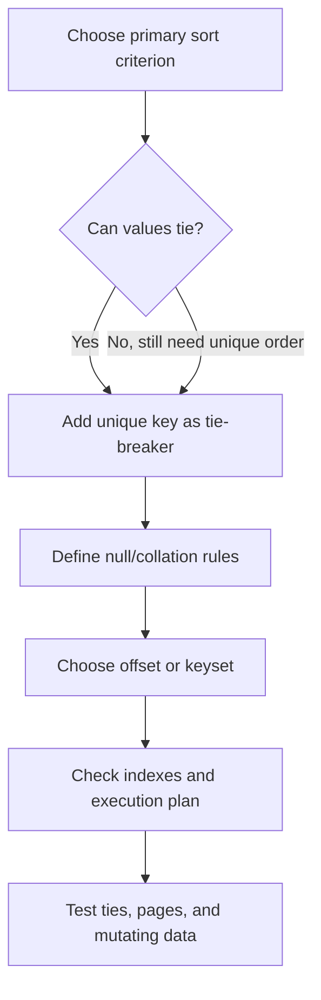

# Multi-Column Sorting and Stable Ordering on Duplicate Values

When querying multiple records, sorting by a single column is often insufficient to determine a unique order. For example, multiple orders may share the exact same creation timestamp; the database can return them in any order if the SQL does not specify a secondary criterion. When combined with pagination, non-deterministic ordering can cause a record to appear on two pages or be skipped between queries.

In Spring Data JDBC, you can sort by multiple properties using `Sort` or declare the ordering in a derived query method name. To keep results stable when primary sort values tie, add a unique secondary criterion, usually the primary key `id`. This lesson uses an order example to explain how to combine multiple columns, apply them to offset/keyset pagination, and test result ordering.

## 1. Why Can Single-Column Sorting Be Insufficient?

Suppose the `purchase_order` table has the following orders:

| id | customer_id | status | created_at |
| ---: | ---: | --- | --- |
| 101 | 7 | CREATED | 2026-11-10 09:00 |
| 102 | 7 | CONFIRMED | 2026-11-10 09:00 |
| 103 | 7 | CREATED | 2026-11-10 09:00 |
| 104 | 7 | CANCELLED | 2026-11-09 15:30 |
| 105 | 7 | CREATED | 2026-11-08 12:00 |

The query:

```sql
SELECT id, status, created_at
FROM purchase_order
WHERE customer_id = 7
ORDER BY created_at DESC;
```

only specifies that newer orders come first. The three orders 101, 102, and 103 share the same `created_at`, so SQL defines no relative order among them. The database may return them in different orders due to execution plans, indexes, updates, or physical storage.

SQL guarantees ordering only according to the declared `ORDER BY` expressions. Whenever those expressions are equal, the order among tied rows remains undefined.

## 2. Adding a Unique Secondary Criterion

A stable ordering typically looks like:

```sql
SELECT id, status, created_at
FROM purchase_order
WHERE customer_id = 7
ORDER BY created_at DESC, id DESC;
```

How to read it:

1. Sort `created_at` descending: newer orders come first.
2. If two orders have the same `created_at`, sort `id` descending.
3. Because `id` is a unique primary key, each row has a deterministic position in the result order.

With the sample data, the order will be 103, 102, 101, 104, 105. If you want smaller IDs first among tied timestamps, use `id ASC`.

The final criterion should establish a unique order within the result set. The primary key is a common choice because it is unique and non-null. A business code works only if the database genuinely enforces its uniqueness within the query's scope.

**Stable ordering does not mean the underlying data itself is immutable.** If an order's `created_at` is updated or rows are inserted/deleted while a user paginates, positions can still shift. The secondary criterion resolves ties in sort values; it does not lock a data snapshot across multiple requests.

## 3. Multi-Column Sorting with Spring Data Sort

Spring Data provides `Sort` to describe multiple criteria in priority order. Example repository:

```java
package com.example.orders.repository;

import java.util.List;

import com.example.orders.domain.PurchaseOrder;
import org.springframework.data.domain.Sort;
import org.springframework.data.repository.CrudRepository;

public interface PurchaseOrderRepository
        extends CrudRepository<PurchaseOrder, Long> {

    List<PurchaseOrder> findByCustomerId(
        Long customerId,
        Sort sort
    );
}
```

Calling the repository with two criteria:

```java
Sort sort = Sort.by(
    Sort.Order.desc("createdAt"),
    Sort.Order.desc("id")
);

List<PurchaseOrder> orders =
    purchaseOrderRepository.findByCustomerId(7L, sort);
```

The order of `Sort.Order` arguments in `Sort.by(...)` is the priority order. The first criterion is applied first; the second criterion breaks ties among rows equal on the first criterion.

In SQL terms, this request corresponds to:

```sql
SELECT ...
FROM purchase_order
WHERE customer_id = ?
ORDER BY created_at DESC, id DESC;
```

This expresses the SQL conceptually; the actual statement also depends on mapping, dialect, and framework version.

### Sort Directions Can Differ Across Columns

For example, to group statuses alphabetically, with newest orders first within each status:

```java
Sort sort = Sort.by(
    Sort.Order.asc("status"),
    Sort.Order.desc("createdAt"),
    Sort.Order.desc("id")
);
```

Equivalent SQL meaning:

```sql
ORDER BY status ASC, created_at DESC, id DESC
```

Not all columns must share the same direction. Choose each direction according to how users need to read the results, then append a unique key at the end.

### Using Sort with Other Methods

`Sort` is a special parameter of Spring Data query methods. It is not a domain value to bind like `customerId`. It can be combined with derived query conditions:

```java
List<PurchaseOrder> findByStatus(
    String status,
    Sort sort
);

List<PurchaseOrder> findByCustomerIdAndStatus(
    Long customerId,
    String status,
    Sort sort
);
```

Property names in `Sort.Order` are Java property names of the domain model. If Java has `createdAt` and mapping produces column `created_at`, use `"createdAt"` in `Sort`, not the SQL column name `"created_at"`.

## 4. Declaring Fixed Ordering with OrderBy in the Method Name

If a query always uses the same order, it can be encoded directly in the derived query method name:

```java
List<PurchaseOrder> findByCustomerIdOrderByCreatedAtDescIdDesc(
    Long customerId
);
```

This method has an ordering equivalent to `created_at DESC, id DESC`.

Another example:

```java
List<PurchaseOrder> findByStatusOrderByTotalAmountDescIdAsc(
    String status
);
```

Corresponding to:

```sql
WHERE status = ?
ORDER BY total_amount DESC, id ASC
```

Choose between `OrderBy` and `Sort` based on purpose:

| Approach | When appropriate |
| --- | --- |
| `OrderByCreatedAtDescIdDesc` | A method always uses the same order and the name remains short and readable. |
| `Sort` parameter | The caller needs to pick among multiple application-allowed orders. |
| Custom SQL | Complex sort expressions, database functions, custom null ordering, or dedicated keyset predicates are needed. |

Do not create method names so long they become unreadable just to support every sort combination. When ordering varies by screen or user preference, `Sort` is usually more flexible.

## 5. Multi-Column Sorting and Offset Pagination

Offset pagination typically splits results into segments using `LIMIT` and `OFFSET`:

```sql
SELECT id, status, created_at
FROM purchase_order
WHERE customer_id = 7
ORDER BY created_at DESC, id DESC
LIMIT 2 OFFSET 0;

SELECT id, status, created_at
FROM purchase_order
WHERE customer_id = 7
ORDER BY created_at DESC, id DESC
LIMIT 2 OFFSET 2;
```

With static data and a unique order, the first page might be 103, 102; the next page is 101, 104. Each row has an unambiguous position in the result set.

If only `ORDER BY created_at DESC` were used, the database could reorder rows sharing the same timestamp. When a page boundary cuts across a group sharing `created_at`, the same order can appear on both pages or vanish from both when re-queried.

Never use `LIMIT/OFFSET` without `ORDER BY` if users expect repeatable page ordering. An unordered result set has no stable concept of page 1 and page 2.

### Custom Repository Example with Limit/Offset

When explicit SQL control is needed, `JdbcTemplate` can be used:

```java
public List<OrderSummary> findPage(
        long customerId,
        int page,
        int pageSize) {

    if (page < 0 || pageSize < 1 || pageSize > 100) {
        throw new IllegalArgumentException("Invalid page request");
    }

    long offset = (long) page * pageSize;

    String sql = """
        SELECT id, customer_id, status, total_amount, created_at
        FROM purchase_order
        WHERE customer_id = ?
        ORDER BY created_at DESC, id DESC
        LIMIT ? OFFSET ?
        """;

    return jdbc.query(
        sql,
        rowMapper,
        customerId,
        pageSize,
        offset
    );
}
```

`LIMIT` and `OFFSET` are numeric values so they can be bound on many databases/drivers; exact syntax and binding support still need verification per dialect. Table names, column names, and `ORDER BY` order remain fixed SQL structure in code.

If using `Pageable` in your Spring Data JDBC version's repository/query path, `Sort` can be set on the paging object. Check the API and support of your exact version; whether using `Pageable` or writing `LIMIT/OFFSET` manually, the order must include a unique tie-breaker key.

## 6. Why Is Stable Ordering Still Not Enough Under Concurrent Writes?

Suppose a user is viewing the first page:

- Page 1 fetches the two newest orders: 103, 102.
- Before the user requests page 2, a new order with ID 106 is inserted with a newer timestamp.
- Page 2 still uses `OFFSET 2`.

The new order is 106, 103, 102, 104, 105. Page 2 starts from the third position and can return 102, 104. Order 102 is duplicated even though `ORDER BY` already has `id` as a secondary criterion.

This is not a tie-breaking bug. Offset is recomputed over the mutated result set; the newly inserted record at the top shifts existing rows' positions.

If data changes frequently, consider:

- Accepting the best-effort nature of offset pagination.
- Holding a consistent snapshot within the same transaction when the workflow permits.
- Using keyset/seek pagination so the next page starts from the last seen values.
- For reports requiring a snapshot across multiple requests, storing a snapshot/version or building a business-fixed result set.

## 7. Keyset Pagination: Using Sort Values as a Cursor

Keyset pagination does not skip a count of rows via `OFFSET`. Instead, the next-page request sends back the sort values of the last row from the previous page.

Suppose the order is:

```sql
ORDER BY created_at DESC, id DESC
```

The last row of the current page has:

- `lastCreatedAt = 2026-11-10 09:00`
- `lastId = 102`

The next page fetches rows appearing after that pair in descending order:

```sql
SELECT id, status, created_at
FROM purchase_order
WHERE customer_id = :customerId
  AND (
       created_at < :lastCreatedAt
       OR (
           created_at = :lastCreatedAt
           AND id < :lastId
       )
  )
ORDER BY created_at DESC, id DESC
LIMIT :pageSize;
```

The condition has two branches because:

1. Rows with smaller `created_at` come after the last row in descending order.
2. When timestamps are equal, smaller IDs come after when IDs are also sorted descending.

The next results are 101, 104 in the example above. If a new order is inserted at the top of the list after page 1, the cursor still resumes from `(lastCreatedAt, lastId)`; the new row does not shift the cursor position like offset does.

### Keyset Predicate Must Match the Exact Ordering

With `status ASC, created_at DESC, id DESC`, the next-page predicate is more complex:

- `status > :lastStatus`, or
- equal status and `created_at < :lastCreatedAt`, or
- equal status and timestamp, but `id < :lastId`.

In general, for multi-column sort keys, the seek predicate compares left to right: hold all prior columns equal to the cursor values, then compare the next column according to its sort direction. Each subsequent branch adds an equality condition for the preceding columns.

If `NULL`, collation, or normalization expressions are in `ORDER BY`, the cursor predicate must also mirror how the database orders those values. For complex orders, write and test custom SQL rather than guessing predicate generation.

### The Cursor Must Carry Enough Sort Values

If the order is `created_at DESC, id DESC`, the cursor must contain both `created_at` and `id`. Sending only the ID is not enough to reconstruct the position in the chosen order.

The cursor API can encode those two values into an opaque token. The server should validate format, filter scope, and sort order tied to the cursor; never trust an arbitrary client-forged cursor if it could alter tenant, filter conditions, or sensitive data.

Keyset pagination is generally more efficient than offset on deep pages when backed by an appropriate index, though it does not inherently provide an absolute snapshot. Existing records can still change their sort values between requests. If report-grade snapshot consistency is required, a separate snapshot mechanism is needed.

## 8. NULL Values and Sort Order

If a sort column allows `NULL`, null ordering can differ across databases and dialects. For instance, a nullable `created_at` may place rows without timestamps first or last depending on the DBMS.

Spring Data `Sort.Order` provides hints such as `nullsFirst()` and `nullsLast()`:

```java
Sort sort = Sort.by(
    Sort.Order.desc("createdAt").nullsLast(),
    Sort.Order.desc("id")
);
```

These are null-handling requests/hints. Whether and how they translate to SQL depends on the store/dialect; do not assume every database behaves identically. If null rules are an important business requirement, inspect the generated SQL and run integration tests on the production database.

Another option is making the sort column non-null via the schema/domain if business rules require a value to always exist. Do not invent fake default values purely for easier sorting if that distorts data semantics.

## 9. String Sorting, Collation, and ignoreCase

String sorting also depends on database collation. For example, names `An`, `an`, `Ánh`, and `Anh` may sort differently depending on locale/collation settings.

Spring Data can express case-insensitive sorting with `ignoreCase()`:

```java
Sort sort = Sort.by(
    Sort.Order.asc("status").ignoreCase(),
    Sort.Order.asc("id")
);
```

How this request translates into concrete SQL expressions depends on the database/dialect and can affect index usage. If the application needs stable linguistic ordering, define collation/normalization at the database level and test with real Vietnamese data.

As with other columns, if multiple strings tie after ignoring case, append a unique criterion at the end to break ties.

## 10. Dynamic Sorting from APIs: Only Allow Predefined Choices

If an API lets users pick a sort option, do not turn raw request strings directly into sort properties. Use an enum/allowlist:

```java
public enum OrderSort {
    NEWEST,
    HIGHEST_AMOUNT,
    STATUS
}

public static Sort toSort(OrderSort choice) {
    return switch (choice) {
        case NEWEST -> Sort.by(
            Sort.Order.desc("createdAt"),
            Sort.Order.desc("id")
        );
        case HIGHEST_AMOUNT -> Sort.by(
            Sort.Order.desc("totalAmount"),
            Sort.Order.desc("id")
        );
        case STATUS -> Sort.by(
            Sort.Order.asc("status"),
            Sort.Order.desc("createdAt"),
            Sort.Order.desc("id")
        );
    };
}
```

Every option includes a final tie-breaking criterion. With `STATUS`, if multiple orders share status and timestamp, `id DESC` determines the order among them.

Do not do:

```java
Sort sort = Sort.by(request.sortBy());
```

if `sortBy` is an arbitrary client string. Validate the choice, map it to a predefined `Sort`, and keep the trailing ID criterion.

## 11. Indexes for Multi-Column Sorting

Correct sorting alone does not guarantee fast queries. The database may have to read many rows and perform an extra sort step if indexes do not match.

For a common query:

```sql
SELECT ...
FROM purchase_order
WHERE customer_id = ?
ORDER BY created_at DESC, id DESC
LIMIT ?;
```

You can consider a composite index:

```sql
CREATE INDEX idx_order_customer_created_id
ON purchase_order (customer_id, created_at DESC, id DESC);
```

Index column order matters:

- `customer_id` comes first because it is a common equality filter.
- `created_at` and `id` follow to support the result order.
- The index can let the database scan in order and avoid a separate sort step, depending on optimizer and database.

If querying by status and then sorting:

```sql
WHERE customer_id = ?
  AND status = ?
ORDER BY created_at DESC, id DESC
```

another index may fit:

```sql
CREATE INDEX idx_order_customer_status_created_id
ON purchase_order (customer_id, status, created_at DESC, id DESC);
```

Do not create every possible index combination just because you can. Indexes take storage space and add write/update overhead. Inspect actual workloads, selectivity, table sizes, and execution plans with database tools.

## 12. Sorting the Root vs. Sorting Child Collections

When a repository returns a list of `PurchaseOrder`, `Sort` applies to the order of aggregate roots in the query result.

It does not automatically govern the order of elements inside `PurchaseOrder.lines`. If a child collection has a business order, model that order separately—for example, using the key/index column of `@MappedCollection` or a `position` property in the child table—and control saving and reading via the appropriate mapping.

For example:

- Sorting the order list by `createdAt DESC, id DESC`: order among orders.
- Sorting line items by `lineNo ASC`: order within an order.

Do not assume a repository `Sort` automatically sorts nested collections or other aggregates.

## 13. Testing Stable Ordering

A test that only inserts rows with distinct `createdAt` values will not catch tie-breaking bugs. Intentionally create multiple rows with identical values in the primary sort column.

Example data:

```sql
INSERT INTO purchase_order (id, customer_id, status, created_at)
VALUES
    (101, 7, 'CREATED',   '2026-11-10 09:00:00'),
    (102, 7, 'CONFIRMED', '2026-11-10 09:00:00'),
    (103, 7, 'CREATED',   '2026-11-10 09:00:00'),
    (104, 7, 'CANCELLED', '2026-11-09 15:30:00');
```

With sort `createdAt DESC, id DESC`, expected IDs:

```text
103, 102, 101, 104
```

Key tests:

1. Multiple rows sharing `createdAt` are broken by ID in the right direction.
2. Multiple sort criteria with mixed directions are applied in the right priority order.
3. Offset pages on a static dataset have no duplicates and no missing rows.
4. Dynamic sorting only accepts valid enum/allowlist options.
5. Null handling and case-insensitive sorting are verified on the target database if the application depends on them.
6. Keyset cursors contain all sort values and the next page does not duplicate rows at boundaries.
7. Under concurrent inserts/updates, tests verify behavior per the chosen policy (best-effort, snapshot, or keyset).

Example ordering assertion with AssertJ:

```java
List<PurchaseOrder> result =
    repository.findByCustomerId(
        7L,
        Sort.by(
            Sort.Order.desc("createdAt"),
            Sort.Order.desc("id")
        )
    );

assertThat(result)
    .extracting(PurchaseOrder::id)
    .containsExactly(103L, 102L, 101L, 104L);
```

This is an illustrative test; fixtures must provide all required columns of the aggregate and use database/test setup matching the project.

### Testing Offset Pagination

With page size 2 on the static dataset:

- Page 0: 103, 102.
- Page 1: 101, 104.

Combining both pages must yield the full exact order with no duplicate IDs. If a test has no duplicate sort values, it has not proven that the secondary criterion works.

## 14. Workflow for Choosing Sort Order on an Endpoint

When designing a list endpoint, determine:

1. **Primary column:** what do users care about most, e.g., newest timestamp or highest amount?
2. **Sort direction:** ascending or descending?
3. **Tie-breaker:** which column guarantees a unique order, typically the primary key?
4. **Null semantics:** is the column nullable, and where should nulls go?
5. **Collation:** if sorting strings, what are the case and locale rules?
6. **Pagination:** is offset or keyset better for the volume and mutation rate?
7. **Index:** which index supports filter + sort?
8. **API contract:** which sort choices are clients allowed to pick?
9. **Concurrency:** is cross-page drift acceptable or is a snapshot required?
10. **Testing:** do fixtures include ties and check page boundaries?

Decision diagram:



## 15. Common Misconceptions

- **`ORDER BY created_at DESC` always returns the same order when timestamps tie.** Incorrect. Order among rows with equal values is not guaranteed.
- **Any extra column works as a secondary sort.** Insufficient if that column can also tie; the final criterion should be unique within the result set.
- **`Sort` takes SQL column names.** Spring Data `Sort` usually takes domain model properties; `createdAt` is the property, `created_at` is the mapped column.
- **Sorting the root also sorts child collections.** Incorrect. Root ordering and child collection ordering are two separate requirements.
- **With a tie-breaker, offset pagination never duplicates or skips rows.** Incorrect when the dataset changes between requests; offsets still shift.
- **Keyset pagination does not need a unique sort.** Incorrect. A cursor requires a total order, usually ending with a primary key.
- **`nullsLast()` definitely generates identical SQL on every database.** Incorrect. It is a hint that can depend on dialect/store.
- **Indexes must cover every column of every sort order.** Incorrect. Design indexes based on actual queries and execution plans.

## 16. Self-Check Questions

- Why does `ORDER BY created_at DESC` leave the order among orders with identical timestamps undefined?
- What does appending `id DESC` at the end accomplish if `id` is the primary key?
- In `Sort.by(Order.desc("createdAt"), Order.asc("id"))`, which criterion takes precedence first?
- When should you use `OrderBy...` in a method name instead of a `Sort` parameter?
- Why does `LIMIT/OFFSET` need a deterministic order?
- Why can inserting a new record at the top of the list cause the next offset page to duplicate a record?
- Which values does keyset pagination use as a cursor when sorting by two columns?
- How does the seek predicate change if one column is sorted ASC and another DESC?
- Are `nullsFirst`/`nullsLast` and `ignoreCase` database-dependent?
- How should a composite index reflect filter and sort order?
- How do you test stable ordering when multiple rows share the same primary sort value?

When sorting by multiple columns, treat the final criterion as the completion of the order: business columns determine grouping and display direction, while the unique key breaks ties among equal rows. Combine that ordering with an appropriate pagination strategy, matching indexes, and tests containing duplicate values so results remain predictable.
