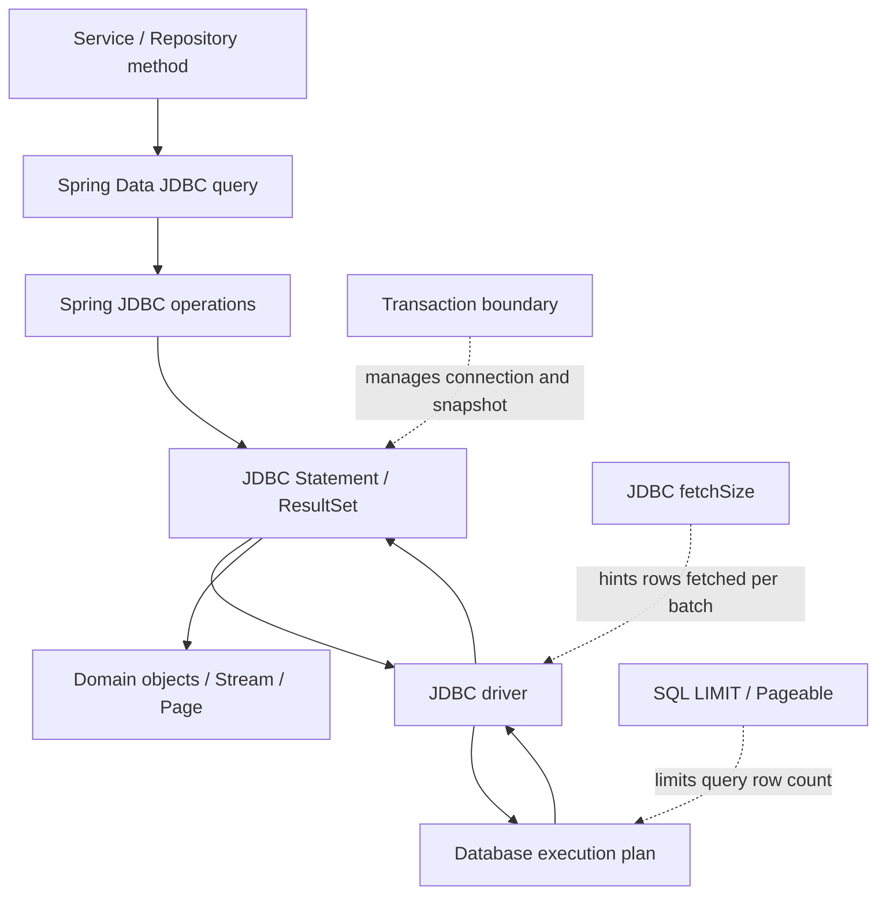
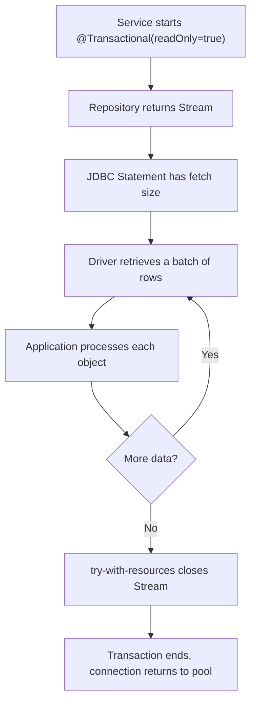

# Choosing Fetch Size, Result Limits, and Transaction Scope for Reads

When reading data with Spring Data JDBC, three decisions directly impact system performance and resource usage:

- **Fetch size:** how large of a batch the JDBC driver retrieves from the database at a time.
- **Result limits:** how many rows the application needs for a query, a page, or a processing batch.
- **Transaction scope:** how long the connection and transaction must stay open to read data safely, especially when consuming results as a `Stream`.

These three concepts are related but do not replace one another. `fetchSize` does not cap total rows; `LIMIT` does not control how the driver fetches rows incrementally; transactions govern connection lifecycles and affect streaming capabilities in certain JDBC drivers.

This lesson uses Spring Data JDBC and Spring JDBC to explain how to choose each mechanism, configure them in Spring Boot, and structure code that reads large datasets without holding too many objects in memory or keeping connections open too long.

## 1. The Big Picture of a Read Operation

A repository method such as:

```java
List<PurchaseOrder> findByStatus(OrderStatus status);
```

can return all aggregates matching the condition. Spring Data JDBC generates the SQL, executes it via `NamedParameterJdbcOperations`, and maps rows into domain objects.

Several layers participate in that process:

1. **Query method/repository:** defines filters, ordering, pages, or result limits.
2. **Spring Data JDBC:** builds the SQL and materializes aggregates.
3. **Spring JDBC:** creates the `Statement`/`PreparedStatement`, configures fetch size, and executes.
4. **JDBC driver:** decides how to retrieve the `ResultSet` from the database.
5. **Database:** executes the query plan, filters, sorts, and returns result rows.



You can remember the differences as follows:

| Mechanism | Question answered | Example |
| --- | --- | --- |
| SQL limit/pagination | At most how many rows should one query return? | `LIMIT 100`, `Pageable` |
| Fetch size | How many rows should the driver retrieve per fetch batch? | `setFetchSize(500)` |
| Transaction | Within what scope are the Connection/ResultSet held? | `@Transactional(readOnly = true)` |

## 2. What Is Fetch Size?

**Fetch size** is a hint to the JDBC driver indicating how many rows to retrieve from the database whenever the `ResultSet` needs more data. It is generally useful when a query returns many rows and the application wants to process them incrementally.

For example, a query returns 100,000 rows with a fetch size of 500:

```text
Total results: 100,000 rows

Fetch batch 1: 500 rows
Fetch batch 2: 500 rows
Fetch batch 3: 500 rows
...
Final fetch batch: remaining rows
```

The number 500 is an example. Drivers may interpret fetch size differently; it is not a guarantee that every database sends exactly 500 rows per network packet or holds only 500 objects in memory.

### 2.1. Fetch Size Does Not Limit Total Results

If a query matches 100,000 rows and fetch size is 500, the application can still read all 100,000 rows. The driver simply breaks retrieval into batches when a cursor/fetch mechanism is supported and enabled.

Conversely, the SQL:

```sql
SELECT id, order_number
FROM purchase_orders
ORDER BY id
LIMIT 100;
```

asks the database to return at most 100 rows regardless of what fetch size is set to.

### 2.2. Fetch Size Is a Hint, Not a Streaming Guarantee

JDBC defines `Statement.setFetchSize(int)` as a hint to the driver. A driver may ignore it or apply it in its own way. Some drivers load the entire `ResultSet` to the client even when fetch size is positive; others support server-side cursors and fetch incrementally.

Thus, setting `fetch-size: 500` alone is not proof that the application streams data. You must examine simultaneously:

- The return type and how the application consumes results.
- How Spring JDBC creates `Statement`s.
- The JDBC driver's behavior.
- Auto-commit and transactions.
- Database/driver-specific configuration.

## 3. Configuring Fetch Size in Spring Boot

Spring Boot provides properties for `JdbcTemplate`:

```yaml
spring:
  jdbc:
    template:
      fetch-size: 500
      max-rows: -1
      query-timeout: 30s
```

Meaning:

| Property | Meaning |
| --- | --- |
| `spring.jdbc.template.fetch-size` | Suggested number of rows each time the driver needs to fetch more data. |
| `spring.jdbc.template.max-rows` | Maximum row limit on the JDBC `Statement`. |
| `spring.jdbc.template.query-timeout` | Query execution timeout, in Spring Boot duration units. |

The default value for both `fetch-size` and `max-rows` is `-1`, meaning the JDBC driver/`Statement` defaults are used.

Spring Boot's `NamedParameterJdbcTemplate` delegates to the underlying `JdbcTemplate`. Spring Data JDBC accesses the database through `NamedParameterJdbcOperations`; under default Spring Boot auto-configuration, verify that the operations use the customized template. If your project manually declares multiple `JdbcTemplate` or `NamedParameterJdbcOperations` beans, check which bean Spring Data JDBC actually uses.

### 3.1. Choosing a Fetch Size Value

There is no single optimal number for every application. Larger fetch sizes can reduce round trips, while increasing how much data the driver buffers at once. Smaller fetch sizes reduce batch sizes, while potentially increasing database round trips.

Some starting points to test:

| Fetch size | When to consider |
| --- | --- |
| `0` | Use the driver's default JDBC behavior. |
| `100` | Small batches, relatively wide rows, or tight client memory limits. |
| `500` | Reasonable benchmark starting point for multi-row moderate-sized results. |
| `1,000` or higher | May suit small rows when round-trip latency matters; measure memory/network. |

These numbers are only benchmark starting points. Measure query duration, memory, round trips, and database load using your actual driver and application workload.

### 3.2. `max-rows` Is Not SQL `LIMIT`

`spring.jdbc.template.max-rows` configures a row limit at the JDBC `Statement` level. It can prevent the application from receiving more rows than configured, yet does not replace a query with proper `WHERE`, `ORDER BY`, and `LIMIT` clauses.

Setting `max-rows: 100` globally may cap every query executed through that template. Because this has wide-reaching impact, do not use it as a substitute for pagination on a single screen.

To bound a specific use case, prefer limiting inside the query/repository method. Use `max-rows` when you intentionally want a `Statement`-level safety cap across queries sharing that template.

## 4. Streaming Query Results with `Stream`

Spring Data JDBC supports query methods returning `Stream<T>`. Unlike `List<T>`, which materializes all results upfront, `Stream` lets the application consume elements as they arrive from the database.

Repository:

```java
import java.util.stream.Stream;

import org.springframework.data.jdbc.repository.query.Query;
import org.springframework.data.repository.ListCrudRepository;
import org.springframework.data.repository.query.Param;

public interface PurchaseOrderRepository
        extends ListCrudRepository<PurchaseOrder, Long> {

    @Query("""
        SELECT id, order_number, status
        FROM purchase_orders
        WHERE status = :status
        ORDER BY id
        """)
    Stream<PurchaseOrder> streamByStatus(
        @Param("status") String status
    );
}
```

Spring Data JDBC keeps the connection associated with the `Stream` open while the `Stream` is in use. Therefore, **you must close the `Stream`** to release the `ResultSet`/`Statement`/connection.

### 4.1. Using `try-with-resources`

Example consuming results in a service:

```java
import java.util.stream.Stream;

import org.springframework.stereotype.Service;
import org.springframework.transaction.annotation.Transactional;

@Service
public class OrderExportService {

    private final PurchaseOrderRepository orders;

    public OrderExportService(PurchaseOrderRepository orders) {
        this.orders = orders;
    }

    @Transactional(readOnly = true)
    public void exportByStatus(String status) {
        try (Stream<PurchaseOrder> stream =
                 orders.streamByStatus(status)) {

            stream.forEach(order -> {
                // Write each order to file or process in batch.
                process(order);
            });
        }
    }

    private void process(PurchaseOrder order) {
        // Logic to process one aggregate.
    }
}
```

In this example:

1. The transaction starts before the service executes.
2. The repository opens the query and returns a `Stream` backed by JDBC resources.
3. The application consumes each element inside the transaction.
4. The `try-with-resources` block closes the `Stream` upon completion or exception.
5. The service method exits and the transaction completes.

Never return a `Stream` out of a transactional service to consume it in a controller or another thread. Once the transactional method exits, the connection may be released; the `Stream` is no longer guaranteed to remain readable.

### 4.2. `Stream` Does Not Automatically Mean Batched Driver Fetching

`Stream` lets application code consume results incrementally, yet does not guarantee the JDBC driver avoids buffering the entire `ResultSet` on the client. To reduce driver memory usage, configure fetch size and satisfy the driver's cursor conditions.

In other words:

- `Stream<T>` controls how application code consumes results.
- `fetchSize` hints how the JDBC driver retrieves results.
- Transactions and the driver determine whether a database cursor can be used.

All three conditions must be configured together.

### 4.3. Do Not Use `Stream` If Only a Small Set Is Needed

If a query returns only tens or hundreds of rows, `List<T>` is usually simpler. `Stream` holds open resources and requires proper closing; there is no need to use it for every repository method.

## 5. PostgreSQL: Fetch Size and Transactions

The PostgreSQL JDBC driver (pgJDBC) may fetch the entire query result to the client by default. To enable cursor-based fetching, the driver requires several key conditions:

- Fetch size must be positive.
- The connection must not be in auto-commit mode—i.e., the query runs inside a transaction.
- The `ResultSet` type must be forward-only.
- The query must be a single statement compatible with cursors.

If the connection is in auto-commit mode, the server-side cursor can close immediately after statement completion, causing the driver to fall back to fetching the entire result set.

Therefore, with PostgreSQL, configuring fetch size should accompany an active transaction enclosing the `Stream` consumption duration.

Example:

```yaml
spring:
  jdbc:
    template:
      fetch-size: 500
```

And service:

```java
@Transactional(readOnly = true)
public void processLargeResult() {
    try (Stream<PurchaseOrder> stream =
             orders.streamAllForExport()) {
        stream.forEach(this::process);
    }
}
```

Spring JDBC's transaction manager manages the connection within the scope of the transactional method. Verify that your application's `DataSource`/transaction manager configuration uses the same connection that the repository uses.

Other drivers have their own rules. Do not apply PostgreSQL's requirements to MySQL, SQL Server, Oracle, or H2 without checking the corresponding driver documentation.

## 6. Limiting Results with Query Methods

Fetch size does not cap total rows. When business logic only needs a fixed-size subset of results, limit it in the query.

Spring Data JDBC supports query methods with `First` or `Top`:

```java
List<PurchaseOrder> findTop50ByStatusOrderByCreatedAtDescIdDesc(
    OrderStatus status
);
```

This method requests at most 50 orders by status, sorted newest first. `Id` is added as a secondary criterion to keep ordering stable when multiple orders share `createdAt`.

If only the single first element is needed:

```java
Optional<PurchaseOrder> findFirstByStatusOrderByCreatedAtDescIdDesc(
    OrderStatus status
);
```

The limit is applied in the query, avoiding loading all data only to slice the list in Java.

### 6.1. Using `Pageable` with Derived Query Methods

For derived query methods, `Pageable` can be accepted to apply offset, page size, and sort:

```java
import org.springframework.data.domain.Pageable;
import org.springframework.data.domain.Slice;
import org.springframework.data.domain.Page;

Slice<PurchaseOrder> findByStatus(
    OrderStatus status,
    Pageable pageable
);

Page<PurchaseOrder> findPageByStatus(
    OrderStatus status,
    Pageable pageable
);
```

Invocation from a service:

```java
Pageable pageable = PageRequest.of(
    0,
    25,
    Sort.by(
        Sort.Order.desc("createdAt"),
        Sort.Order.desc("id")
    )
);

Slice<PurchaseOrder> slice =
    repository.findByStatus(OrderStatus.OPEN, pageable);
```

`Pageable` holds offset, page size, and sort order. Spring Data JDBC applies these to the query according to dialect capabilities.

### 6.2. How Do `Page` and `Slice` Differ?

| Return type | Information available | Typical cost |
| --- | --- | --- |
| `List<T>` + `Pageable` | List within the page range | No total page metadata needed. |
| `Slice<T>` | Page content and whether a next page exists | Usually fetches one extra row to check for more data. |
| `Page<T>` | Page content, total elements, and total pages | May require an extra `COUNT` query. |

If the UI only needs a “Next” button, `Slice` is usually sufficient and avoids the cost of counting all results. If displaying “page 1 of 50” is genuinely required, `Page` may fit better, though count query cost must be weighed.

### 6.3. Sorting Must Have a Stable Order

Do not sort solely by a column that can have ties:

```java
Sort.by(Sort.Order.desc("createdAt"))
```

If multiple rows share the same timestamp, the order among them can vary. Add a unique key as a secondary criterion:

```java
Sort.by(
    Sort.Order.desc("createdAt"),
    Sort.Order.desc("id")
)
```

A stable order makes paging less likely to duplicate or skip rows when data is static. However, offset pagination can still be affected if rows are inserted or deleted between page requests.

## 7. String-Based `@Query` and Result Limits

A notable characteristic of Spring Data JDBC: **string-based queries declared with `@Query` are not automatically rewritten to apply `Pageable`, `Sort`, or `Limit` like derived query methods**.

The following example is not how dynamic pagination is applied to a static SQL string:

```java
@Query("""
    SELECT id, order_number, status
    FROM purchase_orders
    WHERE status = :status
    """)
List<PurchaseOrder> findByStatus(
    @Param("status") String status,
    Pageable pageable
);
```

When limiting with `@Query`, express the limit directly in dialect-appropriate SQL and bind the value safely:

```java
@Query("""
    SELECT id, order_number, status
    FROM purchase_orders
    WHERE status = :status
    ORDER BY created_at DESC, id DESC
    LIMIT :maxRows
    """)
List<PurchaseOrder> findRecentByStatus(
    @Param("status") String status,
    @Param("maxRows") int maxRows
);
```

This example uses PostgreSQL/MySQL `LIMIT` syntax. Other databases may use `FETCH FIRST ... ROWS ONLY`, `TOP`, or dialect-specific syntax. Write SQL matching your actual dialect.

Never concatenate raw input strings into the query to construct `LIMIT` or column names. Use named parameters for values; if identifiers must vary, select from an allowlist.

## 8. SQL `LIMIT/OFFSET` and Pagination Performance

A paginated SQL query commonly looks like:

```sql
SELECT id, order_number, status
FROM purchase_orders
WHERE status = 'OPEN'
ORDER BY created_at DESC, id DESC
LIMIT 25 OFFSET 50;
```

In this example:

- `LIMIT 25` requests at most 25 rows.
- `OFFSET 50` skips the preceding 50 rows.
- `ORDER BY` defines the order of the result set.

Offset pagination is easy to implement and works well when users need to jump to a specific page. Yet at very large offsets, the database still has to process/scan through many rows before returning the requested slice. Hence deeper pages can become progressively slower.

### 8.1. Keyset Pagination for Large Datasets

If the use case only needs to continue forward from the last position, keyset pagination can be used. Instead of skipping a large offset, the query uses the values of the last row read.

Example sorting by ascending ID:

```sql
SELECT id, order_number, status
FROM purchase_orders
WHERE id > :lastSeenId
ORDER BY id ASC
LIMIT :batchSize;
```

The first batch uses an appropriate starting ID (or a separate query); each subsequent batch passes the last ID from the previous batch.

Illustrative repository method:

```java
@Query("""
    SELECT id, order_number, status
    FROM purchase_orders
    WHERE id > :lastSeenId
    ORDER BY id ASC
    LIMIT :batchSize
    """)
List<PurchaseOrder> findNextBatch(
    @Param("lastSeenId") long lastSeenId,
    @Param("batchSize") int batchSize
);
```

Keyset pagination requires stable ordering and matching indexes. If sorting by multiple columns, the next-page condition must compare the complete sort tuple (e.g., `created_at` and `id`) in exact order. You cannot use `id > lastSeenId` alone if the actual ordering is by a different column.

## 9. Distinguishing Fetch Size, `LIMIT`, and `maxRows`

Three settings are frequently confused:

| Mechanism | Layer applied | Affects total results? | Example |
| --- | --- | --- | --- |
| SQL `LIMIT` / `FETCH FIRST` | Database query | Yes | `LIMIT 100` |
| JDBC fetch size | JDBC Statement/driver | No; only a hint for how to fetch | `setFetchSize(500)` |
| JDBC `maxRows` | JDBC Statement | Caps max rows JDBC returns to the app | `setMaxRows(100)` |

Example on the same 10,000-row query:

- `LIMIT 100`: the database is asked to return at most 100 rows.
- `fetchSize = 500`: the driver may retrieve results in batches of 500 rows until exhausted.
- `maxRows = 100`: the JDBC `Statement` caps the maximum rows read by the app from the `ResultSet`; it does not replace good SQL filtering/limiting.

If a screen only needs 100 results, limit at the SQL/repository method level. If you need to process all rows without having the driver fetch everything at once, consider `Stream` + fetch size + transaction.

## 10. Transaction Scope During Reads

Spring Data JDBC relies on Spring JDBC transactions. Inherited CRUD methods on repositories carry default transaction configuration; reads typically have `readOnly = true`, whereas writes use regular transactions.

For custom-declared query methods, define transactions explicitly, especially when materializing an aggregate requires multiple queries to load child components.

Example annotating repository query methods:

```java
@Transactional(readOnly = true)
public interface PurchaseOrderRepository
        extends ListCrudRepository<PurchaseOrder, Long> {

    List<PurchaseOrder> findByStatus(OrderStatus status);

    @Query("""
        SELECT id, order_number, status
        FROM purchase_orders
        WHERE status = :status
        """)
    Stream<PurchaseOrder> streamByStatus(
        @Param("status") String status
    );
}
```

Or placing the transaction on the application service:

```java
@Service
public class PurchaseOrderQueryService {

    private final PurchaseOrderRepository orders;

    public PurchaseOrderQueryService(PurchaseOrderRepository orders) {
        this.orders = orders;
    }

    @Transactional(readOnly = true)
    public PurchaseOrder loadOrder(Long id) {
        return orders.findById(id).orElseThrow();
    }
}
```

If an outer transaction already exists, the repository method's transaction configuration participates in the outer transaction; the service-level transaction defines the scope for the whole use case.

### 10.1. Why Do Aggregate Queries Need Transactions?

An aggregate can contain a root, collections, and child entities. Spring Data JDBC may run multiple queries to materialize the full aggregate.

If each query ran on a separate connection/transaction, it could:

- Increase the number of connections used.
- Put pressure on the connection pool.
- Read different parts of the aggregate at different points in time.
- Increase the risk of deadlocks or connection waits under concurrency.

A transaction at the service or repository ensures related queries share the same transaction/connection as configured by Spring.

### 10.2. `readOnly` Is a Hint, Not a Security Mechanism

`@Transactional(readOnly = true)` signals read intent and allows the transaction manager/driver to apply optimizations. It is **not a strict enforcement layer** guaranteeing code cannot execute `INSERT` or `UPDATE`. Some databases may reject writes in a read-only transaction; behavior depends on the transaction manager and database.

Do not use `readOnly = true` as a replacement for database permissions, validation, or access control.

### 10.3. Keep Transaction Durations Reasonable

Long-running read transactions can hold connections, snapshots, and database resources for the duration of processing. Especially when using `Stream`, avoid:

- Opening a `Stream` and waiting for user interaction.
- Holding a transaction open during slow external API calls.
- Returning a `Stream` to an HTTP response without lifecycle control.
- Keeping one transaction open for a multi-hour job when batching is possible.

For large export tasks, consider splitting into batches, processing each batch in a short transaction, and recording checkpoints so the job can resume if interrupted.

## 11. Combining `Stream`, Fetch Size, and Transactions

For a large dataset, the three factors work together as follows:



Combined example:

```java
@Service
public class OrderBatchProcessor {

    private final PurchaseOrderRepository orders;

    public OrderBatchProcessor(PurchaseOrderRepository orders) {
        this.orders = orders;
    }

    @Transactional(readOnly = true)
    public long processOpenOrders() {
        long[] count = {0};

        try (Stream<PurchaseOrder> stream =
                 orders.streamByStatus("OPEN")) {

            stream.forEach(order -> {
                process(order);
                count[0]++;
            });
        }

        return count[0];
    }

    private void process(PurchaseOrder order) {
        // Synchronously process one order.
    }
}
```

This example demonstrates consuming a `Stream` inside a transaction. For long jobs, if `process` performs network calls or heavy work, the transaction can stay open too long. In that case, separate reading into small batches and process/commit according to an appropriate design.

### 11.1. Do Not Collect the Entire `Stream` into a `List`

The following defeats the memory benefit of streaming:

```java
try (Stream<PurchaseOrder> stream = repository.streamByStatus("OPEN")) {
    List<PurchaseOrder> all = stream.toList();
    process(all);
}
```

The `Stream` still holds open resources while `toList()` materializes the entire result set in memory. Only do this if the result set is small and building a `List` is intentional.

### 11.2. Avoid Returning a `Stream` Out of a Transaction

Do not write a service method like:

```java
@Transactional(readOnly = true)
public Stream<PurchaseOrder> getOpenOrders() {
    return repository.streamByStatus("OPEN");
}
```

The transaction can complete when the method returns, before the caller has consumed the `Stream`. At that point the connection/`ResultSet` may already be closed or lack the required transaction.

Instead, consume and close the `Stream` inside the transactional method, or design a batch API returning a bounded list.

## 12. Choosing a Read Strategy by Data Scale

| Scenario | Approach |
| --- | --- |
| A few aggregates by ID | `findById` or single-record query. |
| Small list where caller needs everything | `List<T>`. |
| Paginated UI list | `Pageable` with `Slice` or `Page`. |
| Only need the newest N results | `Top/First` or SQL limit. |
| Scanning many rows and processing element by element | `Stream<T>` + fetch size + transaction. |
| Large report export without needing full domain aggregates | Custom query + DTO/`RowMapper`. |
| Large batch needing short transactions and resumability | Keyset pagination or key-based batching. |
| Hand-written SQL query needing limits | Write dialect-specific limit/offset directly in `@Query`. |

Do not pick `Stream` merely because data “looks big”. If a query returns 20 rows, `List` is simpler. If hundreds of thousands of rows are needed, measure memory, object sizes, aggregate materialization costs, and driver behavior before deciding.

## 13. When Should You Use a Custom `RowMapper` Instead of an Aggregate Repository?

Spring Data JDBC repositories focus on aggregates. A report needing only a few columns may not need to construct full domain objects.

Example:

```java
public record OrderReportRow(
    Long id,
    String orderNumber,
    Instant createdAt,
    BigDecimal total
) {}
```

Custom query via Spring JDBC:

```java
import java.math.BigDecimal;
import java.time.Instant;
import java.util.function.Consumer;

import org.springframework.jdbc.core.JdbcTemplate;
import org.springframework.stereotype.Repository;

@Repository
public class OrderReportRepository {

    private final JdbcTemplate jdbc;

    public OrderReportRepository(JdbcTemplate jdbc) {
        this.jdbc = jdbc;
    }

    public void streamReport(Consumer<OrderReportRow> consumer) {
        jdbc.query("""
            SELECT id, order_number, created_at, total
            FROM order_report_view
            ORDER BY id
            """, rs -> {
                OrderReportRow row = new OrderReportRow(
                    rs.getLong("id"),
                    rs.getString("order_number"),
                    rs.getTimestamp("created_at").toInstant(),
                    rs.getBigDecimal("total")
                );

                consumer.accept(row);
            });
    }
}
```

`RowCallbackHandler` lets you process each row without creating a `List` containing the entire result set. `JdbcTemplate` fetch size and the service transaction can be configured for this read path.

This suits read models/reporting. Do not use it to bypass invariants when updating aggregates; reporting queries and business persistence serve different goals.

## 14. Common Errors

| Symptom | Cause | Solution |
| --- | --- | --- |
| Fetch size is set, yet memory still grows with full results | Driver buffers the full `ResultSet` or code collects `Stream` into a `List`. | Check driver, transaction, cursor support, and consumption code. |
| PostgreSQL still loads all data | Connection is in auto-commit or missing transaction/cursor conditions. | Consume `Stream` inside a transaction, set positive fetch size, and check driver. |
| Stream reads a few rows then fails with connection closed | Transaction ended before `Stream` was consumed or `Stream` was closed. | Consume inside transactional method and use `try-with-resources`. |
| Connection pool exhausted during export | `Stream`/transaction held too long or never closed. | Close `Stream`, split into batches, and limit processing time. |
| Deep pages are very slow | Large `OFFSET` forces database to scan many rows. | Use keyset pagination with indexes and stable sort. |
| `Page` query slower than expected | `Page` may trigger a `COUNT` query. | Use `Slice` if only checking for a next page. |
| `@Query` ignores `Pageable` | String-based queries are not rewritten to add paging/sorting. | Write `LIMIT/OFFSET` in SQL or use a derived query. |
| `max-rows` truncates results across many places | Global `JdbcTemplate` setting. | Use only for intentional global caps; prefer per-query limits. |
| Read transaction does not cover child queries | Query method lacks shared transaction or service boundary is wrong. | Place transaction on repository interface or service use case. |
| Using `Stream` for tasks calling slow external APIs | Connection and transaction are held while waiting on network. | Read in batches, close transaction, then process outside DB. |

## 15. Workflow for Designing a Large Read Flow

When building a feature that reads large amounts of data:

1. Determine whether the use case needs **all data**, one page, the newest N rows, or just a report.
2. If a bounded subset is needed, use a query method with `Top/First`, `Pageable`, or SQL limit.
3. If scanning the full set, consider `Stream<T>` or a row-by-row callback.
4. Choose fetch size based on driver/database and benchmark with realistic workloads.
5. Ensure a transaction spans the consumption lifetime of the `ResultSet`/`Stream`.
6. Close `Stream`/`ResultSet`/`Statement` properly.
7. Avoid holding transactions during network calls or slow non-database tasks.
8. For large offsets, consider keyset pagination and suitable indexes.
9. If only DTOs/reports are needed, use a custom query/`RowMapper` to avoid unnecessary aggregate materialization.
10. Test against the exact database and JDBC driver of your deployment environment.

> **Fetch size controls how the driver retrieves results in batches; SQL limit and `Pageable` cap the query's row count; transactions define connection and `ResultSet` lifetimes.** In Spring Data JDBC, use `Stream` when consuming large data, close the `Stream` inside a transaction, and check your JDBC driver's cursor requirements. For paginated queries, prefer limiting at the database rather than loading everything and slicing lists in Java.

### References

- [Spring Data Relational — Query Methods](https://docs.spring.io/spring-data/relational/reference/jdbc/query-methods.html): `Pageable`, `Slice`, `Page`, limiting queries, and streaming results in Spring Data JDBC.
- [Spring Data Relational — Transactionality](https://docs.spring.io/spring-data/relational/reference/jdbc/transactions.html): default repository transactions, query methods, and the read-only flag.
- [Spring Boot — SQL Databases](https://docs.spring.io/spring-boot/reference/data/sql.html): configuring `JdbcTemplate` and `spring.jdbc.template.*` properties.
- [Spring Boot — Common Application Properties](https://docs.spring.io/spring-boot/appendix/application-properties/): meaning and defaults of `fetch-size`, `max-rows`, and `query-timeout`.
- [pgJDBC — Cursor-based fetching](https://jdbc.postgresql.org/documentation/query/#getting-results-based-on-a-cursor): cursor and fetch-size requirements for the PostgreSQL JDBC driver.
- [JDBC Statement API — setFetchSize](https://docs.oracle.com/en/java/javase/21/docs/api/java.sql/java/sql/Statement.html#setFetchSize(int)): JDBC contract for fetch size.
