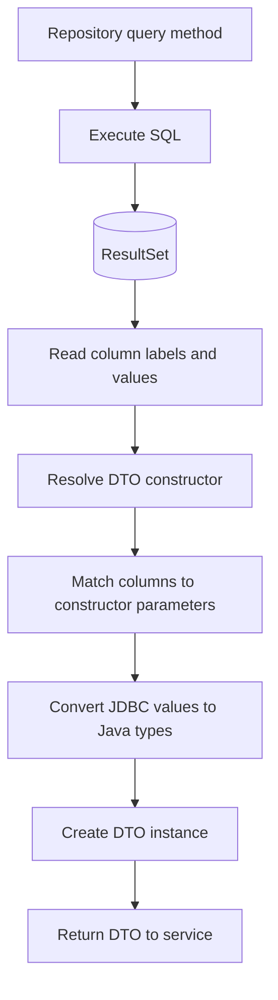

# DTO Constructors and Java Records for Query Results

In **Spring Data Relational JDBC**, repositories do not have to return the entire aggregate root whenever the application only needs a few fields. For read queries, you can map SQL results into a **DTO (Data Transfer Object)** via its constructor or use a **Java record** with its canonical constructor.

This approach is useful for lists, search screens, reports, and multi-table join queries. A DTO contains only the data the use case needs, helping avoid leaking the entire persistence model into the API layer or read services.

The core point is: Spring Data JDBC must map ResultSet columns into the corresponding constructor parameters. Therefore, column/alias names, parameter names, data types, and the selected constructor must be compatible. Records make this convenient because component names and the canonical constructor are clearly defined by Java.

## 1. What Is a DTO in JDBC Queries?

A DTO is a data type used to transfer results between application layers. A DTO typically holds the values needed for a specific use case and does not represent an aggregate with a persistence lifecycle.

For example, the `PurchaseOrder` aggregate might contain ID, order code, status, customer reference, order line list, shipping address, and other business fields. Yet an order list screen may only need ID, order code, status, and customer name.

If the entire aggregate is returned, the application may have to read unnecessary data and later convert it into a response model. A DTO can contain only the required fields:

```java
public record OrderListItem(
        Long id,
        String orderCode,
        String status,
        String customerName
) {
}
```

The query result maps directly into `OrderListItem`. The DTO does not need to become an aggregate root, does not need its own repository, and typically does not have `@Id` or `@Table`.

### 1.1. Distinguishing DTOs, Entities, and Projections

| Type | Purpose | Has persistence lifecycle? | Example |
|---|---|---|---|
| Aggregate/entity | Domain model persisted and managed as an aggregate | Yes, via repository/template | `PurchaseOrder` |
| DTO | Holds data serving a use case or application layer | Not necessarily | `OrderListItem` |
| Projection | Describes the set of properties to read from query results | Usually read-only | Interface or DTO projection |
| API response | Data contract returned to clients | No | `OrderResponse` |

The query DTO and API response can be the same class if the structure fits. In larger applications, separating them keeps persistence queries decoupled from API contracts.

**A DTO is not a child aggregate.** Having a `customerName` or `lineCount` field in a DTO does not mean Spring Data JDBC will persist it to the aggregate's table.

## 2. Flow of Mapping SQL Results to a Constructor

When a query method returns a DTO, the general flow is:

1. The repository executes SQL and receives a ResultSet.
2. Spring Data JDBC reads the returned column labels/names.
3. The mapping infrastructure resolves the matching constructor of the result type.
4. Column values are converted to the corresponding Java types.
5. Spring Data instantiates the DTO via the constructor.
6. The repository returns the DTO to the caller.



With a DTO class, constructor parameters must correspond to selected properties. With a record, component names define the parameters of the canonical constructor.

Example SQL:

```sql
SELECT
    o.id AS id,
    o.order_code AS order_code,
    o.status AS status
FROM orders o
WHERE o.id = ?;
```

DTO:

```java
public record OrderSummary(
        Long id,
        String orderCode,
        String status
) {
}
```

The alias `order_code` follows the snake_case naming convention corresponding to the `orderCode` property. If your project uses a custom naming strategy, use aliases matching your mapping and verify with integration tests.

Do not assume every JDBC driver preserves unquoted alias casing. Some databases normalize unquoted identifiers. Use clear, consistent aliases and avoid two columns having the same label.

## 3. DTO Classes with Constructors

A traditional DTO class can be written as immutable using `final` fields and a full constructor.

```java
public final class OrderSummary {

    private final Long id;
    private final String orderCode;
    private final String status;

    public OrderSummary(
            Long id,
            String orderCode,
            String status
    ) {
        this.id = id;
        this.orderCode = orderCode;
        this.status = status;
    }

    public Long getId() {
        return id;
    }

    public String getOrderCode() {
        return orderCode;
    }

    public String getStatus() {
        return status;
    }
}
```

When a DTO has a single suitable constructor, Spring Data can usually pick that constructor. Parameters must have names matching the property/column mapping. To retain constructor parameter names of regular Java classes at runtime, enable the `-parameters` compiler option.

### 3.1. Configuring Constructor Parameter Name Retention

For a Gradle Java project, you can configure:

```gradle
tasks.withType(JavaCompile).configureEach {
    options.compilerArgs.add("-parameters")
}
```

If your project already configures this option via a convention plugin or shared build logic, there is no need to declare it repeatedly.

Without parameter name retention, the framework may fail to determine which constructor parameter corresponds to which property. Errors typically surface when the repository query is initialized or when results are mapped.

With constructor-based mapping, avoid generic parameter names such as `value1`, `value2`. Name them after the domain data:

```java
public OrderSummary(Long id, String orderCode, String status) {
    // ...
}
```

Clear names make mapping and code reviews easier to follow.

### 3.2. Using `@PersistenceCreator` with Multiple Constructors

If a DTO has multiple constructors, Spring Data needs to know which constructor to use to create the object from persistence/query data.

```java
import org.springframework.data.annotation.PersistenceCreator;

public final class OrderSummary {

    private final Long id;
    private final String orderCode;
    private final String status;

    @PersistenceCreator
    public OrderSummary(
            Long id,
            String orderCode,
            String status
    ) {
        this.id = id;
        this.orderCode = orderCode;
        this.status = status;
    }

    public OrderSummary(Long id, String orderCode) {
        this(id, orderCode, "UNKNOWN");
    }

    public Long getId() {
        return id;
    }

    public String getOrderCode() {
        return orderCode;
    }

    public String getStatus() {
        return status;
    }
}
```

`@PersistenceCreator` belongs to `org.springframework.data.annotation`. This annotation marks the constructor/factory used by Spring Data for object creation. It is not a JPA annotation.

For query DTOs, it is generally best to keep one clear constructor to reduce ambiguity. Add convenience constructors only when genuinely needed and annotate the persistence constructor when necessary.

### 3.3. Constructor DTOs Need No Setters

If the constructor accepts all required data, the DTO can be immutable without setters:

- Callers cannot mutate query data after object creation.
- No no-arg constructor is needed just for mapping.
- No write property APIs are exposed.
- Easy to use as read results or pass across layers.

Do not add setters merely out of JavaBean habit. Constructor-based mapping is designed to construct objects directly from data.

## 4. Java Records for Query Results

Java records are a concise choice for immutable DTOs. A record automatically generates private final fields for each component, a canonical constructor, accessors matching component names, and `equals`, `hashCode`, and `toString` methods.

Example:

```java
public record OrderSummary(
        Long id,
        String orderCode,
        String status
) {
}
```

A record can be used as a query method return type when Spring Data JDBC's mapping and the returned data types align.

### 4.1. Canonical Constructor

For the record:

```java
public record CustomerCard(
        Long id,
        String displayName,
        String email
) {
}
```

Java generates an equivalent canonical constructor:

```java
public CustomerCard(
        Long id,
        String displayName,
        String email
) {
    this.id = id;
    this.displayName = displayName;
    this.email = email;
}
```

Spring Data can use this constructor to create the record from query data. Component names are stored in the record's metadata, so there is no need to rely on compiler flags to retain constructor parameter names as regular Java classes do.

Records require Java 16 or higher for standard production use. If your project targets an older Java version, use a DTO class with a constructor.

### 4.2. Compact Constructors for Data Validation

Records allow declaring a compact constructor to validate data:

```java
public record CustomerCard(
        Long id,
        String displayName,
        String email
) {
    public CustomerCard {
        if (displayName == null || displayName.isBlank()) {
            throw new IllegalArgumentException(
                    "Display name is required"
            );
        }
    }
}
```

The compact constructor runs both when Spring Data instantiates the record from query results and when application code instantiates it directly. Therefore, place validation here only if existing database data must also satisfy that condition.

If the database holds invalid legacy data, the query may fail right during mapping. Clean/migrate the data or place validation in a layer appropriate for the use case.

### 4.3. Records with Nullable Properties

If an SQL column can be NULL, use a Java type capable of representing null:

```java
public record UserStatus(
        Long id,
        String email,
        Boolean enabled
) {
}
```

`Boolean` can represent `TRUE`, `FALSE`, and `null`. The primitive `boolean` can only represent true/false.

Similarly:

- Nullable SQL `BIGINT` → consider `Long`, not `long`, if null must be preserved.
- Nullable SQL `INTEGER` → consider `Integer`.
- Nullable SQL `DECIMAL` → consider nullable `BigDecimal`.
- Nullable SQL `TIMESTAMP` → consider a nullable date-time type.

If a query can return NULL while the DTO uses a primitive, mapping may be unable to represent that state or may encounter conversion errors. Choose DTO types based on the actual nullability of SQL results.

## 5. Using `@Query` to Return DTO Constructors

For queries needing explicit column selection, joins, or calculations, you can declare SQL via `@Query` and set the DTO as the return type.

Suppose the schema is:

```sql
CREATE TABLE customers (
    id BIGINT GENERATED BY DEFAULT AS IDENTITY PRIMARY KEY,
    display_name VARCHAR(160) NOT NULL,
    email VARCHAR(255)
);

CREATE TABLE orders (
    id BIGINT GENERATED BY DEFAULT AS IDENTITY PRIMARY KEY,
    order_code VARCHAR(40) NOT NULL,
    customer_id BIGINT NOT NULL REFERENCES customers(id),
    status VARCHAR(30) NOT NULL,
    created_at TIMESTAMP NOT NULL
);
```

Record:

```java
import java.time.LocalDateTime;

public record OrderListItem(
        Long id,
        String orderCode,
        String status,
        String customerName,
        LocalDateTime createdAt
) {
}
```

Repository:

```java
import java.util.List;

import org.springframework.data.jdbc.repository.query.Query;
import org.springframework.data.repository.CrudRepository;
import org.springframework.data.repository.query.Param;

public interface PurchaseOrderRepository
        extends CrudRepository<PurchaseOrder, Long> {

    @Query("""
        SELECT
            o.id AS id,
            o.order_code AS order_code,
            o.status AS status,
            c.display_name AS customer_name,
            o.created_at AS created_at
        FROM orders o
        JOIN customers c ON c.id = o.customer_id
        WHERE o.status = :status
        ORDER BY o.created_at DESC
        """)
    List<OrderListItem> findOrderListItems(
            @Param("status") String status
    );
}
```

The query returns the columns needed for `OrderListItem`. It does not need to return the entire `PurchaseOrder` or the entire `Customer`.

Key points:

- `o.id AS id` corresponds to the `id` component.
- `o.order_code AS order_code` corresponds to `orderCode` under the naming convention.
- `c.display_name AS customer_name` corresponds to `customerName`.
- `o.created_at AS created_at` corresponds to `createdAt`.
- `@Param("status")` binds the Java parameter to the `:status` named parameter.

Spring Data JDBC `@Query` takes **SQL**, not JPQL. Use actual database table and column names.

### 5.1. Why Select Specific Columns?

You could write `SELECT *`, but a DTO usually only needs a subset of data. Selecting columns explicitly offers several benefits:

- Reduces data transferred from the database.
- Makes clear which columns build the DTO.
- Avoids column name collisions on joins.
- Reduces coupling to unrelated schema changes.
- Easier to read and review queries.

With multi-table joins, never use `SELECT *` hoping the mapper will distinguish two columns with the same name such as `id`, `name`, or `created_at`.

### 5.2. Aliases Must Match Mapping

If the record component is `customerName`, you can alias according to the naming strategy:

```sql
SELECT c.display_name AS customer_name
```

If you use a quoted camelCase alias:

```sql
SELECT c.display_name AS "customerName"
```

case preservation depends on the database and dialect. For instance, PostgreSQL preserves exact casing on quoted identifiers. Pick one consistent convention and verify against your target database.

If a custom mapping strategy applies or a result column cannot be aliased under standard rules, you can use a custom RowMapper.

## 6. DTO Classes and Records in the Same Repository

A repository can have multiple query methods with different DTO return types:

```java
public interface PurchaseOrderRepository
        extends CrudRepository<PurchaseOrder, Long> {

    @Query("""
        SELECT id AS id, order_code AS order_code, status AS status
        FROM orders
        WHERE id = :id
        """)
    OrderSummary findSummaryById(@Param("id") Long id);

    @Query("""
        SELECT id AS id, order_code AS order_code, status AS status
        FROM orders
        WHERE status = :status
        ORDER BY id DESC
        """)
    List<OrderSummary> findSummariesByStatus(
            @Param("status") String status
    );

    @Query("""
        SELECT
            o.id AS id,
            o.order_code AS order_code,
            c.display_name AS customer_name
        FROM orders o
        JOIN customers c ON c.id = o.customer_id
        WHERE o.id = :id
        """)
    OrderListItem findListItemById(@Param("id") Long id);
}
```

Here:

- `OrderSummary` can be a DTO class with a constructor.
- `OrderListItem` can be a record.
- Both are read data types, not aggregate roots.
- The repository remains defined for the `PurchaseOrder` aggregate root.

If a query finds no rows, pick a return type matching the API semantics. For a possibly absent single result, `Optional<OrderSummary>` usually communicates the contract better than returning `null`, if supported by the method/return type in your version.

## 7. DTO Constructor Mapping with Complex Data Types

Constructor mapping applies not only to String and Long. Spring Data JDBC uses its conversion infrastructure to convert JDBC types to supported Java types.

Example reporting DTO:

```java
import java.math.BigDecimal;
import java.time.LocalDate;

public record DailySalesSummary(
        LocalDate salesDate,
        Long orderCount,
        BigDecimal totalAmount
) {
}
```

Query:

```java
@Query("""
    SELECT
        CAST(o.created_at AS DATE) AS sales_date,
        COUNT(*) AS order_count,
        SUM(o.total_amount) AS total_amount
    FROM orders o
    WHERE o.created_at >= :start
      AND o.created_at < :end
    GROUP BY CAST(o.created_at AS DATE)
    ORDER BY sales_date
    """)
List<DailySalesSummary> summarizeSales(
        @Param("start") LocalDateTime start,
        @Param("end") LocalDateTime end
);
```

Return types of `COUNT`, `SUM`, and `CAST` depend on the database and driver. The example uses `Long` and `BigDecimal` as common result types; check the actual JDBC types if your database returns different ones.

### 7.1. Enums

If a DTO has an enum:

```java
public record OrderStateView(
        Long id,
        OrderStatus status
) {
}
```

the SQL column must be in a form that the application's converter can convert to `OrderStatus`. For name-stored enums, column values can be `NEW`, `PAID`, or `CANCELLED`. If the database stores custom codes such as `N`, `P`, `C`, register an appropriate Spring Data converter or choose a DTO type holding the string code.

Do not use the JPA `@Enumerated` annotation to control Spring Data JDBC query mapping.

### 7.2. Computed Values and Aggregate Functions

DTOs are well suited to receive computed SQL results:

```sql
SELECT
    o.id AS order_id,
    COUNT(l.id) AS line_count,
    COALESCE(SUM(l.quantity), 0) AS total_quantity
FROM orders o
LEFT JOIN order_lines l ON l.order_id = o.id
GROUP BY o.id;
```

Record:

```java
public record OrderLineCount(
        Long orderId,
        Long lineCount,
        Long totalQuantity
) {
}
```

`COALESCE` ensures total quantity returns 0 instead of NULL when there are no order lines. Still, the SQL data type of the aggregate function must be compatible with the Java component.

### 7.3. JSON, Arrays, and Vendor-Specific Database Types

If a query returns specialized types such as JSON, arrays, UUIDs, or vendor-specific types, mapping may require a custom converter or RowMapper. Never assume all JDBC drivers return such types as the same Java class.

When a DTO constructor cannot directly accept a JDBC type:

1. Check the column metadata/Java class in the ResultSet.
2. Determine the required domain type.
3. Write a converter if the conversion infrastructure fits.
4. Or use a custom RowMapper for explicit conversion.

## 8. DTOs and Projections Do Not Automatically Load Aggregate Graphs

A DTO holds only the values returned by the query. If SQL joins `orders` with `customers`, the `OrderListItem` record can receive `customerName`, but that does not mean Spring Data JDBC instantiates a `Customer` object and attaches it to `PurchaseOrder`.

Example:

```java
public record OrderListItem(
        Long id,
        String orderCode,
        String customerName
) {
}
```

This record has only three components. It does not contain a `Customer` entity and has no lazy-loading behavior.

Similarly, if a query returns an `OrderSummary` containing `lineCount`, that value is merely the result of an aggregate function. Spring Data JDBC does not automatically populate `List<OrderLine>` from `lineCount`.

| Result | Meaning |
|---|---|
| DTO with `customerName` | A scalar retrieved from the customer table via SQL |
| DTO with `lineCount` | An aggregated value from child rows |
| Aggregate with Customer reference | Domain model storing an ID/reference |
| Aggregate with `@MappedCollection` | Child collection belonging to the aggregate lifecycle |
| Aggregate with `@Embedded` | Value object flattened into root columns |

If a use case needs both the aggregate and supplementary data, decide explicitly: load the aggregate through its repository and query supplementary data separately, or write an aggregated DTO query for the read screen.

## 9. DTO Projections vs. Interface Projections

The Spring Data ecosystem offers two common projection styles:

- **Class-based projection:** Spring Data instantiates a class/record via its constructor.
- **Interface-based projection:** Spring Data creates a projection based on an interface and accessors.

This lesson focuses on class-based DTOs and Java records. They fit when you want to explicitly define data types, constructors, nullability, and the result contract.

Interface projection example:

```java
public interface OrderNameView {
    Long getId();
    String getOrderCode();
}
```

Interface projections have their own proxy/tuple mapping mechanism, and support varies by module, query type, and version. Do not assume every Spring Data JPA interface projection pattern works identically in Spring Data JDBC. When you need predictable results with SQL joins or calculations, DTO constructors/records with explicit column selection are usually easier to control.

## 10. When to Use a Record vs. a DTO Class?

| Criterion | Java record | DTO class |
|---|---|---|
| Syntax | Concise | More verbose |
| Immutability | Built-in | Requires final fields and no setters |
| Constructor | Canonical constructor auto-generated | Explicitly declared |
| Parameter names | Explicit component names | Requires retaining parameter metadata or matching mapping |
| Multiple constructors | Can overload, though canonical constructor remains clear | May require `@PersistenceCreator` |
| Validation | Compact constructor | Regular constructor |
| Java version | Requires Java 16+ | Works across older Java versions |
| Inheritance | Records are final, cannot extend other classes | Classes can extend if design permits |
| Extra API | Can add methods, static factories | More flexible with custom builders/methods |

### 10.1. Choose a Record When

- The DTO is primarily data.
- You want an immutable result.
- The number of components is moderate.
- The project runs on Java 16 or newer.
- The canonical constructor suffices for mapping.
- DTO inheritance is not needed.

### 10.2. Choose a Class When

- The project is not yet on Java 16.
- Multiple constructors or complex factories are needed.
- Inheritance or additional behavior is required.
- Compatibility with legacy serialization/libraries is needed.
- You need explicit control over which constructor Spring Data picks.

Do not pick a record merely because it is shorter. Choose based on Java version, mapping requirements, and how the DTO is used.

## 11. Common Mistakes When Mapping DTO Constructors

| Symptom | Possible Cause | Fix |
|---|---|---|
| Cannot instantiate DTO | No matching constructor found | Provide a clear constructor; use `@PersistenceCreator` with multiple constructors |
| Constructor parameter receives wrong/null value | Parameter name mismatches property/column mapping | Retain parameter names with `-parameters`; use matching aliases |
| Record component not mapped | SQL alias mismatches component name/naming strategy | Use clear aliases, inspect column labels |
| Query reports missing column | DTO requires property missing from SELECT | Select all columns needed for the constructor |
| Data type mapping error | JDBC type incompatible with Java component | Use compatible type or converter/RowMapper |
| Nullable column breaks primitive | Primitives cannot represent null | Use wrappers such as `Long`, `Integer`, `Boolean` |
| Wrong constructor chosen among multiple | Persistence constructor not marked | Use `@PersistenceCreator` |
| Two joined columns share a name | ResultSet has duplicate column labels | Assign distinct aliases to each column |
| Using JPQL in `@Query` | Confusing Spring Data JDBC with JPA | Write SQL using database table/column names |
| Expecting DTO to auto-hold nested aggregates | Confusing DTO mapping with aggregate graph mapping | Write explicit query/RowMapper or separate queries |
| `SELECT *` makes mapping unpredictable | Extra or duplicate column names in joins | Select an explicit column list with aliases |
| Constructor validation fails queries | DB data violates constructor invariants | Migrate/clean data or adjust validation |

### 11.1. Check Column Labels First

When mapping fails, inspect the SQL statement and the column labels actually returned by the ResultSet. Unquoted aliases in SQL can have their casing normalized by the database.

Example:

```sql
SELECT
    c.display_name AS customer_name
FROM customers c;
```

DTO:

```java
public record CustomerNameView(String customerName) {
}
```

Ensure Spring Data's mapping strategy recognizes `customer_name` as `customerName`. Otherwise, adjust the alias to follow mapping rules or use a custom RowMapper.

### 11.2. Check Constructor Parameter Names

For a DTO class:

```java
public OrderSummary(
        Long id,
        String orderCode,
        String status
) {
    // ...
}
```

If the build does not retain parameter names, the framework may lack metadata to link parameters to properties. Enable `-parameters`, or choose another explicit mapping approach supported by the module.

For a record:

```java
public record OrderSummary(
        Long id,
        String orderCode,
        String status
) {
}
```

component names are part of record metadata, so there is no need to rely on a compiler flag for parameter names the way regular classes do.

## 12. When Do You Need a Custom `RowMapper`?

Constructor mapping works well for simple result structures where columns map directly to the DTO. When special conversions are needed or the result shape does not fit a constructor directly, a custom `RowMapper` can be clearer.

Example:

```java
public record OrderLineReport(
        Long orderId,
        String orderCode,
        String sku,
        Integer quantity,
        BigDecimal lineTotal
) {
}
```

Read repository using `NamedParameterJdbcTemplate`:

```java
@Repository
public class OrderReportRepository {

    private final NamedParameterJdbcTemplate jdbc;

    public OrderReportRepository(NamedParameterJdbcTemplate jdbc) {
        this.jdbc = jdbc;
    }

    public List<OrderLineReport> findLines(String sku) {
        String sql = """
            SELECT
                o.id AS order_id,
                o.order_code AS order_code,
                l.sku AS sku,
                l.quantity AS quantity,
                (l.quantity * l.unit_price) AS line_total
            FROM orders o
            JOIN order_lines l ON l.order_id = o.id
            WHERE l.sku = :sku
            ORDER BY o.id
            """;

        var parameters = new MapSqlParameterSource("sku", sku);

        return jdbc.query(sql, parameters, (rs, rowNum) ->
                new OrderLineReport(
                        rs.getLong("order_id"),
                        rs.getString("order_code"),
                        rs.getString("sku"),
                        rs.getObject("quantity", Integer.class),
                        rs.getBigDecimal("line_total")
                )
        );
    }
}
```

Here, the code explicitly controls reading each column and calling the record constructor. This fits when:

- Calculations or vendor-specific database types are involved.
- Custom NULL-handling rules are needed.
- A join query returns multiple rows and the DTO projects each row.
- Explicit control over aliases and conversions is desired.
- Automatic constructor mapping is not flexible enough.

`JdbcTemplate` and `NamedParameterJdbcTemplate` still participate in Spring transactions when sharing the same DataSource and transaction manager. They do not create aggregate persistence semantics; they provide an explicit SQL read path.

## 13. Query DTOs and Data Updates

Read DTOs are typically designed solely to return results. Do not pass a DTO projection back into `repository.save(...)` expecting Spring Data JDBC to update the original aggregate.

Example:

```java
OrderListItem item = repository.findOrderListItems("PAID")
        .get(0);

// This is read data for a use case, not an aggregate to save.
```

If an order needs to change:

1. Load the aggregate root via its repository.
2. Call a domain method to mutate state.
3. Save the aggregate root.
4. Return a new DTO/response if the use case needs display data.

Service example:

```java
@Service
public class OrderApplicationService {

    private final PurchaseOrderRepository orders;

    public OrderApplicationService(PurchaseOrderRepository orders) {
        this.orders = orders;
    }

    @Transactional
    public OrderSummary markAsPaid(long orderId) {
        PurchaseOrder order = orders.findById(orderId)
                .orElseThrow();

        order.markAsPaid();

        PurchaseOrder saved = orders.save(order);

        return new OrderSummary(
                saved.getId(),
                saved.getOrderCode(),
                saved.getStatus().name()
        );
    }
}
```

Here the aggregate is used for write behavior; the DTO is constructed to return read data. This separation prevents the persistence model from becoming the API response model.

## 14. Testing DTO Constructor and Record Mapping

An integration test with `@DataJdbcTest` can verify the actual query, aliases, and constructor mapping.

Example repository:

```java
public interface PurchaseOrderRepository
        extends CrudRepository<PurchaseOrder, Long> {

    @Query("""
        SELECT
            o.id AS id,
            o.order_code AS order_code,
            o.status AS status
        FROM orders o
        WHERE o.id = :id
        """)
    OrderSummary findSummary(@Param("id") Long id);
}
```

Test:

```java
@DataJdbcTest
class PurchaseOrderProjectionTest {

    @Autowired
    PurchaseOrderRepository orders;

    @Test
    void mapsQueryResultToRecord() {
        OrderSummary summary = orders.findSummary(100L);

        assertThat(summary).isNotNull();
        assertThat(summary.id()).isEqualTo(100L);
        assertThat(summary.orderCode()).isEqualTo("PO-100");
        assertThat(summary.status()).isEqualTo("NEW");
    }
}
```

The test requires matching fixtures and schema. It confirms:

- The query executes.
- SQL returns the expected columns.
- Aliases map to record components.
- The record constructor creates the object properly.
- Data types and nullability are compatible.

### 14.1. Testing DTO Class Constructors

You can swap the record for a DTO class while keeping the query unchanged. The test asserts getters:

```java
assertThat(summary.getId()).isEqualTo(100L);
assertThat(summary.getOrderCode()).isEqualTo("PO-100");
```

If the class has multiple constructors, tests also help catch cases where Spring Data picks the wrong constructor or lacks parameter metadata.

### 14.2. Testing NULLs and Aggregate Functions

For queries with LEFT JOIN, `COUNT`, `SUM`, or nullable columns, seed test cases for:

- An order with no order lines.
- A customer with a NULL email.
- Nullable date-time columns if the schema allows them.
- Aggregate functions returning NULL when `COALESCE` is omitted.

Verify the DTO uses appropriate wrapper types and that null/zero values reflect business expectations.

## 15. Maintainable SQL and DTO Design Rules

### 15.1. One DTO Should Serve One Clear Read Use Case

Examples:

- `OrderListItem`: order list screen.
- `OrderDetailHeader`: detail page header.
- `DailySalesSummary`: daily report.
- `OrderLineReport`: line-level data.

Do not build an oversized DTO with many nullable fields just to reuse it across every screen. A focused DTO helps the query select the right data and reduces confusion.

### 15.2. Alias Names Aligned with Components/Properties

Maintain a consistent rule:

| DTO component | Suggested SQL alias |
|---|---|
| `orderId` | `order_id` |
| `orderCode` | `order_code` |
| `customerName` | `customer_name` |
| `createdAt` | `created_at` |
| `lineCount` | `line_count` |

This rule pairs naturally with the camelCase ↔ snake_case naming strategy commonly used in Spring Data Relational. If your project configures a different naming strategy, follow that strategy.

### 15.3. Avoid Duplicate Aliases in Joins

Do not write:

```sql
SELECT o.id, c.id, o.status, c.status
FROM orders o
JOIN customers c ON c.id = o.customer_id;
```

The result may have two columns labeled `id` and two columns labeled `status`. Alias them separately:

```sql
SELECT
    o.id AS order_id,
    c.id AS customer_id,
    o.status AS order_status,
    c.status AS customer_status
FROM orders o
JOIN customers c ON c.id = o.customer_id;
```

The DTO can represent:

```java
public record OrderCustomerView(
        Long orderId,
        Long customerId,
        String orderStatus,
        String customerStatus
) {
}
```

### 15.4. Keep SQL and DTOs Synchronized

When adding a component to a DTO, add the corresponding column in SELECT. When removing a component, consider removing the column from the query if no longer needed. SQL and the constructor form a mapping contract; editing one side while forgetting the other easily causes runtime errors.

If a query is shared across multiple services, consider placing the DTO and repository method close together in the module/package so readers can locate both easily.

## 16. Quick Selection Table

| Need | Choice |
|---|---|
| Result has only a few fields, Java 16+ | Java record |
| Immutable result on older Java version | DTO class with constructor |
| Multiple constructors | DTO class + `@PersistenceCreator` |
| Join query and aggregated data | `@Query` returning DTO/record |
| Vendor-specific DB types or custom conversion | Custom RowMapper |
| Multi-table report returning rows | DTO/record projection |
| Need to mutate domain state | Load aggregate, invoke domain method, save root |
| API response differs from persistence projection | Map query DTO to response model |

## 17. Key Takeaways

1. **DTO constructors** create immutable query results directly from SQL columns without setters.
2. **Java records** provide canonical constructors and explicit component names, fitting read projections well.
3. **Alias names** must match properties/components under mapping conventions; use clear aliases and avoid duplicate column names in joins.
4. **Class constructors** require resolvable parameter names; enable `-parameters` and use `@PersistenceCreator` when multiple constructors exist.
5. **Java types** must be compatible with JDBC types and SQL result nullability; use wrappers for nullable columns.
6. **Spring Data JDBC `@Query` is SQL**, not JPQL. Select needed columns and alias clearly.
7. **A DTO is not an aggregate**: it has no persistence lifecycle, child collections, or lazy-loading relationships.
8. **Custom `RowMapper`/`JdbcTemplate`** is the right choice when automatic mapping lacks sufficient flexibility.
9. **Test against a database** to verify SQL, aliases, constructors, conversions, and NULL behavior.

When a use case only needs a subset of data, design the query to return those exact columns and map them into a DTO constructor or Java record. Records fit concise, immutable read results; DTO classes help when extra constructors or behaviors are required. Keep aliases and data types aligned with the constructor so mapping stays clear, testable, and independent from aggregate persistence.
