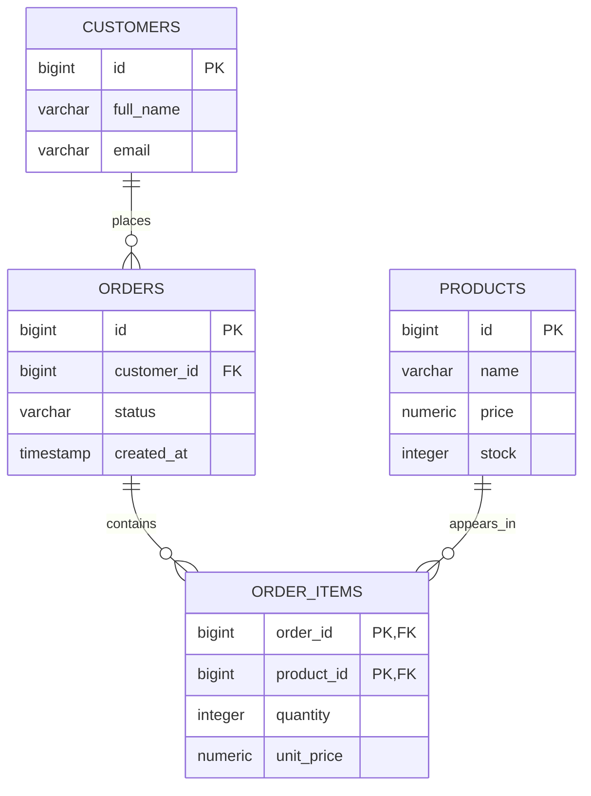

# SQL Refresher: SELECT, JOIN, GROUP BY, INSERT, UPDATE, and DELETE

SQL is the language for working with relational data. In **Spring Data Relational JDBC**, although operations often go through repositories or Spring's JDBC components, the application ultimately still reads and writes rows in tables according to SQL rules. Understanding SQL helps you design correct queries, read statements from logs, spot row duplication bugs when joining, control UPDATE/DELETE statements, and distinguish single-row operations from set-based operations.

This lesson uses **PostgreSQL** as the illustrative database management system. The concepts of SELECT, JOIN, GROUP BY, INSERT, UPDATE, DELETE, and key constraints are universal; certain syntax such as `LIMIT`, `RETURNING`, and `GENERATED ... AS IDENTITY` may differ in other database systems.

## 1. Data Model Used Throughout This Lesson

Suppose a store has four tables:

| Table | Purpose | Primary Key | Relationships |
|---|---|---|---|
| `customers` | Customers | `id` | One customer can have many orders |
| `products` | Products | `id` | One product can appear in many order line items |
| `orders` | Orders | `id` | `customer_id` references `customers.id` |
| `order_items` | Product line items in an order | `(order_id, product_id)` | References `orders` and `products` |

Relationship diagram:



### Creating the Tables

```sql
CREATE TABLE customers (
    id BIGINT PRIMARY KEY,
    full_name VARCHAR(100) NOT NULL,
    email VARCHAR(255) NOT NULL UNIQUE
);

CREATE TABLE products (
    id BIGINT PRIMARY KEY,
    name VARCHAR(100) NOT NULL,
    price NUMERIC(12, 2) NOT NULL CHECK (price >= 0),
    stock INTEGER NOT NULL CHECK (stock >= 0)
);

CREATE TABLE orders (
    id BIGINT PRIMARY KEY,
    customer_id BIGINT NOT NULL REFERENCES customers(id),
    status VARCHAR(20) NOT NULL
        CHECK (status IN ('NEW', 'PAID', 'CANCELLED')),
    created_at TIMESTAMP NOT NULL
);

CREATE TABLE order_items (
    order_id BIGINT NOT NULL REFERENCES orders(id),
    product_id BIGINT NOT NULL REFERENCES products(id),
    quantity INTEGER NOT NULL CHECK (quantity > 0),
    unit_price NUMERIC(12, 2) NOT NULL CHECK (unit_price >= 0),
    PRIMARY KEY (order_id, product_id)
);
```

**Meaning of the constraints:**

- `PRIMARY KEY` uniquely identifies each row; `order_items` uses a composite primary key because the same product appears at most once per order in this example design.
- `FOREIGN KEY` prevents an order item from pointing to a nonexistent order/product and prevents an order from pointing to a nonexistent customer.
- `NOT NULL` requires a value to be present. `UNIQUE` prevents duplicate emails. `CHECK` restricts status, price, and quantity values.
- `NUMERIC(12, 2)` is better suited than floating-point types for representing money; `unit_price` stores the price **at the time of purchase**, independent of the product's current price.

So that example results are reproducible, the sample data assigns IDs explicitly. In a real application, IDs can also be auto-generated by the database using an identity column.

### Sample Data

```sql
INSERT INTO customers (id, full_name, email) VALUES
    (1, 'An',   'an@example.com'),
    (2, 'Bình', 'binh@example.com'),
    (3, 'Chi',  'chi@example.com'),
    (4, 'Dũng', 'dung@example.com');

INSERT INTO products (id, name, price, stock) VALUES
    (101, 'Coffee',       50000.00, 20),
    (102, 'Tea',          30000.00, 15),
    (103, 'Cake',         45000.00,  8),
    (104, 'Ceramic mug',  80000.00,  5);

INSERT INTO orders (id, customer_id, status, created_at) VALUES
    (1001, 1, 'PAID',      '2026-11-01 09:00:00'),
    (1002, 1, 'NEW',       '2026-11-02 10:00:00'),
    (1003, 2, 'PAID',      '2026-11-03 11:00:00'),
    (1004, 3, 'CANCELLED', '2026-11-04 12:00:00');

INSERT INTO order_items (order_id, product_id, quantity, unit_price)
VALUES
    (1001, 101, 2, 50000.00),
    (1001, 103, 1, 45000.00),
    (1002, 102, 1, 30000.00),
    (1003, 101, 1, 50000.00),
    (1003, 104, 1, 80000.00);
```

Thus:

- Order `1001` has two product items, totaling `2 × 50,000 + 1 × 45,000 = 145,000`.
- Order `1002` has a total of `30,000` and status `NEW`.
- Order `1003` has a total of `130,000` and status `PAID`.
- Order `1004` has no product items yet; customer Dũng has no orders yet.

> Practice on a test database. The data-modifying statements in later sections should be run separately or after restoring the sample data before comparing SELECT results.

## 2. SELECT: Retrieving the Exact Data You Need

Familiar structure:

```sql
SELECT [DISTINCT] col_1, col_2, ...
FROM table_name
WHERE condition
ORDER BY col [ASC | DESC]
LIMIT row_count OFFSET skip_count;
```

Parts in square brackets are optional; the example above only describes the shape of the statement, not SQL that can be run verbatim.

### 2.1. Selecting Columns, Aliases, and Expressions

```sql
SELECT id, full_name, email
FROM customers;

SELECT id, name AS product_name, price,
       price * 2 AS price_for_two
FROM products
ORDER BY id;
```

`AS` names a result column; the expression `price * 2` only computes a value at query time and does not update `price` in the table. When using a JDBC `RowMapper` or SQL projection, clear aliases make reading columns from `ResultSet` safe and readable.

You should list the needed columns instead of defaulting to `SELECT *`, especially with JOINs or queries used for APIs: adding a column to the table later will not accidentally change the returned data structure.

### 2.2. WHERE: Filtering Row by Row

```sql
-- Single condition
SELECT id, name, price
FROM products
WHERE price >= 45000;

-- Combining multiple conditions
SELECT id, name, price, stock
FROM products
WHERE price BETWEEN 30000 AND 50000
  AND stock > 0
ORDER BY price DESC, id ASC;

-- Status in a set
SELECT id, customer_id, status
FROM orders
WHERE status IN ('NEW', 'PAID');

-- Name starting with a character; case sensitivity depends on the DBMS
SELECT id, full_name
FROM customers
WHERE full_name LIKE 'A%';
```

Common pitfalls:

- `AND` has higher precedence than `OR`; use parentheses for complex conditions: `WHERE (status = 'NEW' OR status = 'PAID') AND customer_id = 1`.
- `BETWEEN a AND b` includes both endpoints. For timestamp columns, prefer a half-open range to avoid missing records that have hours, minutes, and seconds: `created_at >= '2026-11-01' AND created_at < '2026-12-01'`.
- Use `IS NULL` and `IS NOT NULL` to check for missing values, **not** `= NULL`. Regular comparisons with `NULL` produce `UNKNOWN` in SQL three-valued logic.
- `NOT IN (...)` can produce unexpected results if the list or subquery contains `NULL`. For set exclusion problems, consider `NOT EXISTS`.

### 2.3. DISTINCT, ORDER BY, LIMIT, OFFSET

```sql
-- List of customers who have at least one order
SELECT DISTINCT customer_id
FROM orders
ORDER BY customer_id;

-- Ten most recent orders, with deterministic order when timestamps tie
SELECT id, customer_id, status, created_at
FROM orders
ORDER BY created_at DESC, id DESC
LIMIT 10 OFFSET 0;
```

`DISTINCT` removes duplicate result rows across **all selected columns**; it does not automatically pick the "latest record" for each customer. `ORDER BY` determines presentation order; without it, you must not assume any return order. When paginating with `OFFSET`, add a unique sort key (such as `id`) so results stay stable; for large tables or frequently changing data, `keyset pagination` is often a better fit than deep OFFSET.

## 3. JOIN: Combining Data from Multiple Tables

A JOIN produces a set of rows according to the join condition between tables. The key is understanding **how many rows in the right-hand table each row in the left-hand table can match**.

### 3.1. INNER JOIN: Only Taking Related Pairs

```sql
SELECT o.id AS order_id,
       c.full_name AS customer_name,
       o.status,
       o.created_at
FROM orders AS o
INNER JOIN customers AS c
    ON c.id = o.customer_id
ORDER BY o.id;
```

The result has four orders `1001–1004`, each paired with exactly one customer. Dũng does not appear because he has no orders.

Two different roles:

- `ON` defines the matching condition between two data sources.
- `WHERE` filters the result by condition after the JOIN is processed.

Example querying all paid orders along with customer names:

```sql
SELECT o.id, c.full_name, o.status
FROM orders o
JOIN customers c ON c.id = o.customer_id
WHERE o.status = 'PAID'
ORDER BY o.id;
```

The result contains order `1001` for An and `1003` for Bình.

### 3.2. LEFT JOIN: Keeping Unmatched Rows

```sql
SELECT c.id AS customer_id,
       c.full_name,
       o.id AS order_id
FROM customers c
LEFT JOIN orders o ON o.customer_id = c.id
ORDER BY c.id, o.id;
```

The `customers` table is on the left, so Dũng still gets a result row, with `order_id` as `NULL`. An has two orders, so she appears in **two rows**. That does not mean An's record in `customers` was duplicated: that is the number of rows in the **JOIN result**.

A common mistake is filtering the right-hand table in `WHERE`:

```sql
-- No longer keeps customers without a PAID order:
SELECT c.id, c.full_name, o.id
FROM customers c
LEFT JOIN orders o ON o.customer_id = c.id
WHERE o.status = 'PAID';
```

Unmatched rows have `o.status = NULL` and will be eliminated. To keep all customers and only join PAID orders, put the condition in `ON`:

```sql
SELECT c.id, c.full_name, o.id AS paid_order_id
FROM customers c
LEFT JOIN orders o
    ON o.customer_id = c.id
   AND o.status = 'PAID'
ORDER BY c.id, o.id;
```

### 3.3. One-to-Many JOINs and Row Multiplication

```sql
SELECT o.id AS order_id,
       p.name AS product_name,
       oi.quantity,
       oi.unit_price
FROM orders o
JOIN order_items oi ON oi.order_id = o.id
JOIN products p ON p.id = oi.product_id
WHERE o.id = 1001
ORDER BY p.id;
```

Order `1001` appears twice in the result because it has two `order_items`: coffee and cake. When counting orders after a JOIN, use `COUNT(DISTINCT o.id)` if you need to count **unique orders**. `SELECT DISTINCT` is not a fix for every wrong JOIN; first check whether the relationships and join conditions are correct.

Avoid omitting the `ON` condition or joining on the wrong column because that can create a Cartesian product result set (causing row counts to explode). You can use `EXISTS` when you only need to check existence without fetching child rows:

```sql
-- Customers with at least one paid order
SELECT c.id, c.full_name
FROM customers c
WHERE EXISTS (
    SELECT 1
    FROM orders o
    WHERE o.customer_id = c.id
      AND o.status = 'PAID'
)
ORDER BY c.id;
```

## 4. GROUP BY: Aggregation and Statistics

Common aggregate functions:

| Function | Meaning |
|---|---|
| `COUNT(*)` | Counts the number of rows in the set under consideration |
| `COUNT(col)` | Counts **non-NULL** values of the column |
| `COUNT(DISTINCT col)` | Counts distinct, non-NULL values |
| `SUM(col)` | Sums non-NULL values |
| `AVG(col)` | Averages non-NULL values |
| `MIN(col)`, `MAX(col)` | Minimum/maximum value |

### 4.1. Counting Orders by Status

```sql
SELECT status, COUNT(*) AS total_orders
FROM orders
GROUP BY status
ORDER BY status;
```

With the sample data, `PAID = 2`, `NEW = 1`, `CANCELLED = 1`.

`GROUP BY status` gathers rows with the same `status` into one group; `COUNT(*)` returns one result per group. When a SELECT has both regular columns and aggregate functions, the regular columns must appear in `GROUP BY` (aside from functional dependency rules supported by some DBMSs).

### 4.2. Counting Customers Without Orders as Well

```sql
SELECT c.id,
       c.full_name,
       COUNT(o.id) AS total_orders
FROM customers c
LEFT JOIN orders o ON o.customer_id = c.id
GROUP BY c.id, c.full_name
ORDER BY c.id;
```

| Customer | `total_orders` |
|---|---:|
| An | 2 |
| Bình | 1 |
| Chi | 1 |
| Dũng | 0 |

**Why use `COUNT(o.id)` instead of `COUNT(*)`?** LEFT JOIN still produces one row with `o.*` columns equal to `NULL` for Dũng. `COUNT(*)` counts that row and yields 1; `COUNT(o.id)` ignores NULL values and yields 0.

### 4.3. SUM, COALESCE, and Order Totals

```sql
SELECT o.id AS order_id,
       o.status,
       COALESCE(SUM(oi.quantity * oi.unit_price), 0) AS total_amount
FROM orders o
LEFT JOIN order_items oi ON oi.order_id = o.id
GROUP BY o.id, o.status
ORDER BY o.id;
```

| `order_id` | `status` | `total_amount` |
|---:|---|---:|
| 1001 | PAID | 145000.00 |
| 1002 | NEW | 30000.00 |
| 1003 | PAID | 130000.00 |
| 1004 | CANCELLED | 0 |

`SUM` over a set with no numeric values to add returns `NULL`; `COALESCE(..., 0)` turns that case into 0. Compute totals using `unit_price` in `order_items` because that is the price locked in at purchase time, rather than using `products.price` which may change later.

### 4.4. How Do WHERE and HAVING Differ?

```sql
SELECT o.id AS order_id,
       SUM(oi.quantity * oi.unit_price) AS total_amount
FROM orders o
JOIN order_items oi ON oi.order_id = o.id
WHERE o.status = 'PAID'
GROUP BY o.id
HAVING SUM(oi.quantity * oi.unit_price) >= 100000
ORDER BY total_amount DESC;
```

The query returns two orders, `1001` and `1003`:

- `WHERE` filters **rows** before grouping: only considers `PAID` orders.
- `GROUP BY` groups `order_items` rows by order.
- `HAVING` filters **groups** after summing: only keeps orders totaling at least 100,000.
- `ORDER BY` sorts the resulting rows, here by total amount.

A simplified way to remember the *logical processing order* of SELECT is:

`FROM / JOIN → WHERE → GROUP BY → HAVING → SELECT → DISTINCT → ORDER BY → LIMIT / OFFSET`.

This is the **logical** order for understanding results, not a guarantee of physical execution order: the query optimizer may choose a different plan while preserving the exact semantics.

### 4.5. Aggregating After Multiple JOINs: Watch for Double Counting

```sql
SELECT c.id,
       c.full_name,
       COUNT(DISTINCT o.id) AS paid_orders,
       COALESCE(SUM(oi.quantity * oi.unit_price), 0) AS paid_revenue
FROM customers c
LEFT JOIN orders o
    ON o.customer_id = c.id
   AND o.status = 'PAID'
LEFT JOIN order_items oi ON oi.order_id = o.id
GROUP BY c.id, c.full_name
ORDER BY c.id;
```

Result:

| Customer | `paid_orders` | `paid_revenue` |
|---|---:|---:|
| An | 1 | 145000.00 |
| Bình | 1 | 130000.00 |
| Chi | 0 | 0 |
| Dũng | 0 | 0 |

`COUNT(DISTINCT o.id)` is necessary because order `1001` has two product items, yet it is only **one** order. Using `SUM` here is accurate because each `order_items` row is joined once with its corresponding order and customer. If you join another independent one-to-many relationship (such as multiple discount vouchers on the same order), the product rows can get multiplied again; in that case, aggregate each relationship first in a subquery or CTE before joining.

## 5. INSERT: Adding Rows and Respecting Constraints

### 5.1. Inserting One or Multiple Rows

```sql
INSERT INTO products (id, name, price, stock)
VALUES (105, 'Water bottle', 120000.00, 10);

INSERT INTO products (id, name, price, stock)
VALUES
    (106, 'Straw',     10000.00, 40),
    (107, 'Paper bag',  5000.00, 100);
```

You should explicitly write the column list because column order in a table may change; you do not need to supply values for columns with `DEFAULT` or auto-generated by the database. An already existing primary key causes an error; a foreign key value missing from the parent table also causes an error.

### 5.2. Database-Generated Primary Keys

In real applications, a table may define the column like this (illustrating an alternative design choice to the sample `products` table):

```sql
id BIGINT GENERATED BY DEFAULT AS IDENTITY PRIMARY KEY
```

Then you do not need to pass `id` into INSERT:

```sql
INSERT INTO products (name, price, stock)
VALUES ('Water bottle', 120000.00, 10)
RETURNING id;
```

`RETURNING id` is PostgreSQL syntax that retrieves the newly generated ID in the same operation; JDBC also has a mechanism to retrieve generated keys. You need to pick **one** ID generation strategy consistent with Spring Data JDBC's `@Id` mapping and the actual table structure, rather than automatically applying this INSERT style to the sample schema which requires passing an ID.

### 5.3. Inserting Related Data

To create an order along with its product line items, the customer and products must exist first; then insert into `orders` and then `order_items`.

```sql
BEGIN;

INSERT INTO orders (id, customer_id, status, created_at)
VALUES (1005, 4, 'NEW', '2026-11-05 08:30:00');

INSERT INTO order_items (order_id, product_id, quantity, unit_price)
VALUES (1005, 102, 1, 30000.00);

COMMIT;
```

If a statement inside the transaction fails, you must `ROLLBACK` instead of `COMMIT`. Once a transaction errors in PostgreSQL, subsequent statements cannot continue succeeding in that transaction before rolling back. With Spring, transaction boundaries are usually placed at the service layer using `@Transactional`, letting appropriate exceptions trigger a rollback.

## 6. UPDATE: Modifying Existing Data

### 6.1. Structure and the WHERE Condition

```sql
UPDATE products
SET price = 55000.00
WHERE id = 101;
```

This statement updates the price of product `101`. **Without `WHERE`, UPDATE affects every row** in the table. Before running an important manual operation, you can verify the expected set of rows using a SELECT with the same condition:

```sql
SELECT id, name, price
FROM products
WHERE id = 101;
```

You can update multiple columns and use current values in expressions:

```sql
UPDATE products
SET price = price + 5000.00,
    stock = stock + 3
WHERE id = 103;
```

`price = price + 5000` is a relative update, not assigning a string; each row uses its own current value.

### 6.2. Conditional Updates to Prevent Negative Stock

```sql
UPDATE products
SET stock = stock - 2
WHERE id = 101
  AND stock >= 2;
```

If stock is insufficient, the statement updates **0 rows**. The application needs to check the updated row count; if it is 0, handle the missing product or insufficient stock situation according to business rules. Placing the condition in the UPDATE statement itself makes the stock deduction atomic at the database level.

With PostgreSQL, you can inspect the new value immediately:

```sql
UPDATE products
SET stock = stock - 2
WHERE id = 101 AND stock >= 2
RETURNING id, stock;
```

Do not follow the pattern of "just read the stock value beforehand and write it back" when multiple requests may buy concurrently, because that easily causes **lost updates** without proper locking/concurrency control.

### 6.3. Affected Row Count and Transactions

In JDBC, `executeUpdate()` or the corresponding update method returns the number of affected rows. Typical outcomes to interpret:

- `1`: one row matched and was processed.
- `0`: no row satisfied WHERE; may be due to a wrong ID, a changed status, or an unmet business condition.
- More than `1`: the condition matched multiple rows; make sure this is the intended behavior of the operation.

For changes spanning multiple tables (such as confirming an order and deducting stock), use a transaction so they succeed or roll back together; additionally, check that the result matches business expectations.

## 7. DELETE: Deleting Rows and Handling Relationships

### 7.1. Conditional Deletion

```sql
DELETE FROM products
WHERE id = 105;
```

DELETE removes **rows**; it does not merely clear the value of a single column. Without `WHERE`, the statement will attempt to delete all rows in the table. If a product is already referenced in `order_items`, the default foreign key will block the delete operation; do not remove constraints just to make the command run.

### 7.2. Deleting in Relationship Order Within a Transaction

For example, to delete order `1002` and its product line items:

```sql
BEGIN;

DELETE FROM order_items
WHERE order_id = 1002;

DELETE FROM orders
WHERE id = 1002;

COMMIT;
```

Since `order_items.order_id` references `orders.id`, deleting from the child table first and then the parent table is the proper approach when the foreign key is **not** configured with `ON DELETE CASCADE`. If using cascade, you must understand exactly which rows will be deleted automatically. For business data requiring history or auditing, changing `status`/marking as inactive may be more appropriate than physical deletion, depending on system requirements.

### 7.3. Safer Conditional Deletion

```sql
-- Only delete a cancelled order when no product line items remain
DELETE FROM orders o
WHERE o.id = 1004
  AND o.status = 'CANCELLED'
  AND NOT EXISTS (
      SELECT 1
      FROM order_items oi
      WHERE oi.order_id = o.id
  );
```

`NOT EXISTS` excludes orders that still have product line items. The status condition prevents deleting an order that has transitioned to another stage. The application must still check the deleted row count to report the proper outcome.

## 8. Connecting SQL Statements to Spring Data JDBC

### 8.1. From SQL to Repositories

Spring Data JDBC maps data between tables and aggregates in Java, while supporting CRUD operations via repositories such as `save`, `findById`, `findAll`, and `deleteById`. Understanding the underlying SQL helps you answer:

- Which key does `findById` read by, and what happens when it is not found?
- Does `save` correspond to an insert or an update based on how Spring Data JDBC detects a new entity?
- Is a repository query returning an aggregate or an aggregated report across multiple tables?
- When deleting an aggregate, how are relationships between child tables and the parent table handled?

**Note on the model:** Spring Data JDBC uses the concept of an *aggregate root* to manage the lifecycle of data belonging to an aggregate. You should not assume every one-to-many relationship in SQL will automatically behave like JPA's lazy loading or entity relationships. Reporting queries joining multiple tables are often better suited for a DTO/projection or a dedicated JDBC repository.

### 8.2. Parameterized Queries: Avoid Concatenating User Input

Unsafe example:

```java
String sql = "SELECT * FROM orders WHERE customer_id = " + userInput;
```

Values coming from a request must not be concatenated directly into a SQL string. JDBC `PreparedStatement` uses `?` for parameters; Spring `NamedParameterJdbcTemplate` uses named parameters `:customerId`:

```java
import java.math.BigDecimal;
import java.util.List;
import java.util.Map;
import org.springframework.jdbc.core.namedparam.NamedParameterJdbcTemplate;
import org.springframework.stereotype.Repository;

record PaidOrderTotal(long orderId, BigDecimal totalAmount) {}

@Repository
class PaidOrderReportRepository {
    private final NamedParameterJdbcTemplate jdbc;

    PaidOrderReportRepository(NamedParameterJdbcTemplate jdbc) {
        this.jdbc = jdbc;
    }

    List<PaidOrderTotal> findByCustomer(long customerId) {
        String sql = """
            SELECT o.id AS order_id,
                   COALESCE(SUM(oi.quantity * oi.unit_price), 0) AS total_amount
            FROM orders o
            LEFT JOIN order_items oi ON oi.order_id = o.id
            WHERE o.customer_id = :customerId
              AND o.status = 'PAID'
            GROUP BY o.id
            ORDER BY o.id
            """;

        return jdbc.query(
            sql,
            Map.of("customerId", customerId),
            (rs, rowNum) -> new PaidOrderTotal(
                rs.getLong("order_id"),
                rs.getBigDecimal("total_amount")
            )
        );
    }
}
```

Here `:customerId` is parameter syntax processed by Spring before sending the statement to JDBC; it is not a SQL column name. `RowMapper` reads two clearly aliased columns from `ResultSet` and creates the DTO. The Java code uses text block syntax (Java 15+) and records (Java 16+), suitable for modern Java environments.

For conditional UPDATE operations, checking the row count is especially important:

```java
int updated = jdbc.update(
    """
    UPDATE products
    SET stock = stock - :quantity
    WHERE id = :productId AND stock >= :quantity
    """,
    Map.of("productId", productId, "quantity", quantity)
);

if (updated != 1) {
    throw new IllegalStateException("Product unavailable or insufficient stock");
}
```

The example above illustrates mapping a **0/1 row** result to a business decision; the service layer should decide the specific exception type, message, and transaction handling.

### 8.3. Transactions and Scope of Guarantees

A business operation such as creating an order, adding order items, deducting stock, and updating payment status can consist of multiple SQL statements. If just one statement fails while earlier statements have already committed, data can become inconsistent. In Spring, `@Transactional` on a service method establishes a transaction boundary; by default it rolls back when an unchecked exception (`RuntimeException`) is thrown, whereas rollback policies for checked exceptions may need explicit configuration.

A transaction guarantees atomicity for operations within the same transaction and the same managed resource; it **does not automatically** prevent all concurrency conflicts. Conditional UPDATEs, row locks, isolation levels, or optimistic locking must be chosen according to actual requirements.

### 8.4. Distinguishing Business Operations from Reporting Queries

| Need | Usually Appropriate Approach |
|---|---|
| Reading/writing an aggregate by ID | `CrudRepository` / Spring Data JDBC repository |
| Filtering by specific conditions | Repository query or parameterized SQL query |
| Revenue statistics, multi-table JOIN, GROUP BY | Dedicated SQL query returning a DTO/projection |
| Conditional stock deduction | Atomic UPDATE, checking affected row count |
| Writing to multiple tables in one business operation | `@Transactional` service with clear error policy |

The choice is not based on "whether raw SQL or a repository is better," but on the shape of the data needed and the business invariants that must be preserved.

## 9. SQL Mistakes to Spot When Reading Code

| Symptom | Possible Cause | How to Check |
|---|---|---|
| JOIN returns more rows than expected | Joining a one-to-many relationship, missing JOIN condition | Check row counts of each table and the keys used in `ON` |
| Customers without orders disappear from results | Filtering the right-hand table of a LEFT JOIN in `WHERE` | Consider moving the appropriate condition into `ON` |
| Customer with no orders is counted as 1 | Using `COUNT(*)` after LEFT JOIN | Use `COUNT(o.id)` when counting actual orders |
| Revenue is doubled | Joining additional one-to-many sets | Aggregate independently before joining, verify data grain |
| `SUM` returns NULL | Group has no values to sum | Use `COALESCE(SUM(...), 0)` if business logic expects 0 |
| UPDATE/DELETE modifies too many rows | Missing/wrong `WHERE` | SELECT first, use transaction when needed, verify row count |
| INSERT fails | Duplicate PK/UNIQUE, missing FK, NOT NULL/CHECK violation | Read constraint name and inspect related data |
| Unstable query results when paginating | Missing unique ordering | Add an `ORDER BY` tie-breaker with a unique key |
| Query vulnerable to SQL injection | Concatenating user parameters into SQL | Use prepared/named parameters; only allow identifiers from a trusted allowlist |

## 10. Hands-On Practice with the Sample Data

The following exercises are based on the **initial data**, before running the INSERT, UPDATE, and DELETE statements from the sections above.

**Exercise 1.** Retrieve the ID and name of products priced at 45,000 or higher, sorted by price descending and then by ID ascending.

```sql
SELECT id, name
FROM products
WHERE price >= 45000
ORDER BY price DESC, id ASC;
```

Results in order: `104 – Ceramic mug`, `101 – Coffee`, `103 – Cake`.

**Exercise 2.** List all customers and their number of paid orders, including customers with 0 orders.

```sql
SELECT c.id, c.full_name,
       COUNT(o.id) AS paid_orders
FROM customers c
LEFT JOIN orders o
    ON o.customer_id = c.id
   AND o.status = 'PAID'
GROUP BY c.id, c.full_name
ORDER BY c.id;
```

Results: An 1, Bình 1, Chi 0, Dũng 0.

**Exercise 3.** Calculate the total amount of `PAID` orders, keeping only orders with a total amount of 140,000 or more.

```sql
SELECT o.id,
       SUM(oi.quantity * oi.unit_price) AS total_amount
FROM orders o
JOIN order_items oi ON oi.order_id = o.id
WHERE o.status = 'PAID'
GROUP BY o.id
HAVING SUM(oi.quantity * oi.unit_price) >= 140000
ORDER BY o.id;
```

Only order `1001`, totaling `145,000`.

**Exercise 4.** Write a statement to deduct 3 units from stock of product `102` without allowing negative stock. After running, check whether exactly one row was updated.

```sql
UPDATE products
SET stock = stock - 3
WHERE id = 102
  AND stock >= 3;
```

Starting from the sample data, product `102` stock decreases from `15` to `12`; if stock is insufficient, no rows are updated. In a JDBC application, read the returned row count to decide whether to continue or report an error.

**Exercise 5.** Delete order `1004` only if it is still cancelled and has no product line items.

```sql
DELETE FROM orders o
WHERE o.id = 1004
  AND o.status = 'CANCELLED'
  AND NOT EXISTS (
      SELECT 1 FROM order_items oi
      WHERE oi.order_id = o.id
  );
```

With the initial data, exactly one order is deleted. If the status or relationships have changed, the result may be 0 rows.

## 11. Takeaways Before Diving Deep into Spring Data JDBC

1. **SELECT** reads data; `WHERE` filters rows, `ORDER BY` sorts, and `LIMIT/OFFSET` limits/paginates.
2. **JOIN** combines data by key and changes result row counts; check one-to-one, one-to-many relationships, and LEFT JOIN semantics.
3. **GROUP BY** produces summaries; `HAVING` filters groups. When joining multiple tables, be clear whether you are counting **orders**, **order items**, or **customers**.
4. **INSERT** must satisfy primary key, foreign key, and valid value constraints; multi-table data should be written inside a transaction.
5. **UPDATE/DELETE** require an accurate `WHERE` clause and checking the affected row count. Critical business conditions should be guarded right in the statement or via appropriate concurrency mechanisms.
6. **In Spring Data JDBC**, repositories help work with aggregates; parameterized SQL and DTO mapping remain essential for reporting, conditional updates, and explaining query behavior.

Whenever you read a repository method or a SQL query in a project, ask yourself: **which tables does it read/write, how many rows are in the result at each relationship level, and what guarantees the data remains accurate if a request fails or runs concurrently?** Being able to answer those three questions is an important foundation for learning the more advanced mechanisms of Spring Data JDBC.
