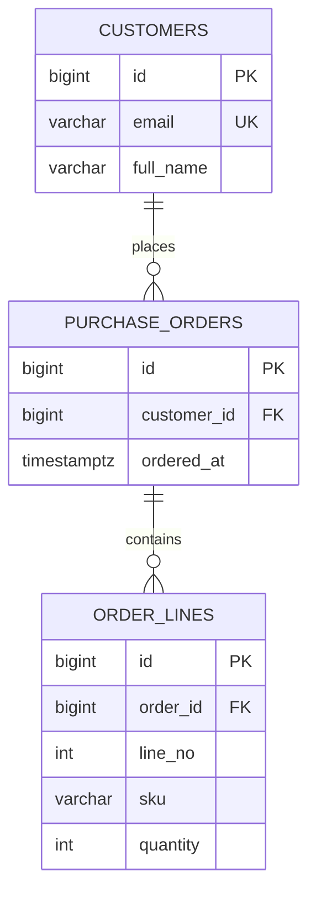

# Primary Keys, Foreign Keys, Unique Constraints, and Referential Integrity

When building an application with **Spring Data JDBC**, data is typically split across multiple related tables. An order belongs to a customer, an order has multiple order lines, and each customer's email must be unique. These rules must be protected directly in the database using **primary keys**, **foreign keys**, **unique constraints**, and mechanisms that enforce **referential integrity**.

Spring Data JDBC helps map Java objects to tables and perform save/query operations. However, Java mapping annotations **do not replace** SQL constraints. The application can validate data before writing, but the database is the final gatekeeper, even when multiple requests run concurrently or data is modified from another tool.

## 1. Running Example: Customers and Orders

Consider a small sales system with three tables:

| Table | Purpose | Important Columns |
| --- | --- | --- |
| `customers` | Customer information | `id`, `email`, `full_name` |
| `purchase_orders` | Orders placed by customers | `id`, `customer_id`, `ordered_at` |
| `order_lines` | Line items of an order | `id`, `order_id`, `line_no`, `sku`, `quantity`, `unit_price` |



Rules to enforce:

- Every record must have a distinct identity: `customers.id`, `purchase_orders.id`, and `order_lines.id` are primary keys.
- No two customers may share the same `email` value under the chosen email comparison rules: `customers.email` is unique.
- Every order must point to an existing customer: `purchase_orders.customer_id` is a foreign key and also `NOT NULL`.
- Every order line must belong to an existing order: `order_lines.order_id` is a foreign key and also `NOT NULL`.
- Within one order, no two lines may share the same position: the pair `(order_id, line_no)` is unique, although different orders can both have `line_no = 0`.

## 2. Primary Key (`PRIMARY KEY`)

A **primary key** is a column or group of columns used to uniquely identify a row in a table. The `PRIMARY KEY` constraint combines two requirements:

1. **Uniqueness:** no two rows can have the same primary key value.
2. **Non-nullability:** none of the columns belonging to the primary key can accept `NULL`.

Each table declares only **one primary key constraint**, though that constraint may contain multiple columns. For example:

```sql
CREATE TABLE customers (
    id BIGINT GENERATED BY DEFAULT AS IDENTITY PRIMARY KEY,
    email VARCHAR(320) NOT NULL
);
```

`id` is a **surrogate key**: an identifier generated for technical purposes, not business data. This is a common choice in Spring Data JDBC applications, because the identifier remains stable even if the customer's email or name changes.

Sometimes business data itself is already sufficiently unique, such as an ISO country code or an issued code that is never reused; that is a **natural key**. Before using it as a primary key, consider the likelihood of changes, reuse, and value normalization rules. Business columns that may change are usually better suited for `UNIQUE`.

### Composite Primary Keys

A primary key can consist of multiple columns, for example a table recording student course enrollments:

```sql
CREATE TABLE enrollments (
    student_id BIGINT NOT NULL,
    course_id BIGINT NOT NULL,
    enrolled_at TIMESTAMP NOT NULL,
    CONSTRAINT pk_enrollments PRIMARY KEY (student_id, course_id)
);
```

In this design, a student can enroll in multiple courses and a course can have multiple students, but the same student–course pair does not appear twice. With Spring Data JDBC, mapping a **composite identifier** requires checking the level of support in the Spring Data version you are using. An easy-to-operate option is to use a separate `id` as the `PRIMARY KEY`, and then apply `UNIQUE(student_id, course_id)` to enforce the business rule.

### Distinguishing Primary Key from `@Id`

```java
import org.springframework.data.annotation.Id;
import org.springframework.data.relational.core.mapping.Table;

@Table("customers")
public class Customer {
    @Id
    private Long id;
    // Other fields...
}
```

`@Id` tells Spring Data JDBC which property is the identifier for mapping rows and receiving generated keys on save. **This annotation by itself does not create a `PRIMARY KEY` in the database.** If the table lacks SQL constraints, Spring Data JDBC cannot guarantee data is unique or non-null on its own. With a `Long id` field left `null` when creating a new object, the database can auto-generate a value via `IDENTITY` as shown in the example above.

## 3. Unique Constraint (`UNIQUE`)

`UNIQUE` prevents different rows from holding the same value, or the same **combination of values**, across the specified columns. It is suited for business rules beyond the primary identifier.

```sql
ALTER TABLE customers
ADD CONSTRAINT uq_customers_email UNIQUE (email);

ALTER TABLE order_lines
ADD CONSTRAINT uq_order_lines_position UNIQUE (order_id, line_no);
```

With the second constraint, two rows `(order_id=10, line_no=0)` and `(order_id=10, line_no=1)` are valid; adding another `(order_id=10, line_no=0)` row will be rejected. The row `(order_id=11, line_no=0)` remains valid because it belongs to a different order.

| Criterion | `PRIMARY KEY` | `UNIQUE` |
| --- | --- | --- |
| Purpose | Identifies each row | Protects one or more uniqueness rules |
| Count per table | One constraint, may span multiple columns | Multiple constraints allowed |
| `NULL` values | Disallowed in key columns | Depends on DBMS and configuration; many DBMSs allow multiple `NULL`s |
| Common uses | `id` | Email, business codes, `(order_id, line_no)` |

**Important note on `NULL`:** in PostgreSQL, a standard `UNIQUE(email)` still allows multiple rows with `email IS NULL`, because `NULL` values are treated as distinct by default when checking uniqueness. If email is required, you must declare **`NOT NULL` combined with `UNIQUE`**. Do not assume this rule applies identically to every database management system; some systems handle `NULL` differently.

**Note on casing and normalization:** `UNIQUE(email)` checks according to the column's comparison rules in the database and does not automatically know that `Mai@Example.com` and `mai@example.com` refer to the same account. If business logic treats them as identical, you must agree on a normalization approach (for example storing lowercase emails) or use a database-appropriate constraint/data type. Checking beforehand in Java alone cannot replace a unique constraint under concurrent writes.

In PostgreSQL, `PRIMARY KEY` and `UNIQUE` are typically backed by unique indexes. However, distinguish **data rules** from **query performance**: the primary purpose of a constraint is to reject invalid data, not merely to speed up lookups.

## 4. Foreign Key (`FOREIGN KEY`)

A **foreign key** is a column or group of columns in a child table referencing a valid key in a parent table. It forces the referenced value to exist in the target table according to the constraint rules.

```sql
ALTER TABLE purchase_orders
ADD CONSTRAINT fk_purchase_orders_customer
FOREIGN KEY (customer_id)
REFERENCES customers(id);
```

Here:

- The **child** table is `purchase_orders`, and the referencing column is `customer_id`.
- The **parent** table is `customers`, and the referenced column is `id`.
- One customer can have many orders; **a foreign key does not prevent multiple orders from pointing to the same customer**.
- A foreign key can point to a primary key or an appropriate unique key on the parent table, depending on the database management system.

If you run:

```sql
INSERT INTO purchase_orders (customer_id) VALUES (999999);
```

and `customers` has no `id = 999999`, the database rejects the operation due to a foreign key violation. Having a Java field named `customerId` does not automatically check this existence.

### Can a Foreign Key Be `NULL`?

Yes, if the column allows `NULL`. A single-column foreign key with a `NULL` value normally represents an unassigned/absent relationship and does not require finding a parent record. Therefore, if **every order must have a customer**, you need **both** conditions:

```sql
customer_id BIGINT NOT NULL,
CONSTRAINT fk_purchase_orders_customer
    FOREIGN KEY (customer_id) REFERENCES customers(id)
```

For composite foreign keys, check the DBMS's `NULL` rules (for example, PostgreSQL's default `MATCH SIMPLE` skips checking when any part of a composite key is `NULL`). Avoid assuming that merely declaring `FOREIGN KEY` makes every component required.

### When Updating or Deleting a Parent Record

The database needs to know what to do if a customer is deleted while orders still reference that customer. The `ON DELETE` rule defines the behavior:

| Policy | Behavior When Deleting a Parent Row | When Appropriate |
| --- | --- | --- |
| `RESTRICT` | Blocks deletion if referencing child rows exist | Order history must be preserved while the customer has orders |
| `NO ACTION` | Checks and rejects if the relationship is violated; check timing may differ from `RESTRICT` when deferred constraints are supported | Want to preserve integrity without auto-deleting children |
| `CASCADE` | Automatically deletes dependent child rows | Order lines have no meaning once the order is deleted |
| `SET NULL` | Sets the child row's foreign key to `NULL` | Relationship is optional and column allows `NULL` |
| `SET DEFAULT` | Sets the foreign key to a default value; that value must still be valid | A default parent row is explicitly designed |

`ON UPDATE` has similar policies when the referenced key value changes. However, it is best to avoid modifying identity keys such as `customers.id`; business changes should affect regular columns rather than triggering cascading foreign key updates.

**Do not use `ON DELETE CASCADE` just for convenience.** For auditable data like orders, cascading deletes from a customer could wipe out the entire history. Choose the policy based on actual data lifecycle and ownership boundaries.

## 5. What Is Referential Integrity?

**Referential integrity** is the state in which relationships between tables remain valid: no non-`NULL` foreign key points to a nonexistent parent row, and insert, update, and delete operations never leave dangling references behind. Foreign keys are the core mechanism enforcing this rule.

For example, an order line with `order_id = 42` when `purchase_orders` has no `id = 42` is an **orphan record**. The constraint `FOREIGN KEY (order_id) REFERENCES purchase_orders(id)` blocks that situation at write time.

Data integrity is broader than referential integrity: `PRIMARY KEY` protects identity, `UNIQUE` protects uniqueness, `NOT NULL` protects presence, and `CHECK(quantity > 0)` protects value conditions. They complement each other; a valid foreign key can still sit on an order line with a negative quantity if `CHECK` or equivalent validation is missing.

The key difference between application-level checks and database constraints is **concurrent writes**. Two requests can both run `SELECT` to confirm an email does not yet exist, and then both attempt `INSERT`. Without `UNIQUE`, both can create duplicate records. Similarly, checking whether a customer exists before creating an order does not stop another transaction from deleting the customer before the order is written. SQL constraints, combined with database transactions and locking, protect correctness at the moment of actual modification.

## 6. Complete Schema Design in PostgreSQL

The following example uses PostgreSQL syntax. MySQL, SQL Server, H2, and other systems may differ in ID generation syntax, timestamp types, `NULL` behavior in `UNIQUE`, and constraint behavior; consult the target system's documentation when switching databases.

```sql
CREATE TABLE customers (
    id BIGINT GENERATED BY DEFAULT AS IDENTITY,
    email VARCHAR(320) NOT NULL,
    full_name VARCHAR(150) NOT NULL,
    CONSTRAINT pk_customers PRIMARY KEY (id),
    CONSTRAINT uq_customers_email UNIQUE (email)
);

CREATE TABLE purchase_orders (
    id BIGINT GENERATED BY DEFAULT AS IDENTITY,
    customer_id BIGINT NOT NULL,
    ordered_at TIMESTAMPTZ NOT NULL DEFAULT CURRENT_TIMESTAMP,
    CONSTRAINT pk_purchase_orders PRIMARY KEY (id),
    CONSTRAINT fk_purchase_orders_customer
        FOREIGN KEY (customer_id)
        REFERENCES customers(id)
        ON DELETE RESTRICT
);

CREATE INDEX ix_purchase_orders_customer_id
    ON purchase_orders(customer_id);

CREATE TABLE order_lines (
    id BIGINT GENERATED BY DEFAULT AS IDENTITY,
    order_id BIGINT NOT NULL,
    line_no INTEGER NOT NULL,
    sku VARCHAR(50) NOT NULL,
    quantity INTEGER NOT NULL CHECK (quantity > 0),
    unit_price NUMERIC(12, 2) NOT NULL CHECK (unit_price >= 0),
    CONSTRAINT pk_order_lines PRIMARY KEY (id),
    CONSTRAINT uq_order_lines_position UNIQUE (order_id, line_no),
    CONSTRAINT fk_order_lines_order
        FOREIGN KEY (order_id)
        REFERENCES purchase_orders(id)
        ON DELETE CASCADE
);
```

Three design points to note:

1. `purchase_orders.customer_id` uses `RESTRICT` because orders should not disappear simply because a customer is deleted. The application needs an appropriate retention, anonymization, or deletion policy before removing a customer.
2. `order_lines.order_id` uses `CASCADE` because order lines belong to the order's lifecycle; deleting an order removes its related lines. This should only be used if business rules truly permit deleting orders.
3. PostgreSQL **does not automatically create an index on a child table's referencing column** just because a foreign key exists. The index `purchase_orders(customer_id)` speeds up queries as well as parent deletes/updates. For `order_lines`, the unique index created by `UNIQUE(order_id, line_no)` already has `order_id` as its leading column and can generally serve queries by `order_id`; creating a redundant index is unnecessary.

Constraint names like `pk_customers`, `uq_customers_email`, and `fk_purchase_orders_customer` make errors easier to identify than database-generated names. Actual `CREATE TABLE`/`ALTER TABLE` statements should live in migrations managed by Flyway or Liquibase.

## 7. Testing Valid and Violating Scenarios

The statements below assume a freshly created schema with no data. The ID `1` is illustrative only: in a real application you must use the value actually returned by the database (`RETURNING id` in PostgreSQL) rather than guessing auto-increment IDs.

```sql
-- Create a customer and retrieve the generated ID.
INSERT INTO customers (email, full_name)
VALUES ('mai@example.test', 'Mai Nguyen')
RETURNING id;

-- Suppose the returned ID is 1.
INSERT INTO purchase_orders (customer_id)
VALUES (1)
RETURNING id;

-- Suppose the order also gets ID = 1.
INSERT INTO order_lines (order_id, line_no, sku, quantity, unit_price)
VALUES
    (1, 0, 'BOOK-01', 2, 120000.00),
    (1, 1, 'PEN-02', 3, 15000.00);
```

Next, the following scenarios illustrate constraints in action:

| Operation | Outcome | Related Constraint |
| --- | --- | --- |
| Insert another customer with `email = 'mai@example.test'` | Rejected | `uq_customers_email` |
| Insert an order with `customer_id = 999999` when this ID does not exist | Rejected | `fk_purchase_orders_customer` |
| Insert `(order_id = 1, line_no = 0)` again | Rejected | `uq_order_lines_position` |
| Insert a line with a nonexistent `order_id` | Rejected | `fk_order_lines_order` |
| Insert a line with `quantity = 0` | Rejected | `CHECK (quantity > 0)` |
| Delete customer ID `1` while referencing orders still exist | Rejected | `ON DELETE RESTRICT` |
| Delete order ID `1` | Order is deleted; its order lines are deleted as well | `ON DELETE CASCADE` |

You can observe the errors with individual test statements:

```sql
-- Duplicate email (PostgreSQL SQLSTATE 23505).
INSERT INTO customers (email, full_name)
VALUES ('mai@example.test', 'Another Customer');

-- Nonexistent customer (SQLSTATE 23503).
INSERT INTO purchase_orders (customer_id)
VALUES (999999);

-- Cannot delete customer while orders remain (SQLSTATE 23503).
DELETE FROM customers WHERE id = 1;
```

When practicing error-inducing commands, run each statement in its own transaction or execute `ROLLBACK`; in PostgreSQL, a SQL error puts the current transaction into an aborted state until rolled back.

## 8. Mapping to Spring Data JDBC

Spring Data JDBC is based on **aggregates**: a root object (aggregate root) is responsible for the lifecycle of child objects contained within the aggregate. In this example, `Customer` is one aggregate root; `PurchaseOrder` is another aggregate root; `OrderLine` is a component belonging to an order.

Key point to remember: **a foreign key relationship in the database does not equate to an aggregate ownership relationship in Java.** An order references a customer by ID, whereas order lines are mapped as a collection belonging to the order. Spring Data JDBC does not use `@ManyToOne`, `@OneToMany`, lazy proxies, or a persistence context the way JPA does.

### `Customer`: `@Id` Maps the Primary Key

```java
import org.springframework.data.annotation.Id;
import org.springframework.data.relational.core.mapping.Column;
import org.springframework.data.relational.core.mapping.Table;

@Table("customers")
public class Customer {
    @Id
    private Long id;

    private String email;

    @Column("full_name")
    private String fullName;

    protected Customer() { }

    public Customer(String email, String fullName) {
        this.email = email;
        this.fullName = fullName;
    }

    public Long getId() { return id; }
    public String getEmail() { return email; }
}
```

`@Table` selects the table, `@Column` selects the column name, and `@Id` designates the identifier field. These annotations do not declare `UNIQUE(email)` or `NOT NULL` in the schema: those rules must exist in the DDL.

### `PurchaseOrder` and `OrderLine`: Foreign Keys with Two Different Relationship Types

```java
import java.util.ArrayList;
import java.util.List;
import org.springframework.data.annotation.Id;
import org.springframework.data.relational.core.mapping.Column;
import org.springframework.data.relational.core.mapping.MappedCollection;
import org.springframework.data.relational.core.mapping.Table;

@Table("purchase_orders")
public class PurchaseOrder {
    @Id
    private Long id;

    @Column("customer_id")
    private Long customerId; // References the Customer aggregate by ID.

    @MappedCollection(idColumn = "order_id", keyColumn = "line_no")
    private List<OrderLine> lines = new ArrayList<>();

    protected PurchaseOrder() { }

    public PurchaseOrder(Long customerId) {
        this.customerId = customerId;
    }

    public void addLine(OrderLine line) {
        lines.add(line);
    }

    public Long getId() { return id; }
}
```

```java
import java.math.BigDecimal;
import org.springframework.data.annotation.Id;
import org.springframework.data.relational.core.mapping.Column;
import org.springframework.data.relational.core.mapping.Table;

@Table("order_lines")
public class OrderLine {
    @Id
    private Long id;

    private String sku;
    private int quantity;

    @Column("unit_price")
    private BigDecimal unitPrice;

    protected OrderLine() { }

    public OrderLine(String sku, int quantity, BigDecimal unitPrice) {
        this.sku = sku;
        this.quantity = quantity;
        this.unitPrice = unitPrice;
    }
}
```

In this example:

- `customerId` is the ID of **another aggregate**, stored as `purchase_orders.customer_id`. JPA relationship annotations are not used to model the customer inside the order.
- `lines` is a collection inside **the same order aggregate**. `@MappedCollection(idColumn = "order_id")` indicates the child table's FK column. With a `List`, `keyColumn = "line_no"` stores the element position (typically 0-based), matching the `UNIQUE(order_id, line_no)` constraint.
- `@Id` in `OrderLine` maps `order_lines.id`; Spring Data JDBC saves the order lines as part of saving the aggregate. How collection updates are performed depends on the framework's aggregate persistence strategy; do not assume JPA-style row-by-row dirty checking.
- **SQL constraints remain in effect** regardless of whether operations go through a repository, direct SQL, or another application.

### Repositories and Transactional Services

```java
import org.springframework.data.repository.CrudRepository;

public interface CustomerRepository extends CrudRepository<Customer, Long> { }

public interface PurchaseOrderRepository
        extends CrudRepository<PurchaseOrder, Long> { }
```

```java
import java.math.BigDecimal;
import org.springframework.stereotype.Service;
import org.springframework.transaction.annotation.Transactional;

@Service
public class OrderService {
    private final PurchaseOrderRepository orders;

    public OrderService(PurchaseOrderRepository orders) {
        this.orders = orders;
    }

    @Transactional
    public Long placeOrder(Long customerId, String sku,
                           int quantity, BigDecimal unitPrice) {
        PurchaseOrder order = new PurchaseOrder(customerId);
        order.addLine(new OrderLine(sku, quantity, unitPrice));
        return orders.save(order).getId();
    }
}
```

If `customerId` does not exist, the write will violate the FK. If `quantity <= 0`, the `CHECK` constraint rejects the line item. `@Transactional` ensures operations inside the service belong to one transaction so that when saving the aggregate fails, related changes can roll back together. It does not replace FK/UNIQUE constraints: transactions and constraints handle complementary responsibilities.

When the application needs to read customer details for an order, it can use `customerId` to query `CustomerRepository` separately. Another option in Spring Data JDBC is `AggregateReference<Customer, Long>` to represent an ID-based reference between aggregates; how it is represented in Java does not make the database automatically create an FK.

## 9. Handling Constraint Errors in the Application

Spring typically translates constraint errors from JDBC into its data access exception hierarchy, commonly `DataIntegrityViolationException`. The exact error code and root exception depend on the database and driver. On PostgreSQL, common SQLSTATEs include:

| SQLSTATE | Common Error | Example |
| --- | --- | --- |
| `23505` | `unique_violation` | Duplicate email, duplicate `(order_id, line_no)` |
| `23503` | `foreign_key_violation` | Order pointing to nonexistent customer, or deleting a referenced parent |
| `23502` | `not_null_violation` | Missing required `customer_id` |
| `23514` | `check_violation` | `quantity <= 0` |

Applications should validate user-friendly errors early (malformed email, non-positive quantity), yet still **catch and handle constraint errors** from the database. When designing an API, duplicate emails can be mapped to HTTP `409 Conflict` and invalid data to `400 Bad Request` per the API contract. Do not collapse every `DataIntegrityViolationException` into a generic message like "email already exists": the same exception can originate from different constraints. You can classify by constraint name or SQLSTATE provided by the driver, while logging full details internally without exposing database internals to clients.

Concurrency race conditions are the reason you cannot rely solely on code like:

```java
if (!customerRepository.existsByEmail(email)) {
    customerRepository.save(new Customer(email, fullName));
}
```

Two requests can pass the check simultaneously. Even with a pre-check, **`UNIQUE(email)` must still exist in the database**, and the application must be ready to handle duplicate write failures. The snippet above only illustrates the weakness of a pre-check; `existsByEmail` would need to be declared as an appropriate query method if actually used.

## 10. Designing and Operating Constraints Safely

**Adding constraints to tables with existing data:** clean up old data first, because `ALTER TABLE ... ADD CONSTRAINT` will fail if existing rows already violate the rule. You can find duplicate emails and orphan orders using SQL:

```sql
SELECT email, COUNT(*) AS occurrences
FROM customers
GROUP BY email
HAVING COUNT(*) > 1;

SELECT o.id, o.customer_id
FROM purchase_orders o
LEFT JOIN customers c ON c.id = o.customer_id
WHERE c.id IS NULL;
```

**Migrations and environments:** use Flyway/Liquibase to version schemas, keep constraint names clear, plan cleanup for legacy data, and introduce constraints in parent-to-child table order. Spring Data JDBC does not use JPA/Hibernate's automatic schema generation; do not expect `spring.jpa.hibernate.ddl-auto` to create tables and FKs for JDBC.

**Order of inserting/deleting data:** parent tables must generally be inserted before child tables; when deleting, child data must be handled first if the FK does not cascade. With `ON DELETE CASCADE`, the database handles this according to the declared rule. For multi-table transactions, ensure all changes commit or roll back consistently.

**Foreign key performance:** when frequently querying by an FK or deleting/updating parent rows with many children, evaluate indexes on the child side using actual query plans. Do not create an index duplicating one that already covers the same leading column prefix; for example, `UNIQUE(order_id, line_no)` can already serve queries filtering on `order_id` in PostgreSQL.

**Ask the right questions about aggregate modeling:** if customers and orders have independent lifecycles, `PurchaseOrder` should hold `customerId` instead of embedding the entire `Customer` as a child object. If order lines always change and are deleted along with the order, `@MappedCollection` for `OrderLine` makes sense. **Aggregate boundaries** are a domain modeling decision; **foreign keys** are relational constraints in the database. They are related, not identical.

## 11. Summary and Self-Check

| Rule to Protect | Appropriate SQL Tool | Corresponding Mapping in Spring Data JDBC |
| --- | --- | --- |
| Every customer has a unique, non-null ID | `PRIMARY KEY(id)` | `@Id` on `Customer.id` |
| No two customers share the same email | `NOT NULL` + `UNIQUE(email)` | `email` property; mapping annotations do not replace constraints |
| Order must belong to an existing customer | `customer_id NOT NULL` + `FOREIGN KEY` | `Long customerId` or `AggregateReference` |
| Order line must belong to an order | `order_id NOT NULL` + `FOREIGN KEY` | `@MappedCollection(idColumn = "order_id")` in order aggregate |
| Line position is unique within each order | `UNIQUE(order_id, line_no)` | `keyColumn = "line_no"` for `List<OrderLine>` |
| Quantity must be positive | `CHECK(quantity > 0)` | Business validation in Java, combined with SQL constraint |

Check your understanding with the following questions:

1. If `customers.email` only has `UNIQUE` without `NOT NULL`, why is there still a risk of having multiple customers without an email?
2. Why does `purchase_orders.customer_id` need both `FOREIGN KEY` and `NOT NULL` if every order must have a customer?
3. If `order_lines` had `UNIQUE(line_no)` instead of `UNIQUE(order_id, line_no)`, what business capability would be wrongly restricted?
4. If deleting a customer is allowed with `ON DELETE CASCADE`, what could happen to purchase history?
5. Why do `@Id`, `@MappedCollection`, `@Transactional`, and service-level checks still not replace `PRIMARY KEY`, `FOREIGN KEY`, and `UNIQUE` in the database?

Understanding the division of responsibility between **identity (`PRIMARY KEY`)**, **business uniqueness (`UNIQUE`)**, **valid relationships (`FOREIGN KEY`)**, and **referential delete/update rules** will help you design sound schemas, align Spring Data JDBC mappings with proper aggregate boundaries, and prevent data corruption under concurrent load.
