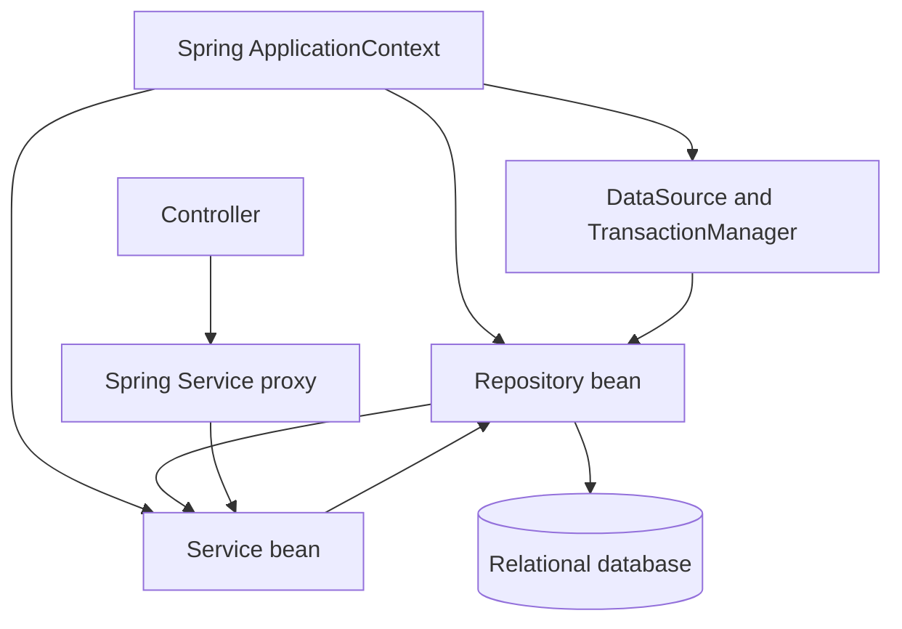
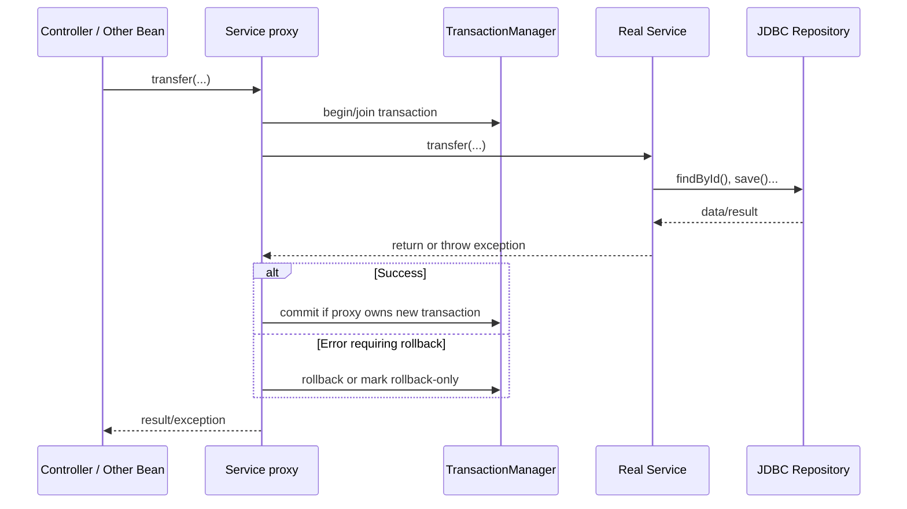

# Spring IoC, Bean Configuration, Proxies, and Transaction Management Refresher

In **Spring Data Relational JDBC** (often shortened to **Spring Data JDBC**), repositories perform database access via JDBC, while the Spring Framework organizes application objects and coordinates transactions. To understand why a `repository.save(...)` call runs in the same transaction as other operations, you need to grasp four links in the chain: **IoC container → beans and dependency injection → proxies → transaction manager**.

After this lesson, you will be able to explain:

- How Spring creates and wires beans such as `Service`, `Repository`, and `DataSource`; and when to use `@Component`, `@Service`, `@Repository`, `@Configuration`, and `@Bean`.
- Why `@Transactional` usually takes effect when a method is called through a Spring bean, yet may not take effect when called from another method inside the same object.
- How Spring attaches multiple JDBC operations to one transaction and decides when to `commit` or `rollback`.
- How to place transaction boundaries at the service layer when using Spring Data JDBC, along with common configuration pitfalls.

## 1. The Big Picture: Who Creates Objects and Who Manages Transactions?

In plain Java, a class might instantiate its own dependencies:

```java
class CheckoutService {
    private final PaymentGateway gateway = new PaymentGateway();
}
```

`CheckoutService` is tightly coupled to how `PaymentGateway` is constructed: hard to swap implementations, configure, and test. With **Inversion of Control (IoC)**, application code declares what it needs; the **Spring container** is responsible for creating, configuring, and wiring the appropriate objects. Passing dependencies into a class is **Dependency Injection (DI)**.



**Crucial distinction:** `ApplicationContext` manages beans; a **proxy** sits in front of certain beans to add behaviors such as transactions; the **transaction manager** coordinates transactions over the JDBC connection. They work together while holding distinct responsibilities.

### 1.1. `ApplicationContext` and Bean Lifecycle

`ApplicationContext` is the central interface of the IoC container. When the application starts, Spring typically:

1. Collects *bean definitions* from component scanning, `@Bean` methods, and auto-configuration.
2. Instantiates beans in dependency order, picks constructors, injects dependencies, and applies configuration.
3. Invokes lifecycle extension points such as `BeanPostProcessor`; this is where Spring can wrap beans requiring AOP/transactions in proxies.
4. Puts beans into service and invokes appropriate destruction callbacks when closing the context.

A **bean** is an object managed by the Spring container. An object created via `new` in normal business code is still a valid Java object, but it will not automatically receive Spring dependency injection, `@Transactional` handling, or container lifecycle callbacks.

By default, beans have **`singleton` scope**: one instance per bean definition within an `ApplicationContext` (not necessarily a single instance across the entire JVM). Because multiple requests share a singleton service, **avoid storing per-request mutable state in service fields**. Local method variables or state persisted in the database are usually much safer.

Common scopes:

| Scope | Meaning | Typical Use |
|---|---|---|
| `singleton` | One instance per container for that bean; default | Shared services, repositories, configuration |
| `prototype` | Creates a new instance each time the container is asked for the bean | Objects needing an independent lifecycle |
| `request` | One instance per HTTP request | State genuinely scoped to a web request |
| `session` | One instance per HTTP session | Per-session web data when truly needed |

Injecting a prototype bean into a singleton **once at constructor time** does not refresh the prototype on each method call. If you need fresh instances repeatedly, consider `ObjectProvider<T>` or redesigning that component.

## 2. Declaring and Injecting Beans

### 2.1. Component Scanning with Stereotype Annotations

Spring can discover classes within the scanned packages via annotations:

| Annotation | Typical Role |
|---|---|
| `@Component` | General-purpose Spring component |
| `@Service` | Holds business rules and operations |
| `@Repository` | Data access layer; for custom DAO classes you write, also enables translation of certain data access exceptions |
| `@Controller` / `@RestController` | Handles web application requests |
| `@Configuration` | Class declaring configuration and `@Bean` factory methods |

`@Service`, `@Repository`, and `@Controller` are all stereotypes built on `@Component`, expressing a class's responsibility clearly. For an interface extending **Spring Data JDBC**'s `CrudRepository`, Spring Data automatically generates the repository proxy; you do not need to write an implementation class or annotate the interface with `@Repository` just to register it.

`@SpringBootApplication` includes component scanning, defaulting to the package containing the main class as the root and scanning subpackages. If you place a service outside that package tree, Spring may fail to find the bean and throw an error during dependency injection.

### 2.2. Constructor Injection Is the Best Default

```java
import org.springframework.stereotype.Service;
import java.time.Clock;
import java.time.Instant;

@Service
public class InvoiceService {
    private final Clock clock;

    // If the class has a single constructor, Spring uses it automatically.
    public InvoiceService(Clock clock) {
        this.clock = clock;
    }

    public Instant issuedAt() {
        return Instant.now(clock);
    }
}
```

Here `InvoiceService` does not create `Clock`: Spring passes the matching bean into the constructor. `final` signals that the dependency is required and immutable after construction. In unit tests, you can directly pass `Clock.fixed(...)` without starting Spring.

### 2.3. `@Bean` for Configurable Objects or Third-Party Classes

Not every object can be annotated with `@Component` (for instance, `Clock` from the Java standard library). In that case, declare a `@Bean` method:

```java
import org.springframework.context.annotation.Bean;
import org.springframework.context.annotation.Configuration;
import java.time.Clock;

@Configuration
public class TimeConfiguration {
    @Bean
    Clock businessClock() {
        return Clock.systemUTC();
    }
}
```

Spring registers the returned object as a bean named `businessClock`. `@Configuration` designates where beans are declared, and `@Bean` marks the factory method; `@Bean` itself does not mean the method is invoked anew every time the object is used. The cleanest way to consume this bean is **constructor injection**, rather than calling `timeConfiguration.businessClock()` directly from business code.

In a Spring Boot application using Spring Data JDBC, auto-configuration normally provisions `DataSource`, Spring JDBC components, repository infrastructure, and `PlatformTransactionManager` when dependencies and properties are present. Only declare beans manually when customizing behavior or working with multiple data sources; avoid creating a duplicate transaction manager that conflicts with the one Boot already configures.

### 2.4. When Multiple Beans Share the Same Type

Suppose two beans implement `NotificationSender`; Spring cannot always tell which one to inject. You can disambiguate:

```java
@Service
class OrderNotificationService {
    private final NotificationSender sender;

    OrderNotificationService(
            @org.springframework.beans.factory.annotation.Qualifier("emailSender")
            NotificationSender sender) {
        this.sender = sender;
    }
}
```

`@Qualifier` selects a specific bean; `@Primary` marks the default choice among multiple beans of the same type. `@Profile` and conditional configuration allow registering beans per environment. When only one matching bean exists, Spring resolves by type without needing a qualifier.

### 2.5. Lifecycle and Design Considerations

- `@PostConstruct` is useful for initialization after dependency injection, but **do not rely on `@Transactional` on the bean itself inside initialization callbacks**: the proxy may not yet be in the call path as it is during normal application execution.
- `@PreDestroy` is for cleaning up resources when the bean/container shuts down, not for business rollback logic.
- Circular dependencies (`A` requires `B`, `B` requires `A`) through constructors usually signal unclear separation of responsibilities; refactor the design rather than forcing Spring to wire a cycle.
- Never store `Connection`, `ResultSet`, or transaction state in fields of a singleton service: connections belong to the scope of an operation/transaction and must be managed properly.

## 3. Proxies: Why Calling Through a Spring Bean Differs from Internal Calls

A **proxy** is an object standing in front of the *target* bean. When external code invokes a method through the proxy, Spring can execute extra logic before and after the call: opening a transaction, controlling rollback, security checks, timing, or other AOP advice.



Spring AOP typically uses two proxy mechanisms:

| Mechanism | How It Works | Limitations to Remember |
|---|---|---|
| **JDK dynamic proxy** | Proxy implements the interfaces exposed by the bean | Calls must go through methods on the proxied interface |
| **Class-based proxy** (CGLIB) | Generates a subclass of the target class | Cannot override to intercept `final` methods; `final` classes cannot be subclassed this way |

Which mechanism is used also depends on AOP configuration and how the bean is defined. Place `@Transactional` on **`public` methods of concrete service classes**, avoiding reliance on differences between proxy mechanisms. `private` methods cannot be intercepted by these proxies as external calls.

**Do not confuse two types of proxies:** Spring Data JDBC generates implementations/proxies for repository interfaces; Spring transaction AOP generates proxies for services. Domain objects like `Account` are mapped from table rows by Spring Data JDBC without a persistence context, dirty checking, or lazy-loading proxies as commonly seen in JPA.

### 3.1. The Self-Invocation Trap

```java
import org.springframework.stereotype.Service;
import org.springframework.transaction.annotation.Propagation;
import org.springframework.transaction.annotation.Transactional;

@Service
class BatchService {
    public void runBatch() {
        saveOne(); // Calls this.saveOne(): goes straight to the target.
    }

    @Transactional(propagation = Propagation.REQUIRES_NEW)
    public void saveOne() {
        // Repository/JDBC operations.
    }
}
```

When an external caller invokes `runBatch()` via the proxy, inside the object it calls `saveOne()` through `this`. That call **does not go back through the proxy**, so `@Transactional(REQUIRES_NEW)` advice on `saveOne()` never runs. If `runBatch()` already has a transaction, `saveOne()` continues running in the existing context instead of opening a new transaction as expected.

A clearer design moves the operation requiring its own boundary into another bean:

```java
@Service
class ItemWriter {
    @Transactional(propagation = Propagation.REQUIRES_NEW)
    public void saveOne() {
        // Write data using repository.
    }
}

@Service
class BatchService {
    private final ItemWriter itemWriter;

    BatchService(ItemWriter itemWriter) {
        this.itemWriter = itemWriter;
    }

    public void runBatch() {
        itemWriter.saveOne(); // Calls another bean through the Spring proxy.
    }
}
```

Issues sharing the same root cause: instantiating a service with `new` instead of getting the bean from Spring; calling methods via `this`; calling `private` or `final` methods where proxies cannot intercept; or invoking proxy-dependent logic before the bean is properly proxied. Inspect the **actual call path**, not just the presence of an annotation.

## 4. JDBC Transactions in Spring

### 4.1. What Does a Transaction Guarantee?

A transaction groups database operations into a single unit of work. In the transfer example, the two updates — "debit account A" and "credit account B" — must both succeed or both be undone. The commonly referenced ACID properties are:

- **Atomicity:** either all changes in the transaction are committed, or the transaction's changes are rolled back.
- **Consistency:** the transaction respects defined data constraints; the DB does not automatically understand all business rules.
- **Isolation:** defines the degree to which concurrent transactions can observe each other's changes.
- **Durability:** committed changes are durably stored by the DB according to the DBMS's guarantees.

Spring **does not replace** the database's transaction mechanism. Spring decides **when to begin, join, commit, and roll back**; the JDBC driver, connection, and DBMS perform the physical transaction work.

### 4.2. Collaborating Components

| Component | Responsibility |
|---|---|
| `DataSource` | Supplies JDBC `Connection` instances (usually via a connection pool) |
| `PlatformTransactionManager` | Spring interface for beginning/committing/rolling back a transaction |
| `JdbcTransactionManager` / `DataSourceTransactionManager` | JDBC transaction manager implementation for a `DataSource` |
| `TransactionInterceptor` | Advice that reads `@Transactional` rules and instructs the transaction manager |
| `TransactionSynchronizationManager` | Binds transaction resources to the current execution thread |
| `JdbcTemplate` / Spring Data JDBC repository | Performs JDBC access, cooperating to reuse the connection bound to the current transaction |

In standard JDBC setups, Spring binds a `Connection` to the **thread** running the transaction. Repository calls on the same thread using the same `DataSource` and Spring-transaction-aware JDBC tools reuse that bound connection to participate in the transaction. Therefore, do not manually open/close an independent connection with `dataSource.getConnection()` in the middle of that business flow. If writing lower-level JDBC DAOs, use `JdbcTemplate` or `DataSourceUtils` per Spring's contract.

Thread-bound transaction context does not automatically propagate across `@Async`, `new Thread(...)`, or an HTTP call to another service. A single-datasource JDBC transaction also **does not make sending an email, calling an API, Kafka, or another database atomic**.

### 4.3. Where Should `@Transactional` Live?

For multi-step business workflows forming one consistent unit, place the transaction on a **`public` service method**:

```java
import org.springframework.stereotype.Service;
import org.springframework.transaction.annotation.Transactional;

@Service
public class OrderApplicationService {
    private final OrderRepository orderRepository;
    private final InventoryRepository inventoryRepository;

    public OrderApplicationService(OrderRepository orderRepository,
                                   InventoryRepository inventoryRepository) {
        this.orderRepository = orderRepository;
        this.inventoryRepository = inventoryRepository;
    }

    @Transactional
    public void placeOrder(Order order, Inventory inventory) {
        inventory.reserve(order.quantity());
        inventoryRepository.save(inventory);
        orderRepository.save(order);
    }
}
```

This snippet illustrates a **business boundary**; the `Order`, `Inventory`, and repository types belong to the application. If saving inventory succeeds but saving the order throws an error causing rollback, all JDBC changes made inside the transaction are undone. Do not make transactions overly broad just to cover file processing or waiting on network APIs: that holds connections/locks longer and does not provide atomicity with external resources.

Specific note for Spring Data JDBC: mutating entity fields in memory **does not auto-flush like JPA**; you must explicitly call repository `save(...)` to persist changes. Transactions do not magically persist in-memory objects.

### 4.4. Default Commit and Rollback Rules

For a `@Transactional` boundary that starts a new transaction:

1. Method completes normally → Spring requests `commit`, unless the transaction has been marked `rollback-only`.
2. Method exits with a `RuntimeException` or `Error` → requests `rollback` by default.
3. Method exits with a **checked exception** (for example, an `IOException`) → **does not** roll back by default, unless configured otherwise.

Customize the rule when business requirements call for it:

```java
@Transactional(rollbackFor = java.io.IOException.class)
public void importData() throws java.io.IOException {
    // JDBC operations and a step that may throw IOException.
}
```

If you `catch` an error internally and return normally, the interceptor cannot tell that the business operation failed:

```java
@Transactional
public void riskyOperation() {
    try {
        performDatabaseWrite();
    } catch (IllegalStateException ex) {
        // Swallowing the error: method may still finish normally and commit.
    }
}
```

Let the appropriate exception propagate, convert it to a business exception that triggers rollback, or intentionally mark the transaction rollback-only. When participating in a caller's transaction, an inner layer marking `rollback-only` can cause the outer `commit` to fail with `UnexpectedRollbackException` even if the caller caught the intermediate error.

## 5. Options of `@Transactional`

Declaring `@Transactional` from `org.springframework.transaction.annotation.Transactional` lets you configure propagation, isolation, timeout, rollback rules, and read-only hints.

### 5.1. Propagation: Which Transaction Does This Call Join?

| Mode | When a Transaction Exists | When No Transaction Exists |
|---|---|---|
| `REQUIRED` (default) | Joins the existing transaction | Starts a new transaction |
| `REQUIRES_NEW` | Suspends the existing transaction and starts an independent one | Starts a new transaction |
| `SUPPORTS` | Joins if present | Runs non-transactionally |
| `MANDATORY` | Must join existing transaction | Throws an exception |
| `NOT_SUPPORTED` | Suspends the existing transaction | Runs non-transactionally |
| `NEVER` | Throws an exception | Runs non-transactionally |
| `NESTED` | Uses a savepoint inside the transaction if supported by transaction manager/driver | Usually starts a transaction like `REQUIRED` |

Examples:

```java
@Transactional(propagation = Propagation.REQUIRED)
public void createInvoice() {
    // Joins caller's transaction or starts a new one.
}

@Transactional(propagation = Propagation.REQUIRES_NEW)
public void recordIndependentAttempt() {
    // Runs in its own transaction when invoked via proxy.
}
```

`REQUIRES_NEW` can require a **second connection** while the outer transaction is still holding its connection; an undersized connection pool will block or even deadlock when many threads do this concurrently. `NESTED` relies on savepoints, so it is not equivalent to an independent physical transaction. Do not pick advanced propagation modes simply to feel "safer"; first clarify which business step owns commit/rollback responsibility.

### 5.2. Isolation: Handling Concurrent Data Access

| Level | High-Level Practical Meaning |
|---|---|
| `DEFAULT` | Uses the database's default isolation level |
| `READ_UNCOMMITTED` | May allow reading uncommitted data if supported by the DB |
| `READ_COMMITTED` | Prevents dirty reads; repeated reads may see newly committed data |
| `REPEATABLE_READ` | Increases stability of values read during a transaction; specifics depend on the DB |
| `SERIALIZABLE` | Strongest protection modeling serializable execution; may increase contention or throw retryable errors |

Common anomalies include **dirty read** (reading uncommitted data), **non-repeatable read** (re-reading the same row yields different values), and **phantom read** (re-running a condition-based query returns a different set of rows). How each DBMS implements isolation, snapshots, locking, and allowed anomalies differs. Always **check your target database's documentation and configuration** rather than inferring behavior solely from enum names.

```java
@Transactional(isolation = Isolation.READ_COMMITTED)
public void settlePayment() {
    // ...
}
```

### 5.3. `readOnly`, `timeout`, and Transaction Manager Name

```java
@Transactional(readOnly = true)
public AccountView getAccount(long id) {
    // Execute read queries and return a DTO.
}

@Transactional(timeout = 5)
public void updateAccount() {
    // Limits transaction duration as supported by the transaction manager/driver.
}
```

`readOnly = true` is an **optimization hint and statement of intent**, not a security mechanism or absolute guarantee blocking writes on every DB. `timeout` cannot interrupt arbitrary Java work; enforcement depends on the transaction manager and underlying resources. With multiple `PlatformTransactionManager` beans, choose via qualifier/name such as `@Transactional(transactionManager = "ordersTransactionManager")`, and ensure repositories/JDBC actually use the matching `DataSource`.

## 6. Complete Example: Money Transfer with Spring Data JDBC

This small flow demonstrates IoC, beans, proxies, and JDBC transactions working together. To keep arithmetic exact, the example represents **amounts in smallest currency units** (`long balanceCents`) rather than floating-point numbers. `@Version` provides **optimistic locking** checks when concurrent transactions update the same account.

### 6.1. Application Setup

In a Spring Boot project using Maven with Boot dependency management:

```xml
<dependency>
    <groupId>org.springframework.boot</groupId>
    <artifactId>spring-boot-starter-data-jdbc</artifactId>
</dependency>
<dependency>
    <groupId>org.postgresql</groupId>
    <artifactId>postgresql</artifactId>
    <scope>runtime</scope>
</dependency>
```

Sample connection configuration (adjust for your environment; never hardcode real passwords in source control):

```properties
spring.datasource.url=jdbc:postgresql://localhost:5432/learning_db
spring.datasource.username=learning_user
spring.datasource.password=${DB_PASSWORD}
```

When matching dependencies and connection properties are configured, Spring Boot sets up `DataSource`, the transaction manager, and Spring Data JDBC repositories. You usually **do not need** to manually declare `@Bean DataSource` or implement `AccountRepository`.

A simple PostgreSQL schema:

```sql
CREATE TABLE accounts (
    id BIGINT GENERATED BY DEFAULT AS IDENTITY PRIMARY KEY,
    balance_cents BIGINT NOT NULL CHECK (balance_cents >= 0),
    version BIGINT
);
```

### 6.2. Aggregate Root and Repository

```java
import org.springframework.data.annotation.Id;
import org.springframework.data.annotation.Version;
import org.springframework.data.relational.core.mapping.Table;

@Table("accounts")
public class Account {
    @Id
    private Long id;

    @Version
    private Long version;

    private long balanceCents;

    protected Account() { } // Used by Spring Data for data mapping.

    public Account(long openingBalanceCents) {
        if (openingBalanceCents < 0) {
            throw new IllegalArgumentException("Opening balance must not be negative");
        }
        this.balanceCents = openingBalanceCents;
    }

    public long getBalanceCents() {
        return balanceCents;
    }

    public void debit(long amountCents) {
        if (amountCents <= 0 || balanceCents < amountCents) {
            throw new IllegalArgumentException("Invalid amount or insufficient funds");
        }
        balanceCents -= amountCents;
    }

    public void credit(long amountCents) {
        if (amountCents <= 0) {
            throw new IllegalArgumentException("Amount must be positive");
        }
        balanceCents = Math.addExact(balanceCents, amountCents);
    }
}
```

```java
import org.springframework.data.repository.CrudRepository;

public interface AccountRepository extends CrudRepository<Account, Long> {
    // Spring Data JDBC provides the implementation for basic CRUD.
}
```

`@Table` maps the class to a table; `@Id` designates the primary key; `@Version` detects concurrent updates against the same data version. When updating a record whose version has changed, Spring Data JDBC can throw an optimistic locking exception (a runtime exception), causing the outer transaction to roll back. Without `@Version`, merely wrapping operations in a transaction is not enough to prevent all *lost update* cases under concurrent access.

### 6.3. Service Holding the Transaction Boundary

```java
import org.springframework.stereotype.Service;
import org.springframework.transaction.annotation.Transactional;

@Service
public class TransferService {
    private final AccountRepository accounts;

    public TransferService(AccountRepository accounts) {
        this.accounts = accounts;
    }

    @Transactional
    public void transfer(long fromId, long toId, long amountCents) {
        if (fromId == toId || amountCents <= 0) {
            throw new IllegalArgumentException("Invalid transfer");
        }

        Account from = accounts.findById(fromId)
                .orElseThrow(() -> new IllegalArgumentException("Source account not found"));
        Account to = accounts.findById(toId)
                .orElseThrow(() -> new IllegalArgumentException("Destination account not found"));

        from.debit(amountCents);
        to.credit(amountCents);

        accounts.save(from);
        accounts.save(to);
    }
}
```

Sequence when a controller or another bean calls `transferService.transfer(...)`:

1. The caller invokes the **Spring bean proxy** of `TransferService`.
2. Transaction advice inspects `@Transactional`; with default `REQUIRED`, if no transaction exists, the transaction manager starts a JDBC transaction.
3. The service invokes the repository bean provided by Spring Data JDBC; reads and writes execute within the active transaction when sharing the `DataSource` and thread.
4. Both `accounts.save(from)` and `accounts.save(to)` must succeed for the transaction to commit. If the second step throws a runtime exception, the first update rolls back as well.
5. When the service exits normally and the transaction is not marked rollback-only, the transaction manager commits and returns the connection to the pool per resource management rules.

This example focuses on atomicity and IoC. Production monetary systems also require authorization checks, accounting rules, idempotency, concurrency control, and retry strategies for version/serialization failures. When external resources outside the database are involved, a standalone JDBC transaction does not guarantee atomicity across the whole workflow; add patterns such as transactional outbox or sagas as required.

## 7. When Should You Configure the Transaction Manager Manually?

In a Boot application with **one** `DataSource` and the proper Spring Data JDBC starter, let auto-configuration register the transaction manager. If manual configuration is needed, the rule is that the transaction manager must reference **the exact DataSource used by repositories/JDBC**:

```java
import javax.sql.DataSource;
import org.springframework.context.annotation.Bean;
import org.springframework.context.annotation.Configuration;
import org.springframework.jdbc.support.JdbcTransactionManager;
import org.springframework.transaction.PlatformTransactionManager;

@Configuration
class JdbcTransactionConfiguration {
    @Bean
    PlatformTransactionManager transactionManager(DataSource dataSource) {
        return new JdbcTransactionManager(dataSource);
    }
}
```

**This is an illustrative example to explain the mechanism, not configuration to copy into every Boot project.** With multiple data sources, ensure the chosen transaction manager corresponds to the repository and connection factory; a `JdbcTransactionManager` only coordinates local JDBC transactions on the `DataSource` it manages.

If you need programmatic transaction control instead of annotations, Spring also provides `TransactionTemplate`:

```java
import org.springframework.transaction.support.TransactionTemplate;

public class MaintenanceTask {
    private final TransactionTemplate transactions;

    public MaintenanceTask(TransactionTemplate transactions) {
        this.transactions = transactions;
    }

    public void execute() {
        transactions.executeWithoutResult(status -> {
            // JDBC operations within the same transaction.
            // status.setRollbackOnly() if explicit rollback is needed.
        });
    }
}
```

`TransactionTemplate` must be registered/initialized with the appropriate transaction manager. It is handy when transaction boundaries must be expressed in code, yet **does not replace choosing the right DataSource and handling exceptions properly**.

## 8. Common Mistakes When Learning Spring Data JDBC

| Symptom | Likely Cause to Check | How to Fix |
|---|---|---|
| `@Transactional` present, but no transaction opens as expected | Calling via `this`, instantiating service with `new`, method not going through proxy | Call via another Spring bean; place transaction on a public service method invoked by callers |
| Two `save()` calls do not roll back together | No transaction wrapping the full workflow, or running against different transactions/DataSources | Place `@Transactional` on the service; verify transaction manager and DataSource |
| Exception thrown, yet changes still commit | Checked exceptions do not roll back by default; or error was caught and swallowed | Use `rollbackFor` when needed, or let rollback-triggering exceptions propagate |
| `REQUIRES_NEW` does not behave as expected | Self-invocation; connection pool exhausted for independent transaction | Call through another proxy; review connection pool limits |
| Changing object fields does not update the DB | Confusing Spring Data JDBC with JPA dirty checking | Explicitly call `repository.save(...)` |
| Concurrent access causes lost updates | Transactions alone do not prevent every write conflict | Consider `@Version`, row locks, isolation levels, and proper retries |
| Tests pass, yet production commits differently | Test method has a transaction that auto-rolls back at the end | Distinguish in-transaction logic tests from verifying real commits |
| `NoSuchBeanDefinitionException` | Class outside component scan; missing stereotype/`@Bean`; unsatisfied conditional config | Check component scan scope, bean definitions, and active profiles |
| `NoUniqueBeanDefinitionException` | Multiple beans of the same type; Spring cannot disambiguate | Use `@Qualifier`, `@Primary`, or adjust dependency design |
| Connections/locks held too long | Transaction wraps network I/O, slow work, or unnecessary nested transactions | Narrow transactions strictly to DB operations needing atomicity |

### 8.1. Observing Transactions at Runtime

You can temporarily raise log levels to observe transaction/JDBC activity (exact log output depends on versions and components):

```properties
logging.level.org.springframework.transaction=TRACE
logging.level.org.springframework.jdbc.datasource=DEBUG
```

When troubleshooting, trace in order: **which bean the caller invokes**, whether the call goes through a proxy, what annotation and propagation the method carries, which transaction manager is selected, whether repositories share the same `DataSource`, and which exception actually escapes the method. Those facts matter far more than simply seeing `@Transactional` in source code.

### 8.2. Testing Commit and Rollback Behavior Meaningfully

- **Unit tests:** construct the service with mock/fake repositories to verify business rules; this kind of test does not prove a real JDBC transaction rolled back.
- **Integration tests:** use a test database and invoke the service via a bean retrieved from Spring, inspecting row state after an error mid-workflow.
- **Note:** if the test method itself is wrapped in `@Transactional`, the test framework may auto-roll back when it ends. To verify service commit/rollback behavior under realistic conditions, design tests appropriately rather than relying on the test's default transaction.

Example scenario to verify: account A has 100 units, account B has 0; when attempting to transfer 120 units, the service throws an exception and both accounts still hold 100/0. For a scenario failing **after saving A but before saving B**, after rollback A's data must also be restored. On a `@Version` conflict, the entire transfer transaction must roll back so no half-completed transfer is persisted.

## 9. Self-Check Questions

1. **Does `@Service` create a transaction?** No. It lets Spring manage the service as a bean; transactions only occur when transaction infrastructure is configured and a call is intercepted per transaction rules.
2. **Why does constructor injection make testing easier?** Dependencies are explicit in the constructor; tests can pass fake implementations without starting a container.
3. **Does putting `@Transactional` on a private method guarantee rollback?** Not under standard Spring proxy AOP; private methods are not intercepted like external calls.
4. **Why doesn't `REQUIRES_NEW` on `this.saveOne()` open a new transaction?** Because internal calls bypass the proxy carrying transaction advice.
5. **Is a service making two `repository.save()` calls automatically atomic?** You cannot conclude that merely from two repository calls; a transaction must wrap both operations and use the right transaction resource.
6. **Does mutating `account.balance` in memory automatically persist to the DB in Spring Data JDBC?** No. You must tell the repository to save the aggregate.
7. **Do checked exceptions roll back by default?** No; configure `rollbackFor` if rollback is desired for them.
8. **Can a JDBC transaction roll back an already-sent email?** No. Email is an external resource outside the local DB transaction; a separate coordination pattern is needed.

## 10. Remembering the Operational Model

Follow the **actual call path**: `ApplicationContext` creates beans and wires dependencies → caller receives the service bean (potentially a proxy) → transaction advice opens/joins a transaction → service invokes Spring Data JDBC repositories → JDBC uses the current transaction's connection → Spring commits or rolls back based on the outcome. For related write operations, a `@Transactional` boundary at the service layer is a clear starting point; edge cases are governed by **proxies, propagation, rollback rules, and the transaction manager**.
