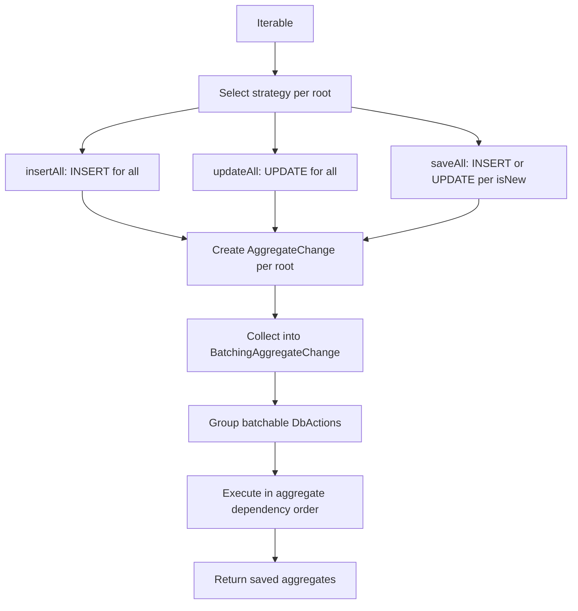

# Operations `insertAll`, `updateAll`, and `saveAll`

In **Spring Data Relational JDBC**, `JdbcAggregateTemplate` provides direct write operations at the aggregate level. Alongside `insert()`, `update()`, and `save()` for a single aggregate, the template offers variants that accept an `Iterable`: **`insertAll()`**, **`updateAll()`**, and **`saveAll()`**.

All three methods operate on **aggregate roots and all entities owned within the aggregate**. The main difference lies in how the write operation is decided:

- `insertAll()` always creates an insert operation for each aggregate.
- `updateAll()` always creates an update operation for each aggregate.
- `saveAll()` inspects the new/existing state of each aggregate and chooses insert or update accordingly.

The `...All` methods also group batchable operations so the database can execute them more efficiently. That does not mean the entire set of aggregates always becomes a single SQL statement. Statement count and batchability depend on aggregate structure, `DbAction` types, database, and `DataAccessStrategy`.

## 1. What Is `JdbcAggregateTemplate`?

`JdbcAggregateTemplate` is Spring Data JDBC's high-level API for saving and loading aggregates by domain type. Spring Data JDBC repositories use the template to implement most persistence functionality; applications can also inject the template directly when custom operations are needed.

```java
import org.springframework.data.jdbc.core.JdbcAggregateTemplate;
import org.springframework.stereotype.Service;

@Service
public class OrderImportService {

    private final JdbcAggregateTemplate aggregateTemplate;

    public OrderImportService(JdbcAggregateTemplate aggregateTemplate) {
        this.aggregateTemplate = aggregateTemplate;
    }
}
```

Once the application configures Spring Data JDBC (typically via `spring-boot-starter-data-jdbc`), Spring creates the template bean with the appropriate mapping context, converters, and data access strategy. There is normally no need to instantiate `JdbcAggregateTemplate` via its constructor manually.

The template operates on **aggregate roots**, not an arbitrary list of tables. If a root owns `List<OrderLine>`, calling `insertAll` or `saveAll` causes Spring Data JDBC to plan writes for both the root and its child lines according to the mapping. Another aggregate in the same list remains an independent root with its own lifecycle.

## 2. Distinguishing the Three Methods

| Method | Decision per Aggregate | When to Use |
|---|---|---|
| `insertAll(Iterable<T>)` | Always insert | All aggregates are new and you want to force insert, even if IDs are pre-assigned |
| `updateAll(Iterable<T>)` | Always update | All aggregates already exist and you want to force update |
| `saveAll(Iterable<T>)` | Checks new/existing state and chooses insert or update | Input collection may contain both new and existing aggregates |

Do not think of `saveAll()` as a database upsert per ID. Spring Data JDBC determines new/existing state from **entity state** (for example `@Id`, `@Version`, or `Persistable`), rather than running a `SELECT` by default to check whether each row exists before deciding.

### API Signatures

In current Spring Data Relational `JdbcAggregateTemplate`, the signatures are:

```java
<T> List<T> insertAll(Iterable<T> instances);
<T> List<T> updateAll(Iterable<T> instances);
<T> List<T> saveAll(Iterable<T> instances);
```

If you declare the dependency using the `JdbcAggregateOperations` interface, the `insertAll` signature on the interface returns `Iterable<T>`; the `JdbcAggregateTemplate` implementation returns a concrete `List<T>`. `updateAll` and `saveAll` return `List<T>`.

API milestones:

- `saveAll` has existed since Spring Data Relational **3.0**.
- `insertAll` and `updateAll` were added in **3.1**.
- `upsert(instance)` is a separate operation; it is not what `insertAll` means, and the current API does not provide a corresponding `upsertAll`.

## 3. Example Model: An Order with Multiple Lines

To see how batch methods process the full aggregate, use `PurchaseOrder` as the root and `OrderLine` as the owned child entity.

### Aggregate Root

```java
package com.example.sales;

import java.util.ArrayList;
import java.util.List;

import org.springframework.data.annotation.Id;
import org.springframework.data.annotation.Version;
import org.springframework.data.relational.core.mapping.MappedCollection;
import org.springframework.data.relational.core.mapping.Table;

@Table("purchase_order")
public class PurchaseOrder {

    @Id
    private Long id;

    @Version
    private Long version;

    private String status;

    @MappedCollection(idColumn = "order_id", keyColumn = "line_no")
    private List<OrderLine> lines = new ArrayList<>();

    protected PurchaseOrder() {}

    public PurchaseOrder(String status) {
        this.status = status;
    }

    public void addLine(Long productId, int quantity) {
        if (productId == null || quantity <= 0) {
            throw new IllegalArgumentException("Invalid order line");
        }
        lines.add(new OrderLine(productId, quantity));
    }

    public Long getId() { return id; }
    public Long getVersion() { return version; }
    public String getStatus() { return status; }
    public List<OrderLine> getLines() { return List.copyOf(lines); }

    public void confirm() {
        if (lines.isEmpty()) {
            throw new IllegalStateException("An empty order cannot be confirmed");
        }
        status = "CONFIRMED";
    }
}
```

### Child Entity

```java
package com.example.sales;

import org.springframework.data.annotation.Id;
import org.springframework.data.relational.core.mapping.Column;
import org.springframework.data.relational.core.mapping.Table;

@Table("order_line")
public class OrderLine {

    @Id
    private Long id;

    @Column("product_id")
    private Long productId;

    private int quantity;

    protected OrderLine() {}

    public OrderLine(Long productId, int quantity) {
        this.productId = productId;
        this.quantity = quantity;
    }

    public Long getId() { return id; }
    public Long getProductId() { return productId; }
    public int getQuantity() { return quantity; }
}
```

In this model, `PurchaseOrder` owns `OrderLine` via `@MappedCollection`. When writing a list of orders, the template processes each order and its child lines. `OrderLine` does not need its own repository if its lifecycle stays entirely inside the `PurchaseOrder` aggregate.

Illustrative PostgreSQL DDL:

```sql
CREATE TABLE purchase_order (
    id BIGINT GENERATED BY DEFAULT AS IDENTITY PRIMARY KEY,
    version BIGINT NOT NULL,
    status VARCHAR(30) NOT NULL
);

CREATE TABLE order_line (
    id BIGINT GENERATED BY DEFAULT AS IDENTITY PRIMARY KEY,
    order_id BIGINT NOT NULL REFERENCES purchase_order(id),
    line_no INTEGER NOT NULL,
    product_id BIGINT NOT NULL,
    quantity INTEGER NOT NULL CHECK (quantity > 0),
    UNIQUE (order_id, line_no)
);
```

Schemas must be created via migrations or SQL scripts. Template operations do not create tables for aggregates automatically.

## 4. `insertAll()`: Always Insert Every Input Aggregate

`insertAll()` is the choice when you know for certain every aggregate in the `Iterable` is new. The API skips new/existing entity checks and creates insert operations for every aggregate, including owned child entities.

```java
import java.util.List;

import org.springframework.data.jdbc.core.JdbcAggregateTemplate;
import org.springframework.stereotype.Service;
import org.springframework.transaction.annotation.Transactional;

@Service
public class OrderImportService {

    private final JdbcAggregateTemplate template;

    public OrderImportService(JdbcAggregateTemplate template) {
        this.template = template;
    }

    @Transactional
    public List<PurchaseOrder> insertNewOrders(List<PurchaseOrder> orders) {
        return template.insertAll(orders);
    }
}
```

Example call:

```java
List<PurchaseOrder> orders = List.of(
        orderWithLines("DRAFT", 10L, 2, 15L, 1),
        orderWithLines("DRAFT", 20L, 3)
);

List<PurchaseOrder> inserted = orderImportService.insertNewOrders(orders);
```

`insertAll()` fits when:

- Importing a set of new aggregates from a file or another system.
- Root IDs are pre-assigned by the application/client and you want to insert regardless of whether the ID is already populated.
- You have an import workflow where every item is confirmed not to exist yet.

Because this is an **insert**, do not pass existing aggregates. If primary keys collide, the database may fail with a duplicate-key error. The method does not fall back to update or turn into an upsert.

### IDs and Versions on Insert

If the database uses identity/auto-increment, roots can start with a `null` ID; the database generates IDs during insertion. Root IDs are used to write child rows that carry a foreign key pointing back to the root.

If the client pre-assigns IDs, `insertAll()` is helpful because it does not infer "non-null ID means existing entity." However, provided IDs must be valid and must not collide with existing data. If the aggregate has `@Version`, the template prepares the initial version for the insert operation.

## 5. `updateAll()`: Always Update Every Input Aggregate

`updateAll()` skips new/existing entity checks and always plans an update for each aggregate. Use it when all input roots are guaranteed to already exist.

```java
@Service
public class OrderUpdateService {

    private final JdbcAggregateTemplate template;

    public OrderUpdateService(JdbcAggregateTemplate template) {
        this.template = template;
    }

    @Transactional
    public List<PurchaseOrder> confirmOrders(List<PurchaseOrder> existingOrders) {
        existingOrders.forEach(PurchaseOrder::confirm);
        return template.updateAll(existingOrders);
    }
}
```

Passed aggregates are typically loaded beforehand from a repository or template and modified via domain methods. Do not pass newly constructed, never-persisted objects expecting `updateAll()` to insert them. If a row does not exist, the update operation does not become an insert.

### Optimistic Locking with `@Version`

In the example, `PurchaseOrder` has `@Version Long version`. On update, Spring Data JDBC uses the current version in the condition and increments the version for the next update. If another transaction modified the same root, the version no longer matches and the template throws `OptimisticLockingFailureException`.

With `updateAll()`, this means a single element with a stale version can fail the batch operation. If the whole batch runs within a single transaction, earlier changes in that transaction roll back when the exception escapes the transaction boundary.

If the aggregate lacks `@Version`, the application has no automatic optimistic locking on the root. In particular, do not assume `updateAll()` verified that every ID existed simply because the method returned normally. When you need to detect missing rows or concurrent updates, consider `@Version` and test against the target database.

## 6. `saveAll()`: Choosing Insert or Update per Root

`saveAll()` has the same semantics as repository `save()` but accepts multiple aggregates. The framework inspects the new/existing state **per aggregate**, so a single list can contain both new and existing items.

```java
@Service
public class OrderSaveService {

    private final JdbcAggregateTemplate template;

    public OrderSaveService(JdbcAggregateTemplate template) {
        this.template = template;
    }

    @Transactional
    public List<PurchaseOrder> saveOrders(List<PurchaseOrder> orders) {
        return template.saveAll(orders);
    }
}
```

Suppose the list contains:

| Item | State When Calling `saveAll()` | Operation Chosen |
|---|---|---|
| Order A | ID `null`, version `null` | Insert |
| Order B | Loaded from database, version populated | Update |
| Order C | Pre-assigned ID, version `null`, entity state detected as new | Insert |

Determining new vs. existing relies on Spring Data's entity state detection strategy (ID, version, or `Persistable`). By default, the template does not run a `SELECT` before each item to ask the database whether a corresponding row exists.

This makes `saveAll()` convenient for mixed datasets, but only safe if each object's state accurately reflects the intended write. An object carrying an existing ID without being marked new may take the update branch; an existing object with a stale version may hit an optimistic locking failure.

## 7. Aggregate-Level Batch Processing Flow

Conceptually, the three methods construct a group of aggregate changes and hand that group to an executor:



`BatchingAggregateChange` allows operations across multiple aggregates to be combined. Batchable actions are grouped and combined to unlock optimization opportunities at the data access layer. For aggregates with child entities, actions must still respect dependency order: insert roots before children and process deletes in reverse order.

### Does "All" Mean a Single SQL Statement?

No. `insertAll`, `updateAll`, and `saveAll` are **aggregate-level batch operations**. A single aggregate can span a root and multiple child tables; multiple aggregates can produce multiple action groups. Spring Data groups compatible operations so batch execution can be used, but does not guarantee every case collapses into a single `INSERT ... VALUES (...), (...), (...)` SQL statement.

Batchability and statement count depend on:

- Aggregate structure and number of child entities.
- Insert/update/delete actions generated per root.
- Whether IDs are database-generated or application-assigned.
- JDBC driver, dialect, and `DataAccessStrategy`.
- Whether an action type can be grouped with others or must execute separately.

Therefore, measure statement counts and timings against a real database rather than inferring performance solely from the `All` method suffix.

## 8. Operation Ordering with Child Entities and Foreign Keys

Suppose `PurchaseOrder` owns `OrderLine` via `order_line.order_id`:

```text
purchase_order
  id

order_line
  id
  order_id  -> purchase_order.id
  line_no
  product_id
```

When `insertAll()` runs for multiple orders, each root must be written before child lines referencing its ID. When updating existing aggregates, Spring Data JDBC synchronizes collections according to its persistence strategy; owned child entities may be deleted and re-inserted to reflect current state. Foreign keys must permit that operation sequence.

Design implications:

- The child's FK column must point to the root's ID.
- Roots referenced across aggregates (such as `Product`) must already exist if FKs are checked immediately.
- Do not place independent aggregate roots into an owned collection merely to batch them together.
- Children with independent lifecycles or referenced by multiple roots should be modeled as separate aggregate roots.

Batching does not bypass database integrity rules. If an aggregate violates an FK, unique constraint, or check constraint, the statement can still fail.

## 9. Lifecycle Callbacks and Auditing in `...All` Operations

`JdbcAggregateTemplate` still executes the aggregate lifecycle when using `insertAll`, `updateAll`, and `saveAll`. For each root in the batch, the save pipeline invokes the relevant callbacks before creating/writing changes and after successful writes, for example:

- `BeforeConvertCallback`: transforms the root before creating `AggregateChange`; can be used to assign IDs following lifecycle rules.
- `BeforeSaveCallback`: receives the root and `AggregateChange` before SQL executes.
- `AfterSaveCallback`: runs after the aggregate has been saved.

Callbacks and lifecycle events apply per aggregate root in the input collection. Consequently, expensive auditing or callback logic scales with the number of roots.

For entities using `@CreatedDate`, `@LastModifiedDate`, `@CreatedBy`, and `@LastModifiedBy`, configure auditing as usual. `...All` still passes through the aggregate lifecycle; this differs from direct bulk SQL via `@Modifying @Query`, which bypasses lifecycle callbacks and events.

## 10. Transactions: When Must the Entire Batch Succeed Together?

The `All` suffix describes the input count of aggregates, not the use case's transactional requirement. If business rules require **all aggregates in the set to commit or roll back together**, place `@Transactional` on the application service wrapping the template call.

```java
@Service
public class BulkOrderService {

    private final JdbcAggregateTemplate template;

    public BulkOrderService(JdbcAggregateTemplate template) {
        this.template = template;
    }

    @Transactional
    public List<PurchaseOrder> importAtomically(List<PurchaseOrder> orders) {
        return template.insertAll(orders);
    }
}
```

With a service transaction, statements executed by the template join the same JDBC transaction when using the proper `DataSource` and transaction manager. If one aggregate triggers a constraint violation or optimistic locking failure, the escaping exception causes the transaction to roll back under Spring's default rules for `RuntimeException`/`Error`.

Without an enclosing transaction, do not assume statements across multiple aggregates commit or roll back as an atomic unit. In particular, an aggregate spanning multiple statements and multiple roots in a batch can leave partial writes if a mid-batch error occurs without an appropriate transaction.

### Splitting Large Batches into Chunks

Do not pass an enormous dataset into a single call just because the API accepts an `Iterable`. The template prepares aggregate changes for the input set; huge batches can consume substantial memory, create long transactions, and hold many locks.

You can split into chunks:

```java
for (List<PurchaseOrder> chunk : partition(orders, 200)) {
    bulkOrderService.insertChunk(chunk);
}
```

Where `insertChunk` is a method on a separate Spring bean or invoked through a proxy:

```java
@Service
public class OrderChunkWriter {

    private final JdbcAggregateTemplate template;

    public OrderChunkWriter(JdbcAggregateTemplate template) {
        this.template = template;
    }

    @Transactional
    public List<PurchaseOrder> insertChunk(List<PurchaseOrder> chunk) {
        return template.insertAll(chunk);
    }
}
```

Each chunk runs in its own transaction. If the fourth chunk fails, the previous three chunks may have already committed. This is a trade-off between smaller transactions and whole-import atomicity; choose according to business needs. If an entire import must be all-or-nothing, use a single enclosing transaction or design a separate staging/validation/commit pipeline.

## 11. Optimistic Locking When Using `updateAll()` and `saveAll()`

For aggregate roots with `@Version`, Spring Data JDBC increments the version on update and checks the previous version in the SQL condition. If one aggregate in the batch carries a stale version, the operation can throw `OptimisticLockingFailureException`.

Example:

```java
List<PurchaseOrder> orders = orderRepository.findAllById(orderIds);

orders.forEach(PurchaseOrder::confirm);

List<PurchaseOrder> saved = template.updateAll(orders);
```

If an order was updated by another transaction after `findAllById`, the object's version may no longer match. Do not increment the version manually in Java to force the write. Read the latest state, verify invariants, and decide whether the business command can be reapplied or a conflict must be returned to the caller.

With `insertAll()`, the version is prepared for insertion. With `saveAll()`, each root is classified as new or existing before generating actions; new roots follow insert and existing roots follow update with the corresponding optimistic locking rules.

## 12. Comparison with `CrudRepository.saveAll()` and `JdbcTemplate.batchUpdate()`

These APIs have similar names but operate at different abstraction levels:

| API | Input Objects | How It Works |
|---|---|---|
| `CrudRepository.saveAll(Iterable<S>)` | Aggregate roots | Repository persistence; uses Spring Data JDBC's save mechanism |
| `JdbcAggregateTemplate.saveAll(Iterable<T>)` | Aggregate roots | Direct template API; detects insert/update and writes all aggregate members |
| `JdbcAggregateTemplate.insertAll/updateAll` | Aggregate roots | Forces insert or update path for all aggregates |
| `JdbcTemplate.batchUpdate(sql, batchArgs)` | Parameter sets for a single SQL statement | Repeatedly runs one SQL statement with many parameter sets; does not manage aggregate mapping |

If you need to persist multiple aggregates with children, generated IDs, versions, and lifecycle callbacks, use `JdbcAggregateTemplate`. If you need to execute one SQL statement repeatedly against a single table with multiple parameter sets, `JdbcTemplate.batchUpdate()` may be a better fit.

Do not manually write `batchUpdate` against a child table and assume Spring Data JDBC will synchronize in-memory aggregates automatically. Plain JDBC simply executes the provided SQL; it does not apply the aggregate lifecycle.

## 13. Common Mistakes

| Symptom | Cause | Resolution |
|---|---|---|
| `insertAll()` fails with duplicate key | A root already exists or client-assigned ID collides | Pass only new aggregates; verify IDs and unique constraints |
| `updateAll()` does not create new rows | Method always updates and never falls back to insert | Use `insertAll()` or `saveAll()` matching entity state |
| `saveAll()` chooses update for new object with ID | Entity state detection sees object as existing | Check `@Id`, `@Version`, or `Persistable.isNew()` |
| `saveAll()` chooses insert for existing object | Entity state incorrectly marked new or version uninitialized | Fix state detection and load aggregate from database before modifying |
| Optimistic locking failure in batch | One aggregate has a stale version | Reload, verify invariants, and handle conflict or controlled retry |
| FK violation on child | Referenced root does not exist or FK mapping is wrong | Check DDL, write ordering, and aggregate ownership |
| Large batch consumes excessive memory | Input set too large when building aggregate changes | Partition into chunks and choose appropriate transaction boundaries |
| Partial data written when batch fails | Missing shared transaction or transaction boundary does not wrap template call | Place `@Transactional` on the application service |
| Expected one SQL statement but saw many | Each aggregate spans multiple tables/`DbAction`s; only compatible actions batch | Measure actual SQL; do not assume `...All` is a single SQL statement |
| Auditing/version not behaving as expected | Incorrect entity state, callbacks, or auditing configuration | Check lifecycle callbacks, `@Version`, and auditing configuration |

## 14. Testing the Three Methods

An integration test should verify that both root and children are persisted and clearly distinguish insert from update.

```java
@DataJdbcTest
class PurchaseOrderTemplateTest {

    @Autowired JdbcAggregateTemplate template;
    @Autowired JdbcTemplate jdbcTemplate;

    @Test
    void insertAllPersistsRootsAndTheirLines() {
        List<PurchaseOrder> input = List.of(
                orderWithLines("DRAFT", 10L, 2, 15L, 1),
                orderWithLines("DRAFT", 20L, 3)
        );

        List<PurchaseOrder> inserted = template.insertAll(input);

        assertThat(inserted).hasSize(2);
        assertThat(inserted).allSatisfy(order -> assertThat(order.getId()).isNotNull());

        Integer rootCount = jdbcTemplate.queryForObject(
                "SELECT COUNT(*) FROM purchase_order", Integer.class);
        Integer lineCount = jdbcTemplate.queryForObject(
                "SELECT COUNT(*) FROM order_line", Integer.class);

        assertThat(rootCount).isEqualTo(2);
        assertThat(lineCount).isEqualTo(3);
    }

    @Test
    void saveAllCanHandleNewAndExistingRoots() {
        PurchaseOrder existing = template.insert(orderWithLines("DRAFT", 10L, 1));
        existing.confirm();

        PurchaseOrder newOrder = orderWithLines("DRAFT", 20L, 2);

        List<PurchaseOrder> saved = template.saveAll(List.of(existing, newOrder));

        assertThat(saved).hasSize(2);
        assertThat(saved.get(0).getVersion()).isNotNull();
        assertThat(saved.get(1).getId()).isNotNull();
    }
}
```

This is an illustrative example for an H2/PostgreSQL schema with `purchase_order` and `order_line`; a matching `schema.sql` and `orderWithLines(...)` helper are needed. `@DataJdbcTest` typically wraps tests in a transaction and rolls back at the end of each test. If you need to test service transaction boundaries across multiple requests/transactions, write dedicated tests that commit or roll back intentionally.

### Recommended Test Scenarios

- `insertAll` accepts an empty list and returns an empty list.
- `insertAll` with duplicate IDs triggers a constraint error.
- `updateAll` updates existing roots.
- `updateAll` with a stale version triggers an optimistic locking failure when the root has `@Version`.
- `saveAll` handles a mix of new and existing roots.
- Child rows are persisted with accurate FKs and collection mappings.
- A mid-batch failure rolls back the entire batch when the service opens a transaction.
- Chunked batches follow the intended per-chunk commit semantics.

To test performance, use the target database/driver and observe SQL or datasource instrumentation. H2 is useful for fast mapping tests, but does not fully represent batching capabilities, generated keys, and execution plans of a production database.

## 15. Method Selection Workflow

1. **Determine the state of each root:** all new, all existing, or mixed list?
2. **If all are new:** use `insertAll()` when you want to force insert.
3. **If all exist:** use `updateAll()` when you want to force update.
4. **If the list is mixed:** use `saveAll()` so the framework detects each root.
5. **Check IDs/versions:** ensure `@Id`, `@Version`, or `Persistable` accurately represents state.
6. **Protect the aggregate:** remember these methods write owned child entities too; review collection sizes and FKs.
7. **Choose transaction boundaries:** use `@Transactional` when the entire batch must be all-or-nothing; chunk large datasets when partial commits are acceptable.
8. **Verify results:** confirm roots, children, versions, row counts, and constraints on the real database.
9. **Measure performance:** check which actions get batched, statement counts, and memory usage instead of assuming the `All` suffix means one SQL statement.

### Quick Decision Table

| Input Condition | Method |
|---|---|
| All aggregates are new, even with externally assigned IDs | `insertAll()` |
| All aggregates already exist and need updating | `updateAll()` |
| Mix of new and existing aggregates | `saveAll()` |
| Single aggregate only | `insert()`, `update()`, or `save()` |
| Need native upsert for a single root on a supported dialect | Individual `upsert()`; do not equate with `insertAll()` |
| Need to repeat one SQL statement across many parameter sets | Consider `JdbcTemplate.batchUpdate()` |

**Key takeaway:** `insertAll`, `updateAll`, and `saveAll` all persist multiple aggregates along with their owned entities. `insertAll` always inserts, `updateAll` always updates, and `saveAll` decides based on each root's state. The template groups batchable `DbAction`s for optimization, but does not guarantee a single SQL statement. Place transactions on the application service when the entire batch must commit or roll back together, and verify versions, FKs, callbacks, and write costs on the target database.

## Official References

- [Spring Data Relational 4.1 — Persisting Entities](https://docs.spring.io/spring-data/relational/reference/jdbc/entity-persistence.html): how the template persists aggregates, `save`, `insert`, `update`, upsert, and lifecycle.
- [Spring Data JDBC — `JdbcAggregateOperations` API](https://docs.spring.io/spring-data/relational/reference/api/java/org/springframework/data/jdbc/core/JdbcAggregateOperations.html): signatures, return types, and semantics of `saveAll`, `insertAll`, and `updateAll`.
- [Spring Data JDBC — `JdbcAggregateTemplate` API](https://docs.spring.io/spring-data/relational/reference/api/java/org/springframework/data/jdbc/core/JdbcAggregateTemplate.html): concrete template API.
- [Spring Data Relational — `SaveBatchingAggregateChange` API](https://docs.spring.io/spring-data/relational/reference/api/java/org/springframework/data/relational/core/conversion/SaveBatchingAggregateChange.html): entity tree ordering and grouping of batchable actions.
- [Spring Data JDBC — Transactionality](https://docs.spring.io/spring-data/relational/reference/jdbc/transactions.html): default repository transactions and service-layer transaction boundaries.
- [Spring Data JDBC — Lifecycle Events](https://docs.spring.io/spring-data/relational/reference/jdbc/events.html): callbacks and events in the aggregate save pipeline.
